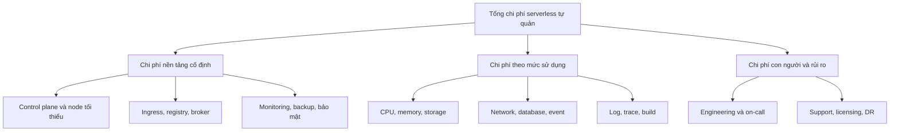

# Đánh giá chi phí vận hành serverless trên hạ tầng tự quản

Serverless trên hạ tầng tự quản cho phép nhóm triển khai function theo request, message hoặc event mà không phải quản lý từng process ứng dụng. Các nền tảng như Knative, OpenFaaS, Apache OpenWhisk hoặc Fission có thể chạy trên Kubernetes, private cloud, cụm máy chủ tại doanh nghiệp hoặc edge site. Người phát triển tập trung vào handler; nền tảng đảm nhiệm định tuyến, tạo execution instance, scale và một phần vòng đời function.

Tuy nhiên, “serverless” không có nghĩa là hạ tầng miễn phí hoặc không cần người vận hành. Khi tự quản, tổ chức phải mua hoặc thuê compute, lưu trữ, mạng, dự phòng, bảo mật và quan sát; đồng thời duy trì Kubernetes, function runtime, registry, ingress, message broker và các thành phần điều khiển. Nền tảng có thể thu phí theo function invocation, nhưng hạ tầng phía dưới thường có một phần chi phí cố định ngay cả khi không có request.

Đánh giá đúng cần nhìn vào **Total Cost of Ownership (TCO)** của toàn bộ nền tảng và workload, sau đó quy đổi thành chi phí trên một đơn vị nghiệp vụ đã hoàn tất. Không nên chỉ so sánh giá CPU hoặc số invocation, vì cold start, idle capacity, nhân lực vận hành, HA/DR, network, log và database có thể chiếm phần lớn tổng chi phí.

## 1. “Serverless tự quản” thực sự bao gồm những gì?

Trong mô hình này, người dùng vẫn triển khai function theo giao diện serverless, nhưng tổ chức sở hữu hoặc chịu trách nhiệm cho hạ tầng chạy nền tảng.

Một kiến trúc điển hình gồm:

- **Control plane:** API quản lý function, scheduler, controller, autoscaler, admission và metadata.
- **Data plane:** ingress/gateway, queue/event broker, function pods hoặc execution containers.
- **Compute layer:** Kubernetes worker nodes, VM, bare-metal server hoặc edge nodes.
- **Storage:** container registry, persistent volume, database, object storage và log storage.
- **Network:** load balancer, ingress, service mesh, DNS, firewall, VPN và kết nối giữa site.
- **Operations layer:** monitoring, logging, tracing, alerting, backup, security scanning và CI/CD.

Các nền tảng thường gặp có cách tổ chức khác nhau:

| Nền tảng | Mô hình thường dùng | Thành phần cần tính chi phí |
| --- | --- | --- |
| Knative Serving/Eventing | Serving revision, scale theo request, event broker/channel và integration với Kubernetes | Kubernetes, ingress/networking, autoscaler, broker, registry, observability và node capacity |
| OpenFaaS | Function gateway, provider, watchdog/runtime và autoscaling trên Kubernetes hoặc Docker | Gateway/provider, worker nodes, ingress, registry, queue nếu dùng async, support/subscription nếu áp dụng |
| Apache OpenWhisk | Controller, invoker, action runtime và message/storage dependencies | Controller/invoker capacity, Kafka hoặc message layer, database/storage, Kubernetes/VM và vận hành |
| Fission | Environment, router, executor và function pods trên Kubernetes | Router/executor, builder, worker nodes, registry, ingress và monitoring |
| KEDA kết hợp Kubernetes | Scale workload theo event source; bản thân KEDA không phải function runtime đầy đủ | Kubernetes, scaler/operator, message broker, function container, ingress và node capacity |

Tên thành phần và cách triển khai có thể thay đổi theo phiên bản hoặc kiến trúc. Bảng này dùng để nhận diện nhóm tài nguyên cần tính, không phải bảng giá hay khuyến nghị chọn nền tảng.

### 1.1. Phân biệt chi phí nền tảng và chi phí workload

Chi phí nền tảng là khoản cần có để hệ thống serverless tồn tại và sẵn sàng nhận function: control plane, worker node tối thiểu, ingress, registry, broker, monitoring và đội vận hành.

Chi phí workload phát sinh theo function hoặc theo mức sử dụng: CPU, memory, storage, database, message, network, log và số lần thực thi. Một số khoản nằm giữa hai nhóm. Ví dụ, worker node có thể là chi phí nền tảng khi tải thấp, nhưng trở thành chi phí workload khi phải mở rộng để xử lý peak.



Một nền tảng có thể scale function về zero nhưng không thể scale toàn bộ control plane, broker, ingress và monitoring về zero nếu vẫn cần nhận event hoặc phục vụ quản trị. Đây là lý do chi phí tối thiểu của hệ thống tự quản thường khác 0.

## 2. Khung tính Total Cost of Ownership

TCO nên tính trên cùng một chu kỳ, thường theo tháng hoặc năm, và bao gồm cả chi phí trực tiếp lẫn chi phí vận hành.

```text
TCO trong kỳ
  = compute và phần cứng
  + điện, làm mát, rack và cơ sở vật chất
  + Kubernetes và control plane
  + network, load balancer và truyền dữ liệu
  + storage, database, registry và message broker
  + logging, metrics, tracing và bảo mật
  + backup, HA, DR và capacity dự phòng
  + license, support và dịch vụ bên ngoài
  + nhân lực triển khai, vận hành và on-call
  + chi phí migration, nâng cấp và thay thế thiết bị được phân bổ
```

Không phải tổ chức nào cũng trả hóa đơn riêng cho từng mục. Nếu dùng máy chủ tại chỗ, điện và rack có thể nằm trong ngân sách data center. Nếu dùng private cloud, compute có thể được chargeback theo VM hoặc quota. Dù khoản tiền nằm ở cost center nào, nó vẫn là tài nguyên được workload tiêu thụ và nên xuất hiện trong TCO.

### 2.1. Compute và phần cứng

Các khoản cần tính:

- máy chủ worker, CPU, RAM và accelerator nếu có;
- node control plane hoặc VM quản lý;
- hypervisor, Kubernetes distribution và system node pools;
- thiết bị dự phòng, spare capacity và chu kỳ thay thế;
- chi phí thuê cloud VM nếu hạ tầng tự quản nằm trên IaaS.

Nếu mua phần cứng, phân bổ giá mua theo thời gian sử dụng thực tế, không tính toàn bộ giá mua vào một tháng. Ví dụ, máy chủ có giá mua 300 triệu đồng và dự kiến sử dụng 48 tháng có chi phí khấu hao đơn giản khoảng 6,25 triệu đồng/tháng, chưa tính bảo trì, điện, tài chính và giá trị còn lại.

Không chỉ đếm số node. Hãy tính tài nguyên usable sau khi trừ system reservation, daemon, kubelet, OS, runtime và headroom cần thiết. Một node 32 vCPU không có nghĩa workload function có thể dùng đủ 32 vCPU.

### 2.2. Điện, làm mát và cơ sở vật chất

Với hạ tầng tại chỗ, tính điện năng tiêu thụ của server, switch, storage và thiết bị mạng, cùng chi phí làm mát, rack, UPS và data center. Có thể dùng PUE để ước lượng phần điện phụ trợ:

\[
Energy_{facility} = Energy_{IT} \times PUE
\]

PUE càng cao thì lượng điện toàn cơ sở càng lớn so với điện cấp trực tiếp cho thiết bị IT. Nên lấy số đo từ data center hoặc nhà cung cấp, không mặc định một hệ số cho mọi site.

Ở edge site, chi phí điện và vận hành tại nhiều địa điểm có thể cao hơn dự tính do thiết bị nhỏ, điều kiện nhiệt, nguồn điện dự phòng và nhân lực hỗ trợ phân tán.

### 2.3. Kubernetes và control plane

Tự quản Kubernetes có thể không có dòng phí license trực tiếp, nhưng vẫn có chi phí:

- control plane nodes hoặc managed control plane fee;
- etcd backup, quorum và nâng cấp;
- cluster networking, CNI, CSI và ingress controller;
- autoscaler, KEDA, Knative/OpenFaaS/Fission controllers;
- certificate management, policy engine và secrets integration;
- upgrade, compatibility testing và xử lý sự cố.

Nếu dùng Kubernetes managed service, cần tính phí control plane, node pool, load balancer, NAT, persistent disk và các dịch vụ phụ trợ theo bảng giá của nhà cung cấp. Nếu tự dựng control plane, phần phí dịch vụ có thể giảm nhưng trách nhiệm vận hành và nhân lực tăng.

### 2.4. Network và truyền dữ liệu

Chi phí mạng có thể bao gồm:

- load balancer, ingress và egress gateway;
- NAT gateway hoặc firewall;
- cross-zone/cross-region traffic;
- VPN, leased line, Internet transit và inter-site connectivity;
- service mesh sidecar hoặc gateway overhead;
- traffic đến database, object storage, registry và external APIs.

Một function nhỏ có thể tạo nhiều request đến dịch vụ bên ngoài. Nếu function chạy ở nhiều edge site, traffic quay về trung tâm hoặc cross-region có thể lớn hơn chi phí CPU. Hãy đo byte in/out theo workload và đường đi thực tế.

### 2.5. Storage, database và message broker

Đừng chỉ tính dung lượng lưu trữ. Tính cả IOPS, throughput, replication, backup, retention, snapshot và chi phí vận hành. Với message broker, tính node/volume, replication factor, partition, retention và network traffic. Với database, tính connection capacity, read/write, backup, failover và license nếu có.

Một nền tảng function có thể miễn phí nhưng mỗi function lại tạo ra tải database hoặc queue đáng kể. Khi so sánh, phải tính chi phí dependency ở cùng phạm vi workload.

### 2.6. Observability và bảo mật

Logging, metrics, tracing và audit thường có chi phí theo ingest volume, retention, cardinality, storage và query. Trace sampling không phù hợp có thể tạo dữ liệu lớn hơn cả log ứng dụng. Metric label chứa `requestId`, `userId` hoặc event ID có cardinality rất cao và làm tăng chi phí hệ thống monitoring.

Bảo mật còn bao gồm image scanning, vulnerability management, secrets manager, certificate lifecycle, policy engine, audit archive và penetration testing. Không bỏ các khoản này khỏi TCO chỉ vì chúng được cung cấp bởi một nền tảng dùng chung.

## 3. Chi phí cố định, chi phí biến đổi và idle capacity

### 3.1. Chi phí cố định

Chi phí cố định là phần cần duy trì để nền tảng hoạt động dù workload thấp:

- control plane và node tối thiểu;
- ingress/router và DNS;
- broker hoặc event bus cần luôn sẵn sàng;
- registry và artifact storage;
- monitoring, logging collector và security agents;
- license/support hoặc nhân lực on-call.

Nếu function scale về zero nhưng queue broker, controller và ingress vẫn chạy, hóa đơn compute nền tảng vẫn tồn tại.

### 3.2. Chi phí biến đổi

Chi phí biến đổi tăng theo workload:

- số function instance và thời gian chạy;
- CPU/memory consumed;
- network bytes và request;
- số message/event, partition hoặc storage operations;
- database connections và query load;
- log/trace volume.

Một số chi phí có dạng bậc thang. Ví dụ, khi vượt capacity của 3 worker node, autoscaler phải thêm node thứ 4; chi phí tăng theo một bước thay vì tăng tuyến tính từng request.

### 3.3. Idle capacity

Idle capacity là tài nguyên đã được trả tiền hoặc đã mua nhưng chưa được workload sử dụng. Trong nền tảng tự quản, idle capacity có thể xuất hiện vì:

- phải giữ node dự phòng cho peak;
- node chạy control plane/system workload;
- autoscaler cần thời gian thêm node;
- workload có memory request lớn nhưng CPU sử dụng thấp;
- function được giữ warm để giảm cold start;
- nhiều cluster hoặc edge site có tải không đồng đều.

Một node có CPU utilization trung bình 15% vẫn có thể không scale down được nếu memory request của pod đã chiếm gần hết allocatable memory. Tương tự, một node rảnh CPU nhưng có pod hệ thống hoặc local persistent volume không thể di chuyển có thể vẫn phải duy trì.

### 3.4. Scale-to-zero không làm toàn hệ thống về zero

Scale-to-zero thường áp dụng cho workload function hoặc revision khi không có request trong một khoảng thời gian. Nó không nhất thiết áp dụng cho:

- control plane;
- broker/queue cần nhận event;
- ingress cần nhận HTTP request;
- autoscaler và event source adapter;
- monitoring/agent;
- node pool tối thiểu.

Khi function scale từ zero lên, cần thời gian khởi động container, JVM, framework và kết nối dependency. Nếu SLA yêu cầu phản hồi nhanh, nhóm có thể giữ warm replica hoặc provisioned capacity, làm tăng chi phí idle.

### 3.5. Utilization và bin packing

Bin packing đặt nhiều workload lên ít node hơn để tăng tỷ lệ sử dụng. Nhưng target utilization quá cao làm giảm headroom cho burst, rolling update, node failure và pod rescheduling.

Hãy tính utilization riêng cho CPU, memory, storage và network. Ví dụ, CPU 70% nhưng memory 92% có thể khiến cluster không còn chỗ schedule pod mới. Tài nguyên bottleneck quyết định khả năng scale, không phải metric có vẻ thuận lợi nhất.

## 4. Ước lượng capacity trước khi tính tiền

Chi phí compute chỉ có ý nghĩa khi capacity đủ đáp ứng tải và mức sẵn sàng. Bắt đầu từ workload profile:

- request/event rate trung bình, p95 và peak;
- thời gian xử lý mỗi invocation;
- CPU-seconds và memory footprint;
- concurrency mục tiêu;
- batch size và backlog tolerance;
- tỷ lệ function cần warm;
- tỷ lệ lỗi/retry và thời gian chờ dependency.

### 4.1. Ước lượng concurrency

Một ước lượng đơn giản theo Little’s Law:

\[
Concurrency \approx ArrivalRate \times AverageDuration
\]

Nếu hệ thống nhận 200 request/giây và thời gian xử lý trung bình là 0,25 giây, concurrency trung bình xấp xỉ 50. Đây chỉ là giá trị trung bình; cần thêm headroom cho burst, tail latency, retry và phân bố tải.

### 4.2. Ước lượng số pod/function instance

Nếu mỗi pod được phép xử lý `c` request đồng thời và tổng concurrency mục tiêu là `C`, số pod sơ bộ:

\[
Pods \approx \left\lceil \frac{C}{c} \right\rceil
\]

Số pod thực tế còn phụ thuộc CPU, memory, giới hạn thread, connection pool, request queue trong process và latency dependency. Không đặt concurrency per pod quá cao nếu Java handler tạo thread hoặc connection theo request.

### 4.3. Ước lượng số node

Một công thức sàng lọc:

\[
Nodes \approx \left\lceil \frac{Demand + Headroom}{UsableCapacityPerNode} \right\rceil
\]

`UsableCapacityPerNode` phải là tài nguyên sau khi trừ system reservation và các pod nền tảng. `Headroom` cần tính thêm N+1, rolling update, node drain, peak burst và tải không đồng đều giữa zone/site.

Đây là ước lượng đầu tiên, không thay thế bin packing simulation hoặc load test. Một node có đủ tổng CPU và RAM vẫn có thể không schedule được pod nếu từng pod yêu cầu resource lớn, affinity/anti-affinity hạn chế hoặc volume không thể di chuyển.

### 4.4. Capacity cho HA

Nếu cluster cần chịu được mất một node, phải có đủ capacity để đặt lại workload sau khi node đó mất. Với ba zone, cần kiểm tra tình huống một zone không sẵn sàng và traffic dồn sang hai zone còn lại. N+1 làm tăng chi phí idle nhưng giảm nguy cơ quá tải khi có sự cố.

Với edge, cần quyết định site nào phải hoạt động độc lập. Dự phòng toàn bộ capacity tại mọi site có thể đắt; một số workload có thể degrade hoặc chuyển về region trung tâm khi edge site mất kết nối.

## 5. Công thức phân bổ chi phí

### 5.1. TCO và unit economics

Chi phí trên một invocation thành công:

\[
CostPerSuccess = \frac{TCO_{period}}{SuccessfulInvocations_{period}}
\]

Chỉ số này hữu ích khi các invocation tương đối đồng nhất. Nếu một function xử lý ảnh 20 MB còn function khác chỉ xác thực token, hãy phân bổ theo resource usage hoặc đơn vị nghiệp vụ thay vì chia đều tổng chi phí.

Một chỉ số tốt hơn cho nhiều workload có thể là:

\[
CostPerBusinessUnit = \frac{AllocatedTCO}{CompletedBusinessUnits}
\]

Ví dụ business unit có thể là đơn hàng hoàn tất, ảnh được xử lý, báo cáo được tạo hoặc message được xử lý thành công.

### 5.2. Phân bổ shared platform cost

Control plane, ingress và monitoring phục vụ nhiều team. Cần quy tắc phân bổ nhất quán, chẳng hạn:

- theo CPU/memory request hoặc usage;
- theo số invocation có trọng số theo duration/memory;
- theo network bytes hoặc log ingest;
- theo số function/revision/tenant;
- theo quota capacity đã giữ trước;
- kết hợp một phần fixed allocation và một phần usage-based allocation.

Không nên chia đều cho tất cả function nếu mức sử dụng khác nhau quá lớn. Nhưng cũng không nên chargeback chỉ theo CPU nếu workload gây chi phí chủ yếu ở network, storage hoặc observability.

### 5.3. Ví dụ phân bổ theo resource

Giả sử trong một tháng:

| Hạng mục | Chi phí giả định |
| --- | ---: |
| Compute worker và khấu hao | 36 triệu đồng |
| Điện, rack và làm mát | 8 triệu đồng |
| Network và load balancing | 7 triệu đồng |
| Storage, registry và broker | 9 triệu đồng |
| Logging, metrics và tracing | 6 triệu đồng |
| License/support và bảo mật | 8 triệu đồng |
| Nhân lực vận hành phân bổ | 24 triệu đồng |
| Backup, DR và capacity dự phòng | 7 triệu đồng |
| **Tổng TCO** | **105 triệu đồng/tháng** |

Đây là số giả định để minh họa cách tính, không phải giá thị trường hay báo giá của nhà cung cấp. Nếu tháng đó có 10 triệu business invocation hoàn tất và toàn bộ TCO được phân bổ cho workload này, chi phí bình quân là:

\[
105.000.000 / 10.000.000 = 10,5\text{ đồng/đơn vị}
\]

Nếu chỉ có 2 triệu invocation, chi phí bình quân tăng lên 52,5 đồng/đơn vị dù tổng chi phí gần như không đổi. Nếu tăng lên 30 triệu invocation mà không cần thêm node hoặc nhân lực, chi phí bình quân giảm còn 3,5 đồng/đơn vị. Khi vượt capacity và phải mua thêm node, chi phí sẽ tăng theo bậc.

Điều này cho thấy utilization và volume ảnh hưởng lớn đến unit economics. Không nên dùng chi phí trên invocation để kết luận workload rẻ hay đắt nếu chưa kiểm tra kích thước payload, thời gian chạy và mức độ hoàn thành nghiệp vụ.

## 6. So sánh tự quản với serverless managed service

Managed FaaS như AWS Lambda, Google Cloud Functions/Cloud Run functions hoặc Azure Functions chuyển phần lớn trách nhiệm hạ tầng và capacity management cho nhà cung cấp. Mô hình tính phí thường dựa trên invocation, thời gian chạy, tài nguyên, request hoặc các dịch vụ phụ trợ theo từng sản phẩm.

Hạ tầng tự quản thường có chi phí cố định lớn hơn nhưng có thể giảm chi phí biên khi utilization cao và workload ổn định. Managed service có thể có chi phí biến đổi cao hơn ở tải lớn nhưng giảm nhu cầu vận hành control plane và worker fleet.

| Tiêu chí | Serverless managed | Serverless tự quản |
| --- | --- | --- |
| Chi phí ban đầu | Thường thấp, ít phải mua hạ tầng | Có thể cao do cluster, network, storage và triển khai nền tảng |
| Chi phí khi tải thấp | Có thể thấp nếu tính phí theo usage và scale-to-zero | Vẫn có baseline control plane, broker, node và on-call |
| Chi phí khi tải cao ổn định | Có thể tăng theo invocation/resource usage | Có thể hiệu quả nếu node utilization cao và capacity được lập kế hoạch tốt |
| Nhân lực vận hành | Ít trách nhiệm quản lý runtime/worker fleet hơn | Cần đội vận hành Kubernetes, runtime, network, security và upgrade |
| Kiểm soát hạ tầng | Phụ thuộc giới hạn và dịch vụ của provider | Kiểm soát sâu hơn runtime, placement, network và data locality |
| Portability | Có nguy cơ phụ thuộc API/dịch vụ riêng của provider | Có thể tăng portability, nhưng vẫn có lock-in ở storage/network/identity/runtime |
| Edge/on-premises | Tùy khả năng hỗ trợ và kết nối provider | Có thể chạy tại site riêng hoặc mạng cô lập |
| HA/DR | Nhiều khả năng được cung cấp như dịch vụ, vẫn cần cấu hình | Tổ chức tự thiết kế, thử nghiệm và chịu trách nhiệm |
| Chi phí ẩn | Egress, log, database, API gateway và vendor-specific services | Idle capacity, support, labor, spare hardware, backup và upgrade |

Không có mô hình rẻ hơn trong mọi trường hợp. Cần so sánh cùng một workload, cùng SLA, cùng vùng dữ liệu, cùng mức HA và cùng phạm vi chi phí nhân lực.

### 6.1. Công thức break-even đơn giản

Giả sử:

- `F_s`: chi phí cố định hàng tháng của nền tảng tự quản;
- `v_s`: chi phí biến đổi cho mỗi đơn vị workload của nền tảng tự quản;
- `F_m`: chi phí cố định hàng tháng của managed service;
- `v_m`: chi phí biến đổi cho mỗi đơn vị workload của managed service;
- `W`: số đơn vị workload trong tháng.

Khi đó:

\[
Cost_{self} = F_s + v_s W
\]

\[
Cost_{managed} = F_m + v_m W
\]

Nếu `F_s > F_m` nhưng `v_s < v_m`, điểm hòa vốn đơn giản là:

\[
W_{break-even} = \frac{F_s - F_m}{v_m - v_s}
\]

Ví dụ giả định: tự quản có fixed cost 100 triệu đồng/tháng và variable cost 1 đồng/unit; managed có fixed cost 10 triệu đồng/tháng và variable cost 5 đồng/unit. Điểm hòa vốn:

\[
W = \frac{100.000.000 - 10.000.000}{5 - 1}
  = 22.500.000\text{ units/tháng}
\]

Trên mức này, mô hình tự quản có thể rẻ hơn theo giả định đã đặt. Dưới mức này, managed có thể rẻ hơn. Ví dụ chưa tính step cost khi phải mua thêm node, biến động tải, chi phí nhân lực tăng theo quy mô, SLA, egress và chi phí migration; vì vậy chỉ dùng để sàng lọc.

### 6.2. So sánh phải tính cả chi phí con người

Một nền tảng tự quản có thể giảm hóa đơn cloud nhưng cần nhiều kỹ sư hơn. Nếu đội platform phải trực on-call, vá bảo mật, nâng cấp Kubernetes, sửa autoscaler, vận hành broker và xử lý capacity, chi phí nhân lực là một phần thực của TCO.

Ngược lại, managed service không loại bỏ mọi công việc. Nhóm vẫn phải quản lý IAM, event contract, retry, idempotency, database, observability, deployment và cost monitoring. Hãy chỉ ghi nhận phần công việc thực sự được chuyển cho nhà cung cấp.

## 7. Những yếu tố làm thay đổi chi phí trong thực tế

### 7.1. Cold start và warm capacity

Scale-to-zero giảm tài nguyên idle nhưng tạo cold start khi có request đầu tiên. Với Java, cold start có thể gồm:

- khởi động container/JVM;
- class loading và framework bootstrap;
- tạo dependency injection context;
- tạo HTTP/database client;
- tải cấu hình và secret;
- kết nối database hoặc message broker.

Giữ warm replica hoặc minimum scale giúp giảm latency nhưng làm tăng compute idle. Hãy đo p50/p95/p99 cold start và tần suất request trước khi chọn minimum replica. Nếu workload chỉ chạy vài lần mỗi ngày và chấp nhận latency vài giây, scale-to-zero có thể tiết kiệm hơn. Nếu API yêu cầu latency thấp liên tục, warm capacity có thể cần thiết.

### 7.2. JVM memory và concurrency

Java process có memory baseline đáng kể so với một số runtime nhẹ. Nếu mỗi function instance yêu cầu memory lớn, cluster có thể bị giới hạn bởi RAM trước CPU. Đo heap, metaspace, direct buffer, thread stack và native memory.

Tăng concurrency trên mỗi pod có thể tăng throughput nhưng cũng tăng thread, connection và memory. Giảm số pod không chắc giảm tổng chi phí nếu pod phải cấp nhiều tài nguyên hơn hoặc gây tail latency cao.

Native image hoặc AOT compilation có thể giảm startup time và memory trong một số ứng dụng, nhưng tăng build complexity, compatibility constraints và chi phí bảo trì. Cần benchmark toàn vòng đời thay vì chỉ đo startup.

### 7.3. Autoscaling và node provisioning

Autoscaler cần tín hiệu đủ sớm để thêm pod hoặc node. Nếu node provisioning mất vài phút, queue backlog có thể tăng trong lúc chờ. Giữ spare node giảm latency scale-out nhưng tạo idle cost.

KEDA có thể scale workload theo queue depth hoặc event lag; Knative có thể scale serving revision theo request/concurrency. Tuy nhiên, scale function không đồng nghĩa node mới xuất hiện tức thì. Cần phối hợp application autoscaler với cluster autoscaler và giới hạn cloud/on-prem capacity.

### 7.4. Queue backlog và retry storm

Queue giúp tách tốc độ nhận event khỏi tốc độ xử lý, nhưng backlog làm tăng thời gian hoàn thành và có thể kéo dài thời gian function/worker phải chạy. Retry không có backoff hoặc poison message có thể làm tăng invocation, log và database load.

Đưa retry, DLQ, idempotency và backpressure vào mô hình chi phí. Một message được thử lại 8 lần tiêu thụ nhiều tài nguyên hơn một message thành công ngay lần đầu. Theo dõi cost per successful event thay vì cost per delivery.

### 7.5. Database và connection pool

Nếu mỗi pod Java giữ pool 10 kết nối, 100 pod có thể tạo 1.000 connection. Database có thể phải tăng instance size hoặc thêm proxy/pooler. Chi phí database và vận hành connection thường lớn hơn chi phí function compute.

Đặt giới hạn concurrency theo database capacity, giữ transaction ngắn, dùng pool nhỏ, cân nhắc RDS Proxy/connection pooler hoặc managed database proxy tương ứng. Đừng để autoscaler khuếch đại tải vượt khả năng dependency.

### 7.6. Observability cardinality và retention

Một function có thể tạo hàng triệu log entry. Log debug trong vòng lặp, stack trace cho lỗi nghiệp vụ dự kiến hoặc trace 100% traffic có thể làm chi phí ingest và storage tăng nhanh.

Đặt log level phù hợp, sample trace theo tỷ lệ, giữ audit log theo yêu cầu, tách operational log và business event, giới hạn metric label cardinality. Không bỏ qua dữ liệu cần cho điều tra và compliance; tối ưu bằng retention, sampling và cấu trúc dữ liệu.

## 8. Tính chi phí cho edge và nhiều site

Edge platform có thể chạy function tại nhà máy, cửa hàng, trạm viễn thông hoặc thiết bị gateway. Chi phí cần tính thêm:

- thiết bị compute nhỏ tại mỗi site;
- nguồn điện, UPS, tủ rack và điều kiện nhiệt;
- kết nối WAN, VPN hoặc đường truyền riêng;
- nhân lực onsite, thay thiết bị và bảo trì từ xa;
- đồng bộ image, secret, cấu hình và event khi mất kết nối;
- local storage, replication và retention;
- capacity dự phòng cho site bị cô lập;
- bảo mật vật lý và quản lý thiết bị.

### 8.1. Locality có thể giảm network cost

Chạy function gần nguồn dữ liệu có thể giảm bandwidth về region trung tâm, latency và chi phí truyền dữ liệu. Ví dụ, function lọc telemetry tại nhà máy chỉ gửi aggregate thay vì gửi mọi sensor event lên cloud.

Nhưng locality có thể làm tăng số cluster nhỏ, chi phí quản trị, phân phối image và hỗ trợ nhiều phiên bản. Hãy so sánh tổng chi phí của xử lý tại edge với truyền toàn bộ dữ liệu về region, gồm cả vận hành site.

### 8.2. Mất kết nối và vận hành offline

Nếu edge site có thể mất WAN, cần xác định function nào tiếp tục chạy cục bộ, queue nào lưu event, giới hạn disk và cách đồng bộ sau khi kết nối trở lại. Local queue/storage làm tăng chi phí nhưng có thể cần thiết cho tính liên tục của nghiệp vụ.

Khi site hoạt động độc lập, cần xử lý duplicate event, clock skew, version drift và conflict khi đồng bộ. Chi phí phục hồi dữ liệu và vận hành sau offline phải được đưa vào TCO.

### 8.3. Một cluster lớn hay nhiều cluster nhỏ?

Một cluster trung tâm lớn có thể tăng utilization và giảm số control plane, nhưng traffic và latency đến edge tăng. Nhiều cluster nhỏ cải thiện locality và cô lập lỗi nhưng nhân bản control plane, monitoring, upgrade và spare capacity.

Không quyết định chỉ theo giá node. So sánh:

- tổng capacity usable;
- số control plane và system node;
- network transit;
- mức dự phòng;
- nhân lực vận hành trên mỗi site;
- yêu cầu data residency và offline operation.

## 9. Chargeback, showback và cost allocation

Một nền tảng dùng chung cần giúp team hiểu workload nào đang tiêu thụ tài nguyên. **Showback** báo cáo chi phí theo team mà chưa thu tiền nội bộ; **chargeback** phân bổ chi phí vào ngân sách của team.

### 9.1. Gắn nhãn workload

Mỗi function/revision nên có metadata:

- team hoặc cost center;
- service/application;
- environment;
- owner;
- business capability;
- criticality/SLA;
- data classification.

Label cần ổn định và có quy tắc. Tránh dùng user ID, request ID hoặc event ID làm label metric vì cardinality rất cao.

### 9.2. Phân bổ resource usage

Có thể thu thập CPU time, memory request/usage, pod-seconds, network bytes, storage, log ingest và invocation duration. Sau đó phân bổ chi phí node, network, storage và platform theo tỷ trọng usage hoặc quota reserved.

Ví dụ, team A dùng 40% CPU-seconds và 30% memory-seconds; team B dùng 60% CPU-seconds và 70% memory-seconds. Nếu chi phí compute được phân bổ theo trung bình có trọng số CPU/memory, cần công bố trọng số để tránh tranh cãi. Một số workload memory-bound hoặc network-heavy cần cost model riêng.

### 9.3. Phân bổ idle và reserved capacity

Idle capacity không nên biến mất khỏi báo cáo. Có thể phân bổ theo quota mà team yêu cầu giữ sẵn, mức peak reservation hoặc tỷ lệ usage cộng một phần shared overhead. Cách này khuyến khích team khai báo request/limit sát thực tế và không giữ warm replica không cần thiết.

Nếu platform team chịu toàn bộ idle cost, các team có thể yêu cầu capacity dư thừa mà không thấy tác động ngân sách. Showback giúp làm rõ chi phí của lựa chọn latency/availability.

## 10. Tối ưu chi phí có kiểm soát

### 10.1. Tối ưu request/limit và bin packing

Đo resource usage thực tế rồi điều chỉnh CPU/memory requests. Request quá lớn gây fragmentation và giữ node không cần thiết; request quá thấp gây throttling/OOM và tăng retry. Đặt limit phù hợp với runtime và đặc tính burst của workload.

Không tối ưu utilization đến mức không còn headroom cho N+1, rolling deploy hoặc burst. Một cluster chạy 95% CPU liên tục có thể rẻ trên dashboard nhưng đắt khi latency tăng và sự cố xảy ra.

### 10.2. Chọn scale-to-zero hoặc minimum replica

Nhóm workload có thể phân loại:

| Loại workload | Chính sách gợi ý để đánh giá |
| --- | --- |
| Job theo lịch, chạy vài lần/ngày | Cân nhắc scale-to-zero và chấp nhận cold start |
| HTTP API có SLA latency thấp | Cân nhắc warm replica cho baseline traffic |
| Queue worker có backlog | Scale theo queue depth/age và đặt min/max worker |
| Event processor không cần phản hồi ngay | Cho phép scale-to-zero nếu broker và event delivery vẫn hoạt động |
| Edge function cần phản hồi offline | Giữ runtime tối thiểu tại site nếu yêu cầu nghiệp vụ bắt buộc |

Chính sách cần dựa trên số đo latency và workload, không chỉ dựa trên loại trigger.

### 10.3. Tối ưu Java runtime

- giảm dependency và classpath scanning;
- tái sử dụng client thread-safe;
- trì hoãn khởi tạo thành phần không cần cho request đầu;
- tối ưu heap và thread count;
- chọn concurrency phù hợp với CPU/memory;
- benchmark JVM flags và garbage collector;
- cân nhắc native image/AOT sau khi kiểm tra compatibility.

Đo CPU-seconds, memory-seconds, startup latency và error rate. Một bản build nhanh hơn nhưng sử dụng CPU cao hơn có thể không tiết kiệm tổng chi phí.

### 10.4. Tối ưu event và retry

- batch event nếu payload và latency cho phép;
- đặt concurrency theo downstream capacity;
- dùng backoff và jitter;
- phân loại lỗi permanent/transient;
- dùng idempotency để tránh xử lý lặp;
- chuyển poison message sang DLQ;
- đặt retention và redrive policy rõ ràng.

Giảm retry không có nghĩa là bỏ qua lỗi. Cần giữ đủ thông tin để điều tra và replay an toàn.

### 10.5. Tối ưu network và data locality

Đặt function gần database/event source nếu phù hợp, tránh cross-zone hoặc cross-region traffic không cần thiết, giảm payload, nén dữ liệu khi có lợi và dùng endpoint nội bộ phù hợp. Với edge, aggregate/filter dữ liệu tại site nếu không cần gửi raw event về trung tâm.

### 10.6. Tối ưu observability

Đặt retention theo mục đích, sample trace, giảm log debug, tránh high-cardinality labels và dùng metric tổng hợp. Bảo đảm audit/security log vẫn đáp ứng yêu cầu điều tra và tuân thủ.

## 11. Quy trình lập mô hình chi phí

Có thể dùng quy trình sau trước khi quyết định tự quản hay managed:

1. **Định nghĩa workload:** số request/event, payload size, duration, memory, CPU, concurrency và SLA.
2. **Chọn kiến trúc tham chiếu:** số cluster/site, node type, control plane, broker, ingress, registry và observability.
3. **Tính capacity usable:** trừ system reservation, tính N+1, rolling update và peak headroom.
4. **Ước lượng utilization:** tải trung bình, peak, idle, scale-to-zero và warm capacity.
5. **Tính hạ tầng:** compute, power, network, storage, database, backup và DR.
6. **Tính platform:** Kubernetes, runtime, autoscaler, broker, gateway, monitoring, security và support.
7. **Tính nhân lực:** build, upgrade, on-call, incident response, capacity planning và compliance.
8. **Tính chi phí theo đơn vị nghiệp vụ:** successful invocation, event hoàn tất, đơn hàng hoặc dữ liệu xử lý.
9. **So sánh managed service:** dùng cùng traffic, SLA, HA, retention, region và chi phí nhân lực.
10. **Chạy pilot/load test:** đo cold start, utilization, queue lag, database pressure, network và chi phí thật.
11. **Phân tích sensitivity:** thay đổi traffic, node price, labor, utilization, log volume và tỷ lệ retry.
12. **Đặt ngưỡng quyết định:** break-even, mức utilization tối thiểu, SLA và điều kiện chuyển kiến trúc.

### 11.1. Kịch bản sensitivity

Ít nhất nên mô hình hóa:

- **Low traffic:** phần lớn thời gian idle, scale-to-zero, chi phí fixed chiếm ưu thế.
- **Expected traffic:** tải trung bình dự kiến, node utilization và nhân lực bình thường.
- **Peak traffic:** burst, concurrency cao, autoscaler và downstream pressure.
- **Failure scenario:** mất một node/zone/site, retry tăng, backlog và capacity dự phòng.
- **Growth scenario:** số team/function tăng, log retention và support workload tăng.

Không chỉ thay đổi số invocation. Hãy thay cả duration, memory, payload, retry ratio và thời gian giữ warm instance. Một workload có cùng invocation count nhưng thời lượng tăng gấp 3 sẽ có profile compute khác.

## 12. Ví dụ quyết định: nền tảng function cho hệ thống nhà máy

Một doanh nghiệp có 8 nhà máy, mỗi site phát sinh telemetry và event từ thiết bị. Có hai lựa chọn:

- **Phương án A:** gửi toàn bộ event về managed cloud rồi xử lý bằng managed serverless.
- **Phương án B:** chạy function platform trên Kubernetes tại từng site, lọc/aggregate event cục bộ và đồng bộ kết quả về trung tâm.

### 12.1. Các yếu tố cần đo

| Yếu tố | Managed cloud | Tự quản tại edge |
| --- | --- | --- |
| Compute | Phí theo usage và dịch vụ phụ trợ | Thiết bị/site, khấu hao, điện, spare node |
| Network | WAN upload và egress | Đồng bộ aggregate, VPN/leased line và quản trị site |
| Availability | Phụ thuộc cloud region và WAN | Có thể xử lý cục bộ khi WAN gián đoạn |
| Operations | Ít quản lý cluster tại site | Cần cập nhật, giám sát và hỗ trợ 8 site |
| Data locality | Dữ liệu chuyển về cloud | Raw telemetry có thể ở lại site |
| Idle capacity | Có thể scale theo request | Mỗi site cần một baseline runtime/control plane hoặc gateway |

### 12.2. Cách ra quyết định

Nếu WAN ổn định, dữ liệu nhỏ và traffic thấp, managed cloud có thể có TCO thấp hơn vì không cần duy trì cluster ở 8 site. Nếu WAN đắt hoặc không ổn định, raw telemetry lớn và xử lý cục bộ giúp giảm network cost và giữ hoạt động offline; edge self-managed có thể đáng giá dù compute/site cao hơn.

Một phương án kết hợp cũng có thể phù hợp: edge chỉ chạy function lọc/aggregate và queue cục bộ; các workload cần nhiều tài nguyên hoặc báo cáo dài chạy ở managed cloud. Cần tính chi phí đồng bộ, quản trị phiên bản và vận hành cả hai môi trường.

Không nên kết luận “edge rẻ hơn vì giảm bandwidth” nếu chưa tính nhân lực onsite, thiết bị dự phòng, upgrade và thời gian xử lý sự cố tại từng nhà máy.

## 13. Những sai lầm khi đánh giá chi phí

| Sai lầm | Vì sao kết luận sai | Cách khắc phục |
| --- | --- | --- |
| Chỉ tính CPU/RAM của function | Bỏ qua control plane, ingress, broker, log, network và labor | Tính TCO toàn platform và dependency |
| Cho rằng scale-to-zero làm chi phí bằng 0 | System services và baseline nodes vẫn chạy | Tách fixed platform cost khỏi function usage |
| Dùng peak capacity cho cả tháng | Đánh giá quá cao chi phí nếu peak hiếm và không cần giữ toàn bộ warm | Mô hình hóa autoscaling, queue và headroom theo SLA |
| Dùng average utilization duy nhất | Che giấu memory bottleneck, burst và failure capacity | Theo dõi CPU, memory, network và storage theo percentile |
| Bỏ qua nhân lực vận hành | Hạ thấp TCO của nền tảng tự quản | Phân bổ engineering/on-call/upgrade/incident effort |
| Không tính retry | Cost per delivery thấp giả tạo, cost per success cao hơn | Tính retry attempts và business completion |
| Bỏ qua database | Function compute rẻ nhưng database quá tải/đắt | Tính dependency và connection budget |
| Bỏ qua observability | Log/trace ingest có thể tăng nhanh | Tính volume, retention, sampling và cardinality |
| So sánh không cùng SLA | Mô hình rẻ hơn có thể không đáp ứng availability/latency | So sánh cùng SLA, HA/DR và data locality |
| Không tính vòng đời phần cứng | Bỏ sót thay thế, spare và khấu hao | Phân bổ chi phí theo thời gian sử dụng |

## 14. Checklist đánh giá trước khi tự quản serverless

- [ ] Có workload profile gồm arrival rate, duration, memory, CPU, payload và concurrency.
- [ ] Đã xác định rõ phần nào scale-to-zero và phần nào phải luôn chạy.
- [ ] Đã tính control plane, ingress, broker, registry và system nodes.
- [ ] Capacity usable đã trừ system reservation và tính headroom N+1.
- [ ] Đã tính khấu hao phần cứng, điện, làm mát, rack và spare capacity nếu có.
- [ ] Đã tính network, cross-zone/region, NAT, VPN và edge connectivity.
- [ ] Đã tính database, object storage, message broker, backup và retention.
- [ ] Đã tính log, metric, trace, audit và security scanning.
- [ ] Đã tính nhân lực build, upgrade, on-call và incident response.
- [ ] Đã đánh giá license, support và phụ thuộc nhà cung cấp.
- [ ] Đã tính cold start, warm replicas và chi phí idle capacity.
- [ ] Đã giới hạn concurrency theo downstream capacity.
- [ ] Đã tính retry, DLQ, redrive và cost per successful business unit.
- [ ] Có showback/chargeback cho workload và shared platform cost.
- [ ] So sánh với managed service trên cùng workload, SLA và phạm vi chi phí.
- [ ] Có sensitivity analysis cho low/expected/peak/failure/growth scenarios.
- [ ] Đã load test/pilot và đối chiếu mô hình với số đo thực tế.
- [ ] Có ngưỡng break-even và tiêu chí chuyển sang managed/hybrid khi cần.

## Kết luận

Serverless tự quản có thể mang lại quyền kiểm soát runtime, dữ liệu, mạng và khả năng chạy ở on-premises hoặc edge. Đổi lại, tổ chức phải chịu trách nhiệm cho compute, control plane, node headroom, broker, ingress, storage, observability, bảo mật, HA/DR và nhân lực vận hành. Scale-to-zero ở function không xóa chi phí nền tảng tối thiểu.

Quyết định kinh tế cần dựa trên TCO toàn hệ thống và cost per successful business unit. Workload tải thấp, không đều và cần ít tùy chỉnh thường có lợi khi dùng managed service. Workload tải cao, ổn định, có yêu cầu data locality hoặc cần chạy trong mạng riêng có thể phù hợp với nền tảng tự quản nếu utilization đủ cao và tổ chức có năng lực vận hành. Nhiều hệ thống sẽ chọn mô hình hybrid để đặt từng workload ở nơi có tổng chi phí và mức kiểm soát phù hợp.

Hãy lập mô hình theo low/expected/peak/failure scenarios, tính cả idle capacity và con người, sau đó kiểm chứng bằng pilot/load test. Chi phí thực tế chỉ rõ khi đo toàn bộ đường đi từ trigger đến business completion, bao gồm retry, dependency, network và vận hành nền tảng.
