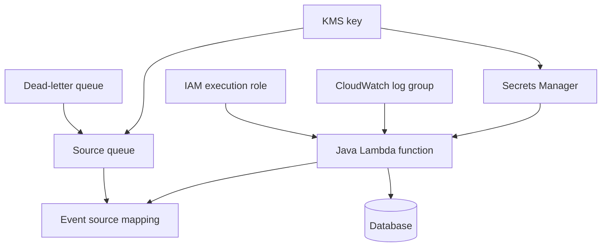
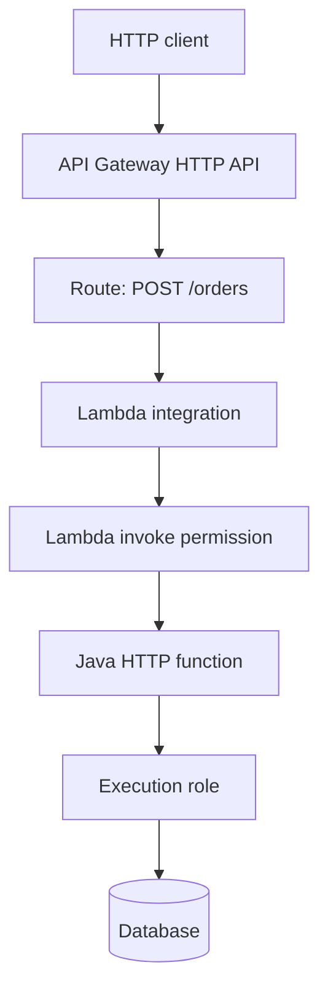

# Mô hình hóa function, trigger, quyền và tài nguyên phụ thuộc

Trong ứng dụng serverless, một function hiếm khi đứng riêng lẻ. Nó cần runtime và gói triển khai, một hoặc nhiều trigger, danh tính thực thi, quyền truy cập, cấu hình, log, queue hoặc storage và các dịch vụ nghiệp vụ phía sau. Nếu tạo những thành phần này thủ công qua console, cấu hình giữa môi trường dễ lệch nhau, quyền có thể rộng hơn cần thiết và việc tái tạo hệ thống sau sự cố trở nên khó khăn.

Infrastructure as Code (IaC) mô tả hạ tầng bằng các file có thể lưu trong version control, review, kiểm thử và triển khai lặp lại. Với Java serverless, IaC giúp thể hiện rõ function được chạy bằng runtime nào, nhận event từ đâu, được phép truy cập tài nguyên nào và phụ thuộc vào những thành phần nào. Bản mô tả đó trở thành một phần của thiết kế hệ thống, không chỉ là tập lệnh triển khai.

Bài học này tập trung vào cách mô hình hóa function, trigger, quyền và tài nguyên phụ thuộc; minh họa bằng Terraform cho một Java Lambda được kích hoạt từ SQS; đồng thời trình bày các nguyên tắc có thể áp dụng với AWS SAM/CloudFormation, Azure Bicep/ARM và Google Cloud Terraform.

## 1. IaC mô tả trạng thái mong muốn của hệ thống

Thay vì ghi một chuỗi thao tác console như “tạo queue, tạo role, upload JAR, cấu hình trigger”, IaC mô tả trạng thái cuối cùng cần có. Công cụ IaC so sánh mô tả đó với trạng thái hiện tại rồi đề xuất hoặc thực hiện các thay đổi cần thiết.

Ví dụ, một mô hình serverless có thể khai báo:

- Một Java function với runtime, handler, artifact, memory, timeout và concurrency cụ thể.
- Một SQS queue nhận công việc và một dead-letter queue (DLQ) giữ message lỗi lâu dài.
- Một event source mapping nối queue với function, gồm batch size và partial batch response.
- Một execution role chỉ có quyền đọc/xóa message từ queue được chỉ định và ghi log.
- Một log group có retention rõ ràng.
- Các biến cấu hình theo môi trường và tham chiếu tới secret được quản lý an toàn.

Khi các thành phần được khai báo cùng nhau, người review có thể nhìn thấy function nhận dữ liệu từ đâu, quyền nào cho phép điều đó và tài nguyên nào phải tồn tại trước khi function hoạt động.

### Declarative và imperative

**Declarative IaC** mô tả tài nguyên và thuộc tính mong muốn. Công cụ tự tính dependency graph và thứ tự tạo/cập nhật/xóa. Terraform, CloudFormation, SAM và Bicep thường được dùng theo cách này.

**Imperative deployment** mô tả từng lệnh cần chạy theo trình tự. Script có thể hữu ích cho bước đóng gói, migration hoặc thao tác mà provider chưa hỗ trợ, nhưng nếu dùng để quản lý toàn bộ hạ tầng sẽ khó theo dõi drift và khó đảm bảo chạy lặp an toàn.

Hai cách có thể kết hợp: pipeline chạy Maven/Gradle để tạo JAR, sau đó IaC tham chiếu artifact đã build để cập nhật function. Không nên để IaC tự biên dịch ứng dụng một cách khó kiểm soát hoặc để script triển khai tạo thêm tài nguyên ngoài state mà không ghi nhận.

## 2. Mô hình hóa function như một tài nguyên có hợp đồng

Một function cần nhiều thuộc tính hơn tên và runtime. Nên coi khai báo function là hợp đồng giữa code, nền tảng và hệ thống vận hành.

| Nhóm thuộc tính | Nội dung cần mô hình hóa | Tác động |
|---|---|---|
| Runtime và artifact | Java runtime, architecture, handler, JAR/ZIP/container image, checksum/version | Tương thích khi chạy và khả năng rollback |
| Tài nguyên | Memory, CPU nếu nền tảng hỗ trợ, ephemeral storage | Thời gian xử lý, heap, throughput và chi phí |
| Thời gian | Timeout, startup/health behavior | Giới hạn invocation và retry |
| Scale | Reserved/max concurrency, min/max instance, scaling limits | Bảo vệ downstream và kiểm soát chi phí |
| Cấu hình | Environment variables, endpoint, feature flags | Khác biệt giữa dev/staging/prod |
| Danh tính | Execution role/service account/managed identity | Quyền gọi dịch vụ phía sau |
| Quan sát | Log, tracing, metrics, retention, alarms | Phát hiện lỗi và điều tra |
| Network | VPC/VNet, subnet, security group, private endpoint, egress | Khả năng kết nối và phạm vi truy cập |
| Release | Version, alias, revision, deployment strategy | Phát hành, canary và rollback |

Không phải mọi nền tảng đều có cùng thuộc tính hoặc cùng tên gọi. IaC cần thể hiện đúng khả năng của runtime/hosting plan đang dùng. Ví dụ, một nền tảng có thể cấu hình memory nhưng tự cấp CPU theo memory; nền tảng khác cho phép đặt CPU và memory riêng. Không sao chép một cấu hình từ cloud này sang cloud khác mà không kiểm tra semantics.

### Một function nên có trách nhiệm rõ ràng

Nếu hai luồng có trigger, timeout, quyền hoặc cách scale khác nhau, hãy cân nhắc mô hình hóa thành hai function riêng. Một function xử lý HTTP request tạo đơn có thể cần phản hồi nhanh và quyền ghi order; một worker tiêu thụ queue có thể cần timeout dài hơn và quyền đọc message. Dùng chung một function chỉ để giảm số resource có thể khiến quyền quá rộng và cấu hình khó tối ưu.

IaC nên phản ánh ranh giới nghiệp vụ đã chọn. Tên resource, biến cấu hình và IAM policy cần cho biết function phục vụ nhiệm vụ nào, không chỉ ghi một tên chung như `handler1` hoặc `service-function`.

## 3. Mô hình hóa trigger và đường đi của event

Trigger xác định điều gì khiến function chạy. Các loại trigger phổ biến gồm HTTP, queue, event bus, object storage, stream và lịch định kỳ. Cách khai báo trigger phụ thuộc cơ chế tích hợp của nền tảng.

| Trigger | Mô hình tích hợp thường gặp | Thành phần IaC cần có |
|---|---|---|
| HTTP | API gateway/router gọi function | API, route, integration, permission invoke, auth và throttling |
| SQS/queue | Event source mapping poll queue rồi gọi Lambda | Queue, DLQ, redrive policy, mapping, batch/retry và execution permissions |
| Object storage | Storage phát notification tới function hoặc event bus | Bucket/container, event filter, invoke permission hoặc event subscription |
| Event bus | Event bus định tuyến event tới function | Bus, rule/filter, target, retry/DLQ và permission |
| Stream | Mapping đọc partition/shard và chuyển batch | Stream, mapping, checkpoint/batch failure và quyền đọc |
| Schedule | Scheduler gọi function hoặc workflow | Schedule, target, identity/permission và retry policy |

### Phân biệt quyền gọi function và quyền function gọi dịch vụ

Có hai chiều quyền khác nhau:

1. **Invocation permission:** cho phép một dịch vụ như API Gateway, S3 hoặc EventBridge gọi function. Trên AWS, quyền này thường được biểu diễn bằng resource-based policy của Lambda, ví dụ `aws_lambda_permission`.
2. **Execution permission:** cho phép code bên trong function truy cập SQS, DynamoDB, S3, Secrets Manager hoặc dịch vụ khác. Trên AWS, quyền này nằm trong IAM role được gắn vào function.

Hai loại quyền không thay thế nhau. Cấp quyền cho Lambda đọc SQS không tự cho phép SQS gọi function; cấu hình event source mapping và execution role phải phù hợp. Tương tự, cho API Gateway quyền invoke function không cho code Java quyền đọc database.

### Push trigger và polling trigger

Một số dịch vụ push event tới endpoint hoặc function; một số tích hợp dùng event source mapping để poll queue/stream. Sự khác biệt này ảnh hưởng cách scale, retry, acknowledgement và permission.

Với SQS, Lambda poll message bằng event source mapping. Với API Gateway, gateway invoke Lambda theo request. Với S3, notification có thể được cấu hình để gọi Lambda trực tiếp hoặc đưa qua EventBridge. IaC cần mô hình hóa đúng cơ chế thực tế, tránh tạo nhầm resource permission hoặc giả định sai nơi thực hiện retry.

### Filter trigger ngay tại nguồn

Nếu function chỉ cần object trong prefix `incoming/`, hãy cấu hình event filter phù hợp thay vì gửi mọi object event tới function rồi mới loại bỏ ở code. Nếu worker chỉ nhận một loại message, định nghĩa schema/version và quy tắc routing rõ ràng. Filter giảm invocation không cần thiết, nhưng vẫn cần validation ở handler vì payload là dữ liệu đầu vào không đáng tin cậy.

## 4. Mô hình hóa quyền truy cập theo nguyên tắc least privilege

IaC là nơi quan trọng để review quyền vì policy thường nằm cạnh resource sử dụng nó. Một function chỉ nên có quyền thực hiện những hành động cần cho nhiệm vụ của nó, trên đúng resource.

Một policy tốt trả lời được:

- Ai là principal? Lambda execution role, service account, managed identity hay dịch vụ trigger?
- Hành động nào được phép? Ví dụ `sqs:ReceiveMessage`, `sqs:DeleteMessage`, `s3:GetObject` hoặc `secretsmanager:GetSecretValue`.
- Resource nào được truy cập? ARN, bucket/prefix, queue, secret hoặc database cụ thể.
- Điều kiện nào giới hạn quyền? Source ARN, account, encryption key, network hoặc tag nếu phù hợp.
- Quyền được cấp trong bao lâu và ai chịu trách nhiệm rà soát?

### Execution role và trust policy

Với AWS Lambda, execution role có trust policy cho phép dịch vụ Lambda assume role. Identity policy gắn với role định nghĩa quyền mà code được sử dụng. Không nhầm trust policy với permission policy: trust policy xác định ai được assume role; permission policy xác định role được làm gì sau khi assume.

Ví dụ, worker SQS chỉ cần đọc message từ một queue. Role không cần `sqs:*` trên `*`, không cần quyền xóa bucket hoặc quản trị account. Nếu queue dùng customer-managed KMS key, có thể cần thêm quyền decrypt đúng key và key policy tương ứng.

### Quyền invoke riêng

Với trigger dạng push như API Gateway hoặc S3 gọi Lambda, resource-based permission nên giới hạn principal và source ARN. Nếu để `Principal = "*"` hoặc cho phép toàn bộ dịch vụ trong account mà không giới hạn nguồn, function có thể bị invoke từ những resource ngoài dự kiến.

Với trigger dạng polling như SQS event source mapping, execution role cần quyền poll/delete queue; mapping liên kết queue với function. Luôn kiểm tra cả hai phía của quan hệ.

### Không đưa secret vào IaC plaintext

Không ghi password, API token hoặc private key trực tiếp trong HCL, YAML, template parameter hoặc file `.tfvars` được commit. Có thể khai báo tham chiếu secret, ARN hoặc tên secret trong IaC rồi để runtime lấy giá trị bằng identity. Lưu ý Terraform state có thể chứa giá trị nhạy cảm đã được truyền qua resource/data source; đánh dấu `sensitive = true` chỉ che output ở một số giao diện, không tự mã hóa state. State cần được lưu ở backend bảo mật, có encryption, access control và locking.

## 5. Mô hình hóa tài nguyên phụ thuộc

Function thường phụ thuộc vào tài nguyên khác. Các dependency cần được khai báo rõ để công cụ IaC có thể tạo theo đúng thứ tự và xóa/cập nhật an toàn.

| Tài nguyên | Mục đích | Quan hệ với function |
|---|---|---|
| Queue/topic/stream | Nhận công việc hoặc event | Trigger source hoặc output destination |
| DLQ | Giữ message xử lý thất bại | Được queue nguồn tham chiếu trong redrive policy |
| Bucket/container | Lưu input/output lớn | Được trigger hoặc code truy cập |
| Database | Lưu trạng thái nghiệp vụ | Runtime truy cập qua endpoint/identity/secret |
| Secret store | Lưu credential/cấu hình nhạy cảm | Runtime lấy secret qua identity |
| KMS key | Mã hóa dữ liệu hoặc secret | Resource policy và IAM cần cho phép đúng principal |
| Log group/monitoring | Lưu log, metric và cảnh báo | Function ghi log/telemetry; retention và alarm được quản lý |
| Network resources | VPC, subnet, security group, private endpoint | Cung cấp đường kết nối tới dịch vụ riêng |
| API gateway | Công bố HTTP endpoint | Route/integration và invocation permission |

Một dependency graph khái niệm:



Sơ đồ biểu diễn quan hệ phụ thuộc và quyền ở mức khái niệm; chiều mũi tên không phải lúc nào cũng là thứ tự triển khai. Ví dụ function cần role để chạy, event source mapping cần function và queue tồn tại, queue có thể tham chiếu DLQ, còn KMS policy cần cho phép đúng service principal.

### Dependency tường minh và dependency ngầm

Terraform tự suy ra thứ tự khi một resource tham chiếu attribute của resource khác. Ví dụ `aws_lambda_event_source_mapping` tham chiếu ARN của function và queue, nên Terraform biết phải tạo hai resource trước mapping.

Chỉ dùng `depends_on` khi có dependency thực sự nhưng không thể biểu diễn qua reference, ví dụ cần đợi một policy được gắn vào role trước khi tạo function để tránh lỗi eventual consistency. Lạm dụng `depends_on` làm graph quá chặt, giảm khả năng song song và có thể khiến thay đổi không liên quan phải chạy lại.

## 6. Ví dụ Terraform: Java Lambda tiêu thụ SQS

Ví dụ dưới đây mô hình hóa một worker Java xử lý đơn hàng từ SQS. Queue nguồn có DLQ, Lambda có execution role tối thiểu, log group có retention và event source mapping bật partial batch response.

```hcl
terraform {
  required_version = ">= 1.6.0"

  required_providers {
    aws = {
      source  = "hashicorp/aws"
      version = ">= 5.0"
    }
  }
}

provider "aws" {
  region = var.aws_region
}

variable "aws_region" {
  type        = string
  description = "AWS region triển khai"
}

variable "artifact_path" {
  type        = string
  description = "Đường dẫn tới JAR Java đã build"
}

variable "environment" {
  type        = string
  description = "Tên môi trường, ví dụ dev, staging hoặc prod"
}

locals {
  function_name = "order-worker-${var.environment}"
  queue_name    = "order-events-${var.environment}"
}

resource "aws_sqs_queue" "dlq" {
  name                      = "${local.queue_name}-dlq"
  message_retention_seconds = 1209600
}

resource "aws_sqs_queue" "source" {
  name                       = local.queue_name
  visibility_timeout_seconds = 185
  message_retention_seconds  = 345600

  redrive_policy = jsonencode({
    deadLetterTargetArn = aws_sqs_queue.dlq.arn
    maxReceiveCount     = 5
  })
}

resource "aws_cloudwatch_log_group" "function" {
  name              = "/aws/lambda/${local.function_name}"
  retention_in_days = 30
}

data "aws_caller_identity" "current" {}
data "aws_region" "current" {}

resource "aws_iam_role" "execution" {
  name = "${local.function_name}-execution"

  assume_role_policy = jsonencode({
    Version = "2012-10-17"
    Statement = [{
      Effect = "Allow"
      Principal = {
        Service = "lambda.amazonaws.com"
      }
      Action = "sts:AssumeRole"
    }]
  })
}

resource "aws_iam_role_policy" "runtime" {
  name = "${local.function_name}-runtime"
  role = aws_iam_role.execution.id

  policy = jsonencode({
    Version = "2012-10-17"
    Statement = [
      {
        Effect = "Allow"
        Action = [
          "sqs:ReceiveMessage",
          "sqs:DeleteMessage",
          "sqs:GetQueueAttributes"
        ]
        Resource = aws_sqs_queue.source.arn
      },
      {
        Effect = "Allow"
        Action = [
          "logs:CreateLogStream",
          "logs:PutLogEvents"
        ]
        Resource = "arn:aws:logs:${data.aws_region.current.name}:${data.aws_caller_identity.current.account_id}:log-group:/aws/lambda/${local.function_name}:*"
      }
    ]
  })
}

resource "aws_lambda_function" "worker" {
  function_name = local.function_name
  role          = aws_iam_role.execution.arn
  runtime       = "java21"
  handler       = "com.example.orders.OrderHandler::handleRequest"
  filename      = var.artifact_path
  source_code_hash = filebase64sha256(var.artifact_path)

  memory_size                    = 1024
  timeout                        = 30
  reserved_concurrent_executions = 10

  environment {
    variables = {
      APP_ENV   = var.environment
      LOG_LEVEL = "INFO"
    }
  }

  depends_on = [
    aws_iam_role_policy.runtime,
    aws_cloudwatch_log_group.function
  ]
}

resource "aws_lambda_event_source_mapping" "orders" {
  event_source_arn = aws_sqs_queue.source.arn
  function_name    = aws_lambda_function.worker.arn
  enabled          = true
  batch_size       = 10

  function_response_types = ["ReportBatchItemFailures"]

  scaling_config {
    maximum_concurrency = 10
  }
}

output "function_name" {
  value = aws_lambda_function.worker.function_name
}

output "source_queue_url" {
  value = aws_sqs_queue.source.url
}

output "dead_letter_queue_arn" {
  value = aws_sqs_queue.dlq.arn
}
```

Đây là một skeleton để minh họa quan hệ giữa resource; cần điều chỉnh provider version, runtime, handler, artifact, retention, timeout và policy theo dự án. Một số điểm cần chú ý:

- JAR phải được build trước khi chạy `terraform plan/apply`; `artifact_path` trỏ tới artifact có thật trong pipeline.
- `source_code_hash` giúp Terraform phát hiện nội dung artifact thay đổi.
- Role chỉ có quyền nhận/xóa message từ queue nguồn và ghi log vào log group của function.
- Nếu queue dùng customer-managed KMS key, cần bổ sung quyền decrypt cho execution role và cấu hình key policy phù hợp.
- `ReportBatchItemFailures` phải khớp với handler Java trả `SQSBatchResponse`.
- Visibility timeout 185 giây được chọn lớn hơn sáu lần function timeout 30 giây; nếu có batching window, phải tính thêm theo khuyến nghị của AWS.
- `reserved_concurrent_executions` và `maximum_concurrency` đều giới hạn tải; cần kiểm tra tổng concurrency của function nếu có trigger khác.
- `depends_on` ở Lambda bảo đảm policy và log group được tạo trước khi Lambda được tạo; reference role ARN đã tự tạo dependency tới role.
- Log retention được quản lý bằng resource riêng thay vì phụ thuộc retention mặc định không giới hạn.

Ví dụ không tạo database hoặc secret vì chúng không cần thiết cho minh họa queue worker. Khi thêm dependency, khai báo resource hoặc tham chiếu output của module sở hữu tài nguyên đó, rồi cấp quyền tối thiểu cho function.

## 7. Mô hình hóa HTTP trigger và invoke permission

Với HTTP API, thường có các resource riêng cho API, integration, route, stage và permission cho gateway gọi Lambda. Đừng nhầm API route với execution role của function.

Mô hình quan hệ:



`aws_lambda_permission` có thể giới hạn principal `apigateway.amazonaws.com` và source ARN của API/route. Execution role chỉ cấp quyền đọc/ghi database hoặc dịch vụ mà code cần. Nếu endpoint yêu cầu xác thực người dùng, khai báo authorizer/JWT configuration hoặc đặt API Management layer phù hợp; quyền invoke ở cấp AWS không thay thế authorization nghiệp vụ.

Với trigger từ S3, cần bucket notification và Lambda permission cho `s3.amazonaws.com` với `source_arn` là bucket cụ thể. Cần tránh cấu hình vòng lặp bằng cách chỉ theo dõi prefix đầu vào và ghi output sang prefix/bucket khác.

## 8. Cấu hình theo môi trường và quản lý state

Một module thường được triển khai ở nhiều môi trường. Khác biệt như region, queue name, timeout, concurrency, domain và retention nên được truyền qua biến hoặc cấu hình environment, không sao chép toàn bộ file rồi sửa thủ công.

Ví dụ file `dev.tfvars`:

```hcl
aws_region    = "ap-southeast-1"
environment   = "dev"
artifact_path = "../../build/libs/order-worker.jar"
```

Production có thể dùng file variable riêng trong pipeline hoặc một nguồn cấu hình được quản lý. Không commit secret trong `.tfvars`. Nếu biến nhạy cảm cần truyền vào provider/resource, state vẫn có thể lưu giá trị; dùng secret reference và backend được mã hóa.

### Remote state và locking

Terraform state ánh xạ resource trong code với resource thực tế. Trong nhóm làm việc, state nên được lưu ở remote backend có mã hóa, phân quyền và locking để tránh hai pipeline cùng apply làm hỏng trạng thái. Backend S3 có thể dùng versioning và cơ chế lock phù hợp phiên bản Terraform/provider backend đang dùng; Terraform cũng hỗ trợ các backend remote khác.

Không chỉnh state file bằng tay hoặc commit state chứa thông tin nhạy cảm vào repository. Khi cần chia module, dùng output/input rõ ràng hoặc data source để tham chiếu tài nguyên được sở hữu bởi stack khác. Tránh để nhiều state cùng quản lý một resource.

### Module hóa theo ranh giới sở hữu

Module có thể đóng gói một pattern như `java-sqs-worker`, gồm function, role, queue mapping, log group và alarm cơ bản. Inputs nên thể hiện các quyết định mà người gọi được phép cấu hình: artifact, runtime, timeout, memory, queue ARN, concurrency và retention. Outputs nên công bố những gì stack khác cần: function ARN, queue URL, role ARN hoặc log group name.

Không tạo một module khổng lồ chứa mọi loại function, trigger và dịch vụ. Module quá tổng quát thường có nhiều boolean flag khó hiểu và tạo ra cấu hình không hợp lệ. Tạo module nhỏ theo pattern thực tế, rồi compose chúng ở tầng ứng dụng.

## 9. Dependency graph và thứ tự triển khai

Khi thiết kế IaC, hãy vẽ hoặc suy nghĩ về dependency graph trước khi viết resource. Ví dụ với SQS worker:

1. Tạo DLQ.
2. Tạo source queue tham chiếu DLQ.
3. Tạo log group.
4. Tạo execution role và policy.
5. Tạo Lambda function dùng role và log group.
6. Tạo event source mapping tham chiếu queue và function.
7. Tạo alarm/dashboard tham chiếu metric của queue và function.

Thứ tự trên là dependency logic; Terraform sẽ tự sắp xếp dựa trên reference. Khi xóa, mapping nên bị xóa trước khi function hoặc queue bị xóa để tránh cấu hình dangling. IaC engine thường tính reverse dependency khi destroy.

### Circular dependency

Vòng phụ thuộc có thể xuất hiện nếu:

- Function cần bucket ARN để tạo policy, trong khi bucket notification lại tham chiếu function ARN.
- Role policy tham chiếu resource, còn resource lại phụ thuộc role policy để được tạo.
- Hai module cùng tham chiếu output của nhau.

Có thể phá vòng bằng cách tách resource thành nhiều bước/module, dùng ARN được xác định trước nếu an toàn, tạo bucket/function trước rồi gắn notification sau, hoặc dùng policy scope ít phụ thuộc hơn. Không giải quyết vòng bằng `depends_on` theo cả hai chiều; điều đó không làm graph hợp lệ.

### Resource replacement và lifecycle

Một số thuộc tính khi thay đổi sẽ buộc resource bị replace, ví dụ tên queue hoặc một số cấu hình identity. Cần hiểu `plan` sẽ destroy/create hay update in-place. Với resource chứa dữ liệu như queue, bucket, database, việc replace có thể làm mất message hoặc dữ liệu. Dùng lifecycle policy như `prevent_destroy` khi cần bảo vệ, nhưng không lạm dụng vì có thể cản trở thay đổi hợp lệ. Với resource stateful, cần migration/cutover rõ ràng.

## 10. Bảo vệ dữ liệu và secret trong IaC

IaC có thể chứa thông tin về tên bucket, queue, ARN và endpoint. Những metadata này không phải lúc nào cũng là secret, nhưng vẫn cần phân quyền repository và state phù hợp. Password, token, private key và credential không nên xuất hiện trong code hoặc plan output.

Các nguyên tắc:

- Lưu secret trong Secret Manager, Secrets Manager, Key Vault hoặc dịch vụ tương đương.
- Cấp runtime identity để function lấy secret khi cần.
- Tránh truyền secret plaintext qua command line hoặc pipeline log.
- Bật encryption và access control cho remote state.
- Hạn chế quyền đọc plan/state artifacts.
- Dùng secret rotation và kiểm tra function có refresh/reconnect sau khi secret thay đổi.
- Không dùng `sensitive = true` như biện pháp thay thế mã hóa state.

Nếu function chạy trong VPC/VNet để truy cập database riêng, IaC cần mô hình hóa subnet, security group/network security group, route, NAT hoặc private endpoint phù hợp. Chỉ gắn function vào private subnet mà quên đường egress có thể khiến function không truy cập được dịch vụ public hoặc endpoint quản lý cần thiết. Ngược lại, mở outbound rộng có thể vi phạm yêu cầu bảo mật.

## 11. Kiểm thử và review thay đổi IaC

IaC là code có thể gây tác động production. Pipeline nên kiểm tra cú pháp, định dạng, policy và kế hoạch thay đổi trước khi apply.

Một quy trình thường gặp:

1. Format file theo convention (`terraform fmt` hoặc formatter của công cụ).
2. Validate syntax và schema (`terraform validate`).
3. Chạy static analysis/lint và policy as code để phát hiện quyền quá rộng, resource public hoặc encryption thiếu.
4. Tạo `terraform plan` và lưu artifact có thể review.
5. Kiểm tra resource nào sẽ create/update/replace/destroy, đặc biệt queue, bucket, database và IAM.
6. Apply qua pipeline có quyền phù hợp và ghi nhận audit.
7. Kiểm tra sau triển khai: trigger hoạt động, function có quyền cần thiết, log/metric xuất hiện và alarm được cấu hình.
8. Theo dõi drift giữa code và hạ tầng thực tế.

### Test ở nhiều tầng

| Loại kiểm thử | Mục tiêu |
|---|---|
| Unit test cho module | Kiểm tra input/output và resource properties mong đợi |
| Static policy check | Phát hiện wildcard IAM, public exposure, thiếu encryption/retention |
| Plan review | Phát hiện replacement hoặc thay đổi phá hủy dữ liệu |
| Integration test | Gửi event/message thử và xác nhận function được kích hoạt |
| Permission test | Xác nhận hành động cần thiết thành công và hành động ngoài phạm vi bị từ chối |
| Drift detection | Phát hiện thay đổi thủ công ngoài IaC |
| Recovery test | Kiểm tra DLQ, replay, rollback và khôi phục tài nguyên |

Local test không thể thay thế kiểm thử permission và trigger trên cloud thật. Emulator có thể hỗ trợ phát triển nhưng không mô phỏng đầy đủ IAM, event delivery, quota hoặc eventual consistency của provider.

## 12. Drift, versioning và quản lý thay đổi

Configuration drift xảy ra khi hạ tầng thực tế khác mô tả trong repository, ví dụ ai đó sửa timeout qua console hoặc thêm quyền IAM ngoài policy. Nếu không phát hiện, lần apply sau có thể ghi đè thay đổi hoặc tiếp tục giữ quyền ngoài kiểm soát.

Để giảm drift:

- Quy định thay đổi production đi qua pull request và pipeline.
- Hạn chế quyền chỉnh sửa thủ công ngoài quy trình incident.
- Chạy plan định kỳ hoặc theo lịch để phát hiện thay đổi ngoài IaC.
- Import resource đã tồn tại vào state khi chuyển sang quản lý bằng IaC; không tạo resource trùng.
- Review mọi thay đổi role/policy và trigger filter như thay đổi code bảo mật.
- Version module và provider, nâng cấp có kiểm soát, đọc plan trước khi apply.

### Triển khai function và hạ tầng cùng nhau

Code Java và IaC có vòng đời liên quan nhưng không nhất thiết phải phát hành cùng một artifact. Pipeline có thể:

1. Build và test JAR.
2. Đẩy artifact bất biến lên artifact store.
3. Tạo plan tham chiếu version/checksum artifact.
4. Review hạ tầng và quyền.
5. Apply function version/configuration và trigger.
6. Chạy smoke test bằng event thử.
7. Chuyển alias/traffic nếu nền tảng hỗ trợ versioned deployment.

Không dùng đường dẫn `latest.jar` có thể thay đổi nội dung mà không đổi version. Artifact nên được định danh bằng version hoặc checksum để có thể tái tạo và rollback chính xác.

## 13. Những lỗi mô hình hóa thường gặp

| Lỗi | Hệ quả | Cách khắc phục |
|---|---|---|
| Chỉ khai báo function, tạo trigger thủ công | Môi trường khác nhau và khó tái tạo | Quản lý trigger/mapping/route cùng IaC |
| Dùng một role quyền rộng cho mọi function | Tăng blast radius và khó audit | Role riêng theo function hoặc nhóm trách nhiệm |
| Nhầm invoke permission với execution role | Trigger không gọi được hoặc code thiếu quyền | Mô hình hóa hai chiều quyền riêng biệt |
| Dùng wildcard resource/action không cần thiết | Quyền vượt quá yêu cầu | Scope theo ARN, prefix và action cụ thể |
| Không khai báo DLQ/retry/visibility | Message lỗi lặp hoặc mất khả năng điều tra | Khai báo queue policy và recovery path cùng trigger |
| Không khai báo log retention | Log tích lũy và chi phí tăng | Quản lý log group và retention bằng IaC |
| Ghi secret plaintext trong HCL/tfvars | Lộ secret qua Git, plan hoặc state | Dùng secret manager và identity runtime |
| Tạo `depends_on` ở mọi resource | Graph cứng và apply chậm | Dùng reference; chỉ thêm dependency ẩn thật sự |
| Để nhiều state quản lý cùng resource | Drift và apply xung đột | Mỗi resource có một owner/state rõ ràng |
| Không review resource replacement | Mất queue message hoặc dữ liệu stateful | Review plan và có migration/cutover |
| Để console thay đổi ngoài IaC | Drift và quyền không được kiểm soát | Quy trình PR, plan định kỳ và hạn chế manual change |

## 14. Quy trình thiết kế IaC cho một Java function

Trước khi viết HCL/template, hãy trả lời các câu hỏi sau:

1. **Function làm nhiệm vụ gì?** Xác định tên, runtime Java, handler, artifact và ranh giới trách nhiệm.
2. **Trigger nào gọi function?** HTTP, queue, stream, object event hay schedule; push hay polling?
3. **Hợp đồng event là gì?** Schema, batch, filter, ordering, timeout và retry.
4. **Function cần quyền gì?** Tách execution role khỏi invoke permission; scope theo resource/action.
5. **Function phụ thuộc tài nguyên nào?** Queue, DLQ, bucket, database, secret, KMS, network và log.
6. **Scale và timeout ra sao?** Memory/CPU, concurrency, batch, queue visibility và giới hạn downstream.
7. **Cấu hình nào thay đổi theo môi trường?** Region, endpoint, resource name, feature flag và secret reference.
8. **Ai sở hữu state và module?** Xác định backend, locking, output/input và lifecycle.
9. **Thay đổi được kiểm tra thế nào?** Format, validate, policy scan, plan review, integration test và drift detection.
10. **Khôi phục ra sao?** Version artifact, rollback, DLQ/replay và migration dữ liệu.

Một thiết kế tốt cho phép reviewer lần theo đường đi từ trigger tới function, từ function tới execution identity, từ identity tới resource được phép truy cập và từ resource tới chính sách vận hành. Nếu một cạnh trong luồng đó không được mô hình hóa hoặc không có owner, đó là một khoảng trống cần xử lý trước khi triển khai.

## 15. Checklist trước khi apply production

- [ ] Function có runtime, handler, architecture và artifact version/checksum rõ ràng.
- [ ] Memory, timeout, concurrency và ephemeral storage phù hợp với workload.
- [ ] Trigger, filter, batch, ordering và retry được khai báo đầy đủ.
- [ ] Invocation permission và execution permission được tách riêng.
- [ ] IAM chỉ cấp action cần thiết trên resource cụ thể.
- [ ] Queue có DLQ/redrive; stream có checkpoint/retry phù hợp; HTTP có auth/throttling.
- [ ] Log group, retention, metrics và alarm được quản lý bằng IaC.
- [ ] Secret được tham chiếu từ secret manager; state backend được bảo vệ.
- [ ] Network/subnet/route/security group/private endpoint đúng hướng lưu lượng.
- [ ] Dependency graph không có vòng và không dùng `depends_on` tùy tiện.
- [ ] Resource stateful có kế hoạch migration/retention và không bị replace ngoài ý muốn.
- [ ] Remote state có encryption, access control và locking.
- [ ] Plan đã được review; policy scan và integration test đã chạy.
- [ ] Có quy trình rollback, replay và phát hiện drift.

## Kết luận

IaC giúp mô hình hóa hạ tầng serverless như một hệ thống có quan hệ rõ ràng: function chạy code nào, trigger nào gọi nó, danh tính nào cho phép gọi, code được phép truy cập tài nguyên nào và các dependency được tạo/quản lý ra sao. Khi tách invocation permission khỏi execution permission, khai báo queue/DLQ/log/secret/network cùng function và quản lý state có kiểm soát, hệ thống dễ review, tái tạo và vận hành hơn. Với Java serverless, hãy coi artifact version, runtime, timeout, concurrency, event contract và quyền truy cập là một phần của cấu hình triển khai. Review `plan`, kiểm tra policy và kiểm thử trigger trên môi trường thật trước khi apply production.
