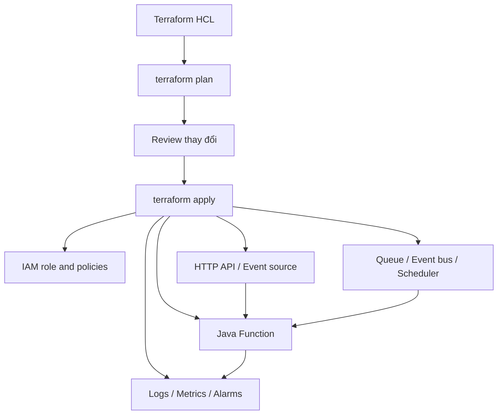

# Quản lý hạ tầng serverless bằng Terraform

Ứng dụng serverless vẫn cần hạ tầng được cấu hình rõ ràng: function runtime, quyền truy cập, API endpoint, queue, event rule, log group, cảnh báo, storage và mạng. Nếu tạo các thành phần này thủ công trên portal, cấu hình giữa development, staging và production dễ lệch nhau; việc dựng lại môi trường hoặc kiểm tra thay đổi cũng khó dự đoán.

**Infrastructure as Code (IaC)** giải quyết vấn đề đó bằng cách mô tả hạ tầng trong các file có thể lưu version, review và triển khai lặp lại. **Terraform** dùng ngôn ngữ HCL để khai báo trạng thái mong muốn, so sánh với hạ tầng hiện tại và tạo execution plan trước khi áp dụng thay đổi. Với Java FaaS, Terraform có thể quản lý function resource và các dịch vụ xung quanh; pipeline ứng dụng vẫn chịu trách nhiệm biên dịch, kiểm thử và tạo JAR/ZIP hoặc container image.

## 1. IaC trong kiến trúc serverless

Một function hiếm khi đứng độc lập. Ví dụ, một Java Lambda được gọi qua HTTP API cần ít nhất function, IAM execution role, quyền để API Gateway invoke function và log group. Nếu xử lý nền, hệ thống có thể cần thêm queue, dead-letter queue (DLQ), event source mapping và cảnh báo.



Terraform quản lý tài nguyên cloud và mối quan hệ giữa chúng. Mã Java xử lý nghiệp vụ; Maven hoặc Gradle tạo artifact; CI/CD đưa artifact đến nơi triển khai. Có thể dùng Terraform để cập nhật version code của function, nhưng không nên biến `terraform apply` thành một lệnh build tùy tiện trên máy triển khai.

### 1.1. Lợi ích thực tế

- **Lặp lại được:** cùng một cấu hình có thể dựng các môi trường với biến đầu vào khác nhau.
- **Review được:** pull request hiển thị IAM policy, timeout, memory, queue và endpoint nào sắp thay đổi.
- **Có lịch sử:** Git lưu ai thay đổi cấu hình và vì sao.
- **Phát hiện drift:** so sánh cấu hình khai báo với tài nguyên bị thay đổi thủ công trên cloud.
- **Tự động hóa:** pipeline có thể kiểm tra, tạo plan, yêu cầu phê duyệt và apply theo môi trường.
- **Chuẩn hóa bảo mật:** quyền, mã hóa, retention và cảnh báo được định nghĩa cùng hạ tầng.

IaC không tự bảo đảm cấu hình an toàn. Một IAM policy quá rộng được khai báo bằng Terraform vẫn là policy quá rộng. Cần review cả nội dung HCL lẫn execution plan.

## 2. Các khái niệm Terraform cần biết

| Khái niệm | Vai trò | Ví dụ trong serverless |
|---|---|---|
| Provider | Plugin giao tiếp với API của cloud hoặc dịch vụ | `hashicorp/aws`, `hashicorp/azurerm` |
| Resource | Tài nguyên Terraform tạo và quản lý | `aws_lambda_function`, `aws_sqs_queue` |
| Data source | Đọc thông tin tài nguyên có sẵn | Lấy AWS region hoặc account ID |
| Variable | Tham số đầu vào | Region, tên function, timeout |
| Local | Giá trị tính toán dùng lại trong cấu hình | Tên resource theo môi trường |
| Output | Giá trị trả ra sau khi apply | API endpoint, function ARN |
| Module | Nhóm resource thành thành phần tái sử dụng | Module Java Lambda có IAM, log group và alarm |
| State | Bản ghi ánh xạ resource trong cấu hình với tài nguyên thật | ID, ARN và metadata của Lambda/queue |
| Backend | Nơi lưu state và cơ chế khóa state | S3 backend hoặc HCP Terraform |

Terraform xây dựng dependency graph từ các tham chiếu resource. Ví dụ, khi `aws_lambda_function` tham chiếu ARN của IAM role, Terraform biết role cần tồn tại trước function. Chỉ dùng `depends_on` khi dependency không thể suy ra từ tham chiếu trực tiếp; lạm dụng nó làm graph khó hiểu và giảm khả năng triển khai song song.

## 3. Cấu trúc một dự án Terraform cho Java serverless

Một root module có thể tổ chức như sau:

```text
serverless-infra/
├── versions.tf       # Terraform và provider constraints
├── providers.tf      # Provider configuration
├── backend.tf        # Remote state backend
├── variables.tf      # Input variables
├── main.tf           # Resource graph chính
├── iam.tf            # Role và policy
├── api.tf             # API Gateway hoặc trigger
├── observability.tf  # Log group, alarm, dashboard
├── outputs.tf        # ARN, endpoint, tên resource
├── terraform.tfvars  # Giá trị môi trường, không chứa secret
└── modules/
    └── java-function/
        ├── main.tf
        ├── variables.tf
        └── outputs.tf
```

Với dự án nhỏ, có thể bắt đầu bằng một vài file `.tf` trong cùng thư mục. Terraform tự ghép các file HCL trong root module; việc chia file chủ yếu giúp người đọc tìm được phần cấu hình cần review.

Khi số lượng function tăng, tạo module tái sử dụng cho các mẫu chung như Lambda + execution role + log retention, hoặc Function App + Application Insights. Module nên nhận các giá trị cần thay đổi qua variables và chỉ expose outputs thật sự cần cho module gọi nó.

Không tạo module quá tổng quát ngay từ đầu. Một module có hàng chục cờ để hỗ trợ mọi trigger, mọi runtime và mọi cloud provider thường khó sử dụng hơn vài module nhỏ có mục tiêu rõ ràng.

## 4. Khai báo provider và phiên bản

Ví dụ root module dùng AWS provider:

```hcl
terraform {
  required_version = ">= 1.10.0"

  required_providers {
    aws = {
      source  = "hashicorp/aws"
      version = "~> 6.0"
    }
  }
}

provider "aws" {
  region = var.aws_region
}
```

`required_version` giới hạn phiên bản Terraform CLI; `required_providers` khai báo nguồn và dải phiên bản provider. Dải `~> 6.0` cho phép các bản cập nhật tương thích trong major version 6. Khi dự án ổn định, commit `terraform.lock.hcl` để nhóm và CI dùng cùng phiên bản provider đã được chọn.

Ví dụ variables:

```hcl
variable "aws_region" {
  description = "AWS region triển khai function"
  type        = string
  default     = "ap-southeast-1"
}

variable "environment" {
  description = "Tên môi trường"
  type        = string
  validation {
    condition     = contains(["dev", "staging", "prod"], var.environment)
    error_message = "environment phải là dev, staging hoặc prod."
  }
}

variable "function_name" {
  description = "Tên Lambda function"
  type        = string
}

variable "lambda_zip_path" {
  description = "Đường dẫn đến ZIP artifact đã được build trước"
  type        = string
}
```

Giá trị khác nhau giữa môi trường nên đi qua `*.tfvars`, pipeline variable hoặc cơ chế cấu hình phù hợp. Không commit credential cloud hoặc secret vào `terraform.tfvars`.

## 5. Quản lý Terraform state

Terraform state ánh xạ resource trong HCL với tài nguyên thật trên cloud. State giúp Terraform biết ID, ARN, thuộc tính và dependency của những resource đã quản lý. State không chỉ là file cache: nó là dữ liệu quan trọng của quy trình IaC.

### 5.1. Vì sao không nên dùng local state cho nhóm?

Backend mặc định `local` ghi state vào `terraform.tfstate` trên máy đang chạy. Nếu nhiều người cùng apply từ những bản state khác nhau, họ có thể ghi đè trạng thái hoặc tạo tài nguyên trùng. Local state cũng khó chia sẻ và khôi phục khi máy bị mất.

Với nhóm và CI/CD, dùng remote backend có khóa state. Ví dụ S3 backend:

Trong root module thực tế, gộp cấu hình backend này vào `terraform` block đã khai báo `required_version` và `required_providers`; đoạn dưới chỉ tập trung minh họa các thuộc tính backend.

```hcl
terraform {
  backend "s3" {
    bucket       = "company-terraform-state"
    key          = "serverless/orders/prod/terraform.tfstate"
    region       = "ap-southeast-1"
    encrypt      = true
    use_lockfile = true
  }
}
```

Bucket state phải được tạo và bảo vệ trước, thường bằng một bootstrap stack riêng hoặc quy trình quản trị nền tảng. Bật S3 versioning để khôi phục state khi bị xóa hoặc ghi nhầm. `use_lockfile = true` bật state locking bằng S3 lock file; cần Terraform từ 1.10 trở lên. Cơ chế DynamoDB locking cũ đã bị đánh dấu deprecated trong tài liệu backend S3 hiện hành.

Backend block không thể tham chiếu `var.*`, `local.*` hoặc output resource. Nếu backend khác nhau theo môi trường, dùng partial configuration và truyền thông tin backend khi `terraform init`, hoặc tách root module/state theo môi trường.

### 5.2. State có thể chứa dữ liệu nhạy cảm

Terraform state có thể lưu giá trị thuộc tính của resource, bao gồm dữ liệu mà provider đánh dấu sensitive. `sensitive = true` chủ yếu che giá trị khỏi một số output CLI; nó không tự loại giá trị khỏi state hoặc plan file.

Vì vậy:

- Mã hóa backend khi lưu trữ và dùng TLS khi truyền.
- Giới hạn quyền đọc state; quyền đọc state có thể tiết lộ thông tin nhạy cảm.
- Bật versioning/backup và kiểm soát quyền khôi phục state.
- Không commit `terraform.tfstate`, `*.tfstate.backup`, `.terraform/` hoặc plan file vào Git.
- Không truyền secret qua HCL literal hoặc `-var` trên command line nếu chúng có thể bị lưu trong shell history/log.
- Ưu tiên workload identity/role federation để Terraform xác thực cloud thay vì access key dài hạn.

### 5.3. Tách state theo môi trường và quyền

Development, staging và production nên có ranh giới state rõ ràng. Với môi trường production, nên dùng state key riêng, tài khoản/subscription riêng khi phù hợp và quyền apply hạn chế hơn. Terraform workspaces có thể tạo nhiều state từ cùng một cấu hình, nhưng không tự tạo ranh giới bảo mật hoặc quyền truy cập. Khi các môi trường cần quyền, lịch phát hành hay topology khác nhau, các root module/backend key riêng thường dễ kiểm soát hơn.

## 6. Ví dụ: triển khai Java Lambda và HTTP API bằng Terraform

Ví dụ sau minh họa một HTTP endpoint `GET /health` gọi Java Lambda. Maven/Gradle đã build artifact trước; Terraform quản lý Lambda, IAM execution role, CloudWatch log group, API Gateway HTTP API và quyền invoke.

### 6.1. Chuẩn bị artifact Java

Ví dụ Java handler có thể triển khai bằng AWS Lambda Java runtime:

```java
package com.example;

import com.amazonaws.services.lambda.runtime.Context;
import com.amazonaws.services.lambda.runtime.RequestHandler;
import java.util.Map;

public final class HealthHandler
        implements RequestHandler<Map<String, Object>, Map<String, Object>> {

    @Override
    public Map<String, Object> handleRequest(
            Map<String, Object> event,
            Context context) {
        context.getLogger().log("Health endpoint invoked");
        return Map.of(
                "statusCode", 200,
                "headers", Map.of("content-type", "application/json"),
                "body", "{\"status\":\"ok\"}");
    }
}
```

Build và đóng gói thành ZIP theo quy ước Java Lambda, ví dụ ZIP có thư mục `lib/` chứa JAR ứng dụng cùng dependency runtime. Handler trong Terraform phải khớp package, class và method của artifact. Tên runtime trong ví dụ là `java21`; hãy kiểm tra danh sách runtime AWS Lambda được hỗ trợ khi nâng cấp Java.

Pipeline nên tạo artifact trước bước Terraform plan. `source_code_hash` giúp Terraform phát hiện ZIP thay đổi và cập nhật code function. Nếu file chưa tồn tại khi Terraform đánh giá cấu hình, biểu thức hash sẽ lỗi; vì vậy thứ tự build artifact rồi mới chạy Terraform là quan trọng.

### 6.2. IAM role và log group

```hcl
data "aws_iam_policy_document" "lambda_assume_role" {
  statement {
    effect  = "Allow"
    actions = ["sts:AssumeRole"]

    principals {
      type        = "Service"
      identifiers = ["lambda.amazonaws.com"]
    }
  }
}

resource "aws_iam_role" "health_function" {
  name               = "${var.function_name}-${var.environment}-role"
  assume_role_policy = data.aws_iam_policy_document.lambda_assume_role.json
}

resource "aws_iam_role_policy_attachment" "lambda_logs" {
  role       = aws_iam_role.health_function.name
  policy_arn = "arn:aws:iam::aws:policy/service-role/AWSLambdaBasicExecutionRole"
}

resource "aws_cloudwatch_log_group" "health_function" {
  name              = "/aws/lambda/${var.function_name}-${var.environment}"
  retention_in_days = 14
}
```

Execution role là danh tính mà code function sử dụng khi gọi dịch vụ AWS. Managed policy `AWSLambdaBasicExecutionRole` cấp quyền ghi log cơ bản vào CloudWatch Logs. Nếu function cần đọc SQS, ghi S3 hoặc lấy secret, hãy bổ sung policy chỉ cho đúng ARN và action cần thiết; không gắn `AdministratorAccess` hoặc `PowerUserAccess` cho function.

Tạo log group tường minh giúp quản lý retention bằng IaC. Nếu Lambda được gọi trước khi log group tồn tại, runtime có thể tự tạo log group theo quyền được cấp; trong ví dụ, `depends_on` ở resource function bảo đảm policy và log group đã được tạo trước khi function được triển khai.

### 6.3. Lambda function

```hcl
resource "aws_lambda_function" "health" {
  function_name = "${var.function_name}-${var.environment}"
  role          = aws_iam_role.health_function.arn
  runtime       = "java21"
  handler       = "com.example.HealthHandler::handleRequest"

  package_type = "Zip"
  filename     = var.lambda_zip_path
  source_code_hash = filebase64sha256(var.lambda_zip_path)

  memory_size = 1024
  timeout     = 15

  environment {
    variables = {
      APP_ENV = var.environment
    }
  }

  depends_on = [
    aws_iam_role_policy_attachment.lambda_logs,
    aws_cloudwatch_log_group.health_function
  ]
}
```

`memory_size` và `timeout` nên dựa trên đo đạc thực tế. Java có thể cần thêm bộ nhớ cho JVM và class loading; tăng memory cũng có thể làm tăng CPU được cấp và thay đổi chi phí. Không đặt timeout vô hạn. Biến môi trường chỉ nên chứa cấu hình không nhạy cảm; secret nên được lấy lúc chạy từ Secrets Manager hoặc Parameter Store bằng execution role.

### 6.4. API Gateway HTTP API và quyền invoke

```hcl
resource "aws_apigatewayv2_api" "http" {
  name          = "${var.function_name}-${var.environment}-api"
  protocol_type = "HTTP"
}

resource "aws_apigatewayv2_integration" "lambda" {
  api_id                 = aws_apigatewayv2_api.http.id
  integration_type       = "AWS_PROXY"
  integration_uri        = aws_lambda_function.health.invoke_arn
  payload_format_version = "2.0"
}

resource "aws_apigatewayv2_route" "health" {
  api_id    = aws_apigatewayv2_api.http.id
  route_key = "GET /health"
  target    = "integrations/${aws_apigatewayv2_integration.lambda.id}"
}

resource "aws_apigatewayv2_stage" "default" {
  api_id      = aws_apigatewayv2_api.http.id
  name        = "$default"
  auto_deploy = true
}

resource "aws_lambda_permission" "api_gateway" {
  statement_id  = "AllowHttpApiInvoke"
  action        = "lambda:InvokeFunction"
  function_name = aws_lambda_function.health.function_name
  principal     = "apigateway.amazonaws.com"
  source_arn    = "${aws_apigatewayv2_api.http.execution_arn}/*/*"
}

output "health_endpoint" {
  description = "HTTP endpoint của health function"
  value       = "${aws_apigatewayv2_api.http.api_endpoint}/health"
}
```

API Gateway gọi Lambda bằng integration proxy; `payload_format_version = "2.0"` quyết định cấu trúc HTTP event mà handler nhận. `aws_lambda_permission` là resource-based permission cho phép API Gateway invoke function. Execution role của Lambda và resource policy cho phép invoke là hai loại quyền khác nhau: role cho code bên trong function; permission cho dịch vụ bên ngoài gọi function.

Đoạn mã minh họa endpoint health công khai. Với API nghiệp vụ, hãy bổ sung authorizer hoặc cơ chế xác thực phù hợp, throttling, access logging và WAF khi cần. Không xem việc endpoint khó đoán là một cơ chế bảo mật.

## 7. Quản lý queue, event source mapping và lịch chạy

Terraform cũng quản lý các trigger liên quan đến queue và event. Ví dụ với SQS, các resource thường gặp là:

| Resource Terraform | Vai trò |
|---|---|
| `aws_sqs_queue` | Tạo queue chính và DLQ |
| `aws_iam_role_policy` | Cấp quyền `ReceiveMessage`, `DeleteMessage`, `GetQueueAttributes` cho Lambda worker |
| `aws_lambda_event_source_mapping` | Kết nối queue với Lambda và cấu hình batch |
| `aws_cloudwatch_event_rule` | Định nghĩa lịch hoặc pattern sự kiện EventBridge trong các kịch bản phù hợp |
| `aws_cloudwatch_event_target` | Chỉ định Lambda là target của rule |
| `aws_lambda_permission` | Cho phép EventBridge invoke Lambda |

Ví dụ tạo queue chính, DLQ và cấu hình redrive:

```hcl
resource "aws_sqs_queue" "orders_dlq" {
  name                      = "orders-${var.environment}-dlq"
  message_retention_seconds = 1209600
}

resource "aws_sqs_queue" "orders" {
  name                       = "orders-${var.environment}"
  visibility_timeout_seconds = 180
  message_retention_seconds  = 345600

  redrive_policy = jsonencode({
    deadLetterTargetArn = aws_sqs_queue.orders_dlq.arn
    maxReceiveCount     = 5
  })
}
```

Ví dụ rút gọn cho event source mapping:

```hcl
resource "aws_lambda_event_source_mapping" "orders" {
  event_source_arn = aws_sqs_queue.orders.arn
  function_name    = aws_lambda_function.order_worker.arn
  batch_size       = 10

  function_response_types = ["ReportBatchItemFailures"]
  enabled                = true
}
```

Ở đây `aws_lambda_function.order_worker` là worker được khai báo ở phần resource tương ứng; queue `orders` và DLQ đã được tạo ở ví dụ trên. Giá trị visibility timeout 180 giây minh họa cho worker có timeout 30 giây và không dùng batching window dài; khi đổi timeout hoặc batch window, hãy điều chỉnh lại theo khuyến nghị của AWS để tránh message xuất hiện lại trong lúc invocation trước vẫn chạy. Worker cần execution role có quyền đọc/xóa message và đọc thuộc tính queue. `ReportBatchItemFailures` yêu cầu handler trả đúng cấu trúc partial batch response.

Với lịch chạy, có thể dùng EventBridge Scheduler hoặc EventBridge rule tùy yêu cầu. Scheduler thường có resource riêng như `aws_scheduler_schedule`, target và IAM role cho Scheduler invoke function. Lịch chạy và permission invoke cần được quản lý cùng nhau để tránh lịch tồn tại nhưng không có quyền gọi target.

Đừng giả định mọi trigger dùng cùng cơ chế retry. SQS event source mapping, Kinesis stream, EventBridge Scheduler và async Lambda invocation có chính sách giao nhận khác nhau. Cấu hình retry, DLQ, maximum event age, batch size và concurrency theo đúng loại nguồn.

## 8. Áp dụng cùng nguyên tắc cho Azure Functions

Terraform không gắn với một cloud provider duy nhất. Với Azure, provider phổ biến là `hashicorp/azurerm`; các resource có thể bao gồm Resource Group, Storage Account, Service Plan, Function App, Application Insights và role assignment.

Ví dụ khai báo provider Azure:

```hcl
terraform {
  required_providers {
    azurerm = {
      source  = "hashicorp/azurerm"
      version = "~> 4.0"
    }
  }
}

provider "azurerm" {
  features {}
}
```

Với Function App mới, có thể dùng resource tương ứng với hosting plan, ví dụ `azurerm_service_plan` cùng `azurerm_function_app_flex_consumption` cho Flex Consumption trên Linux. Cấu hình còn cần Storage Account và container triển khai code, cùng Application Insights/Log Analytics nếu cần quan sát. Tên resource và thuộc tính thay đổi theo phiên bản provider và hosting plan; hãy dùng quickstart Terraform chính thức của Microsoft làm mẫu cho phiên bản đang pin.

Các khái niệm tương đương giữa hai cloud:

| Nhu cầu | AWS | Azure |
|---|---|---|
| Function compute | `aws_lambda_function` | Function App và Functions runtime |
| Quyền runtime | IAM execution role/policy | Managed identity và Azure RBAC |
| HTTP entry point | API Gateway / Function URL | HTTP trigger / API Management |
| Queue | SQS | Storage Queue / Service Bus |
| Event routing | EventBridge | Event Grid / Event Hubs |
| Logs/metrics | CloudWatch | Azure Monitor / Application Insights |
| IaC provider | `hashicorp/aws` | `hashicorp/azurerm` |

Không nên cố tạo một module Terraform duy nhất có hàng loạt điều kiện để che đi khác biệt giữa AWS Lambda và Azure Functions. Có thể dùng interface module chung ở tầng ứng dụng, nhưng module resource nên phản ánh đúng mô hình quyền, trigger, scale và deployment của từng cloud.

## 9. Module hóa và tái sử dụng

Khi có nhiều Java function, có thể xây dựng module `java-function` nhận các biến như:

- Tên function, runtime, handler và đường dẫn artifact.
- Memory, timeout, reserved concurrency và environment variables không nhạy cảm.
- IAM policy statements được giới hạn theo resource.
- Log retention, alarm threshold và tags.
- Trigger integration được bật theo nhu cầu.

Ví dụ cách gọi module:

```hcl
module "order_api" {
  source = "./modules/java-function"

  function_name   = "orders-api"
  runtime         = "java21"
  handler         = "com.example.OrderHandler::handleRequest"
  lambda_zip_path = "${path.root}/artifacts/orders-api.zip"
  memory_size     = 1024
  timeout         = 20
  environment     = "prod"
}
```

Đây là ví dụ giao diện module; các biến phải được khai báo trong module và resource bên trong cần thực hiện đúng các giá trị đó. Không truyền policy JSON tùy ý từ mọi caller nếu module có thể cung cấp các quyền chuẩn, nhỏ và dễ review hơn.

Module nên được version hóa khi chia sẻ giữa nhiều repository hoặc nhóm. Với module nội bộ, có thể dùng Git tag hoặc Terraform Registry private. Tránh tham chiếu branch `main` không cố định trong production vì cùng một cấu hình có thể tải nội dung khác ở lần init sau.

## 10. Phân tách hạ tầng và vòng đời ứng dụng

Hạ tầng và artifact Java có nhịp thay đổi khác nhau. IAM, API Gateway, queue, VPC hoặc log retention thường thay đổi ít hơn code nghiệp vụ. Có thể tổ chức pipeline theo hai luồng phối hợp:

1. **Infrastructure pipeline:** kiểm tra HCL, tạo plan, review và apply thay đổi tài nguyên.
2. **Application pipeline:** build Java, chạy test, tạo artifact có version/digest, rồi triển khai artifact vào function đã tồn tại.

Nếu dùng `aws_lambda_function` để quản lý cả cấu hình lẫn artifact, pipeline application có thể truyền đường dẫn ZIP và `source_code_hash` vào root module. Cần bảo đảm plan được tạo từ đúng artifact sẽ apply. Với tần suất phát hành code cao, cân nhắc tách resource code deployment khỏi thay đổi hạ tầng hoặc dùng cơ chế phát hành version/alias phù hợp.

Không để Terraform và một công cụ deploy khác cùng quản lý một resource theo hai nguồn sự thật. Ví dụ, nếu Terraform quản lý `aws_lambda_function`, một lệnh CLI ngoài pipeline thay đổi runtime, environment hoặc memory sẽ tạo drift; lần apply sau có thể ghi đè thay đổi đó.

## 11. Quy trình Terraform an toàn

Quy trình cơ bản trong local hoặc CI:

```bash
terraform fmt -check -recursive
terraform init
terraform validate
terraform plan -out=tfplan
terraform show tfplan
terraform apply tfplan
```

Ý nghĩa từng bước:

- `fmt`: chuẩn hóa định dạng HCL để diff dễ đọc.
- `init`: tải provider/module và kết nối backend.
- `validate`: kiểm tra cú pháp và tính nhất quán nội bộ của cấu hình.
- `plan`: refresh thông tin resource và dự kiến các thao tác create/update/delete.
- `show`: review execution plan đã lưu.
- `apply tfplan`: áp dụng đúng plan đã được review.

Trong CI production, plan nên được tạo và review trước khi apply; không chạy `terraform apply -auto-approve` trực tiếp trên mọi commit mà không có kiểm soát. Plan file có thể chứa dữ liệu nhạy cảm nên cần bảo vệ artifact pipeline và xóa sau thời gian cần thiết.

Các kiểm tra bổ sung có thể gồm:

- `terraform fmt -check` và `terraform validate`.
- TFLint để phát hiện lỗi cấu hình theo provider.
- Checkov hoặc Trivy config để kiểm tra một số quy tắc bảo mật IaC.
- `terraform test` cho module có test file và fixture phù hợp.
- Policy as code để chặn public storage, wildcard IAM hoặc cấu hình logging/retention không đạt chuẩn.

Các công cụ scan bổ sung cảnh báo, không thay thế review execution plan và hiểu biết về kiến trúc.

## 12. Drift, import và thay đổi tài nguyên

**Drift** xảy ra khi tài nguyên trên cloud khác với cấu hình hoặc state Terraform. Ví dụ, một người tăng timeout Lambda trên Console nhưng không cập nhật HCL. Lần `terraform plan` tiếp theo có thể đề xuất đưa timeout về giá trị khai báo.

Khi phát hiện drift:

1. Xác định thay đổi thủ công có chủ ý hay là thao tác ngoài quy trình.
2. Nếu thay đổi được chấp nhận, cập nhật HCL để phản ánh trạng thái mong muốn.
3. Nếu thay đổi không được chấp nhận, review plan rồi để Terraform đưa tài nguyên về cấu hình chuẩn.
4. Nếu resource có sẵn nhưng chưa nằm trong state, dùng `import` block hoặc `terraform import` để đưa nó vào quản lý; sau đó viết HCL tương ứng và review plan.

Đọc kỹ ký hiệu `-/+` hoặc thông báo `forces replacement` trong plan. Một số thay đổi như tên resource, runtime/package type hoặc thuộc tính immutable có thể buộc xóa và tạo lại resource, làm gián đoạn trigger hoặc endpoint. Với tài nguyên có dữ liệu như queue, bucket hoặc database, cần kiểm tra retention, deletion protection và backup trước khi apply.

Không dùng `terraform state rm` hoặc `terraform state push` như cách sửa lỗi mặc định. Các lệnh này thay đổi state trực tiếp và có thể làm Terraform mất liên kết với tài nguyên thật. Sao lưu state và làm theo quy trình recovery khi thực sự cần.

## 13. Bảo mật và quyền tối thiểu

IaC thường quản lý những tài nguyên có quyền cao, vì vậy bảo mật cần áp dụng cho cả pipeline lẫn function runtime.

- **Terraform runner:** dùng OIDC/workload identity hoặc assume role; cấp quyền deploy đúng account, region và loại resource.
- **State backend:** mã hóa, versioning, locking và giới hạn quyền đọc/ghi state.
- **Execution role:** chỉ cấp quyền cho những API và ARN function cần dùng.
- **Resource policy:** chỉ cho phép API Gateway, EventBridge hoặc service source cần thiết invoke function.
- **Secrets:** không đưa giá trị secret vào HCL/state nếu có thể tránh; để function đọc từ Secrets Manager/Parameter Store hoặc Key Vault bằng identity.
- **Network:** chỉ đặt function vào VPC/VNet khi cần truy cập private resource; hiểu tác động của NAT, DNS, endpoint và cold start.
- **Logging:** đặt retention, mã hóa và quyền đọc; tránh log payload nhạy cảm.
- **Tagging:** gắn owner, environment, cost center và service để quản lý chi phí, inventory và audit.

Biến Terraform có `sensitive = true` sẽ che giá trị trong một số output, nhưng state và plan vẫn có thể chứa giá trị đó. Đây là điểm cần nhắc lại khi quản lý connection string hoặc secret.

## 14. Kiểm soát chi phí serverless bằng IaC

Terraform không chỉ tạo function mà còn có thể chuẩn hóa giới hạn và cảnh báo chi phí:

- Memory, timeout và reserved concurrency của function.
- Queue retention, visibility timeout, batch size và DLQ.
- Log retention, metric filters và alarm.
- API throttling/quota và event schedule frequency.
- VPC endpoint, NAT Gateway, storage và data transfer.
- Tags theo môi trường, nhóm và cost center.

Không thể suy ra toàn bộ chi phí chỉ từ số invocation. Một function ít gọi nhưng chạy lâu, giữ memory lớn, dùng NAT Gateway hoặc ghi log quá nhiều vẫn có thể tốn kém. Cần đo tải và xem hóa đơn theo từng dịch vụ phụ trợ.

Với dev/test, có thể đặt timeout và concurrency thấp hơn production, retention ngắn hơn và lịch chạy chỉ trong thời gian cần thiết. Các giá trị phải được kiểm tra để không làm sai hành vi test hoặc bỏ sót lỗi.

## 15. Checklist trước khi quản lý serverless bằng Terraform

1. Provider và phiên bản Terraform đã được pin và `terraform.lock.hcl` được commit chưa?
2. Resource nào thuộc Function App/Lambda, trigger, IAM, API, queue, log và alarm?
3. Java artifact được build trước plan/apply và có version/hash xác định chưa?
4. Handler, runtime, architecture, memory, timeout và concurrency có đúng với artifact không?
5. IAM execution role và resource policy có theo least privilege không?
6. State nằm trong remote backend có mã hóa, versioning, locking và quyền truy cập phù hợp không?
7. State/plan có thể chứa secret nào? Có cách dùng identity hoặc secret manager thay thế không?
8. Mỗi môi trường có state, account/subscription và quyền deploy tách biệt chưa?
9. Plan đã được review, đặc biệt các thao tác replace/delete, chưa?
10. Queue retry, DLQ, schedule, log retention, alarm và giới hạn chi phí đã được khai báo chưa?
11. Có kiểm tra drift, import resource có sẵn và rollback/recovery state không?
12. Pipeline có fmt, validate, scan, plan review và apply có kiểm soát không?

## Kết luận

Terraform giúp mô tả và quản lý toàn bộ hạ tầng quanh Java function bằng cấu hình có thể review, version hóa và triển khai lặp lại. Để vận hành an toàn, cần hiểu provider/resource/module, bảo vệ remote state, tách quyền deploy khỏi execution role, quản lý artifact theo version, review plan và kiểm soát drift. Với serverless, IaC cần mô tả cả function lẫn trigger, IAM, API, queue, DLQ, log, alarm và giới hạn concurrency; chỉ tạo function mà bỏ qua các thành phần xung quanh sẽ chưa tạo thành một hệ thống có thể vận hành.

## Tài liệu tham khảo chính thức

- [Terraform language and configuration](https://developer.hashicorp.com/terraform/language)
- [Terraform modules](https://developer.hashicorp.com/terraform/language/modules)
- [Terraform state](https://developer.hashicorp.com/terraform/language/state)
- [S3 backend and state locking](https://developer.hashicorp.com/terraform/language/backend/s3)
- [AWS Lambda function resource](https://registry.terraform.io/providers/hashicorp/aws/latest/docs/resources/lambda_function)
- [AWS Lambda event source mapping resource](https://registry.terraform.io/providers/hashicorp/aws/latest/docs/resources/lambda_event_source_mapping)
- [AWS Lambda runtimes](https://docs.aws.amazon.com/lambda/latest/dg/lambda-runtimes.html)
- [AWS Lambda with API Gateway](https://docs.aws.amazon.com/lambda/latest/dg/services-apigateway.html)
- [Create Azure Functions resources from Terraform](https://learn.microsoft.com/en-us/azure/azure-functions/functions-create-first-function-terraform)
