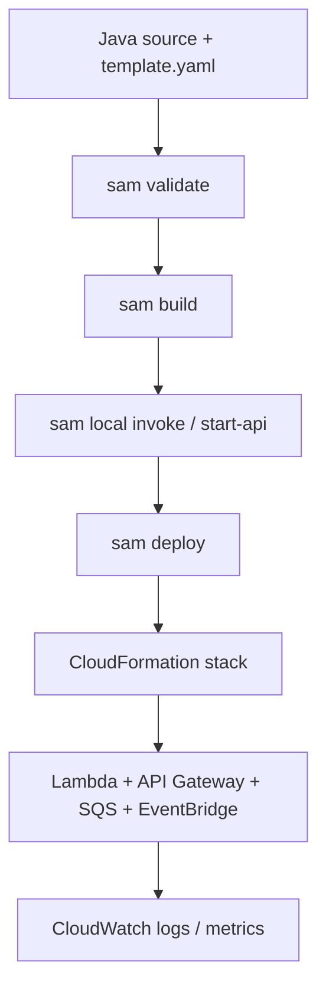

# Mô tả ứng dụng Lambda bằng AWS SAM

AWS Serverless Application Model (AWS SAM) là framework mã nguồn mở giúp mô tả, đóng gói và triển khai ứng dụng serverless trên AWS. Thay vì tạo từng Lambda function, API Gateway, SQS queue, EventBridge rule và IAM policy thủ công trên Console, ta khai báo chúng trong một template có thể lưu cùng source code, review qua pull request và triển khai lặp lại giữa các môi trường.

SAM mở rộng AWS CloudFormation bằng cú pháp ngắn gọn cho các tài nguyên serverless. Khi triển khai, SAM transform template thành các tài nguyên CloudFormation tương ứng. Vì vậy, một ứng dụng SAM vẫn có vòng đời stack, change set, rollback và IAM permissions như hạ tầng CloudFormation thông thường.

Trong module Cloud Serverless, SAM giúp đóng gói các Java Lambda được kích hoạt bởi HTTP, message hoặc event. Template cần mô tả cả function, trigger, quyền truy cập, cấu hình runtime và tài nguyên phụ trợ. Thiết kế tốt phải tính đến retry, idempotency, concurrency, cold start, quan sát và chi phí ngay trong cấu hình hạ tầng.

## 1. AWS SAM gồm những gì?

SAM thường được dùng qua ba thành phần:

- **SAM template:** file YAML hoặc JSON mô tả ứng dụng, thường tên `template.yaml`.
- **SAM CLI:** công cụ dòng lệnh để khởi tạo project, validate template, build artifact, chạy local và deploy.
- **SAM transform:** macro CloudFormation `AWS::Serverless-2016-10-31` chuyển tài nguyên rút gọn như `AWS::Serverless::Function` thành Lambda, IAM role, event source mapping, API Gateway và các tài nguyên liên quan.

Luồng làm việc điển hình:



SAM quản lý hạ tầng dưới dạng mã; nó không thay thế thiết kế ứng dụng. Logic nghiệp vụ vẫn nằm trong Java code, còn template mô tả cách runtime, trigger, quyền và tài nguyên kết nối với nhau.

## 2. Cấu trúc cơ bản của SAM template

Một template SAM thường có các phần:

| Phần | Mục đích |
|---|---|
| `AWSTemplateFormatVersion` | Phiên bản định dạng CloudFormation |
| `Transform` | Khai báo SAM transform |
| `Description` | Mô tả stack |
| `Parameters` | Giá trị đầu vào theo môi trường |
| `Mappings` / `Conditions` | Ánh xạ và điều kiện tạo tài nguyên khi cần |
| `Globals` | Thuộc tính dùng chung cho Function, API hoặc SimpleTable theo hỗ trợ của SAM |
| `Resources` | Lambda, API, queue, event bus, IAM role và tài nguyên khác |
| `Outputs` | Giá trị hữu ích sau triển khai như ARN, URL hoặc queue URL |

Template tối thiểu:

```yaml
AWSTemplateFormatVersion: '2010-09-09'
Transform: AWS::Serverless-2016-10-31
Description: Example serverless application

Resources:
  HelloFunction:
    Type: AWS::Serverless::Function
    Properties:
      CodeUri: hello/
      Handler: com.example.HelloHandler
      Runtime: java21
      MemorySize: 1024
      Timeout: 15
```

`CodeUri` chỉ tới thư mục chứa project/artifact build của function. Với class triển khai `RequestHandler`, `Handler` là tên class đầy đủ; dạng `Class::method` dùng cho method handler tương ứng. `Runtime` chọn môi trường Java được Lambda hỗ trợ. `MemorySize` và `Timeout` ảnh hưởng trực tiếp đến tài nguyên, độ trễ và chi phí.

## 3. `AWS::Serverless::Function` và thuộc tính quan trọng

`AWS::Serverless::Function` là tài nguyên trung tâm để khai báo Lambda. Một số thuộc tính thường dùng:

| Thuộc tính | Ý nghĩa |
|---|---|
| `CodeUri` | Vị trí source/build artifact |
| `Handler` | Java class/method được gọi |
| `Runtime` | Runtime, ví dụ `java21` |
| `Architectures` | `x86_64` hoặc `arm64` nếu runtime/dependency hỗ trợ |
| `MemorySize` | Memory được cấp; CPU cũng tăng theo cấu hình memory |
| `Timeout` | Thời gian tối đa cho một invocation |
| `Environment` | Environment variables của function |
| `Policies` / `Role` | Quyền IAM execution role |
| `Events` | HTTP, SQS, EventBridge, schedule và trigger khác |
| `Layers` | Lambda layers được attach |
| `ReservedConcurrentExecutions` | Giới hạn concurrency dành riêng cho function |
| `Tracing` | Cấu hình AWS X-Ray tracing |
| `AutoPublishAlias` | Quản lý version/alias khi triển khai theo cấu hình SAM |

Chỉ đặt thuộc tính cần thiết. Ví dụ, function xử lý SQS cần timeout phù hợp với batch và visibility timeout của queue; function HTTP cần timeout nhỏ hơn giới hạn đồng bộ của API gateway và trải nghiệm client. Function xử lý tác vụ dài có thể nên chuyển sang queue/workflow thay vì giữ request mở.

### Dùng `Globals` để tránh lặp cấu hình

`Globals` áp dụng các giá trị mặc định cho các tài nguyên SAM cùng loại. Ví dụ, mọi function có thể dùng cùng runtime, memory, timeout và biến môi trường chung:

```yaml
Globals:
  Function:
    Runtime: java21
    Architectures:
      - x86_64
    MemorySize: 1024
    Timeout: 30
    Environment:
      Variables:
        APP_ENV: !Ref EnvironmentName
```

Function cụ thể có thể override các giá trị primitive. Với map như `Environment.Variables`, SAM hợp nhất giá trị global và giá trị riêng của function theo quy tắc Globals; với list, các phần tử có thể được nối thêm. Kiểm tra template đã transform hoặc tài liệu SAM khi cần hiểu chính xác kết quả cuối cùng.

Không đưa secret thật vào `Globals`. Giá trị global được áp dụng cho nhiều function; nếu mỗi function cần quyền hoặc secret khác nhau, khai báo riêng hoặc tách function app/stack theo ranh giới tin cậy.

## 4. Parameters, Conditions và Outputs

### Parameters

Parameters giúp dùng cùng template cho development, staging và production mà không sửa source:

```yaml
Parameters:
  EnvironmentName:
    Type: String
    Default: dev
    AllowedValues:
      - dev
      - staging
      - prod
```

Sau đó tham chiếu bằng `!Ref EnvironmentName` trong tên resource, tag hoặc environment variable. Không dùng parameter để nhúng password/token trực tiếp vào template. Parameter value có thể xuất hiện trong lịch sử triển khai hoặc metadata tùy cách sử dụng.

### Conditions

Conditions cho phép tạo tài nguyên tùy môi trường, ví dụ bật một alarm hoặc provisioned concurrency trong production. Không dùng condition để che giấu một cấu hình quyền quá rộng; quyền vẫn cần được review trong từng nhánh.

### Outputs

Outputs công bố các giá trị sau deploy, chẳng hạn ARN của function, URL API hoặc queue URL:

```yaml
Outputs:
  OrdersQueueUrl:
    Description: URL of the order queue
    Value: !Ref OrdersQueue
  ProcessOrderFunctionArn:
    Description: ARN of the SQS consumer function
    Value: !GetAtt ProcessOrderFunction.Arn
```

Output hữu ích cho pipeline hoặc stack khác tham chiếu. Tránh xuất secret hoặc dữ liệu nhạy cảm qua Outputs.

## 5. Ví dụ template: Java Lambda với HTTP, SQS và EventBridge

Ví dụ sau mô tả một ứng dụng đơn hàng có ba function:

- `CreateOrderFunction` nhận HTTP POST và gửi công việc vào SQS.
- `ProcessOrderFunction` đọc message từ SQS, xử lý đơn hàng và trả partial batch failure khi cần.
- `AuditOrderFunction` nhận event `OrderCreated` từ EventBridge để ghi audit hoặc cập nhật projection.

```yaml
AWSTemplateFormatVersion: '2010-09-09'
Transform: AWS::Serverless-2016-10-31
Description: Java order processing application using AWS SAM

Parameters:
  EnvironmentName:
    Type: String
    Default: dev
    AllowedValues: [dev, staging, prod]

Globals:
  Function:
    Runtime: java21
    Architectures:
      - x86_64
    MemorySize: 1024
    Timeout: 30
    Environment:
      Variables:
        APP_ENV: !Ref EnvironmentName

Resources:
  OrdersQueue:
    Type: AWS::SQS::Queue
    Properties:
      VisibilityTimeout: 210
      MessageRetentionPeriod: 345600
      RedrivePolicy:
        deadLetterTargetArn: !GetAtt OrdersDeadLetterQueue.Arn
        maxReceiveCount: 5

  OrdersDeadLetterQueue:
    Type: AWS::SQS::Queue
    Properties:
      MessageRetentionPeriod: 1209600

  CreateOrderFunction:
    Type: AWS::Serverless::Function
    Properties:
      CodeUri: .
      Handler: com.example.orders.CreateOrderHandler
      Timeout: 10
      Policies:
        - arn:aws:iam::aws:policy/service-role/AWSLambdaBasicExecutionRole
        - Version: '2012-10-17'
          Statement:
            - Effect: Allow
              Action:
                - sqs:SendMessage
              Resource: !GetAtt OrdersQueue.Arn
      Environment:
        Variables:
          ORDERS_QUEUE_URL: !Ref OrdersQueue
      Events:
        OrdersApi:
          Type: HttpApi
          Properties:
            Path: /orders
            Method: POST

  ProcessOrderFunction:
    Type: AWS::Serverless::Function
    Properties:
      CodeUri: .
      Handler: com.example.orders.ProcessOrderHandler
      Policies:
        - arn:aws:iam::aws:policy/service-role/AWSLambdaBasicExecutionRole
        - Version: '2012-10-17'
          Statement:
            - Effect: Allow
              Action:
                - sqs:ReceiveMessage
                - sqs:DeleteMessage
                - sqs:GetQueueAttributes
                - sqs:ChangeMessageVisibility
              Resource: !GetAtt OrdersQueue.Arn
      Events:
        OrdersQueueEvent:
          Type: SQS
          Properties:
            Queue: !GetAtt OrdersQueue.Arn
            BatchSize: 10
            MaximumBatchingWindowInSeconds: 5
            FunctionResponseTypes:
              - ReportBatchItemFailures

  AuditOrderFunction:
    Type: AWS::Serverless::Function
    Properties:
      CodeUri: .
      Handler: com.example.orders.AuditOrderHandler
      Policies:
        - arn:aws:iam::aws:policy/service-role/AWSLambdaBasicExecutionRole
      Events:
        OrderCreatedEvent:
          Type: EventBridgeRule
          Properties:
            Pattern:
              source:
                - com.example.orders
              detail-type:
                - OrderCreated

Outputs:
  OrdersQueueUrl:
    Description: URL of the order queue
    Value: !Ref OrdersQueue
  CreateOrderFunctionArn:
    Description: ARN of the HTTP function
    Value: !GetAtt CreateOrderFunction.Arn
  ProcessOrderFunctionArn:
    Description: ARN of the SQS consumer
    Value: !GetAtt ProcessOrderFunction.Arn
```

Đây là template minh họa cấu trúc và cần được điều chỉnh theo project thực tế. Queue `OrdersQueue` đã liên kết `OrdersDeadLetterQueue` bằng `RedrivePolicy`; khi đưa vào production, tiếp tục cấu hình encryption, retention phù hợp, alarm và các quyền data-plane mà nghiệp vụ cần.

Với function timeout 30 giây và batching window 5 giây, visibility timeout 210 giây trong ví dụ lớn hơn khuyến nghị tối thiểu 6 lần timeout cộng batching window (185 giây). Hãy tính lại khi thay đổi timeout hoặc batch window. Đối với queue production, nên khai báo `RedrivePolicy` và `maxReceiveCount` rõ ràng.

`EventBridgeRule` trong SAM tạo rule và quyền invoke target cần thiết. Với SQS event source mapping, SAM tạo mapping giữa queue và Lambda; execution role của function vẫn phải có quyền đọc/xóa message. API event type `HttpApi` dùng API Gateway HTTP API; nếu cần REST API v1, chọn event type và cấu hình tương ứng.

## 6. Khai báo IAM permission theo least privilege

Mỗi Lambda chạy bằng execution role. SAM có thể tạo role tự động khi khai báo `Policies`, hoặc dùng role được quản lý riêng qua thuộc tính `Role`. Quyền nên gắn với đúng resource ARN và đúng thao tác:

| Function | Quyền cần thiết thường gặp |
|---|---|
| HTTP producer | `sqs:SendMessage` trên queue đích |
| SQS consumer | `sqs:ReceiveMessage`, `sqs:DeleteMessage`, `sqs:GetQueueAttributes`, `sqs:ChangeMessageVisibility` trên queue nguồn |
| EventBridge target Lambda | Quyền invoke do SAM tạo cho rule; function execution role chỉ cần quyền mà code thực sự sử dụng |
| Function đọc secret | `secretsmanager:GetSecretValue` hoặc quyền SSM/Secrets Manager tương ứng trên secret cụ thể |
| Function ghi dữ liệu | Quyền DynamoDB/S3/RDS tương ứng trên table/bucket/resource cụ thể |

Không cấp `sqs:*`, `dynamodb:*` hoặc `secretsmanager:*` trên `*` chỉ để làm ví dụ chạy nhanh. Với quyền CloudWatch Logs, dùng managed policy `AWSLambdaBasicExecutionRole` hoặc inline policy có các action log cần thiết. Nếu bật X-Ray tracing, cấp quyền ghi trace phù hợp hoặc dùng cấu hình tracing/role policy theo hướng dẫn AWS.

### SAM policy templates

SAM có các policy template để rút gọn quyền thường gặp, ví dụ `SQSPollerPolicy`, `SQSSendMessagePolicy` hoặc `DynamoDBCrudPolicy`. Ví dụ:

```yaml
Policies:
  - SQSPollerPolicy:
      QueueName: !GetAtt OrdersQueue.QueueName
```

Policy template giúp viết ngắn hơn nhưng vẫn phải xem policy được sinh ra và kiểm tra scope. Nếu cần quyền cụ thể hơn, dùng inline policy document hoặc IAM role được quản lý riêng.

## 7. Redrive policy và DLQ cho SQS event source

Khai báo DLQ riêng giúp message lỗi không chặn mãi luồng chính. Có thể gắn redrive policy vào queue nguồn:

```yaml
OrdersQueue:
  Type: AWS::SQS::Queue
  Properties:
    VisibilityTimeout: 210
    RedrivePolicy:
      deadLetterTargetArn: !GetAtt OrdersDeadLetterQueue.Arn
      maxReceiveCount: 5
```

Queue policy hoặc cấu hình redrive cần thỏa điều kiện của SQS, bao gồm loại queue tương thích và quyền cần thiết. Sau khi sửa lỗi consumer, có thể redrive message từ DLQ về queue nguồn theo quy trình vận hành có kiểm soát.

Với Lambda SQS event source mapping, bật `ReportBatchItemFailures` và trả về danh sách message ID lỗi để chỉ các item đó được giao lại. Nếu không bật partial batch response, một record lỗi có thể khiến cả batch được retry, dẫn đến lặp side effect ở những record đã xử lý thành công.

## 8. Java Lambda handler cho HTTP API

Java Lambda có thể dùng `RequestHandler` cùng AWS Lambda Java Events để nhận API Gateway HTTP API event. Ví dụ sau nhận POST request, đưa body vào SQS và trả `202 Accepted` để client biết yêu cầu đã được tiếp nhận.

```java
package com.example.orders;

import com.amazonaws.services.lambda.runtime.Context;
import com.amazonaws.services.lambda.runtime.RequestHandler;
import com.amazonaws.services.lambda.runtime.events.APIGatewayV2HTTPEvent;
import com.amazonaws.services.lambda.runtime.events.APIGatewayV2HTTPResponse;
import software.amazon.awssdk.services.sqs.SqsClient;
import software.amazon.awssdk.services.sqs.model.SendMessageRequest;
import java.util.Map;

public final class CreateOrderHandler implements
        RequestHandler<APIGatewayV2HTTPEvent, APIGatewayV2HTTPResponse> {

    private static final SqsClient SQS = SqsClient.create();

    @Override
    public APIGatewayV2HTTPResponse handleRequest(
            APIGatewayV2HTTPEvent event, Context context) {
        String body = event.getBody();
        if (body == null || body.isBlank()) {
            return response(400, "{\"error\":\"Request body is required\"}");
        }

        String queueUrl = System.getenv("ORDERS_QUEUE_URL");
        if (queueUrl == null || queueUrl.isBlank()) {
            context.getLogger().log("ORDERS_QUEUE_URL is not configured");
            return response(500, "{\"error\":\"Configuration unavailable\"}");
        }

        SQS.sendMessage(SendMessageRequest.builder()
                .queueUrl(queueUrl)
                .messageBody(body)
                .build());

        return response(202, "{\"status\":\"accepted\"}");
    }

    private static APIGatewayV2HTTPResponse response(int status, String body) {
        return APIGatewayV2HTTPResponse.builder()
                .withStatusCode(status)
                .withHeaders(Map.of("content-type", "application/json"))
                .withBody(body)
                .build();
    }
}
```

Ví dụ lược giản bỏ qua deserialize/validate domain request, authentication và idempotency. Trong production, producer nên gắn operation ID ổn định hoặc idempotency key, xác thực caller, kiểm tra quyền trên tenant/resource và chỉ trả `202` sau khi SQS xác nhận đã nhận message. Không đưa toàn bộ HTTP headers hoặc token vào message body.

Client `SqsClient` được khởi tạo ở phạm vi class để tái sử dụng giữa các invocation trong cùng execution environment. Client SDK là thread-safe; không dùng biến static để lưu dữ liệu nghiệp vụ của request.

## 9. Java Lambda handler cho SQS với partial batch response

Khi trigger là SQS, handler nhận một batch. Mỗi message cần được xử lý độc lập và function trả lại danh sách item lỗi nếu cấu hình `ReportBatchItemFailures`.

```java
package com.example.orders;

import com.amazonaws.services.lambda.runtime.Context;
import com.amazonaws.services.lambda.runtime.RequestHandler;
import com.amazonaws.services.lambda.runtime.events.SQSEvent;
import com.amazonaws.services.lambda.runtime.events.SQSBatchResponse;
import java.util.ArrayList;
import java.util.List;

public final class ProcessOrderHandler implements
        RequestHandler<SQSEvent, SQSBatchResponse> {

    @Override
    public SQSBatchResponse handleRequest(SQSEvent event, Context context) {
        List<SQSBatchResponse.BatchItemFailure> failures = new ArrayList<>();

        for (SQSEvent.SQSMessage message : event.getRecords()) {
            try {
                OrderService.processIdempotently(message.getBody());
            } catch (Exception ex) {
                context.getLogger().log(
                        "Failed messageId=" + message.getMessageId());
                failures.add(new SQSBatchResponse.BatchItemFailure(
                        message.getMessageId()));
            }
        }

        return new SQSBatchResponse(failures);
    }
}
```

`OrderService.processIdempotently` là application service minh họa. Nó cần lưu event/message ID đã xử lý cùng thay đổi dữ liệu trong transaction hoặc dùng idempotency key của hệ thống downstream. Không log toàn bộ message body nếu payload có dữ liệu nhạy cảm.

## 10. Java handler cho EventBridge

EventBridge gửi event envelope với các trường như `source`, `detail-type`, `id` và `detail`. Handler nên xác minh event type và parse detail theo schema đã định nghĩa.

```java
package com.example.orders;

import com.amazonaws.services.lambda.runtime.Context;
import com.amazonaws.services.lambda.runtime.RequestHandler;
import com.fasterxml.jackson.databind.ObjectMapper;
import java.util.Map;

public final class AuditOrderHandler implements
        RequestHandler<Map<String, Object>, Void> {

    private static final ObjectMapper MAPPER = new ObjectMapper();

    @Override
    @SuppressWarnings("unchecked")
    public Void handleRequest(Map<String, Object> event, Context context) {
        String source = (String) event.get("source");
        String detailType = (String) event.get("detail-type");
        String envelopeId = (String) event.get("id");

        if (!"com.example.orders".equals(source)
                || !"OrderCreated".equals(detailType)) {
            throw new IllegalArgumentException("Unexpected event type");
        }

        Map<String, Object> detail = (Map<String, Object>) event.get("detail");
        OrderCreatedDetail payload = MAPPER.convertValue(
                detail, OrderCreatedDetail.class);

        AuditService.recordIdempotently(payload.eventId(), envelopeId, payload);
        return null;
    }
}
```

Domain `eventId` trong `detail` nên là khóa idempotency ổn định. EventBridge envelope `id` nhận diện một event được đưa vào bus; nếu producer publish lại cùng thay đổi nghiệp vụ bằng một lần `PutEvents` mới, envelope ID có thể khác trong khi domain event ID giữ nguyên.

## 11. Maven packaging cho Java Lambda

Java Lambda cần có runtime handler và các dependency trong deployment artifact. Một project Maven thường chứa `pom.xml`, source dưới `src/main/java` và các dependency cần thiết như:

```xml
<dependencies>
  <dependency>
    <groupId>com.amazonaws</groupId>
    <artifactId>aws-lambda-java-core</artifactId>
    <version>${lambda-java.version}</version>
  </dependency>
  <dependency>
    <groupId>com.amazonaws</groupId>
    <artifactId>aws-lambda-java-events</artifactId>
    <version>${lambda-events.version}</version>
  </dependency>
  <dependency>
    <groupId>software.amazon.awssdk</groupId>
    <artifactId>sqs</artifactId>
    <version>${aws-sdk.version}</version>
  </dependency>
  <dependency>
    <groupId>com.fasterxml.jackson.core</groupId>
    <artifactId>jackson-databind</artifactId>
    <version>${jackson.version}</version>
  </dependency>
</dependencies>
```

Các property version chỉ là placeholder; project cần khóa phiên bản thực tế hoặc dùng AWS SDK BOM để quản lý đồng bộ dependency. Với class triển khai `RequestHandler`, `Handler` trong template là tên class đầy đủ; cú pháp `Class::method` dành cho kiểu handler method tương ứng. Đảm bảo artifact cuối chứa dependency runtime theo cách build mà SAM Java builder mong đợi. `sam build` dùng cấu hình Maven/Gradle trong `CodeUri` để tạo build artifact dưới `.aws-sam/build`.

Nếu project dùng thư viện native hoặc cần build tương thích môi trường Lambda Linux, cân nhắc `sam build --use-container` để build trong container gần runtime đích. Chọn `arm64` chỉ khi toàn bộ dependency/native library tương thích kiến trúc đó; nếu chưa xác minh, `x86_64` là lựa chọn tương thích rộng hơn.

## 12. Build, validate và chạy local

Một chu trình local thường gồm:

```bash
# Kiểm tra cấu trúc và intrinsic của template
sam validate --lint

# Build Java artifacts
sam build

# Build trong container tương thích Lambda khi cần
sam build --use-container

# Gọi trực tiếp function với event mẫu
sam local invoke CreateOrderFunction --event events/api-gateway-v2.json

# Chạy HTTP API local
sam local start-api
```

`sam validate --lint` sử dụng cfn-lint khi được cài đặt. `sam local invoke` giúp thử handler với event JSON; `sam local start-api` dựng API local cho các HTTP event được khai báo. Các lệnh local thường dùng Docker để mô phỏng runtime Lambda.

SAM local không mô phỏng hoàn toàn IAM, SQS delivery, retry, EventBridge rule evaluation, concurrency hoặc service behavior trên AWS. Có thể dùng event JSON mẫu để kiểm tra handler, nhưng cần integration test trên môi trường AWS riêng cho queue, permissions, DLQ, event routing và retry semantics.

## 13. Deploy bằng SAM CLI

Lần đầu có thể chạy:

```bash
sam deploy --guided
```

SAM CLI hỏi stack name, AWS Region, khả năng tạo IAM role, xác nhận change set và có lưu cấu hình vào `samconfig.toml` hay không. Khi template có IAM role/policy, chọn capability phù hợp như `CAPABILITY_IAM`; nếu tạo role có tên tùy chỉnh, có thể cần `CAPABILITY_NAMED_IAM`.

Sau khi cấu hình, có thể triển khai lặp lại:

```bash
sam build
sam deploy --config-env default
```

Ví dụ `samconfig.toml`:

```toml
version = 0.1

[default.deploy.parameters]
stack_name = "orders-serverless-dev"
resolve_s3 = true
s3_prefix = "orders-serverless-dev"
region = "ap-southeast-1"
capabilities = "CAPABILITY_IAM"
confirm_changeset = true
parameter_overrides = "EnvironmentName=dev"
```

Không lưu access key, secret hoặc token vào `samconfig.toml`. Dùng AWS IAM Identity Center, role assumption hoặc OIDC từ CI/CD để lấy credential ngắn hạn. Mỗi môi trường nên có stack name, parameter và quyền deploy riêng.

## 14. SAM và CloudFormation stack lifecycle

Khi deploy, SAM CLI upload artifact lên nơi lưu trữ triển khai (thường là S3 hoặc cơ chế resolve bucket), tạo CloudFormation change set và cập nhật stack. CloudFormation tạo hoặc cập nhật Lambda, API, queue, event source mapping, rule và IAM role theo template.

Điều này đem lại một số lợi ích:

- Hạ tầng có thể review và version control cùng code.
- Có thể tái tạo môi trường từ cùng template với parameter khác nhau.
- CloudFormation theo dõi trạng thái resource và rollback khi stack update thất bại theo cơ chế hỗ trợ.
- Thay đổi quyền IAM và trigger được review trong cùng pull request.
- Outputs có thể được pipeline hoặc stack khác sử dụng.

Tuy nhiên, không phải mọi thay đổi đều không gián đoạn. Thay đổi logical ID hoặc thuộc tính yêu cầu replacement có thể tạo resource mới; đổi queue/event source mapping có thể ảnh hưởng backlog; thay đổi API route hoặc IAM permission có thể làm client/consumer lỗi. Trước deploy production, xem change set và hiểu resource nào sẽ bị replace, update hoặc delete.

## 15. Quản lý môi trường và secret

Dùng Parameters hoặc stack config cho các giá trị không bí mật như environment name, queue name, feature flag và resource ARN. Với secret, tránh đặt giá trị rõ trong template hoặc parameter override.

Một số cách quản lý secret:

- Function đọc secret từ AWS Secrets Manager hoặc Systems Manager Parameter Store bằng SDK khi chạy; execution role chỉ có quyền trên secret/parameter cụ thể.
- Dùng dynamic reference của CloudFormation khi resource property cần secret tại thời điểm deploy và dịch vụ hỗ trợ dynamic reference.
- Cache secret trong execution environment với TTL/refresh phù hợp để giảm request và latency, đồng thời có kế hoạch rotation.

Nếu secret được đưa vào Lambda environment variable, người có quyền đọc cấu hình Lambda có thể có khả năng xem giá trị đã phân giải. Environment variables được mã hóa khi lưu, nhưng vẫn cần giới hạn quyền `lambda:GetFunctionConfiguration` và cân nhắc runtime retrieval cho secret nhạy cảm. Không đưa secret vào Outputs hoặc log.

## 16. Trigger và event source mapping

SAM hỗ trợ khai báo nhiều loại event trong `Events`. Một số loại phổ biến:

| SAM event type | Nguồn kích hoạt | Tài nguyên/adapter được tạo |
|---|---|---|
| `HttpApi` | HTTP API Gateway | API route và Lambda permission |
| `Api` | API Gateway REST API | REST API method/integration và permission |
| `SQS` | SQS queue | Lambda event source mapping |
| `EventBridgeRule` | EventBridge rule | Rule và Lambda permission/target |
| `Schedule` | EventBridge scheduled rule theo cú pháp SAM | Rule lịch và target |
| `Kinesis` / `DynamoDB` | Stream | Event source mapping |

Mỗi trigger có delivery semantics và retry khác nhau. HTTP đồng bộ trả response cho client; SQS consumer nhận message theo batch và có thể retry; EventBridge giao event theo retry policy của target. Không dùng cùng một giả định ack/retry cho mọi trigger.

Với SQS, cấu hình `BatchSize`, `MaximumBatchingWindowInSeconds`, `FunctionResponseTypes`, concurrency và queue visibility timeout tương thích. Với EventBridge, event pattern phải đủ hẹp để tránh kích hoạt function với event không liên quan. Với HTTP API, cần xác thực, throttling và giới hạn payload phù hợp.

## 17. Idempotency và xử lý lỗi trong hạ tầng SAM

Template có thể khai báo queue, DLQ, retry policy và event source mapping, nhưng idempotency vẫn là trách nhiệm của application code và database.

- Với SQS, cấu hình `RedrivePolicy`, `maxReceiveCount` và DLQ; consumer chỉ ack sau khi side effect đã commit.
- Với partial batch response, trả chính xác message ID lỗi để tránh retry toàn batch.
- Với EventBridge, có thể cấu hình target retry policy và SQS DLQ trên target khi dịch vụ hỗ trợ.
- Với Lambda async invocation, cấu hình maximum event age, retry attempts, on-failure destination hoặc DLQ theo trigger.
- Với HTTP, dùng idempotency key cho thao tác tạo tài nguyên có thể được client retry sau timeout.

Nếu một function ghi database rồi publish event, dùng transactional outbox để tránh khoảng trống giữa commit và publish. Khi consumer nhận lại cùng event, dùng inbox hoặc unique event ID để không lặp side effect. SAM giúp tạo tài nguyên nhưng không tự bảo đảm exactly-once cho toàn quy trình.

## 18. Cold start, memory và concurrency

SAM template cho phép khai báo runtime, memory, architecture, timeout và concurrency. Các giá trị này ảnh hưởng thời gian xử lý và chi phí:

- Tăng memory cũng tăng CPU/network throughput theo mô hình Lambda; benchmark nhiều mức memory thay vì mặc định chọn thấp nhất.
- Java thường có thời gian khởi tạo runtime và dependency; giảm artifact/dependency, tái sử dụng client và chọn framework nhẹ khi cold start quan trọng.
- `ReservedConcurrentExecutions` giới hạn số invocation đồng thời và có thể bảo vệ database/API downstream.
- SQS event source mapping có thể cấu hình maximum concurrency để điều tiết consumer.
- Timeout phải đủ cho công việc nhưng không quá dài; tác vụ dài nên chuyển sang workflow hoặc chia thành message.
- Provisioned concurrency có thể giảm cold start cho workload nhạy latency nhưng tạo chi phí duy trì.

Không đặt concurrency quá cao chỉ vì Lambda có thể scale. Database connection, throughput, API quota và chi phí downstream vẫn là giới hạn. Dùng queue để làm phẳng burst và theo dõi backlog/age of oldest message.

## 19. Observability trong SAM

Có thể cấu hình tracing trong SAM, ví dụ `Tracing: Active`, và cấp quyền ghi trace phù hợp cho execution role. Lambda tự ghi log vào CloudWatch Logs khi role có quyền cần thiết. Nên đặt log retention, metric filter/alarm và dashboard trong cùng template thay vì tạo thủ công ngoài stack.

Các tín hiệu nên theo dõi:

| Thành phần | Metric/log cần quan sát |
|---|---|
| Lambda | Invocations, Errors, Duration, Throttles, ConcurrentExecutions |
| API Gateway | Request count, 4xx/5xx, latency và throttling |
| SQS | Queue depth, age of oldest message, DLQ depth, receive count |
| EventBridge | Matched events, failed invocations, throttling và DLQ |
| Application | Correlation ID, event ID, business outcome, duplicate count và step duration |

Truyền correlation ID qua HTTP, message và event. Không dùng order ID hoặc event ID làm metric dimension cardinality cao; giữ các ID trong log/trace. Đặt retention cho log theo nhu cầu vận hành và chi phí.

## 20. CI/CD với SAM

Một pipeline triển khai thường có các bước:

1. Checkout source và cài Java/Maven/SAM CLI.
2. Chạy unit test và kiểm tra dependency.
3. `sam validate --lint` để kiểm tra template.
4. `sam build` để đóng gói Java artifact.
5. Kiểm tra security/IaC và quyền IAM trong template.
6. Deploy lên stack dev hoặc staging bằng role ngắn hạn.
7. Chạy integration/smoke test cho HTTP, queue và event routing.
8. Promote cùng artifact/template lên production qua approval/change set.
9. Theo dõi error, latency, DLQ và rollback nếu cần.

CI nên dùng OIDC hoặc role assumption để lấy AWS credential tạm thời. Không lưu access key dài hạn trong repository hoặc pipeline variable nếu có thể tránh. Giữ artifact đã build để promotion giữa môi trường không phải build lại code khác nhau.

## 21. Các lệnh SAM thường dùng

| Lệnh | Mục đích |
|---|---|
| `sam init` | Tạo project mẫu |
| `sam validate --lint` | Kiểm tra template và lint |
| `sam build` | Build function artifacts |
| `sam local invoke` | Gọi function bằng event mẫu |
| `sam local start-api` | Chạy HTTP API local |
| `sam local start-lambda` | Dựng endpoint Lambda local để tích hợp thử |
| `sam deploy --guided` | Deploy tương tác lần đầu |
| `sam deploy` | Deploy theo cấu hình đã lưu |
| `sam logs -n FunctionLogicalId --stack-name StackName --tail` | Theo dõi log function trong stack đã triển khai |
| `sam sync --watch` | Đồng bộ thay đổi nhanh trong môi trường phát triển khi phù hợp |
| `sam delete` | Xóa stack và tài nguyên do stack quản lý theo chính sách CloudFormation |

`sam delete` có thể xóa tài nguyên và dữ liệu phụ thuộc retention/deletion policy. Chỉ chạy khi đã xác nhận môi trường và tác động; với production, cần quy trình phê duyệt và backup phù hợp.

## 22. Những lỗi thiết kế thường gặp

| Lỗi | Hậu quả | Cách xử lý |
|---|---|---|
| Đặt secret rõ trong template hoặc `samconfig.toml` | Lộ credential qua Git, artifact hoặc deployment history | Secrets Manager/SSM SecureString và IAM tối thiểu |
| Cấp `Resource: '*'` cho mọi action | Quyền quá rộng, tăng blast radius | Scope theo ARN và action cần thiết |
| Dùng một role cho mọi function | Function có quyền của nhau dù không cần | Role riêng hoặc policy riêng theo function |
| Bỏ qua SQS visibility timeout | Message được giao lại khi function vẫn chạy | Tính timeout theo Lambda timeout và batching window |
| Không bật partial batch response | Một record lỗi khiến cả batch bị retry | `ReportBatchItemFailures` và trả đúng message ID |
| Cho rằng SAM local mô phỏng đầy đủ AWS | Bỏ sót IAM, retry, scale và routing thật | Integration test trên AWS test stack |
| Sửa resource ngoài CloudFormation | Drift giữa thực tế và template | Quản lý thay đổi qua template/stack và drift detection |
| Đổi logical ID tùy tiện | Resource có thể bị replace | Review change set và migration plan |
| Đặt timeout/concurrency không theo downstream | Throttling, backlog hoặc chi phí tăng | Benchmark và giới hạn theo năng lực phụ thuộc |
| Không có Outputs/stack config rõ ràng | Pipeline khó lấy ARN/URL và môi trường khó tái tạo | Khai báo Outputs và parameters có kiểm soát |

## 23. Checklist trước khi deploy

- [ ] Template có `Transform: AWS::Serverless-2016-10-31` và validate thành công.
- [ ] Mỗi function có `CodeUri`, `Handler`, `Runtime` và resource configuration phù hợp.
- [ ] Java runtime, dependency và architecture tương thích Lambda.
- [ ] `Globals` chỉ chứa cấu hình thật sự dùng chung.
- [ ] Parameters tách biệt cấu hình theo môi trường; Outputs không chứa dữ liệu nhạy cảm.
- [ ] HTTP, SQS và EventBridge event definitions khớp contract của handler.
- [ ] IAM execution role theo least privilege và tách theo function khi cần.
- [ ] Queue có visibility timeout, retention, redrive policy và DLQ phù hợp.
- [ ] SQS partial batch response được cấu hình nếu handler trả batch failures.
- [ ] Consumer idempotent; database/event publish dùng outbox/inbox khi cần.
- [ ] Secret được lấy từ Secrets Manager/SSM/secure mechanism, không hardcode.
- [ ] Timeout, memory, architecture và concurrency đã được benchmark.
- [ ] Log, metrics, tracing, alarms và retention được khai báo.
- [ ] `sam validate`, `sam build`, local tests và integration tests đã chạy.
- [ ] Change set được review trước khi deploy production.
- [ ] CI/CD dùng credential ngắn hạn và promotion artifact có kiểm soát.

AWS SAM biến một ứng dụng Lambda thành hạ tầng có thể mô tả và triển khai bằng mã. Template khai báo function, runtime, trigger, queue, event rule, IAM và cấu hình; SAM CLI build Java artifact và CloudFormation quản lý vòng đời stack. Khi kết hợp least-privilege IAM, DLQ, idempotency, concurrency limit, observability và pipeline triển khai có kiểm soát, nhóm phát triển có thể vận hành ứng dụng serverless nhất quán giữa các môi trường và đánh giá được tác động của mỗi thay đổi hạ tầng.
