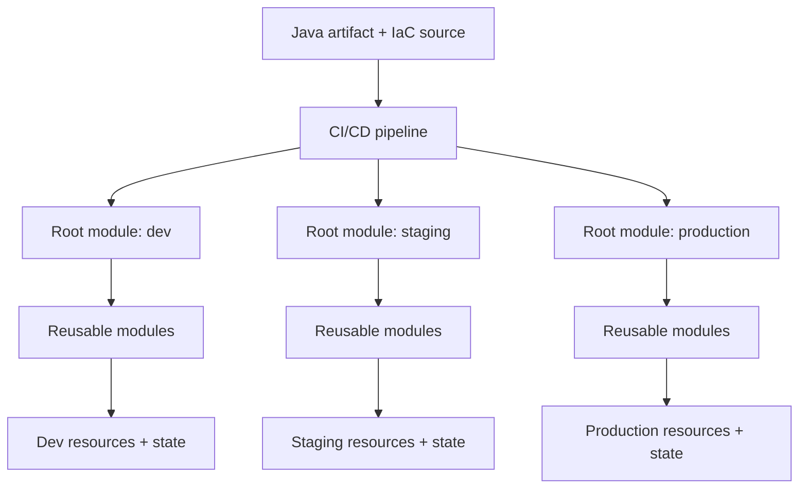
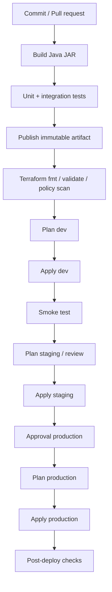

# Tổ chức module hạ tầng và tham số theo môi trường

Một ứng dụng Java serverless thường được triển khai ở nhiều môi trường như dev, test, staging và production. Các môi trường có cùng kiến trúc tổng thể nhưng khác region, tên queue, endpoint, memory, timeout, concurrency, retention, domain và quyền truy cập. Nếu sao chép một bộ file hạ tầng cho từng môi trường rồi chỉnh thủ công, cấu hình sẽ dần lệch nhau và việc sửa lỗi phải lặp lại ở nhiều nơi.

Infrastructure as Code (IaC) giải quyết vấn đề này bằng cách tách **mẫu hạ tầng có thể tái sử dụng** khỏi **tham số và trạng thái riêng của từng môi trường**. Module mô tả một thành phần có trách nhiệm rõ ràng; biến đầu vào thể hiện những lựa chọn được phép cấu hình; output công bố thông tin mà thành phần khác cần; root module kết hợp các module thành một hệ thống hoàn chỉnh.

Bài học này tập trung vào cách tổ chức module hạ tầng và tham số theo môi trường, minh họa bằng Terraform cho một Java Lambda xử lý SQS. Các nguyên tắc về module contract, state isolation, secret và release cũng áp dụng được khi dùng AWS SAM/CloudFormation, Azure Bicep/ARM hoặc Google Cloud Terraform.

## 1. Vì sao cần module và cấu hình theo môi trường?

Giả sử hệ thống có một Java worker nhận message từ SQS. Worker cần function, execution role, queue mapping, log group và một số giới hạn vận hành. Dev và production dùng cùng logic nhưng khác tải và yêu cầu bảo vệ:

| Tham số | Dev | Production |
|---|---:|---:|
| Memory Lambda | 512 MB | 2048 MB |
| Timeout | 15 giây | 60 giây |
| Reserved concurrency | 2 | 30 |
| Queue max concurrency | 2 | 20 |
| Log retention | 7 ngày | 90 ngày |
| Queue | `orders-dev` | `orders-prod` |
| Artifact | Bản build thử | Artifact đã phát hành, có version |

Nếu tạo hai bản hạ tầng riêng, mỗi lần thay đổi IAM hoặc event source mapping phải sửa hai nơi. Nếu dùng một module và truyền tham số, logic chung chỉ được định nghĩa một lần, còn các khác biệt có chủ đích nằm trong cấu hình môi trường.

### Ba lớp cấu trúc phổ biến

1. **Module thành phần (child module):** đóng gói một pattern có trách nhiệm rõ ràng, ví dụ Java SQS worker, HTTP API function, queue có DLQ hoặc log/alert baseline.
2. **Root module theo môi trường:** kết hợp các child module và resource thành một hệ thống cho dev, staging hoặc production.
3. **Pipeline/configuration:** cung cấp artifact version, biến môi trường và quyền triển khai để chạy plan/apply đúng môi trường.



Các root module có thể dùng cùng source module nhưng có state, biến và quyền triển khai riêng. Nhờ đó, một thay đổi ở module chung được review một lần, còn plan của từng môi trường cho thấy tác động cụ thể trước khi apply.

## 2. Thiết kế ranh giới module

Module nên đại diện cho một thành phần hạ tầng có mục đích và vòng đời tương đối rõ. Không nên chia module chỉ vì muốn mỗi file ngắn hơn, cũng không nên tạo một module khổng lồ có hàng chục boolean flag để điều khiển mọi loại trigger.

### Khi nào nên tạo module?

Nên tạo module khi một nhóm resource:

- Thường được triển khai cùng nhau và có quan hệ phụ thuộc rõ.
- Có cấu hình, quyền và vòng đời riêng.
- Được dùng lại ở nhiều môi trường hoặc nhiều ứng dụng.
- Cần được kiểm thử/review như một đơn vị.
- Có input/output ổn định mà caller có thể hiểu.

Ví dụ module `java-sqs-worker` có thể sở hữu Lambda function, execution role, log group và event source mapping. Queue có thể do module riêng quản lý nếu nhiều worker dùng chung queue hoặc queue có vòng đời độc lập.

### Khi nào không nên tạo module?

- Một resource đơn giản chỉ xuất hiện một lần và không có logic tái sử dụng.
- Hai resource luôn thay đổi cùng nhau nhưng module hóa làm interface phức tạp hơn.
- Module có quá nhiều cờ như `enable_sqs`, `enable_s3`, `enable_http`, `enable_vpc`, `enable_dlq`, khiến người gọi khó biết cấu hình nào hợp lệ.
- Module chỉ bọc một resource mà không bổ sung convention, validation hoặc quyền sở hữu có ý nghĩa.

### Root module và child module

Root module là thư mục mà pipeline chạy Terraform. Nó cấu hình provider, backend, biến theo môi trường và gọi child module. Child module mô tả resource và interface tái sử dụng; thông thường không tự cấu hình backend hoặc provider credentials.

Ví dụ cấu trúc repository:

```text
infra/
  modules/
    java-sqs-worker/
      main.tf
      variables.tf
      outputs.tf
      versions.tf
    sqs-queue/
      main.tf
      variables.tf
      outputs.tf
  environments/
    dev/
      main.tf
      variables.tf
      versions.tf
      backend.hcl
      dev.tfvars
    staging/
      main.tf
      variables.tf
      versions.tf
      backend.hcl
      staging.tfvars
    prod/
      main.tf
      variables.tf
      versions.tf
      backend.hcl
      prod.tfvars
```

Mỗi thư mục môi trường là một root module riêng. Các thư mục này gọi module dùng chung bằng source path tương đối. Cách tổ chức khác cũng có thể hợp lý, miễn là owner của state, module và biến môi trường rõ ràng.

## 3. Module contract: variables, locals và outputs

Một module dễ dùng cần có contract rõ ràng. Caller cần biết biến nào bắt buộc, biến nào có default, giá trị hợp lệ là gì, output nào có thể dùng và những resource nào module sở hữu.

### Input variables

Input variable là giao diện cấu hình từ bên ngoài. Tên biến nên thể hiện ý nghĩa, kiểu dữ liệu và đơn vị. Dùng `description`, `type`, `default` và `validation` để giảm cấu hình sai.

```hcl
variable "function_name" {
  description = "Tên Lambda function cho worker"
  type        = string

  validation {
    condition     = length(var.function_name) > 0
    error_message = "function_name không được để trống."
  }
}

variable "memory_size" {
  description = "Memory Lambda tính bằng MB"
  type        = number
  default     = 1024

  validation {
    condition     = var.memory_size >= 128 && var.memory_size <= 10240
    error_message = "memory_size phải nằm trong khoảng 128 đến 10240 MB."
  }
}

variable "timeout_seconds" {
  description = "Thời gian tối đa của một invocation, tính bằng giây"
  type        = number
  default     = 30

  validation {
    condition     = var.timeout_seconds >= 1 && var.timeout_seconds <= 900
    error_message = "timeout_seconds phải nằm trong khoảng 1 đến 900 giây."
  }
}
```

Không nên tạo biến cho mọi thuộc tính của resource nếu caller không cần tùy chỉnh. Quá nhiều biến làm module khó hiểu và khiến mỗi môi trường có thể vô tình khác nhau ở những chi tiết không quan trọng. Hãy đưa ra default an toàn, rồi chỉ mở interface cho các quyết định có lý do vận hành.

### Locals

`locals` dùng để tính toán hoặc đặt tên nội bộ dựa trên input. Caller không cần truyền các giá trị có thể suy ra nhất quán.

```hcl
locals {
  common_tags = merge(var.tags, {
    Environment = var.environment
    ManagedBy   = "Terraform"
    Service     = "cloud-serverless"
  })

  log_group_name = "/aws/lambda/${var.function_name}"
}
```

Nếu mọi môi trường đều cần tag `ManagedBy`, không nên bắt caller truyền tag đó. Giữ convention trong module giúp tránh sai khác. Với tag có thể override, hãy quy định rõ thứ tự `merge` để caller không vô tình ghi đè giá trị bắt buộc.

### Outputs

Output công bố thông tin cần cho module khác hoặc pipeline, ví dụ ARN function, URL queue hoặc tên log group.

```hcl
output "function_arn" {
  description = "ARN của Java worker Lambda"
  value       = aws_lambda_function.worker.arn
}

output "function_name" {
  description = "Tên Lambda function"
  value       = aws_lambda_function.worker.function_name
}

output "log_group_name" {
  description = "Tên CloudWatch Log Group của function"
  value       = aws_cloudwatch_log_group.function.name
}
```

Không output secret hoặc credential. Output không phải API để phơi bày mọi attribute của resource; chỉ công bố những gì caller cần để kết nối hoặc vận hành.

## 4. Ví dụ module tái sử dụng cho Java SQS worker

Ta xây dựng module `java-sqs-worker` sở hữu function, execution role, log group và event source mapping. Queue được tạo ở root module hoặc module queue riêng rồi truyền ARN vào worker. Cách này cho phép queue có vòng đời độc lập, trong khi worker vẫn dùng được ở nhiều môi trường.

### Khai báo provider requirement

Trong `modules/java-sqs-worker/versions.tf`:

```hcl
terraform {
  required_version = ">= 1.6.0"

  required_providers {
    aws = {
      source  = "hashicorp/aws"
      version = ">= 5.0"
    }
  }
}
```

Child module khai báo provider requirement nhưng không tự cấu hình region hoặc credential. Root module quyết định provider configuration và có thể truyền provider alias khi cần nhiều account/region.

### Định nghĩa interface trong `variables.tf`

```hcl
variable "function_name" {
  description = "Tên Lambda function"
  type        = string
}

variable "artifact_s3_bucket" {
  description = "Bucket chứa artifact Java đã build"
  type        = string
}

variable "artifact_s3_key" {
  description = "Object key có version của JAR"
  type        = string
}

variable "artifact_source_hash" {
  description = "SHA-256/base64 hash của artifact để phát hiện thay đổi"
  type        = string
}

variable "queue_arn" {
  description = "ARN của SQS source queue"
  type        = string
}

variable "environment" {
  description = "Tên môi trường triển khai"
  type        = string
}

variable "memory_size" {
  description = "Memory Lambda tính bằng MB"
  type        = number
  default     = 1024

  validation {
    condition     = var.memory_size >= 128 && var.memory_size <= 10240
    error_message = "memory_size phải nằm trong khoảng 128 đến 10240 MB."
  }
}

variable "timeout_seconds" {
  description = "Timeout của Lambda tính bằng giây"
  type        = number
  default     = 30

  validation {
    condition     = var.timeout_seconds >= 1 && var.timeout_seconds <= 900
    error_message = "timeout_seconds phải nằm trong khoảng 1 đến 900 giây."
  }
}

variable "reserved_concurrency" {
  description = "Giới hạn concurrency của function"
  type        = number
  default     = 10
}

variable "maximum_queue_concurrency" {
  description = "Giới hạn concurrency của event source mapping"
  type        = number
  default     = 10
}

variable "log_retention_days" {
  description = "Số ngày giữ log"
  type        = number
  default     = 30
}

variable "environment_variables" {
  description = "Các biến cấu hình không nhạy cảm cho runtime"
  type        = map(string)
  default     = {}
}

variable "tags" {
  description = "Tags áp dụng cho resource hỗ trợ tags"
  type        = map(string)
  default     = {}
}
```

Các giới hạn trong validation phải khớp dịch vụ và runtime thực tế. Ví dụ trên dùng giới hạn memory/timeout của AWS Lambda; nếu chuyển module sang nền tảng khác, không tái sử dụng validation này nguyên trạng.

### Khai báo resource trong `main.tf`

```hcl
locals {
  log_group_name = "/aws/lambda/${var.function_name}"
}

resource "aws_cloudwatch_log_group" "function" {
  name              = local.log_group_name
  retention_in_days = var.log_retention_days
  tags              = var.tags
}

resource "aws_iam_role" "execution" {
  name = "${var.function_name}-execution"

  assume_role_policy = jsonencode({
    Version = "2012-10-17"
    Statement = [{
      Effect = "Allow"
      Principal = {
        Service = "lambda.amazonaws.com"
      }
      Action = "sts:AssumeRole"
    }]
  })
  tags = var.tags
}

resource "aws_iam_role_policy" "runtime" {
  name = "${var.function_name}-runtime"
  role = aws_iam_role.execution.id

  policy = jsonencode({
    Version = "2012-10-17"
    Statement = [
      {
        Effect = "Allow"
        Action = [
          "sqs:ReceiveMessage",
          "sqs:DeleteMessage",
          "sqs:GetQueueAttributes"
        ]
        Resource = var.queue_arn
      },
      {
        Effect = "Allow"
        Action = [
          "logs:CreateLogStream",
          "logs:PutLogEvents"
        ]
        Resource = "${aws_cloudwatch_log_group.function.arn}:*"
      }
    ]
  })
}

resource "aws_lambda_function" "worker" {
  function_name = var.function_name
  role          = aws_iam_role.execution.arn
  runtime       = "java21"
  handler       = "com.example.orders.OrderHandler::handleRequest"

  s3_bucket        = var.artifact_s3_bucket
  s3_key           = var.artifact_s3_key
  source_code_hash = var.artifact_source_hash

  memory_size                    = var.memory_size
  timeout                        = var.timeout_seconds
  reserved_concurrent_executions = var.reserved_concurrency

  environment {
    variables = merge(var.environment_variables, {
      APP_ENV = var.environment
    })
  }

  tags = var.tags

  depends_on = [
    aws_iam_role_policy.runtime,
    aws_cloudwatch_log_group.function
  ]
}

resource "aws_lambda_event_source_mapping" "queue" {
  event_source_arn = var.queue_arn
  function_name    = aws_lambda_function.worker.arn
  enabled          = true
  batch_size       = 10

  function_response_types = ["ReportBatchItemFailures"]

  scaling_config {
    maximum_concurrency = var.maximum_queue_concurrency
  }
}
```

Đây là module mẫu cho Standard SQS queue và Java handler hỗ trợ `SQSBatchResponse`. Nếu dùng FIFO, cần xem lại batch semantics, message group và cách xử lý thứ tự. Nếu queue dùng customer-managed KMS key, module hoặc root module cần cấp quyền decrypt đúng key và cấu hình key policy tương ứng.

`artifact_source_hash` nên được pipeline tạo từ chính artifact được upload. `artifact_s3_key` nên chứa version/build identifier bất biến; tránh dùng một key `latest.jar` bị ghi đè mà không có checksum/version rõ ràng. Tùy cách upload, có thể truyền thêm S3 object version để deployment gắn với đúng object version.

### Khai báo outputs trong `outputs.tf`

```hcl
output "function_arn" {
  description = "ARN của Java Lambda worker"
  value       = aws_lambda_function.worker.arn
}

output "function_name" {
  description = "Tên Java Lambda worker"
  value       = aws_lambda_function.worker.function_name
}

output "execution_role_arn" {
  description = "ARN của execution role"
  value       = aws_iam_role.execution.arn
}

output "log_group_name" {
  description = "CloudWatch Log Group của worker"
  value       = aws_cloudwatch_log_group.function.name
}
```

Root module có thể dùng output để tạo alarm, gắn quyền invoke từ một dịch vụ khác hoặc công bố ARN cho stack khác. Module không output secret hay nội dung environment variables.

## 5. Root module theo môi trường

Root module chịu trách nhiệm ghép các resource và child module thành một môi trường hoàn chỉnh. Nó thường sở hữu queue, DLQ, policy của queue, provider, backend state và tham số môi trường.

Ví dụ `environments/dev/main.tf`:

```hcl
terraform {
  required_version = ">= 1.6.0"

  required_providers {
    aws = {
      source  = "hashicorp/aws"
      version = "~> 5.0"
    }
  }
}

provider "aws" {
  region = var.aws_region
  default_tags {
    tags = {
      Environment = var.environment
      ManagedBy   = "Terraform"
      Service     = "cloud-serverless"
    }
  }
}

resource "aws_sqs_queue" "orders_dlq" {
  name                      = "orders-${var.environment}-dlq"
  message_retention_seconds = 1209600
}

resource "aws_sqs_queue" "orders" {
  name                       = "orders-${var.environment}"
  visibility_timeout_seconds = var.queue_visibility_timeout
  message_retention_seconds  = 345600

  redrive_policy = jsonencode({
    deadLetterTargetArn = aws_sqs_queue.orders_dlq.arn
    maxReceiveCount     = var.max_receive_count
  })
}

module "order_worker" {
  source = "../../modules/java-sqs-worker"

  function_name                 = "order-worker-${var.environment}"
  artifact_s3_bucket            = var.artifact_s3_bucket
  artifact_s3_key               = var.artifact_s3_key
  artifact_source_hash          = var.artifact_source_hash
  queue_arn                     = aws_sqs_queue.orders.arn
  environment                   = var.environment
  memory_size                   = var.worker_memory_mb
  timeout_seconds               = var.worker_timeout_seconds
  reserved_concurrency          = var.worker_reserved_concurrency
  maximum_queue_concurrency     = var.worker_queue_concurrency
  log_retention_days            = var.log_retention_days
  environment_variables = {
    ORDER_TABLE_NAME = var.order_table_name
    LOG_LEVEL        = var.log_level
  }
  tags = {
    Component = "order-worker"
  }
}

output "worker_function_arn" {
  value = module.order_worker.function_arn
}

output "orders_queue_url" {
  value = aws_sqs_queue.orders.url
}
```

Đây là ví dụ ghép module; cần khai báo các input variables trong `variables.tf` và bảo đảm queue visibility timeout lớn hơn thời gian xử lý theo khuyến nghị SQS-Lambda. `default_tags` được khai báo ở provider để gắn tag chung; tag component được truyền cho module. Với provider version cụ thể, kiểm tra schema của resource trước khi dùng trong production.

### Khai báo biến môi trường

Trong `environments/dev/variables.tf`:

```hcl
variable "aws_region" {
  type        = string
  description = "AWS region"
}

variable "environment" {
  type        = string
  description = "Tên môi trường"
  validation {
    condition     = contains(["dev", "staging", "prod"], var.environment)
    error_message = "environment phải là dev, staging hoặc prod."
  }
}

variable "artifact_s3_bucket" { type = string }
variable "artifact_s3_key" { type = string }
variable "artifact_source_hash" { type = string }
variable "order_table_name" { type = string }

variable "worker_memory_mb" {
  type    = number
  default = 1024
}

variable "worker_timeout_seconds" {
  type    = number
  default = 30
}

variable "worker_reserved_concurrency" {
  type    = number
  default = 5
}

variable "worker_queue_concurrency" {
  type    = number
  default = 5
}

variable "queue_visibility_timeout" {
  type    = number
  default = 185
}

variable "max_receive_count" {
  type    = number
  default = 5
}

variable "log_retention_days" {
  type    = number
  default = 7
}

variable "log_level" {
  type    = string
  default = "DEBUG"
}
```

Trong dự án thật, có thể gom các tham số worker vào một object variable để giảm số biến rời rạc, nhưng cần giữ validation và mô tả rõ:

```hcl
variable "worker" {
  type = object({
    memory_mb       = number
    timeout_seconds = number
    concurrency     = number
  })

  default = {
    memory_mb       = 1024
    timeout_seconds = 30
    concurrency     = 5
  }
}
```

Object variable giúp nhóm cấu hình liên quan và làm `tfvars` dễ đọc hơn. Không nên gom mọi thứ vào một object lồng nhiều tầng nếu các phần có vòng đời và owner khác nhau.

## 6. Truyền giá trị khác nhau cho từng môi trường

Root module dev và production có thể dùng cùng cấu trúc nhưng truyền giá trị khác nhau qua `.tfvars` hoặc biến từ pipeline.

Ví dụ `dev.tfvars`:

```hcl
aws_region                   = "ap-southeast-1"
environment                  = "dev"
artifact_s3_bucket           = "company-artifacts-dev"
artifact_s3_key              = "order-worker/build-180.jar"
artifact_source_hash         = "<base64-sha256-of-dev-artifact>"
order_table_name             = "orders-dev"
worker_memory_mb             = 512
worker_timeout_seconds       = 15
worker_reserved_concurrency  = 2
worker_queue_concurrency     = 2
queue_visibility_timeout     = 95
max_receive_count            = 3
log_retention_days           = 7
log_level                    = "DEBUG"
```

Ví dụ `prod.tfvars`:

```hcl
aws_region                   = "ap-southeast-1"
environment                  = "prod"
artifact_s3_bucket           = "company-artifacts-prod"
artifact_s3_key              = "order-worker/release-4.2.1.jar"
artifact_source_hash         = "<base64-sha256-of-release-artifact>"
order_table_name             = "orders-prod"
worker_memory_mb             = 2048
worker_timeout_seconds       = 60
worker_reserved_concurrency  = 30
worker_queue_concurrency     = 20
queue_visibility_timeout     = 365
max_receive_count            = 5
log_retention_days           = 90
log_level                    = "INFO"
```

Hash trong ví dụ là placeholder, pipeline phải thay bằng hash thật. Queue visibility timeout trong ví dụ cần được tính theo timeout function và batching window; giá trị production phải tuân theo hướng dẫn nền tảng và đo thời gian xử lý thực tế. Các con số chỉ minh họa cách tách cấu hình, không phải khuyến nghị sizing chung.

### Cấu hình nào nên khác nhau?

Nên khác nhau khi có lý do rõ:

- Region/account/project và tên resource.
- Artifact version/checksum.
- Memory, timeout và concurrency theo tải.
- Log retention và mức log.
- Domain, endpoint và feature flags.
- Quyền, network boundary và chính sách bảo vệ dữ liệu.
- Backup, retention và disaster recovery.

Nên giữ giống nhau nếu không có lý do:

- Cấu trúc module và naming convention.
- Quy tắc least privilege.
- Schema event và contract API.
- Cách tạo log, trace và metric.
- Quy trình kiểm tra plan, policy và artifact.

Không nên tạo khác biệt production chỉ bằng cách chỉnh tay sau apply. Mọi khác biệt cần được thể hiện trong file cấu hình được review hoặc nguồn cấu hình có kiểm soát.

## 7. Tách state theo môi trường

Terraform state lưu ánh xạ giữa cấu hình và resource thực tế. Dev và production không nên dùng chung một state nếu chúng có vòng đời, quyền triển khai hoặc mức độ ảnh hưởng khác nhau.

Các cách phổ biến:

1. Mỗi môi trường có một root directory và backend key riêng.
2. Mỗi môi trường dùng workspace riêng trong cùng backend, khi mô hình truy cập và vòng đời cho phép.
3. Mỗi account/project/subscription dùng backend và quyền riêng.

Với production, tách state và quyền truy cập rõ ràng thường giúp giảm nguy cơ một thao tác ở dev tác động nhầm production. Terraform workspace không phải ranh giới bảo mật: người có quyền backend phù hợp vẫn có thể truy cập nhiều workspace trong cùng backend.

### Backend cấu hình riêng

Backend block không thể tham chiếu Terraform input variables như resource bình thường. Có thể dùng partial backend configuration và truyền file cấu hình khi chạy `terraform init`.

Ví dụ `backend.hcl` của dev:

```hcl
bucket         = "company-terraform-state"
key            = "cloud-serverless/dev/terraform.tfstate"
region         = "ap-southeast-1"
dynamodb_table = "terraform-locks"
encrypt        = true
```

Production dùng key khác và quyền backend hạn chế hơn. Cấu hình locking phụ thuộc phiên bản Terraform/backend và cách tổ chức hiện tại; hãy dùng cơ chế locking được backend hỗ trợ. Không để credential backend trong file này.

Khởi tạo root module với backend config tương ứng, ví dụ:

```bash
terraform init -backend-config=backend.hcl
terraform plan -var-file=dev.tfvars -out=dev.tfplan
terraform apply dev.tfplan
```

Chạy trong thư mục root module của dev. Pipeline production cần dùng backend và tfvars production, role triển khai production và approval policy riêng. Plan artifact nên được bảo vệ vì có thể chứa thông tin nhạy cảm.

## 8. Dùng Terraform workspace hay thư mục môi trường?

| Cách tổ chức | Ưu điểm | Hạn chế |
|---|---|---|
| Root directory riêng cho từng môi trường | Backend, biến và quyền tách rõ; dễ review theo môi trường | Có một ít file root lặp lại |
| Workspace riêng | Dùng chung source root, state tách theo workspace | Dễ nhầm workspace; không tạo ranh giới IAM; biến môi trường cần quản lý cẩn thận |
| Repository/state riêng | Cách ly mạnh về quyền và vòng đời | Nhiều repository/pipeline cần đồng bộ module |

Với hệ thống production quan trọng hoặc nhiều account/project, root module và state riêng thường dễ kiểm soát hơn. Workspace có thể phù hợp cho môi trường thử nghiệm ngắn hạn hoặc các deployment có cùng backend access policy. Đừng dùng workspace như biện pháp cách ly security boundary.

## 9. Giữ module tái sử dụng mà không che giấu khác biệt

Mục tiêu của module là tái sử dụng logic chung, không ép mọi môi trường phải có cấu hình giống nhau. Module nên cung cấp default hợp lý và cho phép caller điều chỉnh những thuộc tính ảnh hưởng tới workload.

### Dùng object/map cho cấu hình nhóm

Thay vì tạo quá nhiều biến rời, có thể dùng object:

```hcl
variable "scaling" {
  description = "Giới hạn scale của worker"
  type = object({
    reserved_concurrency = number
    maximum_queue        = number
  })

  default = {
    reserved_concurrency = 10
    maximum_queue        = 10
  }
}
```

Hoặc dùng map cho nhiều worker cùng pattern:

```hcl
variable "workers" {
  type = map(object({
    queue_arn       = string
    memory_mb       = number
    timeout_seconds = number
  }))
}

module "worker" {
  for_each = var.workers
  source   = "../../modules/java-sqs-worker"

  function_name       = "${each.key}-${var.environment}"
  queue_arn           = each.value.queue_arn
  memory_size         = each.value.memory_mb
  timeout_seconds     = each.value.timeout_seconds
  environment         = var.environment
  artifact_s3_bucket  = var.artifact_s3_bucket
  artifact_s3_key     = var.artifact_s3_key
  artifact_source_hash = var.artifact_source_hash
}
```

Ví dụ này cho thấy một root module có thể tạo nhiều worker theo map. Khi dùng `for_each`, key cần ổn định vì Terraform dùng key để định danh instance trong state. Đổi key có thể khiến Terraform xem resource là instance cũ bị xóa và instance mới được tạo.

### Đừng dùng biến môi trường để thay thế secret manager

Environment variables phù hợp với cấu hình không nhạy cảm như `APP_ENV`, log level, tên queue hoặc feature flag. Password, token và private key nên được lưu trong secret manager và function lấy bằng runtime identity. Nếu buộc phải truyền secret qua environment variable, hiểu rằng giá trị có thể xuất hiện trong Terraform state hoặc metadata và cần bảo vệ state tương ứng.

`sensitive = true` chỉ giúp ẩn giá trị trong một số output/CLI presentation; nó không bảo đảm giá trị không được ghi vào state. Không commit `.tfvars` chứa secret, không in biến ra pipeline log và hạn chế quyền đọc plan/state artifact.

## 10. Provider, region và account theo môi trường

Root module thường quyết định provider configuration. Child module nên nhận provider từ caller thay vì tự tạo provider với credential riêng.

Ví dụ root module:

```hcl
provider "aws" {
  region = var.aws_region
}

module "order_worker" {
  source = "../../modules/java-sqs-worker"

  providers = {
    aws = aws
  }

  # Các input khác...
}
```

Nếu một root module triển khai tài nguyên ở nhiều region/account, có thể dùng provider alias và truyền provider phù hợp cho từng module. Tuy nhiên, tránh làm một module vừa quản lý nhiều account vừa chứa logic nghiệp vụ phức tạp; tách root stack thường dễ review và cấp quyền hơn.

Không hard-code access key trong provider. Dùng role assumption, OIDC từ CI/CD hoặc credential chain của SDK/provider. Mỗi pipeline environment nên assume role có quyền đúng phạm vi.

## 11. Versioning và phát hành module

Khi module được dùng ở nhiều repository hoặc team, cần quản lý version. Module local path thuận tiện trong cùng repository; module registry hoặc Git source có version/tag giúp nhiều dự án pin cùng một bản.

Ví dụ gọi module từ Git tag:

```hcl
module "java_worker" {
  source = "git::https://example.com/platform/iac-modules.git//aws/java-sqs-worker?ref=v1.4.0"

  # Inputs...
}
```

URL minh họa; trong thực tế dùng repository nội bộ và tag đã được phát hành. Không dùng branch `main` cho production vì nội dung có thể thay đổi mà không có version cố định.

### Thay đổi module có tương thích ngược

Các thay đổi thường tương thích:

- Thêm output mới.
- Thêm input variable có default an toàn.
- Thêm tag hoặc metadata không bắt buộc.
- Mở rộng validation mà không từ chối cấu hình hợp lệ hiện tại.

Các thay đổi có thể phá vỡ caller:

- Đổi tên hoặc xóa variable/output.
- Đổi kiểu dữ liệu hoặc ý nghĩa input.
- Thay default làm tăng concurrency/chi phí hoặc mở rộng quyền.
- Đổi resource name khiến resource bị replace.
- Thay IAM policy hoặc trigger semantics.

Với thay đổi breaking, tăng major version hoặc phát hành module mới. Đọc plan ở tất cả môi trường trước khi nâng version. Nếu module tạo resource stateful, cần migration/cutover thay vì chỉ nâng source version.

## 12. CI/CD cho nhiều môi trường

Pipeline nên dùng chung quy trình nhưng tách credentials, backend, biến và approval theo môi trường.

Một flow thường gặp:



Không dùng cùng một credential có quyền production cho tất cả job. CI có thể build artifact một lần, lưu artifact bất biến rồi promote cùng checksum qua dev, staging và production. Hạ tầng mỗi môi trường vẫn dùng state và quyền riêng.

### Plan phải gắn với đúng artifact và state

Terraform plan được tạo dựa trên source, input variables, provider version và state tại thời điểm plan. Nếu artifact thay đổi sau khi tạo plan, hoặc state bị thay đổi bởi một pipeline khác, plan có thể không còn phản ánh trạng thái hiện tại. Pipeline nên lưu checksum artifact và plan, dùng locking, rồi apply đúng plan đã review trong một cửa sổ hợp lý.

Với production, review những thay đổi sau trước khi apply:

- Resource sẽ bị destroy/recreate.
- Queue, bucket hoặc database có thể mất dữ liệu.
- IAM policy mở rộng principal/action/resource.
- Function timeout, memory hoặc concurrency thay đổi.
- Trigger filter, batch, retry hoặc visibility timeout thay đổi.
- Secret reference, KMS key hoặc network boundary thay đổi.

## 13. Kiểm thử module và cấu hình môi trường

Module nên được kiểm tra như code. Tùy quy mô, có thể dùng `terraform validate`, static analysis, policy as code, Terraform test hoặc integration test triển khai vào account/project thử nghiệm.

| Kiểm thử | Nội dung |
|---|---|
| Syntax/format | `terraform fmt -check`, `terraform validate` |
| Input validation | Memory, timeout, concurrency, retention và tên resource nằm trong phạm vi |
| Static security | Không có wildcard IAM ngoài chủ đích, secret plaintext hoặc public endpoint ngoài yêu cầu |
| Plan assertions | Module tạo đúng function, role, trigger, queue mapping và retention |
| Environment diff | Dev/prod khác ở tham số được cho phép, không lệch cấu trúc ngoài ý muốn |
| Integration | Gửi message thử, xác nhận function chạy và response/ack đúng |
| Permission | Hành động cần thiết thành công; hành động ngoài phạm vi bị từ chối |
| Drift | Phát hiện thay đổi thủ công ngoài IaC |

Một module có thể được kiểm thử với nhiều bộ input: dev nhỏ, production concurrency cao, queue FIFO hoặc cấu hình không hợp lệ. Validation nên bắt lỗi sớm trước khi resource được tạo.

### So sánh plan giữa môi trường

Plan dev và prod không nhất thiết giống hệt vì thông số tải khác nhau. Điều cần kiểm tra là khác biệt có chủ đích. Ví dụ, production có thể có memory/concurrency cao hơn và log retention dài hơn, nhưng vẫn dùng cùng role pattern, trigger semantics và cấu trúc module. Một thay đổi bất ngờ như dev bật public access còn prod không bật cần được giải thích hoặc sửa.

## 14. Các lỗi thường gặp khi tổ chức module và môi trường

| Lỗi | Hệ quả | Cách khắc phục |
|---|---|---|
| Copy toàn bộ hạ tầng cho từng môi trường | Logic trùng lặp và dễ lệch | Dùng child module và root module theo môi trường |
| Module quá tổng quát với nhiều boolean | Interface khó hiểu, cấu hình tổ hợp không hợp lệ | Chia module theo pattern có trách nhiệm rõ |
| Module không có validation | Giá trị sai chỉ lộ khi apply hoặc runtime | Dùng type, description và validation |
| Đưa mọi giá trị thành input | Caller phải cấu hình quá nhiều chi tiết | Dùng locals/default cho convention chung |
| Không có output contract | Module khác phải truy cập resource nội bộ | Công bố output tối thiểu cần thiết |
| Dùng chung Terraform state dev/prod | Nguy cơ apply nhầm và quyền khó tách | State/backend key riêng, role riêng |
| Coi workspace là ranh giới bảo mật | Quyền truy cập state không được cách ly | Tách backend/account và IAM policy |
| Dùng `main` branch làm source production | Module thay đổi không kiểm soát | Pin tag/version hoặc commit SHA |
| Truyền secret qua tfvars | Secret có thể vào Git, plan hoặc state | Dùng secret manager và runtime identity |
| Build artifact khác nhau cho từng môi trường | Không biết production có đúng bản đã test | Build một lần, promote cùng checksum |
| Đổi resource name mà không xem plan | Resource stateful có thể bị replace | Review lifecycle và lập kế hoạch migration |
| Không giới hạn provider/credential | Pipeline có thể deploy nhầm account/region | Tách role và xác minh target trước apply |

## 15. Quy trình tổ chức module cho một Java serverless service

Khi bắt đầu một module hạ tầng mới, có thể đi theo trình tự:

1. **Liệt kê resource và owner.** Xác định function, trigger, queue, DLQ, role, log, secret, network và database do thành phần nào sở hữu.
2. **Nhóm resource theo vòng đời.** Những resource luôn được triển khai và thay đổi cùng nhau có thể nằm trong một module.
3. **Định nghĩa module contract.** Chọn input bắt buộc, default, validation, output và tag convention.
4. **Tạo root module theo môi trường.** Root cấu hình provider/backend, tạo resource môi trường và gọi child module.
5. **Tách state và quyền.** Mỗi môi trường có backend key/state và deployment role phù hợp.
6. **Đưa khác biệt vào tfvars/pipeline.** Không sửa code module chỉ để đổi memory, timeout hoặc queue name giữa môi trường.
7. **Pin artifact và module version.** Dùng JAR/image bất biến, checksum và module tag/commit cố định.
8. **Kiểm thử và review plan.** Validate, policy scan, xem replacement, IAM, trigger và scale trước apply.
9. **Promote có kiểm soát.** Dùng cùng artifact qua dev/staging/prod, nhưng plan/apply độc lập theo state và quyền từng môi trường.
10. **Theo dõi drift và nâng cấp.** Chạy plan định kỳ, nâng provider/module có kiểm soát và ghi nhận migration.

Một thiết kế tốt giúp người vận hành trả lời được: module này sở hữu resource nào, input nào được thay đổi theo môi trường, state nằm ở đâu, ai có quyền apply và một thay đổi module sẽ ảnh hưởng những môi trường nào.

## 16. Checklist trước khi đưa module vào production

- [ ] Module có một trách nhiệm rõ và không có quá nhiều flag điều khiển không liên quan.
- [ ] Inputs có type, description, default và validation phù hợp.
- [ ] Locals giữ convention chung; outputs chỉ công bố dữ liệu cần thiết.
- [ ] Root module sở hữu provider, backend và composition theo môi trường.
- [ ] Child module không hard-code credential hoặc backend.
- [ ] Dev/staging/prod dùng state và quyền triển khai được cách ly phù hợp.
- [ ] Secret được lấy từ secret manager; state và plan được bảo vệ.
- [ ] Artifact Java và module version được pin bằng version/checksum bất biến.
- [ ] Khác biệt memory, timeout, concurrency và retention có lý do rõ.
- [ ] Trigger, retry, DLQ, IAM và network được kiểm thử.
- [ ] Plan đã được review, đặc biệt với resource stateful và IAM.
- [ ] Pipeline build một lần và promote artifact đã kiểm thử.
- [ ] Có drift detection, rollback và quy trình nâng cấp module.

## Kết luận

Tổ chức module tốt giúp tái sử dụng hạ tầng mà vẫn giữ được khác biệt cần thiết giữa các môi trường. Child module đóng gói một pattern có trách nhiệm rõ, root module kết hợp các thành phần cho từng môi trường, variables mô tả lựa chọn được phép, locals giữ convention chung và outputs tạo hợp đồng giữa module. Tách state, backend và quyền triển khai giúp tránh apply nhầm giữa dev và production. Với Java serverless, hãy pin runtime, artifact, trigger, IAM, timeout và concurrency trong module; truyền cấu hình môi trường qua biến được review; bảo vệ secret/state; và dùng cùng artifact bất biến khi promote qua các môi trường.
