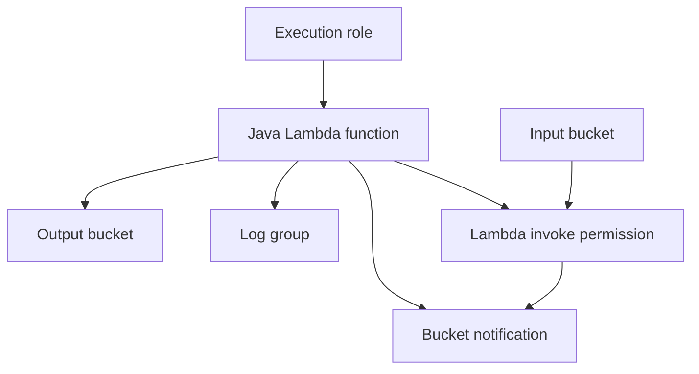
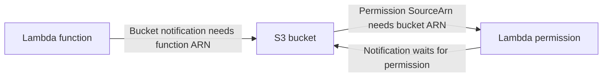
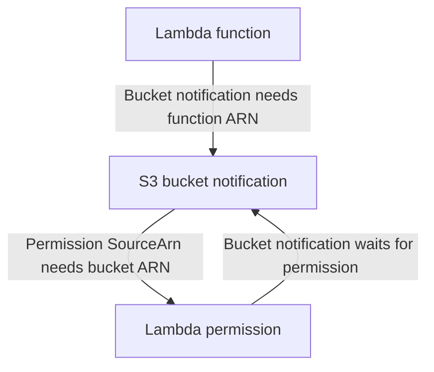
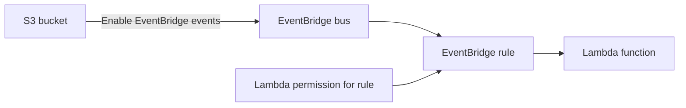
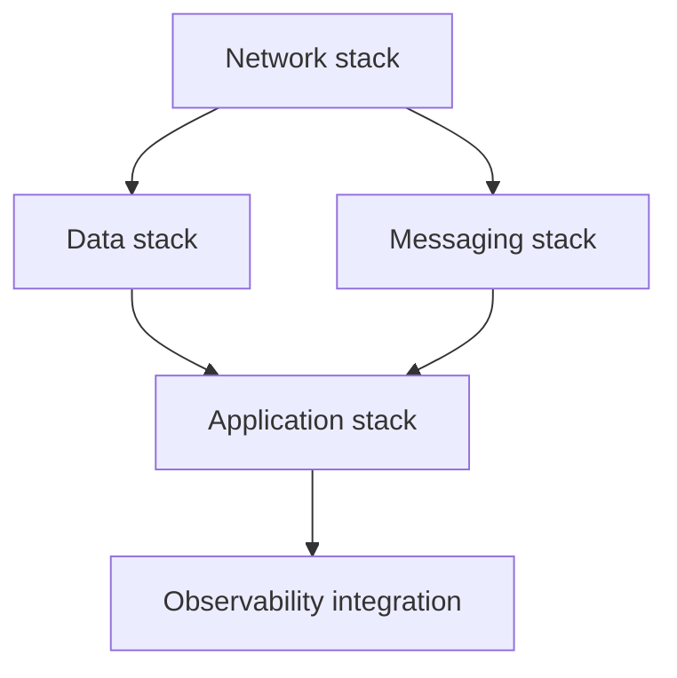
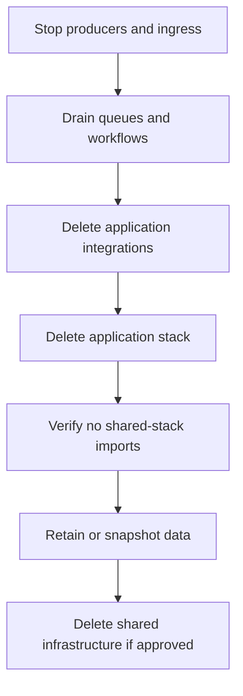

# Xử lý thứ tự triển khai, phụ thuộc vòng và xóa stack an toàn

Một ứng dụng serverless thường được tạo từ nhiều tài nguyên: function, API gateway, queue, event source, bucket, database, IAM role, policy, log group và secret. Khi triển khai bằng Infrastructure as Code (IaC), các tài nguyên này không thể được tạo tùy ý. Một số tài nguyên cần ARN hoặc tên của tài nguyên khác; một số policy chỉ có thể cấp quyền sau khi biết nguồn gọi; và một số dịch vụ cần được cấu hình trigger sau khi function đã tồn tại.

Nếu mô hình hóa sai thứ tự, deployment có thể thất bại vì tài nguyên chưa sẵn sàng hoặc vì hai tài nguyên tham chiếu lẫn nhau. Khi gỡ bỏ môi trường, xóa stack thiếu kiểm soát còn có thể làm mất dữ liệu, log, file đầu vào hoặc database đang được ứng dụng khác sử dụng.

Trong phạm vi **CLOUD_SERVERLESS**, bài học tập trung vào phát triển và triển khai Java function được kích hoạt bởi HTTP, thông điệp hoặc sự kiện. Việc quản lý dependency và vòng đời hạ tầng ảnh hưởng trực tiếp đến trigger, quyền truy cập, trạng thái, retry, khả năng mở rộng và chi phí. Bài này trình bày cách đọc dependency graph, xử lý circular dependency và thiết kế quy trình teardown an toàn.

## 1. IaC mô tả một đồ thị tài nguyên

Một template CloudFormation, CDK app hoặc Terraform configuration mô tả các tài nguyên và mối quan hệ giữa chúng. Có thể hình dung hệ thống là một đồ thị có hướng:

- Mỗi node đại diện cho một tài nguyên hoặc một bước triển khai.
- Một cạnh `A → B` biểu thị B cần A tồn tại hoặc cần giá trị do A cung cấp.
- Bộ triển khai sắp xếp thứ tự tạo, cập nhật và xóa dựa trên các cạnh này.

Ví dụ một Java function xử lý file từ S3:



Sơ đồ thể hiện các quan hệ khái niệm; dependency thực tế phụ thuộc thuộc tính được tham chiếu. Function cần execution role trước khi chạy. S3 cần permission cho phép gọi function. Bucket notification cần biết function ARN và phải được S3 xác minh quyền gọi. Nếu một tài nguyên tham chiếu ngược lại tài nguyên đã phụ thuộc vào nó, đồ thị có thể hình thành chu trình.

IaC không chỉ là danh sách tài nguyên. Một template tốt phải thể hiện được thứ tự triển khai, quyền sở hữu, ranh giới dữ liệu và cách gỡ bỏ tài nguyên.

## 2. Implicit dependency và explicit dependency

Hầu hết công cụ IaC có thể suy ra dependency từ tham chiếu giữa các tài nguyên.

**Implicit dependency** xuất hiện khi một tài nguyên dùng output/attribute của tài nguyên khác. Ví dụ CloudFormation `!GetAtt Function.Arn` hoặc Terraform `aws_lambda_function.processor.arn` khiến công cụ biết tài nguyên đích cần tồn tại trước khi tạo tài nguyên tham chiếu.

**Explicit dependency** được khai báo khi quan hệ thứ tự không thể suy ra từ tham chiếu dữ liệu. Ví dụ một bước custom resource cần chạy sau khi role policy được gắn, dù cấu hình không trực tiếp đọc output của policy.

| Công cụ | Implicit dependency | Explicit dependency |
|---|---|---|
| AWS CloudFormation | `Ref`, `Fn::GetAtt`, `Fn::Sub` tham chiếu resource | `DependsOn` |
| AWS CDK | Tham chiếu construct/attribute và các liên kết construct | `node.addDependency()` hoặc API tương đương |
| Terraform | Tham chiếu attribute giữa resource/module | `depends_on` |
| Google Cloud Deployment Manager / Config Connector | Tham chiếu và quan hệ tài nguyên theo công cụ | Trường dependency hoặc thứ tự apply theo công cụ |
| Azure Bicep / ARM | Tham chiếu symbol/resource | `dependsOn` khi không có tham chiếu suy ra |

Ưu tiên dependency được suy ra từ tham chiếu dữ liệu vì nó diễn đạt lý do phụ thuộc trực tiếp. Chỉ thêm explicit dependency khi cần thứ tự mà graph không thể suy ra. Khai báo `DependsOn` hoặc `depends_on` tràn lan khiến template khó hiểu và có thể làm giảm khả năng triển khai song song.

## 3. Ví dụ thứ tự triển khai trong CloudFormation

Giả sử Lambda cần execution role, role cần policy đọc bucket và function cần được S3 gọi. Template có thể mô tả role trước về mặt logic, nhưng CloudFormation dùng dependency graph chứ không phụ thuộc thứ tự dòng trong YAML.

```yaml
Resources:
  ProcessorRole:
    Type: AWS::IAM::Role
    Properties:
      AssumeRolePolicyDocument:
        Version: '2012-10-17'
        Statement:
          - Effect: Allow
            Principal:
              Service: lambda.amazonaws.com
            Action: sts:AssumeRole

  ProcessorRolePolicy:
    Type: AWS::IAM::Policy
    Properties:
      PolicyName: ReadIncomingObjects
      Roles:
        - !Ref ProcessorRole
      PolicyDocument:
        Version: '2012-10-17'
        Statement:
          - Effect: Allow
            Action: s3:GetObject
            Resource: !Sub '${InputBucket.Arn}/incoming/*'

  ProcessorFunction:
    Type: AWS::Lambda::Function
    Properties:
      Runtime: java21
      Handler: example.Handler::handleRequest
      Role: !GetAtt ProcessorRole.Arn
      Code:
        S3Bucket: deployment-artifacts
        S3Key: processor/function.zip

  AllowBucketInvoke:
    Type: AWS::Lambda::Permission
    Properties:
      FunctionName: !GetAtt ProcessorFunction.Arn
      Action: lambda:InvokeFunction
      Principal: s3.amazonaws.com
      SourceArn: !GetAtt InputBucket.Arn
      SourceAccount: !Ref AWS::AccountId
```

Đây là ví dụ từng phần để minh họa dependency; `InputBucket` cần được khai báo trong cùng template hoặc được truyền vào theo cách phù hợp. Trong thực tế, policy IAM inline/managed và các thuộc tính runtime cần hoàn chỉnh theo artifact và quyền thực tế.

Các quan hệ chính:

- `ProcessorRolePolicy` tham chiếu `ProcessorRole`, nên role phải được tạo trước policy.
- `ProcessorFunction` tham chiếu ARN của role, nên role phải tồn tại trước function.
- `AllowBucketInvoke` tham chiếu function và bucket, nên cả hai phải tồn tại trước permission.
- Nếu bucket notification tham chiếu function ARN, bucket notification phải được cấu hình sau khi function và permission đã sẵn sàng.

CloudFormation tự sắp xếp các tài nguyên dựa trên tham chiếu. Nếu một bước cần chạy sau khi policy đã gắn nhưng không có tham chiếu dữ liệu, `DependsOn` có thể bổ sung quan hệ thứ tự.

## 4. Khi nào cần DependsOn?

Giả sử một resource tùy chỉnh gọi API để đăng ký cấu hình sau khi IAM policy đã được tạo. Nếu resource đó không tham chiếu policy ARN hay output của policy, CloudFormation có thể không biết rằng nó phải chờ policy.

```yaml
RegisterIntegration:
  Type: Custom::IntegrationRegistration
  DependsOn:
    - ProcessorRolePolicy
  Properties:
    ServiceToken: !GetAtt RegistrationFunction.Arn
```

`DependsOn` yêu cầu `RegisterIntegration` chờ `ProcessorRolePolicy`. Khi xóa stack, dependency được đảo chiều: resource phụ thuộc được xóa trước tài nguyên mà nó phụ thuộc.

Không dùng `DependsOn` để che giấu dependency vòng. Nếu A phụ thuộc B và B phụ thuộc A, thêm cạnh thứ ba hoặc ép một thứ tự tùy ý không làm chu trình biến mất. Cần thay đổi ranh giới hoặc trình tự tạo tài nguyên.

## 5. Circular dependency là gì?

Circular dependency xảy ra khi dependency graph có đường đi quay trở lại node ban đầu. Ví dụ:



Trong CloudFormation, chu trình thường biểu hiện bằng lỗi kiểu `Circular dependency between resources`. Terraform có thể báo `Cycle` khi các resource/module tham chiếu lẫn nhau.

Nguyên nhân thường gặp trong serverless:

- S3 bucket notification tham chiếu Lambda function, trong khi Lambda permission hoặc execution policy tham chiếu lại bucket.
- Lambda execution role và policy bị chia resource theo cách tham chiếu hai chiều.
- API Gateway integration tham chiếu Lambda ARN, còn Lambda permission tham chiếu API execution ARN được tạo từ API resource phụ thuộc integration.
- Hai stack export/import output của nhau theo hai chiều.
- Hai module Terraform cùng cần output của module còn lại.
- Custom resource tạo tài nguyên mà chính resource đó lại cần custom resource hoàn tất trước.

Không phải mọi quan hệ hai chiều trong kiến trúc đều tạo dependency cycle trong IaC. Chu trình chỉ tồn tại khi công cụ suy ra các cạnh dependency quay lại cùng node hoặc module.

## 6. Ví dụ kinh điển: S3 notification và Lambda permission

Một bucket notification cần ARN của Lambda function. Đồng thời Lambda permission cần giới hạn `SourceArn` vào bucket cụ thể. Nếu bucket notification được khai báo trong resource bucket và permission tham chiếu bucket, graph có thể trở thành:



Thêm `DependsOn` vào bucket hoặc permission không giải quyết được chu trình vì hai tài nguyên thật sự cần tham chiếu lẫn nhau. Cần tách quá trình triển khai thành các giai đoạn hoặc thay đổi kiến trúc.

### Phương án A: triển khai theo hai giai đoạn

1. Tạo bucket và Lambda function trước, chưa cấu hình notification.
2. Tạo Lambda permission giới hạn bucket ARN.
3. Cập nhật bucket notification để trỏ đến function.

Có thể thực hiện bằng hai stack/module hoặc một pipeline chạy hai lần với tham số/feature flag. Khi dùng nhiều stack, tránh tạo cross-stack export/import hai chiều.

### Phương án B: custom resource cấu hình notification sau

Một custom resource có thể gọi API cấu hình bucket notification sau khi bucket, function và permission đã tồn tại. Custom resource phải có create/update/delete handler idempotent, xử lý retry và dọn cấu hình khi stack bị xóa.

Phương án này linh hoạt nhưng tăng mã vận hành. Cần bảo đảm custom resource không xóa notification do hệ thống khác sở hữu và không để cấu hình cũ tồn tại khi cập nhật.

### Phương án C: dùng EventBridge làm lớp định tuyến

S3 có thể gửi event đến EventBridge. Bucket chỉ cần bật EventBridge notification; EventBridge rule lọc event rồi chuyển đến Lambda. Permission cho phép `events.amazonaws.com` gọi function và giới hạn source bằng rule ARN.



Mô hình này thường loại bỏ tham chiếu trực tiếp từ bucket notification đến Lambda. Tuy nhiên, cần đánh giá độ trễ, chi phí, retry, event filtering và dead-letter behavior của EventBridge. Không chọn EventBridge chỉ để né một lỗi template nếu direct notification đơn giản hơn và không tạo cycle sau khi chia giai đoạn.

## 7. Thiết kế IAM để giảm phụ thuộc vòng

IAM role và policy thường tạo dependency phức tạp vì policy cần ARN tài nguyên, còn resource có thể tham chiếu role hoặc policy. Một số cách giảm rủi ro:

- Tạo execution role độc lập với function; function chỉ tham chiếu role ARN.
- Đưa policy cần thiết vào role theo cách tránh tham chiếu ngược từ role đến function.
- Dùng ARN/prefix ổn định khi phù hợp, nhưng không hard-code giá trị môi trường nếu có thể truyền qua parameter hoặc output.
- Tách quyền invoke (resource-based policy của function) khỏi quyền truy cập dịch vụ (execution role policy).
- Không tạo một policy tổng quát tham chiếu mọi resource nếu điều đó làm graph khó kiểm soát.
- Nếu quyền cần function ARN hoặc API ARN, cấp quyền ở giai đoạn sau khi resource đã tồn tại.

Với Lambda, cần nhớ hai lớp quyền:

1. Execution role cho phép mã function truy cập S3, DynamoDB, SQS, Secrets Manager hoặc dịch vụ khác.
2. Resource-based policy cho phép service hoặc principal khác invoke function.

Tách rõ hai lớp giúp policy dễ review và giảm tham chiếu không cần thiết.

## 8. Dependency giữa stack và module

Khi hệ thống lớn, có thể chia hạ tầng thành nhiều stack/module theo vòng đời hoặc quyền sở hữu:

- **Foundation/network stack:** VPC, subnet, security group, shared endpoint.
- **Data stack:** database, bucket lưu trữ lâu dài, encryption key.
- **Messaging stack:** queue, topic, event bus và dead-letter queue.
- **Application stack:** Java function/service, API gateway và subscription.
- **Observability stack:** log group, dashboard, alert và tracing configuration.

Chia stack giúp giới hạn blast radius và cho phép đội sở hữu từng phần triển khai độc lập. Tuy nhiên, mỗi ranh giới stack tạo thêm contract đầu vào/đầu ra. Cần tránh hai stack import output lẫn nhau.

Ví dụ dependency một chiều:



Trong thực tế, observability stack có thể được tạo trước và application stack tham chiếu log group/alert. Điều quan trọng là chọn hướng dependency nhất quán theo quyền sở hữu và vòng đời. Shared foundation thường được triển khai trước; application layer triển khai sau; teardown đi theo thứ tự ngược.

## 9. Cross-stack reference và export/import

CloudFormation `Export` và `Fn::ImportValue` cho phép stack cung cấp giá trị cho stack khác. Đây là cách hữu ích để chia sẻ VPC ID, subnet ID, bucket ARN hoặc queue ARN.

```yaml
Outputs:
  UploadBucketArn:
    Description: ARN of the shared upload bucket
    Value: !GetAtt UploadBucket.Arn
    Export:
      Name: shared-upload-bucket-arn
```

Stack ứng dụng có thể import:

```yaml
Parameters:
  SharedBucketExportName:
    Type: String
    Default: shared-upload-bucket-arn

Resources:
  ProcessorPolicy:
    Type: AWS::IAM::Policy
    Properties:
      PolicyName: ReadSharedBucket
      Roles:
        - !Ref ProcessorRole
      PolicyDocument:
        Version: '2012-10-17'
        Statement:
          - Effect: Allow
            Action: s3:GetObject
            Resource:
              Fn::Sub:
                - '${BucketArn}/incoming/*'
                - BucketArn:
                    Fn::ImportValue:
                      Fn::Sub: '${SharedBucketExportName}'
```

Ví dụ chỉ minh họa cách import output; cần điều chỉnh cú pháp YAML intrinsic cho parser và template thực tế. Trong CloudFormation, export đang được stack khác import không thể bị thay đổi hoặc xóa cho đến khi consumer ngừng import.

Vì vậy, thay đổi tên export, thay bucket hoặc xóa stack nền tảng cần quy trình chuyển đổi:

1. Cập nhật consumer để không còn phụ thuộc output cũ.
2. Triển khai consumer và xác minh.
3. Xóa import cũ hoặc chuyển sang output mới.
4. Chỉ sau đó mới xóa hoặc thay đổi export ở producer stack.

Tránh tạo dependency vòng giữa hai stack. Nếu cả hai stack cần output của nhau, hãy tạo một stack contract/foundation ở giữa, truyền một phần giá trị qua pipeline parameter hoặc tái cấu trúc để dependency đi một chiều.

## 10. Terraform dependency graph và module design

Terraform xây dựng graph từ tham chiếu resource/module. Ví dụ:

```hcl
resource "aws_iam_role" "processor" {
  name = "processor-role"

  assume_role_policy = jsonencode({
    Version = "2012-10-17"
    Statement = [{
      Effect = "Allow"
      Principal = { Service = "lambda.amazonaws.com" }
      Action = "sts:AssumeRole"
    }]
  })
}

resource "aws_lambda_function" "processor" {
  function_name = "object-processor"
  role          = aws_iam_role.processor.arn
  runtime       = "java21"
  handler       = "example.Handler::handleRequest"
  filename      = "build/function.zip"
}
```

Tham chiếu `aws_iam_role.processor.arn` tạo implicit dependency để role tồn tại trước function. Nếu cần một quan hệ không được suy ra, Terraform hỗ trợ:

```hcl
resource "aws_lambda_permission" "allow_bucket" {
  statement_id  = "AllowBucketInvoke"
  action        = "lambda:InvokeFunction"
  function_name = aws_lambda_function.processor.function_name
  principal     = "s3.amazonaws.com"
  source_arn    = aws_s3_bucket.upload.arn
}
```

Resource permission tham chiếu function và bucket nên graph đã biết hai dependency. Chỉ thêm `depends_on` khi có dependency thực sự nhưng không biểu diễn qua attribute. `depends_on` quá rộng có thể làm Terraform phải thay đổi hoặc chờ nhiều resource hơn cần thiết.

Khi thiết kế module, hãy truyền các giá trị đầu vào cần thiết và export output rõ ràng. Module network không nên gọi ngược module application để lấy ARN function. Nếu module cần biết function để cấu hình trigger, có thể tách trigger integration thành module thứ ba nhận output từ cả hai phía.

## 11. Thay đổi cấu hình và replacement

Không phải mọi thay đổi IaC đều là update tại chỗ. Một số thuộc tính yêu cầu tạo resource mới rồi thay thế resource cũ. Với serverless, replacement có thể ảnh hưởng đến:

- Function ARN/name và các trigger đang gọi function.
- Queue/topic ARN, subscription và message đang chờ.
- Bucket name, object và notification configuration.
- KMS key và dữ liệu đã mã hóa bằng key đó.
- Database endpoint, schema và connection string.
- IAM role name/ARN mà resource khác đang tham chiếu.

Trước khi apply, đọc kế hoạch thay đổi để phân biệt create, update, replace và delete. Kiểm tra resource nào bị thay thế, tài nguyên nào có thể mất dữ liệu và có cần migration hoặc giai đoạn chuyển tiếp hay không.

Với Terraform, `terraform plan` hiển thị các thay đổi dự kiến; dấu `-/+` thường biểu thị replacement. Với CloudFormation, change set cho biết resource nào sẽ bị thay đổi hoặc thay thế. Không áp dụng tự động chỉ vì pipeline tạo được plan; cần review những thay đổi có tác động dữ liệu hoặc downtime.

## 12. Xóa stack an toàn là gì?

Xóa stack không đơn thuần là xóa các file cấu hình. Đây là thao tác gỡ tài nguyên cloud và có thể xóa dữ liệu thật. Một quy trình an toàn cần trả lời:

- Stack có đang được stack hoặc ứng dụng khác tham chiếu không?
- Resource nào là dữ liệu lâu dài và resource nào chỉ là compute tạm?
- Có backup/snapshot và đã kiểm tra khả năng restore chưa?
- Có message đang chờ, event chưa xử lý hoặc workflow đang chạy không?
- Có object version, delete marker, retention lock hoặc legal hold không?
- Có KMS key cần giữ để giải mã backup/object cũ không?
- Có log, metric hoặc trace cần giữ để audit không?
- Có thể rollback nếu quá trình teardown dừng giữa chừng không?

Hãy phân loại resource trước khi xóa:

| Nhóm | Ví dụ | Hành động thường phù hợp |
|---|---|---|
| Compute tạm | Lambda function, Cloud Run service revision | Có thể xóa sau khi ngừng traffic và trigger |
| Integration | API route, event subscription, notification, queue mapping | Ngừng nguồn gọi hoặc drain trước khi xóa |
| Data | S3 bucket, database, object store, persistent disk | Backup/retain và có phê duyệt rõ ràng |
| Security | KMS key, secret, IAM role/policy | Kiểm tra dependency và khả năng khôi phục trước khi xóa |
| Observability | Log group, dashboard, alert, trace storage | Giữ theo retention/audit policy |

Không nên đặt cùng một chính sách deletion cho mọi loại tài nguyên. Function có thể được thay thế thường xuyên; bucket hoặc database có thể chứa dữ liệu không thể tái tạo.

## 13. CloudFormation DeletionPolicy và UpdateReplacePolicy

CloudFormation cung cấp `DeletionPolicy` để quyết định điều gì xảy ra với resource khi resource bị xóa khỏi template hoặc khi stack bị xóa. Các lựa chọn thường gặp:

- `Delete`: xóa resource theo hành vi mặc định của loại tài nguyên.
- `Retain`: giữ resource lại sau khi stack hoặc resource bị xóa; resource không còn được stack quản lý như trước.
- `Snapshot`: tạo snapshot trước khi xóa, chỉ áp dụng cho những loại resource hỗ trợ.
- `RetainExceptOnCreate`: giữ resource trong các trường hợp xóa thông thường nhưng có thể xóa resource vừa tạo trong lần create rollback theo hành vi được tài liệu hóa.

Ví dụ giữ bucket dữ liệu và tạo snapshot database khi stack bị xóa:

```yaml
Resources:
  UploadBucket:
    Type: AWS::S3::Bucket
    DeletionPolicy: Retain
    UpdateReplacePolicy: Retain

  OrdersDatabase:
    Type: AWS::RDS::DBInstance
    DeletionPolicy: Snapshot
    UpdateReplacePolicy: Snapshot
    Properties:
      DBInstanceClass: db.t4g.micro
      Engine: postgres
      AllocatedStorage: 20
```

Đây là ví dụ rút gọn, chưa có đầy đủ thuộc tính production, credential và network. `UpdateReplacePolicy` kiểm soát resource cũ khi một update buộc phải replacement; `DeletionPolicy` kiểm soát khi resource bị xóa khỏi stack hoặc stack bị xóa. Hai policy có mục đích khác nhau.

`Retain` không có nghĩa resource vẫn được quản lý tự động sau khi stack bị xóa. Resource được giữ lại có thể trở thành tài nguyên orphan cần import vào stack khác hoặc quản lý riêng. Hãy ghi lại owner, tên, ARN, tag và quy trình tiếp nhận tài nguyên retained.

## 14. Bảo vệ stack khỏi thao tác xóa nhầm

Với CloudFormation, stack termination protection ngăn stack bị xóa cho đến khi protection được tắt. Đây là lớp bảo vệ ở cấp stack, hữu ích với production hoặc stack chứa tài nguyên quan trọng.

Stack policy có thể giới hạn những update action được phép trên resource. Tuy nhiên, stack policy và termination protection có phạm vi khác nhau; không dùng stack policy thay cho cơ chế bảo vệ xóa stack.

Với CDK, có thể cấu hình removal policy cho construct/resource. Ví dụ khái niệm:

```java
Bucket bucket = Bucket.Builder.create(this, "DataBucket")
        .versioned(true)
        .removalPolicy(RemovalPolicy.RETAIN)
        .build();
```

Tên package và API có thể khác theo phiên bản AWS CDK Java. Hãy kiểm tra resource synthesis để chắc chắn template thực sự chứa policy mong muốn; không chỉ dựa vào cấu hình trong mã.

Các biện pháp bổ sung:

- Dùng account/region riêng cho development, staging và production.
- Áp dụng tag `environment`, `owner`, `data-classification` và `managed-by`.
- Giới hạn quyền `cloudformation:DeleteStack` hoặc quyền destroy theo IAM/approval workflow.
- Bắt buộc review change set/plan với resource có dữ liệu.
- Bật backup, snapshot và retention theo chính sách dữ liệu.
- Có cảnh báo khi ai đó tắt termination protection hoặc xóa resource quan trọng.

## 15. S3 bucket không thể xóa khi còn object

S3 bucket thường phải rỗng trước khi xóa. Bucket bật versioning còn có thể chứa nhiều object version và delete marker; xóa object hiện tại không nhất thiết làm bucket rỗng.

Trước khi xóa bucket:

1. Xác nhận bucket không còn được function, API, replication hoặc hệ thống khác sử dụng.
2. Kiểm tra versioning, object versions, delete markers, multipart uploads và replication.
3. Kiểm tra Object Lock, retention period và legal hold.
4. Xác định dữ liệu cần archive/backup hoặc giữ lại.
5. Chỉ xóa các version/marker theo quy trình đã được phê duyệt.
6. Xóa bucket sau khi xác nhận không còn object và dependency.

Không bật cơ chế tự động xóa toàn bộ object trong bucket production chỉ để stack có thể delete thành công. Một tùy chọn như CDK `autoDeleteObjects` có thể hữu ích cho bucket tạm trong môi trường thử nghiệm, nhưng có khả năng xóa dữ liệu hàng loạt; phải hiểu rõ hành vi và giới hạn quyền trước khi dùng.

## 16. Database, KMS key và secret cần chính sách riêng

Database có thể cần snapshot trước khi xóa. Với RDS, xem xét final snapshot, automated backup retention và khả năng restore. Snapshot phải được tạo ở đúng tài khoản/vùng, có quyền truy cập phù hợp và được kiểm tra bằng restore test nếu dữ liệu quan trọng.

KMS key là tài nguyên đặc biệt: xóa key hoặc lên lịch xóa có thể khiến dữ liệu đã mã hóa không thể giải mã. Trước khi xóa key, xác định mọi object, snapshot, backup, secret và hệ thống còn phụ thuộc. Thường nên giữ key theo vòng đời dữ liệu thay vì vòng đời function.

Secret có thể được tham chiếu bởi nhiều function hoặc deployment pipeline. Trước khi xóa, chuyển consumer sang secret mới, xác nhận không còn invocation dùng secret cũ và tuân thủ thời hạn lưu audit.

## 17. Terraform destroy và bảo vệ dữ liệu

Terraform xóa resource theo dependency graph ngược với thứ tự tạo. Trước khi chạy `terraform destroy`, hãy kiểm tra workspace, backend state, biến môi trường và phạm vi resource sẽ bị xóa.

Ví dụ quy trình review:

```bash
# Kiểm tra workspace và trạng thái hiện tại
terraform workspace show
terraform state list

# Tạo kế hoạch destroy để review
terraform plan -destroy -out=destroy.tfplan

# Hiển thị kế hoạch đã lưu
terraform show destroy.tfplan

# Chỉ sau khi được review/phê duyệt mới thực thi
terraform apply destroy.tfplan
```

Các lệnh trên minh họa quy trình; không chạy `destroy` chỉ để dọn môi trường khi chưa xác minh workspace và state. File plan có thể chứa dữ liệu nhạy cảm trong giá trị cấu hình, nên cần bảo vệ như artifact bí mật.

Terraform hỗ trợ `lifecycle { prevent_destroy = true }` để từ chối kế hoạch xóa resource khi resource vẫn còn trong configuration:

```hcl
resource "aws_db_instance" "orders" {
  identifier = "orders-production"
  engine     = "postgres"

  lifecycle {
    prevent_destroy = true
  }
}
```

`prevent_destroy` là lớp bảo vệ trong Terraform plan, không phải backup và không bảo vệ resource nếu block bị xóa khỏi configuration hoặc state bị thao tác ngoài quy trình. Nó cũng không ngăn người có quyền xóa trực tiếp resource trong cloud console/API.

Không dùng `terraform state rm` để giả vờ xóa resource khỏi cloud; lệnh đó chỉ bỏ resource khỏi state management và để lại tài nguyên ngoài thực tế. Chỉ dùng khi có kế hoạch chuyển quyền quản lý rõ ràng.

## 18. Xóa theo thứ tự ngược và drain workload trước

Khi teardown một ứng dụng event-driven, thứ tự an toàn thường là ngừng nhận công việc mới trước, xử lý hoặc lưu lại công việc đang chờ, rồi mới xóa compute và cuối cùng là tài nguyên nền tảng/dữ liệu.

Một trình tự tham khảo:

1. Tắt hoặc chuyển traffic API; dừng producer và lịch phát event.
2. Tắt S3 notification, EventBridge rule hoặc event source mapping để ngừng invocation mới.
3. Chờ queue drain hoặc quyết định archive/replay message còn tồn.
4. Dừng consumer/Java function sau khi không còn công việc đang xử lý.
5. Gỡ permission, subscription, route và integration không còn dùng.
6. Giữ hoặc snapshot database, bucket, key, secret và log theo chính sách dữ liệu.
7. Xóa stack application.
8. Chỉ xóa shared infrastructure khi xác nhận không còn consumer hoặc stack khác tham chiếu.

Với workflow dài, cần chờ trạng thái terminal hoặc có quy trình cancel/resume. Xóa function khi queue còn message có thể làm mất khả năng xử lý cho đến khi consumer được triển khai lại; xóa queue có thể làm mất message chưa xử lý.

## 19. Cross-stack deletion và thứ tự gỡ dependency

Nếu Application stack import VPC/subnet/bucket output từ Foundation stack, phải xóa Application stack hoặc ngừng import trước khi xóa Foundation stack. CloudFormation sẽ từ chối xóa export đang được import.

Một quy trình teardown nhiều stack:



Nếu một stack shared được nhiều môi trường dùng chung, không xóa stack đó trong quy trình teardown của một ứng dụng đơn lẻ. Cần xác nhận consumer list và owner của tài nguyên trước khi xóa.

## 20. Rollback và xử lý deployment thất bại

Deployment có thể thất bại sau khi một phần tài nguyên đã được tạo. IaC thường rollback các thay đổi trong phạm vi công cụ kiểm soát, nhưng rollback không phải lúc nào cũng khôi phục được mọi side effect.

Ví dụ:

- Custom resource đã gọi API bên ngoài nhưng không có delete handler đúng.
- Function đã xử lý message hoặc ghi object trước khi stack rollback.
- Database migration đã thay đổi schema không thể tự động đảo ngược.
- Resource bị replacement và dữ liệu đã chuyển sang tài nguyên mới.
- Một resource được `Retain` nên vẫn tồn tại sau rollback.

Để giảm rủi ro:

- Thiết kế custom resource idempotent cho create/update/delete.
- Dùng migration tiến về phía trước có khả năng tương thích với code cũ trong giai đoạn rollout.
- Backup dữ liệu trước thay đổi phá hủy hoặc replacement.
- Dùng change set/plan để xem trước hành động.
- Kiểm tra stack events hoặc Terraform output để biết resource cuối cùng ở trạng thái nào.
- Viết quy trình reconcile cho tài nguyên retained hoặc orphan sau rollback.

Không giả định trạng thái `ROLLBACK_COMPLETE` hoặc `apply failed` nghĩa là mọi side effect đã được hoàn tác. Cần kiểm tra tài nguyên và dữ liệu thực tế trước lần deploy tiếp theo.

## 21. Drift detection và quản lý thay đổi ngoài IaC

Drift xảy ra khi tài nguyên cloud bị thay đổi ngoài cấu hình IaC, ví dụ ai đó sửa security group, thêm bucket notification hoặc thay đổi max instances bằng console.

Drift có thể làm dependency graph trong code không còn phản ánh thực tế. Khi xóa stack, công cụ có thể xóa resource hoặc policy mà nhóm khác đã bắt đầu phụ thuộc.

Thực hành tốt:

- Hạn chế chỉnh sửa production trực tiếp ngoài pipeline IaC.
- Dùng drift detection của CloudFormation hoặc quy trình refresh/plan của Terraform.
- Điều tra khác biệt trước khi reconcile; không tự động ghi đè cấu hình ngoài IaC nếu chưa rõ owner.
- Đưa thay đổi hợp lệ vào source of truth và review như một pull request.
- Dùng tag và inventory để nhận diện tài nguyên thuộc stack/module nào.

Drift detection không phát hiện mọi loại thay đổi hoặc side effect. Vẫn cần kiểm tra policy, trigger và dữ liệu ở dịch vụ thực tế.

## 22. Checklist trước khi deploy

| Câu hỏi | Bằng chứng cần có |
|---|---|
| Dependency graph có acyclic? | CloudFormation validate/change set hoặc Terraform plan không báo cycle |
| Tham chiếu có tạo implicit dependency? | ARN, ID, name và output được truyền qua resource reference |
| Có cần explicit ordering? | `DependsOn`/`depends_on` giải thích được lý do |
| Có resource tham chiếu ngược? | Kiểm tra S3 notification, Lambda permission, API route và IAM policy |
| Stack/module có dependency một chiều? | Sơ đồ producer/consumer và outputs được xác định |
| Cross-stack export có owner? | Danh sách consumer và quy trình thay đổi export |
| IAM có đúng scope? | Execution role và resource-based policy tách biệt |
| Replacement có tác động dữ liệu? | Change set/plan được review, có migration/backup |
| Custom resource có cleanup? | Create/update/delete idempotent và retry-safe |
| Có kiểm thử deploy mới? | Staging deployment và smoke test trigger |

## 23. Checklist trước khi xóa stack

| Câu hỏi | Bằng chứng cần có |
|---|---|
| Đúng account, region, project và workspace? | Xác nhận context trước lệnh delete/destroy |
| Có stack/module khác tham chiếu? | Không còn import/export hoặc consumer dependency |
| Traffic và event source đã dừng? | API, schedule, S3 notification, EventBridge và event mapping đã được xử lý |
| Queue/workflow đã drain? | Backlog bằng 0 hoặc message được archive/replay theo quyết định |
| Database đã backup? | Snapshot, backup retention và restore test phù hợp |
| Bucket có cần giữ object/version? | Inventory, versioning, retention và legal hold đã kiểm tra |
| KMS key có còn được dùng? | Dependency của object, backup, secret và snapshot đã được xác nhận |
| Log và audit có cần giữ? | Retention policy và export phù hợp |
| Deletion protection đã được xử lý đúng? | Termination protection, `DeletionPolicy`, `prevent_destroy` được review |
| Có plan destroy/change set? | Danh sách resource bị xóa/replaced đã được review và phê duyệt |
| Có owner cho resource retained? | Tag, ARN, tài liệu bàn giao và quy trình quản lý tiếp theo |
| Có thể phục hồi nếu xóa nhầm? | Backup, restore procedure và người chịu trách nhiệm |

## 24. Mẫu quy trình quản lý vòng đời hạ tầng serverless

Một quy trình thống nhất có thể chia thành ba giai đoạn:

**Provision:** tạo shared foundation trước, sau đó tạo data/messaging, rồi tạo Java function/API và cuối cùng cấu hình trigger/integration. Kiểm tra dependency graph không có chu trình và quyền được cấp theo least privilege.

**Operate and change:** mọi thay đổi đi qua pull request và plan/change set. Phân biệt update tại chỗ với replacement; với thay đổi có dữ liệu, cần migration, backup và rollout theo giai đoạn. Theo dõi drift và dependency giữa stack.

**Decommission:** ngừng producer/ingress, drain event và workflow, xóa integration, xóa application stack, giữ/snapshot dữ liệu, rồi mới xem xét xóa shared foundation. Mọi tài nguyên retained phải có owner và quy trình quản lý sau khi stack bị xóa.

Thứ tự triển khai đúng giúp function chỉ được kích hoạt khi quyền và dependency đã sẵn sàng. Dependency graph không có chu trình giúp deployment có thể được lập lịch và rollback rõ ràng. Quy trình xóa có kiểm soát bảo vệ dữ liệu, message đang chờ và tài nguyên dùng chung. Đây là những điều kiện cần để vận hành Java serverless an toàn qua nhiều lần phát hành và nhiều môi trường.
