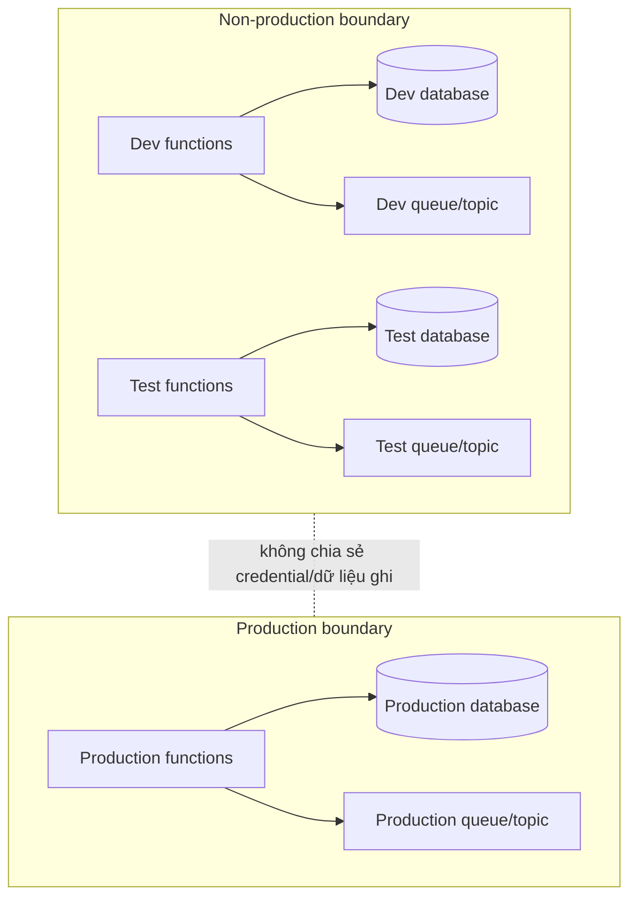
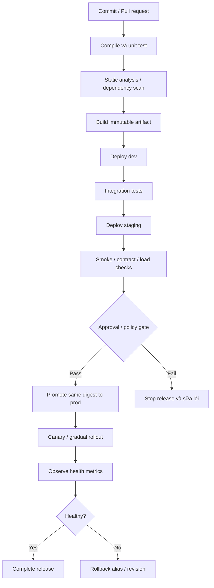

# Phân tách môi trường phát triển, kiểm thử và production

Một ứng dụng Java serverless thường chạy ở nhiều môi trường: máy cá nhân, development, integration test, staging và production. Mỗi môi trường có endpoint, database, queue, secret, quyền IAM, network và giới hạn tài nguyên khác nhau. Nếu function production vô tình dùng database test, hoặc một bản deploy staging ghi vào queue production, lỗi cấu hình có thể gây mất dữ liệu dù code không có bug.

Phân tách môi trường là cách tạo ranh giới rõ ràng giữa dữ liệu, danh tính, hạ tầng và quy trình phát hành. Mục tiêu là để nhóm có thể thử nghiệm và triển khai thường xuyên mà không làm ảnh hưởng workload thật, đồng thời bảo đảm artifact đã kiểm thử chính là artifact được phát hành.

Trong serverless, ranh giới môi trường cần bao phủ cả function lẫn các dịch vụ xung quanh: API Gateway/HTTP endpoint, event bus, queue, database, object storage, secret store, workflow, log và monitoring. Chỉ đổi tên function thành `orders-dev` hay `orders-prod` chưa đủ nếu cả hai vẫn dùng chung role có quyền rộng, cùng bucket hoặc cùng database.

## 1. Môi trường phát triển, kiểm thử và production

### 1.1. Vai trò của từng môi trường

| Môi trường | Mục đích | Dữ liệu và quyền truy cập | Đặc điểm vận hành |
| --- | --- | --- | --- |
| Local | Phát triển nhanh, debug và unit test | Fixture/synthetic data; credential giả hoặc danh tính dev giới hạn | Có thể dùng emulator, container hoặc mock dependency |
| Development (dev) | Tích hợp code mới và thử tính năng | Dữ liệu tổng hợp; quyền ghi trong phạm vi dev | Có thể thay đổi thường xuyên, dễ reset |
| Integration/Test | Kiểm tra function với queue, database, API và event thật trong môi trường cô lập | Dataset kiểm thử có kiểm soát; không dùng dữ liệu production trực tiếp | Kiểm tra contract, retry, idempotency và tích hợp |
| Staging/Pre-production | Diễn tập phát hành gần giống production | Dữ liệu đã ẩn danh hoặc synthetic; quyền gần production nhưng phạm vi riêng | Kiểm tra cấu hình, tải, rollout và rollback |
| Production (prod) | Phục vụ người dùng và nghiệp vụ thật | Dữ liệu thật; quyền tối thiểu, audit và kiểm soát thay đổi nghiêm ngặt | SLA, backup, alert, on-call và quy trình incident |

Không phải dự án nào cũng cần năm môi trường riêng biệt. Một nhóm nhỏ có thể dùng local, dev, staging và production. Điều quan trọng là mỗi môi trường có mục đích, dữ liệu, quyền và chính sách triển khai được định nghĩa rõ.

### 1.2. Mức độ cô lập

Có thể cô lập môi trường ở nhiều lớp:

- **Account/project/subscription:** ranh giới quản trị và billing mạnh; giảm nguy cơ thao tác nhầm giữa môi trường.
- **Network:** VPC/VNet, subnet, firewall, private endpoint và DNS riêng.
- **Identity:** runtime service account/role riêng, secret access và quyền deploy riêng.
- **Data:** database, bucket, queue, topic và cache riêng.
- **Compute:** cluster, namespace, function/service, concurrency và quota riêng.
- **Operations:** log group, metric namespace, alert, dashboard và retention riêng.

Mô hình cô lập mạnh thường dùng cloud account hoặc project riêng cho production và non-production. Namespace hoặc prefix riêng trong cùng account/project có thể đủ cho một số workload nhỏ, nhưng cần hiểu rõ các tài nguyên nào có thể bị chia sẻ và tác động khi policy hoặc quota thay đổi.



### 1.3. Chọn ranh giới theo rủi ro

Một môi trường không cần được tách bằng một cloud account riêng trong mọi trường hợp. Hãy đánh giá:

- hậu quả nếu code dev ghi nhầm dữ liệu thật;
- ai có quyền deploy và thay đổi IAM;
- yêu cầu audit, data residency và compliance;
- mức độ chia sẻ network hoặc database;
- khả năng đặt quota, billing và alert riêng;
- chi phí vận hành thêm account/project/cluster.

Với production chứa dữ liệu nhạy cảm hoặc workload quan trọng, account/project riêng thường tạo ranh giới tốt hơn. Với dev/test, có thể dùng chung account non-production nhưng vẫn tách database, bucket, queue, service account và secret theo môi trường.

## 2. Những gì phải tách giữa các môi trường

### 2.1. Function và endpoint

Đặt tên function/service/route có quy ước rõ, ví dụ `orders-api-dev`, `orders-api-staging`, `orders-api-prod`. Mỗi môi trường có endpoint và DNS riêng. Tránh để client staging trỏ nhầm API production hoặc để webhook production gửi event vào endpoint dev.

Không dựa vào tên để bảo vệ tài nguyên. Authorization policy và resource boundary phải ngăn function dev gọi hoặc ghi vào tài nguyên production ngay cả khi code bị cấu hình sai.

### 2.2. Database và schema

Dev/test/staging nên có database hoặc ít nhất schema và credential riêng. Tránh dùng chung database production để kiểm thử tích hợp vì test có thể:

- ghi hoặc xóa dữ liệu thật;
- tạo lock và làm chậm truy vấn production;
- chạy migration không tương thích;
- gửi thông báo hoặc thanh toán thật;
- làm lộ dữ liệu cá nhân cho người không có quyền.

Nếu cần dữ liệu gần production, tạo bản sao đã ẩn danh hoặc synthetic dataset. Không sao chép dữ liệu nhạy cảm sang dev một cách tùy tiện. Kiểm tra cả backup, export, log và cache vì dữ liệu có thể tồn tại ngoài bảng chính.

### 2.3. Queue, topic và event bus

Mỗi môi trường cần queue/topic/event bus riêng hoặc namespace được kiểm soát rõ. Ví dụ:

```text
orders-created-dev
orders-created-test
orders-created-staging
orders-created-prod
```

Không cho consumer dev subscribe queue production. Event routing rule cần giới hạn source, account/project, event type và môi trường. Khi test retry hoặc DLQ, dùng queue riêng để message kiểm thử không làm tăng backlog production.

### 2.4. Object storage và file tạm

Bucket hoặc container lưu file nên tách theo môi trường. Dùng policy giới hạn prefix nếu chia sẻ một bucket là lựa chọn có chủ đích, nhưng lưu ý quyền bucket, lifecycle, encryption key và event notification có thể ảnh hưởng nhiều prefix.

Đặc biệt, function xử lý object có thể tạo event mới khi ghi output. Nếu dev và prod dùng chung bucket/notification, một lần upload test có thể kích hoạt function production. Tách bucket hoặc cấu hình filter theo prefix và kiểm thử event routing.

### 2.5. Cache và state store

Cache, session store, idempotency table và workflow state cũng cần ranh giới môi trường. Nếu staging dùng chung cache keyspace với production, một key trùng có thể trả dữ liệu sai hoặc xóa cache thật. Dùng instance riêng hoặc namespace/prefix và credential riêng theo khả năng dịch vụ.

### 2.6. IAM role và service account

Mỗi runtime nên có danh tính riêng. `orders-dev` chỉ đọc secret dev và ghi bảng dev; `orders-prod` chỉ có quyền cần thiết cho bảng/secret production. Không dùng một execution role/service account quản trị rộng cho mọi môi trường.

Tách cả danh tính deployer và runtime:

- Developer/CI principal có quyền deploy vào môi trường được phép.
- Runtime identity chỉ có quyền mà function cần khi chạy.
- Trigger identity có quyền invoke/nhận event theo cấu hình.
- Build identity có quyền đọc source và ghi artifact registry.

Việc tách này giảm tác động nếu credential dev bị lộ hoặc một function có lỗ hổng.

## 3. Cấu hình phải nằm ngoài artifact

### 3.1. Build một artifact, cấu hình theo môi trường

Một nguyên tắc phát hành hữu ích là build artifact bất biến một lần, sau đó promote chính artifact đó qua test, staging và production. Khác biệt giữa môi trường được cung cấp bằng configuration, identity và hạ tầng.

Ví dụ, cùng một JAR `orders-service-1.8.0.jar` có thể chạy ở staging và production với endpoint database, secret reference, log level và concurrency khác nhau. Nếu build riêng JAR cho từng môi trường, có nguy cơ code hoặc dependency giữa các artifact không còn giống nhau.

Artifact nên có version hoặc digest để xác định chính xác nội dung đã kiểm thử. CI/CD có thể lưu checksum, image digest, SBOM và kết quả kiểm tra bảo mật cùng bản phát hành.

### 3.2. Phân loại cấu hình

| Loại | Ví dụ | Cách quản lý |
| --- | --- | --- |
| Cấu hình không nhạy cảm | Region, endpoint, tên bucket, queue, feature flag | Environment variables hoặc config service |
| Secret | DB password, API key, signing key | Secret Manager/Secrets Manager/Key Vault tương ứng |
| Hạ tầng | Memory, timeout, concurrency, VPC, trigger | Infrastructure as Code (IaC) hoặc deployment manifest |
| Runtime policy | Log level, retry limit, batch size, feature rollout | Config có version và validation |
| Business data | Đơn hàng, hồ sơ, trạng thái workflow | Database/state store riêng môi trường |

Không nhúng password, private key hoặc token vào source code, JAR, container image, Git repository hay event payload. Mã hóa file cấu hình không thay thế việc kiểm soát ai có thể giải mã và sử dụng secret.

### 3.3. Ví dụ Java đọc environment variables

Java handler có thể đọc cấu hình khi khởi tạo application component:

```java
import java.util.Set;

public record AppConfig(
        String environment,
        String ordersTable,
        String queueName,
        String logLevel) {

    public static AppConfig fromEnvironment() {
        String environment = required("APP_ENV");
        String ordersTable = required("ORDERS_TABLE");
        String queueName = required("ORDERS_QUEUE");
        String logLevel = System.getenv().getOrDefault("LOG_LEVEL", "INFO");

        if (!Set.of("dev", "test", "staging", "prod").contains(environment)) {
            throw new IllegalStateException("Unsupported APP_ENV value");
        }

        return new AppConfig(environment, ordersTable, queueName, logLevel);
    }

    private static String required(String name) {
        String value = System.getenv(name);
        if (value == null || value.isBlank()) {
            throw new IllegalStateException("Missing required configuration: " + name);
        }
        return value;
    }
}
```

Ví dụ dùng `Set` nên cần `import java.util.Set;`. Việc validate cấu hình lúc khởi động giúp phát hiện sớm thiếu biến hoặc giá trị sai, thay vì đợi đến khi request đầu tiên gọi dependency. Không đưa giá trị secret vào exception message.

### 3.4. Tránh dùng APP_ENV làm cơ chế bảo mật

Biến `APP_ENV=dev` hữu ích cho log, metric và lựa chọn cấu hình. Nhưng nếu code chỉ dựa vào biến này để quyết định có được ghi vào production hay không, một lỗi cấu hình có thể phá vỡ ranh giới bảo mật.

Quyền truy cập phải được giới hạn ở IAM, database grants, bucket policy, network và resource boundary. Ngay cả khi function dev vô tình nhận `APP_ENV=prod`, runtime identity dev cũng không được có quyền ghi tài nguyên production.

### 3.5. Thứ tự ưu tiên cấu hình

Một ứng dụng có thể nhận cấu hình từ nhiều nơi: default trong code, file cấu hình, environment variable, config service và secret store. Hãy định nghĩa thứ tự ưu tiên rõ ràng, ví dụ:

1. Default an toàn trong ứng dụng.
2. File cấu hình không nhạy cảm được đóng gói.
3. Environment variables do nền tảng triển khai cung cấp.
4. Config service cho giá trị có thể thay đổi theo thời gian.
5. Secret store cho credential nhạy cảm.

Không để nhiều nguồn cùng ghi đè một giá trị mà không có quy tắc. Khi khởi động, có thể log tên cấu hình và nguồn của nó nhưng không log secret value.

## 4. Quản lý secret theo môi trường

### 4.1. Một secret riêng cho mỗi môi trường

Ví dụ:

```text
dev/orders-db-password
test/orders-db-password
staging/orders-db-password
prod/orders-db-password
```

Hoặc dùng project/account riêng và cùng secret ID trong mỗi project. Cách thứ hai giúp code giữ tên secret nhất quán trong khi quyền và dữ liệu được tách theo project/account.

Runtime identity dev chỉ được đọc secret dev; runtime identity prod chỉ đọc secret prod. Không cấp quyền đọc toàn bộ secret của project production cho service account dev.

### 4.2. Rotation và versioning

Secret cần có vòng đời: tạo, phân phối, rotation, thu hồi và audit. Khi thay password database, phối hợp rotation với database và connection pool. Nếu function cache secret trong process, đặt TTL và xử lý trường hợp credential cũ bị từ chối.

Staging nên kiểm thử rotation trước khi thực hiện ở production. Không dùng cùng secret value giữa staging và production chỉ để giảm công cấu hình.

### 4.3. Không để secret xuất hiện trong pipeline

Pipeline cần deploy function mà không in secret ra log. Hạn chế truyền secret dưới dạng command-line argument vì có thể xuất hiện trong process listing hoặc shell history. Ưu tiên secret store integration và quyền đọc ngắn hạn của CI principal.

Build artifact không cần chứa production secret. Nếu một pipeline build image có quyền đọc secret production, mọi bước build hoặc dependency script có thể trở thành đường lấy secret; nên tách build và deploy, chỉ cấp quyền secret runtime cho workload cần dùng.

## 5. Environment parity và khác biệt có chủ đích

### 5.1. Giữ cấu trúc giống nhau

Staging nên gần production về:

- runtime Java và operating environment;
- artifact/container image;
- trigger type và event schema;
- database engine/version và migration process;
- network path và TLS;
- IAM pattern và secret injection;
- concurrency, timeout và retry semantics;
- logging/tracing và deployment strategy.

Không nhất thiết staging có cùng quy mô hoặc SLA với production. Có thể dùng instance nhỏ hơn và traffic thấp hơn, nhưng cần ghi nhận các khác biệt vì chúng có thể che giấu lỗi capacity hoặc timeout.

### 5.2. Những khác biệt phải được khai báo

Một số khác biệt là cần thiết:

- database endpoint và dataset;
- bucket/queue/topic;
- service account/role;
- secret version/reference;
- memory, timeout, concurrency và min/max instance;
- domain, callback URL và webhook destination;
- log level, alert threshold và retention.

Đưa các khác biệt này vào cấu hình có version hoặc IaC. Tránh chỉnh tay console mà không cập nhật source of truth.

### 5.3. Không giả định staging có thể đại diện hoàn toàn cho production

Staging thường ít traffic hơn, dữ liệu nhỏ hơn và ít cạnh tranh tài nguyên hơn. Vì vậy, nó có thể không bộc lộ:

- connection exhaustion khi Lambda/Cloud Run scale-out;
- hot partition hoặc lock contention;
- queue backlog kéo dài;
- cold start ở tải thấp;
- log/metric cardinality ở quy mô lớn;
- rate limit của dependency.

Bổ sung load test có kiểm soát và canary production. Không đưa test tải lớn vào production nếu chưa có giới hạn, lịch và phê duyệt vận hành phù hợp.

## 6. CI/CD: promote cùng một artifact

### 6.1. Pipeline tham khảo



Một pipeline tốt giữ artifact bất biến sau build. Các bước deploy thay đổi cấu hình và hạ tầng môi trường, không biên dịch lại code với dependency khác cho production.

### 6.2. Kiểm tra trước khi deploy

Pipeline nên kiểm tra:

- unit test và integration test;
- code style, static analysis và vulnerability scan;
- dependency/license policy;
- artifact checksum hoặc image digest;
- cấu hình bắt buộc và secret reference;
- IAM permission diff;
- IaC plan và thay đổi destructive;
- compatibility của event schema và database migration.

Không đưa secret value vào artifact metadata hoặc pipeline output. Chỉ lưu reference, version hoặc checksum an toàn khi cần truy vết.

### 6.3. Promotion giữa môi trường

Một quy trình có thể như sau:

1. Build `orders-api:1.8.0` một lần.
2. Deploy digest đó vào dev và chạy smoke test.
3. Promote cùng digest vào test/staging.
4. Chạy contract, integration, security và performance checks.
5. Có approval theo policy để phát hành production.
6. Cập nhật alias/revision/traffic để production dùng digest đã kiểm thử.
7. Quan sát metric và rollback nếu vượt ngưỡng lỗi.

Nếu cần build lại artifact, đó là một bản build mới và phải chạy lại các gate cần thiết. Không gắn cùng version tag cho hai image có digest khác nhau.

## 7. Infrastructure as Code và tránh configuration drift

### 7.1. Quản lý hạ tầng bằng code

Function, role, policy, trigger, queue, database parameter, network và monitoring nên được khai báo bằng IaC như Terraform, AWS SAM/CDK/CloudFormation hoặc Google Cloud deployment tooling tương ứng.

IaC giúp:

- review thay đổi trước khi áp dụng;
- tái tạo môi trường;
- phát hiện quyền bị mở rộng;
- so sánh dev/staging/prod;
- lưu lịch sử và rollback cấu hình;
- giảm thao tác thủ công không được ghi nhận.

Có thể dùng module chung cho cấu trúc function và truyền giá trị khác nhau theo environment. Nhưng không nên dùng một biến chung khiến production vô tình kế thừa quyền hoặc endpoint của dev.

### 7.2. Tách state và quyền deploy

Nếu IaC dùng remote state, tách state theo account/project và môi trường, giới hạn quyền đọc/ghi. State có thể chứa resource metadata hoặc secret value tùy provider; bảo vệ nó như dữ liệu nhạy cảm.

CI principal dev không nên có quyền apply production state. Tách pipeline environment, approval và credential federation. Tránh lưu cloud key dài hạn trong repository.

### 7.3. Detect drift

Configuration drift xảy ra khi tài nguyên thực tế khác với khai báo IaC. Ví dụ, một người bật public access cho bucket qua console nhưng source IaC vẫn để private. Nếu pipeline không phát hiện, lần deploy tiếp theo có thể không sửa hoặc vô tình ghi đè thay đổi.

Chạy plan/drift detection định kỳ và review thay đổi IAM, network, secret policy, trigger và concurrency. Mọi hotfix production cần được đưa trở lại IaC để source of truth không bị lệch.

## 8. Kiểm thử theo từng môi trường

### 8.1. Local và unit test

Unit test nên kiểm tra domain logic mà không cần cloud resource thật. Inject interface cho repository, clock, HTTP client và event publisher để test được:

- validation và business rules;
- mapping input/output;
- idempotency decision;
- retry classification;
- error mapping;
- behavior khi dependency timeout hoặc trả dữ liệu sai.

Mock không thay thế integration test. Mock chỉ chứng minh code phản ứng với hành vi giả định; nó không chứng minh IAM, network, schema hay event source mapping đã đúng.

### 8.2. Integration test

Test tích hợp cần kiểm tra các thành phần thật hoặc emulator tương thích:

- function nhận đúng event schema;
- quyền runtime identity truy cập resource;
- database migration và transaction;
- queue acknowledgement, retry và DLQ;
- object storage notification;
- secret retrieval và TLS;
- timeout/concurrency theo cấu hình.

Không để integration test có thể publish message sang topic production hoặc gửi email/thanh toán thật. Dùng sandbox account, fake provider hoặc destination giả lập.

### 8.3. Contract test

Với event-driven system, schema event là hợp đồng giữa producer và consumer. Kiểm tra field bắt buộc, version, enum, timestamp, encoding và backward compatibility. Producer staging phải phát event vào topic staging; consumer staging đọc đúng topic đó.

Nếu thay schema, dùng chiến lược tương thích như thêm field optional trước, cập nhật consumer rồi mới chuyển producer. Không deploy producer mới tạo event mà consumer production chưa hiểu.

### 8.4. End-to-end và smoke test

Smoke test sau deploy nên kiểm tra endpoint hoặc event flow tối thiểu, không chạy dữ liệu có side effect thật. Có thể dùng health endpoint, synthetic request với tenant test hoặc message đánh dấu test.

E2E test cần xác minh cả kết quả cuối trong state store và các tác động phụ được kiểm soát. Một HTTP 202 chỉ chứng minh request được nhận theo hợp đồng; chưa chắc workflow xử lý xong.

### 8.5. Performance và resilience test

Staging nên có test:

- tải trung bình và peak;
- cold start và scale-from-zero;
- burst concurrency;
- database connection limit;
- dependency latency và rate limit;
- retry storm và poison message;
- duplicate event và idempotency;
- failover hoặc mất kết nối;
- memory pressure và timeout.

Giới hạn test để không gây ảnh hưởng hệ thống dùng chung. Dữ liệu kiểm thử cần được làm sạch hoặc có TTL.

## 9. Database migration và tương thích khi deploy

### 9.1. Không giả định code và schema đổi cùng lúc

Serverless thường có nhiều revision chạy đồng thời trong rollout. Event có thể được giữ trong queue nhiều phút hoặc nhiều giờ. Vì vậy, code mới có thể đọc dữ liệu do code cũ ghi và ngược lại.

Dùng chiến lược **expand-and-contract**:

1. Expand: thêm cột/table/index mới theo cách tương thích ngược.
2. Deploy code có thể đọc cả schema cũ và mới.
3. Backfill hoặc dual-write nếu cần, có kiểm soát.
4. Chuyển toàn bộ traffic và consumer sang schema mới.
5. Contract: xóa cột hoặc constraint cũ sau khi chắc chắn không còn revision/event phụ thuộc.

Không xóa hoặc đổi tên cột ngay trong cùng lần deploy mà code cũ vẫn đang chạy.

### 9.2. Migration nên có owner rõ ràng

Không nên để mọi Lambda instance tự chạy migration khi cold start. Nhiều instance có thể đồng thời chạy migration và gây lock hoặc race. Dùng một bước migration riêng trong pipeline/job có quyền phù hợp, lock/version kiểm soát và audit.

Runtime role thường không cần quyền DDL rộng. Tách migration identity khỏi application runtime identity.

## 10. Chiến lược deploy và rollback

### 10.1. Rolling, blue/green và canary

- **Rolling:** thay dần instance/revision; cần tương thích giữa code cũ và mới.
- **Blue/green:** chạy hai revision/environment và chuyển traffic khi bản mới sẵn sàng; cần tính chi phí chạy song song.
- **Canary:** chuyển một tỷ lệ nhỏ traffic hoặc event sang bản mới, quan sát rồi tăng dần.

Serverless platform có thể hỗ trợ version, alias, revision hoặc traffic splitting. Cách cấu hình cụ thể phụ thuộc nền tảng. Với queue consumer, chuyển traffic không giống HTTP; cần kiểm soát event source mapping, concurrency và khả năng đọc message cũ.

### 10.2. Điều kiện rollback

Đặt ngưỡng trước khi deploy:

- error rate tăng;
- p95/p99 latency vượt ngưỡng;
- timeout/throttle tăng;
- queue age/backlog tăng;
- database connection hoặc lock wait tăng;
- business success rate giảm;
- cost per successful operation tăng bất thường.

Rollback code không tự đảo ngược database migration hoặc side effect đã thực hiện. Cần bảo đảm schema vẫn tương thích với version cũ và có quy trình compensation/forward fix nếu dữ liệu đã thay đổi.

### 10.3. Feature flag

Feature flag cho phép bật tính năng theo môi trường, tenant hoặc tỷ lệ traffic mà không cần deploy code mới. Flag cần có owner, default an toàn, expiry và audit. Không dùng feature flag thay cho IAM hoặc authorization.

Một flag production phải được kiểm soát quyền thay đổi và có khả năng rollback nhanh. Tránh để flag cũ tồn tại vô thời hạn vì chúng làm tăng nhánh logic và chi phí kiểm thử.

## 11. Quản lý tài nguyên và chi phí theo môi trường

Non-production vẫn có thể phát sinh chi phí lớn nếu function, database, queue và log không được dọn dẹp. Đặt budget/quota và chính sách lifecycle:

- giới hạn max concurrency và min instances;
- tắt hoặc scale down resource dev ngoài giờ nếu phù hợp;
- TTL cho test object, database snapshot và message;
- retention log riêng cho dev/test;
- tự động xóa preview environment sau khi PR đóng;
- quota riêng để load test không chiếm capacity production.

Không áp dụng chính sách scale-to-zero hoặc retention ngắn cho production chỉ để giảm chi phí nếu vi phạm SLA, audit hoặc khả năng điều tra.

## 12. Quan sát và audit theo môi trường

Mỗi môi trường nên có dashboard và alert phù hợp. Dev có thể log chi tiết hơn trong thời gian ngắn; production cần log có cấu trúc, redaction và retention theo chính sách.

Các trường hữu ích:

- environment, service và function version;
- request ID, trace ID, event ID và correlation ID;
- artifact digest hoặc build version;
- tenant/business key ở dạng được phép;
- retry attempt và failure category;
- deployment ID và change reference.

Không dùng environment label để ghi secret hoặc dữ liệu nhạy cảm. Tránh high-cardinality metric label như request ID. Audit log nên ghi principal, hành động, resource và thời điểm thay đổi IAM/configuration.

## 13. Ví dụ cấu trúc cấu hình theo môi trường

Ví dụ file cấu hình không chứa secret:

```yaml
app:
  name: orders-api
  logLevel: INFO

environments:
  dev:
    databaseInstance: orders-dev
    ordersTable: OrdersDev
    queue: orders-created-dev
    maxConcurrency: 5
  staging:
    databaseInstance: orders-staging
    ordersTable: OrdersStaging
    queue: orders-created-staging
    maxConcurrency: 10
  prod:
    databaseInstance: orders-prod
    ordersTable: Orders
    queue: orders-created-prod
    maxConcurrency: 100
```

Đây là ví dụ cấu trúc khái niệm; cách inject vào Lambda/Cloud Run và cú pháp IaC tùy nền tảng. Không đặt password trong file này. Secret reference nên được quản lý riêng theo môi trường và runtime identity tương ứng.

Một cấu hình production cần được kiểm tra trước khi áp dụng: `maxConcurrency` phải phù hợp với database và downstream capacity. Không sao chép giá trị từ ví dụ vào môi trường thật mà chưa đo tải.

## 14. Checklist phân tách môi trường

- [ ] Mỗi môi trường có mục đích, owner và chính sách deploy rõ ràng.
- [ ] Production có account/project hoặc ranh giới bảo vệ phù hợp với mức rủi ro.
- [ ] Function endpoint, trigger và event routing được tách theo môi trường.
- [ ] Database, schema, bucket, queue, topic, cache và workflow state được tách hoặc namespace an toàn.
- [ ] Dev/test không thể ghi vào dữ liệu production bằng runtime identity.
- [ ] Runtime service account/role riêng cho mỗi workload và môi trường.
- [ ] Deployer, build identity và trigger identity được tách khỏi runtime identity.
- [ ] Secret riêng theo môi trường, quyền accessor tối thiểu và rotation được kiểm thử.
- [ ] Artifact bất biến được build một lần và promote qua các môi trường.
- [ ] Cấu hình không nhạy cảm được inject ngoài artifact; secret không nằm trong source/image/log.
- [ ] Staging đủ giống production về runtime, event contract, IAM pattern và network path.
- [ ] IaC quản lý function, trigger, role, network, database và monitoring.
- [ ] Có drift detection và quy trình đưa hotfix trở lại IaC.
- [ ] Unit, integration, contract, smoke, load và resilience test có phạm vi riêng.
- [ ] Database migration tương thích với code cũ/mới trong rollout.
- [ ] Có canary/gradual rollout và ngưỡng rollback đo được.
- [ ] Rollback không làm hỏng schema hoặc side effect đã thực hiện.
- [ ] Non-production có budget, quota, TTL và cleanup.
- [ ] Log/metric/tracing tách theo môi trường và không làm lộ dữ liệu nhạy cảm.

## Kết luận

Phân tách dev, test, staging và production là phân tách cả identity, network, data, secret, trigger và quy trình vận hành. Một biến `APP_ENV` hoặc tên function khác nhau không tạo ra ranh giới bảo mật. Production cần được bảo vệ bằng account/project, IAM, resource policy và network phù hợp; dev/test phải dùng dữ liệu và credential riêng.

Hãy build artifact bất biến một lần, quản lý cấu hình ngoài artifact, dùng IaC để tái tạo môi trường và promote cùng digest qua các bước kiểm thử. Staging cần đủ giống production để phát hiện lỗi cấu hình và tích hợp, còn canary/rollback giúp giảm rủi ro khi triển khai. Với database và event-driven workload, luôn tính đến nhiều revision chạy đồng thời, message cũ, schema compatibility, retry và side effect.

Một quy trình môi trường tốt không chỉ giúp tránh ghi nhầm dữ liệu thật; nó còn làm cho phát hành có thể lặp lại, audit được và phục hồi có kiểm soát khi thay đổi gây sự cố.
