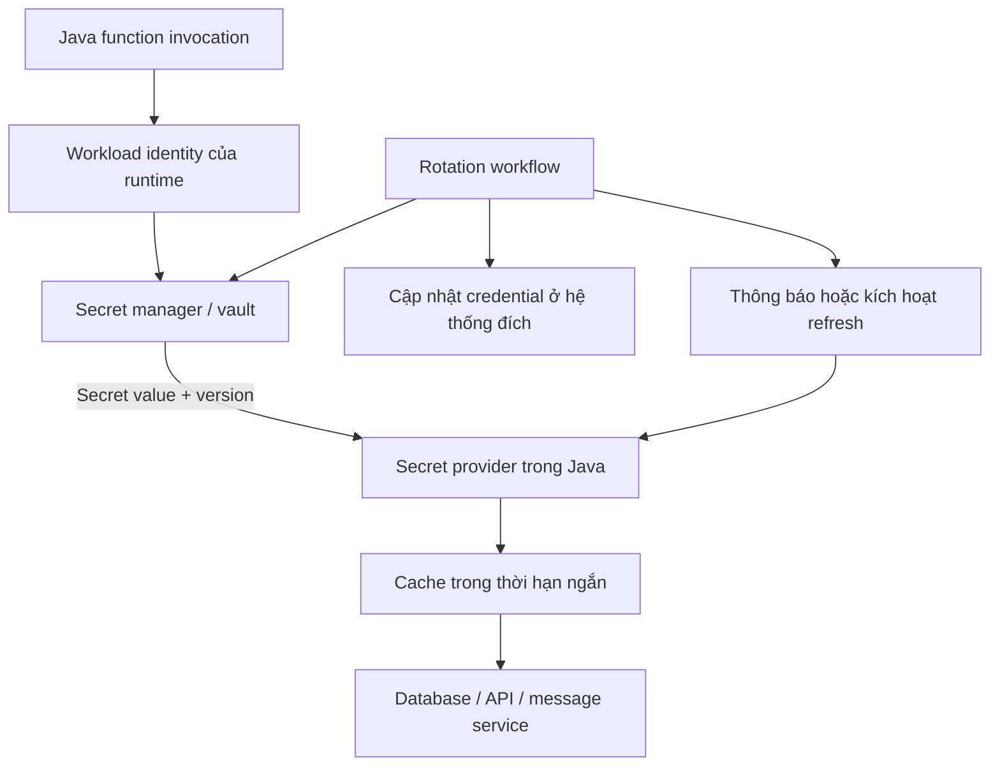
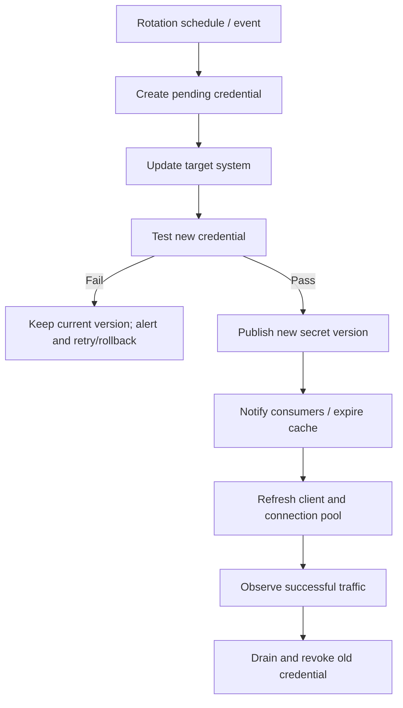

# Nạp secret an toàn và xoay vòng thông tin xác thực

Java function thường cần thông tin xác thực để gọi database, API đối tác, queue, object storage hoặc một dịch vụ nội bộ. Những giá trị như database password, API key, OAuth client secret, webhook signing key và private key là **secret**: nếu bị lộ, người khác có thể mạo danh ứng dụng hoặc truy cập dữ liệu.

Trong môi trường serverless, function có thể được tạo mới, tái sử dụng, scale-out hoặc dừng bất kỳ lúc nào. Vì vậy, secret phải được lưu ở một hệ thống quản lý riêng, được cấp cho workload bằng danh tính của runtime và có quy trình xoay vòng. Không nhúng credential vào source code, JAR, container image hoặc file cấu hình được commit.

Bài học tập trung vào ba việc: chọn cách xác thực không cần secret khi có thể; nạp secret từ secret manager bằng Java; và xoay vòng credential mà không làm gián đoạn function hoặc các kết nối đang hoạt động.

## 1. Phân biệt configuration, secret và workload identity

Ba loại dữ liệu này có vai trò khác nhau:

| Loại | Ví dụ | Cách quản lý |
| --- | --- | --- |
| Configuration | Region, tên queue, bucket, timeout, feature flag | App settings/environment variables hoặc configuration service |
| Secret | Password, API key, private key, client secret, signing key | Secret manager/vault có kiểm soát truy cập, version và audit |
| Workload identity | Lambda execution role, Azure managed identity, Google service account | IAM/Entra ID và cơ chế cấp token ngắn hạn của nền tảng |

Workload identity là cách function chứng minh danh tính với cloud provider. Khi dịch vụ đích hỗ trợ IAM, Microsoft Entra ID hoặc Google IAM, hãy dùng identity thay cho một access key dài hạn. Ví dụ Java function có thể dùng Lambda execution role để đọc S3, managed identity để đọc Key Vault hoặc service account để gọi Google APIs.

Secret manager vẫn cần thiết khi hệ thống đích chỉ hỗ trợ password/API key hoặc khi cần quản lý credential bên ngoài cloud. Khi đó, workload identity được dùng để xác thực với secret manager; secret manager trả về credential cần thiết cho ứng dụng.



Nếu dịch vụ đích hỗ trợ xác thực trực tiếp bằng workload identity, bỏ qua bước lấy secret. Mỗi credential được loại bỏ là một credential không cần xoay vòng, lưu trữ hoặc bảo vệ.

## 2. Những gì được xem là secret?

Các giá trị sau thường cần được bảo vệ như secret:

- Username/password của database hoặc message broker.
- API key, OAuth client secret, refresh token và access token dài hạn.
- Private key, certificate private material và khóa ký webhook.
- Connection string chứa credential.
- Signing/encryption key do ứng dụng quản lý.
- Credential của hệ thống cũ không hỗ trợ identity federation.

Một số dữ liệu không nhất thiết là secret nhưng vẫn có thể nhạy cảm, chẳng hạn database hostname nội bộ, account ID hoặc tên resource. Hãy phân loại theo chính sách tổ chức; không đưa thông tin hạ tầng nhạy cảm vào log hoặc public configuration chỉ vì nó không phải password.

**Secret khác encryption key.** Secret Manager/Key Vault lưu và kiểm soát việc truy cập giá trị bí mật. KMS/Key Vault Key/Cloud KMS quản lý thao tác mã hóa, giải mã hoặc ký bằng key. Xoay vòng key mã hóa không tự động đổi database password; đổi password không đồng nghĩa đã xoay vòng encryption key. Hai quy trình có thể liên quan nhưng phải được lập kế hoạch riêng.

## 3. Vì sao không lưu secret trong source code hoặc image?

Đưa credential vào code hoặc image làm tăng số nơi phải kiểm soát:

- Secret có thể tồn tại trong Git history kể cả sau khi xóa khỏi file hiện tại.
- JAR, Docker image, build cache và artifact registry có thể được tải xuống hoặc sao chép.
- Log build, crash dump, exception hoặc diagnostic bundle có thể làm lộ giá trị.
- Mỗi lần đổi credential phải build và deploy lại artifact nếu secret được đóng gói cùng ứng dụng.
- Nhiều môi trường có thể vô tình dùng chung credential production.

Không đặt secret trong:

- Source code, `application.properties`, YAML hoặc JSON được commit.
- Dockerfile `ENV`, build argument hoặc image layer.
- File `.env`, `local.settings.json` hoặc file cấu hình local được commit.
- URL/query string, command line argument hoặc tên resource/tag.
- Log, metric label, trace attribute, exception message hoặc ticket công khai.

File local có thể dùng placeholder hoặc credential của developer qua CLI/credential provider. Nếu cần secret local, lưu ngoài repository, giới hạn quyền file và đưa vào `.gitignore`. Không copy credential production về máy cá nhân chỉ để làm cho local test chạy được.

## 4. Kiến trúc nạp secret trong serverless

Một function có thể lấy secret theo ba cách chính:

1. **Platform secret injection:** nền tảng phân giải secret reference thành environment variable hoặc mount file trước khi chạy container/function.
2. **SDK/API trực tiếp:** Java dùng workload identity để gọi secret manager và lấy secret theo tên/version.
3. **Sidecar/extension hoặc agent:** một thành phần do nền tảng cung cấp hoặc được đóng gói cùng workload lấy secret và cache; ứng dụng đọc từ local endpoint/file theo contract của thành phần đó.

| Cách nạp | Ưu điểm | Điều cần kiểm soát |
| --- | --- | --- |
| Environment variable/secret reference | Code đơn giản, platform quản lý quyền đọc | Giá trị thường gắn với vòng đời/revision/instance; cần hiểu thời điểm refresh và restart |
| Java SDK | Chủ động chọn version, cache, refresh và xử lý lỗi | Cần SDK, IAM permission, network path, timeout và cache |
| Extension/sidecar | Có thể chuẩn hóa cache và giảm code provider-specific | Thêm thành phần vận hành, endpoint local và cấu hình extension |

Không có cách nào tự động giải quyết rotation nếu ứng dụng hoặc runtime giữ giá trị cũ. Cần xác định rõ: secret được lấy khi deploy, khi instance khởi động hay khi invocation cần dùng; sau khi secret đổi, instance đang chạy sẽ nhận giá trị mới bằng cách nào?

### Chọn theo nhu cầu

- Nếu secret chỉ đổi khi deploy và muốn rollout có kiểm soát, pin version trong deployment config và phát hành revision mới.
- Nếu secret được xoay vòng độc lập với release, dùng SDK/cache có TTL hoặc cơ chế refresh của platform.
- Nếu nền tảng cung cấp secret reference có tự refresh, đọc kỹ cache/refresh interval và cách restart instance.
- Nếu credential dùng cho connection pool, phải có bước tạo pool mới và drain pool cũ; chỉ cập nhật biến secret trong memory chưa đủ.

## 5. Dùng workload identity thay cho access key dài hạn

Workload identity giúp ứng dụng lấy credential ngắn hạn do platform cấp. Không lưu access key của service account hoặc client secret trong environment chỉ để gọi cloud API nếu platform có cơ chế identity phù hợp.

| Nền tảng | Danh tính runtime thường dùng | Quyền đọc secret |
| --- | --- | --- |
| AWS Lambda | Execution role của function | `secretsmanager:GetSecretValue`; thêm `kms:Decrypt` nếu dùng customer-managed KMS key |
| Azure Functions/App Service | System-assigned hoặc user-assigned managed identity | Role như `Key Vault Secrets User` hoặc quyền secret `get` phù hợp |
| Google Cloud Run/Functions | Service account gắn với workload và Application Default Credentials | `roles/secretmanager.secretAccessor` trên secret cần đọc |

### Nguyên tắc least privilege

- Mỗi function hoặc nhóm function có trách nhiệm riêng nên dùng role/service account riêng khi cần phân tách quyền.
- Chỉ cấp quyền đọc secret cụ thể, không cấp quyền list/read toàn bộ vault nếu không cần.
- Function chỉ đọc secret; rotation workflow mới có quyền tạo version hoặc cập nhật credential ở hệ thống đích.
- Tách quyền giữa môi trường development, staging và production.
- Không dùng tài khoản người dùng hoặc key của developer làm danh tính production.
- Ghi nhận ai/role nào đã đọc hoặc thay đổi secret bằng audit log của nền tảng.

## 6. Nạp secret bằng AWS Secrets Manager và Java SDK v2

AWS Lambda có thể dùng execution role để gọi AWS Secrets Manager. SDK Java v2 dùng default credentials provider chain, vì vậy trong Lambda nó có thể lấy credential tạm thời từ execution role mà không cần hard-code access key.

Dependency Maven:

```xml
<dependency>
    <groupId>software.amazon.awssdk</groupId>
    <artifactId>secretsmanager</artifactId>
</dependency>
```

Ví dụ provider đọc version đang mang nhãn `AWSCURRENT`:

```java
import software.amazon.awssdk.regions.Region;
import software.amazon.awssdk.services.secretsmanager.SecretsManagerClient;
import software.amazon.awssdk.services.secretsmanager.model.GetSecretValueRequest;

public final class AwsSecretReader {
    private final SecretsManagerClient client;

    public AwsSecretReader(Region region) {
        this.client = SecretsManagerClient.builder()
                .region(region)
                .build();
    }

    public String getCurrent(String secretId) {
        var request = GetSecretValueRequest.builder()
                .secretId(secretId)
                .versionStage("AWSCURRENT")
                .build();

        var response = client.getSecretValue(request);
        String value = response.secretString();
        if (value == null || value.isBlank()) {
            throw new IllegalStateException("Secret has no string payload");
        }
        return value;
    }

    public void close() {
        client.close();
    }
}
```

Tạo client một lần trong execution environment và tái sử dụng nếu lifecycle/runtime cho phép; không tạo một SDK client mới cho mọi request. Trong Lambda, có thể đặt provider/client ở field dùng chung của handler để tận dụng warm invocation, nhưng không giả định instance sẽ tồn tại mãi. Đóng client khi ứng dụng/runtime kết thúc theo cơ chế shutdown phù hợp.

Execution role cần `secretsmanager:GetSecretValue` trên ARN secret cụ thể. Nếu secret được mã hóa bằng customer-managed KMS key, role cũng cần quyền giải mã phù hợp và key policy phải cho phép. Không log `response.secretString()` hoặc payload chứa credential.

AWS Secrets Manager dùng staging label để xác định version:

| Label | Ý nghĩa |
| --- | --- |
| `AWSCURRENT` | Version ứng dụng thường đọc và được xem là hiện hành |
| `AWSPREVIOUS` | Version trước đó, có thể dùng cho kiểm tra/rollback theo quy trình |
| `AWSPENDING` | Version đang được tạo và kiểm tra trong rotation |

Nếu không chỉ định `VersionStage` hoặc `VersionId`, `GetSecretValue` mặc định trả `AWSCURRENT`. Không nên tự chuyển nhãn version bằng code ứng dụng thông thường; việc đó thuộc rotation workflow có quyền riêng.

## 7. Nạp secret bằng Azure Key Vault và Java SDK

Azure Functions có thể dùng managed identity để đọc Azure Key Vault. Java SDK `azure-security-keyvault-secrets` cung cấp `SecretClient`; `DefaultAzureCredential` hỗ trợ nhiều nguồn credential và có thể dùng Azure CLI trong local development, managed identity khi chạy trên Azure.

Dependency Maven:

```xml
<dependency>
    <groupId>com.azure</groupId>
    <artifactId>azure-security-keyvault-secrets</artifactId>
</dependency>
<dependency>
    <groupId>com.azure</groupId>
    <artifactId>azure-identity</artifactId>
</dependency>
```

Ví dụ đọc secret mới nhất theo tên:

```java
import com.azure.identity.DefaultAzureCredentialBuilder;
import com.azure.security.keyvault.secrets.SecretClient;
import com.azure.security.keyvault.secrets.SecretClientBuilder;

public final class AzureSecretReader {
    private final SecretClient client;

    public AzureSecretReader(String vaultUrl) {
        this.client = new SecretClientBuilder()
                .vaultUrl(vaultUrl)
                .credential(new DefaultAzureCredentialBuilder().build())
                .buildClient();
    }

    public String getLatest(String secretName) {
        var secret = client.getSecret(secretName);
        if (secret.getValue() == null || secret.getValue().isBlank()) {
            throw new IllegalStateException("Secret has no value");
        }
        return secret.getValue();
    }
}
```

Đặt `KEY_VAULT_URI` hoặc tên vault trong app setting; đây là định danh vault, không phải secret value. Gán managed identity quyền đọc secret theo mô hình RBAC của vault, thường là `Key Vault Secrets User` trong phạm vi vault hoặc secret cần thiết. Không cấp quyền `set`, `delete` hoặc quản trị vault cho function chỉ cần đọc.

`getSecret(name)` lấy version mới nhất; SDK cũng hỗ trợ đọc version cụ thể. Chọn version cụ thể khi cần rollout có kiểm soát. Nếu dùng Key Vault reference trong Azure Functions app setting, code đọc setting như một environment variable bình thường; nền tảng phân giải reference bằng managed identity theo cấu hình. Cách reference này có cache và refresh riêng, vì vậy không được giả định giá trị mới xuất hiện tức thì trong process đang chạy.

## 8. Nạp secret bằng Google Cloud Secret Manager và Java

Cloud Run hoặc Cloud Functions có thể dùng service account gắn với workload và Application Default Credentials (ADC) để gọi Secret Manager. Không tạo và tải JSON service account key vào container nếu runtime identity đã đáp ứng yêu cầu.

Dependency Maven:

```xml
<dependency>
    <groupId>com.google.cloud</groupId>
    <artifactId>google-cloud-secretmanager</artifactId>
</dependency>
```

Ví dụ đọc một version cụ thể hoặc alias `latest`:

```java
import com.google.cloud.secretmanager.v1.AccessSecretVersionResponse;
import com.google.cloud.secretmanager.v1.SecretManagerServiceClient;
import com.google.cloud.secretmanager.v1.SecretVersionName;
import java.io.IOException;
import java.nio.charset.StandardCharsets;

public final class GoogleSecretReader {
    public String getVersion(
            String projectId,
            String secretId,
            String versionId
    ) throws IOException {
        SecretVersionName name = SecretVersionName.of(
                projectId, secretId, versionId);

        try (SecretManagerServiceClient client =
                     SecretManagerServiceClient.create()) {
            AccessSecretVersionResponse response =
                    client.accessSecretVersion(name);
            byte[] data = response.getPayload().getData().toByteArray();
            return new String(data, StandardCharsets.UTF_8);
        }
    }
}
```

Ví dụ tạo client trong method để thể hiện resource lifecycle; với function có nhiều invocation, nên tái sử dụng client an toàn giữa các lần gọi thay vì mở/đóng client liên tục. Khi tái sử dụng, quản lý shutdown và thread safety theo SDK. Service account chỉ cần `roles/secretmanager.secretAccessor` trên secret tương ứng.

Secret Manager có các version bất biến và alias `latest` trỏ tới version mới nhất. `latest` tiện trong development nhưng có thể khiến version lỗi được áp dụng ngay cho toàn bộ instance mới. Với production cần rollout có kiểm soát, hãy pin version ID trong cấu hình deployment, phát hành dần và giữ khả năng quay lại version trước.

## 9. Đọc secret theo schema thay vì truyền chuỗi tùy tiện

Một secret có thể lưu JSON chứa nhiều trường liên quan, ví dụ username, password và endpoint. Hãy định nghĩa schema và validate sau khi đọc:

```json
{
  "schemaVersion": 1,
  "username": "app_user",
  "password": "<secret-value>",
  "host": "db.internal.example",
  "port": 5432
}
```

Ví dụ DTO Java:

```java
public record DatabaseCredentials(
        int schemaVersion,
        String username,
        String password,
        String host,
        int port
) {
    public DatabaseCredentials {
        if (schemaVersion != 1) {
            throw new IllegalArgumentException("Unsupported secret schema");
        }
        if (username == null || username.isBlank()
                || password == null || password.isBlank()
                || host == null || host.isBlank()
                || port < 1 || port > 65535) {
            throw new IllegalArgumentException("Invalid database credentials");
        }
    }
}
```

Parse JSON bằng Jackson hoặc serializer tương ứng. Không đưa secret value vào `toString()` của DTO, log hoặc exception. Nếu đổi schema, có thể hỗ trợ hai version trong giai đoạn rollout để instance cũ và mới cùng đọc được.

Tách secret theo quyền và vòng đời. Một secret JSON chứa credential cho mười dịch vụ khiến function chỉ cần một trường cũng phải được cấp quyền đọc tất cả. Chỉ gom nhiều trường khi chúng cùng owner, cùng consumer và cùng lịch xoay vòng.

## 10. Cache secret trong môi trường serverless

Gọi secret manager ở mỗi invocation làm tăng latency, request count và chi phí. Khi function scale-out, nhiều instance có thể đồng thời gọi vault, gây burst traffic hoặc throttling. Vì vậy, client-side cache thường hữu ích.

Nhưng cache vô thời hạn tạo ra một vấn đề: instance đang chạy có thể tiếp tục dùng credential cũ sau khi secret đã được xoay vòng. Một function warm trong thời gian dài hoặc connection pool được giữ lại có thể sống qua nhiều lần rotation.

Một cache cần có:

- TTL ngắn và có cấu hình theo độ nhạy/rotation policy.
- Refresh khi hết hạn hoặc nhận tín hiệu rotation.
- Đồng bộ khi nhiều invocation cùng yêu cầu refresh.
- Timeout và retry có backoff khi gọi vault.
- Hành vi rõ ràng khi vault tạm thời không khả dụng.
- Không log giá trị secret hoặc giữ nhiều bản sao không cần thiết.

Ví dụ cache tối giản theo TTL, dùng cho một secret trong một runtime:

```java
import java.time.Duration;
import java.time.Instant;
import java.util.Objects;

public final class TtlSecretCache {
    @FunctionalInterface
    public interface Loader {
        String load();
    }

    private record Entry(String value, Instant expiresAt) {}

    private final Loader loader;
    private final Duration ttl;
    private volatile Entry entry;

    public TtlSecretCache(Loader loader, Duration ttl) {
        this.loader = Objects.requireNonNull(loader);
        this.ttl = Objects.requireNonNull(ttl);
    }

    public String get() {
        Entry current = entry;
        if (current != null && Instant.now().isBefore(current.expiresAt())) {
            return current.value();
        }

        synchronized (this) {
            current = entry;
            if (current != null && Instant.now().isBefore(current.expiresAt())) {
                return current.value();
            }

            String value = loader.load();
            if (value == null || value.isBlank()) {
                throw new IllegalStateException("Secret loader returned no value");
            }
            entry = new Entry(value, Instant.now().plus(ttl));
            return value;
        }
    }

    public synchronized void invalidate() {
        entry = null;
    }
}
```

Cache này chỉ minh họa một secret trong một process. Ứng dụng thực tế có thể cần nhiều key, version metadata, jitter, stale-while-refresh, metrics và giới hạn memory. `synchronized` ngăn nhiều invocation trong cùng instance cùng tải secret tại một thời điểm; nó không phối hợp cache giữa nhiều instance/serverless execution environment.

### Chọn TTL như thế nào?

TTL phải nhỏ hơn khoảng thời gian mà tổ chức chấp nhận credential cũ còn được sử dụng sau rotation, có tính đến thời gian propagation và connection pool. TTL quá ngắn làm tăng API calls và nguy cơ throttling; TTL quá dài làm chậm việc áp dụng credential mới.

Không có một TTL chuẩn cho mọi ứng dụng. Ví dụ, API key có khả năng dùng song song hai phiên bản có thể chấp nhận cache vài phút; credential bị nghi ngờ lộ cần refresh/revoke nhanh hơn và có thể phải chủ động invalidate cache/restart workload. Dùng jitter để các instance không cùng refresh tại một thời điểm.

Không tạo scheduled thread nền để refresh cache trong một FaaS invocation nếu runtime không bảo đảm thread sống sau khi handler kết thúc. Hãy refresh khi request cần secret, theo lifecycle hook được platform hỗ trợ hoặc bằng rotation event/extension riêng.

## 11. Secret rotation là gì?

Rotation là quy trình thay credential trong **cả secret store và hệ thống chấp nhận credential đó**. Chỉ tạo version mới trong vault mà không cập nhật database/API đích không phải rotation hoàn chỉnh. Ngược lại, đổi password ở database mà không cập nhật secret store sẽ làm function tiếp tục dùng credential cũ.

Một rotation an toàn thường gồm các bước:

1. **Prepare:** xác định consumer, quyền, deadline, cách rollback và credential hiện hành.
2. **Create:** tạo credential mới hoặc version mới ở trạng thái chưa công bố cho consumer.
3. **Apply:** cập nhật hệ thống đích để chấp nhận credential mới.
4. **Test:** xác minh credential mới hoạt động bằng một kết nối/thao tác thực tế.
5. **Publish:** chuyển version/label/alias để consumer bắt đầu đọc credential mới.
6. **Refresh:** cập nhật cache, environment/revision hoặc connection pool của consumer.
7. **Drain:** chờ các request và connection đang dùng credential cũ hoàn tất.
8. **Revoke:** vô hiệu hóa credential cũ sau khi xác nhận không còn consumer hợp lệ dùng nó.
9. **Verify:** theo dõi lỗi xác thực, latency, pool exhaustion và audit event sau rotation.



Thứ tự chính xác phụ thuộc hệ thống đích. Với dịch vụ chỉ cho phép một password, có thể có khoảng thời gian giữa lúc đổi password và lúc consumer nhận secret mới. Với dịch vụ hỗ trợ hai credential cùng lúc, có thể triển khai gần như không gián đoạn bằng cách tạo credential mới, rollout consumer rồi mới thu hồi credential cũ.

## 12. Xoay vòng database credential không gián đoạn

Database connection pool làm rotation phức tạp hơn việc chỉ đổi chuỗi password. Connection đã xác thực thường vẫn tồn tại sau khi password bị đổi; connection mới sẽ dùng credential mới. Nếu pool tiếp tục cấp connection cũ hoặc cố tạo connection bằng password đã bị thu hồi, lỗi sẽ xuất hiện dần khi connection cũ bị đóng.

Một mẫu an toàn khi database hỗ trợ hai user:

1. Tạo user B với quyền tương đương user A nhưng chỉ đúng schema/operation cần thiết.
2. Lưu credential B ở secret store với version mới.
3. Kiểm tra B có thể kết nối và thực hiện query cần thiết.
4. Cập nhật consumer để đọc credential B.
5. Tạo connection pool mới bằng B, kiểm tra health và chuyển traffic sang pool mới.
6. Drain pool cũ dùng A và chờ transaction/request đang chạy hoàn tất.
7. Thu hồi user A sau khi xác minh không còn kết nối hợp lệ.

Nếu database chỉ cho một user/password, rotation có thể cần maintenance window hoặc cơ chế phối hợp chặt hơn: thay password, cập nhật secret, refresh toàn bộ consumer nhanh chóng và chuẩn bị rollback. Hãy thử nghiệm trên staging; đừng giả định cập nhật secret và password database là một transaction nguyên tử.

### API key có hai slot

Một số nhà cung cấp cho phép hai API key cùng hợp lệ. Dùng key A hiện tại và key B mới theo quy trình:

- Tạo key B nhưng chưa xóa A.
- Phát hành secret version mới chứa B.
- Rollout/refresh consumer và xác minh request thành công.
- Thu hồi A sau thời gian drain đã định.

Nếu nhà cung cấp chỉ cho một key, cần phối hợp thời điểm đổi và refresh consumer; rotation event có thể đến trễ hoặc bị giao lại, nên consumer vẫn cần retry/idempotency.

## 13. AWS Secrets Manager rotation

AWS Secrets Manager hỗ trợ rotation theo lịch. Với nhiều secret được quản lý bởi dịch vụ AWS, có thể dùng managed rotation. Với credential tùy chỉnh, Secrets Manager có thể gọi Lambda rotation function.

Rotation Lambda thường triển khai bốn bước:

| Bước | Trách nhiệm |
| --- | --- |
| `createSecret` | Tạo version mới và lưu với nhãn `AWSPENDING` |
| `setSecret` | Cập nhật credential ở database hoặc dịch vụ đích |
| `testSecret` | Xác minh credential pending hoạt động |
| `finishSecret` | Chuyển `AWSCURRENT` sang version mới; version trước thành `AWSPREVIOUS` |

Việc lưu pending version trước khi cập nhật hệ thống đích giúp rotation có thể tiếp tục an toàn khi retry. Rotation handler phải idempotent theo client request token/version ID; không tạo một credential khác ở mỗi lần retry cho cùng một rotation.

Với database hỗ trợ alternating users, rotation có thể chuyển giữa hai user để consumer có thời gian chuyển pool. Với một user, cần hiểu rõ khoảng thời gian đổi password và propagation. Cấu hình VPC/endpoint của rotation Lambda cũng phải cho phép nó truy cập database và Secrets Manager.

Ứng dụng đọc `AWSCURRENT`; không nên đọc `AWSPENDING` trong luồng nghiệp vụ bình thường. `AWSPREVIOUS` hữu ích để điều tra/rollback nhưng không tự động có nghĩa credential cũ vẫn còn được database chấp nhận.

## 14. Azure Key Vault và Azure Functions

Azure Key Vault lưu nhiều version của một secret. Có hai cách thường dùng để Azure Function lấy giá trị:

- Dùng Key Vault reference trong app setting; code đọc setting như environment variable.
- Dùng Java `SecretClient` để gọi Key Vault trực tiếp, đọc version mới nhất hoặc version cụ thể.

Với Key Vault reference không pin version, App Service/Functions cache giá trị và thường tự phân giải version mới trong vòng khoảng 24 giờ. Thay đổi cấu hình app có thể làm ứng dụng restart và refresh references sớm hơn; có API refresh references được Microsoft hỗ trợ. Vì vậy, versionless reference không đồng nghĩa tất cả instance nhận secret mới ngay khi version được tạo.

Azure Key Vault không tự thay password ở database hoặc API đối tác chỉ vì secret có version mới. Rotation cần workflow cập nhật hệ thống đích, ví dụ Event Grid phát sự kiện near-expiry hoặc secret lifecycle event để Azure Function thực hiện logic xoay vòng. Với tài nguyên chỉ có một credential, có thể có khoảng gián đoạn giữa cập nhật vault và cập nhật target. Nếu target hỗ trợ hai credential, dùng mô hình luân phiên hai bộ credential để giảm gián đoạn.

Với Azure SQL Database/Azure SQL Managed Instance, ưu tiên Microsoft Entra authentication khi phù hợp để loại bỏ password SQL. Chỉ dùng password rotation khi ứng dụng hoặc hệ thống đích thực sự cần SQL login.

## 15. Google Cloud Secret Manager rotation

Google Cloud Secret Manager quản lý secret và các version bất biến. Có thể đọc version cụ thể hoặc alias `latest`. Secret Manager hỗ trợ rotation schedule và gửi thông báo `SECRET_ROTATE` đến Pub/Sub topic được cấu hình khi đến thời điểm rotation.

Thông báo này là tín hiệu để hệ thống rotation thực hiện công việc; nó không tự động thay password ở database hoặc API bên ngoài. Cần có consumer/Cloud Run job/Cloud Function nhận message, tạo credential mới, cập nhật target, kiểm tra, thêm secret version và thông báo consumer.

Trong production, pin version ID trong cấu hình rollout có thể giúp xác minh và rollback theo release process. Dùng `latest` có thể khiến version mới được áp dụng ngay cho các instance khởi động sau đó; nếu version mới sai, scale-up có thể làm nhiều instance cùng lỗi. Nếu chọn `latest`, phải có quy trình phát hiện lỗi và quay lại version đã biết tốt.

## 16. Xử lý rotation event và refresh cache

Rotation event có thể đến trùng, đến trễ hoặc không đến được consumer. Hãy xem event như một tín hiệu yêu cầu kiểm tra version mới, không phải bằng chứng rằng mọi bước rotation đã thành công.

Consumer có thể xử lý event theo cách:

1. Kiểm tra event source/type và xác thực producer.
2. Đọc secret version/metadata hiện tại từ vault.
3. So sánh version ID với version đang cache.
4. Nếu khác, validate schema và thử tạo credential/client mới.
5. Kiểm tra kết nối tới target bằng credential mới.
6. Chuyển traffic sang client/pool mới một cách an toàn.
7. Chỉ sau khi thành công mới thay cache và đánh dấu event đã xử lý.

Nếu event bị giao lại, version ID giống nhau giúp handler nhận ra đã refresh. Nếu secret version mới không hợp lệ, giữ version đang hoạt động trong giới hạn an toàn, phát cảnh báo và yêu cầu rotation workflow xử lý lại. Không ghi secret value vào event; event chỉ nên mang secret resource ID, version ID hoặc metadata cần thiết.

## 17. Khi secret manager tạm thời không khả dụng

Lỗi khi nạp secret có thể do IAM thiếu quyền, network endpoint/DNS sai, vault throttling, service outage, version bị disable hoặc secret hết hạn. Phân biệt các trường hợp này để tránh retry vô hạn.

| Tình huống | Hành vi nên có |
| --- | --- |
| Secret chưa từng được nạp và vault không khả dụng | Fail fast với lỗi rõ; không dùng credential giả hoặc fallback hard-coded |
| Cache còn hạn và vault tạm thời lỗi | Có thể tiếp tục dùng cache theo policy đã phê duyệt, đồng thời cảnh báo |
| Cache hết hạn và không lấy được version mới | Không tự kéo dài vô hạn; áp dụng fail-closed hoặc degraded mode theo mức độ nghiệp vụ |
| AccessDenied/401/403 | Không retry liên tục; kiểm tra workload identity, IAM/RBAC và resource policy |
| Throttling/5xx/network timeout | Retry có giới hạn, exponential backoff và jitter |
| Version bị disable/expired | Dừng dùng version đó và chuyển sang quy trình phục hồi được kiểm soát |

Không nên dùng stale secret vô thời hạn chỉ để function tiếp tục trả thành công. Với một số workload đọc dữ liệu không nhạy cảm, degraded mode có thể chấp nhận được; với thanh toán hoặc ghi dữ liệu nhạy cảm, fail-closed thường an toàn hơn. Quyết định phải được ghi thành policy và thử nghiệm.

## 18. Thu hồi credential khẩn cấp khi nghi ngờ bị lộ

Rotation theo lịch không thay thế incident response. Khi credential có khả năng bị lộ:

1. Xác định secret, hệ thống đích, consumer và phạm vi quyền của credential.
2. Tạo credential thay thế hoặc danh tính mới với quyền tối thiểu.
3. Cập nhật secret store và rollout/refresh consumer theo quy trình khẩn cấp.
4. Thu hồi credential bị lộ theo mức độ rủi ro; nếu cần, revoke ngay cả khi có gián đoạn dịch vụ.
5. Invalidate cache, thay connection pool và restart instance/revision nếu cần.
6. Kiểm tra audit log, API access, database login, queue activity và dữ liệu có thể đã bị truy cập.
7. Tìm nguồn rò rỉ trong Git history, artifact, log, CI/CD, support bundle và máy developer.
8. Xóa hoặc vô hiệu hóa bản sao bị lộ; cập nhật secret scanning rule và quy trình phòng ngừa.

Không chỉ xóa secret khỏi vault rồi cho rằng credential đã bị vô hiệu hóa ở hệ thống đích. Phải revoke credential tại nơi nó được chấp nhận. Nếu credential là token có thời hạn, xác minh token cũ đã hết hiệu lực hoặc bị revoke theo cơ chế của nhà cung cấp.

## 19. Bảo vệ secret trong Java process

Secret manager bảo vệ giá trị khi lưu trữ và khi truyền, nhưng sau khi ứng dụng đọc, giá trị tồn tại trong memory của process. Giảm thời gian và số nơi lưu giữ:

- Chỉ nạp secret ngay trước khi cần; không đọc mọi secret của hệ thống khi function khởi động.
- Cache trong memory trong thời hạn cần thiết; không lưu vào file tạm nếu không có yêu cầu rõ.
- Tránh copy chuỗi secret qua nhiều DTO/service; truyền credential đến component cần dùng.
- Không log giá trị, không đưa vào exception, metric label hoặc trace.
- Không expose secret qua health endpoint, debug endpoint hoặc actuator environment endpoint.
- Hạn chế heap dump, core dump và diagnostic bundle; kiểm soát quyền truy cập nếu phải tạo.
- Dùng TLS khi gọi secret manager và dịch vụ đích.
- Xóa tham chiếu khi không cần, nhưng hiểu rằng Java `String` immutable và garbage collector không bảo đảm xóa ngay nội dung khỏi memory.
- Không coi việc gọi `String.clear()` hoặc gán biến thành `null` là bảo đảm memory đã được xóa an toàn.

Nếu xử lý dữ liệu nhạy cảm cực cao, cân nhắc kiểu dữ liệu và thư viện có hỗ trợ quản lý bộ nhớ phù hợp, giảm thời gian giữ plaintext và đánh giá yêu cầu runtime/OS. Không tự viết cơ chế cryptography.

## 20. Network path đến secret manager

Workload identity cho phép xác thực nhưng không tự tạo network route. Nếu function chạy trong private subnet hoặc VPC connector, phải bảo đảm nó có thể truy cập endpoint của secret manager:

- AWS Lambda trong VPC có thể cần NAT hoặc Secrets Manager interface VPC endpoint, cùng security group và endpoint policy phù hợp.
- Azure Functions dùng Key Vault private endpoint cần VNet integration, DNS/private DNS và route đúng theo hosting plan.
- Google Cloud Run/Functions cần network egress/DNS phù hợp; với private service access hoặc VPC egress, kiểm tra đường tới Google APIs và cấu hình Private Google Access/Private Service Connect theo dịch vụ.

Nếu function không truy cập được vault, invocation có thể timeout dù IAM role đã đúng. Chẩn đoán riêng network (DNS, route, firewall, endpoint) và authorization (IAM/RBAC, resource policy, KMS key policy). Đặt timeout ngắn có kiểm soát cho secret fetch và theo dõi latency/error rate.

## 21. Audit, monitoring và cảnh báo

Secret manager thường ghi audit event cho các thao tác đọc, tạo version, cập nhật metadata, disable hoặc delete. Bật log phù hợp và cảnh báo cho:

- Một principal đọc secret ngoài lịch hoặc ngoài workload dự kiến.
- Một role có số lần đọc tăng đột biến hoặc đọc nhiều secret không liên quan.
- Secret sắp hết hạn hoặc rotation schedule bị trễ.
- Rotation workflow thất bại ở bước tạo, cập nhật target, test hoặc publish.
- Function gặp `AccessDenied`, throttling, timeout hoặc lỗi authentication downstream.
- Credential cũ vẫn được dùng sau thời gian drain.
- Secret version mới được tạo nhưng consumer chưa refresh.

Metric nên dùng secret name/ARN đã được phân loại an toàn hoặc nhóm service; không đưa secret value vào metric. Có thể log version ID, request ID và rotation execution ID để điều tra. Kiểm tra chính sách retention và quyền xem audit log vì metadata cũng có thể tiết lộ cấu trúc hạ tầng.

## 22. Kiểm thử quy trình rotation

Rotation cần được kiểm thử như một luồng nghiệp vụ phân tán, không chỉ test hàm đọc secret.

| Kịch bản | Điều cần xác minh |
| --- | --- |
| Secret mới hợp lệ | Consumer lấy version mới và kết nối thành công |
| Secret mới sai định dạng | Validation từ chối trước khi thay cache/pool |
| Target không nhận credential mới | Rotation không publish current; cảnh báo và retry/rollback |
| Function đang warm khi rotation diễn ra | TTL/event refresh hoạt động; không dùng credential cũ vô thời hạn |
| Scale-out trong lúc rotation | Instance mới và cũ đều dùng version được phép trong giai đoạn overlap |
| Event rotation bị giao lại | Handler idempotent, không tạo thêm credential ngoài ý muốn |
| Secret manager throttling/outage | Backoff, timeout và stale-cache policy đúng như thiết kế |
| Connection pool giữ session cũ | Pool mới được tạo, pool cũ drain và credential cũ được revoke đúng lúc |
| Rollback version | Consumer có thể trở về version đã biết tốt và target vẫn chấp nhận credential đó |
| Credential bị lộ | Quy trình khẩn cấp revoke, refresh cache và audit được thực hiện đầy đủ |

Kiểm thử trên staging với credential riêng. Không chạy thử rotation trên database production chỉ để xác nhận code hoạt động. Ghi nhận thời gian từ lúc tạo version mới đến lúc toàn bộ consumer chuyển đổi; dùng con số này để chọn TTL, overlap window và lịch thu hồi.

## 23. Những lỗi thường gặp

1. **Lưu password trong Git hoặc Docker image.** Credential bị sao chép theo mọi clone, artifact và cache.
2. **Dùng access key dài hạn để đọc secret manager.** Dùng workload identity nếu nền tảng hỗ trợ.
3. **Cấp quyền đọc toàn bộ vault.** Giới hạn theo secret và action cần thiết.
4. **Gọi secret manager mỗi invocation.** Tăng latency/cost và dễ throttling; dùng cache TTL có kiểm soát.
5. **Cache secret vô thời hạn.** Instance warm có thể dùng credential đã bị thu hồi.
6. **Chỉ cập nhật secret store mà quên hệ thống đích.** Credential mới chưa được target chấp nhận.
7. **Xoay password nhưng không refresh connection pool.** Connection mới vẫn dùng password cũ hoặc pool cũ không được drain.
8. **Giả định secret reference tự refresh ngay.** Platform có cache/restart behavior riêng; phải kiểm tra tài liệu và đo thực tế.
9. **Dùng `latest` cho production mà không có rollout/rollback.** Version lỗi có thể được áp dụng cho instance mới trên diện rộng.
10. **Log payload hoặc exception chứa secret.** Secret bị sao chép sang hệ thống observability có phạm vi truy cập rộng.
11. **Chỉ xóa secret mà không revoke credential ở target.** Credential bị lộ vẫn có thể tiếp tục hoạt động.
12. **Coi KMS key rotation là password rotation.** Hai quy trình có mục tiêu và tác động khác nhau.

## 24. Quy trình thiết kế secret lifecycle cho Java function

1. **Inventory:** liệt kê secret, owner, consumer, target service, quyền và ngày hết hạn.
2. **Eliminate:** thay credential dài hạn bằng workload identity khi có thể.
3. **Store:** lưu secret ở secret manager riêng cho từng môi trường; bật encryption, version và audit.
4. **Grant:** cấp quyền đọc tối thiểu cho function; tách quyền rotation khỏi quyền runtime.
5. **Load:** dùng SDK hoặc platform reference; validate schema và timeout.
6. **Cache:** chọn TTL, jitter, refresh event và stale policy theo rủi ro.
7. **Rotate:** tạo credential mới, cập nhật target, test, publish và rollout consumer.
8. **Drain/revoke:** thay pool, chờ connection cũ và thu hồi credential trước.
9. **Observe:** theo dõi rotation age, secret fetch error, auth failure và credential usage.
10. **Recover:** kiểm thử rollback và incident rotation định kỳ.

## 25. Checklist trước khi đưa vào production

- [ ] Secret đã được phân loại riêng với configuration thông thường.
- [ ] Không có secret trong source, Git history, JAR, image, build arg hoặc log.
- [ ] Workload identity được dùng thay access key dài hạn khi có thể.
- [ ] Function chỉ có quyền đọc đúng secret cần thiết.
- [ ] Rotation workflow có quyền riêng để tạo version và cập nhật target.
- [ ] Java SDK client được tái sử dụng đúng lifecycle; timeout và retry có giới hạn.
- [ ] Secret payload có schema version và được validate.
- [ ] Cache có TTL, jitter, refresh/invalidation và chính sách khi vault không khả dụng.
- [ ] Secret reference/env injection có refresh behavior được hiểu rõ.
- [ ] Rotation cập nhật cả secret store lẫn database/API đích.
- [ ] Có overlap/dual credential nếu target hỗ trợ và cần giảm downtime.
- [ ] Connection pool/client được refresh và drain sau rotation.
- [ ] Consumer xử lý rotation event trùng/đến trễ một cách idempotent.
- [ ] Có version rollback và quy trình thu hồi credential cũ.
- [ ] Có audit log, alert và test cho rotation failure/credential compromise.
- [ ] Network path, DNS, private endpoint và IAM/RBAC đã được kiểm tra riêng.

Nạp secret an toàn là sự kết hợp giữa workload identity, secret manager, quyền tối thiểu, cache có thời hạn và xử lý plaintext cẩn thận trong Java process. Rotation hoàn chỉnh phải thay credential ở hệ thống đích, phát hành version mới, refresh consumer và chỉ thu hồi credential cũ sau khi connection/request đã chuyển đổi. Khi quản lý toàn bộ vòng đời này, Java function có thể scale và tái sử dụng runtime mà không phụ thuộc vào credential được nhúng trong artifact hoặc một giá trị bí mật tồn tại vô thời hạn.

## Tài liệu tham khảo chính thức

- [AWS Secrets Manager – Get secret value with Java SDK](https://docs.aws.amazon.com/secretsmanager/latest/userguide/retrieving-secrets-java-sdk.html)
- [AWS Secrets Manager – Rotate secrets](https://docs.aws.amazon.com/secretsmanager/latest/userguide/rotating-secrets.html)
- [AWS Secrets Manager – Rotation Lambda functions](https://docs.aws.amazon.com/secretsmanager/latest/userguide/rotate-secrets_lambda-functions.html)
- [Azure Key Vault – Java Secret client library](https://learn.microsoft.com/java/api/overview/azure/security-keyvault-secrets-readme)
- [Azure App Service/Functions – Key Vault references and refresh](https://learn.microsoft.com/azure/app-service/app-service-key-vault-references)
- [Azure Functions – Configure connections and managed identity](https://learn.microsoft.com/azure/azure-functions/manage-connections)
- [Azure Key Vault – Secret rotation tutorial](https://learn.microsoft.com/azure/key-vault/secrets/tutorial-rotation)
- [Google Cloud Secret Manager – Access a secret version](https://docs.cloud.google.com/secret-manager/docs/access-secret-version)
- [Google Cloud Secret Manager – Rotation recommendations](https://docs.cloud.google.com/secret-manager/docs/rotation-recommendations)
- [Google Cloud Secret Manager – Rotation schedules](https://docs.cloud.google.com/secret-manager/docs/secret-rotation)
