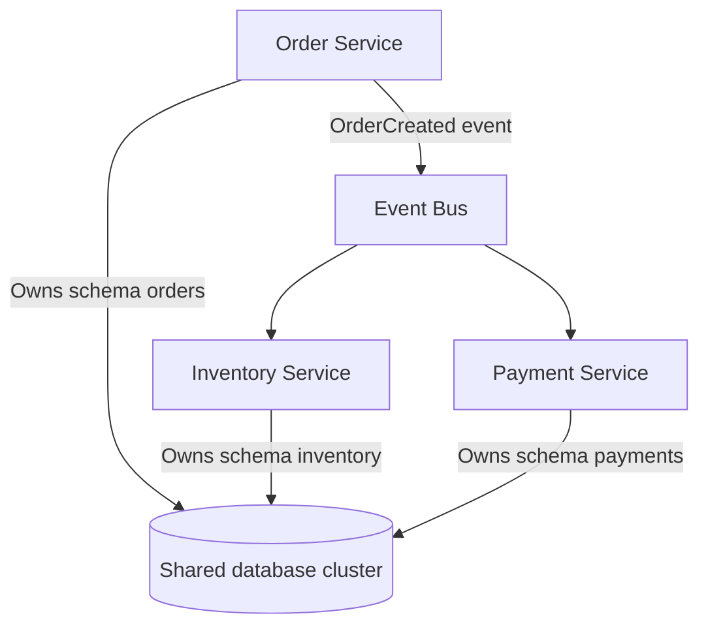
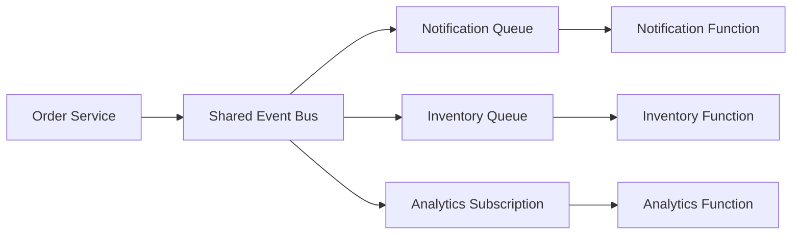
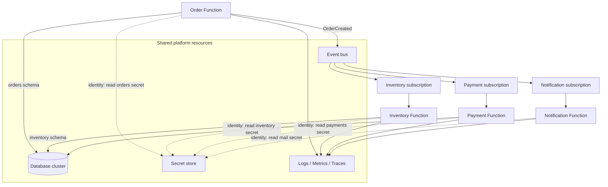

# Quản lý tài nguyên dùng chung giữa nhiều service

Trong một hệ thống serverless, nhiều service có thể cùng sử dụng database cluster, object storage, message broker, secret store, mạng riêng, hệ thống quan sát hoặc API của bên thứ ba. Chia sẻ tài nguyên giúp giảm chi phí và công sức vận hành, nhưng cũng tạo ra phụ thuộc giữa các service. Nếu không xác định rõ quyền sở hữu, quyền truy cập, giới hạn sử dụng và cách thay đổi, một service có thể làm chậm hoặc gây sự cố cho những service còn lại.

Quản lý tài nguyên dùng chung là thiết kế **ranh giới chia sẻ**: xác định phần nào được dùng chung về mặt hạ tầng, phần nào cần tách biệt về dữ liệu và quyền, ai chịu trách nhiệm vận hành, và mỗi service kết nối đến tài nguyên đó bằng cấu hình nào. Với Java function, cấu hình nên chứa endpoint hoặc resource identifier cùng các tùy chọn không nhạy cảm; credential nên được cấp qua danh tính workload hoặc secret manager.

## 1. Tài nguyên nào thường được chia sẻ?

Một service serverless không nhất thiết sở hữu một bản triển khai vật lý riêng cho mọi dependency. Nhiều service có thể dùng chung một nền tảng hoặc cụm tài nguyên, nhưng cần phân vùng quyền và dữ liệu ở cấp logic.

| Nhóm tài nguyên | Ví dụ dùng chung | Điều cần kiểm soát |
|---|---|---|
| Dữ liệu | Database server/cluster, read replica, data warehouse | Database/schema/table ownership, connection limit, migration và backup |
| Messaging | Message broker, event bus, topic namespace | Queue/subscription riêng, quyền publish/consume, ordering, retention và quota |
| Object storage | Storage account, bucket hoặc container | Prefix/bucket riêng, IAM/RBAC, encryption, lifecycle và data classification |
| Cấu hình và secret | Parameter Store, App Configuration, Secrets Manager, Key Vault | Namespace, quyền đọc, version, rotation và audit |
| Cache | Redis cluster hoặc distributed cache | Key namespace, TTL, eviction, memory quota và invalidation |
| Mạng | VPC/VNet, subnet, NAT, DNS, private endpoint | Segmentation, routing, egress policy, throughput và điểm lỗi chung |
| Quan sát | Log workspace, metrics backend, tracing collector | Tenant/service labels, retention, quyền đọc và ingestion quota |
| Dịch vụ bên ngoài | Payment gateway, email provider, identity provider | Credential riêng, rate limit, idempotency, timeout và circuit breaker |

“Dùng chung” có nhiều mức. Hai service có thể dùng chung một cụm database nhưng mỗi service có database riêng; cùng một bucket nhưng mỗi service có prefix và policy riêng; cùng một message broker nhưng mỗi consumer có queue/subscription riêng. Dùng chung phần compute hoặc control plane không đồng nghĩa chia sẻ mọi dữ liệu và quyền truy cập.

## 2. Xác định ranh giới chia sẻ trước khi cấp quyền

Trước khi tạo resource hoặc cấu hình function, hãy trả lời bốn câu hỏi:

1. **Ai sở hữu tài nguyên?** Một team platform hay một service nghiệp vụ? Ai quyết định schema, retention, quota và lịch bảo trì?
2. **Ai được dùng?** Service nào được đọc, ghi, publish, consume, quản trị hoặc thay đổi cấu hình?
3. **Phần nào được chia sẻ?** Chỉ hạ tầng vật lý, hay cả database/schema/topic/bucket và dữ liệu bên trong?
4. **Điều gì xảy ra khi có lỗi hoặc thay đổi?** Một consumer chậm, một migration sai hoặc một secret rotation có ảnh hưởng service khác không?

Một mô hình ownership hữu ích là tách trách nhiệm nền tảng và trách nhiệm nghiệp vụ:

| Vai trò | Trách nhiệm chính |
|---|---|
| Platform/resource owner | Provisioning, patching, backup, encryption, network, capacity, SLO hạ tầng và quy trình khôi phục |
| Service owner | Cách service sử dụng resource, schema/contract thuộc service, retry, idempotency, timeout và xử lý dữ liệu |
| Security/data owner | Phân loại dữ liệu, phê duyệt quyền, retention, audit và yêu cầu tuân thủ |
| On-call/operations | Dashboard, cảnh báo, runbook, incident coordination và escalation |

Mỗi resource dùng chung nên có owner rõ ràng, service consumer được đăng ký, mục đích sử dụng, phân loại dữ liệu, SLO, quota, retention và quy trình yêu cầu thay đổi. Nếu không biết ai chịu trách nhiệm khi resource đầy hoặc bị lộ credential, resource đó chưa có mô hình vận hành hoàn chỉnh.

## 3. Chọn chia sẻ hay tách riêng

Chia sẻ giúp tận dụng công suất và giảm số resource phải quản lý. Tách riêng tăng khả năng cô lập, nhưng làm tăng chi phí và số thành phần vận hành. Không có quy tắc rằng mọi service phải dùng chung hoặc mọi service phải có resource vật lý riêng.

| Tiêu chí | Dùng chung | Tách riêng |
|---|---|---|
| Chi phí cố định | Chia sẻ chi phí hạ tầng | Mỗi service có thể phải trả phần công suất tối thiểu |
| Cô lập lỗi | Một service gây quá tải có thể ảnh hưởng service khác | Giới hạn blast radius tốt hơn |
| Bảo mật | Cần policy, namespace và audit chặt | Dễ tạo ranh giới quyền và dữ liệu riêng hơn |
| Scale | Các service cạnh tranh cùng quota/capacity | Scale theo đặc tính tải của từng service |
| Thay đổi | Cần tương thích với mọi consumer | Owner có thể thay đổi độc lập hơn |
| Vận hành | Ít resource vật lý hơn, nhưng cần quản trị chia sẻ | Nhiều resource hơn, nhưng trách nhiệm rõ theo service |

Nên ưu tiên tách riêng khi có dữ liệu nhạy cảm hoặc yêu cầu tuân thủ khác nhau; service có tải lớn/đột biến; cần lịch bảo trì hoặc retention riêng; một service có thể làm cạn connection, memory hoặc quota; hoặc các team cần quyền quản trị độc lập. Có thể chia sẻ khi workload nhỏ, cùng trust boundary, cùng yêu cầu SLO, có cơ chế phân vùng và quota đáng tin cậy.

### 3.1. Chia sẻ hạ tầng vật lý, tách quyền logic

Một cách cân bằng là chia sẻ lớp hạ tầng nhưng tách các đơn vị logic:

- Một database cluster có nhiều database hoặc schema do từng service sở hữu.
- Một object storage bucket có prefix riêng, policy riêng và lifecycle phù hợp cho từng nhóm dữ liệu.
- Một broker cluster có queue hoặc topic/subscription riêng cho từng consumer.
- Một log workspace dùng chung có resource attributes `service.name`, `environment` và quyền truy cập theo nhóm.
- Một cache cluster có key prefix, TTL và giới hạn memory theo service nếu nền tảng hỗ trợ.

Phân vùng logic chỉ có tác dụng khi quyền truy cập được enforce ở lớp dịch vụ. Đặt tên key theo `service-a/` nhưng cấp mọi service quyền đọc toàn bucket thì chưa tạo được cô lập thực sự.

## 4. Chia sẻ database mà không tạo phụ thuộc dữ liệu chặt

Database là tài nguyên dễ bị chia sẻ quá mức. Một cluster có thể phục vụ nhiều service, nhưng các service không nên mặc nhiên cùng ghi vào mọi bảng.

### 4.1. Tách ownership của dữ liệu

Mỗi bảng hoặc schema nên có một service chịu trách nhiệm về mô hình dữ liệu và migration. Service khác truy cập thông tin qua API hoặc event contract của owner thay vì ghi trực tiếp vào bảng nội bộ của service đó.

Ví dụ:



Cluster vật lý được chia sẻ để tiết kiệm vận hành, nhưng mỗi service sở hữu schema và dữ liệu của mình. Khi Order Service thay đổi cấu trúc bảng orders, nó không cần sửa trực tiếp schema inventory hoặc payments.

Nếu nhiều service cùng đọc/ghi một bảng nghiệp vụ, schema trở thành hợp đồng ngầm giữa các team. Thay đổi cột hoặc ý nghĩa dữ liệu có thể làm service khác hỏng mà không có API version hay event schema để cảnh báo. Chỉ nên dùng chung bảng khi đó là một bounded context có owner rõ ràng và có quy trình thay đổi thống nhất.

### 4.2. Giới hạn connection từ serverless

Java function có thể scale-out thành nhiều execution environment. Mỗi environment có thể tạo connection pool riêng. Tổng số kết nối gần đúng là:

\[
\text{DB connections} \approx \text{active instances} \times \text{pool size per instance}
\]

Ví dụ 40 instance, mỗi instance mở pool tối đa 10 connection, có thể tạo đến khoảng 400 connection. Nếu database chỉ chịu được 150 connection, scale-out của function có thể làm database quá tải dù từng instance hoạt động bình thường.

Các biện pháp kiểm soát:

- Đặt pool size nhỏ và có giới hạn; không tạo pool lớn theo số request đồng thời.
- Tái sử dụng pool/client trong vòng đời execution environment khi thư viện cho phép; không mở/đóng connection cho mọi invocation một cách tùy tiện.
- Giới hạn concurrency hoặc reserved concurrency của function theo khả năng database.
- Dùng proxy/connection pooler như RDS Proxy hoặc PgBouncer khi phù hợp.
- Đặt connection timeout, query timeout và idle timeout; đóng connection bị lỗi.
- Theo dõi active connections, connection wait time, saturation, query latency và số instance Lambda.

Không dùng một singleton connection duy nhất cho mọi thao tác nếu driver hoặc transaction không thread-safe. Tái sử dụng pool/client an toàn, nhưng mỗi transaction/request vẫn cần connection và transaction boundary riêng.

### 4.3. Migration và tương thích

Migration trên database dùng chung cần được điều phối. Áp dụng mẫu *expand and contract*:

1. Thêm cột hoặc bảng mới theo cách tương thích ngược.
2. Deploy code có thể đọc/ghi cả cấu trúc cũ và mới khi cần.
3. Backfill dữ liệu và xác nhận consumer đã chuyển sang cấu trúc mới.
4. Ngừng sử dụng trường cũ rồi mới xóa ở một đợt phát hành sau.

Không chạy migration phá hủy từ mọi function startup. Khi nhiều instance khởi động đồng thời, chúng có thể cùng chạy migration hoặc tranh chấp lock. Dùng migration job có kiểm soát, một pipeline riêng hoặc lock ở tầng database.

## 5. Chia sẻ queue, topic và event bus

Một broker có thể được dùng chung bởi nhiều service, nhưng cần phân biệt queue với topic/event bus.

- **Queue** thường phân phối mỗi message cho một consumer trong nhóm cạnh tranh. Nếu nhiều service cần nhận cùng một sự kiện độc lập, dùng fan-out qua topic/event bus và subscription/queue riêng.
- **Topic/event bus** cho phép nhiều subscriber nhận cùng loại event theo rule/filter riêng. Mỗi consumer cần quyền và retention/retry phù hợp.
- **Stream** giữ record theo retention và consumer group/offset. Một consumer chậm có thể tăng lag; cần quota và chính sách retention đủ cho khả năng phục hồi.

Ví dụ event fan-out:



Không để các service không liên quan cùng poll một queue nếu tất cả đều cần xử lý message. Khi đó chúng cạnh tranh message và một service có thể lấy mất message của service khác. Tạo subscription/queue riêng cho mỗi consumer group giúp retry, DLQ, throughput và quyền truy cập được quản lý độc lập.

Với broker dùng chung, cần thiết lập:

- Namespace và tên resource có quy ước, ví dụ `orders-created.v1`, `billing-events`.
- Quyền publish riêng cho producer và quyền consume riêng cho từng subscriber.
- Message size, throughput, partition, ordering key và retention theo yêu cầu.
- Retry, visibility/lock duration, dead-letter policy và replay procedure riêng.
- Quota hoặc throughput unit để một service không chiếm hết năng lực broker.
- Event schema/version và quy trình tương thích khi producer thay đổi payload.

Consumer nên idempotent vì retry hoặc giao lại message có thể xảy ra. Một event bus dùng chung không có nghĩa mọi service được quyền publish mọi event type hoặc đọc toàn bộ event.

## 6. Chia sẻ object storage và cache

### 6.1. Object storage

Một bucket hoặc storage account có thể phục vụ nhiều service nếu mỗi service có prefix/container riêng và quyền được giới hạn tương ứng. Ví dụ:

```text
shared-data/
├── orders-service/
│   ├── invoices/
│   └── exports/
├── profile-service/
│   └── avatars/
└── analytics-service/
    └── reports/
```

Chỉ dựa vào prefix naming là chưa đủ. Cần policy giới hạn `GetObject`/`PutObject` vào đúng prefix, encryption key phù hợp, lifecycle/retention và audit truy cập. Nếu dữ liệu có yêu cầu lưu giữ, khóa mã hóa hoặc residency khác nhau, tách bucket/container hoặc account có thể là lựa chọn an toàn hơn.

Đừng dùng object storage như một shared filesystem đồng bộ nếu nhiều function cần cập nhật cùng file. Thiết kế object bất biến theo version hoặc dùng database/lock phù hợp cho trạng thái cần cập nhật đồng thời.

### 6.2. Cache

Cache cluster dùng chung giúp tiết kiệm chi phí, nhưng key collision và noisy neighbor có thể xảy ra. Mỗi service nên có key namespace rõ ràng, ví dụ `orders:v2:order:123`, TTL phù hợp và giới hạn kích thước/eviction. Cache không nên trở thành nguồn dữ liệu chính nếu không có cơ chế phục hồi.

Quy định ai được xóa key, flush namespace hoặc thay đổi cấu hình cache. Một thao tác `FLUSHALL` trong cluster dùng chung có thể ảnh hưởng toàn bộ service. Khi một service có cache workload lớn hoặc dữ liệu nhạy cảm, cân nhắc instance riêng hoặc policy cô lập.

## 7. Quản lý cấu hình và secret cho nhiều service

Tài nguyên dùng chung thường cần cấu hình endpoint, resource ID, region, queue name, database name hoặc feature flag. Các giá trị này nên được tách khỏi source code và quản lý theo môi trường.

### 7.1. Phân biệt configuration và secret

| Loại | Ví dụ | Cách lưu phù hợp |
|---|---|---|
| Cấu hình không nhạy cảm | Queue URL, database host, timeout, batch size, feature flag | Environment variables, App Configuration, Parameter Store hoặc config file được quản lý |
| Secret/credential | Password, API key, client secret, private key | Secrets Manager, Key Vault, secret store hoặc workload identity |
| Resource identity | ARN, resource ID, URI, database/schema name | Cấu hình theo môi trường; không xem đây là credential |

Không lưu secret trong Git, Docker image, JAR, event payload hoặc log. Nếu nền tảng hỗ trợ workload identity, ưu tiên cấp quyền trực tiếp cho function thay vì cấp một access key dài hạn. Nếu phải dùng secret, lưu secret ở secret manager và chỉ cấp quyền đọc cho đúng service.

### 7.2. Mỗi service chỉ nhận cấu hình nó cần

Không tạo một file `.env` khổng lồ chứa endpoint và secret của tất cả service rồi mount vào mọi function. Một function chỉ nên nhận resource reference và quyền truy cập cần cho nhiệm vụ của nó. Cách này giảm rủi ro khi một service bị xâm nhập hoặc log nhầm cấu hình.

Ví dụ environment variables cho Order Worker:

```text
APP_ENV=prod
ORDERS_QUEUE_URL=https://sqs.ap-southeast-1.amazonaws.com/123456789012/orders-prod
DATABASE_SECRET_ARN=arn:aws:secretsmanager:ap-southeast-1:123456789012:secret:orders-db
CONFIG_VERSION=orders-worker-v12
```

Queue URL và secret ARN là resource references, không phải credential. Function có quyền đọc queue và secret thông qua execution role. Giá trị thật của password được lấy lúc chạy từ secret manager, không đặt trong environment variable thông thường.

### 7.3. Cấu hình thay đổi lúc chạy

Environment variables thường được nạp khi execution environment khởi tạo. Nếu cập nhật app setting hoặc cấu hình deployment, một số nền tảng sẽ restart worker hoặc tạo instance mới; không nên giả định function đang chạy tự động nhận giá trị mới ngay lập tức.

Với feature flag hoặc cấu hình cần thay đổi nhanh, dùng config service có version và quy tắc refresh rõ ràng. Có thể cache trong một khoảng TTL ngắn để giảm request, nhưng phải biết độ trễ tối đa trước khi mọi instance nhận cấu hình mới. Với cấu hình nhạy cảm, việc cache secret cần TTL, rotation và cách xử lý khi secret hết hạn.

Không trộn nhiều phiên bản cấu hình tùy tiện trong một workflow. Log `configVersion` hoặc version identifier không nhạy cảm để điều tra invocation nào chạy theo cấu hình nào.

## 8. Ví dụ Java: đọc cấu hình và tái sử dụng client an toàn

Ví dụ sau dùng AWS SDK for Java 2.x để tạo SQS client. Endpoint queue lấy từ environment variable; credential được SDK phân giải từ execution role qua default credentials provider. Client được tái sử dụng trong execution environment để tránh tạo lại HTTP connection pool ở mỗi invocation.

```java
import java.util.Objects;

import software.amazon.awssdk.auth.credentials.DefaultCredentialsProvider;
import software.amazon.awssdk.regions.Region;
import software.amazon.awssdk.services.sqs.SqsClient;
import software.amazon.awssdk.services.sqs.model.SendMessageRequest;

public final class SharedQueuePublisher {
    private static final String QUEUE_URL = required("ORDERS_QUEUE_URL");
    private static final Region REGION = Region.of(required("AWS_REGION"));

    // SqsClient là thread-safe; tái sử dụng client giữa các invocation.
    private static final SqsClient SQS = SqsClient.builder()
            .region(REGION)
            .credentialsProvider(DefaultCredentialsProvider.create())
            .build();

    public void publish(String eventJson) {
        SQS.sendMessage(SendMessageRequest.builder()
                .queueUrl(QUEUE_URL)
                .messageBody(eventJson)
                .build());
    }

    private static String required(String name) {
        return Objects.requireNonNull(
                System.getenv(name), "Missing environment variable: " + name);
    }
}
```

Đây là ví dụ client đơn giản; ứng dụng thực tế cần quản lý vòng đời và đóng client khi môi trường kết thúc nếu framework/runtime cung cấp hook phù hợp. Không gọi `close()` sau mỗi message vì sẽ phá hủy lợi ích tái sử dụng connection. Với queue FIFO, cần có `messageGroupId`; `messageDeduplicationId` cần được cung cấp nếu queue không bật content-based deduplication.

Ví dụ đọc secret từ AWS Secrets Manager bằng execution role:

```java
import software.amazon.awssdk.services.secretsmanager.SecretsManagerClient;
import software.amazon.awssdk.services.secretsmanager.model.GetSecretValueRequest;

public final class DatabaseSecretProvider {
    private static final SecretsManagerClient CLIENT = SecretsManagerClient.create();

    public String loadSecret(String secretArn) {
        return CLIENT.getSecretValue(GetSecretValueRequest.builder()
                .secretId(secretArn)
                .build())
                .secretString();
    }
}
```

Không gọi Secrets Manager liên tục cho mọi query. Cache secret có TTL phù hợp hoặc dùng caching component được nhà cung cấp hỗ trợ; khi rotation, ứng dụng cần refresh credential và tạo lại connection pool an toàn. Chỉ cấp quyền `secretsmanager:GetSecretValue` cho đúng secret ARN, và nếu dùng customer-managed KMS key thì cấp thêm quyền giải mã tối thiểu cần thiết.

## 9. Kiểm soát noisy neighbor, quota và giới hạn sử dụng

Một service có thể sử dụng nhiều tài nguyên hơn dự kiến và làm ảnh hưởng service khác. Hiện tượng này thường gọi là *noisy neighbor*.

Các giới hạn nên thiết kế:

- **Database:** max connection, query timeout, statement timeout, workload class hoặc quota theo role/schema nếu nền tảng hỗ trợ.
- **Queue/event bus:** throughput, message size, partition, subscription, max delivery và consumer concurrency.
- **Storage:** request rate, lifecycle, quota dung lượng và giới hạn egress.
- **Cache:** memory quota, key TTL, eviction policy và command rate.
- **External API:** rate limit, timeout, retry budget, circuit breaker và idempotency key.
- **Function:** reserved concurrency, max instances, batch size, timeout và memory.

Đặt giới hạn cả ở producer lẫn consumer. Retry không giới hạn có thể tạo vòng lặp tải tăng: downstream chậm làm function retry, retry làm queue và downstream càng quá tải. Dùng exponential backoff với jitter, retry budget và DLQ; không retry lỗi dữ liệu không thể khắc phục.

Theo dõi mức sử dụng theo service. Nếu chỉ có metric tổng ở cấp cluster, khó biết service nào gây quá tải. Gắn service identity hoặc namespace vào metric, log và audit record.

## 10. Cô lập bảo mật và môi trường

Resource dùng chung cần một ranh giới tin cậy rõ ràng. Quyền của một function không nên tự động cho phép truy cập mọi dữ liệu trong resource chỉ vì function cùng tài khoản hoặc cùng VPC.

### 10.1. Quyền theo workload identity

Mỗi service/function nên có identity riêng. Cấp quyền theo đúng hành động và tài nguyên:

- Order Worker được consume queue orders và đọc secret của database orders.
- Notification Worker được đọc queue notifications và gọi email provider bằng credential riêng.
- Analytics Function được đọc subscription analytics và ghi vào storage analytics.

Tránh dùng một IAM role hoặc service principal chung cho mọi function. Nếu credential chung bị lộ, toàn bộ service có thể bị ảnh hưởng và audit không xác định được nguồn thao tác.

### 10.2. Tách môi trường

Development, staging và production nên có resource namespace, account/subscription hoặc project tách biệt theo mức rủi ro. Không cho function dev ghi vào queue hoặc database production chỉ vì endpoint dùng chung. Nếu phải truy cập dữ liệu production để kiểm thử, dùng bản sao đã mask hoặc dữ liệu tổng hợp.

Không dùng chung secret giữa môi trường. Credential staging bị lộ không được phép mở đường truy cập production. Resource naming cần chỉ rõ môi trường, ví dụ `orders-dev`, `orders-staging`, `orders-prod`.

### 10.3. Mã hóa và audit

Bật encryption at rest và TLS in transit theo khả năng dịch vụ. Với dữ liệu có yêu cầu khóa riêng, cân nhắc customer-managed key riêng cho từng miền dữ liệu. Ghi audit cho thao tác thay đổi policy, đọc secret, truy cập dữ liệu nhạy cảm, replay message và thay đổi retention.

Quyền quản trị resource nên tách khỏi quyền runtime. Function thường chỉ cần quyền data-plane; không cần quyền tạo/xóa queue, sửa policy hoặc đổi cấu hình cluster.

## 11. Thay đổi tài nguyên dùng chung mà không làm hỏng consumer

Khi resource endpoint, schema, credential hoặc policy thay đổi, nhiều service có thể bị ảnh hưởng cùng lúc. Hãy dùng quy trình thay đổi có phiên bản:

1. Xác định tất cả consumer và owner bị ảnh hưởng.
2. Công bố thay đổi, lý do, thời điểm, mức tương thích và cách rollback.
3. Nếu thay đổi contract, triển khai phiên bản mới song song khi có thể.
4. Cập nhật consumer theo từng đợt; theo dõi error rate và lag.
5. Chỉ ngừng phiên bản cũ sau khi xác nhận không còn consumer.

Với secret rotation, dùng giai đoạn overlap nếu dịch vụ hỗ trợ: tạo credential mới, cập nhật consumer, xác nhận kết nối thành công rồi thu hồi credential cũ. Với endpoint migration, có thể duy trì alias/DNS hoặc hai endpoint trong thời gian chuyển tiếp. Không xoay secret bằng cách thay giá trị ngay lập tức nếu nhiều instance đang giữ connection pool cũ mà không có cơ chế refresh.

## 12. Quan sát và vận hành tài nguyên dùng chung

Một resource dùng chung cần metric tổng và metric theo consumer. Dashboard nên trả lời cả “resource có khỏe không?” và “service nào đang dùng tài nguyên?”

| Resource | Metric tổng | Metric theo service/consumer |
|---|---|---|
| Database | CPU, storage, connections, replication lag | Connection count, query latency, errors, workload/role |
| Queue/broker | Queue depth, throughput, storage, broker health | Consumer lag, message age, retries, DLQ count |
| Object storage | Request rate, errors, capacity, egress | Requests/bytes theo bucket hoặc prefix nếu có |
| Cache | Memory, evictions, latency, connection count | Key namespace, command rate, hit ratio theo service |
| Secret/config service | Availability, throttling, request count | Access denied, refresh failure, version đang dùng |
| External API | Availability, latency, throttling | Request rate, timeout, error và retry theo client identity |

Mỗi resource nên có:

- SLO và ngưỡng cảnh báo rõ ràng.
- Owner và kênh escalation/on-call.
- Runbook cho saturation, outage, credential rotation và restore.
- Backup/restore test cho dữ liệu bền vững.
- Quy trình maintenance và thông báo consumer.
- Retention và audit phù hợp với phân loại dữ liệu.

Nếu resource shared bị lỗi, cần biết service nào bị ảnh hưởng và ưu tiên khôi phục theo mức độ quan trọng. Một dashboard chỉ hiển thị CPU của database không đủ để xác định consumer nào tạo query quá tải.

## 13. Ví dụ kiến trúc: nền tảng đơn hàng có nhiều service

Giả sử hệ thống có Order, Inventory, Payment và Notification service. Các service chia sẻ một cụm database, một event bus, một secret store và một observability workspace.



Ở kiến trúc này, database cluster, event bus, secret store và observability workspace được vận hành tập trung. Schema, subscription, secret và identity được tách theo service. Order Service phát `OrderCreated`; mỗi consumer nhận một bản qua subscription riêng và có retry/DLQ độc lập. Nếu Payment Service gặp sự cố, Notification Service vẫn có thể tiếp tục xử lý event của nó.

Nếu tải Payment tăng đột biến, có thể giới hạn concurrency của Payment Function và quota subscription; không để nó tiêu thụ hết connection database hoặc throughput event bus. Nếu Payment có yêu cầu tuân thủ hoặc SLO riêng, có thể chuyển nó sang database/cluster hoặc secret boundary riêng mà không cần thay đổi toàn bộ mô hình event.

## 14. Những lỗi thiết kế thường gặp

| Lỗi | Hậu quả | Cách khắc phục |
|---|---|---|
| Tất cả function dùng một credential quản trị | Một secret bị lộ ảnh hưởng mọi service | Identity riêng, quyền tối thiểu theo resource |
| Nhiều service ghi trực tiếp vào cùng bảng | Coupling, migration khó và lỗi dữ liệu khó truy nguồn | Một owner cho schema; giao tiếp qua API/event |
| Nhiều consumer cạnh tranh cùng một queue dù đều cần event | Một consumer lấy mất message của consumer khác | Fan-out qua topic/event bus và queue/subscription riêng |
| Không giới hạn connection pool | Scale-out làm database cạn connection | Pool nhỏ, concurrency limit, proxy và metric |
| Dùng chung cache mà không có namespace | Key collision hoặc flush ảnh hưởng service khác | Prefix, TTL, quota và policy riêng |
| Dùng chung secret giữa dev và prod | Môi trường yếu có thể truy cập production | Secret và identity tách theo môi trường |
| Thay endpoint/secret đột ngột | Instance cũ vẫn dùng cấu hình cũ, invocation lỗi | Version, overlap, refresh và rollout theo đợt |
| Không có quota hoặc metric theo consumer | Noisy neighbor khó phát hiện | Giới hạn và telemetry theo service identity |

## 15. Checklist thiết kế tài nguyên dùng chung

1. Tài nguyên nào được chia sẻ vật lý và phần logic nào phải tách?
2. Ai là resource owner, ai là consumer owner và ai chịu trách nhiệm sự cố?
3. Mỗi service có identity riêng và quyền đúng phạm vi không?
4. Database schema/table, queue/subscription, bucket/prefix và cache key có ownership rõ ràng không?
5. Connection, throughput, memory, storage và API rate có quota theo service không?
6. Function scale-out có thể vượt giới hạn database hoặc downstream không?
7. Cấu hình có tách khỏi code, theo môi trường và có version không?
8. Secret có được lưu trong secret manager và rotation có kế hoạch không?
9. Retry, DLQ, idempotency và replay có được cô lập theo consumer không?
10. Migration và thay đổi contract có tương thích ngược và có thời gian chuyển tiếp không?
11. Dashboard có metric tổng lẫn metric theo service/consumer không?
12. Backup, restore, retention, audit, SLO và runbook đã có owner chưa?

## Kết luận

Quản lý tài nguyên dùng chung hiệu quả là chia sẻ đúng lớp và giữ ranh giới rõ ở dữ liệu, quyền truy cập, quota và vận hành. Có thể dùng chung database cluster, broker, storage, secret store hoặc observability platform, nhưng mỗi service cần ownership, identity, namespace và giới hạn riêng. Với Java serverless, phải tính đến việc scale-out tạo nhiều client và connection pool đồng thời; cần cấu hình theo môi trường, tái sử dụng client an toàn, giới hạn concurrency và theo dõi mức tiêu thụ theo consumer. Khi một resource có yêu cầu bảo mật, SLO hoặc tải khác biệt lớn, tách riêng resource có thể giảm blast radius và đơn giản hóa trách nhiệm.
