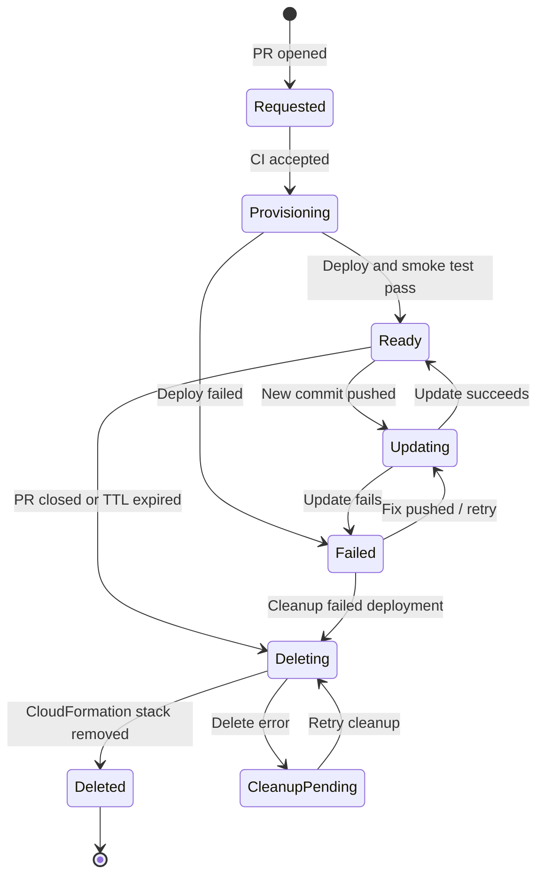

# Môi trường tạm cho từng nhánh và quy tắc tự động thu hồi

## 1. Môi trường tạm là gì?

Trong quá trình phát triển ứng dụng serverless, một nhánh Git thường cần được chạy thử độc lập trước khi merge. Môi trường tạm (ephemeral environment hoặc preview environment) là một bản triển khai có vòng đời gắn với một nhánh, pull request (PR) hoặc thay đổi cụ thể. Khi PR được mở, pipeline tạo hạ tầng và triển khai function; khi có commit mới, pipeline cập nhật môi trường; khi PR đóng hoặc hết thời hạn, hệ thống tự thu hồi tài nguyên.

Ví dụ, nhóm phát triển một Java service xử lý đơn hàng. PR số 482 thêm endpoint kiểm tra tồn kho. Pipeline có thể tạo stack `orders-preview-pr-482` gồm API Gateway, Lambda, SQS và bảng dữ liệu kiểm thử. Reviewer truy cập endpoint preview để thử luồng mới mà không ảnh hưởng môi trường dev dùng chung. Khi PR merge hoặc đóng, stack được xóa.

Môi trường tạm đặc biệt hữu ích với serverless vì hạ tầng có thể được mô tả bằng IaC và triển khai nhanh theo từng stack. Tuy nhiên, “tạm” không có nghĩa tài nguyên tự biến mất. Nếu pipeline bị hủy, webhook không chạy hoặc stack xóa thất bại, tài nguyên vẫn tồn tại và tiếp tục phát sinh chi phí. Cần thiết kế lifecycle, ownership, TTL và cơ chế thu hồi độc lập.

## 2. Vì sao tạo môi trường theo branch hoặc PR?

Môi trường dùng chung thường gây xung đột: hai nhánh có thể deploy phiên bản Lambda khác nhau, thay đổi biến môi trường hoặc cập nhật schema cùng lúc. Một preview environment riêng giúp:

- **Kiểm thử độc lập:** mỗi PR có API, function, queue và cấu hình riêng.
- **Review sớm:** reviewer kiểm tra hành vi qua endpoint thật thay vì chỉ đọc code hoặc chạy local.
- **Phát hiện lỗi tích hợp:** kiểm tra IAM, trigger, DNS, database, timeout và event contract trên AWS.
- **Giảm xung đột:** deploy một nhánh không ghi đè môi trường của nhánh khác.
- **Thử nghiệm kiến trúc:** có thể tạo tài nguyên tạm để đo cold start, concurrency hoặc tích hợp dịch vụ.
- **Tự động hóa vòng đời:** hạ tầng được tạo và thu hồi cùng vòng đời PR.

Đổi lại, mỗi môi trường có thể tạo thêm Lambda, API Gateway, queue, log group, database, secret, NAT hoặc VPC endpoint. Nếu không giới hạn số lượng và thời gian sống, preview environments sẽ làm tăng chi phí và tiêu thụ service quotas.

## 3. Vòng đời của một preview environment

Một vòng đời cơ bản gồm các trạng thái:



| Sự kiện | Hành động |
|---|---|
| PR opened/reopened | Tạo môi trường mới và deploy commit hiện tại |
| Commit pushed/synchronize | Cập nhật cùng môi trường PR đó |
| Smoke test thành công | Đánh dấu môi trường `Ready`, xuất URL preview |
| Deploy thất bại | Ghi trạng thái `Failed`, giữ thông tin để điều tra hoặc thu hồi theo policy |
| PR merged/closed | Xóa stack và tài nguyên riêng của PR |
| Branch deleted | Có thể kích hoạt cleanup dự phòng nếu không có PR event |
| TTL hết hạn | Reaper tìm môi trường quá hạn và thu hồi |
| Cleanup thất bại | Ghi nhận `CleanupPending`, cảnh báo và thử lại |

Không nên chỉ dựa vào sự kiện branch deleted. PR có thể đóng nhưng branch vẫn được giữ lại; ngược lại, branch có thể bị xóa trong lúc PR còn mở. Sự kiện PR closed là tín hiệu chính cho cleanup, còn TTL reaper là cơ chế dự phòng khi webhook hoặc workflow không chạy.

## 4. Chọn phạm vi cô lập

Không phải mọi tài nguyên đều cần tạo mới cho từng PR. Hãy phân loại theo trạng thái và mức độ rủi ro.

| Thành phần | Cách tổ chức thường phù hợp | Lưu ý |
|---|---|---|
| Lambda function và version | Riêng cho từng preview stack | Tránh ghi đè function dùng chung |
| API Gateway route/API | Riêng theo PR hoặc dùng gateway chung với route prefix | Route chung cần cơ chế phân quyền và cleanup chính xác |
| SQS queue và DLQ | Riêng theo PR | Tránh message của nhánh này đi vào worker nhánh khác |
| EventBridge rule/target | Riêng theo PR hoặc dùng bus chung với event namespace | Xóa rule/target khi cleanup |
| DynamoDB table/database | Riêng nếu cần schema/data độc lập; hoặc dùng shared database với partition/schema riêng | Không dùng dữ liệu production |
| S3 bucket/object | Bucket riêng hoặc prefix riêng | Xóa object trước khi xóa bucket nếu policy yêu cầu |
| Secrets Manager secret | Riêng hoặc secret test dùng chung có quyền hạn chế | Không copy production secret vào preview |
| VPC/subnet/NAT | Thường dùng chung hạ tầng network đã quản lý | Tạo VPC riêng cho từng PR thường tốn kém và chậm |
| CloudWatch log group | Riêng theo function/stack | Đặt retention ngắn hợp lý |
| DNS/custom domain | Subdomain riêng như `pr-482.preview.example.com` | Xóa record/certificate mapping khi thu hồi |

Một preview environment nên có ranh giới dữ liệu và quyền truy cập rõ ràng. Chia sẻ VPC hoặc artifact bucket có thể tiết kiệm chi phí, nhưng queue, secret, database schema và IAM permission cần được cô lập cẩn thận.

## 5. Đặt tên môi trường và tài nguyên ổn định

Tên branch không phải lúc nào cũng là tên resource hợp lệ. Branch có thể chứa `/`, dấu chấm, ký tự Unicode hoặc tên rất dài; nhiều dịch vụ AWS có giới hạn ký tự và độ dài khác nhau.

Một quy ước đơn giản là dùng PR number làm định danh duy nhất:

```text
Environment ID: pr-482
CloudFormation stack: orders-preview-pr-482
API hostname: pr-482.preview.example.com
Queue: orders-pr-482
DLQ: orders-pr-482-dlq
Tags:
  EnvironmentType=ephemeral
  PullRequest=482
  OwnerRepo=acme/orders-service
  CommitSha=7a4c...
```

PR number ổn định trong suốt vòng đời PR và dễ dùng trong workflow event. Nếu cần một môi trường theo branch độc lập với PR, hãy chuẩn hóa branch name thành slug rồi nối thêm hash ngắn để tránh collision, ví dụ `feature-checkout-a81f2c`.

Quy tắc đặt tên:

- Chỉ dùng ký tự được dịch vụ đích hỗ trợ; với CloudFormation stack name, dùng chữ/số/hyphen và bắt đầu bằng chữ.
- Giới hạn độ dài theo resource có giới hạn ngắn nhất.
- Không đưa email, tên người dùng hoặc dữ liệu nhạy cảm vào tên resource.
- Dùng cùng một environment ID cho stack, queue, log, secret và DNS record.
- Không tái sử dụng ID của môi trường đã xóa nếu resource ngoài stack vẫn có thể tồn tại.
- Tránh hardcode tên physical resource khi CDK/CloudFormation có thể tự tạo tên duy nhất.

## 6. Đóng dấu ownership và thời hạn bằng tags

Mọi preview stack cần metadata để biết nó thuộc PR nào, repository nào và khi nào phải xóa. Có thể gắn tags ở cấp CloudFormation stack và truyền tags xuống resource hỗ trợ tagging.

Các tag nên có:

| Tag | Ví dụ | Mục đích |
|---|---|---|
| `EnvironmentType` | `ephemeral` | Cho phép cleanup job nhận diện đúng loại stack |
| `OwnerRepo` | `acme/orders-service` | Tránh xóa nhầm stack của repository khác |
| `PullRequest` | `482` | Liên kết stack với PR |
| `CommitSha` | `7a4c...` | Biết commit nào đang được deploy |
| `CreatedAt` | UTC ISO-8601 | Audit thời điểm tạo |
| `ExpiresAt` | UTC ISO-8601 | TTL để reaper thu hồi |
| `OwnerTeam` | `payments-platform` | Xác định nhóm chịu trách nhiệm |
| `CostCenter` | `engineering` | Phân bổ chi phí |

Tag không thay thế quyền IAM hoặc kiểm soát truy cập. Nó là metadata giúp inventory, lọc tài nguyên và cleanup. Một số resource không hỗ trợ tags hoặc không nhận tag từ stack; với chúng cần ghi metadata vào registry riêng hoặc đặt tên theo environment ID.

## 7. Tạo preview stack bằng AWS CDK với Java

CDK cho phép tạo một stack cho mỗi PR. Ứng dụng CDK nhận environment ID từ pipeline và dùng nó làm stack ID/name.

```java
import software.amazon.awscdk.App;
import software.amazon.awscdk.Environment;
import software.amazon.awscdk.StackProps;
import software.amazon.awscdk.Tags;

public final class PreviewApp {
    public static void main(String[] args) {
        String previewId = requireEnv("PREVIEW_ID");
        String pullRequest = requireEnv("PULL_REQUEST_NUMBER");
        String ownerRepo = requireEnv("OWNER_REPO");
        String commitSha = requireEnv("COMMIT_SHA");
        String expiresAt = requireEnv("EXPIRES_AT");

        if (!previewId.matches("pr-[0-9]+")) {
            throw new IllegalArgumentException("Invalid PREVIEW_ID");
        }

        App app = new App();
        Environment env = Environment.builder()
                .account(System.getenv("CDK_DEFAULT_ACCOUNT"))
                .region(System.getenv("CDK_DEFAULT_REGION"))
                .build();

        PreviewStack stack = new PreviewStack(
                app,
                "OrdersPreview-" + previewId,
                StackProps.builder()
                        .env(env)
                        .stackName("orders-preview-" + previewId)
                        .build());

        Tags.of(stack).add("EnvironmentType", "ephemeral");
        Tags.of(stack).add("PullRequest", pullRequest);
        Tags.of(stack).add("OwnerRepo", ownerRepo);
        Tags.of(stack).add("CommitSha", commitSha);
        Tags.of(stack).add("ExpiresAt", expiresAt);

        app.synth();
    }

    private static String requireEnv(String name) {
        String value = System.getenv(name);
        if (value == null || value.isBlank()) {
            throw new IllegalStateException("Missing environment variable: " + name);
        }
        return value;
    }
}
```

`PreviewStack` là stack chứa API, function, queue và tài nguyên riêng của preview. Stack name được tạo từ PR number đã kiểm tra định dạng. Pipeline phải tính `EXPIRES_AT` theo UTC và truyền vào trước khi synth. Ví dụ dùng tag `ExpiresAt` dạng `2026-11-20T12:00:00Z` để cleanup service có thể parse chính xác.

Trong môi trường thật, nên thêm tags như `OwnerTeam`, `CostCenter`, `Service` và `EnvironmentType` cho mọi resource hỗ trợ. Nếu stack tạo resource có tên toàn cục như S3 bucket, phải thêm account/region hoặc suffix duy nhất để tránh trùng tên.

## 8. Cấu hình riêng theo môi trường

Không nên để preview và production dùng chung toàn bộ cấu hình. Mỗi preview cần endpoint, queue, database namespace và secret reference riêng.

Ví dụ:

| Cấu hình | Preview PR 482 | Preview PR 483 | Production |
|---|---|---|---|
| `APP_ENV` | `preview` | `preview` | `production` |
| `PREVIEW_ID` | `pr-482` | `pr-483` | Không có |
| Queue | `orders-pr-482` | `orders-pr-483` | `orders-prod` |
| Database | `orders_preview_482` | `orders_preview_483` | `orders_prod` |
| Secret | `preview/orders/pr-482` | `preview/orders/pr-483` | `production/orders` |
| API host | `pr-482.preview.example.com` | `pr-483.preview.example.com` | `api.example.com` |

Nên quản lý cấu hình theo một schema thống nhất để code chạy được ở mọi môi trường. Những giá trị khác nhau chỉ nên là endpoint, resource identifier, feature flag và secret reference; tránh tạo nhiều nhánh code riêng cho preview.

Không truyền secret thật qua PR title, branch name, workflow output hoặc comment. Dùng Secrets Manager/Parameter Store và quyền IAM chỉ cho preview role. Nếu secret dùng chung cho nhiều preview, bảo đảm quyền chỉ cho phép thao tác cần thiết và không thể truy cập production secret.

## 9. Cô lập dữ liệu và dependency

Môi trường tạm thường bị tạo từ code chưa review đầy đủ. Hãy coi mọi dữ liệu đi qua preview là dữ liệu không tin cậy.

- Dùng dữ liệu synthetic hoặc fixture; không copy nguyên dữ liệu production chứa thông tin cá nhân.
- Nếu cần snapshot production để kiểm thử, phải có quy trình masking/anonymization trước khi đưa vào môi trường preview.
- Dùng database riêng hoặc schema/table prefix riêng theo PR.
- Dùng queue và DLQ riêng để message không chạy vào worker của môi trường khác.
- Tạo bucket riêng hoặc prefix riêng và giới hạn IAM theo đúng ARN/prefix.
- Tắt hoặc giả lập tích hợp thanh toán, gửi email, SMS và webhook có tác động thật.
- Dùng sandbox account/tenant của nhà cung cấp bên ngoài.
- Giới hạn outbound network để code preview không gọi tùy ý vào hệ thống nội bộ nhạy cảm.

Một shared database có thể tiết kiệm chi phí, nhưng cần tách namespace, migration và cleanup theo PR. Không để hai PR cùng chạy migration phá hủy trên một schema dùng chung. Nếu migration không tương thích hoặc cần thử thay đổi dữ liệu lớn, database riêng thường an toàn hơn.

## 10. Quyền IAM và ranh giới bảo mật

Mỗi preview stack nên có execution role riêng hoặc role được giới hạn bằng resource naming/tag. Một Lambda trong PR 482 không cần quyền đọc queue hay secret của PR 483.

Nguyên tắc:

- Dùng least privilege cho Lambda execution role.
- Chỉ cho phép function truy cập resource có environment ID tương ứng.
- Tách role deploy IaC khỏi role runtime của Lambda.
- Không cấp quyền quản trị account cho workflow chạy code từ PR.
- Dùng AWS IAM Identity Center cho phát triển và OIDC federation cho CI/CD thay vì access key dài hạn.
- Giới hạn OIDC trust theo repository, workflow, branch hoặc event claim phù hợp.
- Dùng AWS account riêng cho preview workloads nếu rủi ro hoặc mức tiêu thụ tài nguyên lớn.
- Đặt service quota, budget và concurrency limit để preview không ảnh hưởng production.

### PR từ fork là ranh giới tin cậy quan trọng

Code trong pull request có thể sửa workflow, Maven plugin, build script hoặc test để thực thi lệnh tùy ý. Nếu pipeline cấp AWS role có quyền rộng cho code chưa tin cậy, PR có thể cố đọc biến môi trường hoặc sử dụng credential để truy cập tài nguyên.

Không cấp quyền triển khai production hoặc secret nhạy cảm cho workflow chạy code từ fork. Với repository công khai, có thể bỏ qua preview deployment cho fork, chỉ chạy test không có credential, hoặc dùng sandbox account/role giới hạn nghiêm ngặt cùng bước phê duyệt của người có thẩm quyền. Không dùng `pull_request_target` để checkout và thực thi code của PR một cách thiếu kiểm soát.

## 11. Tự động tạo và cập nhật môi trường trong CI/CD

Một pipeline preview thường được kích hoạt khi PR mở, được cập nhật hoặc mở lại. Mỗi PR có một stack duy nhất; commit mới cập nhật stack đó thay vì tạo thêm một stack mới.

Quy trình deploy:

1. Nhận PR number, repository, head SHA và branch.
2. Kiểm tra PR thuộc repository tin cậy và thỏa điều kiện bảo mật.
3. Tạo preview ID từ PR number.
4. Tính TTL và `ExpiresAt` theo UTC.
5. Build Java artifact và chạy test.
6. Synth CDK template với preview ID và cấu hình tương ứng.
7. Deploy stack vào account/region preview.
8. Chạy smoke test vào endpoint.
9. Cập nhật metadata/registry và công bố URL preview cho reviewer.
10. Khi commit mới đến, cập nhật cùng stack và gia hạn TTL theo policy.

Ví dụ workflow GitHub Actions ở mức khung:

```yaml
name: Preview environment

on:
  pull_request:
    types: [opened, reopened, synchronize, closed]

concurrency:
  group: preview-${{ github.event.pull_request.number }}
  cancel-in-progress: false

permissions:
  contents: read

jobs:
  build-preview:
    if: >-
      github.event.action != 'closed' &&
      github.event.pull_request.head.repo.full_name == github.repository
    runs-on: ubuntu-latest
    outputs:
      preview_id: ${{ steps.meta.outputs.preview_id }}
      expires_at: ${{ steps.ttl.outputs.expires_at }}
    steps:
      - uses: actions/checkout@v4
        with:
          ref: ${{ github.event.pull_request.head.sha }}

      - uses: actions/setup-java@v4
        with:
          distribution: temurin
          java-version: '21'

      - uses: actions/setup-node@v4
        with:
          node-version: '20'

      - name: Build and test
        run: mvn -B test package

      - name: Install pinned CDK CLI
        run: npm install --global "aws-cdk@${CDK_CLI_VERSION}"
        env:
          CDK_CLI_VERSION: ${{ vars.CDK_CLI_VERSION }}

      - name: Set preview ID
        id: meta
        env:
          PR_NUMBER: ${{ github.event.pull_request.number }}
        run: echo "preview_id=pr-${PR_NUMBER}" >> "$GITHUB_OUTPUT"

      - name: Calculate preview expiry
        id: ttl
        run: echo "expires_at=$(date -u -d '+72 hours' +'%Y-%m-%dT%H:%M:%SZ')" >> "$GITHUB_OUTPUT"

      - name: Synthesize preview stack
        env:
          PREVIEW_ID: ${{ steps.meta.outputs.preview_id }}
          PULL_REQUEST_NUMBER: ${{ github.event.pull_request.number }}
          OWNER_REPO: ${{ github.repository }}
          COMMIT_SHA: ${{ github.event.pull_request.head.sha }}
          EXPIRES_AT: ${{ steps.ttl.outputs.expires_at }}
          CDK_DEFAULT_ACCOUNT: ${{ vars.PREVIEW_AWS_ACCOUNT_ID }}
          CDK_DEFAULT_REGION: ${{ vars.AWS_REGION }}
        run: |
          cdk synth "OrdersPreview-${PREVIEW_ID}" --output cdk.out

      - uses: actions/upload-artifact@v4
        with:
          name: preview-cloud-assembly
          path: cdk.out/
          if-no-files-found: error

  deploy-preview:
    needs: build-preview
    if: >-
      github.event.action != 'closed' &&
      github.event.pull_request.head.repo.full_name == github.repository
    runs-on: ubuntu-latest
    environment: preview-sandbox
    permissions:
      actions: read
      contents: read
      id-token: write
    steps:
      - uses: actions/download-artifact@v4
        with:
          name: preview-cloud-assembly
          path: cdk.out

      - uses: actions/setup-node@v4
        with:
          node-version: '20'

      - name: Install pinned CDK CLI
        run: npm install --global "aws-cdk@${CDK_CLI_VERSION}"
        env:
          CDK_CLI_VERSION: ${{ vars.CDK_CLI_VERSION }}

      - uses: aws-actions/configure-aws-credentials@v4
        with:
          role-to-assume: ${{ vars.PREVIEW_DEPLOY_ROLE_ARN }}
          aws-region: ${{ vars.AWS_REGION }}

      - name: Deploy synthesized stack
        env:
          PREVIEW_ID: ${{ needs.build-preview.outputs.preview_id }}
        run: cdk deploy --app cdk.out "OrdersPreview-${PREVIEW_ID}" --require-approval never

  cleanup-preview:
    if: >-
      github.event.action == 'closed' &&
      github.event.pull_request.head.repo.full_name == github.repository
    runs-on: ubuntu-latest
    permissions:
      contents: read
      id-token: write
    steps:
      - uses: aws-actions/configure-aws-credentials@v4
        with:
          role-to-assume: ${{ vars.PREVIEW_CLEANUP_ROLE_ARN }}
          aws-region: ${{ vars.AWS_REGION }}

      - name: Verify ownership and delete preview stack
        env:
          PR_NUMBER: ${{ github.event.pull_request.number }}
          GITHUB_REPOSITORY: ${{ github.repository }}
        run: |
          STACK_NAME="orders-preview-pr-${PR_NUMBER}"
          STACK_JSON=$(aws cloudformation describe-stacks --stack-name "$STACK_NAME" 2>/dev/null || true)
          if [ -z "$STACK_JSON" ]; then
            echo "Preview stack already removed."
            exit 0
          fi
          ENV_TYPE=$(printf '%s' "$STACK_JSON" | jq -r '.Stacks[0].Tags[]? | select(.Key == "EnvironmentType") | .Value')
          OWNER_REPO=$(printf '%s' "$STACK_JSON" | jq -r '.Stacks[0].Tags[]? | select(.Key == "OwnerRepo") | .Value')
          if [ "$ENV_TYPE" != "ephemeral" ] || [ "$OWNER_REPO" != "$GITHUB_REPOSITORY" ]; then
            echo "Refusing to delete a stack not owned by this preview workflow."
            exit 1
          fi
          aws cloudformation delete-stack --stack-name "$STACK_NAME"
          aws cloudformation wait stack-delete-complete --stack-name "$STACK_NAME"
```

Đây là khung minh họa với TTL 72 giờ; `CDK_CLI_VERSION`, `PREVIEW_AWS_ACCOUNT_ID` và `AWS_REGION` là repository variables phải được khai báo. CDK app cần tạo đúng stack ID, và pipeline cần build đúng module chứa function artifact trước khi synth/deploy. Build/test/synth chạy trong job không có quyền OIDC; job deploy chỉ nhận Cloud Assembly đã tổng hợp và dùng role trong GitHub Environment được bảo vệ. Trong production, pin GitHub Actions theo commit SHA, khóa phiên bản Node/CDK CLI, thêm policy checks và smoke test. OIDC trust policy của AWS phải giới hạn đúng repository và event subject; điều kiện `head.repo.full_name` chỉ là một lớp lọc, không thay thế IAM trust policy. Cleanup role nên chỉ có quyền đọc/xóa preview stack thuộc account sandbox và cần giữ policy kiểm tra tag ownership như ví dụ. Nếu CDK synth cần context lookup, chuẩn bị context trong quy trình tin cậy hoặc dùng role lookup chỉ đọc riêng; không cấp deploy credential cho bước chạy mã PR.

Nếu workflow deploy chạy từ branch PR, mọi script được thực thi trong build có thể tác động đến credential của job. Chỉ dùng role sandbox có quyền giới hạn và chỉ chạy với contributor/repository được tin cậy. Với fork không được cấp quyền, pipeline nên kết thúc ở bước test không credential.

## 12. Cập nhật cùng stack khi có commit mới

Mỗi lần push commit, pipeline nên deploy lại cùng environment ID. CloudFormation so sánh template mới với trạng thái stack và cập nhật các resource thay đổi.

Hãy truyền commit SHA vào tag hoặc parameter để xác định code đang chạy. URL preview không cần thay đổi khi commit mới được deploy. Nếu smoke test thất bại, giữ trạng thái `Failed` và thông báo commit gây lỗi; có thể deploy lại commit trước hoặc sửa PR.

Các vấn đề cần xử lý:

- **Hai commit deploy đồng thời:** serialize deployment theo PR ID để stack không nhận hai update cùng lúc.
- **Deploy bị hủy giữa chừng:** CloudFormation có thể vẫn tiếp tục update; cleanup hoặc deploy tiếp theo cần đợi stack ổn định.
- **PR đóng khi deploy đang chạy:** cleanup phải đợi update hoàn tất rồi mới delete stack.
- **Schema thay đổi:** migration cần tương thích trong thời gian code cũ và mới cùng tồn tại.
- **Resource replacement:** review CloudFormation change set; không thay database hoặc bucket chứa dữ liệu mà không có kế hoạch.

Không giả định hủy workflow đồng nghĩa hủy CloudFormation operation. Hãy dùng concurrency control theo environment ID và kiểm tra trạng thái stack trước khi update hoặc delete.

## 13. Tự động thu hồi khi PR đóng

Sự kiện `pull_request.closed` là trigger chính để xóa preview stack. Cleanup job cần xác định đúng stack name từ PR number, kiểm tra tags ownership rồi gọi CloudFormation delete.

Ví dụ lệnh xóa có kiểm tra tag trước:

```bash
STACK_NAME="orders-preview-pr-${PR_NUMBER}"

STACK_JSON=$(aws cloudformation describe-stacks \
  --stack-name "$STACK_NAME" 2>/dev/null || true)

if [ -z "$STACK_JSON" ]; then
  echo "Preview stack does not exist; cleanup is already complete."
  exit 0
fi

ENV_TYPE=$(printf '%s' "$STACK_JSON" | jq -r \
  '.Stacks[0].Tags[]? | select(.Key == "EnvironmentType") | .Value')
OWNER_REPO=$(printf '%s' "$STACK_JSON" | jq -r \
  '.Stacks[0].Tags[]? | select(.Key == "OwnerRepo") | .Value')

if [ "$ENV_TYPE" != "ephemeral" ] || [ "$OWNER_REPO" != "$GITHUB_REPOSITORY" ]; then
  echo "Refusing to delete a stack not owned by this preview workflow."
  exit 1
fi

aws cloudformation delete-stack --stack-name "$STACK_NAME"
aws cloudformation wait stack-delete-complete --stack-name "$STACK_NAME"
```

Lệnh chỉ minh họa; job cần thiết lập `PR_NUMBER`, `GITHUB_REPOSITORY`, AWS credentials và `jq`. Nếu stack không tồn tại, cleanup kết thúc thành công để hỗ trợ chạy lặp. Nếu tag không khớp, job dừng và báo lỗi thay vì xóa tài nguyên không rõ ownership.

Trong workflow thật, cleanup job phải chạy cả khi PR được merge lẫn khi PR đóng không merge. Có thể bổ sung sự kiện branch deleted để dọn các preview không còn PR, nhưng phải xác định được PR/stack liên quan. Không lấy branch name chưa chuẩn hóa làm đối số trực tiếp cho lệnh CloudFormation.

## 14. TTL và cleanup reaper

Webhook không phải lúc nào cũng được xử lý thành công. Workflow có thể bị xóa, token hết hạn, runner mất kết nối hoặc PR bị bỏ quên. TTL (time to live) tạo giới hạn thời gian sống độc lập với sự kiện Git.

Một policy có thể gồm:

- **Inactivity TTL:** xóa nếu không có commit hoặc hoạt động trong 48 giờ.
- **Maximum lifetime:** dù PR còn mở, môi trường không tồn tại quá 7 ngày nếu không được gia hạn.
- **Grace period:** cảnh báo trước khi xóa, ví dụ 2 giờ.
- **Keep-alive:** người phụ trách có thể gia hạn theo quy trình được kiểm soát.
- **Immediate cleanup:** PR đóng hoặc bị hủy thì xóa ngay, không chờ TTL.

Các con số trên chỉ là ví dụ. Chọn TTL theo thời gian review, thời gian kiểm thử và chi phí. Môi trường cho integration test kéo dài có thể cần TTL dài hơn môi trường preview UI.

Reaper là một job định kỳ quét các môi trường tạm và xóa stack đã hết hạn. Có thể triển khai bằng EventBridge Scheduler gọi Lambda cleanup, một scheduled workflow hoặc một service vận hành tập trung.

Quy trình reaper:

1. Liệt kê CloudFormation stacks theo pagination và trạng thái còn hoạt động.
2. Chỉ xét stack có `EnvironmentType=ephemeral`.
3. Kiểm tra `OwnerRepo`, `PullRequest` và `ExpiresAt`.
4. Xác minh PR đã đóng hoặc TTL/hard maximum lifetime đã hết.
5. Bỏ qua stack đang `CREATE_IN_PROGRESS`, `UPDATE_IN_PROGRESS` hoặc `DELETE_IN_PROGRESS`; ghi lại để thử ở lần sau.
6. Kiểm tra tag ownership lần cuối trước khi xóa.
7. Gọi `DeleteStack` và theo dõi kết quả.
8. Ghi audit log, số resource đã xóa, lỗi và chi phí được giải phóng.
9. Gửi cảnh báo nếu cleanup thất bại quá số lần cho phép.

Reaper phải có quyền IAM giới hạn chỉ trên stack preview và không được phép xóa stack production. Nếu không thể ràng buộc IAM theo tag như mong muốn, dùng account riêng cho ephemeral workloads và xác thực tag ở logic cleanup.

## 15. Không xóa môi trường đang được sử dụng

TTL có thể hết hạn trong khi reviewer đang chạy test hoặc đang trình diễn. Có thể dùng lease/heartbeat:

- Mỗi preview có `ExpiresAt` và `LastActivityAt`.
- Pipeline gia hạn TTL khi có commit mới.
- Người dùng được cấp quyền có thể yêu cầu keep-alive trong thời gian giới hạn.
- Reaper cảnh báo trước khi xóa và bỏ qua môi trường có lease hợp lệ.
- Maximum lifetime vẫn giới hạn tổng thời gian sống để tránh môi trường được gia hạn vô hạn.

Không nên gia hạn chỉ vì có request HTTP bất kỳ; bot hoặc health check có thể giữ môi trường sống mãi. Nếu dùng activity, chỉ tính hành động có ý nghĩa như commit mới, thao tác review được xác thực hoặc gia hạn có chủ đích.

Một registry trong DynamoDB có thể lưu trạng thái:

| Field | Ý nghĩa |
|---|---|
| `environmentId` | Khóa chính, ví dụ `pr-482` |
| `stackName` | CloudFormation stack cần thu hồi |
| `ownerRepo` | Repository sở hữu |
| `pullRequest` | PR liên quan |
| `commitSha` | Commit đang được deploy |
| `status` | `PROVISIONING`, `READY`, `FAILED`, `DELETING`, `DELETED` |
| `createdAt` | Thời điểm tạo |
| `lastActivityAt` | Hoạt động cuối được chấp nhận |
| `expiresAt` | Thời điểm hết hạn |
| `leaseUntil` | Thời điểm lease hiện tại kết thúc |
| `previewUrl` | URL của môi trường |

Registry hữu ích khi cần hiển thị dashboard, xử lý nhiều tài khoản hoặc quản lý resource ngoài CloudFormation stack. Nếu chỉ có vài preview stack đơn giản, tags trên stack có thể đủ và giảm số thành phần vận hành.

## 16. Cleanup phải idempotent và có thể retry

Cleanup cũng là một workflow phân tán. Một lần chạy có thể xóa thành công một số resource rồi thất bại ở resource khác. Người vận hành có thể chạy lại cleanup; vì vậy, thao tác phải an toàn khi thực hiện nhiều lần.

Quy tắc:

- Nếu stack không tồn tại, xem như đã thu hồi.
- Nếu stack đang update, đợi stack ổn định rồi thử delete.
- Nếu stack đã `DELETE_IN_PROGRESS`, không gọi delete liên tục.
- Nếu `DELETE_FAILED`, đọc CloudFormation events để xác định resource ngăn việc xóa.
- Retry lỗi throttling hoặc lỗi dịch vụ tạm thời với backoff.
- Không retry vô hạn lỗi permission, dependency hoặc resource còn chứa dữ liệu không thể xóa.
- Lưu trạng thái `CleanupPending` và phát cảnh báo nếu cần can thiệp thủ công.

CloudFormation xóa các resource thuộc stack theo dependency graph. Nhưng tài nguyên được retain, dữ liệu nằm ngoài stack hoặc tài nguyên được tạo thủ công có thể còn tồn tại. Cleanup cần có inventory những gì nằm ngoài stack, ví dụ object trong shared bucket prefix, DNS record được quản lý riêng hoặc test account ở nhà cung cấp bên ngoài.

## 17. Tài nguyên khó thu hồi và dữ liệu còn sót

Một số resource cần xử lý riêng:

| Tài nguyên | Rủi ro khi xóa | Quy tắc |
|---|---|---|
| S3 bucket | Bucket còn object hoặc version | Xóa object/version trong prefix riêng hoặc dùng auto-delete chỉ cho bucket ephemeral |
| DynamoDB table | Dữ liệu có thể cần giữ để điều tra | Dùng bảng riêng và policy retain/backup theo nhu cầu |
| CloudWatch log group | Log tiếp tục phát sinh chi phí sau khi stack xóa | Đặt retention rõ ràng và xác nhận log group được quản lý trong stack |
| ECR image | Image còn tồn tại sau khi function stack bị xóa | Dùng lifecycle policy theo tag/age hoặc repository riêng |
| Secrets Manager secret | Secret có thể có recovery window | Đặt chính sách xóa cho secret ephemeral và kiểm tra trạng thái pending deletion |
| DNS record | Hostname có thể trỏ đến endpoint đã xóa | Xóa record khi teardown hoặc quản lý bằng stack |
| NAT Gateway/Elastic IP | Có thể bị bỏ sót và vẫn tính phí | Ưu tiên stack sở hữu rõ ràng; xác nhận trạng thái sau delete |
| Shared database schema | Schema không tự biến mất khi stack xóa | Chạy migration/drop script có giới hạn đúng schema/PR |
| Queue message | Message tồn tại trong queue dùng chung | Dùng queue riêng hoặc purge có kiểm soát, không purge queue dùng chung |

Với S3 bucket ephemeral, có thể cấu hình `RemovalPolicy.DESTROY` và `autoDeleteObjects(true)` để CDK tạo cơ chế xóa object trước bucket. Chỉ dùng cho bucket chứa dữ liệu có thể bỏ; không áp dụng cho bucket dùng chung hoặc dữ liệu cần giữ. Việc auto-delete có thể tạo custom resource và cần thêm quyền trong quá trình xóa.

## 18. Giới hạn tài nguyên và chi phí

Môi trường tạm có thể rẻ khi chỉ gồm Lambda và queue, nhưng tăng nhanh khi mỗi PR tạo database, NAT Gateway hoặc VPC endpoint. Cần đặt giới hạn ở cả cấp pipeline và AWS account.

Các biện pháp:

- Giới hạn số preview environment đồng thời.
- Giới hạn memory, timeout và reserved concurrency của function.
- Dùng SQS để điều tiết test load và tránh dồn tải vào database dùng chung.
- Dùng log retention ngắn cho preview.
- Chọn DynamoDB on-demand hoặc database nhẹ khi phù hợp; không cấp capacity production cho mỗi PR.
- Dùng VPC/network dùng chung đã quản lý nếu có thể, thay vì tạo NAT Gateway cho từng PR.
- Tắt hoặc xóa tài nguyên ngay sau khi PR đóng.
- Đặt AWS Budgets/cost anomaly alert cho account preview.
- Gắn `CostCenter`, `OwnerRepo`, `PullRequest` và `EnvironmentType` để phân bổ chi phí.
- Đặt service quota và cảnh báo khi số Lambda, API, queue hoặc ENI tăng bất thường.

Hãy đo chi phí trung bình mỗi preview-hour và mỗi PR. Nếu preview tồn tại 3 ngày nhưng reviewer chỉ dùng trong 30 phút, rút ngắn TTL hoặc dùng môi trường chia sẻ cho các bước kiểm thử không cần cô lập hoàn toàn.

## 19. Mạng và endpoint cho preview environment

Không phải preview nào cũng cần public endpoint. Có ba mô hình phổ biến:

1. **Public preview có xác thực:** API Gateway public nhưng yêu cầu JWT/authorizer hoặc access token dành cho reviewer.
2. **Private preview:** API chỉ truy cập qua VPC, VPN hoặc mạng nội bộ; phù hợp dữ liệu nhạy cảm và hệ thống nội bộ.
3. **Shared gateway với route riêng:** một gateway dùng chung định tuyến đến function của từng PR; cần xác thực, mapping và cleanup route chính xác.

Nếu dùng custom domain, có thể tạo `pr-482.preview.example.com` và certificate wildcard cho `*.preview.example.com`. DNS record cần được tạo/xóa tự động. Với API Gateway endpoint mặc định, có thể tránh quản lý DNS riêng nhưng cần cơ chế chia sẻ URL an toàn.

Preview environment không nên mở database hoặc admin endpoint ra Internet chỉ để reviewer dễ truy cập. Mọi endpoint public phải có authentication, rate limit và dữ liệu test phù hợp.

## 20. Xử lý trigger và message khi môi trường bị thu hồi

Serverless environment có thể có event source mapping, EventBridge rule, scheduled trigger và queue. Khi stack bị xóa, mapping/rule thuộc stack sẽ được xóa, nhưng message trong queue hoặc event đã được gửi tới dịch vụ khác có thể còn tồn tại.

Thiết kế an toàn:

- Dùng queue riêng theo preview để message không được worker khác nhận.
- Tắt schedule trước khi xóa resource nếu schedule nằm ngoài stack.
- Xóa EventBridge rule/target và mapping thuộc preview.
- Đặt retention ngắn cho queue tạm và DLQ.
- Không gửi event preview vào bus production nếu consumer không thể phân biệt môi trường.
- Gắn `environmentId` vào event metadata và kiểm tra consumer không xử lý event của preview như dữ liệu production.
- Dùng idempotency key chứa namespace môi trường để tránh trùng với dữ liệu thật.

Khi cleanup, cần quyết định message còn tồn tại sẽ bị xóa, archive hay redrive. Không purge một queue dùng chung vì một preview đã đóng.

## 21. Tránh race condition giữa deploy và cleanup

Một trường hợp khó là PR đóng đúng lúc workflow đang deploy commit mới. Nếu cleanup chạy trước, deploy có thể tạo lại stack sau khi cleanup hoàn tất. Nếu hai deploy chạy cùng lúc, CloudFormation có thể trả lỗi stack đang được cập nhật.

Để tránh:

- Serialize các thao tác trên cùng environment ID.
- Ghi trạng thái mong muốn vào registry: `ACTIVE` hoặc `DELETING`.
- Trước deploy, kiểm tra PR còn mở và environment chưa chuyển sang `DELETING`.
- Cleanup chuyển trạng thái sang `DELETING` trước khi gọi CloudFormation.
- Khi PR đã đóng, từ chối mọi deploy job đến muộn.
- Nếu deploy đang chạy, chờ CloudFormation ổn định rồi xóa.
- Chạy reaper để phát hiện stack được tạo lại ngoài ý muốn sau khi PR đóng.

CI concurrency group theo PR có thể giảm deploy trùng, nhưng không tự giải quyết mọi race condition. Một job bị hủy không nhất thiết dừng CloudFormation operation đã gửi. Với hệ thống nhiều pipeline hoặc nhiều repository, registry/lease có conditional update giúp kiểm soát trạng thái tốt hơn.

## 22. Quan sát và audit vòng đời preview

Một dashboard preview nên cho biết:

- PR, branch, commit SHA và owner.
- Stack name, account, region và preview URL.
- Trạng thái deploy và thời điểm deploy cuối.
- `CreatedAt`, `LastActivityAt`, `ExpiresAt` và `LeaseUntil`.
- Resource count và chi phí ước tính theo môi trường.
- Lần cleanup gần nhất, trạng thái CloudFormation và lỗi nếu có.
- Số lần reaper thử xóa và thời điểm cảnh báo.

Log cleanup cần có `environmentId`, `stackName`, `ownerRepo`, action, actor, timestamp, kết quả và error code. Không ghi secret hoặc payload dữ liệu người dùng.

Các metric quan trọng:

| Metric | Ý nghĩa |
|---|---|
| Preview environments active | Số môi trường đang tồn tại |
| Preview creation duration | Thời gian từ PR opened đến Ready |
| Deployment failure rate | Tỷ lệ deploy preview thất bại |
| Expired environments | Số môi trường quá TTL nhưng chưa xóa |
| Cleanup success/failure | Tỷ lệ thu hồi thành công |
| Orphaned resource count | Resource ephemeral không còn registry/PR tương ứng |
| Preview cost per hour/PR | Chi phí trung bình theo thời gian hoặc PR |

Đặt cảnh báo nếu môi trường hết hạn quá grace period, cleanup thất bại hoặc chi phí account preview vượt budget. Một hệ thống có nhiều preview đang chạy không đồng nghĩa hoạt động tốt nếu nhiều stack đã mồ côi.

## 23. Quy trình xử lý một môi trường mồ côi

Môi trường mồ côi (orphaned environment) là stack/resource ephemeral không còn PR hoặc owner hợp lệ. Reaper có thể phát hiện qua tag `ExpiresAt`, registry và Git provider API.

Quy trình xử lý:

1. Tìm stack có `EnvironmentType=ephemeral` đã hết hạn.
2. Kiểm tra PR còn mở hay không; không dựa riêng vào branch name.
3. Xác minh owner repository và environment ID.
4. Kiểm tra stack có đang update/delete hay không.
5. Gửi cảnh báo nếu stack có dữ liệu cần review hoặc lease còn hiệu lực.
6. Nếu không có ngoại lệ, xóa stack.
7. Kiểm tra resource ngoài stack như S3 prefix, DNS record, ECR image và schema.
8. Ghi kết quả và đóng registry record.
9. Nếu xóa thất bại, giữ record ở `CleanupPending` và mở ticket/cảnh báo.

Không xóa resource chỉ vì tên chứa `preview` hoặc `pr-`. Cần kiểm tra tag ownership và account/region. Tên không phải bằng chứng đủ để xóa tài nguyên.

## 24. Quy trình triển khai end-to-end

Một quy trình vận hành có thể chuẩn hóa như sau:

1. **PR opened:** xác thực nguồn PR và điều kiện tin cậy.
2. **Build:** chạy unit test, kiểm tra dependency và build Java artifact.
3. **Provision:** tạo stack theo PR ID, gắn ownership/TTL tags và cấp quyền giới hạn.
4. **Deploy:** tạo Lambda, API, queue, database namespace và trigger cần thiết.
5. **Verify:** smoke test, kiểm tra auth, event processing, log và metric.
6. **Publish preview URL:** cung cấp URL cho reviewer qua cơ chế của repository.
7. **Update:** mỗi commit cập nhật cùng stack, đổi commit SHA và gia hạn TTL.
8. **Close:** PR merged/closed chuyển environment sang `DELETING`.
9. **Cleanup:** xóa stack và tài nguyên ngoài stack có ownership rõ.
10. **Reconcile:** reaper quét TTL và orphan để bù cho sự kiện bị bỏ lỡ.
11. **Audit:** lưu trạng thái và kết quả cleanup, phân bổ chi phí.

## 25. Checklist trước khi đưa preview environments vào production

- [ ] Mỗi PR/branch có environment ID duy nhất và tên resource hợp lệ.
- [ ] Stack được gắn `EnvironmentType`, `OwnerRepo`, `PullRequest`, `CommitSha` và `ExpiresAt`.
- [ ] Pipeline tạo mới hoặc cập nhật cùng stack khi PR thay đổi.
- [ ] Preview có URL và cơ chế xác thực phù hợp.
- [ ] Queue, DLQ, event rule và database namespace được cô lập.
- [ ] Không dùng dữ liệu production chưa masking/anonymization.
- [ ] Secret và IAM role riêng, không cấp quyền production cho code PR.
- [ ] PR từ fork không được truy cập AWS credential hoặc secret nhạy cảm.
- [ ] Deploy và cleanup được serialize theo environment ID.
- [ ] PR close/merge kích hoạt cleanup ngay.
- [ ] TTL reaper là cơ chế dự phòng độc lập.
- [ ] Cleanup xác minh tag ownership trước khi xóa.
- [ ] Cleanup có thể chạy lặp, retry và báo `CleanupPending` khi thất bại.
- [ ] Tài nguyên ngoài CloudFormation stack có quy trình thu hồi riêng.
- [ ] S3 bucket, log, secret, ECR image, DNS và NAT không bị bỏ sót.
- [ ] Có giới hạn concurrency, quota, số preview đồng thời và AWS budget.
- [ ] Có dashboard cho preview active, expired, cleanup failure và orphan.
- [ ] Đã kiểm thử PR đóng giữa lúc deploy, workflow bị hủy và reaper chạy đồng thời.

## Tài liệu tham khảo

- [AWS CloudFormation stack lifecycle](https://docs.aws.amazon.com/AWSCloudFormation/latest/UserGuide/stacks.html)
- [AWS CDK Developer Guide](https://docs.aws.amazon.com/cdk/v2/guide/home.html)
- [CloudFormation stack tags](https://docs.aws.amazon.com/AWSCloudFormation/latest/UserGuide/aws-properties-resource-tags.html)
- [GitHub Actions events that trigger workflows](https://docs.github.com/actions/using-workflows/events-that-trigger-workflows)
- [GitHub Actions OIDC in AWS](https://docs.github.com/actions/deployment/security-hardening-your-deployments/configuring-openid-connect-in-amazon-web-services)
- [AWS IAM best practices](https://docs.aws.amazon.com/IAM/latest/UserGuide/best-practices.html)
- [AWS Budgets](https://docs.aws.amazon.com/cost-management/latest/userguide/budgets-managing-costs.html)

## Kết luận

Preview environment gắn với branch hoặc PR giúp kiểm thử serverless độc lập và cho reviewer xem thay đổi trên hạ tầng thật. Để giữ lợi ích này mà không tạo tài nguyên mồ côi, mỗi môi trường cần ID ổn định, tags ownership, cấu hình và dữ liệu được cô lập, quyền triển khai giới hạn, cleanup khi PR đóng và TTL reaper làm lớp dự phòng. Cleanup phải idempotent, kiểm tra ownership và xử lý race condition với deploy đang chạy. Khi kết hợp IaC, CI/CD, audit và cost controls, môi trường tạm trở thành một phần có thể quản lý của vòng đời phát triển thay vì những tài nguyên thử nghiệm bị bỏ quên.
