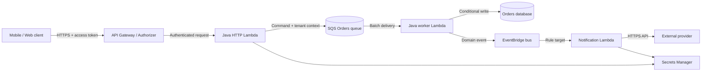
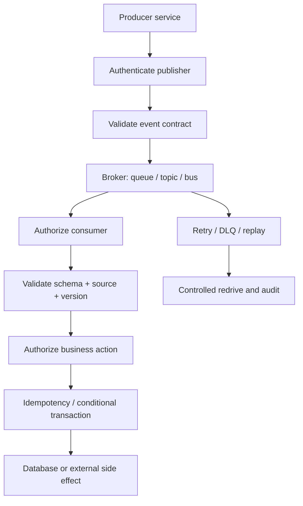

# Lập threat model cho API, trigger và pipeline sự kiện

Ứng dụng serverless thường nhận dữ liệu từ nhiều ranh giới: HTTP client, API Gateway, Function URL, queue, topic, event bus, object storage, lịch chạy và dịch vụ đối tác. Mỗi trigger có cách xác thực, delivery, retry và quyền truy cập khác nhau. Một Java function có thể được gọi hợp lệ bởi nhiều nguồn, nhưng payload vẫn có thể sai, bị giả mạo, phát lại hoặc chứa dữ liệu khiến function thực hiện hành động ngoài ý muốn.

**Threat modeling** là cách phân tích có hệ thống tài sản cần bảo vệ, luồng dữ liệu, ranh giới tin cậy, đối tượng tấn công và đường khai thác trước khi sự cố xảy ra. Kết quả không chỉ là danh sách lỗ hổng; đó là mô hình kiến trúc có rủi ro được ưu tiên, biện pháp giảm thiểu, người chịu trách nhiệm và cách xác minh.

Với Cloud Serverless, threat model cần bao phủ cả API đồng bộ và pipeline bất đồng bộ. Một API có thể xác thực người dùng tốt nhưng sau khi đưa message vào queue, consumer lại tin tenant ID do client gửi. Một EventBridge rule có thể chỉ nhận event từ source được phép, nhưng execution role của Lambda vẫn có quyền quá rộng. Vì vậy, phải theo dõi cùng một hành động qua producer, broker, function, database và hệ thống ngoài.

## 1. Threat model cần trả lời những câu hỏi nào?

Một threat model hữu ích giúp nhóm phát triển trả lời:

1. Hệ thống đang bảo vệ dữ liệu, tài nguyên và hành động nào?
2. Ai hoặc thành phần nào có thể gửi dữ liệu vào từng entry point?
3. Dữ liệu đi qua những service, queue, function, account và network boundary nào?
4. Mỗi thành phần được tin cậy đến mức nào, và dựa trên bằng chứng nào?
5. Kẻ tấn công có thể giả mạo, sửa đổi, phát lại, làm lộ hoặc làm cạn tài nguyên ở đâu?
6. Nếu một function hoặc credential bị chiếm quyền, phạm vi ảnh hưởng lớn nhất là gì?
7. Biện pháp kiểm soát nào ngăn chặn, phát hiện hoặc khôi phục từng rủi ro?
8. Làm thế nào kiểm thử rằng biện pháp đó thực sự hoạt động?

Threat model nên là một phần của thiết kế và thay đổi kiến trúc. Cập nhật nó khi thêm trigger, mở endpoint mới, thay đổi quyền IAM, đưa event sang account khác, thêm consumer, thay đổi schema hoặc cho phép replay dữ liệu.

## 2. Xác định phạm vi, giả định và tài sản

Trước khi liệt kê tấn công, ghi rõ hệ thống đang được mô hình hóa. Không cần mô tả toàn bộ cloud account nếu thay đổi chỉ liên quan một API và một queue; nhưng phải đưa vào phạm vi mọi thành phần có thể ảnh hưởng đến đường dữ liệu đó.

### Tài sản cần bảo vệ

| Nhóm tài sản | Ví dụ | Tác động nếu bị xâm phạm |
|---|---|---|
| Dữ liệu người dùng | Hồ sơ, địa chỉ, lịch sử đơn hàng, dữ liệu thanh toán | Rò rỉ riêng tư, gian lận, vi phạm hợp đồng/quy định |
| Dữ liệu nghiệp vụ | Order, payment, inventory, workflow state | Sai trạng thái, mất tiền, giao hàng sai hoặc trùng |
| Credential và secret | API key, database password, signing key, token | Truy cập trái phép vào service hoặc dữ liệu |
| Danh tính và quyền | IAM role, service principal, JWT claims, tenant context | Leo thang quyền, truy cập chéo tenant |
| Event và message | Event body, schema, event ID, queue backlog | Giả mạo, sửa dữ liệu, replay hoặc poison message |
| Hạ tầng | Function, API, queue, event bus, database, KMS key | Chiếm quyền thực thi, phá hoại hoặc gián đoạn |
| Pipeline triển khai | Source, dependency, build artifact, IaC, deployment role | Phát hành mã độc hoặc thay đổi quyền/hạ tầng |
| Bằng chứng vận hành | Audit log, trace, deployment history | Không điều tra được hoặc phủ nhận hành động |

Phân loại dữ liệu theo độ nhạy và thời gian lưu. Xác định dữ liệu nào cần mã hóa, che log, giới hạn export, xóa theo retention và chỉ cho phép service nào đọc. Không đưa secret vào event payload chỉ vì consumer cần xác thực với một hệ thống khác; consumer nên lấy secret qua secret manager bằng identity riêng.

### Ghi rõ giả định

Ví dụ các giả định cần xác nhận:

- API Gateway xác thực JWT trước khi gọi function; function vẫn phải kiểm tra quyền trên resource.
- EventBridge bus chỉ nhận event từ account hoặc principal được cho phép.
- SQS queue có policy giới hạn producer và consumer.
- Database có partition key tenant và mọi repository query đều ràng buộc tenant.
- CI/CD chỉ deploy từ protected branch bằng role ngắn hạn.

Giả định chưa xác minh phải được ghi là rủi ro, không coi là kiểm soát đã có. Một sơ đồ kiến trúc có biểu tượng khóa không chứng minh rằng resource policy hoặc code đã enforce quyền đó.

## 3. Vẽ data-flow diagram và trust boundary

Data-flow diagram (DFD) mô tả entity bên ngoài, process, data store, luồng dữ liệu và ranh giới tin cậy. Dùng sơ đồ đơn giản, tập trung vào đường đi của dữ liệu nhạy cảm và quyền thực thi.

Ví dụ API tạo đơn hàng và xử lý bất đồng bộ:



Các trust boundary trong ví dụ:

- **TB1 – Internet vào API:** client không đáng tin; token, body, header và path parameter đều cần xác minh.
- **TB2 – API Gateway vào Lambda:** principal/claims được xác thực qua cấu hình authorizer; function phải nhận đúng context từ integration và không tin header client tự đặt.
- **TB3 – Producer vào queue:** message có thể bị giao lại; queue policy và IAM producer/consumer quyết định ai được gửi/nhận.
- **TB4 – Queue vào worker:** payload là dữ liệu đầu vào không tin cậy cho đến khi schema, nguồn và quyền nghiệp vụ được kiểm tra.
- **TB5 – Function vào database/event bus:** execution role giới hạn thao tác và resource ARN.
- **TB6 – Cloud account ra đối tác:** outbound request có thể tiết lộ dữ liệu hoặc bị lợi dụng để gọi đích không mong muốn.
- **TB7 – Source control/build vào production:** dependency, artifact, template và deployment role là đường đưa thay đổi vào hệ thống.

Không phải mọi ranh giới đều là network boundary. Một queue trong cùng account vẫn là trust boundary vì producer và consumer có quyền, trách nhiệm và vòng đời khác nhau.

### Thông tin cần ghi trên mỗi data flow

Ghi nguồn, đích, giao thức, loại dữ liệu, danh tính gọi, cơ chế xác thực, quyền được dùng, mã hóa, độ tin cậy, delivery semantics và cách xử lý lỗi. Với message, ghi event ID, schema version, retention, retry, DLQ và consumer group. Với HTTP, ghi auth mechanism, rate limit, payload limit và timeout.

## 4. Dùng STRIDE để tìm threat

STRIDE nhóm các mối đe dọa thành sáu loại. Có thể dùng nó để rà từng process, data flow và data store trong DFD.

| Nhóm | Câu hỏi | Ví dụ trong serverless | Kiểm soát tiêu biểu |
|---|---|---|---|
| **Spoofing** – giả mạo | Kẻ tấn công có thể giả danh user, producer hoặc service không? | Giả JWT, publish event vào bus, gửi message giả | Xác thực token, resource policy, IAM, chữ ký/nguồn event |
| **Tampering** – sửa đổi | Dữ liệu hoặc cấu hình có thể bị sửa trái phép không? | Sửa `tenantId`, amount, event body, template hoặc artifact | Validation, integrity check, immutable artifact, least privilege |
| **Repudiation** – chối bỏ | Có thể phủ nhận hành động do thiếu bằng chứng không? | Không có audit log cho admin replay hoặc refund | Audit log, request ID, actor, timestamp, immutable retention |
| **Information Disclosure** – lộ dữ liệu | Dữ liệu có thể đến người không được phép không? | Log token, queue policy rộng, IDOR, cross-tenant query | Authorization, encryption, redaction, data minimization |
| **Denial of Service** – từ chối dịch vụ | Có thể làm cạn concurrency, quota, queue hoặc chi phí không? | Request flood, poison message, retry storm, oversized payload | Throttle, quota, batch limit, reserved concurrency, DLQ |
| **Elevation of Privilege** – leo thang quyền | Thành phần có thể thực hiện hành động vượt quyền không? | Function có `*`, confused deputy, CI role deploy mọi account | IAM scope, permission boundary, separation of duties |

STRIDE là cách tìm threat, không phải công thức tính điểm. Một threat có thể thuộc nhiều nhóm; ví dụ forged event vừa là spoofing vừa có thể gây tampering nghiệp vụ.

## 5. Threat model cho HTTP API và Function URL

HTTP là ranh giới trực tiếp với client hoặc hệ thống đối tác. Việc API Gateway đã xác thực request không đồng nghĩa function được phép thao tác mọi resource mà request chỉ định.

### Authentication: xác định caller

Xác định caller là user, service, partner hay public client. Chọn cơ chế phù hợp:

- OAuth 2.0/OIDC hoặc JWT authorizer cho user/API client.
- IAM authorization hoặc SigV4 cho service-to-service trong AWS khi phù hợp.
- Mutual TLS hoặc cơ chế xác thực client certificate cho partner yêu cầu danh tính ở tầng transport.
- API key chủ yếu để nhận diện/quota consumer, không nên dùng như cơ chế xác thực mạnh cho dữ liệu nhạy cảm.

Kiểm tra issuer, audience, expiry, signature, algorithm và key rotation theo cơ chế của authorizer. Không tự decode JWT rồi tin claims mà không xác minh chữ ký. Với token có scope/role, kiểm tra đúng scope cần cho endpoint.

Function URL có thể dùng `AWS_IAM` hoặc `NONE`. `NONE` làm endpoint có thể truy cập công khai nếu không có lớp kiểm soát khác; cần xác định rõ chủ ý, rate limiting, WAF/API Gateway hoặc cơ chế bảo vệ bổ sung. Không bật Function URL công khai chỉ để thử nhanh rồi quên đóng.

### Authorization: kiểm tra quyền trên từng tài nguyên

Sau authentication, kiểm tra caller có quyền thực hiện hành động trên đúng resource hay không. Đây là nơi các lỗi Broken Object Level Authorization (BOLA/IDOR) thường xuất hiện.

Ví dụ client gửi:

```http
GET /tenants/tenant-A/orders/order-123
Authorization: Bearer <token>
```

Không được cho rằng người dùng có quyền với `tenant-A` chỉ vì họ gửi ID đó. Tenant và subject nên được lấy từ claims đã xác minh hoặc authorization context đáng tin cậy. Sau đó repository query phải ràng buộc tenant cùng order ID.

```java
public Order getOrder(AuthenticatedPrincipal principal, String orderId) {
    String tenantId = principal.requireTenantId();
    return orderRepository.findByTenantAndId(tenantId, orderId)
            .orElseThrow(NotFoundException::new);
}
```

`AuthenticatedPrincipal` phải được tạo từ context đã được authorizer xác minh, không được bind trực tiếp từ JSON body. Trả `404` thay vì tiết lộ resource tồn tại trong tenant khác nếu đó là chính sách chống enumeration của API.

### Input validation và injection

Mọi dữ liệu HTTP đều không tin cậy: path, query, header, body, file, content type và encoding. Xác thực schema, giới hạn độ dài/số lượng, kiểm tra enum/range và từ chối field không được phép. Dùng parameterized query cho SQL, không nối chuỗi SQL từ input. Encode output theo context để tránh XSS ở client hoặc dashboard. Kiểm tra archive/file upload để tránh path traversal, decompression bomb và file độc hại.

Nếu function nhận URL để fetch dữ liệu, threat model phải bao gồm SSRF: chặn loopback, link-local, private IP và metadata endpoint; dùng allowlist hostname, kiểm tra DNS/rebinding, giới hạn redirect và outbound network. Không cho client điều khiển URL đầy đủ nếu nghiệp vụ chỉ cần chọn một provider đã biết.

### Rate limit, payload và timeout

Đặt throttling theo API key/user/tenant/IP phù hợp, giới hạn body size, số phần tử trong batch, pagination size và thời gian xử lý. API Gateway throttling không thay thế quota nghiệp vụ: một tenant có thể gây tải lớn dù tổng traffic vẫn nằm trong quota toàn hệ thống.

Đặt timeout cho gateway, function và downstream theo ngân sách end-to-end. Không cho request giữ function chờ tác vụ dài; trả `202 Accepted` kèm operation ID và xử lý qua queue/workflow khi phù hợp. Bảo đảm retry từ client có idempotency key để không tạo đơn/charge trùng.

### CORS và browser security

CORS là chính sách trình duyệt về việc JavaScript ở origin nào được đọc response; nó không phải cơ chế xác thực. Cấu hình allowlist origin, method và header cần thiết. Không dùng wildcard origin cùng credentialed request. API vẫn phải xác thực và phân quyền cho mọi request dù CORS đã được cấu hình.

## 6. Threat model cho event trigger và message pipeline

Message broker tách producer và consumer, nhưng tạo ra các rủi ro đặc thù: event có thể đến muộn, lặp, sai thứ tự, được replay hoặc tồn tại trong queue lâu hơn phiên bản code đã tạo ra nó.

### Xác thực producer và nguồn event

Xác định ai có quyền gửi message vào queue/topic/event bus. Dùng IAM/resource policy, service principal, cross-account trust hoặc cơ chế xác thực của broker để giới hạn producer. Với EventBridge, giới hạn `PutEvents` theo bus ARN và kiểm tra source/detail-type ở rule/consumer; trường `source` trong payload tự nó không chứng minh danh tính producer.

Với webhook từ đối tác, kiểm tra chữ ký HMAC hoặc chữ ký bất đối xứng theo giao thức, timestamp, nonce và replay window. Xác minh chữ ký trên raw body trước khi parse/normalize nếu giao thức yêu cầu. Xoay secret ký và so sánh constant-time khi kiểm tra MAC.

### Event payload không phải quyền truy cập

Các trường `userId`, `tenantId`, `role`, `isAdmin` hoặc `approved=true` trong payload không phải bằng chứng xác thực. Producer có thể bị lỗi hoặc bị xâm nhập; consumer phải xác minh nguồn và quyền theo dữ liệu đáng tin cậy. Nếu event đại diện cho một hành động đã được service khác phê duyệt, consumer cần tin cậy hợp đồng phát event và quyền publish của producer, đồng thời kiểm tra các invariant quan trọng trước side effect.

### Replay và duplicate

Một event hợp lệ vẫn có thể nguy hiểm khi bị phát lại. Ví dụ `PaymentCaptured` bị xử lý hai lần có thể ghi nhận hai lần hoặc kích hoạt giao hàng trùng. Dùng event ID ổn định, idempotency record và transaction để lưu dấu xử lý cùng side effect. Với thao tác ngoài database, dùng idempotency key downstream hoặc đối soát.

Replay hợp lệ cũng có thể tạo hành vi ngoài ý muốn: archive EventBridge phát lại event lịch sử đến rule hiện tại, consumer gửi lại email hoặc chạy lại payment. Phân loại consumer thành side-effecting và rebuildable projection; có chế độ replay an toàn, giới hạn thời gian/phạm vi và phê duyệt thao tác replay.

### Poison message và payload độc hại

Message sai schema hoặc chứa dữ liệu cực lớn có thể làm function lỗi lặp lại, tăng chi phí và giữ backlog. Giới hạn kích thước payload, validate schema/version, giới hạn độ sâu JSON và số record trong batch. Đưa message không xử lý được sang DLQ sau số lần nhận hợp lý; không retry vô hạn lỗi dữ liệu xác định.

DLQ chứa dữ liệu có thể nhạy cảm và có thể là nơi lưu payload độc hại. Giới hạn ai đọc/redrive/xóa DLQ, mã hóa, đặt retention và audit mọi thao tác. Không tự động redrive hàng loạt trước khi xác định nguyên nhân và khả năng side effect trùng.

### Ordering, concurrency và state transition

Không giả định queue/event bus bảo đảm thứ tự toàn cục. Nếu nghiệp vụ cần thứ tự theo aggregate, dùng FIFO/partition phù hợp hoặc lưu version/sequence trong event và kiểm tra trước khi cập nhật. Conditional write/optimistic locking ngăn event cũ ghi đè trạng thái mới.

Concurrency có thể tăng đột biến. Giới hạn maximum concurrency, batch size và downstream connection; dùng queue để làm phẳng burst. Đặt visibility timeout phù hợp để message không được giao lại khi function vẫn đang xử lý. Dùng backoff/jitter ở consumer và tránh retry storm.

## 7. Các mối đe dọa đặc thù serverless

| Threat | Cách xảy ra | Giảm thiểu |
|---|---|---|
| Excessive function permissions | Một function bị chiếm quyền có thể đọc/xóa nhiều dữ liệu hoặc gọi service không liên quan | Execution role riêng, action/resource scope hẹp, permission boundary/SCP khi phù hợp |
| Confused deputy | Function có quyền mạnh thực hiện request theo resource/tenant do caller chỉ định | Ràng buộc resource với principal, allowlist, kiểm tra ownership, tránh nhận ARN tùy ý |
| Event source spoofing | Principal không mong muốn publish hoặc invoke function | Queue/topic/bus resource policy, Lambda resource policy, IAM condition và schema validation |
| Cross-tenant access | Function dùng tenant ID từ body hoặc query không được kiểm tra | Lấy tenant từ principal tin cậy, query luôn có tenant predicate, test isolation |
| Secret exposure | Secret nằm trong env/log/deployment output hoặc bị role khác đọc | Secret manager, runtime retrieval, log redaction, giới hạn quyền đọc cấu hình |
| Runtime/extension compromise | Dependency hoặc layer độc hại chạy trong execution role có quyền | Dependency pinning/scanning, artifact provenance, layer allowlist và role tối thiểu |
| Concurrency exhaustion | Request flood tạo nhiều instance/connection | Throttling, reserved concurrency, queue buffer, quota và circuit breaker |
| Retry amplification | Lỗi downstream khiến broker và function retry cùng lúc | Retry budget, exponential backoff, jitter, DLQ và concurrency cap |
| Data exfiltration | Function bị lạm dụng gửi dữ liệu ra endpoint ngoài | Egress control, allowlist, data minimization, secret/data access monitoring |
| Function URL exposure | Endpoint công khai bị gọi ngoài dự kiến | Auth type, resource policy, API Gateway/WAF, throttling và inventory endpoint |

### Confused deputy trong thực tế

Giả sử một Lambda có quyền đọc mọi object trong bucket. API nhận `bucketName` và `key` từ client rồi yêu cầu Lambda tải object. Kẻ tấn công thay key để đọc file của tenant khác. Lambda đã được xác thực bằng execution role hợp lệ nhưng đang dùng quyền của chính nó để phục vụ một request không được phép.

Giảm thiểu bằng cách không nhận bucket/key tùy ý, ánh xạ resource từ tenant đã xác thực, giới hạn IAM theo bucket/prefix cần thiết và kiểm tra ownership trong database. Nếu cần truy cập nhiều tenant, tách quyền và dữ liệu theo kiến trúc phù hợp thay vì để một endpoint trở thành proxy quyền rộng.

## 8. Threat model cho pipeline sự kiện cụ thể

Một pipeline event nên được đánh giá từ publish đến side effect:



Mỗi bước cần một câu trả lời:

- Producer có quyền publish vào đúng destination không?
- Có thể publish event giả hoặc sai schema không?
- Broker có policy cho principal ngoài dự kiến không?
- Consumer có đọc được queue khác không?
- Payload có được validate trước khi deserialize sâu hoặc gọi dependency không?
- Consumer có kiểm tra tenant/resource và trạng thái hiện tại không?
- Event trùng, event cũ hoặc event replay có tạo side effect trùng không?
- DLQ/archive có chứa PII hoặc secret không, ai có quyền truy cập?
- Redrive có được phê duyệt, ghi audit và giới hạn theo event type/time range không?

### Ví dụ: webhook đối tác vào queue

Một đối tác gửi webhook `ShipmentDelivered` đến HTTP function. Function xác minh chữ ký, timestamp và nonce; parse schema; kiểm tra partner ID được phép gửi event cho shipment nào; sau đó ghi event vào queue. Worker nhận message, kiểm tra shipment thuộc tenant tương ứng, so sánh trạng thái hiện tại và cập nhật bằng conditional write. Nếu webhook được gửi lại, event ID đã xử lý ngăn cập nhật trùng.

Nếu chỉ kiểm tra chữ ký mà không kiểm tra quyền trên shipment, đối tác có thể hợp lệ về danh tính nhưng vẫn gửi event cho shipment của tenant khác. Authentication của producer và authorization của hành động là hai bước riêng.

## 9. Threat model cho pipeline CI/CD và Infrastructure as Code

Pipeline triển khai có thể thay đổi code, IAM, API exposure, event source mapping, network và secret access. Vì vậy, CI/CD là một entry point quan trọng vào production.

### Các tài sản và threat

| Tài sản | Threat | Kiểm soát |
|---|---|---|
| Source repository | Commit độc hại, branch protection bị bỏ qua | Protected branch, review, CODEOWNERS, signed commit khi cần |
| Dependency | Package typosquatting, dependency bị chiếm quyền, version dễ tổn thương | Lockfile, pin version, dependency scanning, allowlist/provenance |
| Build runner | Runner bị chiếm quyền lấy credential hoặc sửa artifact | Runner cô lập, quyền ngắn hạn, không chạy untrusted PR với secret |
| Artifact | Thay artifact sau khi test hoặc build lại khác source | Immutable artifact, checksum/signature, provenance và promotion cùng artifact |
| IaC template | Public endpoint, wildcard IAM, encryption bị tắt | IaC lint/security scan, policy-as-code, review change set |
| Deployment role | Role có quyền admin hoặc deploy sang mọi account | OIDC/assume-role ngắn hạn, scope account/stack, separation of duties |
| Secret pipeline | Credential bị in log hoặc lưu trong config | Secret manager, masking, short-lived credentials, log redaction |
| Production approval | Một người tự sửa và deploy thay đổi nhạy cảm | Approval theo rủi ro, audit và quyền tách biệt |

### Kiểm soát cho AWS SAM/CloudFormation

- Dùng IAM role ngắn hạn qua OIDC hoặc role assumption; tránh access key dài hạn trong CI.
- Tách role build/test khỏi role deploy production.
- Kiểm tra template trước deploy để phát hiện public API, wildcard resource, role trust rộng, bucket không mã hóa hoặc log retention không phù hợp.
- Review CloudFormation change set, đặc biệt resource replacement/deletion, IAM changes và thay đổi event source.
- Không để pull request từ fork chạy script có thể truy cập production secret.
- Pin version của SAM CLI, build image, Maven plugin và dependency.
- Giữ artifact đã build và kiểm thử; promote cùng artifact giữa môi trường.
- Ghi lại commit SHA, artifact digest, stack, deployer principal và change set ID.

Một pipeline được bảo vệ tốt vẫn có thể deploy cấu hình sai. IaC scan là một lớp phát hiện; cần kiểm thử runtime permissions và xác minh trạng thái sau deploy.

## 10. Đánh giá và ưu tiên rủi ro

Không phải threat nào cũng cần xử lý giống nhau. Đánh giá theo khả năng xảy ra và tác động, đồng thời xem xét khả năng khai thác, phạm vi ảnh hưởng và khả năng phát hiện.

Một thang điểm đơn giản có thể dùng:

| Điểm | Likelihood | Impact |
|---|---|---|
| 1 | Khó xảy ra, cần nhiều điều kiện | Tác động nhỏ, dễ phục hồi |
| 2 | Có thể xảy ra nhưng cần quyền/điều kiện bổ sung | Ảnh hưởng giới hạn một chức năng hoặc nhóm nhỏ |
| 3 | Có đường khai thác thực tế | Ảnh hưởng dữ liệu hoặc dịch vụ quan trọng |
| 4 | Dễ khai thác hoặc thường xuyên bị thử | Rò rỉ/gián đoạn đáng kể, ảnh hưởng nhiều tenant |
| 5 | Có thể khai thác rộng hoặc đã có dấu hiệu | Thiệt hại nghiêm trọng, chiếm quyền hoặc mất dữ liệu lớn |

Có thể tính `Risk = Likelihood × Impact` để sắp xếp ban đầu, nhưng không coi điểm số là sự thật tuyệt đối. Một rủi ro impact rất cao như đọc secret production có thể cần kiểm soát dù likelihood thấp. Ghi cả residual risk sau khi áp dụng biện pháp.

### Ví dụ risk register

| ID | Threat scenario | Likelihood | Impact | Kiểm soát chính | Residual risk |
|---|---|---:|---:|---|---|
| R1 | User đọc order của tenant khác qua IDOR | 3 | 5 | Tenant lấy từ claims đã xác minh; repository query có tenant predicate; authorization test | Thấp nếu mọi đường đọc đều enforce |
| R2 | Event `PaymentCaptured` bị replay gây ghi nhận trùng | 4 | 5 | Domain event ID, inbox unique key, transaction, downstream idempotency | Thấp nếu external API hỗ trợ key |
| R3 | Function bị chiếm quyền và đọc toàn bộ bucket | 3 | 5 | Role theo bucket/prefix, resource policy, data access alert | Trung bình nếu function vẫn cần đọc nhiều dữ liệu |
| R4 | Poison message làm backlog và chi phí tăng | 4 | 3 | Schema validation, receive limit, DLQ, batch cap, alarm | Thấp đến trung bình |
| R5 | CI dependency độc hại được deploy | 2 | 5 | Lockfile, scanning, provenance, review và deploy role hẹp | Trung bình; cần theo dõi supply chain |

Risk register nên có owner, due date, trạng thái, bằng chứng kiểm soát và quyết định chấp nhận rủi ro. Rủi ro được chấp nhận cần người có thẩm quyền xác nhận, thời hạn xem xét lại và điều kiện thay đổi quyết định.

## 11. Biện pháp kiểm soát theo lớp

### Identity và access management

- Dùng identity riêng cho từng function hoặc nhóm function có cùng trách nhiệm.
- Giới hạn IAM action và resource ARN; tránh wildcard khi có thể xác định resource.
- Dùng resource policy để giới hạn ai được invoke function, publish topic hoặc gửi queue.
- Tách quyền deploy khỏi quyền runtime; tách quyền quản trị DLQ/replay khỏi quyền xử lý message thông thường.
- Dùng temporary credentials và secret manager; xoay vòng key/certificate.
- Review role trust policy, cross-account permission và service principal condition.

### Data protection

- Mã hóa in transit bằng TLS; mã hóa at rest bằng cơ chế của database, queue, object store và KMS.
- Giới hạn payload theo nguyên tắc data minimization; chỉ gửi field consumer cần.
- Không log token, secret, full payment data hoặc payload nhạy cảm.
- Dùng field-level encryption/tokenization nếu yêu cầu dữ liệu cần bảo vệ ngay cả khi storage được đọc.
- Đặt retention, backup, deletion và archive policy phù hợp phân loại dữ liệu.

### Application controls

- Validate schema và business invariant ở consumer, không chỉ ở API gateway.
- Dùng parameterized query, output encoding, allowlist URL/host và safe file handling.
- Kiểm tra authorization trên từng resource và tenant.
- Dùng idempotency, conditional write, optimistic locking và outbox/inbox.
- Giới hạn kích thước, batch, concurrency, timeout và retry budget.
- Dùng circuit breaker hoặc bulkhead khi downstream không ổn định.

### Network controls

- Dùng private endpoint/VPC integration khi cần cô lập network.
- Giới hạn outbound egress đến destination cần thiết khi kiến trúc hỗ trợ.
- Không cho function truy cập metadata endpoint hoặc internal network qua URL do client điều khiển.
- Tách public ingress khỏi private service và database.
- Dùng WAF/API Gateway throttling cho HTTP exposure phù hợp.

### Detection và response

- Bật audit log cho thay đổi IAM, policy, API exposure, event rule và deployment.
- Theo dõi auth failure, unusual publish rate, DLQ growth, replay, throttling và secret access bất thường.
- Gắn correlation ID, event ID, function request ID và actor vào log/trace đã làm sạch.
- Có runbook khóa producer, disable rule, revoke credential, quarantine queue hoặc rollback deployment.
- Kiểm thử quy trình incident response và lưu bằng chứng theo retention policy.

## 12. Java: kiểm tra event envelope và giới hạn dữ liệu

Consumer nên parse envelope theo schema có kiểm soát, xác minh event type/version và giới hạn dữ liệu trước khi gọi nghiệp vụ. Ví dụ sau minh họa một phần kiểm tra; xác thực nguồn publish vẫn phải được thực hiện bằng IAM/resource policy hoặc chữ ký ở tầng transport.

```java
import java.time.Instant;
import java.util.Set;

public record DomainEvent<T>(
        String eventId,
        String eventType,
        int schemaVersion,
        Instant occurredAt,
        String tenantId,
        T data) {}

public final class OrderEventValidator {
    private static final Set<String> ALLOWED_TYPES =
            Set.of("OrderCreated", "OrderCancelled");
    private static final int MAX_SCHEMA_VERSION = 2;

    public static void validate(DomainEvent<?> event) {
        if (event == null
                || event.eventId() == null || event.eventId().isBlank()
                || event.eventId().length() > 128) {
            throw new IllegalArgumentException("Invalid event ID");
        }
        if (!ALLOWED_TYPES.contains(event.eventType())) {
            throw new IllegalArgumentException("Unsupported event type");
        }
        if (event.schemaVersion() < 1
                || event.schemaVersion() > MAX_SCHEMA_VERSION) {
            throw new IllegalArgumentException("Unsupported schema version");
        }
        if (event.occurredAt() == null || event.tenantId() == null
                || event.tenantId().isBlank()) {
            throw new IllegalArgumentException("Missing event metadata");
        }
    }

    private OrderEventValidator() {}
}
```

Schema validation chỉ kiểm tra cấu trúc và miền giá trị. Consumer vẫn phải xác minh event đến từ producer được phép, tenant được phép thực hiện hành động và trạng thái aggregate còn hợp lệ. Không tin `tenantId` trong payload như một credential; dùng nó như một thuộc tính cần đối chiếu với producer contract và dữ liệu sở hữu.

## 13. Java: idempotent consumer trong transaction

Một mẫu inbox lưu `(consumerName, eventId)` với unique constraint. Khi event đã được xử lý, consumer trả kết quả thành công mà không lặp side effect. Ghi inbox và thay đổi nghiệp vụ trong cùng transaction để tránh trạng thái “đã đánh dấu nhưng chưa xử lý”.

```java
public interface OrderEventRepository {
    /** Execute all operations atomically in one database transaction. */
    boolean applyOnce(String consumerName, String eventId, OrderEvent event);
}

public final class OrderEventConsumer {
    private final OrderEventRepository repository;

    public OrderEventConsumer(OrderEventRepository repository) {
        this.repository = repository;
    }

    public void handle(OrderEvent event) {
        OrderEventValidator.validate(event);
        repository.applyOnce("order-projection", event.eventId(), event);
    }
}
```

`applyOnce` là contract cần được thực hiện bằng transaction/unique constraint thực tế, không chỉ là `if (exists) return` rồi insert ở hai câu lệnh riêng rẽ. Hai Lambda invocation đồng thời có thể cùng kiểm tra “chưa tồn tại”; unique constraint hoặc conditional write là lớp bảo vệ cuối cùng.

Nếu side effect là gọi payment provider, gửi email hoặc ghi sang database khác, transaction cục bộ không thể bao phủ toàn bộ. Dùng idempotency key downstream, outbox, trạng thái workflow và đối soát/compensation tương ứng.

## 14. Logging, audit và quyền riêng tư

Log cần đủ thông tin để trả lời ai đã gọi gì, vào thời điểm nào, qua trigger nào và kết quả ra sao, nhưng không chứa dữ liệu nhạy cảm không cần thiết.

Một log record có thể chứa:

```json
{
  "timestamp": "2026-11-17T12:00:00Z",
  "service": "order-worker",
  "functionRequestId": "lambda-request-id",
  "correlationId": "flow-77",
  "eventId": "evt-01J9Q7M2",
  "tenantRef": "tenant-hash",
  "action": "apply-order-event",
  "outcome": "accepted",
  "durationMs": 42
}
```

Không log access token, API key, password, private key, full card data hoặc raw body chưa được làm sạch. Tránh ghi email/phone/address nếu không cần điều tra. Nếu cần liên kết với tenant/user, dùng ID nội bộ hoặc pseudonymous reference và kiểm soát quyền truy cập log.

Audit log khác application log: audit cần actor, action, target resource, timestamp, result và nguồn yêu cầu; cần retention/integrity phù hợp và không cho chính function nghiệp vụ sửa/xóa tùy ý. Các thao tác nhạy cảm như replay DLQ, đổi IAM role, disable security rule hoặc refund thủ công cần audit riêng.

## 15. Kiểm thử threat model

Threat model chỉ hữu ích khi các kiểm soát được kiểm thử. Kết hợp các lớp:

| Loại kiểm thử | Mục tiêu | Ví dụ |
|---|---|---|
| Unit test | Validation và authorization logic | Tenant A không đọc được order của tenant B |
| Contract test | Schema/version tương thích | Consumer từ chối event type/version không hỗ trợ |
| Integration test | IAM, resource policy và trigger behavior | Principal ngoài allowlist không publish được vào queue |
| Security test | Tấn công API và dữ liệu đầu vào | IDOR, injection, oversized payload, SSRF |
| Resilience test | Retry, duplicate, timeout và poison message | Event xử lý hai lần chỉ tạo một side effect |
| Load/abuse test | Quota, concurrency và chi phí | Burst request không làm cạn database connection |
| IaC/pipeline test | Quyền và cấu hình deploy | Template không mở public endpoint ngoài dự kiến |
| Incident exercise | Khả năng phát hiện/ứng phó | Quarantine queue, revoke credential và redrive an toàn |

Test các trường hợp lỗi ở ranh giới: function commit database rồi mất response; message được giao lại; EventBridge replay event cũ; consumer nhận schema mới chưa hỗ trợ; queue DLQ tăng; role bị thu hẹp; secret bị rotate; deployment thay đổi resource policy. Đây là các tình huống dễ bị bỏ sót khi chỉ test happy path.

## 16. Quy trình threat modeling trong một sprint

Một quy trình nhẹ có thể hoàn thành theo các bước:

1. **Chốt scope:** xác định API, function, event source, data store, account và pipeline liên quan.
2. **Liệt kê tài sản:** phân loại dữ liệu, credential, quyền và hành động nghiệp vụ.
3. **Vẽ DFD:** đánh dấu external entity, process, data store, data flow và trust boundary.
4. **Liệt kê threat:** dùng STRIDE rà từng boundary và luồng dữ liệu; thêm abuse case theo nghiệp vụ.
5. **Ước lượng rủi ro:** đánh giá likelihood, impact, phạm vi ảnh hưởng và khả năng phát hiện.
6. **Chọn kiểm soát:** ưu tiên ngăn chặn ở đúng ranh giới, thêm detection và recovery.
7. **Giao owner:** mỗi biện pháp có người phụ trách, hạn hoàn thành và bằng chứng.
8. **Viết test:** chuyển threat quan trọng thành unit/integration/security/resilience test.
9. **Review khi thay đổi:** cập nhật khi thêm trigger, consumer, permission, event schema hoặc deployment path.

Không cần biến mọi cuộc review thành tài liệu dài. Với thay đổi nhỏ, có thể cập nhật DFD và risk register ngắn. Với payment, dữ liệu nhạy cảm, cross-account, public API hoặc quyền quản trị, cần phân tích sâu hơn và review độc lập.

## 17. Mẫu threat register

Có thể dùng mẫu sau cho từng threat:

| Trường | Nội dung cần ghi |
|---|---|
| Threat ID | Mã duy nhất, ví dụ `API-03` |
| Asset | Dữ liệu/hành động cần bảo vệ |
| Entry point / boundary | API, queue, event bus, CI runner hoặc network boundary |
| Threat scenario | Kẻ tấn công làm gì, với quyền nào, qua bước nào |
| STRIDE | Nhóm threat liên quan |
| Preconditions | Điều kiện cần để khai thác |
| Likelihood / Impact | Điểm và lý do |
| Existing controls | Biện pháp đã triển khai và bằng chứng |
| Mitigation | Thay đổi cần thực hiện |
| Detection / response | Metric, alert, log và runbook |
| Owner / due date | Người chịu trách nhiệm và thời hạn |
| Residual risk | Rủi ro còn lại và người chấp nhận |
| Verification | Test hoặc bằng chứng sau khi hoàn tất |

## 18. Checklist threat model cho API, trigger và event pipeline

### Kiến trúc và tài sản

- [ ] Đã liệt kê dữ liệu nhạy cảm, secret, danh tính, tài nguyên và hành động nghiệp vụ.
- [ ] DFD có external entities, process, data store, data flow và trust boundaries.
- [ ] Đã ghi protocol, principal, quyền, payload, encryption và delivery semantics cho mỗi luồng.
- [ ] Giả định về authorizer, IAM, resource policy, network và consumer đã được xác minh.

### API và HTTP trigger

- [ ] Authentication xác minh issuer, audience, signature, expiry và scope.
- [ ] Authorization kiểm tra quyền trên từng resource và tenant.
- [ ] Tenant/principal context đến từ nguồn đã xác minh, không từ body/header tùy ý.
- [ ] Input schema, payload size, pagination, file và content type được giới hạn.
- [ ] SQL/command/HTML/URL input được xử lý chống injection, XSS và SSRF.
- [ ] Có rate limit, timeout, quota và idempotency cho thao tác ghi.
- [ ] CORS không bị coi là authentication; Function URL exposure đã được kiểm tra.

### Event và message pipeline

- [ ] Chỉ producer được phép mới publish vào queue/topic/event bus.
- [ ] Consumer xác minh schema, event type/version, tenant và quyền nghiệp vụ.
- [ ] Event ID ổn định, idempotency và conditional write ngăn duplicate/replay.
- [ ] Retry có giới hạn, backoff/jitter, DLQ và quy trình redrive.
- [ ] Archive/replay không vô tình chạy lại side effect nguy hiểm.
- [ ] Batch size, visibility timeout, ordering và concurrency phù hợp downstream.
- [ ] DLQ/archive được mã hóa, giới hạn quyền đọc và có retention/audit.

### Serverless identity và hạ tầng

- [ ] Mỗi function có execution role tối thiểu theo trách nhiệm.
- [ ] Resource policy, cross-account trust và Lambda invoke permission được giới hạn.
- [ ] Không có confused deputy path cho resource ARN, tenant hoặc URL do caller điều khiển.
- [ ] Secret nằm trong secret manager; token/secret không xuất hiện trong log hoặc payload.
- [ ] Egress, private endpoint, VPC, WAF và network path phù hợp threat model.
- [ ] Concurrency, quota, retry budget và cost alarm chống DoS/chi phí bất thường.

### CI/CD và vận hành

- [ ] Source, dependency, runner và artifact có kiểm soát integrity/provenance.
- [ ] Deployment role ngắn hạn, scope hẹp và tách khỏi runtime role.
- [ ] IaC được lint/scan/review; CloudFormation change set được kiểm tra.
- [ ] Log/audit đủ để truy vết actor, event, function và deployment nhưng đã redaction.
- [ ] Có alert và runbook cho auth failure, unusual publish, DLQ, replay và secret access.
- [ ] Threat quan trọng đã được chuyển thành test và có owner xử lý residual risk.

Threat modeling cho serverless cần theo dữ liệu qua toàn bộ vòng đời: từ API hoặc trigger, qua broker, đến function và side effect. STRIDE giúp tìm nhóm mối đe dọa; DFD làm rõ ranh giới tin cậy; risk register giúp ưu tiên; kiểm thử chứng minh kiểm soát. Khi kết hợp authentication, authorization theo tenant/resource, IAM tối thiểu, idempotency, DLQ, bảo vệ pipeline và quan sát, nhóm phát triển có thể giảm đáng kể nguy cơ giả mạo event, truy cập chéo tenant, replay, lộ secret, leo thang quyền và từ chối dịch vụ.
