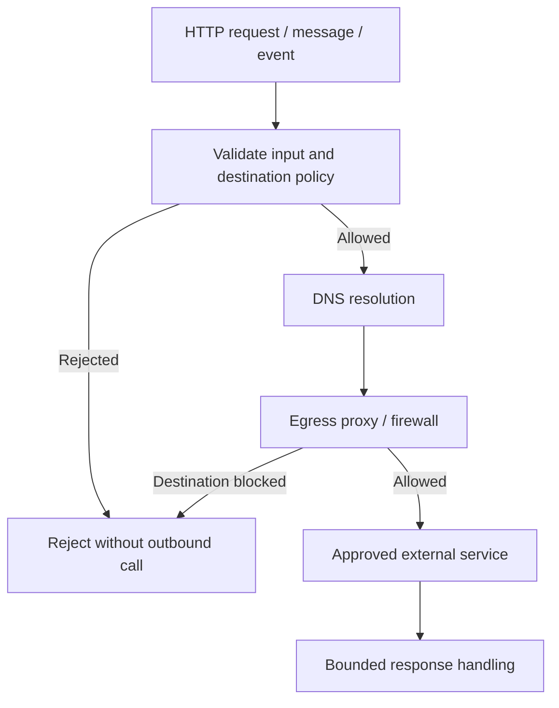

# Phòng chống SSRF khi function gọi dịch vụ bên ngoài

Một Java function serverless thường gọi API đối tác, tải ảnh, lấy nội dung từ URL, gửi webhook hoặc truy cập dịch vụ nội bộ. Nếu request đầu vào có thể quyết định URL đích, kẻ tấn công có thể khiến function gửi request đến một địa chỉ mà người dùng bình thường không truy cập được. Lỗ hổng này gọi là **Server-Side Request Forgery (SSRF)**.

SSRF đặc biệt đáng chú ý trong serverless vì function thường có quyền truy cập mạng và danh tính cloud để đọc secret, ghi database, publish message hoặc gọi các dịch vụ khác. Một endpoint tưởng như chỉ “tải ảnh từ URL” có thể trở thành điểm trung gian để dò mạng nội bộ hoặc truy cập metadata service.

Phòng chống SSRF cần nhiều lớp: tránh nhận URL tùy ý, chỉ cho phép đích đã được phê duyệt, kiểm soát redirect và DNS, giới hạn egress ở tầng mạng, thu hẹp IAM permissions và giới hạn dữ liệu response. Bài học tập trung vào các biện pháp đó trong ứng dụng Java serverless được kích hoạt bởi HTTP, message hoặc event.

## 1. SSRF là gì?

SSRF xảy ra khi ứng dụng server-side tạo request đến một địa chỉ do người dùng hoặc nguồn dữ liệu không đáng tin cậy kiểm soát. Kẻ tấn công không cần kết nối trực tiếp đến hệ thống nội bộ; họ lợi dụng quyền mạng của function làm trung gian.

Ví dụ, một API nhận request:

```http
POST /preview
Content-Type: application/json

{
  "url": "https://images.example.net/photo.png"
}
```

Function tải nội dung URL rồi tạo thumbnail. Nếu handler chấp nhận mọi URL, kẻ tấn công có thể thay bằng địa chỉ nội bộ:

```text
http://127.0.0.1:8080/admin
http://169.254.169.254/
http://10.0.4.12:9000/internal
```

Function có thể gửi request bằng quyền mạng của chính nó. Nếu đích trả dữ liệu, ứng dụng có thể vô tình đưa dữ liệu đó vào response, log, object storage hoặc một hệ thống khác.

### SSRF không chỉ là đọc response

Có hai dạng thường gặp:

- **SSRF có response (basic SSRF):** attacker có thể quan sát nội dung hoặc status của response.
- **Blind SSRF:** attacker không đọc được response, nhưng có thể suy luận qua thời gian, lỗi, callback hoặc tác dụng phụ ở hệ thống đích.

Blind SSRF vẫn có thể nguy hiểm. Một request đến dịch vụ nội bộ có thể kích hoạt hành động, tạo bản ghi, gửi email hoặc làm lộ thông tin qua side channel.

## 2. Vì sao serverless cần chú ý SSRF?

Function thường chạy trong môi trường được cấp quyền để thực hiện nghiệp vụ. Tùy cách triển khai, function có thể:

- Truy cập database trong VPC hoặc mạng riêng.
- Gọi API nội bộ không công khai Internet.
- Đọc secret bằng runtime service account hoặc execution role.
- Truy cập object storage, queue, event bus và dịch vụ cloud.
- Gọi metadata service hoặc endpoint cấp credential trong một số môi trường.
- Được mở rộng thành nhiều instance, khiến một lỗ hổng có thể tạo lượng request lớn.

Một request HTTP đầu vào không đáng tin có thể kích hoạt SSRF trực tiếp. Với function nhận message hoặc event, URL độc hại còn có thể được lưu trong queue hoặc database rồi xử lý ở một thời điểm khác. Đây là **second-order SSRF**: dữ liệu ban đầu chỉ được lưu, nhưng lỗ hổng xuất hiện khi worker sử dụng URL đó sau này.

Ví dụ:

1. HTTP API nhận URL từ người dùng và ghi vào bảng `import_jobs`.
2. Queue phát event báo có công việc mới.
3. Java worker đọc URL và tải nội dung.
4. Nếu worker không kiểm tra lại đích, payload độc hại có thể truy cập mạng nội bộ.

Không giả định dữ liệu trong queue đáng tin chỉ vì nó được gửi từ một service khác. Cần xác định nguồn gốc, schema và ranh giới tin cậy của từng trường.

## 3. Các tình huống dễ tạo SSRF

| Tính năng | Dữ liệu attacker kiểm soát | Nguy cơ |
|---|---|---|
| Import ảnh từ URL | URL ảnh | Gọi localhost, private IP hoặc metadata endpoint |
| Tạo link preview | URL trang web | Đọc dashboard hoặc API nội bộ |
| PDF generator | URL trang cần render | Browser/headless renderer truy cập mạng nội bộ |
| Webhook tester | Callback URL | Gửi request đến service nội bộ |
| URL redirect checker | URL cần kiểm tra | Dò cổng và địa chỉ nội bộ |
| Proxy hoặc fetch API | URL đích | Trở thành open proxy hoặc SSRF gateway |
| Event-driven importer | URL trong message | SSRF xảy ra ở worker sau thời gian chờ |
| Tải schema hoặc file cấu hình | URL do tenant cung cấp | Đọc tài nguyên ngoài phạm vi được phép |

Không phải mọi trường URL đều nguy hiểm. Rủi ro xuất hiện khi server dùng giá trị không đáng tin để quyết định host, port, scheme, redirect hoặc địa chỉ mạng đích.

## 4. Ranh giới tin cậy của một outbound request

Khi function gọi dịch vụ bên ngoài, cần phân biệt các thành phần:

- **Caller:** người dùng, service hoặc producer tạo request/event.
- **Input:** URL, hostname, path, header hoặc identifier được truyền vào.
- **Java function:** kiểm tra dữ liệu và quyết định có gửi request hay không.
- **DNS:** ánh xạ hostname thành địa chỉ IP.
- **Network path:** route, proxy, NAT, VPC và firewall.
- **Destination:** API đối tác, origin hoặc dịch vụ nội bộ.
- **Response:** dữ liệu mà function nhận và có thể chuyển tiếp.

Kiểm tra ở một tầng không thay thế kiểm soát ở tầng khác. Ví dụ, allowlist hostname kiểm soát tên đích theo chính sách ứng dụng, còn egress firewall giới hạn địa chỉ mà kết nối thực sự có thể tới. IAM giảm hậu quả nếu request vẫn tiếp cận được một dịch vụ cloud.



## 5. Biện pháp tốt nhất: không nhận URL tùy ý

Nếu nghiệp vụ chỉ cần gọi một trong vài đối tác đã biết, hãy nhận **mã định danh dịch vụ** thay vì URL.

Ví dụ, thay vì:

```json
{
  "targetUrl": "https://some-host.example/path"
}
```

hãy nhận:

```json
{
  "provider": "PAYMENT_PARTNER",
  "operation": "VERIFY_TRANSACTION",
  "transactionId": "txn-1842"
}
```

Backend ánh xạ provider và operation sang endpoint đã cấu hình:

```java
public enum PartnerOperation {
    VERIFY_TRANSACTION,
    GET_CUSTOMER_STATUS
}

public final class PartnerEndpoints {

    private static final URI PAYMENT_BASE =
            URI.create("https://api.payment.example");

    private PartnerEndpoints() {}

    public static URI endpoint(PartnerOperation operation) {
        return switch (operation) {
            case VERIFY_TRANSACTION ->
                    PAYMENT_BASE.resolve("/v1/transactions/verify");
            case GET_CUSTOMER_STATUS ->
                    PAYMENT_BASE.resolve("/v1/customers/status");
        };
    }
}
```

Client chỉ có thể chọn một operation được ứng dụng hỗ trợ. Caller không thể thay host hoặc scheme. Dữ liệu như transactionId được gửi trong body hoặc query parameter đã được encode theo contract của API.

Đây là lựa chọn ưu tiên cho payment, identity, notification, inventory và các tích hợp có endpoint cố định.

### Cấu hình endpoint phải đến từ nguồn đáng tin

Nếu endpoint thay đổi theo môi trường, có thể đọc từ biến môi trường hoặc config service. Tuy nhiên, người dùng cuối không được quyền sửa cấu hình đó qua request thông thường. Hãy validate endpoint lúc khởi động và giới hạn host, scheme, port theo policy đã duyệt.

Không cho phép tenant tự cấu hình một URL bất kỳ nếu function có quyền truy cập mạng nội bộ. Nếu nghiệp vụ thật sự cần customer-defined destination, cần thiết kế một luồng đăng ký domain riêng với xác minh ownership, allowlist, egress proxy và chính sách hạn chế rõ ràng.

## 6. Chỉ cho phép scheme, host và port đã được phê duyệt

Nếu ứng dụng buộc phải nhận URL, cần parse bằng URI và kiểm tra từng thành phần. Không kiểm tra bằng chuỗi con như `url.contains("partner.example")` hoặc `url.startsWith("https://partner.example")`.

Các kiểm tra cơ bản:

1. Chỉ cho phép `https` nếu nghiệp vụ không có lý do đặc biệt để dùng HTTP.
2. Host phải tồn tại và khớp allowlist chính xác.
3. Chỉ cho phép port dự kiến, thường là 443 cho HTTPS.
4. Từ chối user-info như `user:password@`.
5. Từ chối fragment và các thành phần không cần thiết.
6. Giới hạn path theo API contract nếu path cũng chịu ảnh hưởng từ input.
7. Từ chối IP literal nếu nghiệp vụ chỉ cho phép hostname.
8. Chuẩn hóa hostname và xử lý IDN theo một quy tắc nhất quán trước khi so sánh.

Ví dụ các URL dễ đánh lừa kiểm tra chuỗi:

```text
https://partner.example.attacker.invalid/
https://partner.example@127.0.0.1/
https://attacker.invalid/?next=https://partner.example/
http://partner.example:8080/
```

Host thực của URL thứ hai là `127.0.0.1`, còn `partner.example` chỉ là user-info. Hãy dùng parser và so sánh trường host, scheme, port; không suy luận từ phần đầu của chuỗi.

### Allowlist hostname phải so sánh đúng ranh giới

Nếu cho phép subdomain, điều kiện cần là:

```java
boolean isAllowedSubdomain(String host, String domain) {
    return host.equals(domain)
            || host.endsWith("." + domain);
}
```

Không dùng `host.endsWith("example.com")` vì nó cũng khớp `evil-example.com`. Tuy vậy, wildcard subdomain chỉ an toàn nếu tổ chức kiểm soát toàn bộ subdomain được cho phép. Một subdomain bị chiếm quyền hoặc do người dùng tạo có thể trở thành điểm SSRF.

Với tích hợp cố định, exact hostname allowlist dễ kiểm soát hơn wildcard.

## 7. Ví dụ Java: gọi endpoint cố định và tắt redirect

Ví dụ sau dùng JDK HttpClient. Endpoint lấy từ cấu hình deployment đáng tin, sau đó được kiểm tra khi khởi tạo. Caller chỉ truyền dữ liệu nghiệp vụ; không truyền URL.

```java
import java.io.IOException;
import java.net.URI;
import java.net.http.HttpClient;
import java.net.http.HttpRequest;
import java.net.http.HttpResponse;
import java.time.Duration;
import java.util.Locale;
import java.util.Set;

public final class PartnerClient {

    private static final Set<String> ALLOWED_HOSTS =
            Set.of("api.payment.example");

    private static final URI ENDPOINT = loadEndpoint();

    private static final HttpClient HTTP = HttpClient.newBuilder()
            .connectTimeout(Duration.ofSeconds(2))
            .followRedirects(HttpClient.Redirect.NEVER)
            .build();

    private PartnerClient() {}

    private static URI loadEndpoint() {
        String configured = System.getenv("PAYMENT_VERIFY_URL");
        if (configured == null || configured.isBlank()) {
            throw new IllegalStateException(
                    "Missing PAYMENT_VERIFY_URL");
        }

        URI uri = URI.create(configured);
        String host = uri.getHost();

        boolean valid =
                "https".equalsIgnoreCase(uri.getScheme())
                && host != null
                && ALLOWED_HOSTS.contains(
                        host.toLowerCase(Locale.ROOT))
                && uri.getRawUserInfo() == null
                && uri.getRawFragment() == null
                && uri.getRawQuery() == null
                && (uri.getPort() == -1 || uri.getPort() == 443)
                && "/v1/transactions/verify".equals(uri.getRawPath());

        if (!valid) {
            throw new IllegalStateException(
                    "PAYMENT_VERIFY_URL violates outbound URL policy");
        }

        return uri;
    }

    public static HttpResponse<String> verify(String jsonBody)
            throws IOException, InterruptedException {

        HttpRequest request = HttpRequest.newBuilder(ENDPOINT)
                .timeout(Duration.ofSeconds(4))
                .header("Content-Type", "application/json")
                .header("Accept", "application/json")
                .POST(HttpRequest.BodyPublishers.ofString(jsonBody))
                .build();

        HttpResponse<String> response = HTTP.send(
                request,
                HttpResponse.BodyHandlers.ofString());

        if (response.statusCode() >= 300
                && response.statusCode() < 400) {
            throw new IllegalStateException(
                    "Partner redirect is not permitted");
        }

        if (response.statusCode() < 200
                || response.statusCode() >= 300) {
            throw new IllegalStateException(
                    "Partner API returned HTTP "
                            + response.statusCode());
        }

        return response;
    }
}
```

Ví dụ thể hiện các nguyên tắc:

- URL đến từ cấu hình deployment và được validate khi khởi tạo.
- Host, scheme, port và path bị giới hạn.
- Không chấp nhận user-info, query hoặc fragment ngoài contract.
- Redirect bị tắt.
- Connect timeout và request timeout được đặt rõ ràng.
- Caller không thể thay endpoint qua tham số của method.

Trong ứng dụng thực tế, cần serialize JSON bằng thư viện như Jackson thay vì tự ghép chuỗi; đặt giới hạn kích thước request/response; xử lý lỗi theo contract; và tránh đưa response body không đáng tin vào log. Ví dụ dùng `BodyHandlers.ofString()` để minh họa với API đối tác đã biết; với response lớn hoặc không đáng tin, hãy đọc streaming với giới hạn byte và timeout đọc phù hợp.

Đoạn code allowlist hostname không tự nó giải quyết DNS rebinding hoặc chặn mọi địa chỉ private. Hãy kết hợp với kiểm soát egress ở tầng mạng hoặc outbound proxy như các phần sau.

## 8. Chặn địa chỉ IP nội bộ và đặc biệt

Nếu ứng dụng phải tải URL từ bên ngoài, cần ngăn request đến địa chỉ không được phép. Các nhóm địa chỉ cần chú ý:

### IPv4

- Loopback: `127.0.0.0/8`.
- Private RFC 1918: `10.0.0.0/8`, `172.16.0.0/12`, `192.168.0.0/16`.
- Link-local: `169.254.0.0/16`.
- Unspecified: `0.0.0.0/8` và địa chỉ unspecified tương ứng.
- Multicast: `224.0.0.0/4`.
- Broadcast, documentation, benchmarking và các dải special-use khác theo registry hiện hành.

### IPv6

- Loopback: `::1`.
- Unspecified: `::`.
- Link-local: `fe80::/10`.
- Unique local: `fc00::/7`.
- Multicast: `ff00::/8`.
- IPv4-mapped IPv6 và các dải special-use khác.

Ngoài các dải trên, cần chặn các endpoint nội bộ đặc thù của nền tảng, dải mạng VPC, service mesh, Kubernetes service CIDR và địa chỉ quản trị trong kiến trúc thực tế.

Không chỉ chặn RFC 1918 rồi cho phép mọi địa chỉ còn lại. Một số dải không phải public unicast có thể gây hành vi bất ngờ; danh sách cần dựa trên chính sách egress của tổ chức và registry địa chỉ đặc biệt.

### Kiểm tra hostname chưa đủ

Một hostname public có thể phân giải thành nhiều địa chỉ A/AAAA. Nếu một trong các địa chỉ không được phép, không nên để client tự chọn địa chỉ còn lại theo cách không kiểm soát. Cần kiểm tra tất cả kết quả phân giải và bảo đảm địa chỉ thực tế được dùng để kết nối cũng tuân theo policy.

## 9. DNS rebinding và TOCTOU

DNS rebinding xảy ra khi một hostname trả về địa chỉ IP khác nhau theo thời gian. Ví dụ:

1. Ứng dụng kiểm tra `files.attacker.example` và nhận IP public.
2. Ứng dụng chấp nhận hostname vì IP đó có vẻ hợp lệ.
3. HTTP client phân giải lại hostname khi kết nối.
4. DNS trả về `127.0.0.1` hoặc một địa chỉ private.
5. Request đi đến đích nội bộ.

Đây là lỗi time-of-check to time-of-use (TOCTOU): địa chỉ được kiểm tra không nhất thiết là địa chỉ được dùng khi kết nối.

Các biện pháp:

- Không chỉ resolve hostname trong code rồi tin rằng lần kết nối sau sẽ dùng cùng IP.
- Với URL tùy ý, dùng outbound proxy hoặc egress gateway kiểm tra địa chỉ sau DNS resolution và tại thời điểm kết nối.
- Proxy cần xử lý cả A và AAAA, CNAME, IP special-use và DNS thay đổi.
- Nếu pin IP, vẫn phải giữ hostname gốc cho TLS SNI, certificate verification và HTTP Host; không tự kết nối IP theo cách làm mất xác minh TLS.
- Áp dụng network egress policy để chặn private, link-local, loopback và dải nội bộ kể cả khi kiểm tra ứng dụng bị bỏ qua.

Không nên tự viết DNS pinning hoặc custom socket connector nếu chưa hiểu đầy đủ TLS, IPv6, proxy và connection pooling. Một sai sót có thể khiến policy kiểm tra hostname khác với địa chỉ thực tế được kết nối.

## 10. Redirect là một đường vòng SSRF

Một URL ban đầu có thể trỏ đến host được phép nhưng response trả về redirect sang địa chỉ nội bộ:

```text
https://api.partner.example/redirect
    -> 302 Location: http://169.254.169.254/
```

Nếu HTTP client tự động theo redirect, request có thể đi đến đích không được kiểm tra.

Cách xử lý:

- Tắt redirect tự động nếu nghiệp vụ không cần.
- Nếu cần redirect, giới hạn số hop.
- Parse và validate lại từng Location như một URL mới.
- Không cho redirect chuyển từ HTTPS xuống HTTP.
- Không chuyển Authorization, Cookie hoặc header chứa secret sang origin khác.
- Áp dụng cùng egress policy cho mọi hop.
- Phát hiện vòng lặp redirect và từ chối URL không hợp lệ.

Với JDK HttpClient, cấu hình `HttpClient.Redirect.NEVER` giúp ứng dụng tự quyết định xử lý response 3xx. Đừng chỉ kiểm tra URL đầu tiên rồi để thư viện tự theo redirect.

## 11. Kiểm soát egress ở tầng mạng

Validation trong Java là lớp kiểm soát quan trọng nhưng không phải ranh giới cuối cùng. Egress policy giúp hạn chế những địa chỉ function có thể kết nối, kể cả khi ứng dụng có lỗi.

Một thiết kế thường dùng:

1. Function gửi outbound request qua egress proxy hoặc NAT path được quản lý.
2. Proxy kiểm tra hostname, port và địa chỉ IP sau DNS resolution.
3. Firewall/security rule chặn dải private hoặc destination không được phê duyệt.
4. Chỉ cho phép các route cần thiết đến Internet hoặc dịch vụ nội bộ.
5. Ghi log destination và quyết định allow/deny để điều tra.

Tùy cloud provider, cách triển khai khác nhau:

- **AWS:** đặt Lambda trong VPC khi cần kiểm soát route; dùng security group egress, route table, NAT Gateway và firewall/proxy theo kiến trúc. Security group có stateful rules nhưng không thay thế URL allowlist ở ứng dụng. Cần bảo đảm private subnet không có đường đi ngoài ý muốn đến mạng quản trị.
- **Google Cloud:** với Cloud Run hoặc function thế hệ 2, cân nhắc Direct VPC egress hoặc Serverless VPC Access theo hỗ trợ của dịch vụ, cấu hình egress và firewall/Cloud NAT hoặc proxy phù hợp. Chọn chế độ route toàn bộ traffic qua VPC nếu policy yêu cầu kiểm soát cả outbound Internet.
- **Azure:** dùng VNet integration cho Function App khi cần route đến mạng riêng; kết hợp route/NSG, NAT hoặc firewall để giới hạn outbound theo kiến trúc.

Tên tính năng và giới hạn có thể khác theo loại runtime, generation, region và cấu hình. Kiểm tra tài liệu dịch vụ đang dùng trước khi triển khai.

### Egress allowlist theo đích

Nếu function chỉ gọi ba API đối tác, policy mạng có thể chỉ cho phép ba đích hoặc egress proxy tương ứng. Nếu API đối tác thay đổi IP thường xuyên, quản lý bằng hostname-aware proxy hoặc dịch vụ firewall phù hợp; không hardcode một tập IP cũ mà không có quy trình cập nhật.

## 12. Bảo vệ cloud metadata và credential endpoint

Metadata service có thể cung cấp thông tin instance, token hoặc credential cho workload. Nếu SSRF truy cập được endpoint này, attacker có thể lấy dữ liệu nhạy cảm hoặc credential rồi dùng chúng để gọi cloud API.

Các địa chỉ thường cần nhận diện trong môi trường cloud:

| Môi trường | Ví dụ endpoint cần bảo vệ |
|---|---|
| AWS EC2/ECS | EC2 Instance Metadata Service tại `169.254.169.254`; ECS task metadata có endpoint link-local riêng |
| Google Cloud | Metadata server qua `metadata.google.internal` hoặc `169.254.169.254`, với header metadata theo contract |
| Azure | Instance Metadata Service tại `169.254.169.254`; managed identity endpoint có thể được cung cấp qua biến môi trường của workload |

Không giả định mọi serverless runtime đều có cùng metadata endpoint. Ví dụ, credential của AWS Lambda execution role được cung cấp theo cơ chế của Lambda; điều đó khác với việc một EC2 instance có IMDS. Hãy xác minh runtime và nền tảng cụ thể.

Các biện pháp:

- Chặn metadata IP/hostname tại outbound proxy hoặc egress firewall khi workload không cần truy cập.
- Không cho phép user-controlled URL truy cập link-local hoặc địa chỉ nội bộ.
- Dùng IAM role/service account với quyền tối thiểu; không cấp quyền quản trị project/account cho function.
- Không trả response metadata cho caller và không log credential.
- Dùng SDK credential provider chính thức thay vì tự tải token từ metadata URL.
- Nếu nền tảng có tùy chọn bảo vệ metadata, bật theo hướng dẫn và kiểm tra hiệu lực thực tế.

Một số metadata service yêu cầu header hoặc token phiên bản mới. Đây là lớp giảm rủi ro, không phải lý do để bỏ kiểm soát SSRF. Attacker có thể điều khiển header trong một số tính năng fetch hoặc proxy; network egress và IAM least privilege vẫn cần thiết.

## 13. Hạn chế response và hành vi của HTTP client

Ngay cả khi đích là host được phép, response vẫn có thể gây hại nếu quá lớn, quá chậm hoặc có nội dung không mong muốn.

Cần giới hạn:

- Connect timeout và request timeout.
- Thời gian đọc body hoặc idle read timeout theo khả năng client.
- Số byte response tối đa.
- Số redirect tối đa nếu cho phép.
- Content-Type được chấp nhận.
- Kích thước sau giải nén và compression ratio.
- Số request đồng thời đến cùng destination.
- Tổng thời gian của toàn bộ công việc trong invocation.

Không chỉ dựa vào `Content-Length`: header có thể thiếu hoặc không đáng tin. Với response lớn, dùng streaming body handler và dừng đọc khi vượt giới hạn byte. Nếu giải nén gzip hoặc định dạng nén khác, giới hạn cả kích thước sau giải nén để tránh decompression bomb.

Không tự động chuyển tiếp toàn bộ response header hoặc body đến caller. Loại bỏ header nhạy cảm, kiểm tra Content-Type và chỉ trả dữ liệu cần thiết theo API contract.

## 14. Không chuyển tiếp credential đến URL do người dùng chọn

Một lỗi nghiêm trọng là function nhận URL từ người dùng nhưng vẫn gửi kèm Authorization header, cookie hoặc service token nội bộ.

Ví dụ nguy hiểm:

```java
HttpRequest request = HttpRequest.newBuilder(userSuppliedUri)
        .header("Authorization", "Bearer " + internalServiceToken)
        .GET()
        .build();
```

Nếu URL trỏ đến server của attacker, token nội bộ có thể bị gửi ra ngoài.

Nguyên tắc:

- Chỉ gắn credential cho endpoint đã được xác minh và cấu hình.
- Không tái sử dụng request template có Authorization header cho URL khác origin.
- Không forward cookie hoặc header từ inbound request sang outbound destination một cách mặc định.
- Khi redirect sang origin khác, không chuyển tiếp credential.
- Không đưa token vào query string.
- Dùng service identity riêng và token audience đúng cho từng service-to-service call.

Nếu cần gọi nhiều đối tác, mỗi đối tác có client và credential scope riêng. Không tạo một HTTP client chung gắn token quyền rộng rồi dùng với URL do caller cung cấp.

## 15. SSRF trong webhook và callback URL

Webhook có một đặc thù: người dùng hoặc tenant có thể đăng ký URL nhận event. Khi event phát sinh, hệ thống gửi HTTP request đến URL đã đăng ký. Nếu URL có thể trỏ đến mạng nội bộ, đây cũng là một dạng SSRF outbound.

Một quy trình đăng ký webhook an toàn nên:

1. Xác thực người đăng ký và quyền quản lý endpoint.
2. Chỉ cho phép HTTPS và port được phê duyệt.
3. Xác minh domain ownership bằng challenge hoặc cơ chế xác nhận phù hợp.
4. Chặn IP private, loopback, link-local, metadata và dải nội bộ.
5. Revalidate DNS và đích tại thời điểm gửi, không chỉ lúc đăng ký.
6. Dùng egress proxy/firewall để chống DNS rebinding.
7. Không gửi credential nội bộ hoặc header của người dùng đến callback URL.
8. Ký webhook bằng secret riêng của subscription.
9. Gửi bất đồng bộ qua queue, giới hạn retry và timeout.
10. Có cơ chế tạm khóa endpoint liên tục lỗi và audit thay đổi URL.

Domain ownership challenge chỉ chứng minh người đăng ký kiểm soát domain tại một thời điểm; nó không ngăn DNS thay đổi sau đó. Vì vậy, vẫn cần kiểm tra địa chỉ đích tại thời điểm kết nối.

Nếu nghiệp vụ không cần URL tùy ý, tốt hơn là để tenant chọn một integration đã được quản trị thay vì đăng ký endpoint bất kỳ.

## 16. Xử lý SSRF trong function nhận event hoặc message

Đối với SQS, Pub/Sub, EventBridge, Kafka hoặc stream event, dữ liệu URL có thể đến từ nhiều producer. Consumer nên:

- Validate schema và nguồn phát trước khi xử lý.
- Xác định trường nào là URL và ai có quyền ghi trường đó.
- Không tin dữ liệu chỉ vì message đến từ queue nội bộ.
- Dùng cùng outbound URL policy ở mọi consumer.
- Gắn correlation ID và record ID để truy vết.
- Retry có giới hạn; message chứa URL bị chặn không nên retry vô hạn.
- Đưa record vi phạm policy vào quarantine/DLQ với lý do an toàn, tránh log URL đầy đủ nếu URL chứa token.
- Bảo đảm idempotency nếu việc tải file hoặc gọi API tạo tác dụng phụ.

Không chỉ validate ở API đầu vào. Dữ liệu có thể được ghi trực tiếp vào database bởi batch import, admin tool hoặc service khác. Validation ở consumer là lớp bảo vệ cuối cùng trước outbound request.

## 17. IAM least privilege giảm hậu quả của SSRF

Nếu function vẫn bị lừa gọi một endpoint nội bộ, quyền của function quyết định attacker có thể làm gì tiếp theo.

Ví dụ, nếu function chỉ có quyền đọc một secret cụ thể và ghi một prefix trong bucket, hậu quả thường nhỏ hơn nhiều so với function có quyền Owner hoặc Administrator trên toàn project.

Nguyên tắc:

- Dùng execution role/service account riêng cho từng workload.
- Chỉ cấp quyền cần thiết trên đúng resource.
- Không cấp quyền quản trị IAM hoặc tạo credential mới nếu function không cần.
- Tách quyền đọc secret, ghi object, publish message và truy cập database.
- Dùng token audience và scope phù hợp khi gọi service khác.
- Rotation và thu hồi credential theo quy trình.
- Theo dõi audit log của các hành động nhạy cảm.

Network control ngăn request đến đích; IAM hạn chế hành động nếu request vẫn tiếp cận được dịch vụ. Hai lớp này bổ sung cho nhau.

## 18. Logging, monitoring và cảnh báo

SSRF có thể xuất hiện dưới dạng request bất thường hoặc dò địa chỉ nội bộ. Hãy theo dõi outbound request theo policy, không chỉ theo lỗi HTTP.

Metric và log hữu ích:

- Số outbound request theo destination/host đã chuẩn hóa.
- Số request bị chặn theo lý do: scheme, host, port, IP range hoặc redirect.
- Số lần DNS trả về nhiều địa chỉ hoặc địa chỉ không được phép.
- Số request bị từ chối do metadata/link-local destination.
- Tỷ lệ timeout, redirect, response quá lớn và lỗi TLS.
- Request volume bất thường theo tenant, user hoặc event source.
- Số webhook endpoint bị khóa do vi phạm policy.
- Các lần function truy cập secret hoặc resource ngoài baseline.

Log nên chứa host đã chuẩn hóa, port, policy decision, request ID và source identity. Không log query string đầy đủ, URL có token, Authorization header, cookie, secret hoặc toàn bộ response body.

Cảnh báo khi function cố truy cập localhost, private range, metadata IP hoặc host không nằm trong allowlist. Một request bị chặn cũng có thể là tín hiệu tấn công và nên được ghi nhận có kiểm soát.

## 19. Kiểm thử phòng chống SSRF

Kiểm thử cần bao gồm parser, DNS, redirect, network và IAM. Chỉ test URL hợp lệ là chưa đủ.

| Trường hợp | Kết quả mong đợi |
|---|---|
| HTTPS endpoint nằm trong allowlist | Được gọi nếu policy mạng cho phép |
| HTTP thay vì HTTPS | Bị từ chối |
| Host không nằm trong allowlist | Bị từ chối trước outbound call |
| URL chứa user-info | Bị từ chối |
| Port không được phép | Bị từ chối |
| IP loopback hoặc private | Bị từ chối |
| Link-local/metadata endpoint | Bị chặn ở ứng dụng và egress |
| IPv6 loopback hoặc ULA | Bị chặn |
| Host trả nhiều A/AAAA có IP private | Bị chặn theo policy |
| DNS đổi kết quả sau validation | Egress proxy vẫn chặn đích không hợp lệ |
| Redirect sang private IP | Không được follow; nếu xử lý thủ công phải revalidate |
| Redirect sang host khác | Bị từ chối hoặc chỉ cho phép theo policy rõ ràng |
| Response quá lớn | Dừng đọc và báo lỗi |
| Response chậm | Timeout trong ngân sách invocation |
| URL trong message/event | Consumer validate lại trước khi gọi |
| Caller cố chọn endpoint khác | Không thể thay endpoint cố định của client |

Dùng môi trường kiểm thử cô lập, không thử dò metadata hoặc mạng production. Có thể mô phỏng DNS và redirect bằng test server cục bộ trong môi trường lab để xác minh policy mà không gửi request đến hệ thống thật.

## 20. Những lỗi triển khai thường gặp

- **Kiểm tra URL bằng startsWith hoặc contains:** có thể bị lừa bởi user-info, suffix giả và ký tự đặc biệt; parse URI rồi so sánh thành phần.
- **Chấp nhận mọi HTTPS URL:** HTTPS chỉ mã hóa kết nối, không chứng minh destination đáng tin.
- **Chỉ chặn 127.0.0.1:** còn private range, link-local, IPv6, metadata và dải nội bộ riêng.
- **Resolve DNS một lần rồi tin kết quả:** HTTP client có thể resolve lại; DNS rebinding tạo TOCTOU.
- **Cho phép redirect tự động:** URL hợp lệ ban đầu có thể chuyển đến địa chỉ nội bộ.
- **Dùng wildcard subdomain rộng:** subdomain bị chiếm quyền có thể trở thành đích tấn công.
- **Chuyển Authorization header đến URL tùy ý:** có thể làm lộ token nội bộ.
- **Dùng CORS để phòng SSRF:** CORS là chính sách browser, không giới hạn outbound request từ server.
- **Chỉ validate ở API gateway:** message, event hoặc batch import có thể đi đường khác; consumer phải kiểm tra lại.
- **Dùng IAM quyền rộng:** SSRF có thể biến thành truy cập dữ liệu hoặc hành động cloud vượt mức cần thiết.
- **Không giới hạn response:** endpoint được phép vẫn có thể trả payload lớn làm cạn memory hoặc kéo dài invocation.
- **Retry vô hạn URL bị chặn:** tạo tải và chi phí không cần thiết; phân loại lỗi policy là lỗi không retry.

## 21. Quy trình triển khai thực tế

Khi xây dựng Java function cần gọi dịch vụ bên ngoài, có thể đi theo trình tự:

1. Liệt kê mọi outbound request và nguồn dữ liệu quyết định destination.
2. Loại bỏ URL tùy ý nếu có thể; thay bằng provider/operation ID ánh xạ đến endpoint cố định.
3. Nếu cần URL động, định nghĩa allowlist scheme, host, port và path.
4. Chuẩn hóa hostname và từ chối user-info, IP literal hoặc thành phần không cần thiết.
5. Tắt redirect tự động; revalidate mọi redirect nếu nghiệp vụ cần follow.
6. Thiết kế chống DNS rebinding bằng egress proxy hoặc policy kiểm tra tại thời điểm kết nối.
7. Chặn private, loopback, link-local, metadata và dải mạng nội bộ ở tầng mạng.
8. Giới hạn timeout, response bytes, content type, concurrency và tổng thời gian invocation.
9. Không forward credential hoặc header inbound sang destination không được xác minh.
10. Dùng IAM least privilege và service identity riêng cho từng function.
11. Validate lại URL trong worker nhận message/event và trong webhook dispatcher.
12. Ghi log policy decision, theo dõi outbound destination và cảnh báo hành vi bất thường.
13. Kiểm thử redirect, IPv4/IPv6, DNS rebinding, response lớn và lỗi dependency trong môi trường cô lập.

## 22. Ghi nhớ

SSRF xảy ra khi function bị lợi dụng để gửi request đến một đích do dữ liệu không đáng tin kiểm soát. Trong serverless, lỗ hổng có thể mở đường đến mạng nội bộ, metadata service hoặc API cloud bằng quyền của function.

Ưu tiên không nhận URL tùy ý. Dùng endpoint cố định hoặc allowlist chính xác, giới hạn scheme/host/port, tắt redirect tự động và kiểm tra lại mọi redirect. Với URL động, phải xử lý DNS rebinding và chặn địa chỉ private, loopback, link-local, metadata ở tầng egress tại thời điểm kết nối.

Kết hợp kiểm soát mạng với IAM least privilege, timeout, giới hạn response và logging có chọn lọc. Kiểm tra dữ liệu ở cả HTTP handler lẫn consumer xử lý message/event để SSRF không lọt qua một đường vào khác. Những lớp này giúp function chỉ gọi đúng dịch vụ cần thiết và giảm hậu quả nếu một lớp validation bị bỏ sót.

