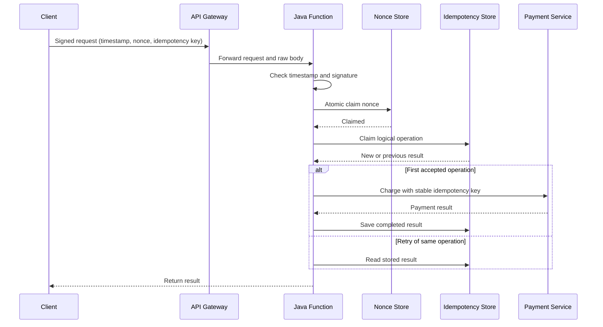
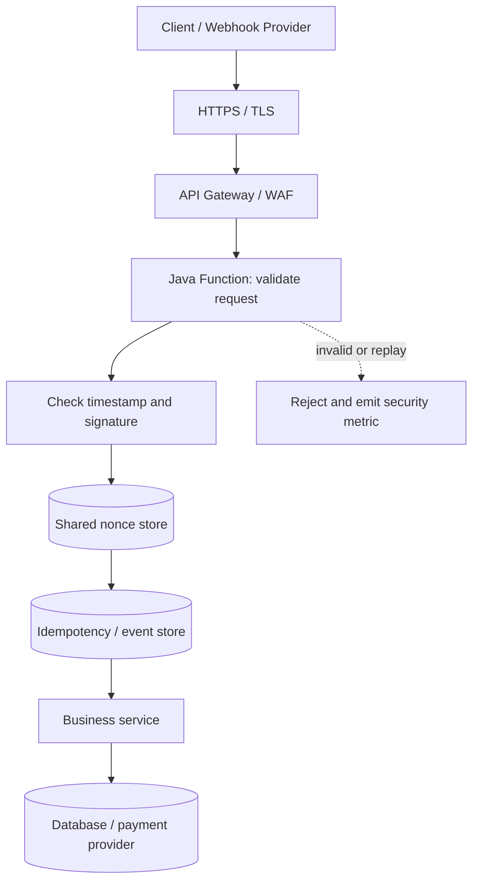

# Chống replay attack và giới hạn thời gian hợp lệ của request

## 1. Replay attack là gì?

Replay attack (tấn công phát lại) xảy ra khi kẻ tấn công ghi lại một request hợp lệ rồi gửi lại request đó để lặp lại hành động hoặc sử dụng lại bằng chứng xác thực. Request ban đầu có thể đã được gửi bởi người dùng hợp pháp; vấn đề nằm ở việc hệ thống chấp nhận cùng một thông điệp nhiều lần mà không nhận ra nó đã được sử dụng.

Ví dụ, một webhook thông báo thanh toán thành công được gửi đến function. Kẻ tấn công ghi lại request có chữ ký hợp lệ và gửi lại nhiều lần. Nếu function cứ nhận mỗi lần như một giao dịch mới, đơn hàng có thể bị cập nhật lặp, email gửi nhiều lần hoặc một side effect khác bị thực hiện ngoài dự kiến.

Replay cũng có thể xuất hiện mà không có kẻ tấn công chủ động. Gateway, client hoặc message broker có thể retry khi không nhận được phản hồi. Function có thể đã hoàn tất side effect nhưng timeout trước khi trả response. Lần giao tiếp theo khiến cùng request/event được xử lý lại. Vì vậy, chống replay vừa là yêu cầu bảo mật vừa là yêu cầu về tính đúng đắn của hệ thống phân tán.

Trong ứng dụng serverless, nhiều execution environment có thể xử lý request đồng thời và function có thể bị khởi tạo lại bất kỳ lúc nào. Bộ nhớ cục bộ của một instance không đủ để phát hiện request đã được nhận bởi instance khác. Cần thiết kế kiểm tra thời gian, định danh duy nhất và lưu trạng thái chống phát lại ở một nơi dùng chung, có thao tác nguyên tử.

## 2. Phân biệt replay, duplicate delivery và idempotency

Ba khái niệm liên quan nhưng không giống nhau:

| Khái niệm | Ý nghĩa | Ví dụ |
| --- | --- | --- |
| Replay attack | Một thông điệp hoặc bằng chứng xác thực hợp lệ bị gửi lại để tái sử dụng | Gửi lại request đã ký hoặc token đã bị đánh cắp |
| Duplicate delivery | Hệ thống giao cùng một message/event nhiều lần do retry hoặc semantics giao nhận | Queue giao lại message khi consumer chưa acknowledgement |
| Idempotency | Xử lý cùng một thao tác logic nhiều lần nhưng chỉ tạo một kết quả nghiệp vụ dự kiến | Client retry tạo đơn với cùng idempotency key và nhận lại kết quả cũ |

Chống replay thường kiểm tra một lần gửi cụ thể: timestamp còn hợp lệ không, nonce đã xuất hiện chưa, chữ ký có đúng không. Idempotency kiểm soát tác động nghiệp vụ của một thao tác logic: cùng một yêu cầu tạo đơn hoặc thanh toán không được tạo ra nhiều giao dịch.

Hai cơ chế cần phối hợp. Một client có thể gửi lại cùng thao tác hợp pháp sau timeout với timestamp và nonce mới nhưng giữ nguyên idempotency key. Request mới vượt qua kiểm tra replay vì nó là lần gửi mới, nhưng tầng nghiệp vụ nhận ra đây là cùng một thao tác và trả lại kết quả đã lưu. Ngược lại, một request có cùng nonce và timestamp bị gửi lại nguyên vẹn phải bị từ chối ở lớp chống replay.

`requestId`, `correlationId` hoặc trace ID không tự động chống replay. Chúng chủ yếu phục vụ theo dõi. Một ID chỉ có giá trị chống replay nếu hệ thống kiểm tra tính duy nhất của nó bằng kho trạng thái dùng chung và thực hiện thao tác claim một cách nguyên tử.

## 3. Mục tiêu và mô hình đe dọa

Một thiết kế chống replay thường cần đạt các mục tiêu:

- Chỉ chấp nhận request được xác thực và có chữ ký/token hợp lệ.
- Giới hạn khoảng thời gian request được phép sử dụng.
- Phát hiện một lần gửi đã được sử dụng trước đó.
- Không cho phép hai function instance đồng thời cùng claim một nonce.
- Giữ tính đúng đắn khi client hoặc broker retry.
- Không biến kho nonce thành điểm nghẽn hoặc nơi bị làm cạn tài nguyên bởi request giả.
- Có thể điều tra request bị từ chối mà không ghi lộ bí mật.

Các tình huống cần xem xét:

1. Kẻ tấn công ghi lại request HTTP đã ký và gửi lại trong thời gian chữ ký còn hợp lệ.
2. Token bearer bị lộ và được dùng từ thiết bị hoặc môi trường khác.
3. Webhook provider retry cùng event vì endpoint timeout.
4. API Gateway hoặc proxy chuyển request đến function nhiều lần.
5. Hai invocation nhận cùng request gần như đồng thời ở hai execution environment.
6. Đồng hồ client bị lệch khiến request hợp lệ bị từ chối hoặc request cũ được chấp nhận quá lâu.
7. Request bị sửa path, query hoặc body sau khi ký do canonicalization không thống nhất.

TLS bảo vệ dữ liệu trên đường truyền và giảm nguy cơ nghe lén/chỉnh sửa mạng, nhưng không thay thế cơ chế chống replay ở tầng ứng dụng. Một request vẫn có thể bị phát lại nếu thông tin xác thực bị lộ, request được ghi lại ở một điểm cuối hoặc một hệ thống trung gian retry.

## 4. Giới hạn thời gian hợp lệ của request

### 4.1. Timestamp, issued-at và expiration

Request có thể mang thời điểm phát hành (`issuedAt` hoặc `timestamp`) và thời điểm hết hạn (`expiresAt`). Server dùng đồng hồ của chính nó để quyết định request còn hợp lệ hay không. Không tin một giá trị `now` do client gửi lên.

Với timestamp (t_r), thời gian server (t_s) và cửa sổ cho phép (Delta), một quy tắc đơn giản là:

\[
|t_s - t_r| \leq \Delta
\]

Nếu request có thời điểm hết hạn rõ ràng, có thể kiểm tra thêm:

\[
t_s \leq t_{expires}
\]

Timestamp giúp giới hạn thời gian một request có thể được phát lại. Tuy nhiên, timestamp đơn lẻ không ngăn việc gửi cùng request nhiều lần trong cửa sổ còn hiệu lực. Kẻ tấn công vẫn có thể phát lại request trong vài giây hoặc vài phút sau lần gửi đầu tiên. Vì vậy, với thao tác nhạy cảm, cần kết hợp timestamp với nonce hoặc một cơ chế chống sử dụng lại tương đương.

### 4.2. Chọn replay window

Replay window là khoảng thời gian server chấp nhận chênh lệch giữa timestamp trong request và thời gian hiện tại. Cửa sổ quá rộng làm tăng khoảng thời gian request bị đánh cắp có thể được sử dụng. Cửa sổ quá hẹp dễ từ chối request hợp lệ khi mạng chậm, client lệch giờ hoặc hệ thống có nhiều bước trung gian.

Một số hệ thống dùng cửa sổ vài phút cho webhook hoặc API ký request; thao tác có rủi ro cao có thể cần cửa sổ ngắn hơn. Không có một giá trị chung cho mọi API. Hãy dựa trên:

- SLA và độ trễ mạng p95/p99.
- Số lượng proxy/gateway và thời gian queue trước khi xử lý.
- Mức độ nhạy cảm của hành động.
- Khả năng đồng bộ thời gian của client và server.
- Chính sách retry của bên gửi.
- Cách nonce được lưu và thời gian tồn tại của nó.

Nếu một webhook có thể được provider retry trong nhiều giờ, không nên kéo dài chữ ký HTTP trong nhiều giờ chỉ để hỗ trợ retry. Thay vào đó, yêu cầu mỗi lần gửi có timestamp/chữ ký mới theo hợp đồng provider, hoặc tách việc xác thực lần gửi khỏi idempotency của event nghiệp vụ.

### 4.3. Clock skew và đồng bộ thời gian

Clock skew là độ lệch giữa đồng hồ của các máy. Nếu client nhanh hơn server vài phút, timestamp có thể bị xem là ở tương lai. Nếu client chậm, request có thể bị coi là quá cũ. Serverless thường chạy trên hạ tầng được quản lý, nhưng client, thiết bị IoT, container hoặc máy chủ tự quản vẫn có thể lệch giờ.

Thực hành tốt:

- Dùng UTC và định dạng timestamp có múi giờ rõ ràng, ưu tiên epoch hoặc ISO-8601 có `Z`/offset.
- Đồng bộ thời gian máy chủ bằng dịch vụ time synchronization/NTP phù hợp.
- Chỉ cho phép clock skew trong giới hạn đã định nghĩa.
- Dùng `java.time.Instant` để biểu diễn thời điểm tuyệt đối.
- Không dùng `LocalDateTime` không có múi giờ để xác thực chữ ký.
- Dùng `System.nanoTime()` cho đo thời lượng trong một process, không dùng làm timestamp truyền qua mạng.

Không nên tự động mở rộng replay window khi thấy nhiều request bị từ chối vì timestamp. Trước tiên kiểm tra đồng hồ client, proxy và cấu hình timezone; mở rộng cửa sổ có thể vô tình kéo dài thời gian request bị đánh cắp còn sử dụng được.

### 4.4. Thời điểm hết hạn phải được kiểm tra ở server

Với link đặt lại mật khẩu, lời mời hoặc mã xác nhận một lần, server cần lưu thời điểm hết hạn và trạng thái đã sử dụng. Client có thể hiển thị thời gian còn lại, nhưng quyết định chấp nhận phải dựa trên đồng hồ server và dữ liệu lưu trữ.

Nếu request chứa `expiresAt`, giá trị đó phải được bảo vệ bởi chữ ký hoặc token đã ký. Nếu không, client có thể sửa expiration để kéo dài thời gian hợp lệ. Server cũng nên giới hạn thời hạn tối đa được phép để ngăn bên gửi tạo token có tuổi thọ quá dài.

## 5. Request signing và canonicalization

### 5.1. Vì sao cần ký request?

Request signature chứng minh request được tạo bởi bên nắm giữ khóa bí mật hoặc khóa riêng tương ứng. Chữ ký cần bao phủ các thành phần có ảnh hưởng đến ý nghĩa request, ví dụ:

- HTTP method.
- Path và query string đã canonicalize.
- Host hoặc authority nếu giao thức yêu cầu.
- Timestamp và nonce.
- Key ID (`kid`) để ràng buộc định danh khóa đã chọn.
- Content type và hash của raw body.
- Idempotency key hoặc một số header quan trọng khác.

Nếu chỉ ký body mà không ký method/path, một body hợp lệ có thể bị chuyển sang endpoint khác hoặc method khác. Nếu timestamp không nằm trong dữ liệu được ký, kẻ tấn công có thể thay timestamp để kéo dài thời gian sử dụng request.

### 5.2. HMAC và chữ ký bất đối xứng

| Cơ chế | Cách hoạt động | Phù hợp khi |
| --- | --- | --- |
| HMAC-SHA-256 | Client và server chia sẻ cùng secret; cả hai tính MAC trên canonical request | Hai bên có thể bảo vệ shared secret và số lượng consumer được kiểm soát |
| Chữ ký bất đối xứng (ví dụ Ed25519 hoặc ECDSA) | Bên gửi ký bằng private key, server xác minh bằng public key | Nhiều bên gửi độc lập; server không cần giữ secret có thể dùng để giả mạo chữ ký |
| TLS/mTLS | TLS bảo vệ kênh; mTLS xác thực chứng thư hai phía | Cần xác thực kết nối ở tầng transport và bảo vệ credential trong truyền tải |

HMAC nhanh và đơn giản nhưng mọi bên giữ shared secret đều có khả năng tạo chữ ký hợp lệ. Với chữ ký bất đối xứng, server chỉ cần public key để xác minh. Dù dùng cơ chế nào, cần quản lý key ID, xoay vòng khóa và thu hồi khóa bị lộ.

### 5.3. Canonical request

Hai bên phải tạo ra cùng một chuỗi byte để ký và xác minh. Canonicalization thường chuẩn hóa method, path, query, header và body digest theo một quy tắc cố định. Ví dụ minh họa:

```text
POST
/v1/payments
amount=120000&currency=VND
application/json
2026-11-17T10:15:30Z
client-42
nonce-8f31
<sha256-of-raw-body>
```

Đây chỉ là định dạng minh họa. Trong production, nên dùng chuẩn chữ ký đã được hai bên thống nhất hoặc tài liệu ký của nhà cung cấp. Không tự phát minh quy tắc canonicalization mà không định nghĩa chính xác cách xử lý:

- Query parameter lặp và thứ tự query parameter.
- Percent-encoding, dấu `/`, Unicode và ký tự reserved.
- Header trùng tên, khoảng trắng và chữ hoa/thường.
- Host, port, path prefix do reverse proxy thêm hoặc loại bỏ.
- Body rỗng, JSON whitespace, encoding và content type.
- Header được gateway thêm vào so với header do client ký.

Nếu gateway biến đổi request trước khi function nhận, chữ ký có thể không còn khớp. Với webhook ký trên raw body, cần giữ nguyên byte gốc để xác minh trước khi parse hoặc serialize lại JSON. Không xác minh chữ ký trên một object JSON đã được parse rồi serialize lại vì thứ tự field, whitespace hoặc encoding có thể thay đổi.

### 5.4. Ví dụ request có chữ ký

Một giao thức nội bộ có thể gửi các header như sau:

```http
POST /v1/payments HTTP/1.1
Host: api.example.com
Content-Type: application/json
X-Key-Id: partner-key-2026-02
X-Request-Timestamp: 2026-11-17T10:15:30Z
X-Request-Nonce: 2kJqv7d8nN1vW3aQmP9xYg
X-Request-Signature: <base64url-signature>
Idempotency-Key: order-42-charge

{"orderId":"order-42","amount":120000,"currency":"VND"}
```

Server cần xác định key theo `X-Key-Id`, kiểm tra timestamp, dựng canonical request từ đúng các trường quy định, xác minh chữ ký, claim nonce và sau đó mới gọi nghiệp vụ. Tên header và format ở đây là ví dụ, không phải tiêu chuẩn HTTP bắt buộc.

## 6. Nonce và phát hiện request đã được sử dụng

### 6.1. Nonce là gì?

Nonce (number used once) là giá trị duy nhất cho một lần gửi. Client tạo nonce mới cho mỗi request, đưa nó vào dữ liệu được ký và server lưu dấu nonce đã chấp nhận. Nếu cùng nonce được gửi lại trong phạm vi còn hợp lệ, server từ chối request.

Nonce nên khó đoán và có entropy đủ lớn. Với API thông thường, có thể tạo ít nhất 128 bit ngẫu nhiên bằng bộ sinh số ngẫu nhiên an toàn của hệ điều hành. Không dùng timestamp, counter dễ đoán hoặc `Math.random()` làm nonce.

Ví dụ tạo nonce bằng Java:

```java
import java.security.SecureRandom;
import java.util.Base64;

public final class NonceGenerator {
    private final SecureRandom random = new SecureRandom();

    public String newNonce() {
        byte[] bytes = new byte[16]; // 128 bit
        random.nextBytes(bytes);
        return Base64.getUrlEncoder().withoutPadding().encodeToString(bytes);
    }
}
```

### 6.2. Nonce phải được lưu ở đâu?

Trong serverless, không lưu nonce duy nhất trong `static Set` hoặc cache cục bộ của Java function. Hai invocation có thể chạy trên hai instance khác nhau; instance mới cũng không biết nonce mà instance cũ đã thấy.

Nơi lưu nonce cần:

- Được chia sẻ bởi mọi execution environment và mọi replica cần xác minh cùng namespace.
- Hỗ trợ thao tác tạo nếu chưa tồn tại (atomic insert-if-absent/put-if-absent).
- Có thể đặt thời hạn lưu trữ để tự dọn nonce cũ.
- Có consistency đủ mạnh cho yêu cầu chống replay.
- Chịu được tốc độ request và concurrency dự kiến.

Một số lựa chọn thường gặp:

| Kho lưu trữ | Cách claim nonce nguyên tử | Lưu ý |
| --- | --- | --- |
| Redis | `SET key value NX EX seconds` | Phải bảo đảm topology/consistency và persistence đáp ứng yêu cầu; không dùng cache best-effort nếu mất dữ liệu cho phép replay |
| Amazon DynamoDB | `PutItem` với condition `attribute_not_exists(pk)` và TTL | Conditional write giúp chỉ một invocation claim thành công; TTL dọn dữ liệu bất đồng bộ nên vẫn phải kiểm tra timestamp khi đọc |
| Azure Cosmos DB | Create item với ID duy nhất trong partition phù hợp | Xử lý conflict khi item đã tồn tại; chọn consistency/partition key theo yêu cầu |
| SQL database | Unique constraint trên `(client_id, nonce)` trong transaction | Có thể dùng insert và xử lý duplicate-key; cần quản lý throughput và connection pool |

TTL là cơ chế dọn dữ liệu, không phải điều kiện xác thực duy nhất. Một số hệ thống xóa item hết hạn không đúng ngay tại thời điểm TTL; server vẫn phải kiểm tra timestamp/expiry ở mỗi request. Nếu record đã hết hạn nhưng chưa bị xóa, có thể dùng conditional update hoặc thiết kế key gắn với time bucket để xử lý đúng.

### 6.3. Claim nonce phải là thao tác nguyên tử

Giả sử hai function instance nhận cùng request gần như đồng thời. Nếu cả hai cùng làm `if (!exists(nonce)) { save(nonce); process(); }`, hai instance có thể cùng đọc “chưa tồn tại” trước khi một bên ghi. Kết quả là cả hai cùng xử lý side effect.

Phải dùng một thao tác nguyên tử tại kho dữ liệu: chỉ một invocation được tạo record; invocation còn lại nhận kết quả duplicate. Không tách bước kiểm tra và ghi thành hai request độc lập.

### 6.4. Thời gian giữ nonce

Nếu server chấp nhận timestamp trong cửa sổ đối xứng (±Δ), request có timestamp `t_r` có thể còn hợp lệ đến khoảng `t_r + Δ`. Nonce cần được giữ ít nhất đến khi request không còn được chấp nhận. TTL nên được tính từ `expiresAt - serverNow`, có giới hạn và không âm.

Không đặt TTL cố định ngắn hơn replay window. Nếu nonce bị xóa trong khi timestamp vẫn còn hợp lệ, request cũ có thể được chấp nhận lần nữa. Ngược lại, giữ nonce lâu hơn cần thiết làm tăng dung lượng lưu trữ; hãy tính theo request rate và thời gian retention.

### 6.5. Claim nonce sau khi xác minh chữ ký

Không nên ghi mọi nonce chưa xác minh vào kho. Kẻ tấn công có thể gửi hàng triệu request giả với nonce ngẫu nhiên để làm đầy cache hoặc database. Trình tự hợp lý:

1. Kiểm tra kích thước và định dạng request cơ bản.
2. Kiểm tra timestamp nằm trong cửa sổ cho phép.
3. Tìm key theo key ID và xác minh chữ ký.
4. Claim nonce nguyên tử trong kho dùng chung.
5. Xác thực/ủy quyền nghiệp vụ và xử lý idempotency.
6. Thực hiện side effect.

Trong một số giao thức, authorization theo principal cần được kiểm tra trước claim. Dù sắp xếp thế nào, không được để request chưa xác thực có thể ghi tùy ý vào namespace nonce của client khác.

## 7. Ví dụ Java: kiểm tra timestamp, chữ ký và nonce

Ví dụ sau minh họa ranh giới xác minh cho một giao thức HMAC nội bộ. Đây không phải implementation thay thế chuẩn chữ ký của webhook provider hoặc AWS/Azure. `CanonicalRequestBuilder`, `KeyResolver` và `NonceStore` phải được triển khai theo hợp đồng đã thống nhất.

```java
import java.nio.charset.StandardCharsets;
import java.security.MessageDigest;
import java.time.Clock;
import java.time.Duration;
import java.time.Instant;
import java.util.Base64;
import javax.crypto.Mac;
import javax.crypto.spec.SecretKeySpec;

public final class RequestReplayVerifier {
    private final Clock clock;
    private final Duration allowedSkew;
    private final KeyResolver keyResolver;
    private final NonceStore nonceStore;
    private final CanonicalRequestBuilder canonicalizer;

    public RequestReplayVerifier(
            Clock clock,
            Duration allowedSkew,
            KeyResolver keyResolver,
            NonceStore nonceStore,
            CanonicalRequestBuilder canonicalizer) {
        this.clock = clock;
        this.allowedSkew = allowedSkew;
        this.keyResolver = keyResolver;
        this.nonceStore = nonceStore;
        this.canonicalizer = canonicalizer;
    }

    public void verify(SignedRequest request) {
        Instant now = clock.instant();
        Instant oldest = now.minus(allowedSkew);
        Instant newest = now.plus(allowedSkew);

        if (request.timestamp().isBefore(oldest)
                || request.timestamp().isAfter(newest)) {
            throw new SecurityException("Request timestamp outside allowed window");
        }

        byte[] secret = keyResolver.resolve(request.keyId());
        if (secret == null) {
            throw new SecurityException("Unknown signing key");
        }

        String canonical = canonicalizer.build(request);
        byte[] expected = hmacSha256(secret, canonical);
        byte[] supplied;
        try {
            supplied = Base64.getUrlDecoder().decode(request.signature());
        } catch (IllegalArgumentException ex) {
            throw new SecurityException("Malformed signature", ex);
        }

        if (!MessageDigest.isEqual(expected, supplied)) {
            throw new SecurityException("Invalid request signature");
        }

        // Giữ nonce đến hết thời điểm request không còn hợp lệ.
        Instant expiresAt = request.timestamp().plus(allowedSkew);
        if (!expiresAt.isAfter(now)) {
            throw new SecurityException("Request expired");
        }

        boolean claimed = nonceStore.claimIfAbsent(
                request.keyId(), request.nonce(), expiresAt);
        if (!claimed) {
            throw new SecurityException("Request nonce already used");
        }
    }

    private static byte[] hmacSha256(byte[] secret, String canonical) {
        try {
            Mac mac = Mac.getInstance("HmacSHA256");
            mac.init(new SecretKeySpec(secret, "HmacSHA256"));
            return mac.doFinal(canonical.getBytes(StandardCharsets.UTF_8));
        } catch (Exception ex) {
            throw new IllegalStateException("Cannot calculate request MAC", ex);
        }
    }
}
```

Các interface/record của ví dụ:

```java
import java.time.Instant;

public record SignedRequest(
        String keyId,
        Instant timestamp,
        String nonce,
        String signature,
        String method,
        String canonicalPathAndQuery,
        String contentType,
        byte[] rawBody) {}

public interface KeyResolver {
    byte[] resolve(String keyId);
}

public interface NonceStore {
    // Phải là insert-if-absent nguyên tử, không phải exists rồi insert.
    boolean claimIfAbsent(String keyId, String nonce, Instant expiresAt);
}

public interface CanonicalRequestBuilder {
    String build(SignedRequest request);
}
```

Trong production, cần bổ sung kiểm tra null/định dạng cho mọi field, giới hạn độ dài nonce/key ID/signature, kiểm tra body size trước khi đọc toàn bộ, phân biệt lỗi client với lỗi kho dữ liệu và không trả chi tiết nội bộ trong response. `MessageDigest.isEqual` được dùng để so sánh byte chữ ký theo cách giảm rủi ro timing leak; không dùng phép so sánh chuỗi thông thường cho MAC.

Đoạn code giả định `timestamp` đã được parse theo một định dạng thống nhất và `CanonicalRequestBuilder` ký đúng raw body digest cùng các thành phần đã thỏa thuận. Không lấy `canonicalPathAndQuery` từ header tùy ý do client gửi; phải lấy từ request đã được gateway chuẩn hóa theo contract và hiểu rõ proxy đã biến đổi gì.

## 8. Idempotency cho thao tác nghiệp vụ

### 8.1. Vì sao nonce chưa đủ?

Nonce ngăn cùng một lần gửi được sử dụng lại. Nhưng khi client không nhận được response, nó cần thử lại thao tác hợp pháp. Lần thử mới nên có timestamp và nonce mới; nếu chỉ dựa vào nonce, server sẽ xem đây là request mới và có thể tạo giao dịch trùng.

Idempotency key nhận diện một thao tác logic qua nhiều lần gửi. Ví dụ:

- Request lần đầu: nonce `n1`, idempotency key `order-42-charge`.
- Client timeout và gửi lại: nonce `n2`, idempotency key vẫn là `order-42-charge`.
- Server chấp nhận request mới về mặt replay, nhưng idempotency store trả lại kết quả thanh toán đã ghi nhận.

Nonce và idempotency key có vòng đời khác nhau. Nonce thường ngắn hạn theo replay window; idempotency record có thể cần được giữ lâu hơn theo yêu cầu nghiệp vụ và thời gian client được phép retry.

### 8.2. Lưu trạng thái idempotency

Một record idempotency thường chứa:

- Key có namespace theo client/tenant và operation.
- Hash của request logic để phát hiện cùng key nhưng payload khác.
- Trạng thái `IN_PROGRESS`, `COMPLETED` hoặc `FAILED_RETRYABLE`.
- Kết quả đã lưu hoặc reference đến kết quả.
- Thời điểm tạo và thời điểm hết hạn.

Nếu cùng idempotency key được dùng với payload khác, nên trả lỗi conflict thay vì trả nhầm kết quả cũ. Việc claim key và lưu trạng thái cần thao tác nguyên tử hoặc dùng transaction/conditional update phù hợp.

### 8.3. Ví dụ trình tự xử lý



Nếu payment provider đã thu tiền nhưng function timeout trước khi lưu kết quả, lần retry phải dùng cùng key tại payment provider hoặc đối soát giao dịch trước khi gửi lại. Không thể tạo transaction ACID xuyên suốt nonce store, idempotency store và payment provider chỉ bằng cách gọi tuần tự các API.

## 9. JWT, bearer token và cơ chế chống token replay

### 9.1. Kiểm tra claim thời gian của JWT

JWT thường chứa các claim:

| Claim | Ý nghĩa | Kiểm tra phía server |
| --- | --- | --- |
| `iss` | Issuer phát hành token | Phải thuộc issuer tin cậy |
| `aud` | Audience dự kiến | Phải chứa API/service đang nhận request |
| `exp` | Thời điểm hết hạn | Token hết hạn phải bị từ chối, có thể cho phép clock skew rất nhỏ |
| `nbf` | Token chưa hợp lệ trước thời điểm này | Không chấp nhận token trước `nbf` |
| `iat` | Thời điểm phát hành | Có thể giới hạn tuổi tối đa của token |
| `jti` | ID duy nhất của token | Chỉ chống replay nếu server lưu/kiểm tra việc sử dụng hoặc đưa vào denylist theo thiết kế |

Server phải xác minh chữ ký JWT bằng thuật toán và key được cấu hình tin cậy; kiểm tra `iss`, `aud`, `exp`, `nbf` và các claim cần thiết. Không chấp nhận thuật toán tùy ý từ token header, không bỏ qua chữ ký và không dùng `jti` như một chuỗi trang trí.

### 9.2. Bearer token vốn có thể được tái sử dụng

Access token dạng bearer thường được phép dùng cho nhiều request cho đến khi hết hạn. Đây là đặc tính thiết kế của bearer token, không tự động là lỗi. Nếu token bị đánh cắp, người khác có thể dùng nó trong thời gian còn hiệu lực.

Để giảm rủi ro:

- Dùng access token có thời hạn phù hợp và scope/audience hẹp.
- Bảo vệ token ở client, tránh lưu trong log hoặc URL.
- Có cơ chế revoke/denylist khi cần thu hồi sớm.
- Với client có rủi ro cao, cân nhắc sender-constrained token như mTLS-bound access token hoặc DPoP.
- Kiểm tra issuer, audience và chữ ký ở gateway/authorizer hoặc function theo kiến trúc.

Không biến mọi access token thành one-time token nếu API cần nhiều request hợp pháp. One-time token phù hợp hơn với hành động như reset password, xác nhận email hoặc phê duyệt một thao tác duy nhất.

### 9.3. DPoP và sender-constrained proof

Demonstrating Proof of Possession (DPoP) ràng buộc việc sử dụng access token với một khóa của client. Client gửi một proof JWT có các thông tin như method (`htm`), URI (`htu`), thời điểm phát hành (`iat`), ID duy nhất (`jti`) và có thể có server nonce. Resource server kiểm tra proof, token binding và chống dùng lại `jti` trong cửa sổ cho phép.

DPoP giảm khả năng một bearer token bị đánh cắp có thể dùng độc lập trên thiết bị khác, nhưng cần triển khai đúng chuẩn OAuth/DPoP. Không tự tạo một header `DPoP` đơn giản rồi coi đó là DPoP hợp lệ. Với hệ thống nội bộ, request signing hoặc mTLS có thể phù hợp hơn tùy mô hình client.

## 10. Webhook: chữ ký, timestamp và event deduplication

### 10.1. Xác minh webhook

Webhook provider thường gửi một HTTP request kèm signature header. Tùy provider, chữ ký có thể được tính trên raw body, timestamp + body hoặc một tập header cụ thể. Phải làm theo tài liệu chính thức của provider:

1. Giữ raw body theo đúng byte nhận được.
2. Đọc signature/timestamp header theo tên và format được quy định.
3. Kiểm tra timestamp trong replay window nếu giao thức hỗ trợ.
4. Tính chữ ký trên đúng message bytes/canonical string.
5. So sánh chữ ký an toàn và xử lý key rotation.
6. Kiểm tra event ID và idempotency trước khi thực hiện nghiệp vụ.

Không parse JSON rồi serialize lại trước khi xác minh nếu provider ký trên raw body. Không tự giả định mọi webhook dùng HMAC-SHA-256 hoặc cùng một tên header.

### 10.2. Event ID và retry của provider

Provider thường có event ID ổn định qua các lần retry. Lưu event ID theo namespace provider và loại sự kiện để ngăn một event được xử lý nhiều lần. Một lần gửi mới có thể có timestamp và signature mới nhưng vẫn cùng event ID.

Nếu xử lý webhook lâu, có thể xác minh chữ ký, claim event ID bền vững, đưa event vào queue và trả `2xx` nhanh theo hợp đồng provider. Consumer xử lý bất đồng bộ với idempotency. Cần bảo đảm việc ghi nhận event và enqueue không tạo khoảng mất dữ liệu; có thể dùng transaction/outbox hoặc cơ chế nhận message bền vững phù hợp.

### 10.3. Phân biệt nonce request và event ID

Nonce thường nhận diện một lần truyền request; event ID nhận diện sự kiện nghiệp vụ. Provider có thể retry cùng event ID nhưng tạo một request envelope mới. Nếu chỉ lưu nonce, các lần retry mới vẫn được xem là khác nhau; nếu chỉ lưu event ID, request bị phát lại có thể vẫn được chấp nhận nhưng không gây side effect nếu deduplication đúng. Hệ thống nên áp dụng cả kiểm tra chữ ký/timestamp và deduplication theo event ID.

## 11. Request một lần và token có thời hạn

Một số nghiệp vụ cần token dùng một lần:

- Link reset mật khẩu.
- Mã xác minh email/số điện thoại.
- Link mời người dùng vào workspace.
- Token phê duyệt giao dịch.
- URL thực hiện một hành động nhạy cảm.

Token cần có entropy cao, gắn với đúng user/action/resource, có thời điểm hết hạn và trạng thái đã sử dụng. Nên lưu hash của token thay vì token thô nếu có thể. Khi tiêu thụ, server phải thực hiện kiểm tra hết hạn và đánh dấu đã dùng trong một transaction hoặc conditional update nguyên tử.

Ví dụ, hai request đồng thời cùng gửi token reset mật khẩu không được cùng thành công. Chỉ một request được chuyển trạng thái token từ `UNUSED` sang `CONSUMED`; request còn lại nhận kết quả đã sử dụng. Nếu chỉ kiểm tra `used=false` rồi cập nhật ở hai thao tác riêng, cả hai request có thể vượt qua kiểm tra cùng lúc.

Không đặt token nhạy cảm trong query string nếu có thể tránh vì URL có thể xuất hiện trong browser history, proxy log, referrer hoặc analytics. Nếu bắt buộc dùng link, dùng HTTPS, thời hạn ngắn, không tải third-party resource trên trang chứa token và đổi token lấy session an toàn sau khi xác minh.

## 12. Kiến trúc chống replay cho ứng dụng serverless

### 12.1. Các lớp kiểm soát



Gateway/WAF có thể kiểm soát kích thước request, rate limit, IP reputation và xác thực token cơ bản. Function xác minh chữ ký/claim theo contract, claim nonce, kiểm tra idempotency và thực hiện nghiệp vụ. Kho nonce và idempotency phải được chia sẻ giữa các execution environment.

### 12.2. Không dùng local memory làm nguồn chống replay

Một Java singleton hoặc `ConcurrentHashMap` có thể dùng làm cache tối ưu, nhưng không phải nguồn sự thật. Khi Lambda scale out, Azure Functions scale out hoặc Cloud Run tạo instance mới, mỗi process có bộ nhớ riêng. Restart cũng xóa dữ liệu.

Nếu dùng local cache để giảm truy vấn, mọi quyết định chấp nhận request vẫn phải được xác nhận bởi kho dùng chung. Không để cache miss hoặc cache reset làm request cũ được xử lý lại.

### 12.3. Multi-region và consistency

Nếu cùng một API được phục vụ ở nhiều region, request bị phát lại có thể đến hai region khác nhau. Hai nonce store độc lập sẽ không phát hiện duplicate xuyên vùng. Cần:

- Một kho claim có tính nhất quán đủ mạnh trên phạm vi region liên quan; hoặc
- Định tuyến một client/key đến một home region ổn định; hoặc
- Dùng khóa idempotency toàn cục ở tầng nghiệp vụ để ngăn side effect trùng; hoặc
- Thiết kế dữ liệu có conflict/conditional write và xử lý rõ ràng khi hai vùng cùng claim.

Một global cache có replication eventual consistency có thể cho phép hai vùng cùng claim trong một khoảng thời gian. Không dùng nó làm bảo đảm duy nhất nếu yêu cầu chống replay cần uniqueness toàn cục tức thời. Phải đọc rõ consistency model, replication lag và failure behavior của dịch vụ lưu trữ.

### 12.4. Partition key và namespace

Nonce key nên được namespace theo client/key ID hoặc tenant, ví dụ:

```text
replay:v1:<tenantId>:<keyId>:<nonce>
```

Điều này tránh va chạm giữa các client và giúp áp dụng quota/retention riêng. Không đưa thông tin nhạy cảm vào key nếu key có thể xuất hiện trong metric hoặc log. Có thể hash nonce trước khi lưu nếu muốn giảm lộ dữ liệu định danh, miễn là thao tác uniqueness vẫn chính xác.

## 13. Bảo vệ kho nonce và chống DoS

Kho nonce là tài nguyên có thể bị tấn công bằng request giả hoặc lưu lượng rất lớn. Các biện pháp cần có:

- Kiểm tra giới hạn body/header và format trước khi đọc/parse sâu.
- Rate limit theo client, key ID, tenant hoặc IP ở gateway/WAF.
- Xác minh chữ ký trước khi ghi nonce để tránh ghi rác chưa xác thực.
- Giới hạn độ dài key ID, nonce và signature.
- Đặt TTL hợp lý và theo dõi số lượng record.
- Dùng partitioning và capacity phù hợp với peak concurrency.
- Có timeout ngắn và circuit breaker khi kho nonce lỗi.
- Phân biệt “nonce đã dùng” với “nonce store không khả dụng”; không trả cùng một lỗi cho cả hai.

Nếu kho nonce không khả dụng, quyết định fail-open hay fail-closed phải dựa trên rủi ro. Với thanh toán, thay đổi quyền hoặc hành động nhạy cảm, thường nên fail-closed hoặc tạm từ chối request để tránh chấp nhận replay. Với một số telemetry không tạo side effect, có thể có chính sách khác. Không âm thầm bỏ qua kiểm tra replay khi store lỗi.

## 14. Key management và xoay vòng khóa

Với request signing, cần có quy trình quản lý key:

1. Cấp key riêng cho từng client hoặc integration khi có thể.
2. Gắn key ID (`kid`) vào request để chọn đúng key.
3. Lưu secret/private key trong secret manager hoặc HSM/KMS phù hợp.
4. Chỉ cấp function quyền đọc key cần thiết.
5. Xoay vòng bằng giai đoạn chấp nhận key cũ và key mới có giới hạn.
6. Thu hồi key bị lộ và từ chối request dùng key đã revoke.
7. Theo dõi lần sử dụng cuối và loại bỏ key cũ khi client đã chuyển đổi.

Không nhúng HMAC secret vào source code, container image, frontend JavaScript hoặc file cấu hình được commit. Không ghi secret, full authorization header hay chữ ký đầy đủ vào log. Khi dùng chữ ký bất đối xứng, private key chỉ nằm ở phía ký; server chỉ cần public key để xác minh.

Khi xoay key, cần xác định request đang trên đường truyền hoặc webhook retry có thể vẫn được ký bằng key cũ trong bao lâu. Thời gian overlap phải có giới hạn và gắn với replay window/retention; không giữ key cũ vô thời hạn để “đỡ lỗi tích hợp”.

## 15. Quan sát và xử lý sự cố

### 15.1. Metric cần theo dõi

- Số request bị từ chối do timestamp quá cũ hoặc ở tương lai.
- Số request có chữ ký không hợp lệ theo key ID/client.
- Số nonce duplicate và số nonce claim thành công.
- Tỷ lệ idempotency hit, conflict và operation đang xử lý.
- Độ trễ và lỗi của nonce/idempotency store.
- Số event webhook trùng, retry và DLQ.
- Clock skew quan sát được giữa client/provider và server.
- Rate limit, throttling và request bị chặn tại gateway/WAF.

### 15.2. Log an toàn

Log nên có request ID, tenant/client ID đã được chuẩn hóa, key ID, route, kết quả kiểm tra và mã lý do. Không ghi raw secret, token, private key, raw signature hoặc payload nhạy cảm. Nếu cần điều tra, dùng hash hoặc fingerprint có kiểm soát thay vì ghi toàn bộ giá trị.

Không đưa nonce nguyên bản vào metric label vì cardinality sẽ tăng rất lớn. Có thể log một fingerprint rút gọn trong môi trường có kiểm soát hoặc chỉ ghi kết quả duplicate cùng key ID.

### 15.3. Phân biệt tấn công với lỗi đồng hồ

Một đợt tăng request timestamp quá cũ có thể là replay attack, nhưng cũng có thể do client mất đồng bộ giờ hoặc queue trì hoãn. Hãy đối chiếu:

- Nguồn request và key ID.
- Độ lệch timestamp phân bố theo client.
- Số nonce duplicate so với timestamp invalid.
- Tình trạng time sync của hạ tầng client.
- Độ trễ gateway/queue và lịch retry của provider.

Không tự động nới replay window để làm metric giảm. Nếu một client thường xuyên lệch giờ, sửa nguồn thời gian hoặc cấp chính sách riêng có giới hạn và được giám sát.

## 16. Kiểm thử chống replay

Một bộ kiểm thử cần bao gồm các trường hợp sau:

| Trường hợp | Kết quả mong đợi |
| --- | --- |
| Chữ ký đúng, timestamp trong cửa sổ, nonce mới | Chấp nhận một lần |
| Gửi lại cùng request, cùng nonce | Từ chối duplicate/replay |
| Cùng nonce nhưng sửa body | Chữ ký không hợp lệ; không claim nonce trước khi xác minh |
| Timestamp quá cũ | Từ chối trước khi thực hiện side effect |
| Timestamp ở tương lai vượt skew | Từ chối |
| Chữ ký sai hoặc key ID không tồn tại | Từ chối, không ghi nonce |
| Hai invocation đồng thời cùng nonce | Chỉ một invocation claim thành công |
| Cùng thao tác với nonce mới nhưng cùng idempotency key | Trả kết quả cũ hoặc trạng thái đang xử lý; không tạo side effect thứ hai |
| Cùng idempotency key nhưng payload khác | Trả conflict theo contract |
| Nonce store không khả dụng | Áp dụng fail-open/fail-closed đã định nghĩa; không âm thầm bỏ qua kiểm tra |
| Replay đến region khác | Vẫn bị chặn theo consistency/idempotency design |
| Webhook provider retry cùng event ID, signature mới | Xác minh lần gửi và không lặp tác động nghiệp vụ |
| Token hết hạn hoặc chưa đến `nbf` | Từ chối |
| One-time token được dùng đồng thời hai lần | Chỉ một request tiêu thụ thành công |

Ngoài unit test, cần integration/load test với kho dữ liệu thật hoặc môi trường tương đương để xác minh atomic claim, TTL, concurrent request và failure behavior. Test local với một process không thể chứng minh chống replay đúng khi scale out.

## 17. Quy trình xử lý request có chữ ký

Một trình tự tham khảo cho HTTP request nhạy cảm:

1. **Giới hạn đầu vào:** kiểm tra method/route, content type, body size và header format.
2. **Đọc thời gian:** parse timestamp theo định dạng được công bố; dùng đồng hồ server UTC.
3. **Kiểm tra cửa sổ:** từ chối request quá cũ hoặc ở tương lai vượt clock skew.
4. **Chọn khóa:** tra key ID và trạng thái key; chỉ chấp nhận thuật toán đã cấu hình.
5. **Dựng canonical request:** dùng raw body, path/query/header theo đúng chuẩn.
6. **Xác minh chữ ký:** so sánh MAC/signature an toàn; không ghi bí mật vào log.
7. **Claim nonce:** insert-if-absent nguyên tử với thời hạn phù hợp.
8. **Xác thực/ủy quyền nghiệp vụ:** xác định principal có quyền thực hiện hành động trên resource.
9. **Kiểm tra idempotency:** claim thao tác logic hoặc trả kết quả đã lưu.
10. **Thực hiện side effect:** dùng timeout, transaction/outbox và idempotency ở hệ thống phụ thuộc.
11. **Lưu kết quả:** ghi trạng thái hoàn tất để client retry có thể nhận lại kết quả.
12. **Quan sát:** phát metric/log về kết quả xác minh, duplicate, latency và lỗi store.

Thứ tự chi tiết có thể thay đổi theo giao thức và yêu cầu authorization, nhưng phải bảo đảm request chưa xác thực không thể ghi tùy ý vào nonce store và side effect không xảy ra trước khi các kiểm tra bảo mật cần thiết hoàn tất.

## 18. Những lỗi thiết kế thường gặp

| Lỗi | Hậu quả | Cách khắc phục |
| --- | --- | --- |
| Chỉ kiểm tra timestamp | Request vẫn có thể bị phát lại nhiều lần trong replay window | Kết hợp nonce hoặc one-time identifier được lưu dùng chung |
| Chỉ dùng nonce trong RAM | Instance khác không biết nonce đã được dùng | Dùng shared store và atomic claim |
| Kiểm tra nonce rồi mới ghi ở thao tác riêng | Hai invocation đồng thời cùng vượt qua | Dùng conditional insert/unique constraint |
| TTL ngắn hơn replay window | Nonce bị xóa khi request vẫn còn hợp lệ | Tính expiry đến cuối thời gian chấp nhận request |
| Dùng TTL làm kiểm tra hết hạn duy nhất | Record hết hạn có thể vẫn tồn tại hoặc cleanup trễ | Luôn kiểm tra timestamp/expiry ở server |
| Ký body nhưng không ký method/path/timestamp | Request có thể bị chuyển endpoint hoặc kéo dài thời gian sử dụng | Ký canonical request chứa mọi thành phần quan trọng |
| Parse rồi serialize JSON trước khi xác minh | Byte body thay đổi và chữ ký không còn đại diện dữ liệu gốc | Xác minh raw body theo spec của provider |
| Coi JWT `jti` tự động chống replay | Token vẫn dùng lại được nếu không lưu/kiểm tra `jti` | Dùng denylist/one-time state hoặc sender-constrained token khi cần |
| Dùng idempotency key thay cho nonce | Request bị đánh cắp vẫn có thể được gửi lại và truy cập logic | Kết hợp xác thực chữ ký, timestamp, nonce và idempotency |
| Cho phép retry tạo key mới | Một thao tác logic có thể tạo nhiều side effect | Giữ idempotency key ổn định qua retry |
| Fail-open khi nonce store lỗi | Replay được chấp nhận trong lúc store gián đoạn | Chọn fail-closed cho hành động nhạy cảm và có phương án phục hồi |
| Log token, signature hoặc raw payload | Bí mật và dữ liệu cá nhân bị lộ | Log metadata tối thiểu và che dữ liệu |

## 19. Checklist triển khai

- [ ] Xác định request/event nào có nguy cơ bị replay và side effect nào nhạy cảm.
- [ ] Chọn giao thức xác thực: HMAC, chữ ký bất đối xứng, JWT, mTLS hoặc DPoP.
- [ ] Định nghĩa timestamp, expiration, clock skew và replay window.
- [ ] Đảm bảo timestamp và nonce nằm trong phần được ký.
- [ ] Chuẩn hóa method, path, query, headers và raw body theo một contract duy nhất.
- [ ] Tạo nonce bằng CSPRNG và kiểm tra độ dài/format.
- [ ] Lưu nonce trong shared store có atomic insert-if-absent.
- [ ] Đặt TTL không ngắn hơn thời gian request còn được chấp nhận.
- [ ] Dùng idempotency key ổn định cho retry của cùng thao tác nghiệp vụ.
- [ ] Xử lý concurrent duplicate và multi-region consistency.
- [ ] Bảo vệ key trong secret manager/KMS và có quy trình rotation/revocation.
- [ ] Giới hạn body size, rate và tài nguyên kho nonce.
- [ ] Định nghĩa fail-open/fail-closed khi nonce store lỗi.
- [ ] Không log secret, token, signature hoặc raw payload nhạy cảm.
- [ ] Kiểm thử replay đồng thời, retry, clock skew, TTL và provider webhook.
- [ ] Theo dõi timestamp rejection, duplicate nonce, idempotency hit và store latency.

## 20. Kết luận

Chống replay cần nhiều lớp phối hợp. Timestamp và expiration giới hạn thời gian request có thể được chấp nhận; chữ ký bảo vệ tính toàn vẹn của method, path, header và body; nonce giúp phát hiện cùng một lần gửi bị sử dụng lại; kho nonce dùng chung với thao tác nguyên tử bảo đảm các execution environment không cùng chấp nhận một request. Idempotency bảo vệ tác động nghiệp vụ khi client hoặc broker gửi lại cùng thao tác bằng một request mới.

Trong serverless, cần đặc biệt chú ý scale-out, concurrency, restart và multi-region. Local memory không thể là nguồn chống replay duy nhất; TTL cũng không thay thế kiểm tra thời gian ở server. Hãy chọn replay window theo độ trễ và rủi ro, đồng bộ đồng hồ, quản lý key an toàn, xác minh raw body đúng chuẩn và kiểm thử các request đồng thời. Cách tiếp cận này giúp API, webhook và consumer Java chống phát lại mà vẫn hỗ trợ retry hợp pháp và giữ được tính đúng đắn của nghiệp vụ.
