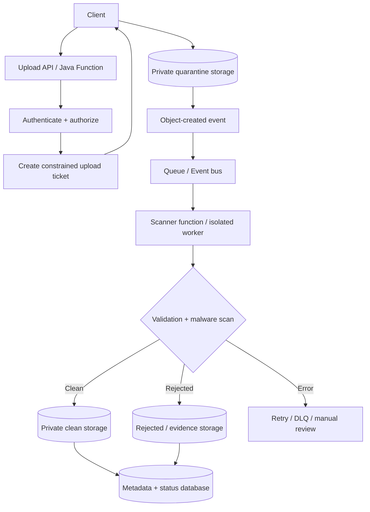
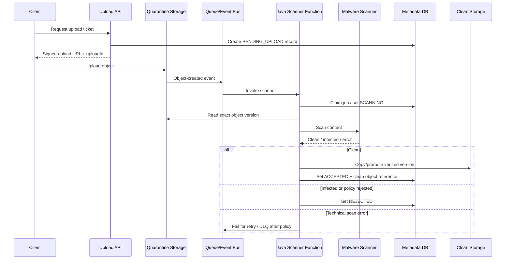

# Xử lý tệp upload, nội dung độc hại và archive bomb

Chức năng upload thường là cửa vào của dữ liệu không đáng tin cậy. Người dùng có thể gửi tệp sai định dạng, giả mạo MIME type, đặt tên chứa đường dẫn nguy hiểm, tải lên mã độc hoặc gửi một archive rất nhỏ nhưng giải nén thành hàng chục gigabyte. Nếu function đưa tệp vào thư mục dùng chung, giải nén ngay trong request hoặc công khai object trước khi kiểm tra, một upload có thể gây lộ dữ liệu, ghi đè tệp, cạn bộ nhớ, đầy ổ đĩa hoặc làm gián đoạn toàn bộ workload.

Trong kiến trúc serverless, cách an toàn thường là nhận upload vào vùng **quarantine** riêng, giới hạn kích thước và loại nội dung, kiểm tra chữ ký tệp, quét mã độc, xử lý archive trong môi trường có giới hạn, rồi mới chuyển kết quả đã được chấp nhận sang vùng lưu trữ sạch. Việc kiểm tra nên chạy bất đồng bộ khi tệp lớn hoặc cần nhiều CPU, để HTTP handler không giữ invocation trong thời gian dài.

Bài này tập trung vào thiết kế upload an toàn cho Java function/FaaS. Các nguyên tắc áp dụng cho object storage, queue, event trigger và các nền tảng serverless khác nhau; giới hạn cụ thể của API Gateway, function runtime và storage provider cần được kiểm tra theo dịch vụ đang triển khai.

## 1. Xác định mối đe dọa từ tệp không đáng tin cậy

### 1.1. Tệp upload không phải dữ liệu an toàn

Không thể kết luận một tệp an toàn chỉ từ tên, phần mở rộng hoặc `Content-Type` do client gửi. Ví dụ:

- `invoice.pdf` có thể chứa nội dung không phải PDF, một tệp polyglot hoặc dữ liệu khai thác parser.
- `photo.jpg` có thể chứa dữ liệu không đúng định dạng ảnh hoặc khai thác lỗ hổng của thư viện xử lý ảnh.
- `report.zip` có thể chứa đường dẫn `../../...`, symlink hoặc hàng triệu entry nhỏ.
- Một tệp nén vài kilobyte có thể bung ra nhiều gigabyte hoặc tiêu tốn CPU rất lâu.
- Một tài liệu Office có thể chứa macro hoặc nội dung nhúng độc hại.
- Tệp HTML/SVG có thể chứa script và trở thành nội dung thực thi khi được phục vụ cùng origin với ứng dụng.

Hãy xem tên tệp, metadata, MIME type, nội dung, archive entry và mọi đường dẫn bên trong archive là input do kẻ tấn công kiểm soát.

### 1.2. Nhóm rủi ro chính

| Rủi ro | Ví dụ | Tác động |
| --- | --- | --- |
| MIME/content spoofing | Gửi executable nhưng khai báo `image/png` | Bypass validation hoặc khiến trình duyệt xử lý nội dung sai cách |
| Path traversal / Zip Slip | Entry tên `../../app/config.yml` | Ghi tệp ra ngoài thư mục giải nén |
| Archive bomb | Tệp nén nhỏ bung ra rất lớn | Cạn disk, memory, CPU hoặc timeout |
| Nested archive | ZIP chứa ZIP lồng nhiều tầng | Khuếch đại chi phí giải nén và quét |
| Symlink/special file | Entry trỏ ra ngoài thư mục hoặc biểu diễn device | Đọc/ghi ngoài vùng dự kiến hoặc gây hành vi không an toàn |
| Malware / exploit | Tệp có mã độc hoặc khai thác parser | Lây nhiễm, thực thi mã hoặc chiếm quyền xử lý |
| Polyglot / parser confusion | Một nội dung hợp lệ với nhiều parser | Bypass kiểm tra hoặc kích hoạt cách diễn giải ngoài dự kiến |
| Resource exhaustion | Rất nhiều entry, tên cực dài, ảnh kích thước lớn | Tốn RAM, CPU, inode, log và thời gian xử lý |
| Public exposure | Object quarantine được cấp URL công khai | Phát tán nội dung chưa được kiểm tra |
| TOCTOU / overwrite | Object bị thay sau khi scanner kiểm tra | Function xử lý một phiên bản nhưng người dùng tải phiên bản khác |

### 1.3. Xác định chính sách theo mục đích sử dụng

Không cần hỗ trợ mọi định dạng tệp. Hãy xác định:

- người dùng được upload loại tệp nào;
- giới hạn kích thước tối đa;
- có chấp nhận archive hay không;
- archive được phép chứa loại file nào;
- tệp sẽ được xem trực tiếp trong trình duyệt hay chỉ tải xuống;
- cần quét antivirus, CDR (Content Disarm and Reconstruction) hay kiểm tra chuyên biệt nào;
- thời gian tối đa từ upload đến khi tệp được chấp nhận;
- dữ liệu phải giữ bao lâu và ai được truy cập.

Allowlist hẹp thường an toàn và dễ vận hành hơn việc cố gắng nhận mọi định dạng rồi tìm cách chặn từng loại nguy hiểm.

## 2. Kiến trúc upload an toàn trong serverless

### 2.1. Không đưa toàn bộ tệp lớn qua HTTP function nếu không cần

Với tệp lớn, API thường chỉ nên xác thực người dùng, cấp quyền upload giới hạn và tạo upload ticket. Client tải trực tiếp lên object storage bằng URL hoặc policy có thời hạn ngắn. Sau khi upload, storage phát event để một worker function xử lý.



Luồng trên giúp request upload không phải chờ antivirus hoặc giải nén. API trả về một upload ID; sau khi storage xác nhận object, metadata chuyển sang `UPLOADED` hoặc `PENDING_SCAN` theo cách triển khai. Client truy vấn trạng thái sau đó. Worker chỉ xử lý object nằm trong quarantine và có event ID/version rõ ràng.

### 2.2. Các vùng lưu trữ nên tách biệt

| Vùng | Mục đích | Chính sách truy cập |
| --- | --- | --- |
| Quarantine | Nhận tệp mới, chưa được tin cậy | Private; chỉ upload principal và scanner có quyền cần thiết |
| Processing/temp | Tệp đang được phân tích hoặc giải nén | Cô lập theo job/invocation; giới hạn dung lượng và thời gian sống |
| Clean | Tệp đã vượt qua các bước kiểm tra | Private theo mặc định; cấp quyền download qua API hoặc URL ngắn hạn |
| Rejected/evidence | Tệp bị từ chối và metadata điều tra | Chỉ security/operations principal được truy cập; retention rõ ràng |

Không dùng cùng một bucket/prefix công khai cho quarantine và clean. Nếu buộc phải dùng chung storage, phân tách prefix, IAM policy, lifecycle và event filter chặt chẽ; tuy nhiên tách bucket thường dễ kiểm soát hơn.

### 2.3. Trạng thái upload

Nên lưu metadata của upload trong database, ví dụ:

| Trạng thái | Ý nghĩa |
| --- | --- |
| `PENDING_UPLOAD` | Ticket đã tạo, client chưa hoàn tất upload |
| `UPLOADED` | Object đã xuất hiện trong quarantine |
| `SCANNING` | Worker đã claim job và đang kiểm tra |
| `ACCEPTED` | Tệp đã qua policy và được chuyển sang clean storage |
| `REJECTED` | Tệp vi phạm policy hoặc scanner phát hiện nội dung độc hại |
| `SCAN_FAILED` | Không thể hoàn tất scan do lỗi kỹ thuật; có thể retry |
| `EXPIRED` | Upload hoặc scan quá thời hạn xử lý |

Phân biệt `REJECTED` với `SCAN_FAILED`. Tệp bị phát hiện malware là kết quả kiểm tra cuối cùng theo policy; scanner timeout hoặc dịch vụ antivirus tạm thời không sẵn sàng là lỗi kỹ thuật. Không đưa tệp vào clean storage chỉ vì scan service đang lỗi.

### 2.4. Giữ liên kết giữa metadata và object version

Mỗi upload nên có một định danh không đoán được, gắn với tenant/user và object key riêng. Sau khi upload, lưu object version ID hoặc generation, kích thước và checksum do storage cung cấp. Scanner phải đọc đúng phiên bản đã được ghi nhận.

Nếu object key có thể bị ghi đè sau event, scanner có thể kiểm tra phiên bản A trong khi API sau đó phục vụ phiên bản B. Cách phòng tránh:

- dùng object key duy nhất cho mỗi upload;
- bật versioning hoặc dùng generation/version ID;
- giới hạn quyền overwrite sau khi upload;
- lưu checksum và kích thước của phiên bản được kiểm tra;
- khi copy sang clean storage, xác minh lại nguồn/version và metadata.

Không xem ETag luôn là MD5. Với multipart upload hoặc một số encryption mode, ETag không đại diện trực tiếp cho checksum nội dung. Dùng checksum được storage hỗ trợ và kiểm tra theo contract của provider.

## 3. Tạo upload ticket có giới hạn

### 3.1. Xác thực và authorization trước khi cấp URL

Upload API phải xác thực caller và kiểm tra:

- người dùng/tenant có quyền tạo upload không;
- loại tài liệu có được phép cho use case này không;
- quota của tenant còn đủ không;
- số upload đang chờ có vượt giới hạn không;
- kích thước tối đa và thời hạn upload;
- object key được server tạo, không dùng nguyên tên do client chọn làm key.

Tên file gốc chỉ nên được lưu làm metadata đã chuẩn hóa để hiển thị, không dùng làm đường dẫn vật lý. Object key nên chứa upload ID ngẫu nhiên hoặc UUID và prefix theo tenant được server xác định.

### 3.2. Presigned URL hoặc signed upload policy

URL upload ký sẵn cho phép client tải trực tiếp vào một object cụ thể mà không nhận credential dài hạn. URL cần:

- thời hạn ngắn;
- chỉ cho phép một method cần thiết;
- giới hạn bucket/object key hoặc prefix;
- ràng buộc content type nếu provider hỗ trợ, nhưng không coi đó là kiểm tra nội dung;
- ràng buộc kích thước qua upload policy/provider feature nếu có;
- không cấp quyền đọc/list/delete;
- không cho phép ghi đè object đã được chấp nhận.

Một số loại presigned PUT không hỗ trợ mọi điều kiện giới hạn kích thước như presigned POST policy. Nếu storage provider không thể ràng buộc content length ở request ký sẵn, phải kiểm tra kích thước sau upload và xóa/quarantine object vượt giới hạn. Multipart upload cần giới hạn tổng kích thước, số part và dọn các upload chưa hoàn tất.

### 3.3. Giới hạn ở nhiều lớp

Không chỉ dựa vào giới hạn của function. Áp dụng giới hạn ở:

1. API Gateway/ingress để chặn request quá lớn trước khi vào handler.
2. Upload ticket/storage policy để hạn chế kích thước và object target.
3. Metadata validation sau upload để xác nhận kích thước thực.
4. Scanner để giới hạn tổng byte, số entry, độ sâu archive và thời gian xử lý.
5. Download API để kiểm soát ai có thể lấy nội dung đã được chấp nhận.

Giới hạn phải nhất quán. Ví dụ, nếu API cho upload 100 MB nhưng scanner chỉ xử lý được 20 MB, người dùng sẽ thường xuyên bị treo ở trạng thái scan failed. Hãy công bố kích thước tối đa theo policy thực tế.

### 3.4. Không tin Content-Type từ client

Header `Content-Type` do client gửi có thể sai hoặc cố ý giả mạo. Dùng nó như gợi ý ban đầu, không phải bằng chứng. Hãy kết hợp:

- allowlist phần mở rộng sau khi chuẩn hóa;
- nhận diện magic bytes/file signature;
- parser thực sự của định dạng;
- kiểm tra cấu trúc và kích thước nội bộ;
- malware scanning hoặc CDR nếu cần.

Không dùng `Files.probeContentType()` làm kiểm tra bảo mật duy nhất. Kết quả có thể dựa vào hệ điều hành hoặc tên file, không chứng minh nội dung an toàn.

## 4. Validation tên, kích thước và nội dung tệp

### 4.1. Chuẩn hóa tên file

Tên file gốc là dữ liệu do client kiểm soát. Khi lưu metadata hoặc hiển thị:

- loại bỏ control character và ký tự null;
- giới hạn độ dài;
- không chấp nhận separator `/` hoặc `\` trong tên hiển thị nếu không cần;
- không dùng tên gốc làm path trên filesystem;
- tránh HTML injection khi hiển thị tên trong trang web;
- xử lý Unicode normalization và tên trùng theo chính sách;
- không tin extension kép như `invoice.pdf.exe`.

Đổi tên file thành UUID không thay thế kiểm tra nội dung, nhưng giảm rủi ro path manipulation và collision.

### 4.2. Kiểm tra kích thước

Kiểm tra kích thước thực của object sau upload, không chỉ `Content-Length` mà client khai báo. Từ chối hoặc cách ly tệp vượt giới hạn. Nếu streaming, đếm byte thực tế và dừng ngay khi vượt ngưỡng.

Giới hạn nên có nhiều mức:

- kích thước upload tối đa;
- kích thước giải nén tối đa cho mỗi entry;
- tổng kích thước giải nén;
- số entry tối đa;
- chiều dài tên entry;
- độ sâu archive lồng nhau;
- thời gian xử lý tối đa;
- CPU và memory tối đa của scanner.

### 4.3. Magic bytes và file signature

Đọc một phần đầu tệp để so sánh signature với định dạng được phép. Ví dụ, PDF thường bắt đầu bằng `%PDF-`; PNG có signature 8 byte xác định; JPEG có marker bắt đầu tương ứng. Danh sách signature cần lấy từ đặc tả định dạng và parser đáng tin cậy.

Magic bytes là một lớp kiểm tra, không phải chứng minh an toàn. Một file có thể giả mạo signature, có dữ liệu thừa hoặc là polyglot. Sau signature, hãy parse bằng thư viện phù hợp và áp dụng policy theo định dạng.

### 4.4. Parse trong môi trường có giới hạn

Parser ảnh, PDF, Office và archive đều có thể có lỗ hổng. Cập nhật thư viện thường xuyên; chạy parser trong process/container có quyền tối thiểu; giới hạn CPU, memory, file descriptor, disk và thời gian; không cấp network egress nếu không cần.

Với tài liệu Office, cân nhắc từ chối macro hoặc dùng CDR để tái tạo tài liệu an toàn nếu nghiệp vụ cho phép. Với PDF, có thể cần disarm JavaScript, embedded file hoặc action nguy hiểm. Với ảnh, decode rồi encode lại sang định dạng được phép có thể loại bỏ metadata và cấu trúc không cần thiết, nhưng vẫn phải giới hạn pixel dimension để tránh image bomb.

## 5. Malware scanning và quyết định chấp nhận

### 5.1. Quét mã độc không phải bước duy nhất

Antivirus scanner có thể phát hiện signature đã biết, nhưng không bảo đảm phát hiện mọi malware, exploit hoặc nội dung độc hại mới. Một kết quả “clean” chỉ có nghĩa là scanner không phát hiện vấn đề theo engine/signature/policy hiện tại.

Kết hợp các lớp:

- allowlist định dạng và business validation;
- signature/content inspection;
- antivirus hoặc malware scanning;
- sandbox/detonation cho loại tệp rủi ro cao nếu cần;
- CDR cho tài liệu phù hợp;
- parser cập nhật và chạy trong sandbox;
- quyền download/serve hạn chế.

### 5.2. Mô hình scan bất đồng bộ

Worker scanner có thể được kích hoạt từ queue/event khi object mới xuất hiện. Worker claim job bằng điều kiện trạng thái trong database để tránh hai invocation cùng scan hoặc cùng promote một object.



### 5.3. Phân biệt infected với scan error

Các kết quả nên được phân loại:

| Kết quả scanner | Ý nghĩa | Xử lý |
| --- | --- | --- |
| Clean | Không phát hiện malware và vượt qua policy | Có thể promote sau khi kiểm tra metadata/version |
| Infected | Phát hiện malware hoặc signature bị cấm | Reject, cách ly, không phục vụ nội dung |
| Unsupported | Định dạng không được hỗ trợ hoặc mã hóa bằng password | Reject hoặc manual review theo policy |
| Scan timeout/unavailable | Scanner hoặc dependency gặp lỗi kỹ thuật | Retry có giới hạn; không promote |
| Resource limit exceeded | Tệp vượt CPU/memory/size/entry budget | Reject hoặc chuyển workflow chuyên biệt |
| Unknown | Kết quả không xác định | Fail closed; manual review hoặc retry có kiểm soát |

Không coi scanner không phản hồi là clean. Nếu không thể hoàn tất kiểm tra, giữ tệp ở quarantine.

### 5.4. Idempotency và event duplicate

Object storage event có thể được giao lặp hoặc đến sai thứ tự. Dùng một khóa xử lý ổn định, ví dụ `bucket + objectKey + versionId + scanPolicyVersion`. Cập nhật trạng thái bằng conditional write hoặc transaction để chỉ một worker claim job.

Khi promote sang clean storage, object key đích nên có version/ID gắn với upload. Nếu worker retry sau khi copy thành công nhưng chưa cập nhật database, worker phải nhận ra object clean đã tồn tại và xác minh checksum/version trước khi hoàn tất trạng thái, tránh copy hoặc tạo bản ghi trùng.

## 6. Archive bomb và các rủi ro khi giải nén

### 6.1. Archive bomb là gì?

Archive bomb là tệp nén được tạo để tiêu thụ lượng tài nguyên rất lớn khi giải nén hoặc phân tích. Tệp nén nhỏ có thể mở rộng thành dữ liệu lớn, chứa rất nhiều entry hoặc lồng nhiều lớp nén.

Ví dụ về kiểu tấn công:

- một entry nén vài kilobyte nhưng bung ra nhiều gigabyte;
- hàng trăm nghìn hoặc hàng triệu entry rỗng/nhỏ gây tốn inode và metadata;
- archive chứa archive khác, lặp nhiều tầng;
- tên entry rất dài hoặc có cấu trúc bất thường khiến parser tốn CPU/memory;
- nhiều entry cùng tên hoặc tên khác nhau nhưng trùng sau chuẩn hóa/case folding;
- archive mã hóa khiến scanner không thể kiểm tra nội dung bên trong.

Không nên chỉ kiểm tra tỷ lệ nén. Một archive có ratio vừa phải vẫn có thể có tổng dung lượng giải nén lớn hoặc quá nhiều entry. Cần kết hợp nhiều giới hạn độc lập.

### 6.2. Các giới hạn giải nén bắt buộc

| Giới hạn | Mục đích |
| --- | --- |
| Compressed upload size | Chặn tệp đầu vào quá lớn |
| Max entries | Ngăn archive có số lượng file/thư mục quá lớn |
| Max bytes per entry | Giới hạn kích thước một tệp sau giải nén |
| Max total expanded bytes | Giới hạn tổng dữ liệu sau giải nén |
| Max compression ratio | Phát hiện entry có mức mở rộng bất thường khi metadata đáng tin cậy |
| Max nesting depth | Chặn archive lồng nhau quá nhiều tầng |
| Max filename/path length | Tránh metadata/path quá lớn hoặc parser bất thường |
| Max processing time | Chặn CPU exhaustion và invocation chạy quá lâu |
| Max temp disk usage | Bảo vệ ephemeral storage và node filesystem |
| Allowed compression methods | Chỉ chấp nhận thuật toán đã hỗ trợ và kiểm thử |

Ví dụ policy minh họa: upload tối đa 25 MB, tối đa 2.000 entry, mỗi entry tối đa 20 MB, tổng giải nén tối đa 100 MB, nesting depth tối đa 1 và scan deadline 30 giây. Các số này không phải giá trị mặc định an toàn cho mọi ứng dụng; phải điều chỉnh theo loại tài liệu và capacity scanner.

### 6.3. Tính compression ratio đúng cách

Compression ratio thường được tính từ kích thước uncompressed chia cho kích thước compressed. Tuy nhiên, metadata trong archive có thể không đáng tin hoặc không có sẵn trong streaming API. Với `ZipInputStream`, compressed size có thể chưa biết khi đọc entry; không dùng giá trị `-1` hoặc metadata thiếu để kết luận an toàn.

Để kiểm soát chắc chắn:

- giới hạn tổng byte thực tế đọc ra trong lúc giải nén;
- giới hạn byte cho từng entry;
- giới hạn số entry và thời gian;
- nếu cần ratio, đọc central directory bằng thư viện hỗ trợ và so sánh với số byte thực tế;
- reject archive có metadata mâu thuẫn hoặc không thể kiểm chứng theo policy.

### 6.4. Zip Slip và path traversal

Zip Slip xảy ra khi tên entry được ghép trực tiếp vào thư mục đích mà không kiểm tra đường dẫn. Entry như `../../outside.txt` có thể thoát khỏi thư mục giải nén.

Không dùng:

```java
File output = new File(destinationDirectory, entry.getName());
```

trừ khi đã chuẩn hóa và xác minh đường dẫn an toàn. Luôn kiểm tra đường dẫn sau khi resolve vẫn nằm dưới thư mục gốc. Từ chối absolute path, `..`, path separator bất thường, drive prefix, tên rỗng và các tên trùng theo quy tắc của filesystem đích.

### 6.5. Symlink và special file

Một số archive format có thể biểu diễn symbolic link, hard link hoặc loại entry đặc biệt. Nếu thư viện giải nén không cung cấp metadata để nhận diện, không nên giả định mọi entry đều là regular file. Với dữ liệu không đáng tin:

- ưu tiên thư viện có thể kiểm tra Unix mode và loại entry;
- từ chối symlink, hard link, device và special file;
- không theo symlink khi ghi tệp;
- giải nén vào thư mục mới tạo, riêng cho một job;
- không giải nén vào thư mục ứng dụng, home hoặc volume chứa dữ liệu khác.

Java `ZipInputStream` đơn giản không cung cấp đầy đủ metadata Unix external attributes để nhận diện mọi symlink. Nếu policy yêu cầu xác minh loại entry, dùng thư viện archive có API phù hợp hoặc chỉ hỗ trợ định dạng/biến thể mà bạn có thể kiểm soát.

## 7. Java: giải nén ZIP với giới hạn tài nguyên

Ví dụ dưới đây minh họa một lớp bảo vệ cơ bản khi đọc ZIP: giới hạn số entry, kích thước từng entry và tổng byte giải nén; từ chối đường dẫn tuyệt đối, backslash và segment `..`; chỉ ghi vào thư mục tạm mới tạo. Ví dụ không thay thế scanner, không kiểm tra Unix symlink metadata và không tính compression ratio từ central directory.

```java
import java.io.IOException;
import java.io.InputStream;
import java.io.OutputStream;
import java.nio.file.Files;
import java.nio.file.Path;
import java.nio.file.StandardOpenOption;
import java.util.zip.ZipEntry;
import java.util.zip.ZipInputStream;

public final class SafeZipExtractor {
    private static final int MAX_ENTRIES = 2_000;
    private static final long MAX_ENTRY_BYTES = 20L * 1024 * 1024;
    private static final long MAX_TOTAL_BYTES = 100L * 1024 * 1024;
    private static final int BUFFER_SIZE = 8 * 1024;

    private SafeZipExtractor() {}

    public static Path extract(InputStream archive, Path privateTempRoot)
            throws IOException {
        Path destination = Files.createTempDirectory(
                privateTempRoot,
                "upload-scan-");
        Path root = destination.toRealPath();

        int entries = 0;
        long totalWritten = 0;
        byte[] buffer = new byte[BUFFER_SIZE];

        try (ZipInputStream zip = new ZipInputStream(archive)) {
            ZipEntry entry;
            while ((entry = zip.getNextEntry()) != null) {
                entries++;
                if (entries > MAX_ENTRIES) {
                    throw new IOException("Archive contains too many entries");
                }

                Path output = resolveSafeEntry(root, entry.getName());

                if (entry.isDirectory()) {
                    Files.createDirectories(output);
                    zip.closeEntry();
                    continue;
                }

                Files.createDirectories(output.getParent());
                long entryWritten = 0;

                // CREATE_NEW rejects duplicate paths and avoids overwriting an existing file.
                try (OutputStream out = Files.newOutputStream(
                        output,
                        StandardOpenOption.CREATE_NEW,
                        StandardOpenOption.WRITE)) {
                    int read;
                    while ((read = zip.read(buffer)) != -1) {
                        if (read > MAX_ENTRY_BYTES - entryWritten) {
                            throw new IOException("Archive entry exceeds size limit");
                        }
                        if (read > MAX_TOTAL_BYTES - totalWritten) {
                            throw new IOException("Archive exceeds total expanded size limit");
                        }

                        out.write(buffer, 0, read);
                        entryWritten += read;
                        totalWritten += read;
                    }
                }

                zip.closeEntry();
            }
        } catch (IOException | RuntimeException error) {
            deleteTreeBestEffort(destination);
            throw error;
        }

        return destination;
    }

    private static Path resolveSafeEntry(Path root, String entryName)
            throws IOException {
        if (entryName == null || entryName.isBlank()
                || entryName.indexOf('\\') >= 0
                || entryName.indexOf(':') >= 0
                || entryName.indexOf('\0') >= 0
                || entryName.startsWith("/")
                || entryName.length() > 1_024) {
            throw new IOException("Unsafe archive entry name");
        }

        String[] segments = entryName.split("/", -1);
        for (int i = 0; i < segments.length; i++) {
            String segment = segments[i];
            if (segment.isEmpty() && i != segments.length - 1) {
                throw new IOException("Archive path contains an empty segment");
            }
            if (segment.equals("..") || segment.equals(".")) {
                throw new IOException("Archive path traversal detected");
            }
            if (segment.length() > 255) {
                throw new IOException("Archive path segment is too long");
            }
        }

        Path output = root.resolve(entryName).normalize();
        if (!output.startsWith(root) || output.equals(root)) {
            throw new IOException("Archive entry escapes destination");
        }
        return output;
    }

    private static void deleteTreeBestEffort(Path root) {
        if (root == null || !Files.exists(root)) {
            return;
        }
        try (var paths = Files.walk(root)) {
            paths.sorted((a, b) -> b.getNameCount() - a.getNameCount())
                    .forEach(path -> {
                        try {
                            Files.deleteIfExists(path);
                        } catch (IOException ignored) {
                            // Production code should log cleanup failure without hiding the original error.
                        }
                    });
        } catch (IOException ignored) {
            // Production code should record that temporary data could not be fully removed.
        }
    }
}
```

Các điểm cần bổ sung trước khi dùng trong production:

- Kiểm tra archive signature và format trước khi tạo `ZipInputStream`.
- Đếm compressed bytes đầu vào và áp dụng upload size limit.
- Đặt deadline/CPU limit ở cấp worker/container; giới hạn entry count và byte count trong code không giới hạn toàn bộ CPU.
- Kiểm tra central directory và compression ratio bằng thư viện phù hợp nếu policy yêu cầu.
- Từ chối symlink/special entry bằng thư viện có thể đọc metadata đó.
- Xử lý tên trùng sau Unicode normalization hoặc case folding theo filesystem đích.
- Không tự động giải nén archive lồng nhau; mặc định từ chối hoặc giữ như tệp opaque. Nếu nghiệp vụ cần đệ quy, truyền nesting-depth budget xuyên suốt và dừng khi vượt giới hạn.
- Dùng thư mục tạm riêng, quyền filesystem tối thiểu và cleanup có giám sát.
- Quét từng file sau giải nén; không thực thi file hoặc macro.
- Không dùng kết quả giải nén làm clean content trước khi toàn bộ policy hoàn tất.

Đoạn code là ví dụ phòng vệ cho ZIP đơn giản. Không dùng nó làm bằng chứng rằng mọi archive đều an toàn; nếu cần hỗ trợ TAR, 7z, RAR hoặc format khác, dùng parser chuyên biệt đã được cập nhật và áp dụng cùng giới hạn.

## 8. Giới hạn tài nguyên trong FaaS

### 8.1. Memory và streaming

Không đọc toàn bộ tệp vào `byte[]` nếu kích thước có thể lớn. Cách làm như `Files.readAllBytes()` hoặc `ByteArrayOutputStream` không giới hạn có thể làm heap tăng theo kích thước upload và gây OOM khi nhiều invocation chạy đồng thời.

Ưu tiên streaming từ object storage qua scanner, ghi từng chunk vào vùng tạm và đếm byte thực tế. Đặt buffer cố định nhỏ. Với parser buộc phải giữ toàn bộ nội dung trong memory, giới hạn kích thước đầu vào và tính memory theo concurrency.

### 8.2. Ephemeral storage

FaaS runtime thường có thư mục tạm với dung lượng giới hạn và vòng đời gắn với execution environment. Giải nén có thể cần dung lượng bằng tổng kích thước expanded cộng file trung gian, bản scan và output. Đặt budget trước khi chạy và dọn tệp sau khi hoàn tất.

Không coi `/tmp` là kho bền vững hoặc chia sẻ giữa các instance. Nếu tệp giải nén lớn hơn giới hạn ephemeral storage, chuyển sang worker container/job có volume riêng hoặc xử lý streaming mà không materialize toàn bộ archive.

### 8.3. Timeout và CPU

Antivirus database update, deep parsing và nested archive có thể kéo dài. Nếu công việc thường xuyên chạm timeout function, tách thành queue worker hoặc container job có giới hạn tài nguyên và thời gian dài hơn. Không tăng timeout vô hạn; điều đó giữ concurrency và làm tăng chi phí khi gặp archive bomb.

### 8.4. Concurrency và backpressure

Một đợt upload lớn có thể kích hoạt nhiều scanner invocation đồng thời. Giới hạn concurrency theo:

- CPU và memory của scanner;
- số kết nối đến antivirus service;
- khả năng đọc object storage;
- throughput database cập nhật trạng thái;
- dung lượng temp storage và số file;
- SLA xử lý upload.

Dùng queue để làm bộ đệm và điều tiết tốc độ. Theo dõi queue age, backlog, retry và DLQ. Khi scanner quá tải, giữ object trong quarantine và tăng thời gian xử lý có kiểm soát; không bỏ qua scan để giải phóng queue.

### 8.5. Tách scanner khỏi parser rủi ro cao

Antivirus engine và parser phức tạp có thể cần signature database lớn, CPU/memory cao hoặc thời gian chạy dài. Có thể chạy scanner trong container worker riêng với:

- user không đặc quyền;
- filesystem read-only ngoài vùng tạm;
- network egress bị chặn hoặc allowlist;
- CPU/memory/PID/disk quota;
- không mount Docker socket, host path hoặc credential không cần thiết;
- timeout và kill policy;
- image được scan và cập nhật thường xuyên.

Function serverless điều phối job, còn worker container thực hiện phân tích nặng. Cách này giúp cô lập parser và tránh làm HTTP API bị ảnh hưởng bởi một tệp bất thường.

## 9. An toàn khi phục vụ tệp đã chấp nhận

Tệp đã qua scanner vẫn cần được phục vụ an toàn. Không đặt mọi upload vào cùng origin với ứng dụng quản trị nếu có thể.

### 9.1. Download qua authorization layer

API download cần kiểm tra người dùng có quyền truy cập upload/tenant/object đó. Có thể tạo signed download URL ngắn hạn sau khi authorization thành công. Không dùng object key đoán được hoặc URL vĩnh viễn công khai.

### 9.2. Content-Disposition và Content-Type

Với nội dung do người dùng upload, ưu tiên `Content-Disposition: attachment` nếu không có nhu cầu preview trực tiếp. Đặt `X-Content-Type-Options: nosniff`; chỉ trả MIME type đã xác định từ pipeline validation. Tên file trong header cần encode/quote an toàn, tránh CRLF/header injection.

Nếu cần hiển thị HTML/SVG hoặc tài liệu có nội dung chủ động, cân nhắc domain riêng biệt, sandboxed iframe, Content Security Policy và CDR. Không inline nội dung không tin cậy trong origin chứa cookie phiên quản trị.

### 9.3. Không công khai quarantine

Quarantine bucket/prefix phải private. Không tạo public ACL hoặc public website endpoint cho vùng này. Chỉ scanner được đọc; uploader chỉ được ghi object mục tiêu trong thời hạn ticket. Tài khoản ứng dụng không nên có quyền list toàn bộ quarantine nếu không cần.

### 9.4. Metadata và tên hiển thị

Không phản chiếu filename, MIME type hoặc metadata do client gửi vào HTML không escape. Không sử dụng filename làm SQL identifier, shell argument hoặc filesystem path. Lưu riêng `originalFilename` đã chuẩn hóa và `storageObjectKey` do server tạo.

## 10. Bảo vệ pipeline trước TOCTOU và event trùng

### 10.1. Time-of-check to time-of-use

TOCTOU xảy ra khi dữ liệu thay đổi sau lúc kiểm tra nhưng trước lúc sử dụng. Ví dụ scanner đọc object key `uploads/123`, đánh dấu clean, nhưng client vẫn có quyền ghi đè object đó; download API sau đó trả nội dung mới chưa scan.

Biện pháp:

- object key duy nhất và không cho overwrite;
- lưu version/generation ID của object đã scan;
- promote/copy đúng version đó;
- chỉ lưu clean reference sau khi copy và checksum xác minh thành công;
- quyền ghi của upload ticket hết hạn và không áp dụng cho clean storage.

### 10.2. Event đến lặp hoặc sai thứ tự

Event object-created có thể được gửi lại. Worker phải idempotent và xác minh upload đang ở trạng thái hợp lệ trước khi xử lý. Nếu record đã `ACCEPTED` cho cùng version/policy version, invocation lặp có thể kết thúc thành công mà không scan/promote lại.

Nếu một upload có nhiều version, event cũ không được ghi đè trạng thái của version mới. Lưu version ID và dùng conditional update theo version/state.

### 10.3. Policy version

Kết quả scan phụ thuộc antivirus signature và policy. Lưu `scannerVersion`, `signatureVersion`, `scanPolicyVersion`, thời điểm scan và checksum. Khi policy thay đổi hoặc phát hiện false negative, có thể xác định tập tệp cần quét lại. Không coi kết quả clean vĩnh viễn nếu chính sách yêu cầu tái kiểm tra.

## 11. Lỗi, retry và xử lý vận hành

### 11.1. Phân loại lỗi pipeline

| Lỗi | Nhóm | Hành động |
| --- | --- | --- |
| Upload vượt size limit | Validation/policy | Reject ngay, không retry |
| Extension/MIME/signature không khớp | Validation/policy | Reject hoặc manual review |
| Antivirus phát hiện malware | Security rejection | Cách ly, đánh dấu `REJECTED`, không promote |
| Scanner service timeout | Technical transient | Retry có backoff và giới hạn |
| Object version không còn tồn tại | State/integrity error | Đánh dấu lỗi, điều tra event/version; không scan object khác thay thế |
| Storage permission denied | Configuration/security | Dừng retry dồn dập, sửa IAM/policy |
| Archive vượt expanded byte/entry/depth limit | Resource/policy rejection | Reject, cleanup temp và ghi lý do |
| Worker hết memory hoặc timeout | Resource failure | Giảm concurrency/size, tăng tài nguyên có kiểm chứng hoặc chuyển worker phù hợp |
| Database cập nhật trạng thái thất bại sau promote | Partial completion | Retry idempotent, xác minh clean object trước khi hoàn tất metadata |

### 11.2. DLQ và manual review

Sau số lần retry tối đa, chuyển job scan lỗi kỹ thuật sang DLQ/failure destination. Lưu upload ID, object version, checksum, scan policy version, error category và correlation ID. Không đưa raw malware vào log hoặc DLQ payload nếu không cần; giữ object ở quarantine với quyền hạn chế.

Manual review phù hợp với định dạng không hỗ trợ, file password-protected hoặc kết quả scanner không rõ ràng. Người vận hành cần có audit trail và quyền truy cập riêng. Không cho phép thao tác “mark clean” không có lý do, người phê duyệt và bằng chứng.

### 11.3. Cleanup và retention

Đặt lifecycle policy để:

- xóa upload ticket chưa hoàn tất sau thời hạn;
- dọn multipart upload chưa hoàn tất;
- xóa temp object sau khi xử lý;
- giữ rejected evidence theo thời hạn security/legal;
- xóa quarantine đã hết hạn;
- giữ clean object theo retention nghiệp vụ.

Cleanup phải tránh xóa object đang được scanner xử lý hoặc object cần giữ để điều tra. Dùng trạng thái job, lease/lock và thời gian an toàn trước khi xóa.

## 12. Logging, metrics và audit

### 12.1. Log có cấu trúc

Các trường hữu ích:

- `uploadId`, `tenantId` đã được phép ghi;
- `objectKey` hoặc định danh nội bộ, không ghi signed URL;
- `objectVersion`/generation và checksum;
- `eventId`, `requestId`, `correlationId`;
- `scannerVersion`, `scanPolicyVersion`;
- kích thước upload, kích thước expanded, entry count;
- loại file xác định, kết quả signature/parser/AV;
- trạng thái cuối và error category.

Không ghi raw file bytes, secret, signed URL, nội dung tài liệu hoặc thông tin cá nhân không cần thiết. Tên file gốc có thể chứa thông tin nhạy cảm; cân nhắc redact hoặc chỉ log upload ID.

### 12.2. Metrics cần theo dõi

| Metric | Ý nghĩa |
| --- | --- |
| Upload count/bytes | Lưu lượng và dung lượng nhận vào |
| Rejected by policy | Tỷ lệ tệp không đáp ứng policy |
| Malware detections | Số phát hiện từ scanner |
| Scan duration p50/p95/p99 | Hiệu năng scan |
| Expanded bytes / compression ratio | Mức mở rộng archive |
| Entry count / nesting depth | Mức phức tạp archive |
| Scanner timeout/OOM | Thiếu tài nguyên hoặc tệp gây tốn tài nguyên |
| Queue depth/oldest age | Backlog và thời gian chờ |
| DLQ depth | Job chưa xử lý được |
| Quarantine age | Tệp chưa có quyết định cuối |
| Clean promotion failures | Lỗi khi chuyển object sang clean storage |
| Cost per accepted upload | Chi phí trên một tệp được chấp nhận |

Không dùng upload ID hoặc filename làm metric label vì cardinality rất cao. Dùng log/tracing để tra cứu từng upload; metric nên có nhãn ít giá trị như file category, result, region và worker type.

### 12.3. Audit trail

Lưu ai tạo upload, ai tải lên, ai xem/tải xuống, ai phê duyệt manual review, scanner/policy version nào được dùng và object version nào được promote. Audit record cần chống sửa/xóa ngoài quy trình và có retention phù hợp với yêu cầu pháp lý.

## 13. Ví dụ quy trình Java: xác nhận upload và phát job scan

Upload API nên tạo metadata và upload ticket, còn worker xác minh object thực tế sau khi storage event đến. Ví dụ interface dưới đây minh họa ranh giới nghiệp vụ; implementation ký URL phụ thuộc object storage provider.

```java
import java.time.Duration;
import java.time.Instant;

public record UploadTicket(
        String uploadId,
        String objectKey,
        String uploadUrl,
        Instant expiresAt,
        long maxBytes) {
}

public final class UploadService {
    private static final long MAX_UPLOAD_BYTES = 25L * 1024 * 1024;

    private final UploadRepository repository;
    private final ObjectStorageSigner signer;

    public UploadService(
            UploadRepository repository,
            ObjectStorageSigner signer) {
        this.repository = repository;
        this.signer = signer;
    }

    public UploadTicket createTicket(
            AuthenticatedUser user,
            String originalFilename,
            long requestedBytes,
            String declaredContentType) {

        if (requestedBytes <= 0 || requestedBytes > MAX_UPLOAD_BYTES) {
            throw new UploadPolicyException("Upload size is not allowed");
        }

        String safeDisplayName = FilenamePolicy.normalize(originalFilename);
        UploadId uploadId = UploadId.random();
        String objectKey = "quarantine/" + user.tenantId()
                + "/" + uploadId.value();

        repository.createPending(
                uploadId,
                user.tenantId(),
                safeDisplayName,
                requestedBytes,
                declaredContentType,
                objectKey);

        SignedUpload signed = signer.signPut(
                objectKey,
                Duration.ofMinutes(5),
                requestedBytes,
                declaredContentType);

        return new UploadTicket(
                uploadId.value(),
                objectKey,
                signed.url(),
                signed.expiresAt(),
                MAX_UPLOAD_BYTES);
    }
}
```

`ObjectStorageSigner.signPut()` là abstraction; không phải API chuẩn chung. Provider cần hỗ trợ điều kiện ký tương ứng. Nếu presigned PUT không thể enforce content length như yêu cầu, kiểm tra size thực sau upload và xóa/quarantine object vượt ngưỡng. Không lưu URL ký sẵn vào log hoặc database lâu hơn cần thiết.

Worker nhận object event cần xác minh upload ID, tenant, bucket/key, version/generation, kích thước thực và trạng thái hiện tại trước khi scan. Sau khi scanner báo clean, worker mới promote đúng version và cập nhật trạng thái bằng conditional write.

## 14. Checklist trước khi đưa upload pipeline vào production

- [ ] Chỉ nhận các định dạng thực sự cần thiết bằng allowlist.
- [ ] Xác thực người dùng/tenant và quota trước khi cấp upload ticket.
- [ ] Object key do server tạo, không dùng filename làm path.
- [ ] Upload ticket có thời hạn ngắn và giới hạn method/object target.
- [ ] Có giới hạn kích thước ở ingress, storage policy và bước kiểm tra sau upload.
- [ ] Quarantine storage private và tách khỏi clean storage.
- [ ] Lưu object version/generation, checksum và upload ID.
- [ ] Không tin Content-Type hoặc extension từ client; kiểm tra signature và parse thực tế.
- [ ] Quét malware; scanner lỗi thì fail closed và giữ quarantine.
- [ ] Archive có giới hạn entry, per-entry bytes, total expanded bytes, ratio, depth, time và temp disk.
- [ ] Chặn Zip Slip, absolute path, drive prefix, symlink và special entry.
- [ ] Nested archive, encrypted archive và compression method được xử lý theo policy rõ ràng.
- [ ] Parser chạy trong môi trường cô lập, quyền tối thiểu và không có network egress không cần thiết.
- [ ] Không load toàn bộ file lớn vào heap; dùng streaming và giới hạn concurrency.
- [ ] Có idempotency cho event duplicate và conditional state transitions.
- [ ] Promote đúng object version đã scan; không có TOCTOU do overwrite.
- [ ] Download yêu cầu authorization, dùng URL ngắn hạn và header an toàn.
- [ ] Có DLQ, manual review, cleanup và lifecycle retention.
- [ ] Log/metric/audit không làm lộ nội dung, token hoặc signed URL.
- [ ] Đã thử upload quá lớn, MIME giả, malware test sample an toàn, Zip Slip, archive bomb mẫu, duplicate event và scanner outage.

## Kết luận

Tệp upload phải được xem là dữ liệu không đáng tin cậy cho đến khi vượt qua policy. Một pipeline an toàn nhận tệp vào quarantine, kiểm tra kích thước và định dạng thực, quét mã độc, xử lý archive trong môi trường giới hạn, rồi mới promote đúng object version sang vùng clean. Với tệp lớn, upload trực tiếp đến object storage và scan bất đồng bộ giúp tránh giữ HTTP invocation quá lâu.

Archive bomb cần nhiều giới hạn đồng thời: kích thước đầu vào, số entry, kích thước từng entry, tổng byte giải nén, compression ratio, nesting depth, thời gian và dung lượng tạm. Zip Slip cần kiểm tra path sau normalize; symlink và special file phải bị từ chối hoặc xử lý bằng thư viện có thể nhận diện chúng. Không dùng một phép kiểm tra MIME hoặc antivirus đơn lẻ làm bảo đảm tuyệt đối.

Trong FaaS, streaming, ephemeral storage, timeout, concurrency, queue backpressure và idempotency quyết định pipeline có thể chịu tải an toàn hay không. Giữ quarantine private, xác minh object version, giới hạn quyền runtime và phục vụ download qua authorization layer giúp giảm nguy cơ nội dung độc hại đi vào hệ thống hoặc đến người dùng khác.
