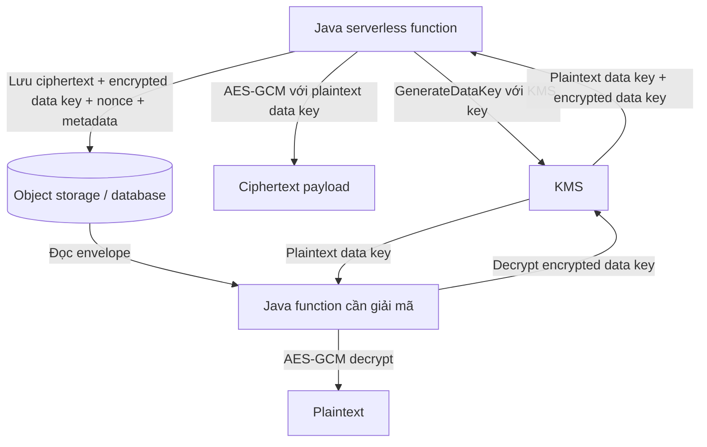

# Mã hóa dữ liệu và quản lý khóa bằng KMS

Ứng dụng Java serverless thường lưu dữ liệu vào object storage, database, queue hoặc secret store. Dữ liệu có thể được mã hóa ở tầng dịch vụ, nhưng một số nghiệp vụ cần kiểm soát khóa chặt hơn: ai được giải mã, dữ liệu thuộc tenant nào, khóa được luân chuyển ra sao và làm thế nào để điều tra một lần truy cập khóa bất thường.

Key Management Service (KMS) cung cấp khả năng tạo và quản lý khóa mã hóa, kiểm soát quyền sử dụng khóa, thực hiện thao tác mật mã và ghi nhận hoạt động. Với serverless, KMS thường được dùng để mã hóa dữ liệu lưu trữ, bảo vệ secret, tạo data key cho ứng dụng và hỗ trợ mã hóa envelope khi dữ liệu lớn hơn giới hạn của API mã hóa trực tiếp.

Điều quan trọng là phân biệt **khóa quản lý bởi KMS** với **khóa dữ liệu dùng để mã hóa payload**. Ứng dụng thường không gửi toàn bộ dữ liệu lớn vào KMS để mã hóa. Thay vào đó, KMS tạo một data key; ứng dụng dùng bản plaintext của data key trong bộ nhớ để mã hóa dữ liệu bằng thuật toán đối xứng, rồi lưu bản data key đã được KMS mã hóa cùng ciphertext. Khi cần giải mã, ứng dụng gửi encrypted data key trở lại KMS để nhận lại data key plaintext.

Bài học này trình bày mô hình mã hóa, envelope encryption, vòng đời và chính sách khóa, tích hợp Java SDK trong Lambda, mã hóa dữ liệu và tài nguyên serverless, rotation, audit, phục hồi và các lỗi thường gặp.

## 1. KMS giải quyết vấn đề gì?

Nếu ứng dụng tự tạo một AES key rồi lưu key cạnh dữ liệu đã mã hóa, kẻ có quyền đọc storage có thể lấy cả ciphertext lẫn key. Nếu nhúng key vào source code hoặc environment variable, key có thể bị lộ qua repository, log, cấu hình hoặc quyền đọc runtime. Khi key được chia sẻ thủ công giữa nhiều service, việc thu hồi và luân chuyển cũng khó kiểm soát.

KMS tách quyền sử dụng khóa khỏi quyền đọc dữ liệu:

- KMS quản lý key material và cung cấp thao tác mã hóa/giải mã hoặc tạo data key.
- IAM, key policy và grant quyết định principal nào được dùng khóa cho hành động nào.
- Dữ liệu mã hóa có thể được lưu ở S3, database hoặc hệ thống khác mà không lưu plaintext key cạnh dữ liệu.
- Hoạt động gọi KMS có thể được ghi nhận qua audit log như AWS CloudTrail.
- Key alias và chính sách vòng đời giúp ứng dụng tham chiếu khóa ổn định trong khi tổ chức quản lý rotation.

KMS không thay thế xác thực người dùng, authorization nghiệp vụ hoặc TLS. Một function có quyền `kms:Decrypt` vẫn cần kiểm tra caller có được đọc bản ghi đó hay không. TLS vẫn cần bảo vệ dữ liệu trên đường truyền; KMS chủ yếu quản lý khóa và hỗ trợ mã hóa dữ liệu lưu trữ hoặc dữ liệu ở tầng ứng dụng.

### Các khái niệm cơ bản

| Khái niệm | Ý nghĩa |
|---|---|
| KMS key | Tài nguyên logic đại diện cho khóa được KMS quản lý và dùng trong các thao tác mật mã |
| Key material | Vật liệu mật mã thực sự; với key do KMS tạo, ứng dụng không thể xuất plaintext key material |
| Key ID / ARN | Định danh khóa trong một account/region |
| Alias | Tên thân thiện trỏ tới một KMS key, có thể chuyển sang key khác |
| Data key | Khóa dữ liệu do KMS tạo, thường dùng để mã hóa payload bằng AES-GCM |
| Ciphertext blob | Bản data key đã được KMS mã hóa; có thể lưu cùng ciphertext của dữ liệu |
| Key policy | Resource policy quyết định ai được sử dụng hoặc quản trị KMS key trên AWS |
| Grant | Cấp quyền sử dụng key cho principal/service với các thao tác và điều kiện cụ thể |
| Encryption context | Cặp key-value bổ sung được xác thực cùng thao tác mã hóa đối xứng của KMS; không phải dữ liệu bí mật |

Tên gọi và mô hình IAM khác nhau giữa các nhà cung cấp cloud, nhưng nguyên tắc quản lý khóa và tách quyền vẫn tương tự.

## 2. Phân biệt mã hóa at rest, in transit và application-level

Ba lớp bảo vệ giải quyết ba phạm vi khác nhau:

| Lớp | Bảo vệ điều gì? | Ví dụ |
|---|---|---|
| Encryption at rest | Dữ liệu lưu trên storage, database, queue hoặc backup | S3 SSE-KMS, SQS SSE-KMS, DynamoDB encryption at rest |
| Encryption in transit | Dữ liệu di chuyển qua mạng | HTTPS/TLS giữa client, API Gateway, Lambda và database |
| Application-level encryption | Nội dung được mã hóa trước khi ghi vào dịch vụ lưu trữ | Java dùng data key để mã hóa một trường nhạy cảm trước khi lưu database |

Encryption at rest của dịch vụ cloud thường bảo vệ media lưu trữ. Tuy nhiên, service hoặc principal có quyền đọc dữ liệu vẫn có thể nhận plaintext thông qua API thông thường. Application-level encryption hữu ích khi muốn giới hạn số thành phần có thể nhìn thấy plaintext, ví dụ chỉ một service giải mã thông tin định danh hoặc dữ liệu tài chính.

Không phải mọi field đều cần application-level encryption. Việc này làm tăng độ phức tạp của query, indexing, rotation, key access và phục hồi. Hãy xác định dữ liệu nào cần bảo vệ, ai cần plaintext và trong thời gian nào trước khi chọn mô hình.

## 3. Envelope encryption: mô hình phù hợp cho dữ liệu ứng dụng

Envelope encryption dùng một khóa được KMS bảo vệ để mã hóa khóa dữ liệu, còn data key mã hóa payload thực tế. Với dữ liệu lớn, cách này tránh gửi toàn bộ payload qua KMS và tận dụng AES-GCM trong JVM.



Quy trình mã hóa:

1. Function xác thực và kiểm tra quyền ghi dữ liệu.
2. Function gọi KMS `GenerateDataKey` với KMS key được cấu hình.
3. KMS trả về plaintext data key và encrypted data key.
4. Function dùng plaintext data key để mã hóa payload bằng AES-256-GCM.
5. Function lưu ciphertext, encrypted data key, nonce, encryption context và phiên bản định dạng envelope.
6. Function xóa bản sao plaintext data key khỏi bộ nhớ ở mức best-effort.

Quy trình giải mã:

1. Function xác thực caller và kiểm tra quyền đọc bản ghi.
2. Function đọc envelope từ storage.
3. Function xác minh metadata/context thuộc đúng tenant, record và mục đích.
4. Function gọi KMS `Decrypt` với encrypted data key và encryption context giống lúc tạo.
5. Function dùng data key plaintext để giải mã AES-GCM và kiểm tra authentication tag.
6. Function trả plaintext qua kênh được bảo vệ, không ghi plaintext hoặc key vào log.

### Vì sao dùng AES-GCM?

AES-GCM là chế độ mã hóa đối xứng có xác thực (authenticated encryption). Nó bảo vệ tính bí mật và phát hiện ciphertext bị sửa đổi. Một nonce không được lặp lại với cùng một AES key. Với mô hình tạo data key riêng cho từng payload, nên dùng nonce 96 bit ngẫu nhiên cho một lần mã hóa và lưu nonce cùng ciphertext.

Không tự ghép AES với một chế độ không xác thực rồi bỏ qua kiểm tra toàn vẹn. Nếu dữ liệu bị sửa, hệ thống phải phát hiện và từ chối giải mã.

### KMS key không phải data key

KMS key thường không rời khỏi KMS dưới dạng plaintext. Data key là khóa tạm thời được KMS tạo để ứng dụng sử dụng. Ứng dụng cần bảo vệ data key plaintext trong thời gian ngắn nó tồn tại trong JVM; không lưu nó vào database, file tạm, log, trace hoặc cache không có chính sách rõ ràng.

Với AWS KMS, thao tác `Encrypt` cho khóa đối xứng có giới hạn kích thước plaintext (tối đa 4.096 byte). Với payload lớn hơn, dùng envelope encryption qua `GenerateDataKey` hoặc AWS Encryption SDK. Giới hạn chính xác và semantics cần được xác minh theo dịch vụ/region đang triển khai.

## 4. AWS KMS key: loại khóa và quyền sở hữu

AWS KMS cung cấp một số loại khóa theo cách quản lý và mục đích sử dụng:

| Loại | Ai quản lý policy/rotation? | Trường hợp sử dụng |
|---|---|---|
| AWS owned key | AWS sở hữu và vận hành; khách hàng không quản lý key policy trực tiếp | Mã hóa mặc định của một số dịch vụ, ít cần tùy chỉnh quyền khóa |
| AWS managed key | AWS quản lý policy và vòng đời; khách hàng không sửa key policy của khóa này | Mã hóa dịch vụ tích hợp, ít cần quản trị riêng |
| Customer managed key | Khách hàng quản lý policy, alias, tag, rotation và lịch xóa | Cần audit/quyền riêng, cross-account hoặc kiểm soát vòng đời |

Customer managed key cho phép kiểm soát chi tiết nhưng cũng tạo trách nhiệm vận hành: phải bảo vệ key policy, theo dõi sử dụng, xử lý rotation, giữ key tồn tại đủ lâu và kiểm tra khả năng giải mã backup cũ.

### Symmetric và asymmetric key

- **Symmetric encryption key:** cùng một key material thực hiện mã hóa và giải mã. Đây là lựa chọn phổ biến cho envelope encryption và mã hóa dữ liệu lưu trữ.
- **Asymmetric key:** có public key và private key. Public key có thể dùng cho một số thao tác mã hóa/verify; private key được KMS giữ để decrypt/sign theo key usage.
- **HMAC key:** dùng tạo/xác minh mã xác thực thông điệp, không phải thay thế cơ chế mã hóa payload.

Chọn key spec và key usage theo mục đích. Không thể tùy ý đổi một KMS key đã tạo từ mục đích encrypt sang sign. Nếu yêu cầu thay đổi, tạo key mới và thực hiện migration phù hợp.

### Region và multi-Region key

KMS key thông thường gắn với một region. Nếu function chạy ở nhiều region và cần decrypt dữ liệu được mã hóa ở region khác, có thể dùng multi-Region key khi semantics và chính sách phù hợp. Các replica key vẫn là resource riêng theo region, có policy và quyền sử dụng cần được cấu hình. Không chọn multi-Region chỉ để tránh thiết kế định tuyến dữ liệu; nó làm tăng phạm vi quản lý và cần kiểm tra yêu cầu residency.

## 5. Key policy, IAM policy và grant

Với AWS KMS, key policy là phần quan trọng nhất của quyền truy cập key. IAM policy gắn vào role chỉ cho phép thao tác KMS khi key policy cho phép mô hình ủy quyền IAM phù hợp. Một IAM policy có `kms:Decrypt` không tự động vượt qua key policy đang từ chối principal đó.

Ba cơ chế thường gặp:

1. **Key policy:** policy gắn trực tiếp với KMS key, xác định principal được quản trị hoặc sử dụng key.
2. **IAM identity policy:** policy gắn với user/role; hoạt động khi key policy cho phép IAM policy trong account quyết định quyền.
3. **Grant:** cấp một tập thao tác cho principal/service, thường hữu ích cho tích hợp dịch vụ và quyền có vòng đời riêng.

### Least privilege cho Lambda

Một Lambda chỉ mã hóa dữ liệu có thể cần `kms:GenerateDataKey` trên một key cụ thể. Function giải mã envelope cần `kms:Decrypt`. Nếu cùng function làm cả hai, chỉ cấp hai thao tác đó khi thực sự cần. Không cấp `kms:*` hoặc `Resource: "*"` trên toàn account cho runtime role.

Ví dụ IAM policy khái niệm:

```json
{
  "Version": "2012-10-17",
  "Statement": [
    {
      "Sid": "UseOrderDataKey",
      "Effect": "Allow",
      "Action": [
        "kms:GenerateDataKey",
        "kms:Decrypt"
      ],
      "Resource": "arn:aws:kms:ap-southeast-1:111122223333:key/12345678-1234-1234-1234-123456789012"
    }
  ]
}
```

ARN chỉ là ví dụ. Key policy của KMS key cũng phải cho phép role hoặc cho phép IAM policy của account quyết định quyền. Với key policy, trường `Resource` thường là `"*"` vì policy được gắn trực tiếp lên một key; không nhầm điều đó với IAM identity policy cấp quyền trên mọi key.

### Encryption context condition

Key policy hoặc IAM policy có thể giới hạn quyền theo encryption context, ví dụ chỉ cho phép `kms:GenerateDataKey` khi context có `application=orders`. Điều này giúp giới hạn việc dùng key theo mục đích. Context phải được xây dựng từ dữ liệu đáng tin cậy ở server-side, không để client tự chọn tùy ý nhằm vượt qua điều kiện policy.

Encryption context không phải bí mật và có thể xuất hiện trong CloudTrail. Không đặt password, token, email, số định danh hoặc dữ liệu nhạy cảm vào context. Dùng các giá trị định danh kỹ thuật như service, purpose, tenant ID nội bộ đã được kiểm soát và record ID không nhạy cảm.

### Cross-account access

Nếu một role ở account A cần dùng key trong account B, thường phải có cả:

- Key policy ở account B cho phép principal/role từ account A.
- IAM policy ở account A cho phép role gọi thao tác KMS trên key ARN account B.
- Điều kiện mạng, identity và tổ chức account phù hợp.

Không chỉ thêm IAM policy ở account gọi rồi giả định quyền đã hoạt động. Kiểm thử bằng đúng role runtime và kiểm tra CloudTrail khi có AccessDenied.

## 6. Quản lý vòng đời khóa

KMS key cần được quản lý từ lúc tạo đến lúc ngừng sử dụng. Một quy trình quản lý khóa thường gồm:

1. Xác định owner, mục đích, phân loại dữ liệu và region.
2. Chọn key spec, key usage, origin và loại key phù hợp.
3. Tạo key policy theo least privilege và chỉ định administrator riêng với key user.
4. Tạo alias dễ nhận biết, ví dụ `alias/serverless/orders-data`.
5. Gắn tag để phân loại owner, môi trường, ứng dụng và dữ liệu.
6. Bật rotation nếu key type/origin hỗ trợ và chính sách yêu cầu.
7. Theo dõi usage, lỗi, grant và thay đổi policy.
8. Lập kế hoạch thay key, re-encrypt hoặc ngừng sử dụng.
9. Chỉ lên lịch xóa khi chắc chắn không còn ciphertext, backup hoặc record cần key đó.

### Dùng alias trong ứng dụng

Ứng dụng có thể cấu hình `alias/serverless/orders-data` thay vì hard-code key ID. Alias giúp chuyển sang key mới trong quy trình rotation thủ công mà không phải đổi code. Tuy nhiên, alias là con trỏ có thể thay đổi; cần kiểm soát ai có quyền cập nhật alias và audit mọi thay đổi.

Với dữ liệu đã mã hóa, encrypted data key thường chứa metadata để KMS xác định key dùng để giải mã. Khi decrypt, không nên chỉ dựa vào alias hiện tại để giả định dữ liệu cũ dùng key mới. Giữ các key cũ ở trạng thái enabled và có quyền decrypt cho tới khi dữ liệu/backup phụ thuộc đã được chuyển đổi hoặc hết retention.

### Automatic rotation và manual rotation

Với các symmetric customer managed key có key material do AWS KMS tạo và loại key được hỗ trợ, có thể bật automatic rotation. KMS giữ các phiên bản key material cũ để giải mã ciphertext cũ và dùng phiên bản mới cho các thao tác mã hóa sau rotation. Khả năng rotation và chu kỳ cụ thể phụ thuộc loại key, origin và cấu hình hiện hành.

Manual rotation thường tạo một KMS key mới, cập nhật alias hoặc cấu hình để mã hóa dữ liệu mới bằng key mới, rồi migration/re-encrypt dữ liệu cũ nếu yêu cầu. Không xóa key cũ chỉ vì alias đã trỏ sang key mới.

Rotation của KMS key không đồng nghĩa mọi dữ liệu application-level đã được mã hóa lại ngay. Với envelope encryption, encrypted data key cũ vẫn cần key material cũ để decrypt. Với mã hóa dịch vụ như S3 SSE-KMS, hành vi rotation được dịch vụ/KMS xử lý theo cơ chế tích hợp, nhưng việc chuyển sang một customer managed key khác có thể cần copy/re-encrypt object.

### Disable và schedule deletion

Disable key ngăn các thao tác mật mã cần key đó, vì vậy ứng dụng có thể không đọc được dữ liệu dù ciphertext vẫn còn. Schedule deletion là thao tác có thời gian chờ; trong thời gian chờ có thể hủy lịch xóa theo cơ chế dịch vụ. Khi key bị xóa thực sự, dữ liệu chỉ còn ciphertext phụ thuộc key đó có thể mất khả năng giải mã vĩnh viễn.

Không schedule deletion để “dọn tài nguyên” trước khi kiểm kê dữ liệu, backup, log archive, event replay, bản export và môi trường disaster recovery. Cần có phê duyệt owner và bằng chứng dữ liệu đã được migrate hoặc hết retention.

## 7. Mã hóa envelope trong Java với AWS SDK for Java 2.x

Trong Java Lambda, có thể dùng AWS SDK for Java 2.x `KmsClient` để tạo và giải mã data key. `KmsClient` là service client thread-safe và nên được tái sử dụng trong cùng execution environment. Dùng credential provider mặc định của runtime/execution role; không hard-code access key.

Maven dependency:

```xml
<dependency>
    <groupId>software.amazon.awssdk</groupId>
    <artifactId>kms</artifactId>
    <version>${aws.sdk.version}</version>
</dependency>
```

Quản lý `${aws.sdk.version}` bằng AWS SDK BOM hoặc dependency management của dự án để các module SDK dùng phiên bản tương thích.

### Tạo KMS client dùng chung

```java
import software.amazon.awssdk.regions.Region;
import software.amazon.awssdk.services.kms.KmsClient;

public final class KmsClients {
    private static final KmsClient INSTANCE = KmsClient.builder()
            .region(Region.of(System.getenv("AWS_REGION")))
            .build();

    private KmsClients() {}

    public static KmsClient get() {
        return INSTANCE;
    }
}
```

Client dùng credential chain mặc định của AWS SDK, trong Lambda thường lấy credential từ execution role. Mỗi execution environment có JVM và client riêng. Không gọi `close()` ở cuối mỗi handler invocation; nếu framework hỗ trợ shutdown lifecycle thì có thể đóng ở đó. Với Lambda, process có thể bị thu hồi mà không có callback shutdown đáng tin cậy, vì vậy tính đúng đắn không được phụ thuộc vào hook đóng client.

### Cấu trúc envelope

Một envelope cần lưu đủ metadata để giải mã về sau:

| Trường | Mục đích |
|---|---|
| `ciphertext` | Nội dung đã mã hóa bằng AES-GCM |
| `encryptedDataKey` | Data key đã được KMS mã hóa |
| `nonce` | Nonce 96 bit dùng với AES-GCM |
| `encryptionContext` | Context dùng khi gọi KMS, cần truyền lại chính xác khi decrypt |
| `formatVersion` | Phiên bản định dạng envelope để hỗ trợ migration |
| `keyReference` | Key/alias hoặc metadata phục vụ inventory và vận hành |
| `algorithm` | Thuật toán và tham số mã hóa, ví dụ `AES-256-GCM` |

Không lưu data key plaintext. Không đưa secret hoặc PII vào encryption context. Context nên gắn dữ liệu với mục đích và resource identity để ciphertext không thể bị tráo giữa các bản ghi mà không bị phát hiện.

### Ví dụ mã hóa dữ liệu

```java
import software.amazon.awssdk.services.kms.KmsClient;
import software.amazon.awssdk.services.kms.model.DataKeySpec;
import software.amazon.awssdk.services.kms.model.GenerateDataKeyRequest;
import software.amazon.awssdk.services.kms.model.GenerateDataKeyResponse;

import javax.crypto.Cipher;
import javax.crypto.spec.GCMParameterSpec;
import javax.crypto.spec.SecretKeySpec;
import java.io.ByteArrayOutputStream;
import java.io.DataOutputStream;
import java.io.IOException;
import java.nio.charset.StandardCharsets;
import java.security.SecureRandom;
import java.util.Arrays;
import java.util.Map;
import java.util.TreeMap;

public final class EnvelopeCrypto {
    private static final int NONCE_BYTES = 12;
    private static final int GCM_TAG_BITS = 128;
    private static final SecureRandom RANDOM = new SecureRandom();

    private final KmsClient kms;
    private final String keyIdOrAlias;

    public EnvelopeCrypto(KmsClient kms, String keyIdOrAlias) {
        this.kms = kms;
        this.keyIdOrAlias = keyIdOrAlias;
    }

    public record Envelope(
            byte[] ciphertext,
            byte[] encryptedDataKey,
            byte[] nonce,
            Map<String, String> encryptionContext,
            String keyId,
            String algorithm,
            int formatVersion) {
        public Envelope {
            ciphertext = ciphertext.clone();
            encryptedDataKey = encryptedDataKey.clone();
            nonce = nonce.clone();
            encryptionContext = Map.copyOf(encryptionContext);
        }

        @Override
        public byte[] ciphertext() {
            return ciphertext.clone();
        }

        @Override
        public byte[] encryptedDataKey() {
            return encryptedDataKey.clone();
        }

        @Override
        public byte[] nonce() {
            return nonce.clone();
        }
    }

    public Envelope encrypt(byte[] plaintext, String tenantRef, String recordId)
            throws Exception {
        Map<String, String> context = Map.of(
                "application", "orders-service",
                "purpose", "order-record",
                "tenant-ref", tenantRef,
                "record-id", recordId
        );

        GenerateDataKeyResponse generated = kms.generateDataKey(
                GenerateDataKeyRequest.builder()
                        .keyId(keyIdOrAlias)
                        .keySpec(DataKeySpec.AES_256)
                        .encryptionContext(context)
                        .build()
        );

        byte[] dataKey = generated.plaintext().asByteArray();
        byte[] nonce = new byte[NONCE_BYTES];
        RANDOM.nextBytes(nonce);

        try {
            Cipher cipher = Cipher.getInstance("AES/GCM/NoPadding");
            cipher.init(Cipher.ENCRYPT_MODE,
                    new SecretKeySpec(dataKey, "AES"),
                    new GCMParameterSpec(GCM_TAG_BITS, nonce));
            cipher.updateAAD(canonicalContext(context));
            byte[] ciphertext = cipher.doFinal(plaintext);

            return new Envelope(
                    ciphertext,
                    generated.ciphertextBlob().asByteArray(),
                    nonce,
                    Map.copyOf(context),
                    generated.keyId(),
                    "AES-256-GCM",
                    1
            );
        } finally {
            // Best-effort: JVM/SDK có thể đã tạo thêm bản sao trong bộ nhớ.
            Arrays.fill(dataKey, (byte) 0);
        }
    }

    static byte[] canonicalContext(Map<String, String> context) throws IOException {
        ByteArrayOutputStream bytes = new ByteArrayOutputStream();
        try (DataOutputStream output = new DataOutputStream(bytes)) {
            for (Map.Entry<String, String> entry : new TreeMap<>(context).entrySet()) {
                byte[] key = entry.getKey().getBytes(StandardCharsets.UTF_8);
                byte[] value = entry.getValue().getBytes(StandardCharsets.UTF_8);
                output.writeInt(key.length);
                output.write(key);
                output.writeInt(value.length);
                output.write(value);
            }
        }
        return bytes.toByteArray();
    }
}
```

Đây là ví dụ minh họa cho payload và context có cấu trúc đã được kiểm soát. Trong production, hãy dùng serializer chuẩn cho envelope và canonicalization có đặc tả rõ. `tenantRef` và `recordId` phải là opaque reference không chứa PII/secret, được lấy từ trạng thái nghiệp vụ đã xác thực chứ không lấy trực tiếp từ caller mà chưa kiểm tra.

Ví dụ dùng `byte[]` để dễ theo dõi, nên payload được giữ trong memory trong lúc mã hóa. Với object lớn, hãy dùng luồng streaming và ghi ciphertext ra storage theo cách chỉ công bố object khi quá trình mã hóa hoàn tất; vẫn phải lưu nonce, encrypted data key và metadata envelope. Cân nhắc AWS Encryption SDK nếu cần streaming format, key commitment hoặc tích hợp envelope đã được thư viện quản lý.

### Giải mã envelope

```java
import software.amazon.awssdk.core.SdkBytes;
import software.amazon.awssdk.services.kms.KmsClient;
import software.amazon.awssdk.services.kms.model.DecryptRequest;
import software.amazon.awssdk.services.kms.model.DecryptResponse;

import javax.crypto.Cipher;
import javax.crypto.spec.GCMParameterSpec;
import javax.crypto.spec.SecretKeySpec;
import java.util.Arrays;
import java.util.Map;
import java.util.Objects;

public final class EnvelopeDecryptor {
    private final KmsClient kms;

    public EnvelopeDecryptor(KmsClient kms) {
        this.kms = kms;
    }

    public byte[] decrypt(
            EnvelopeCrypto.Envelope envelope,
            String expectedTenantRef,
            String expectedRecordId) throws Exception {

        Map<String, String> context = envelope.encryptionContext();
        validateContext(context, expectedTenantRef, expectedRecordId);

        DecryptResponse decrypted = kms.decrypt(DecryptRequest.builder()
                .ciphertextBlob(SdkBytes.fromByteArray(envelope.encryptedDataKey()))
                .encryptionContext(context)
                .build());

        byte[] dataKey = decrypted.plaintext().asByteArray();
        try {
            Cipher cipher = Cipher.getInstance("AES/GCM/NoPadding");
            cipher.init(Cipher.DECRYPT_MODE,
                    new SecretKeySpec(dataKey, "AES"),
                    new GCMParameterSpec(128, envelope.nonce()));
            cipher.updateAAD(EnvelopeCrypto.canonicalContext(context));
            return cipher.doFinal(envelope.ciphertext());
        } finally {
            Arrays.fill(dataKey, (byte) 0);
        }
    }

    private static void validateContext(
            Map<String, String> context,
            String expectedTenantRef,
            String expectedRecordId) {
        if (!"orders-service".equals(context.get("application"))
                || !"order-record".equals(context.get("purpose"))
                || !Objects.equals(expectedTenantRef, context.get("tenant-ref"))
                || !Objects.equals(expectedRecordId, context.get("record-id"))) {
            throw new SecurityException("Encryption context does not match the requested record");
        }
    }
}
```

`expectedTenantRef` và `expectedRecordId` phải được lấy từ database/authorization context đã xác minh. Không chỉ tin context được lưu cùng ciphertext vì người có quyền sửa metadata có thể thay đổi nó. KMS yêu cầu encryption context khi decrypt phải khớp context lúc mã hóa; AES-GCM cũng xác thực AAD và từ chối ciphertext/context bị sửa.

Hai snippet mã hóa/giải mã là hai class hoàn chỉnh có thể đặt cùng package. Trong dự án thật, nên dùng exception mapping rõ ràng cho lỗi KMS, lỗi format và lỗi authentication tag, nhưng response ra ngoài không tiết lộ key ID nội bộ hay chi tiết mật mã.

### Lưu envelope bền vững

Envelope có thể được serialize thành JSON/Avro/Protobuf hoặc lưu ở các cột riêng. Cần lưu `formatVersion` để có thể thay thuật toán hoặc định dạng trong tương lai. Dữ liệu metadata không nhạy cảm có thể lưu riêng để lọc/tìm kiếm; plaintext nhạy cảm không nên được copy vào index hoặc log.

Ví dụ cấu trúc JSON khái niệm:

```json
{
  "formatVersion": 1,
  "algorithm": "AES-256-GCM",
  "keyId": "arn:aws:kms:ap-southeast-1:111122223333:key/example",
  "ciphertext": "<base64-ciphertext>",
  "encryptedDataKey": "<base64-kms-ciphertext-blob>",
  "nonce": "<base64-12-byte-nonce>",
  "encryptionContext": {
    "application": "orders-service",
    "purpose": "order-record",
    "tenant-ref": "tenant-internal-42",
    "record-id": "order-123"
  }
}
```

Base64 chỉ là encoding để lưu byte array, không phải mã hóa. Ciphertext và encrypted data key cần được bảo vệ như dữ liệu nhạy cảm; context không phải secret nhưng có thể chứa metadata nhạy cảm nếu thiết kế sai.

## 8. KMS trong AWS Lambda và các dịch vụ serverless

Một Java function có thể dùng KMS trực tiếp hoặc dựa vào tích hợp mã hóa của dịch vụ lưu trữ. Hai mô hình này khác nhau về nơi mã hóa và principal cần quyền.

| Tài nguyên | Tích hợp KMS | Quyền thường cần xem xét |
|---|---|---|
| Lambda environment variables | Lambda có thể mã hóa cấu hình bằng KMS key do khách hàng chọn | Role/service configuration cần quyền decrypt theo cơ chế Lambda và key policy |
| SQS SSE-KMS | SQS mã hóa message khi lưu queue | Producer/consumer và service principal cần quyền KMS theo cấu hình queue/key policy |
| S3 SSE-KMS | S3 mã hóa object bằng data key được KMS bảo vệ | Role ghi object thường cần `kms:GenerateDataKey`; role đọc object thường cần `kms:Decrypt` |
| DynamoDB encryption at rest | DynamoDB mã hóa dữ liệu lưu trữ bằng key do dịch vụ hoặc customer quản lý | Quyền quản trị key và service integration; ứng dụng không nhất thiết gọi KMS trực tiếp |
| Secrets Manager | Secret được mã hóa bằng KMS key | Role đọc secret cần `secretsmanager:GetSecretValue`; nếu dùng customer managed key, cần quyền decrypt phù hợp |
| Event/logging service | Một số dịch vụ hỗ trợ customer managed key | Quyền service principal, resource policy và IAM theo tài liệu dịch vụ |

Quyền cụ thể phụ thuộc cách cấu hình, key policy, service principal và cross-account. Không copy một policy S3 sang SQS hoặc Secrets Manager mà không xác minh tài liệu của dịch vụ.

### Mã hóa S3 object bằng SSE-KMS

Nếu function chỉ cần bảo vệ object khi lưu trữ, có thể dùng server-side encryption thay vì tự mã hóa payload. Khi upload, SDK có thể yêu cầu S3 dùng KMS key cụ thể; khi download, S3 giải mã nội bộ sau khi xác minh quyền KMS.

Ví dụ khái niệm với AWS SDK Java v2:

```java
PutObjectRequest request = PutObjectRequest.builder()
        .bucket(bucketName)
        .key(objectKey)
        .serverSideEncryption(ServerSideEncryption.AWS_KMS)
        .ssekmsKeyId(kmsKeyArnOrAlias)
        .build();

s3Client.putObject(request, RequestBody.fromBytes(content));
```

Đây là tích hợp S3 SSE-KMS. Ứng dụng không tự lấy plaintext data key. S3 quản lý data key và gọi KMS theo cơ chế dịch vụ. Role và key policy phải cho phép thao tác tương ứng. Nếu yêu cầu là chỉ một service được nhìn thấy plaintext ngay cả khi có quyền đọc object từ S3, cần đánh giá application-level encryption thay vì chỉ SSE-KMS.

### Secrets Manager và KMS

Không dùng KMS làm kho lưu password hoặc API token. Dùng Secrets Manager/Parameter Store/Key Vault để quản lý secret, rotation và truy cập; các dịch vụ này có thể dùng KMS để mã hóa secret at rest. Function lấy secret bằng runtime identity và chỉ cache theo TTL/chính sách phù hợp.

## 9. Cấu hình IAM cho Java Lambda

Ví dụ role cho function dùng envelope encryption cần quyền KMS trên đúng key. Một policy tối thiểu có thể gồm:

```hcl
data "aws_iam_policy_document" "kms_usage" {
  statement {
    sid    = "UseOrderDataKey"
    effect = "Allow"
    actions = [
      "kms:GenerateDataKey",
      "kms:Decrypt"
    ]
    resources = [var.kms_key_arn]
  }
}

resource "aws_iam_role_policy" "kms_usage" {
  name   = "order-worker-kms-usage"
  role   = aws_iam_role.lambda_execution.id
  policy = data.aws_iam_policy_document.kms_usage.json
}
```

Đây chỉ là identity policy. Key policy của `var.kms_key_arn` phải cho phép role này sử dụng key hoặc cho phép IAM policy trong account quyết định quyền. Nếu function chỉ mã hóa mà không giải mã, bỏ `kms:Decrypt`; nếu chỉ giải mã, bỏ `kms:GenerateDataKey`.

Không cấp các quyền quản trị như `kms:PutKeyPolicy`, `kms:ScheduleKeyDeletion`, `kms:DisableKey` hoặc `kms:CreateKey` cho execution role của ứng dụng. Tách vai trò runtime user khỏi key administrator. Việc quản trị policy, rotation và deletion nên được thực hiện bởi pipeline/role vận hành riêng có approval và audit.

### Encryption context để giới hạn mục đích

Có thể thêm condition vào IAM/key policy để yêu cầu encryption context:

```json
{
  "StringEquals": {
    "kms:EncryptionContext:application": "orders-service",
    "kms:EncryptionContext:purpose": "order-record"
  }
}
```

Condition này chỉ phù hợp nếu mọi call hợp lệ luôn gửi context tương ứng. Khi đổi schema/context, cần rollout policy và ứng dụng theo trình tự tương thích. Vì encryption context không bí mật, không dùng nó để chứa secret hoặc thay authorization cho từng record.

## 10. Kết nối KMS khi Lambda chạy trong VPC

Lambda chạy trong VPC có thể cần truy cập KMS để tạo hoặc giải mã data key. Nếu function không có đường egress tới public KMS endpoint, call sẽ timeout hoặc không kết nối được.

Các lựa chọn thường gặp:

- Dùng NAT gateway/egress path được kiểm soát để tới public service endpoint.
- Tạo interface VPC endpoint cho AWS KMS trong VPC nếu phù hợp với region và kiến trúc.
- Cấu hình security group của endpoint, DNS và route đúng.
- Dùng endpoint policy nếu cần giới hạn API/principal được phép qua endpoint.

Đừng nhầm việc Lambda có IAM permission với việc Lambda có network path. AccessDenied thường liên quan policy; timeout/connection error thường cần kiểm tra VPC endpoint, DNS, security group, NAT và endpoint policy.

Với serverless, cold start và số invocation tăng có thể tạo burst KMS API. Theo dõi latency, throttling và quota của KMS. Nếu function gọi KMS ở mỗi request, cần đo tác động tới p95/p99 và ngân sách thời gian invocation.

## 11. Hiệu năng, cache data key và quota

Gọi KMS cho mỗi payload tăng số request, độ trễ và chi phí. Nhưng cache plaintext data key quá lâu làm tăng phạm vi ảnh hưởng nếu key bị lộ và có thể làm phức tạp rotation.

Các lựa chọn:

| Chiến lược | Ưu điểm | Rủi ro/đánh đổi |
|---|---|---|
| GenerateDataKey cho từng payload | Key riêng cho từng dữ liệu, dễ giới hạn phạm vi | Tăng số lần gọi KMS và latency |
| Dùng AWS Encryption SDK với data key caching có ngưỡng | Giảm số lần gọi KMS trong workload phù hợp | Cần giới hạn thời gian, số byte và số message mã hóa bằng một key |
| Cache plaintext data key tự viết | Có thể giảm latency | Dễ tạo cache vô hạn, khó rotation, tăng rủi ro lộ key và concurrency bug |
| Dùng SSE-KMS của storage | Dịch vụ quản lý data key và mã hóa | Không cung cấp application-level encryption; quyền đọc storage có thể nhận plaintext |

Nếu dùng data key caching, ưu tiên thư viện mã hóa đã được thiết kế cho mục đích này và đặt ngưỡng sử dụng/TTL nghiêm ngặt. Không lưu plaintext key trong static map vô thời hạn. Xem xét số byte và số lần dùng mỗi key, thời gian cache, tenant boundary, key rotation và khả năng xóa cache sau thay đổi quyền.

### KMS client reuse không đồng nghĩa data key reuse

`KmsClient` có thể được tái sử dụng giữa invocation trong cùng execution environment vì SDK service client được thiết kế thread-safe. Điều đó không có nghĩa nên tái sử dụng plaintext data key cho mọi request. Client là đối tượng kết nối dịch vụ; data key là bí mật mật mã có vòng đời và giới hạn sử dụng riêng.

Để giảm cold start, tạo `KmsClient` ở cấp environment/application singleton và chỉ khởi tạo khi cần. Đặt timeout/retry SDK phù hợp với timeout của function. Không retry vô hạn lỗi AccessDenied, key disabled hoặc invalid encryption context.

## 12. Rotation, re-encryption và migration dữ liệu

Rotation cần được thiết kế cùng định dạng dữ liệu và cách lưu encrypted data key. Có hai trường hợp:

1. **Automatic rotation của cùng KMS key:** KMS giữ key material cũ để decrypt ciphertext cũ; ứng dụng thường tiếp tục dùng key ID/alias và không cần sửa từng record chỉ vì rotation tự động.
2. **Thay sang một KMS key resource mới:** cần cập nhật alias/cấu hình cho dữ liệu mới và có thể re-encrypt encrypted data key hoặc payload cũ tùy mục tiêu migration.

### Re-encrypt data key

Với envelope encryption, có thể dùng KMS `ReEncrypt` để chuyển encrypted data key từ key nguồn sang key đích mà không đưa plaintext data key về ứng dụng. Payload AES-GCM không nhất thiết phải giải mã/mã hóa lại nếu chỉ cần thay lớp bọc data key và thuật toán/metadata vẫn tương thích.

Quy trình khái niệm:

1. Tạo KMS key mới và policy phù hợp.
2. Cấp quyền `kms:ReEncryptFrom` trên key cũ và `kms:ReEncryptTo` trên key mới cho migration role.
3. Duyệt các record có encrypted data key cũ.
4. Gọi ReEncrypt với encryption context phù hợp.
5. Cập nhật encrypted data key/key reference theo transaction hoặc versioning.
6. Kiểm thử decrypt bằng key mới.
7. Giữ key cũ cho tới khi tất cả dữ liệu, backup và replay window không còn phụ thuộc.

Migration role riêng nên có quyền rộng hơn runtime role trong thời gian giới hạn và có audit. Không cấp `ReEncrypt` cho mọi function nếu runtime chỉ cần encrypt/decrypt.

### Định dạng envelope có version

Lưu `formatVersion` và `algorithm` để code có thể giải mã dữ liệu cũ khi nâng cấp. Có thể triển khai dual-read/single-write:

- Đọc cả format cũ và mới.
- Ghi dữ liệu mới bằng format mới.
- Chạy migration nền cho dữ liệu cũ.
- Theo dõi số record còn dùng format cũ.
- Chỉ loại bỏ code cũ khi hết dữ liệu/backup cần hỗ trợ.

Không đổi thuật toán và ngừng hỗ trợ format cũ trong cùng một lần deploy nếu chưa kiểm kê toàn bộ dữ liệu.

## 13. Audit, logging và phát hiện truy cập bất thường

KMS là ranh giới bảo mật quan trọng. Cần theo dõi ai gọi thao tác nào, trên key nào, từ service/role nào và kết quả ra sao.

Với AWS, CloudTrail có thể ghi nhận các thao tác KMS như `GenerateDataKey`, `Decrypt`, `Encrypt`, `CreateGrant`, `PutKeyPolicy`, `DisableKey` và `ScheduleKeyDeletion`. Có thể gửi log tới centralized logging/SIEM, đặt cảnh báo cho thay đổi key policy, tạo grant bất thường hoặc spike số lần decrypt.

Metric và tín hiệu cần theo dõi:

- Số lần `GenerateDataKey`/`Decrypt` theo key và ứng dụng.
- KMS throttling, AccessDenied và lỗi invalid ciphertext/context.
- Latency p50/p95/p99 của call KMS.
- Số lần function retry do lỗi KMS.
- Key rotation và key state changes.
- Alias changes, grant changes, policy updates và deletion scheduling.
- Tỷ lệ decrypt theo tenant/service bất thường.

Không log plaintext data key, plaintext payload, secret, token hoặc full encryption context nếu context có thể tiết lộ thông tin nhạy cảm. Context được ghi trong CloudTrail theo semantics của KMS; hãy thiết kế nó như metadata có thể quan sát được.

### Tách audit nghiệp vụ và audit KMS

CloudTrail cho biết một principal đã gọi KMS, nhưng không nhất thiết diễn giải đầy đủ lý do nghiệp vụ. Ứng dụng nên ghi audit event riêng gồm operation ID, record reference đã chuẩn hóa, tenant reference, actor đã xác thực và kết quả cho phép/từ chối. Không ghi plaintext. Dùng correlation ID để nối audit ứng dụng với CloudTrail event.

## 14. Backup, disaster recovery và khả năng giải mã dài hạn

Ciphertext chỉ hữu ích khi còn khả năng truy cập key cần để giải mã. Kế hoạch backup cần bao gồm:

- Dữ liệu ciphertext và encrypted data key.
- Metadata envelope: format version, algorithm, nonce, key reference và context.
- KMS key resource và policy cần thiết ở region/account phục hồi.
- Quy trình cấp quyền decrypt cho disaster recovery role.
- Thời gian retention của backup và thời điểm key có thể bị disable/delete.
- Kiểm thử restore dữ liệu bằng chính role và region dự kiến khi disaster recovery.

Không chỉ kiểm tra rằng file backup tồn tại. Hãy thực hiện restore thử và decrypt một tập dữ liệu đại diện. Nếu key nằm ở region khác, xác minh khả năng truy cập và yêu cầu residency. Với imported key material hoặc external key store, kế hoạch khả dụng còn phụ thuộc nguồn key bên ngoài và khả năng cung cấp lại key material.

### Key deletion là thay đổi dữ liệu

Xóa KMS key có thể khiến ciphertext không thể giải mã. Vì vậy, deletion nên được quản lý như thao tác phá hủy dữ liệu, có owner, phê duyệt, inventory phụ thuộc, kiểm thử restore và thời gian chờ. Một key không có request gần đây vẫn có thể cần cho backup cũ hoặc dữ liệu pháp lý phải giữ nhiều năm.

## 15. So sánh dịch vụ KMS giữa các cloud

Tên sản phẩm và semantics khác nhau, nhưng mục tiêu chung là bảo vệ key material, kiểm soát thao tác mật mã và tích hợp với workload identity.

| Cloud | Dịch vụ chính | Tích hợp serverless thường gặp |
|---|---|---|
| AWS | AWS Key Management Service (KMS) | Lambda, S3 SSE-KMS, SQS SSE-KMS, DynamoDB, Secrets Manager |
| Microsoft Azure | Azure Key Vault Keys / Managed HSM | Azure Functions dùng managed identity để gọi Key Vault; storage/service encryption tích hợp với key vault theo dịch vụ |
| Google Cloud | Cloud Key Management Service (Cloud KMS) | Cloud Run/Functions dùng service account để gọi Cloud KMS; CMEK cho các dịch vụ hỗ trợ |

Không chuyển policy trực tiếp giữa các cloud. Azure Key Vault access model, Google Cloud IAM và AWS key policy có semantics khác nhau. Khi xây dựng abstraction Java đa cloud, nên chuẩn hóa interface nghiệp vụ như `encrypt`, `decrypt`, `generateDataKey` và metadata envelope; adapter riêng chịu trách nhiệm mapping tới provider API, identity và policy.

## 16. Các lỗi thường gặp khi dùng KMS

| Lỗi | Hệ quả | Cách khắc phục |
|---|---|---|
| Lưu plaintext data key cạnh ciphertext | Kẻ đọc storage có thể giải mã dữ liệu | Chỉ lưu encrypted data key; giữ plaintext key trong bộ nhớ ngắn hạn |
| Gọi KMS Encrypt cho payload lớn | Vượt giới hạn plaintext của API | Dùng envelope encryption hoặc Encryption SDK |
| Dùng cùng một nonce AES-GCM nhiều lần với một key | Làm suy yếu bảo mật và có thể lộ thông tin | Dùng nonce duy nhất; ưu tiên data key riêng cho payload |
| Không lưu encryption context/metadata cần thiết | Không thể decrypt hoặc không xác minh đúng resource | Lưu context và format version cùng envelope |
| Đưa PII/secret vào encryption context | Metadata có thể xuất hiện trong audit log | Chỉ dùng context kỹ thuật không nhạy cảm |
| Chỉ cấp IAM policy mà bỏ qua key policy | KMS trả AccessDenied | Kiểm tra key policy, IAM policy, grant và cross-account |
| Dùng `kms:*` cho Lambda role | Runtime có thể sửa/xóa hoặc quản trị key | Tách key admin và key user; cấp action tối thiểu |
| Hard-code key ID trong nhiều nơi | Khó thay key và quản lý migration | Dùng alias/configuration được kiểm soát |
| Tắt/xóa key khi còn backup cũ | Dữ liệu không thể giải mã | Kiểm kê dependency và kiểm thử restore trước deletion |
| Cache plaintext data key vô hạn | Tăng blast radius và trì hoãn rotation | Dùng cache có ngưỡng/TTL hoặc data key riêng |
| Lambda trong VPC không có đường tới KMS | Timeout khi GenerateDataKey/Decrypt | Kiểm tra NAT hoặc KMS VPC endpoint, DNS và security group |
| Log plaintext/key để debug | Rò rỉ dữ liệu và bí mật | Log ID, trạng thái và correlation ID; không log key/payload |
| Coi SSE-KMS là application-level encryption | Service có quyền đọc object vẫn nhận plaintext | Dùng envelope encryption khi cần giới hạn plaintext ở tầng ứng dụng |

## 17. Quy trình thiết kế mã hóa cho Java serverless

Khi đưa KMS vào một Java function, có thể đi theo trình tự:

1. **Phân loại dữ liệu.** Xác định field nào nhạy cảm, yêu cầu retention, residency và ai được xem plaintext.
2. **Chọn lớp mã hóa.** SSE-KMS nếu cần bảo vệ storage; envelope encryption nếu cần application-level control.
3. **Chọn KMS key.** Xác định symmetric/asymmetric, customer-managed hay service-managed, region và owner.
4. **Thiết kế policy.** Tách key administrator, runtime role và migration role; giới hạn action/resource/context.
5. **Thiết kế envelope.** Lưu ciphertext, encrypted data key, nonce, algorithm, context và format version.
6. **Tích hợp Java SDK.** Tái sử dụng KMS client, dùng execution role/managed identity và không hard-code credential.
7. **Bảo vệ runtime.** Không log plaintext/key; xóa data key local best-effort; kiểm tra caller trước decrypt.
8. **Tính hiệu năng.** Đo KMS latency, quota, retry, cold start và chi phí; chỉ cache data key khi có policy rõ.
9. **Quản lý rotation.** Dùng alias, giữ key cũ cho decrypt, version envelope và lập migration khi thay key resource.
10. **Audit và recovery.** Theo dõi CloudTrail, policy changes, grants, decrypt spikes và kiểm thử restore backup.

## 18. Checklist trước production

- [ ] Dữ liệu được phân loại và có lý do rõ cho application-level encryption.
- [ ] Envelope encryption dùng data key và AES-GCM hoặc thư viện được kiểm chứng.
- [ ] Nonce không bị lặp với cùng data key; authentication tag luôn được xác minh.
- [ ] Encrypted data key, nonce, context, algorithm và format version được lưu đầy đủ.
- [ ] Encryption context không chứa secret/PII và được tạo từ nguồn tin cậy.
- [ ] KMS key có owner, alias, tag, policy và rotation strategy.
- [ ] Key policy và IAM policy cho phép đúng runtime role, action và key.
- [ ] Key administrator tách khỏi application execution role.
- [ ] KMS client được tái sử dụng; credential đến từ runtime identity.
- [ ] Function trong VPC có network path tới KMS.
- [ ] KMS latency, throttling, retry và quota được đo.
- [ ] Plaintext data key và plaintext payload không xuất hiện trong log hoặc storage phụ.
- [ ] CloudTrail/audit cảnh báo policy, grant, alias, disable và deletion changes.
- [ ] Rotation, re-encryption, backup restore và key recovery đã được kiểm thử.
- [ ] Có inventory chứng minh key chưa bị xóa khi ciphertext/backup còn phụ thuộc.

## Kết luận

KMS giúp quản lý khóa và kiểm soát quyền sử dụng khóa trong ứng dụng serverless. Với dữ liệu lớn hoặc cần application-level encryption, envelope encryption cho phép KMS bảo vệ data key còn Java dùng AES-GCM để mã hóa payload. Để vận hành an toàn, cần kết hợp key policy và IAM least privilege, encryption context không chứa dữ liệu bí mật, alias và rotation có kế hoạch, KMS client dùng lại trong execution environment, audit qua CloudTrail và kiểm thử khả năng giải mã backup. Hãy xem việc disable hoặc xóa key là thay đổi có thể làm mất khả năng đọc dữ liệu, không chỉ là thao tác dọn tài nguyên.
