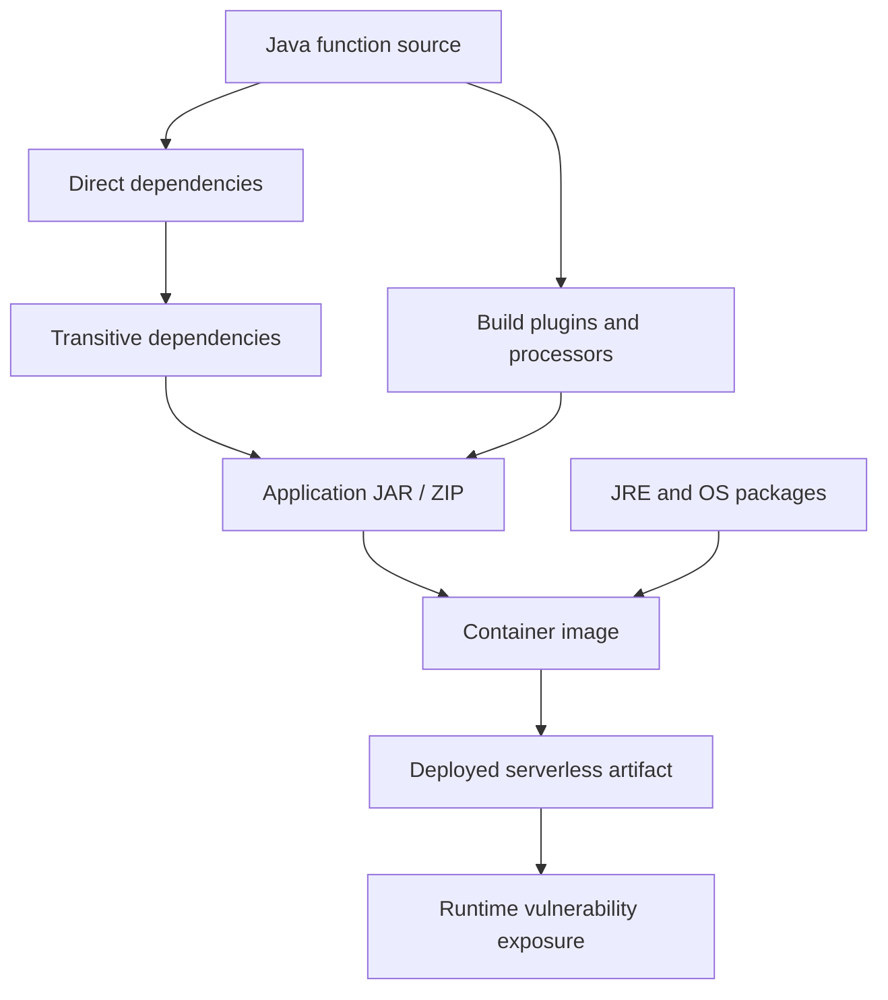
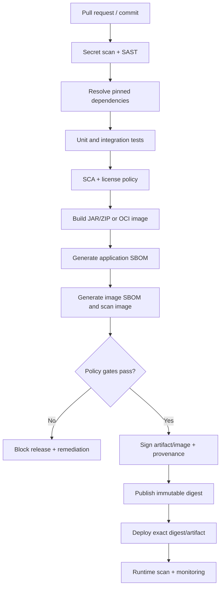

# Bảo vệ dependency, tạo SBOM và quét image

Một Java serverless function có thể chỉ chứa vài class nghiệp vụ, nhưng artifact triển khai thường kéo theo hàng chục hoặc hàng trăm thư viện: framework, JSON parser, HTTP client, database driver, SDK cloud, logging và các dependency bắc cầu. Nếu một thư viện trong chuỗi này có lỗ hổng, function vẫn có thể bị ảnh hưởng dù nhóm phát triển không trực tiếp viết hoặc gọi đoạn code dễ tổn thương.

Với function đóng gói bằng JAR/ZIP, rủi ro nằm trong dependency của ứng dụng và runtime mà nền tảng cung cấp. Với function triển khai bằng container image, còn có thêm JRE/JDK, hệ điều hành nền, package hệ thống, shell tool và các layer của image. Vì vậy, bảo vệ chuỗi cung ứng phần mềm cần kết hợp **quản lý dependency**, **SBOM (Software Bill of Materials)** và **quét artifact/container image**.

SBOM cho biết thành phần nào được đưa vào một bản build. Công cụ quét đối chiếu các thành phần đó với dữ liệu lỗ hổng, license và policy. Chữ ký/provenance giúp xác định artifact đến từ pipeline nào và có bị thay đổi sau build hay không. Các biện pháp này bổ trợ nhau; không một công cụ đơn lẻ nào chứng minh artifact hoàn toàn an toàn.

## 1. Dependency là một phần của bề mặt tấn công

Trong Java, dependency có thể đến từ nhiều nguồn:

- Dependency trực tiếp được khai báo trong `pom.xml` hoặc `build.gradle`.
- Dependency bắc cầu được một thư viện khác kéo vào.
- Plugin build, annotation processor, compiler plugin và công cụ đóng gói.
- JAR được copy thủ công vào thư mục `lib` hoặc đưa vào image.
- Runtime base image, JRE/JDK và package của hệ điều hành.
- Extension hoặc SDK do nền tảng serverless cung cấp.

Ví dụ, ứng dụng dùng một HTTP client; HTTP client kéo theo thư viện codec; thư viện codec lại phụ thuộc một parser. Lỗ hổng trong parser có thể xuất hiện trong artifact dù mã nguồn ứng dụng không import parser trực tiếp.



Một function deploy dạng ZIP có thể không chứa hệ điều hành hoặc JRE vì nền tảng quản lý runtime. Điều đó không loại bỏ rủi ro: cần biết runtime version, thư viện được đóng gói cùng function và cách nhà cung cấp vá thành phần nền tảng. Với container deployment, nhóm phát triển chịu trách nhiệm cập nhật base image và các package được đóng gói vào image.

## 2. Phân biệt dependency trực tiếp, bắc cầu và build-time

Không phải dependency nào cũng được nạp hoặc thực thi trong production. Hãy phân biệt scope và mục đích:

| Nhóm | Ví dụ | Rủi ro cần xem xét |
| --- | --- | --- |
| Compile/runtime | Jackson, AWS SDK, JDBC driver | Có thể được nạp trong function khi chạy |
| Provided/platform | API hoặc thư viện do runtime cung cấp | Phải xác định phiên bản thực tế của môi trường triển khai |
| Test | JUnit, Mockito, Testcontainers | Thường không nằm trong runtime artifact, nhưng vẫn có thể ảnh hưởng build/test pipeline |
| Build plugin | Maven Surefire, compiler plugin, Gradle plugin | Chạy trong CI; plugin độc hại có thể đọc source, token hoặc sửa artifact |
| Annotation processor | Lombok hoặc processor sinh code | Chạy trong giai đoạn compile và có quyền truy cập build environment |
| OS/runtime package | JRE, libc, CA certificates, shell utility | Nằm trong container image hoặc do nền tảng quản lý |

SCA (Software Composition Analysis) cần xem xét cả dependency runtime lẫn thành phần build quan trọng. Không nên bỏ qua plugin chỉ vì chúng không nằm trong JAR cuối cùng: plugin chạy trong CI với quyền truy cập source và có thể tiếp cận credential nếu pipeline cấp quá nhiều quyền.

### Kiểm tra dependency tree

Với Maven:

```bash
mvn dependency:tree
mvn dependency:tree -Dverbose
```

Lệnh đầu hiển thị cây dependency; `-Dverbose` giúp nhìn thấy một số dependency bị loại do conflict hoặc mediation. Khi có lỗ hổng, tìm đường kéo dependency vào để biết thư viện nào cần nâng cấp.

Với Gradle:

```bash
./gradlew dependencies
./gradlew dependencyInsight --dependency jackson-databind --configuration runtimeClasspath
```

`dependencyInsight` giải thích vì sao một version được chọn trong configuration cụ thể. Hãy kiểm tra `runtimeClasspath` và các configuration build/test có liên quan, không chỉ nhìn danh sách dependency khai báo trực tiếp.

## 3. Khóa phiên bản và kiểm soát nguồn dependency

Build phải có khả năng tái tạo được. Nếu cùng một commit hôm nay resolve một version, tuần sau lại resolve version khác do khai báo động, artifact có thể thay đổi mà không có code review tương ứng.

Các nguyên tắc nên áp dụng:

- Pin version cụ thể cho dependency và build plugin quan trọng.
- Dùng BOM (Bill of Materials) có kiểm soát để đồng bộ các thư viện trong cùng hệ sinh thái, ví dụ Spring Boot hoặc AWS SDK.
- Tránh version động như `1.+`, `latest.release` hoặc phụ thuộc SNAPSHOT trong production build.
- Dùng repository tin cậy, hạn chế thêm repository không cần thiết và bảo vệ credential của private artifact repository.
- Kiểm tra checksum/signature khi công cụ và repository hỗ trợ.
- Review thay đổi dependency như thay đổi source code: xem release note, breaking change và advisory.
- Lưu lockfile hoặc dependency verification metadata khi build tool hỗ trợ.

### Gradle dependency locking

Gradle hỗ trợ dependency locking để lưu các version đã được resolve cho configuration. Có thể bật khóa cho các configuration:

```groovy
dependencyLocking {
    lockAllConfigurations()
}
```

Sau khi cấu hình, resolve dependency và ghi lock state:

```bash
./gradlew dependencies --write-locks
```

Commit các lockfile được tạo vào source control và cập nhật chúng qua pull request có review. Locking giúp build chọn cùng version đã khóa; nó không tự chứng minh thư viện không có lỗ hổng. Vẫn phải quét lock state và cập nhật khi có advisory.

Gradle còn hỗ trợ dependency verification metadata để xác minh checksum hoặc chữ ký artifact:

```bash
./gradlew --write-verification-metadata sha256 help
```

Lệnh trên tạo metadata từ artifact đã tải về; nhóm phát triển cần review và commit kết quả, không tự động tin mọi checksum được thu thập trong một build không được kiểm soát. Khi dependency thay đổi hợp lệ, cập nhật metadata qua quy trình review.

### Maven dependency management

Maven core không có cơ chế dependency lockfile tương đương Gradle dependency locking trong mọi project. Có thể tăng tính tái lập bằng cách:

- Khai báo version rõ ràng hoặc import BOM đã pin version trong `dependencyManagement`.
- Pin version của plugin trong `build/plugins` và quản lý plugin repository.
- Dùng Maven Enforcer để kiểm tra dependency convergence, version rule và JDK/toolchain.
- Lưu output dependency tree/SBOM theo build để so sánh thay đổi.
- Dùng repository manager nội bộ nếu tổ chức cần kiểm soát proxy/cache/allowlist artifact.

Ví dụ import BOM:

```xml
<dependencyManagement>
    <dependencies>
        <dependency>
            <groupId>software.amazon.awssdk</groupId>
            <artifactId>bom</artifactId>
            <version>${aws.sdk.version}</version>
            <type>pom</type>
            <scope>import</scope>
        </dependency>
    </dependencies>
</dependencyManagement>
```

Version property phải được pin cụ thể trong project hoặc parent POM. BOM đồng bộ phiên bản các module của cùng thư viện; nó không thay thế kiểm tra CVE, license hoặc checksum.

## 4. Quản lý lỗ hổng trong dependency

SCA scanner thường so sánh tọa độ package/version với cơ sở dữ liệu advisory như CVE, GitHub Advisory Database hoặc dữ liệu của nhà cung cấp. Với Java, tọa độ thường được biểu diễn bằng Maven coordinates (`groupId:artifactId:version`) hoặc Package URL (PURL).

Một finding nên được đánh giá theo nhiều yếu tố:

- **Severity:** mức độ nghiêm trọng theo CVSS hoặc hệ thống đánh giá của scanner.
- **Exploitability:** có exploit công khai, đang bị khai thác ngoài thực tế hoặc có thể khai thác trong điều kiện của ứng dụng không?
- **Reachability:** function có thực sự nạp/gọi đường code bị ảnh hưởng không? Không phải scanner nào cũng phân tích reachability chính xác.
- **Exposure:** function có endpoint public, xử lý input không tin cậy hoặc chạy với quyền rộng không?
- **Fix availability:** có version đã vá, workaround hoặc bản nâng cấp tương thích không?
- **Runtime scope:** package có thực sự nằm trong production artifact hay chỉ thuộc test/build scope?

Không nên bỏ qua CVE chỉ vì function ít traffic. Một function public nhận input không tin cậy có thể có bề mặt tấn công lớn dù chỉ chạy vài lần mỗi ngày. Ngược lại, một finding trong test-only dependency có thể không ảnh hưởng runtime nhưng vẫn cần đánh giá rủi ro build pipeline.

### Quy trình xử lý finding

1. Xác định package, version, source dependency và artifact/image bị ảnh hưởng.
2. Kiểm tra advisory gốc, phiên bản bị ảnh hưởng, điều kiện khai thác và phiên bản đã vá.
3. Xác định dependency trực tiếp hay bắc cầu; tìm dependency cha nếu là transitive.
4. Nâng cấp thư viện cha/BOM hoặc override version nếu tương thích và được nhà cung cấp hỗ trợ.
5. Chạy unit/integration test và kiểm tra API/behavior thay đổi.
6. Build lại artifact/image, tạo SBOM mới và quét lại.
7. Deploy revision/image mới; xác minh phiên bản cũ đã được thay thế hoặc drain.
8. Lưu bằng chứng xử lý và theo dõi finding trong registry/runtime scanner.

Nếu chưa thể nâng cấp, ghi nhận lý do, phạm vi ảnh hưởng, biện pháp giảm thiểu, owner và ngày hết hạn ngoại lệ. Không tạo suppression vĩnh viễn chỉ để pipeline xanh.

## 5. SBOM là gì và dùng để làm gì?

SBOM là danh mục có cấu trúc về các thành phần phần mềm trong một sản phẩm/artifact. Nó giúp trả lời: bản build này chứa thư viện nào, version nào, từ đâu, quan hệ dependency ra sao và license nào được khai báo.

Hai chuẩn thường gặp:

- **CycloneDX:** chuẩn SBOM và risk data do OWASP CycloneDX phát triển; hỗ trợ component, dependency relationship, vulnerability và nhiều loại metadata.
- **SPDX:** chuẩn ISO/IEC dùng để mô tả package, file, license, copyright và quan hệ trong phần mềm.

SBOM có thể ở JSON, XML hoặc định dạng text tùy chuẩn/tool. Trong CI/CD, JSON thường thuận tiện để máy quét và hệ thống quản trị ingest.

Một SBOM hữu ích nên có:

- Tên sản phẩm, version/release hoặc build identifier.
- Thời điểm tạo và công cụ tạo SBOM.
- Component name, version, supplier/author khi biết.
- Package URL (PURL), CPE hoặc định danh tương đương nếu có.
- Hash/checksum của component hoặc artifact khi tool hỗ trợ.
- License metadata và external reference/advisory.
- Quan hệ dependency (depends on, contains) nếu công cụ xác định được.
- Thông tin scope và nguồn inventory: application, OS package, runtime hoặc build component.

SBOM không phải chứng nhận an toàn và không tự phát hiện mọi lỗ hổng. Nó là inventory tại thời điểm build; scanner cần đối chiếu inventory với dữ liệu advisory mới để tìm rủi ro. Một SBOM thiếu OS layer hoặc không nhận diện được shaded JAR có thể bỏ sót thành phần.

## 6. Tạo SBOM cho Java artifact bằng CycloneDX Maven plugin

Với Maven, plugin CycloneDX có thể tạo SBOM từ dependency graph của project. Thêm plugin vào `pom.xml` và pin version đã được tổ chức phê duyệt:

```xml
<build>
    <plugins>
        <plugin>
            <groupId>org.cyclonedx</groupId>
            <artifactId>cyclonedx-maven-plugin</artifactId>
            <version>${cyclonedx.maven.plugin.version}</version>
            <executions>
                <execution>
                    <phase>package</phase>
                    <goals>
                        <goal>makeAggregateBom</goal>
                    </goals>
                </execution>
            </executions>
        </plugin>
    </plugins>
</build>
```

Sau đó chạy:

```bash
mvn -B clean verify
```

Plugin thường tạo file CycloneDX JSON/XML trong thư mục `target` (tên file phụ thuộc goal và cấu hình plugin). Kiểm tra output thực tế và lưu cùng build artifact. Với multi-module project, aggregate BOM giúp nhìn tổng thể dependency của các module; nếu triển khai từng function artifact riêng, cần tạo SBOM tương ứng với đúng artifact được deploy.

Không đưa secret hoặc thông tin môi trường nhạy cảm vào metadata SBOM. SBOM nên gắn với version/hash artifact để tránh nhầm inventory của một build với binary khác.

## 7. Tạo SBOM cho Java artifact bằng Gradle

Gradle có plugin CycloneDX để tạo SBOM từ configurations được chọn. Ví dụ khai báo plugin trong `build.gradle`:

```groovy
plugins {
    id 'java'
    id 'org.cyclonedx.bom' version '<approved-plugin-version>'
}

cyclonedxBom {
    includeConfigs = ['runtimeClasspath']
    skipConfigs = ['testCompileClasspath', 'testRuntimeClasspath']
    projectType = 'application'
    schemaVersion = '1.6'
    destination = file("$buildDir/reports")
    outputName = 'application-sbom'
    outputFormat = 'json'
}
```

Chạy task:

```bash
./gradlew clean build cyclonedxBom
```

Tên extension/property có thể thay đổi theo phiên bản plugin; hãy đối chiếu tài liệu của version đã pin. Ví dụ chỉ đưa `runtimeClasspath` vào SBOM ứng dụng để tập trung vào component triển khai; nếu muốn inventory build/test, tạo SBOM riêng hoặc mở rộng configuration. Ghi rõ scope để người nhận không nhầm SBOM runtime với toàn bộ dependency của repository.

## 8. SBOM cho container image khác SBOM cho JAR

SBOM được tạo từ Maven/Gradle chủ yếu mô tả dependency ứng dụng mà build tool biết. Nó có thể không liệt kê đầy đủ:

- Package của Linux base image.
- JRE/JDK và thư viện hệ thống.
- Binary được copy thủ công vào image.
- Native library và file không được nhận diện là package.
- Thành phần trong layer được kế thừa từ base image.

Vì vậy, với Java function triển khai bằng container, nên có SBOM cho ứng dụng và inventory/SBOM cho image cuối cùng. Công cụ như Syft hoặc Trivy có thể quét image và tạo SBOM dựa trên package/file được nhận diện.

Ví dụ Syft:

```bash
syft packages registry.example.com/orders-function:1.8.2 \
  -o cyclonedx-json=orders-image.cdx.json
```

Ví dụ Trivy tạo SBOM:

```bash
trivy image --format cyclonedx \
  --output orders-image.cdx.json \
  registry.example.com/orders-function:1.8.2
```

Hãy dùng image digest thay cho tag mutable khi lưu bằng chứng build. Tag `1.8.2` có thể bị trỏ sang image khác nếu registry cho phép ghi đè; digest nhận diện chính xác nội dung image. SBOM phải được gắn với digest tương ứng.

## 9. Quét dependency của Java project

Có thể dùng OWASP Dependency-Check hoặc SCA platform của tổ chức để kiểm tra dependency Maven/Gradle. Ví dụ Maven:

```bash
mvn org.owasp:dependency-check-maven:check
```

Dependency-Check phân tích dependency và đối chiếu với dữ liệu vulnerability; kết quả có thể gồm false positive hoặc component identification chưa chính xác. Hãy review report và cấu hình suppression có lý do, phạm vi hẹp, owner và ngày hết hạn.

Một pipeline có thể chạy nhiều loại kiểm tra:

| Kiểm tra | Phạm vi |
| --- | --- |
| Dependency tree/convergence | Version conflict, dependency bắc cầu và version không mong muốn |
| SCA | CVE/advisory trong thư viện và package |
| License scan | License không phù hợp chính sách phân phối |
| Secret scan | Token/password vô tình commit hoặc đóng gói |
| SAST | Pattern lỗi bảo mật trong source code |
| SBOM generation | Inventory component của build |
| Image scan | OS package, JRE, application dependency và misconfiguration trong image |

Không một scanner nào thay thế code review, test, threat modeling hoặc runtime monitoring.

## 10. Quét OCI image bằng Trivy

Trivy có thể quét vulnerability, misconfiguration, secret và license theo chế độ/cấu hình tương ứng. Ví dụ quét image:

```bash
trivy image --scanners vuln,misconfig,secret \
  --severity HIGH,CRITICAL \
  --exit-code 1 \
  registry.example.com/orders-function:1.8.2
```

`--exit-code 1` khiến command trả exit code khác 0 khi có finding ở mức severity đã chọn; CI có thể dùng để fail job. Cấu hình scanner và database cần được cập nhật. Không nên chỉ quét tag local trước khi push rồi bỏ qua digest thực tế được deploy.

Có thể quét filesystem trước khi build:

```bash
trivy fs --scanners vuln,misconfig,secret --severity HIGH,CRITICAL .
```

Filesystem scan hữu ích để phát hiện secret hoặc dependency manifest có vấn đề, nhưng không thay thế image scan. Image scan mới nhìn thấy các package và layer thực sự có trong image cuối.

### Quét theo digest

Sau khi build/push, lấy digest do registry trả về và quét chính digest đó:

```bash
trivy image registry.example.com/orders-function@sha256:<image-digest>
```

Deploy cùng digest đã quét. Nếu build lại hoặc base image thay đổi, digest thay đổi và cần tạo inventory/quét mới. Tránh scan một tag rồi deploy tag đó sau khi một pipeline khác đã ghi đè tag.

## 11. Quét image với Grype và các registry scanner

Grype có thể quét image hoặc SBOM. Ví dụ:

```bash
grype registry.example.com/orders-function@sha256:<image-digest>
grype sbom:orders-image.cdx.json
```

Quét SBOM giúp đánh giá lại inventory khi dữ liệu advisory thay đổi, ngay cả khi image không được build lại. Kết quả vẫn phụ thuộc độ đầy đủ và độ chính xác của SBOM.

Các registry/cloud platform cũng có scanner tích hợp, ví dụ Amazon ECR image scanning, Google Artifact Analysis hoặc Microsoft Defender for Cloud/container registry integration tùy dịch vụ và cấu hình. Registry scanning có thể tiếp tục đánh giá image sau khi push hoặc khi có advisory mới. Cần xác minh loại scanner, phạm vi package, tần suất cập nhật dữ liệu, region và phí theo dịch vụ.

Không giả định registry scan đã bật chỉ vì image nằm trong registry. Kiểm tra repository policy, scan mode, quyền xem findings và alert routing. Với function deploy dạng ZIP/JAR, registry image scanner không thấy artifact; phải scan JAR/ZIP và dependency graph riêng.

## 12. Thiết kế Docker image an toàn cho Java function

Một image nhỏ, có ít package và ít quyền sẽ giảm bề mặt tấn công và số finding cần xử lý. Ví dụ multi-stage build tách Maven build environment khỏi runtime:

```dockerfile
FROM maven:3.9-eclipse-temurin-21 AS build
WORKDIR /workspace
COPY pom.xml .
COPY src ./src
RUN mvn -B -DskipTests package

FROM eclipse-temurin:21-jre
WORKDIR /app
COPY --from=build /workspace/target/function.jar /app/function.jar
USER 10001:10001
ENTRYPOINT ["java", "-jar", "/app/function.jar"]
```

Đây là ví dụ khung. Trong production, build/test phải chạy đầy đủ trong CI; bước build image cuối chỉ nhận artifact đã được kiểm thử. Chọn JRE/base image được duy trì và cập nhật bảo mật. Nếu dùng distroless hoặc minimal image, xác minh CA certificates, timezone, native library và khả năng chẩn đoán cần thiết.

Các nguyên tắc hardening:

- Dùng multi-stage build để không đưa Maven, compiler, source và cache vào runtime image.
- Chọn base image tối thiểu nhưng còn được nhà cung cấp cập nhật security patch.
- Pin base image theo digest trong quy trình production; chủ động cập nhật digest khi có bản vá.
- Chạy non-root user; không cấp Linux capability không cần thiết.
- Không copy `.env`, credential, SSH key, Maven settings chứa token hoặc file local vào image.
- Dùng `.dockerignore` để loại `target` cũ, `.git`, secret file và tài liệu không cần.
- Giữ filesystem read-only nếu ứng dụng hỗ trợ; chỉ dùng thư mục tạm được runtime cấp khi cần.
- Không chạy process phụ hoặc shell daemon nếu function chỉ cần một Java process.
- Ghi log ra stdout/stderr và xử lý SIGTERM/graceful shutdown theo nền tảng.
- Đặt CPU/memory, timeout và concurrency phù hợp; hạn chế quyền runtime IAM.

Minimal image không có nghĩa tự động an toàn. Nếu base image không còn được vá hoặc thiếu CA certificate cần thiết, image nhỏ vẫn có rủi ro và có thể gây lỗi vận hành.

## 13. Phân biệt image scan, dependency scan và configuration scan

Ba loại scan trả lời các câu hỏi khác nhau:

| Loại scan | Câu hỏi | Ví dụ finding |
| --- | --- | --- |
| Dependency/SCA | Thư viện ứng dụng/build nào có advisory hoặc license không phù hợp? | Một version Jackson bị ảnh hưởng CVE |
| Container image scan | Image cuối chứa package/JRE/library nào có CVE? | OpenSSL hoặc OS package lỗi thời; JRE package có advisory |
| Image/configuration scan | Cấu hình image/deployment nào làm tăng rủi ro? | Chạy root, image dùng tag mutable, thiếu health/permission control |

Một ứng dụng có thể vượt qua SCA nhưng image vẫn có OS vulnerability. Ngược lại, image scanner có thể không nhận diện được một dependency được shade/relocate trong fat JAR. Hãy kết hợp scan ở cấp source/build artifact và image cuối.

Secret scan cũng cần chạy trên source và image. Secret có thể bị copy vào một layer rồi bị xóa ở layer sau; file không còn trong filesystem cuối nhưng bytes vẫn tồn tại trong layer lịch sử. Cách xử lý đúng là rebuild image sạch từ source đã loại secret, rotate credential bị lộ và ngăn file đó vào build context.

## 14. CI/CD pipeline cho Java serverless

Một pipeline cơ bản nên tạo artifact bất biến, kiểm tra nó và deploy đúng artifact đã kiểm tra:



Các bước nên được thực hiện theo thứ tự:

1. Quét secret và SAST trước khi build.
2. Resolve dependency từ repository được tin cậy và khóa version.
3. Chạy unit/integration test và kiểm tra license.
4. Build JAR/ZIP hoặc image một lần.
5. Tạo SBOM gắn với build ID và artifact hash.
6. Quét dependency và image cuối.
7. Áp dụng policy gate và xử lý ngoại lệ.
8. Ký artifact/image và tạo provenance/attestation nếu pipeline hỗ trợ.
9. Publish theo digest bất biến.
10. Deploy đúng digest đã scan; lưu release metadata để rollback.
11. Theo dõi vulnerability mới xuất hiện sau thời điểm build.

Với Lambda ZIP hoặc Azure Functions package, không có container image để scan; vẫn cần SCA, SBOM của artifact và secret scan trên package. Với Cloud Run hoặc Lambda container image, scan cả application dependency và OS/runtime layer.

## 15. Policy gate: khi nào chặn build?

Không nên chỉ dùng một ngưỡng CVSS duy nhất cho mọi repository. Policy cần xét mức độ nghiêm trọng, khả năng khai thác, exposure, fix availability và loại artifact.

Ví dụ policy khởi đầu:

| Finding | Hành động gợi ý |
| --- | --- |
| Critical đang bị khai thác, có fix và function public/reachable | Chặn release; yêu cầu nâng cấp hoặc biện pháp giảm thiểu được phê duyệt |
| Critical nhưng package không có trong runtime artifact | Xác minh scope/false positive; lưu bằng chứng và ngoại lệ có thời hạn nếu phù hợp |
| High có đường khai thác tới endpoint xử lý input không tin cậy | Ưu tiên xử lý trước release; có thể chặn theo policy tổ chức |
| Medium/Low không có exploit và không reachable | Tạo backlog, đặt SLA xử lý theo risk policy |
| License không được phép | Chặn nếu vi phạm chính sách phân phối/pháp lý |
| Secret thật trong source/image | Chặn build, revoke/rotate credential và loại bỏ khỏi artifact |
| Image chạy root hoặc base image không còn hỗ trợ | Chặn theo hardening policy hoặc yêu cầu ngoại lệ có owner |

Các giá trị CVSS, EPSS và danh sách Known Exploited Vulnerabilities có thể hỗ trợ ưu tiên. Chúng không thay thế đánh giá kiến trúc và exposure của function. Policy phải ghi rõ owner, SLA, cách exception, ngày hết hạn và bằng chứng chấp nhận rủi ro.

### Ngoại lệ và suppression

Một finding có thể được miễn trừ tạm thời nếu:

- Đã xác minh scanner nhận diện sai package/version.
- Dependency không được đóng gói hoặc không thể truy cập theo cách advisory yêu cầu, có bằng chứng kỹ thuật.
- Chưa có bản vá tương thích và có biện pháp giảm thiểu cụ thể.
- Rủi ro được owner có thẩm quyền chấp nhận trong thời hạn xác định.

Mỗi exception nên có CVE/advisory ID, package, artifact/image digest, lý do, phạm vi, biện pháp giảm thiểu, người phê duyệt và ngày hết hạn. Không suppress toàn bộ package hoặc severity chỉ để giảm số finding.

## 16. Signing, provenance và artifact integrity

SBOM cho biết artifact chứa gì; chữ ký giúp xác minh artifact có đúng là artifact đã được pipeline tin cậy tạo ra; provenance mô tả nguồn và quy trình build.

Một chuỗi cung ứng tốt có thể tạo:

- Artifact digest (SHA-256) cho JAR/ZIP hoặc OCI image.
- SBOM gắn với digest.
- Build provenance/attestation mô tả source commit, builder, build workflow và materials.
- Chữ ký số cho image/artifact hoặc attestation.
- Policy verify chữ ký/provenance trước khi deploy.

Với OCI image, Sigstore Cosign có thể ký theo digest. Ví dụ minh họa dùng keyless signing trong CI có OIDC identity:

```bash
cosign sign --yes registry.example.com/orders-function@sha256:<image-digest>
cosign verify registry.example.com/orders-function@sha256:<image-digest>
```

Keyless signing vẫn cần trust policy cho OIDC issuer, repository/workflow identity và certificate identity. Không chấp nhận chữ ký chỉ vì “có chữ ký”; cần xác minh ai ký, từ workflow nào và digest nào.

Với JAR/ZIP không phải OCI image, có thể ký artifact hoặc phát hành attestation bằng cơ chế tương thích của tổ chức. Không phải mọi serverless platform đều kiểm tra chữ ký SBOM/provenance trước deploy; khi platform không có policy enforcement, có thể kiểm tra trong CI/CD hoặc admission/deployment gate.

## 17. Theo dõi lỗ hổng sau khi deploy

Một SBOM được tạo hôm nay có thể không có finding, nhưng một CVE mới được công bố ngày mai có thể ảnh hưởng component trong artifact đã deploy. Vì vậy, security scanning không kết thúc ở CI.

Các hoạt động cần có:

- Lưu SBOM và digest cho mỗi release đang chạy.
- Định kỳ quét lại SBOM/image theo vulnerability database mới.
- Bật registry scanning/continuous assessment nếu dịch vụ hỗ trợ.
- Theo dõi base image/JRE security advisory và lịch phát hành patch.
- Liên kết finding với service/function owner, môi trường và phiên bản đang chạy.
- Có quy trình rebuild/redeploy nhanh khi xuất hiện CVE nghiêm trọng.
- Theo dõi image cũ, revision cũ, function version và deployment artifact còn được sử dụng.

Nếu scanner phát hiện image mới có lỗ hổng, chỉ build image mới là chưa đủ. Phải xác minh deployment đã chuyển sang digest mới, traffic đã rời revision cũ và rollback policy không vô tình đưa image có lỗ hổng trở lại production.

## 18. Java serverless: các điểm đặc thù cần chú ý

### Fat JAR và shaded dependency

Spring Boot executable JAR hoặc shaded JAR có thể đóng gói nhiều dependency vào một artifact. Scanner cần nhận diện nested JAR, package metadata và version. Kiểm tra SBOM có liệt kê đầy đủ thư viện runtime không; nếu không, bổ sung inventory bằng công cụ đọc archive/image.

### Native image

GraalVM native image có thể giảm startup và memory, nhưng dependency Java được biên dịch vào binary. SBOM của build nên được tạo từ dependency graph trước native compilation và kết hợp inventory OS/native library trong image cuối. Scanner chỉ đọc binary có thể không khôi phục chính xác mọi Java component.

### JRE và base image

JDK chỉ cần trong build stage; runtime thường chỉ cần JRE hoặc native executable cùng thư viện runtime. Tuy nhiên, base image và JRE vẫn cần được cập nhật. Pin digest giúp build tái lập, nhưng pin một digest cũ vô thời hạn sẽ giữ nguyên lỗ hổng; phải có quy trình tự động đề xuất digest mới.

### Function ZIP và managed runtime

Với function deploy JAR/ZIP lên managed Java runtime, scan dependency và package do ứng dụng mang theo. Theo dõi runtime version do cloud provider quản lý và lịch deprecation/patch của provider. Không thể tự quét OS/JRE mà provider không expose; thay vào đó theo dõi thông báo bảo mật, runtime update policy và redeploy khi cần.

### Plugin và build environment

Maven/Gradle plugin chạy trong CI và có thể thực thi code. Pin plugin version, giới hạn quyền CI token, dùng ephemeral runner, không cấp quyền production cho pull request từ fork và bảo vệ artifact repository credentials.

## 19. Các chỉ số và bằng chứng nên lưu

| Bằng chứng/chỉ số | Mục đích |
| --- | --- |
| SBOM theo artifact digest | Xác định thành phần chính xác của release |
| SCA/image scan report | Biết CVE, license và misconfiguration tại thời điểm scan |
| Exception register | Theo dõi finding được chấp nhận tạm thời và hạn xử lý |
| Build provenance | Truy vết source, builder và workflow tạo artifact |
| Signature verification result | Xác minh artifact không bị thay đổi và đến từ identity tin cậy |
| Base image/JRE version | Lập kế hoạch patch runtime |
| Mean time to remediate (MTTR) | Đo thời gian từ phát hiện đến deploy bản đã vá |
| Vulnerable deployed artifact count | Biết bao nhiêu function/revision còn dùng image bị ảnh hưởng |
| Scan coverage | Tỷ lệ artifact production có SBOM và scan hợp lệ |

SBOM và scan report có thể tiết lộ tên package, version và cấu trúc nội bộ. Lưu chúng trong artifact repository có kiểm soát truy cập và retention phù hợp; không nhất thiết public SBOM cho mọi ứng dụng nội bộ.

## 20. Những lỗi thường gặp

1. **Chỉ quét dependency trực tiếp.** Lỗ hổng có thể nằm trong dependency bắc cầu.
2. **Chỉ quét source hoặc JAR.** Container có thể còn OS/JRE package dễ tổn thương.
3. **Chỉ quét image nhưng bỏ qua build plugin.** Plugin độc hại có thể tác động CI trước khi image được tạo.
4. **Tạo SBOM nhưng không gắn digest.** Inventory có thể bị gán nhầm cho binary khác.
5. **Tạo SBOM từ dependency graph nhưng không kiểm tra image cuối.** Base image và package hệ thống bị bỏ sót.
6. **Quét một tag mutable rồi deploy tag khác nội dung.** Dùng digest để scan và deploy cùng artifact.
7. **Dùng base image nhỏ nhưng không được vá.** Số package ít không đồng nghĩa an toàn.
8. **Pin dependency rồi quên cập nhật.** Reproducible build không thay thế vulnerability remediation.
9. **Fail mọi finding mà không triage.** False positive và test-only dependency có thể làm pipeline mất tín hiệu; cần policy theo risk.
10. **Suppress finding vô thời hạn.** Ngoại lệ cần owner, bằng chứng và ngày hết hạn.
11. **Chỉ scan ở thời điểm build.** CVE mới có thể xuất hiện sau deploy; cần continuous reassessment.
12. **Coi SBOM là chứng nhận an toàn.** SBOM là inventory, không chứng minh component không có lỗ hổng.

## 21. Quy trình bảo vệ dependency và image cho Java function

1. **Inventory:** xác định function artifact là JAR/ZIP hay OCI image; liệt kê dependency runtime, build và base image.
2. **Control:** pin dependency/plugin, quản lý BOM/lockfile, repository và checksum.
3. **Test:** chạy unit/integration test và SAST trước khi đóng gói.
4. **Analyze:** chạy SCA, license scan và secret scan trên source/build graph.
5. **Build:** tạo artifact/image một lần với base image được duy trì.
6. **Describe:** tạo SBOM cho application và image, gắn với digest/build ID.
7. **Scan:** quét artifact/image cuối cùng; phân loại finding theo severity, exploitability và exposure.
8. **Gate:** chặn release theo policy; exception phải có owner và thời hạn.
9. **Attest:** ký artifact/image và provenance nếu pipeline hỗ trợ.
10. **Deploy:** triển khai đúng digest/artifact đã được scan và ký.
11. **Monitor:** quét lại inventory, theo dõi advisory mới và base image patch.
12. **Remediate:** nâng dependency/base image, test, rebuild, scan và deploy bản mới.

## 22. Checklist trước khi đưa Java function vào production

- [ ] Đã kiểm tra dependency trực tiếp, bắc cầu, build plugin và annotation processor chưa?
- [ ] Dependency và plugin quan trọng đã được pin version/BOM chưa?
- [ ] Gradle lockfile hoặc cơ chế quản lý version tương đương đã được commit chưa?
- [ ] Repository artifact và credential build có được kiểm soát không?
- [ ] SCA, license scan, secret scan và SAST đã chạy trong CI chưa?
- [ ] SBOM CycloneDX hoặc SPDX được tạo cho đúng artifact release chưa?
- [ ] SBOM có package/version/PURL/hash/relationship và metadata build cần thiết không?
- [ ] Với container, SBOM và scan có bao gồm OS package, JRE và layer cuối không?
- [ ] Image dùng base image được duy trì, pin digest và có quy trình cập nhật không?
- [ ] Container chạy non-root, không chứa secret/tool/build cache không cần thiết không?
- [ ] CI quét image cuối và deploy đúng digest đã scan không?
- [ ] Policy gate, exception owner và remediation SLA đã rõ chưa?
- [ ] Artifact/image có chữ ký và provenance theo khả năng pipeline không?
- [ ] Registry/runtime scanning và quy trình xử lý CVE mới đã được bật chưa?
- [ ] Có inventory các function/revision đang chạy để biết bản nào bị ảnh hưởng không?
- [ ] Đã thử quy trình rebuild, rollback và redeploy khi có CVE nghiêm trọng chưa?

Bảo vệ dependency, SBOM và image scanning tạo thành một vòng kiểm soát liên tục cho Java serverless. Dependency management giảm thay đổi ngoài ý muốn; SCA tìm lỗ hổng trong thư viện; SBOM ghi lại thành phần của đúng bản build; image scanning phát hiện rủi ro ở OS/JRE và layer container; signing/provenance giúp xác minh nguồn gốc artifact; continuous scanning giúp phát hiện CVE xuất hiện sau deploy. Khi kết hợp các bước này với quy trình remediation có owner và thời hạn, nhóm phát triển có thể biết function đang chạy thành phần nào và cập nhật chúng một cách có kiểm soát.

## Tài liệu tham khảo chính thức

- [OWASP Dependency-Check](https://owasp.org/www-project-dependency-check/)
- [OWASP CycloneDX](https://cyclonedx.org/)
- [SPDX specification](https://spdx.dev/specifications/)
- [Gradle dependency locking](https://docs.gradle.org/current/userguide/dependency_locking.html)
- [Gradle dependency verification](https://docs.gradle.org/current/userguide/dependency_verification.html)
- [Apache Maven Enforcer Plugin](https://maven.apache.org/enforcer/maven-enforcer-plugin/)
- [Trivy documentation](https://trivy.dev/latest/docs/)
- [Anchore Syft](https://github.com/anchore/syft)
- [Anchore Grype](https://github.com/anchore/grype)
- [Sigstore Cosign](https://docs.sigstore.dev/cosign/overview/)
- [SLSA provenance](https://slsa.dev/spec/v1.0/provenance)
