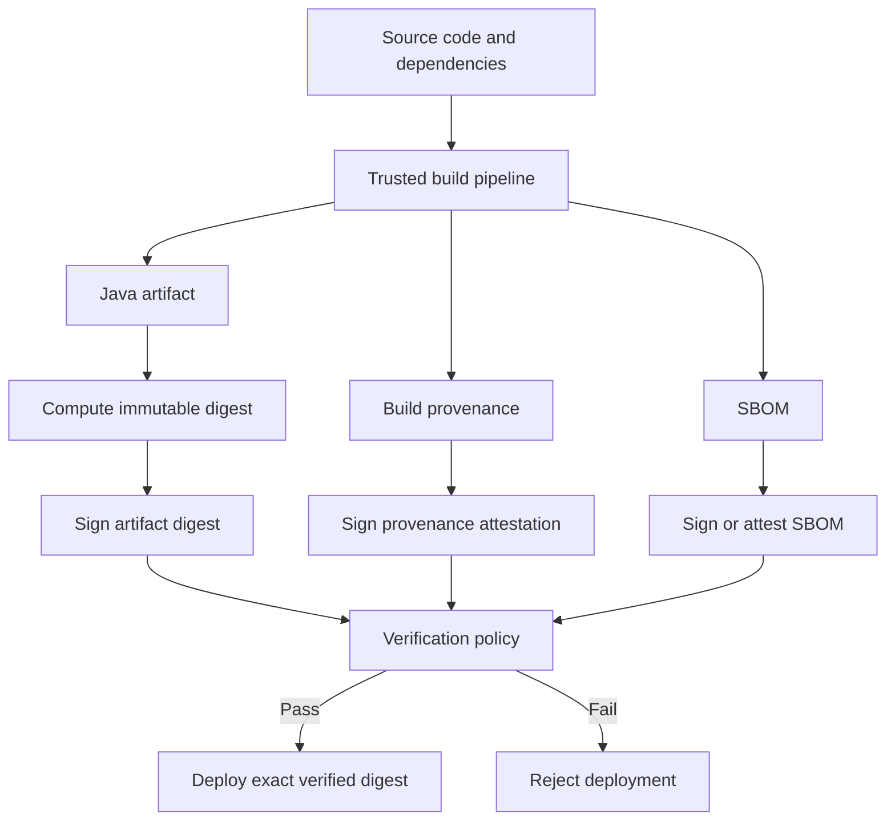
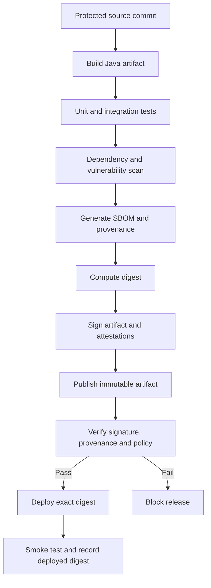

# Ký artifact và xác minh nguồn gốc gói triển khai

Một Java function có thể được build thành JAR, ZIP chứa mã và dependency, hoặc container image. Trước khi triển khai, hệ thống cần trả lời hai câu hỏi: **artifact có còn nguyên vẹn và được ký bởi danh tính được tin cậy không; artifact được tạo ra từ source code, dependency và quy trình build nào?** Chữ ký số giúp xác minh tính toàn vẹn và người ký. Provenance (bằng chứng nguồn gốc) mô tả quá trình tạo artifact. Hai cơ chế bổ sung cho nhau.

Chỉ kiểm tra rằng file tải về mở được hoặc tên version đúng là chưa đủ. Artifact có thể bị thay thế trong registry, bucket hoặc bước trung chuyển. Một image tag có thể trỏ đến digest khác sau khi được cập nhật. Một gói được ký bởi danh tính hợp lệ vẫn có thể chứa mã độc nếu pipeline hoặc dependency đã bị xâm phạm. Vì vậy, cần ràng buộc chữ ký, digest, provenance, SBOM và chính sách triển khai vào cùng một quy trình.

Trong phạm vi **CLOUD_SERVERLESS**, bài học tập trung vào phát triển và triển khai Java function kích hoạt bởi HTTP, thông điệp hoặc sự kiện. Việc ký và xác minh artifact bảo vệ đường đi từ source code qua build pipeline đến function đang chạy, đồng thời giúp truy vết phiên bản khi xử lý sự cố, retry, cập nhật quyền hoặc rollback.

## 1. Phân biệt artifact, digest, signature và provenance

Các khái niệm này có mục đích khác nhau:

| Thành phần | Trả lời câu hỏi | Ví dụ |
|---|---|---|
| Artifact | Gói nào được triển khai? | `orders-function.zip`, `orders.jar`, container image |
| Digest | Nội dung chính xác của gói là gì? | SHA-256 của ZIP hoặc OCI image manifest |
| Signature | Ai đã ký nội dung đó và nội dung có bị thay đổi không? | Chữ ký Cosign, JAR signature, AWS Signer |
| Provenance | Gói được tạo từ source, dependency và builder nào? | SLSA provenance/in-toto attestation |
| SBOM | Artifact chứa những thành phần phần mềm nào? | CycloneDX hoặc SPDX document |
| Deployment policy | Artifact nào được phép chạy? | Chỉ chấp nhận digest có chữ ký và provenance đạt yêu cầu |

Digest là định danh nội dung. Nếu chỉ một byte của file thay đổi, SHA-256 digest gần như chắc chắn thay đổi. Chữ ký số ràng buộc người ký với digest hoặc nội dung được ký. Provenance là một tài liệu mô tả subject (artifact digest), builder, source và quy trình tạo artifact; bản thân provenance cũng cần được ký hoặc xác thực để tránh bị sửa.



## 2. Tại sao Java serverless cần ký artifact?

Java function thường được triển khai tự động qua CI/CD. Một pipeline có thể build mã nguồn, đóng gói dependency, upload artifact, cập nhật function và bật trigger. Nếu một bước trong chuỗi bị xâm phạm, attacker có thể thay gói triển khai mà không thay source code trong repository.

Ký artifact và xác minh provenance giúp:

- Phát hiện artifact bị thay đổi sau khi build hoặc sau khi ký.
- Chỉ chấp nhận artifact do builder hoặc release workflow được tổ chức tin cậy tạo ra.
- Ràng buộc artifact với repository, branch/tag, commit và dependency đã dùng.
- Ngăn triển khai một ZIP/JAR/image không rõ nguồn gốc hoặc được build từ pull request không đáng tin cậy.
- Điều tra phiên bản function đã chạy khi xảy ra incident.
- Giữ nguyên một artifact khi promote qua staging và production, thay vì build lại ở mỗi môi trường.

Chữ ký không chứng minh mã nguồn an toàn, không thay thế review, test, quét lỗ hổng hay kiểm soát dependency. Nó cung cấp bằng chứng để deployment policy quyết định có tin gói đó hay không.

## 3. Xác định chính xác đối tượng cần ký

Java serverless có nhiều dạng artifact. Cần ký đúng đối tượng mà nền tảng thực sự triển khai:

| Cách triển khai | Artifact cần nhận diện | Lưu ý |
|---|---|---|
| Java JAR | File JAR cuối cùng | JAR signing xác thực các entry được ký trong archive; không đồng nghĩa ký ZIP wrapper bên ngoài |
| AWS Lambda ZIP | ZIP deployment package cuối cùng | Lambda Code Signing xác minh package được ký bởi profile được cho phép |
| Container-based function/service | OCI image digest | Ký digest, không chỉ ký tag có thể thay đổi |
| Package trong registry | Digest/immutable version | Xác minh đúng artifact được deploy, không chỉ kiểm tra tên hoặc đường dẫn |

Nếu Lambda ZIP chứa một JAR đã ký, chữ ký JAR giúp kiểm tra các entry trong JAR. Tuy nhiên, nó không tự xác minh các file khác trong ZIP như bootstrap script, native library hoặc file cấu hình. Nếu nền tảng triển khai toàn bộ ZIP, cần ký và xác minh ZIP ở lớp deployment package nữa.

Không chỉnh sửa, nén lại hoặc thêm file vào artifact sau khi ký. Nếu build lại, shade dependency, đổi manifest, cập nhật file cấu hình hoặc tạo image mới, digest thay đổi và cần tạo chữ ký/provenance mới.

## 4. Hash và digest: định danh nội dung bất biến

SHA-256 là lựa chọn phổ biến để tính digest cho file:

```bash
# Linux/macOS
sha256sum orders-function.zip

# Windows PowerShell
Get-FileHash .\orders-function.zip -Algorithm SHA256
```

Ví dụ kết quả có dạng:

```text
9f2a...e41c  orders-function.zip
```

Chuỗi rút gọn trên chỉ minh họa định dạng; trong quy trình thật phải lưu toàn bộ digest. Digest nên được ghi cùng build ID, source commit, artifact URI và metadata phát hành.

Với container image, dùng digest như `registry.example.com/orders@sha256:...` khi xác minh và deploy. Tag như `:latest`, `:release` hoặc `:1.4.0` hữu ích cho con người nhưng có thể bị trỏ sang digest khác. Deployment cần cố định digest đã xác minh.

Digest không phải bí mật. Người nhận có thể tự tính lại digest để so sánh. Nhưng nếu attacker có thể thay cả artifact lẫn file checksum không được bảo vệ, checksum riêng lẻ không chứng minh được nguồn gốc. Cần chữ ký số hoặc attestation có danh tính tin cậy.

## 5. Ký JAR bằng jarsigner

JDK cung cấp `keytool` để quản lý certificate/key store và `jarsigner` để ký, xác minh JAR. JAR signing đặt metadata chữ ký trong `META-INF` và ký các entry được liệt kê trong manifest.

Ví dụ tạo keystore thử nghiệm:

```bash
keytool -genkeypair \
  -alias release-signer \
  -keyalg RSA \
  -keysize 3072 \
  -sigalg SHA256withRSA \
  -validity 365 \
  -keystore release-signing.p12 \
  -storetype PKCS12
```

Đây là ví dụ cho môi trường thử nghiệm. Không tạo hoặc lưu private key production trong source repository. Production nên dùng HSM/KMS hoặc signing service có kiểm soát quyền và audit.

Ký JAR:

```bash
jarsigner \
  -keystore release-signing.p12 \
  -storetype PKCS12 \
  -sigalg SHA256withRSA \
  -digestalg SHA-256 \
  -signedjar orders-signed.jar \
  orders.jar \
  release-signer
```

Xác minh:

```bash
jarsigner -verify -strict -verbose -certs orders-signed.jar
```

Kết quả verify cần được đánh giá cùng certificate chain và trust policy. `jarsigner -verify` kiểm tra chữ ký các entry đã ký; nó không tự chứng minh certificate thuộc tổ chức mong đợi nếu trust anchor hoặc danh tính signer chưa được xác minh theo chính sách của hệ thống.

### Những giới hạn cần hiểu về JAR signing

- JAR có thể chứa entry không được ký; kiểm tra output để phát hiện unsigned entry.
- Chữ ký JAR không ký nguyên byte-for-byte toàn bộ ZIP container theo cách giống file-level signature.
- Repackaging hoặc shading sau khi ký có thể làm chữ ký không còn hợp lệ.
- Chữ ký JAR không chứng minh artifact được build từ commit nào.
- Chữ ký JAR không thay thế chữ ký của deployment package bên ngoài.
- Certificate hết hạn, bị thu hồi hoặc không nằm trong trust policy cần được xử lý theo quy trình phát hành.

## 6. Ký file JAR hoặc ZIP bằng Sigstore Cosign

Sigstore cung cấp hệ sinh thái ký artifact, trong đó Cosign có thể ký container image và file blob. Với keyless signing, pipeline dùng OIDC identity để lấy certificate ngắn hạn; chữ ký và certificate có thể được ghi vào transparency log.

Ký một file JAR bằng keyless signing:

```bash
cosign sign-blob --yes \
  --bundle orders.jar.sigstore.json \
  orders.jar
```

Xác minh file:

```bash
cosign verify-blob \
  --bundle orders.jar.sigstore.json \
  --certificate-identity="https://github.com/example-org/orders/.github/workflows/release.yml@refs/heads/main" \
  --certificate-oidc-issuer="https://token.actions.githubusercontent.com" \
  orders.jar
```

Identity và issuer ở trên chỉ là ví dụ. Cần thay bằng danh tính OIDC thực tế của workflow được phép phát hành. Không dùng quy tắc xác minh quá rộng như chấp nhận mọi certificate từ cùng một issuer; issuer chỉ cho biết hệ thống cấp identity, còn certificate identity mới ràng buộc workflow/repository cụ thể.

Với key-based signing, private key có thể được lưu trong KMS/HSM hoặc secret manager tương thích với Cosign. CI chỉ nên có quyền ký trong job release được bảo vệ. Không tải private key production về runner nếu có thể ký trực tiếp bằng dịch vụ quản lý khóa.

## 7. Ký container image theo digest

Nếu Java function được đóng gói thành container image, hãy push image lên registry, lấy digest cuối cùng rồi ký digest đó.

Ví dụ:

```bash
docker build -t REGION-docker.pkg.dev/PROJECT/apps/orders:1.4.0 .
docker push REGION-docker.pkg.dev/PROJECT/apps/orders:1.4.0

# Lấy digest immutable từ registry, sau đó ký đúng digest đó.
cosign sign --yes \
  REGION-docker.pkg.dev/PROJECT/apps/orders@sha256:IMAGE_DIGEST
```

Xác minh chữ ký:

```bash
cosign verify \
  --certificate-identity="https://github.com/example-org/orders/.github/workflows/release.yml@refs/heads/main" \
  --certificate-oidc-issuer="https://token.actions.githubusercontent.com" \
  REGION-docker.pkg.dev/PROJECT/apps/orders@sha256:IMAGE_DIGEST
```

`IMAGE_DIGEST` là placeholder, phải thay bằng digest đầy đủ do registry trả về. Sau khi ký, deployment cần tham chiếu cùng digest. Nếu chỉ deploy tag, registry tag có thể đã được cập nhật sang image khác sau bước verify.

## 8. Signature và provenance khác nhau thế nào?

Chữ ký xác minh rằng nội dung hoặc attestation được ký bởi một danh tính có thể xác thực và chưa bị thay đổi. Provenance mô tả cách artifact được tạo ra.

Một provenance tốt có thể chứa:

- Subject: artifact name và digest.
- Builder identity: hệ thống/workflow đã thực hiện build.
- Build type: quy trình build hoặc loại pipeline.
- Invocation: tham số, source ref và môi trường build liên quan.
- Materials: source repository, commit và dependency đầu vào.
- Metadata: thời điểm, run ID, build ID và thông tin liên quan.

Một tài liệu provenance không có chữ ký hoặc không có builder identity được tin cậy có thể bị attacker tạo lại. Ngược lại, một artifact được ký bởi release key hợp lệ nhưng không có provenance vẫn có thể thiếu bằng chứng rằng nó đến từ source commit đã review.

Chính sách triển khai nên kiểm tra cả hai:

1. Artifact digest khớp với subject trong provenance.
2. Attestation được ký bởi builder identity được phép.
3. Source repository, branch/tag và commit thuộc phạm vi phát hành.
4. Build workflow và builder version được phê duyệt.
5. Dependency/materials tuân theo policy của tổ chức.
6. Artifact chưa bị thay đổi sau khi build.

## 9. SLSA và in-toto provenance

SLSA (Supply-chain Levels for Software Artifacts) là khung thực hành tăng độ tin cậy của quy trình build và provenance. in-toto cung cấp mô hình attestation để mô tả subject và predicate, trong đó SLSA provenance là một loại predicate phổ biến.

Một in-toto statement có cấu trúc khái niệm như sau:

```json
{
  "_type": "https://in-toto.io/Statement/v1",
  "subject": [
    {
      "name": "orders-function.zip",
      "digest": {
        "sha256": "FULL_SHA256_DIGEST"
      }
    }
  ],
  "predicateType": "https://slsa.dev/provenance/v1",
  "predicate": {
    "buildDefinition": {
      "buildType": "https://example.org/build-types/java-function/v1",
      "externalParameters": {
        "repository": "https://github.com/example-org/orders",
        "ref": "refs/tags/v1.4.0"
      },
      "resolvedDependencies": [
        {
          "uri": "git+https://github.com/example-org/orders",
          "digest": {"gitCommit": "FULL_COMMIT_SHA"}
        }
      ]
    },
    "runDetails": {
      "builder": {
        "id": "https://example.org/trusted-builders/java-release"
      }
    }
  }
}
```

Đây là ví dụ rút gọn để giải thích cấu trúc, không phải provenance đầy đủ hoặc một builder identity mặc định. Trong production, dùng schema và builder được tài liệu SLSA hỗ trợ; không tự điền dữ liệu do client cung cấp rồi xem đó là bằng chứng đáng tin. Builder phải tạo provenance từ thông tin thực tế của build execution và ký attestation bằng identity được xác thực.

SLSA level là mức bảo đảm của quy trình build, không phải điểm chất lượng của source code. Không tuyên bố đạt một level chỉ vì pipeline có file provenance; cần đáp ứng đầy đủ yêu cầu về source, build platform, isolation, provenance và khả năng chống sửa đổi theo phiên bản tiêu chuẩn áp dụng.

## 10. Xác minh provenance trước khi deploy

Một verifier cần áp dụng policy rõ ràng thay vì chỉ kiểm tra attestation có tồn tại.

| Kiểm tra | Câu hỏi |
|---|---|
| Subject digest | Provenance có mô tả đúng digest artifact đang chuẩn bị deploy? |
| Builder identity | Build có chạy trên builder/workflow được tin cậy? |
| Source repository | Artifact đến từ repository chính thức? |
| Source ref | Commit/tag có thuộc branch hoặc release được phép? |
| Review state | Source commit đã qua review và branch protection? |
| Build parameters | Có tham số build không được phê duyệt hoặc secret injection bất thường? |
| Materials | Dependency và base image có nguồn gốc xác định? |
| Signature | Attestation được ký bởi danh tính được policy cho phép? |
| Freshness/revocation | Signing identity hoặc artifact có bị thu hồi/cấm sử dụng? |

Ví dụ, policy có thể chỉ cho phép artifact được build bởi workflow `release.yml` từ tag `v*` trong repository chính thức, với digest trùng subject và provenance được ký bằng OIDC identity của workflow đó.

Không nên chỉ xác minh tên file, image tag, branch name do pipeline tự khai báo hoặc chữ ký mà không ràng buộc identity. Những trường này có thể bị giả mạo nếu không được lấy từ nguồn xác thực.

## 11. SBOM và kiểm tra dependency Java

SBOM (Software Bill of Materials) liệt kê thư viện và thành phần có trong artifact. Với Java, SBOM giúp biết function chứa phiên bản nào của Spring, Jackson, AWS SDK, logging library và các dependency bắc cầu.

SBOM có thể được tạo ở định dạng CycloneDX hoặc SPDX. Ví dụ dùng Syft để tạo SBOM cho thư mục build:

```bash
syft dir:target -o cyclonedx-json=sbom.cdx.json
```

Với container image:

```bash
syft REGION-docker.pkg.dev/PROJECT/apps/orders@sha256:IMAGE_DIGEST \
  -o cyclonedx-json=sbom.cdx.json
```

SBOM nên gắn với digest chính xác của artifact. Nếu SBOM được tạo cho JAR trước khi thêm dependency hoặc cho image tag trước khi push, nó có thể không phản ánh nội dung thực tế được deploy.

Có thể ký hoặc phát hành SBOM dưới dạng attestation. Với container image và Cosign, một quy trình có thể dùng `cosign attest` để gắn predicate SBOM vào digest; verifier sau đó kiểm tra attestation và subject. Dù SBOM có chữ ký, vẫn cần quét vulnerability và đánh giá license theo policy.

## 12. Quản lý khóa ký và danh tính CI

Private key ký release là tài sản nhạy cảm. Nếu attacker lấy được key, họ có thể tạo artifact giả nhưng vẫn có chữ ký hợp lệ.

Các nguyên tắc:

- Không commit private key, keystore hoặc passphrase vào Git.
- Không in secret hoặc signing token vào build log.
- Ưu tiên KMS/HSM hoặc signing service để private key không rời môi trường quản lý.
- Giới hạn quyền ký cho workflow release đã bảo vệ; test job và pull request không cần quyền ký production.
- Dùng OIDC federation/keyless signing nếu nền tảng CI và signer hỗ trợ.
- Ràng buộc identity theo repository, workflow, branch/tag và issuer.
- Bật audit log cho thao tác ký, rotate key/certificate theo policy và có quy trình thu hồi.
- Tách quyền build, quyền ký và quyền deploy khi mức độ rủi ro yêu cầu separation of duties.

Keyless signing giảm nhu cầu lưu private key dài hạn trong CI, nhưng không loại bỏ rủi ro workflow bị xâm phạm. Nếu attacker kiểm soát workflow identity được phép phát hành, họ có thể yêu cầu signer ký artifact độc hại. Vì vậy, bảo vệ branch, pin action, giới hạn token permission và cô lập runner vẫn rất quan trọng.

## 13. Bảo vệ build pipeline trước khi ký

Chữ ký chỉ đáng tin khi quy trình tạo chữ ký được bảo vệ. Một pipeline nên:

1. Lấy source từ repository và commit đã xác định.
2. Chỉ build release từ protected branch hoặc tag được bảo vệ.
3. Pin action/plugin/container image theo phiên bản hoặc digest đáng tin.
4. Khóa dependency bằng Maven/Gradle lock hoặc dependency verification phù hợp.
5. Không chạy script tùy ý từ pull request không tin cậy trong job có quyền ký.
6. Dùng runner ephemeral hoặc môi trường build được cô lập.
7. Giới hạn quyền cloud và OIDC token theo job cần thiết.
8. Tạo artifact, digest, provenance và SBOM trong cùng một build execution có thể truy vết.
9. Chỉ cấp quyền ký sau khi test, scan và release checks đạt yêu cầu.
10. Lưu artifact và attestation trong registry/storage có kiểm soát quyền ghi.

Đặc biệt, không để bước sau build tải một JAR mới từ URL mutable rồi ký nó chỉ vì tên file trùng với artifact vừa build. Signing step phải nhận đúng artifact đầu ra của job đã được xác thực.

## 14. Quy trình CI/CD mẫu cho Java function

Một pipeline phát hành có thể chia thành các giai đoạn:



Build một lần và promote cùng artifact qua môi trường. Không rebuild lại JAR/ZIP/image ở staging hoặc production vì build khác có thể có digest khác và cần provenance/signature riêng.

Mỗi deployment nên lưu lại digest, provenance reference, signer identity, release ID, function version/revision và thời gian triển khai. Khi rollback, triển khai lại digest cũ đã được xác minh, không rebuild source tag cũ rồi giả định kết quả giống hệt.

## 15. AWS Lambda Code Signing

AWS Lambda hỗ trợ code signing cho deployment package ZIP thông qua AWS Signer và Lambda Code Signing Config. Một signing profile được dùng để ký package; code signing configuration xác định signing profile nào được chấp nhận và hành vi khi gặp artifact không đáng tin.

Các thành phần:

- **AWS Signer signing profile:** định danh signer/profile dùng để ký deployment package.
- **Signed ZIP package:** package đầu ra của signing job.
- **Lambda Code Signing Config:** danh sách signing profile version ARN được phép và chính sách `Warn` hoặc `Enforce`.
- **Function association:** gắn Code Signing Config vào Lambda function.

Chính sách:

| Policy | Hành vi |
|---|---|
| `Warn` | Ghi cảnh báo khi package không đáp ứng code signing policy; cho phép deployment tiếp tục |
| `Enforce` | Từ chối deployment package không được ký bởi profile được phép hoặc có chữ ký không hợp lệ |

CloudFormation có resource `AWS::Lambda::CodeSigningConfig`; function có thuộc tính `CodeSigningConfigArn` để liên kết cấu hình. Với môi trường production, `Enforce` thường phù hợp khi toàn bộ pipeline đã ký đúng và có quy trình xử lý artifact cũ.

Lambda Code Signing xác minh chữ ký của ZIP package theo profile được cho phép. Nó không thay thế provenance verification về source commit, dependency hoặc builder. Nếu cần bảo đảm nguồn gốc build, thêm attestation và policy kiểm tra trong CI/CD trước khi gọi API deploy.

## 16. Google Cloud và Binary Authorization

Với Java function đóng gói thành container và triển khai trên Cloud Run, có thể sử dụng Artifact Registry, chữ ký image và Binary Authorization để kiểm soát image được phép triển khai.

Mô hình khái niệm:

1. Build container image và push vào Artifact Registry.
2. Xác định image digest bất biến.
3. Ký image hoặc tạo attestation gắn với digest.
4. Cấu hình Binary Authorization policy và attestor phù hợp.
5. Khi deploy Cloud Run, policy yêu cầu image có attestation từ attestor được tin cậy.
6. Từ chối image không đáp ứng policy.

Binary Authorization áp dụng policy triển khai dựa trên attestation/attestor; nó không tự chứng minh source code an toàn. Chữ ký Cosign và attestation mà Binary Authorization kiểm tra không mặc nhiên là cùng một định dạng hoặc tự động thay thế cho nhau. Pipeline phải tạo/publish attestation theo cơ chế mà Binary Authorization và attestor đã cấu hình chấp nhận; nếu dùng `cosign verify` như một bước riêng trong CI thì đó là một deploy gate độc lập, trừ khi đã thiết lập tích hợp chuyển đổi phù hợp. Cần thiết kế attestation authority và build pipeline đáng tin cậy. Đối với Cloud Run functions được triển khai từ source, cần xác định artifact/container cuối cùng mà nền tảng tạo ra và chọn cơ chế kiểm soát phù hợp với đường triển khai đó.

## 17. Các nền tảng khác và kiểm soát ở pipeline

Không phải nền tảng FaaS nào cũng cung cấp cơ chế native để xác minh chữ ký ZIP hoặc provenance ngay tại API deploy. Nếu nền tảng không có admission policy tương ứng, pipeline phải thực hiện verification trước khi gọi deploy API và chỉ cho phép deploy job truy cập artifact đã được xác minh.

Với container platform, có thể dùng OCI signature/attestation và admission policy tương thích với registry/runtime. Với ZIP/JAR platform, dùng code signing hoặc signature verification ở release pipeline, sau đó ràng buộc quyền deploy vào job đã xác minh.

Một kiểm soát ở CI không mạnh bằng enforcement ở runtime/platform nếu attacker có thể gọi deploy API ngoài pipeline. Vì vậy, hãy giới hạn IAM/RBAC quyền deploy để chỉ release controller được phép cập nhật function production.

## 18. Xác minh đúng artifact trước khi deploy

Verification cần xảy ra sau khi artifact được lấy từ registry/storage và ngay trước deployment. Không chỉ xác minh bản local rồi deploy một URI có thể đã trỏ đến nội dung khác.

Một quy trình:

1. Lấy artifact theo digest hoặc immutable object version.
2. Tính lại digest và so sánh với release metadata.
3. Xác minh signature và signer identity.
4. Xác minh provenance subject trùng digest.
5. Kiểm tra source, builder, workflow và materials theo policy.
6. Kiểm tra SBOM, vulnerability và license policy.
7. Deploy đúng digest vừa xác minh.
8. Ghi lại digest/version/revision mà nền tảng xác nhận đã triển khai.

Nếu bất kỳ bước nào thất bại, dừng release. Không chuyển sang deploy thủ công bằng tag hoặc artifact khác để vượt qua kiểm soát.

## 19. Kiểm tra sau triển khai và rollback

Sau khi deploy, cần xác nhận function đang chạy đúng artifact đã kiểm tra:

- So sánh function version/revision hoặc image digest với release record.
- Gửi smoke test qua HTTP trigger hoặc message/event trigger.
- Xác nhận log, metric và trace có release ID/build ID phù hợp.
- Kiểm tra quyền execution role/service account và secret/config được gắn đúng môi trường.
- Theo dõi error rate, latency, retry và DLQ trong giai đoạn đầu rollout.

Nếu rollback, chọn digest đã ký và provenance đã xác minh của release trước. Không dùng lại tag mutable nếu không kiểm tra digest. Giữ các artifact cũ trong retention window đủ dài để rollback và điều tra sự cố.

## 20. Xử lý certificate, key rotation và thu hồi

Certificate và key có vòng đời. Khi key bị lộ hoặc signer không còn được tin cậy, cần thu hồi quyền ký và ngăn deployment mới từ identity đó.

Quy trình xử lý:

1. Tạm dừng workflow release hoặc thu hồi quyền signer bị ảnh hưởng.
2. Xác định khoảng thời gian, artifact digest và deployment đã được ký bởi identity đó.
3. Đánh giá xem private key hoặc OIDC workflow có bị xâm phạm.
4. Xoay key/certificate hoặc cập nhật trust policy.
5. Re-sign artifact hợp lệ bằng signer mới nếu policy cho phép và provenance vẫn đáng tin.
6. Rebuild từ source đã xác minh nếu không thể tin artifact cũ.
7. Xác minh lại deployment đang chạy và triển khai phiên bản thay thế khi cần.
8. Lưu audit trail, signer ID, key version và quyết định thu hồi.

Không xóa key cũ ngay nếu còn cần xác minh chữ ký lịch sử; có thể cần giữ public key/certificate chain và transparency evidence theo thời hạn audit. Thu hồi quyền ký mới và khả năng xác minh artifact lịch sử là hai vấn đề riêng.

## 21. Các lỗi thường gặp

| Triệu chứng | Nguyên nhân có thể | Hướng xử lý |
|---|---|---|
| JAR verify báo unsigned entry | Entry được thêm sau khi ký hoặc không nằm trong signature manifest | Kiểm tra nội dung archive và ký lại artifact hoàn chỉnh |
| JAR signature invalid | JAR bị sửa, repack hoặc shading sau khi ký | Build lại, ký sau bước đóng gói cuối cùng |
| Cosign verify không tìm được signature | Đang kiểm tra tag/digest sai hoặc registry không có signature | Lấy digest thực và kiểm tra đúng registry/repository |
| Cosign identity mismatch | Workflow identity hoặc OIDC issuer khác policy | Xác minh identity thực tế; chỉ cập nhật policy sau review |
| Provenance subject không khớp | Attestation được tạo cho artifact khác | Chặn deploy và điều tra pipeline/artifact substitution |
| Signature hợp lệ nhưng source không tin cậy | Policy chỉ kiểm tra signer mà không kiểm tra provenance | Thêm kiểm tra repo, commit, branch và builder |
| AWS Lambda từ chối ZIP | Package không được ký bởi profile được phép hoặc signature lỗi | Kiểm tra signing job và Code Signing Config |
| Cloud Run deploy bị Binary Authorization từ chối | Thiếu attestation hoặc sai attestor/image digest | Xác minh image digest, attestor và policy |
| Rollback không tìm thấy artifact cũ | Registry retention xóa artifact | Giữ artifact đã phát hành theo chính sách rollback |
| SBOM không khớp image | SBOM được tạo trước bước thay đổi image | Tạo SBOM từ đúng digest cuối cùng và phát hành lại attestation |

## 22. Checklist trước khi phát hành Java function

| Câu hỏi | Bằng chứng cần có |
|---|---|
| Artifact cuối cùng là gì? | JAR, ZIP hoặc image digest được xác định rõ |
| Digest có bất biến? | SHA-256/OCI digest và immutable artifact reference |
| Artifact đã được ký? | Signature/bundle và signer identity |
| Signer có được tin cậy? | Trust policy ràng buộc issuer, repository và release workflow |
| Provenance có tồn tại và được xác thực? | Signed in-toto/SLSA attestation |
| Subject có khớp digest? | Provenance subject trùng artifact được deploy |
| Source có được phê duyệt? | Repository, commit, tag và branch protection |
| Dependency có được kiểm soát? | Lock/verification, SBOM và vulnerability scan |
| Build pipeline có được bảo vệ? | Runner cô lập, action/plugin pinning, quyền OIDC tối thiểu |
| Verification diễn ra ngay trước deploy? | Release job lấy và xác minh đúng artifact digest |
| Platform có enforcement? | Lambda Code Signing Config, Binary Authorization hoặc deploy gate |
| Quyền deploy có bị giới hạn? | Chỉ release controller có quyền cập nhật production |
| Rollback có artifact xác thực? | Digest cũ, signature và provenance được lưu giữ |
| Có audit trail? | Build ID, signer, digest, function version/revision và deploy time |

## 23. Quy trình vận hành chuỗi cung ứng cho serverless

Một Java serverless release an toàn bắt đầu từ source commit đã review, build trong môi trường được kiểm soát, tạo artifact và metadata nguồn gốc, ký digest bằng signer được phép, rồi xác minh trước khi deploy. Artifact đã được xác minh phải được promote nguyên vẹn qua các môi trường; cấu hình môi trường như biến môi trường, secret và IAM role được inject riêng khi deploy, không sửa nội dung artifact.

Khi vận hành, giữ lại provenance, SBOM, signature bundle và release record cùng thời hạn lưu artifact. Khi cần rollback hoặc điều tra, có thể truy ngược từ function version về digest, signer, builder, source commit và dependency. Khi signer hoặc pipeline bị xâm phạm, dùng audit trail để xác định toàn bộ artifact có liên quan và thu hồi trust phù hợp.

Chữ ký số chứng minh artifact được ký bởi danh tính được tin cậy và nội dung không bị thay đổi sau khi ký. Provenance giải thích artifact được tạo ra như thế nào. SBOM mô tả thành phần bên trong. Deployment policy kết hợp các bằng chứng này để chỉ cho phép gói đáp ứng yêu cầu chạy trên môi trường serverless. Đây là cách bảo vệ đường đi từ Java source code đến function đang phục vụ request hoặc xử lý event.
