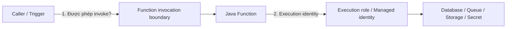
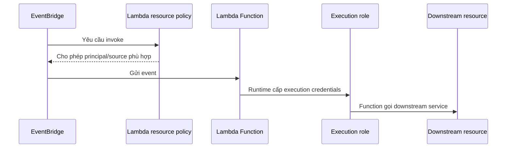
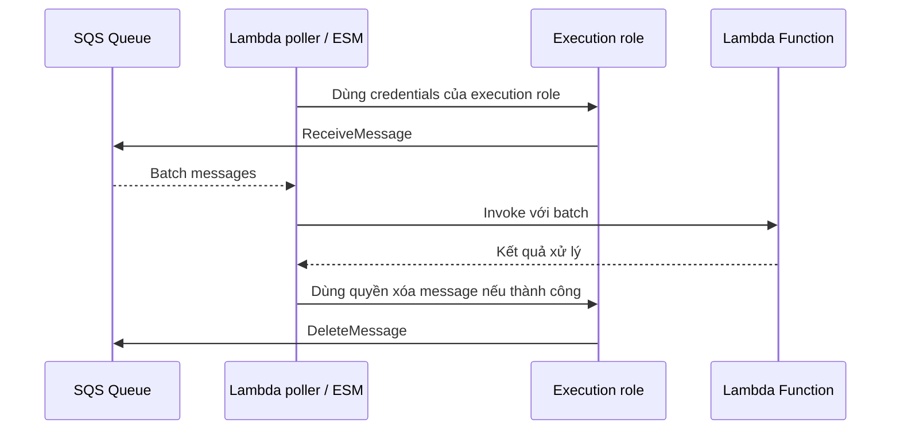

# Phân biệt execution identity và quyền kích hoạt function

Một function serverless có hai chiều truy cập bảo mật cần được thiết kế riêng. Chiều thứ nhất là **ai hoặc dịch vụ nào được phép gọi function**. Chiều thứ hai là **function được phép làm gì sau khi đã chạy**. Danh tính và quyền ở hai chiều này thường khác nhau.

Ví dụ, API Gateway được phép gọi một Java Lambda; sau khi được gọi, mã Java dùng execution role để đọc một bản ghi DynamoDB và gửi message vào SQS. Quyền API Gateway invoke Lambda không tự cấp quyền đọc DynamoDB cho function. Ngược lại, execution role có quyền đọc DynamoDB cũng không khiến mọi client đều được gọi function.

Để tránh nhầm lẫn, cần tách rõ caller identity, execution identity, quyền trên function, quyền truy cập trigger source và danh tính triển khai.

## 1. Hai chiều quyền trong một lần thực thi



**Quyền kích hoạt (invoke permission)** được kiểm tra trước hoặc tại ranh giới gọi function. Nó xác định principal nào có thể gửi request, event hoặc message để bắt đầu một invocation.

**Execution identity** là danh tính mà mã function sử dụng khi truy cập tài nguyên khác trong lúc xử lý. Identity này có quyền riêng, được nền tảng cung cấp cho execution environment hoặc worker.

| Khái niệm | Câu hỏi cần trả lời | Ví dụ |
|---|---|---|
| Caller identity | Ai đang yêu cầu chạy function? | IAM role của API backend, EventBridge, ứng dụng gọi HTTP |
| Invoke permission | Caller có quyền gọi đúng function/version/route không? | `lambda:InvokeFunction`, Lambda resource policy, HTTP auth |
| Execution identity | Mã function đại diện cho ai khi gọi dịch vụ khác? | AWS Lambda execution role, Azure managed identity |
| Trigger-source permission | Runtime/poller có quyền đọc nguồn event không? | Quyền đọc SQS hoặc Service Bus |
| Deployment identity | Ai được tạo, cập nhật hoặc cấu hình function? | CI/CD role, service principal của pipeline |

Một request có thể hợp lệ ở lớp mạng nhưng bị từ chối ở lớp xác thực; caller có thể được xác thực nhưng thiếu quyền invoke; function có thể chạy thành công nhưng bị từ chối khi truy cập database. Hãy xác định lớp từ chối dựa trên principal và resource liên quan.

## 2. AWS Lambda: execution role và quyền invoke

AWS Lambda biểu diễn hai chiều quyền bằng những cơ chế IAM khác nhau.

### 2.1. Execution role: quyền của code đang chạy

Mỗi Lambda function có một **execution role**. Khi invocation bắt đầu, Lambda service assume role này và cung cấp thông tin xác thực tạm thời cho execution environment. Mã Java dùng credential provider của AWS SDK để lấy credential theo role; không cần nhúng access key vào JAR hoặc environment variable.

Execution role có hai phần quan trọng:

- **Trust policy:** xác định principal nào được assume role. Với Lambda thông thường, trusted service principal là `lambda.amazonaws.com` và action là `sts:AssumeRole`.
- **Permissions policy:** xác định code được phép làm gì, ví dụ ghi CloudWatch Logs, đọc một SQS queue hoặc lấy một secret cụ thể.

Ví dụ trust policy:

```json
{
  "Version": "2012-10-17",
  "Statement": [
    {
      "Effect": "Allow",
      "Principal": {
        "Service": "lambda.amazonaws.com"
      },
      "Action": "sts:AssumeRole"
    }
  ]
}
```

Ví dụ permissions policy cho một function cần ghi log và đọc một queue:

```json
{
  "Version": "2012-10-17",
  "Statement": [
    {
      "Effect": "Allow",
      "Action": [
        "logs:CreateLogStream",
        "logs:PutLogEvents"
      ],
      "Resource": "arn:aws:logs:ap-southeast-1:123456789012:log-group:/aws/lambda/order-worker:*"
    },
    {
      "Effect": "Allow",
      "Action": [
        "sqs:ReceiveMessage",
        "sqs:DeleteMessage",
        "sqs:GetQueueAttributes"
      ],
      "Resource": "arn:aws:sqs:ap-southeast-1:123456789012:orders-prod"
    }
  ]
}
```

Đây là ví dụ minh họa; quyền thực tế phụ thuộc trigger, mã ứng dụng, mã hóa và cấu hình log. Nếu queue dùng KMS customer-managed key, có thể cần quyền KMS tương ứng. Chỉ cấp đúng action và ARN cần thiết. Không gắn `AdministratorAccess` cho execution role chỉ để làm cho lỗi `AccessDenied` biến mất.

### 2.2. Quyền invoke: ai được gọi Lambda?

Quyền invoke nằm ở phía caller hoặc resource policy của function, tùy loại caller:

- Một user hoặc IAM role gọi Lambda SDK cần identity-based policy cho phép `lambda:InvokeFunction` trên đúng function hoặc alias.
- Một AWS service như EventBridge, S3 hoặc SNS gọi Lambda thường cần resource-based policy trên function cho phép service principal invoke.
- Một account khác gọi Lambda cần cấu hình cross-account access; resource owner cho phép principal/account trong resource policy và caller cũng cần quyền tương ứng trong account của mình.

Ví dụ policy cho IAM role của một backend chỉ được gọi alias `prod`:

```json
{
  "Version": "2012-10-17",
  "Statement": [
    {
      "Effect": "Allow",
      "Action": "lambda:InvokeFunction",
      "Resource": "arn:aws:lambda:ap-southeast-1:123456789012:function:orders-api:prod"
    }
  ]
}
```

Ví dụ cấp quyền cho EventBridge rule cụ thể invoke function:

```bash
aws lambda add-permission \
  --function-name orders-worker \
  --statement-id AllowOrdersRule \
  --action lambda:InvokeFunction \
  --principal events.amazonaws.com \
  --source-arn arn:aws:events:ap-southeast-1:123456789012:rule/orders-created \
  --source-account 123456789012
```

`--source-arn` giới hạn quyền cho rule cụ thể. Nếu chỉ cho phép principal `events.amazonaws.com` mà không giới hạn nguồn, một rule ở account khác có thể có cơ hội cấu hình gọi function của bạn nếu các điều kiện khác cho phép.

### 2.3. Identity policy và resource policy phối hợp ra sao?

Với lời gọi cùng account, AWS có thể cho phép truy cập nếu identity policy của caller hoặc resource-based policy của Lambda cho phép, miễn không có explicit deny hay ràng buộc cấp cao hơn chặn yêu cầu. Với cross-account access, cần cả resource owner cho phép principal bên ngoài trong resource policy và principal ở account gọi có identity policy cho phép hành động đó. SCP, permissions boundary, session policy và explicit deny vẫn có thể giới hạn quyền cuối cùng.

Đối với AWS service push event, Lambda đánh giá resource-based policy để xác định service nào được gọi function. Đối với event source mapping, Lambda poller đọc nguồn dữ liệu bằng quyền của execution role; cơ chế này khác với việc EventBridge hoặc S3 push một event trực tiếp vào Lambda.

### 2.4. Function URL và API Gateway

Nếu dùng Lambda Function URL với `AuthType = AWS_IAM`, caller cần cả `lambda:InvokeFunctionUrl` và `lambda:InvokeFunction`. Từ tháng 10/2025, Function URL mới yêu cầu cả hai quyền này; với caller cùng account, chúng có thể nằm trong identity-based policy hoặc được cấp qua resource-based policy, còn cross-account cần policy ở cả hai phía. Nếu dùng `AuthType = NONE`, Lambda không xác thực caller bằng IAM; resource policy vẫn phải cho phép public invoke, vì vậy chỉ bật khi endpoint thực sự được thiết kế công khai và có lớp bảo vệ phù hợp cho nghiệp vụ.

Với API Gateway, cần phân biệt hai quyền: API Gateway được phép invoke Lambda qua resource-based permission; người dùng cuối được phép gọi API theo authorizer, JWT/Cognito, IAM authorization, resource policy hoặc cơ chế API được cấu hình. Việc API Gateway gọi được Lambda không có nghĩa mọi người dùng Internet đều được quyền gọi API.

## 3. Trigger push và event source mapping không dùng cùng một đường quyền

AWS có hai kiểu tích hợp phổ biến:

### 3.1. Dịch vụ push event vào Lambda

Ví dụ S3, SNS và EventBridge gửi sự kiện đến Lambda. Function cần resource-based permission cho phép đúng service principal invoke. Permission nên giới hạn bằng source ARN và source account khi dịch vụ hỗ trợ.



Resource policy trả lời “EventBridge có thể gọi function không?”. Execution role trả lời “code trong function có thể đọc DynamoDB hoặc gửi message không?”. Đây là hai quyết định độc lập.

### 3.2. Lambda poll nguồn qua event source mapping

Với SQS, Kinesis Data Streams, DynamoDB Streams hoặc Kafka, Lambda quản lý event source mapping để poll nguồn và gọi function theo batch. Trong mô hình này, execution role cần quyền đọc event source; ví dụ SQS cần `ReceiveMessage`, `DeleteMessage` và `GetQueueAttributes`. Với Kinesis hoặc DynamoDB Streams, role cần các quyền đọc shard/record và quyền phụ trợ theo cấu hình.



Không cần tạo một permission kiểu `events.amazonaws.com` cho SQS event source mapping theo cách của EventBridge push. Với ESM, Lambda cần quyền đọc nguồn; event source mapping là cấu hình kết nối và poll. Cấu hình retry, visibility timeout, batch failure và DLQ vẫn cần thiết để xử lý message lỗi hoặc giao trùng.

## 4. Azure Functions: managed identity và quyền gọi HTTP trigger

Azure Functions cũng cần phân biệt danh tính đi ra và quyền truy cập đi vào.

### 4.1. Managed identity: danh tính của Function App khi gọi dịch vụ khác

Managed identity cho phép mã trong Function App nhận token Microsoft Entra để truy cập Azure Storage, Key Vault, Service Bus, Azure SQL hoặc dịch vụ hỗ trợ Entra ID. Nền tảng quản lý credential của identity nên ứng dụng không phải lưu client secret dài hạn.

Hai loại managed identity:

- **System-assigned:** được tạo gắn với Function App; vòng đời identity gắn với resource. Xóa app sẽ xóa identity này.
- **User-assigned:** là resource độc lập có thể gắn vào một hoặc nhiều Function App; hữu ích khi cần identity tồn tại qua lần tạo lại app hoặc dùng chung có kiểm soát.

Managed identity chỉ có danh tính; nó không tự động có quyền đọc mọi tài nguyên. Cần cấp Azure RBAC role hoặc quyền data-plane phù hợp trên resource đích. Ví dụ, function đọc blob cần quyền data reader trên đúng storage account/container; function nhận message Service Bus cần quyền Data Receiver trên namespace hoặc entity thích hợp.

### 4.2. Quyền kích hoạt HTTP function

HTTP trigger của Azure Functions có `authLevel`:

| Mức | Cơ chế | Ý nghĩa |
|---|---|---|
| `anonymous` | Không yêu cầu Function key | Request có thể đến endpoint; ứng dụng/gateway phải xử lý xác thực nếu cần |
| `function` | Yêu cầu function key hoặc host key hợp lệ | Dùng shared secret để bảo vệ endpoint |
| `admin` | Yêu cầu master key | Quyền rộng ở cấp Function App; không chia sẻ cho client thông thường |

Function key là shared secret dạng bearer: ai có key có thể dùng key đó gọi endpoint trong phạm vi của key. Key không phải danh tính người dùng Microsoft Entra và không cung cấp claims như user ID, tenant hoặc app role. Không đưa master key vào ứng dụng di động, browser hoặc client không tin cậy.

Với API production cần nhận diện người dùng hoặc workload, cân nhắc App Service Authentication/Authorization (Easy Auth) với Microsoft Entra ID, API Management hoặc middleware xác thực JWT trong ứng dụng. Khi bật Easy Auth, platform middleware xác thực request trước khi chuyển vào function; ứng dụng vẫn phải kiểm tra authorization như app role, scope, tenant và quyền trên tài nguyên nghiệp vụ.

### 4.3. Trigger từ Service Bus hoặc Storage

Với trigger không phải HTTP, Functions host cần kết nối đến event source để nhận sự kiện. Có thể dùng connection string trong app settings hoặc identity-based connection nếu binding/extension và hosting/runtime hỗ trợ. Khi dùng managed identity, cấu hình connection theo tên prefix mà extension yêu cầu và cấp RBAC data-plane role tương ứng.

Ví dụ: Service Bus trigger cần quyền nhận message; Blob trigger hoặc Queue trigger cần quyền đọc dữ liệu/metadata tương ứng. Đây là quyền của Function App/host khi kết nối nguồn, khác với managed identity mà code Java dùng để gọi một API downstream khác. Một app có thể dùng cùng identity cho cả hai mục đích, nhưng quyền vẫn phải được giới hạn theo từng resource.

## 5. Java: dùng execution identity để truy cập dịch vụ downstream

### 5.1. AWS Lambda Java và AWS SDK

Trong Lambda, không tạo access key trong code. AWS SDK for Java 2.x dùng default credentials provider chain để lấy credential tạm thời của execution role khi chạy trên Lambda.

```java
import software.amazon.awssdk.auth.credentials.DefaultCredentialsProvider;
import software.amazon.awssdk.regions.Region;
import software.amazon.awssdk.services.sqs.SqsClient;
import software.amazon.awssdk.services.sqs.model.SendMessageRequest;

public final class OrderPublisher {
    private static final SqsClient SQS = SqsClient.builder()
            .region(Region.of(System.getenv("AWS_REGION")))
            .credentialsProvider(DefaultCredentialsProvider.create())
            .build();

    public void publish(String queueUrl, String eventJson) {
        SQS.sendMessage(SendMessageRequest.builder()
                .queueUrl(queueUrl)
                .messageBody(eventJson)
                .build());
    }
}
```

Function cần policy `sqs:SendMessage` trên đúng queue ARN. `DefaultCredentialsProvider` không cấp quyền; nó chỉ tìm credential của execution environment. Quyền thực tế đến từ policy gắn với execution role và các ràng buộc IAM liên quan.

### 5.2. Java caller invoke Lambda bằng identity riêng

Một ứng dụng Java khác gọi Lambda bằng AWS SDK sử dụng credential của chính caller. Caller đó cần `lambda:InvokeFunction` trên function/alias mục tiêu. Quyền này không đến từ execution role của function được gọi.

```java
import software.amazon.awssdk.regions.Region;
import software.amazon.awssdk.services.lambda.LambdaClient;
import software.amazon.awssdk.services.lambda.model.InvokeRequest;
import software.amazon.awssdk.services.lambda.model.InvokeResponse;
import software.amazon.awssdk.core.SdkBytes;

public final class FunctionInvoker {
    private final LambdaClient lambda = LambdaClient.builder()
            .region(Region.of(System.getenv("AWS_REGION")))
            .build();

    public InvokeResponse invoke(String functionArn, String payload) {
        return lambda.invoke(InvokeRequest.builder()
                .functionName(functionArn)
                .payload(SdkBytes.fromUtf8String(payload))
                .build());
    }
}
```

Credential provider mặc định của `LambdaClient` đại diện cho identity của ứng dụng gọi. Trong production, ứng dụng backend thường chạy trên compute có IAM role riêng. Kiểm tra cả `statusCode` của Invoke API và `functionError` trong response; API nhận lời gọi không đồng nghĩa handler chạy thành công.

### 5.3. Azure Functions Java và DefaultAzureCredential

Với Azure SDK for Java, dùng `DefaultAzureCredential` để lấy token từ môi trường chạy. Khi deploy trên Azure, credential chain có thể dùng managed identity được gắn cho Function App. Khi chạy local, chain có thể dùng developer identity đã đăng nhập.

```java
import com.azure.identity.DefaultAzureCredential;
import com.azure.identity.DefaultAzureCredentialBuilder;
import com.azure.storage.blob.BlobServiceClient;
import com.azure.storage.blob.BlobServiceClientBuilder;

public final class SharedBlobReader {
    private final BlobServiceClient blobService;

    public SharedBlobReader(String endpoint) {
        DefaultAzureCredential credential =
                new DefaultAzureCredentialBuilder().build();

        this.blobService = new BlobServiceClientBuilder()
                .endpoint(endpoint)
                .credential(credential)
                .buildClient();
    }

    public String readBlobText(String containerName, String blobName) {
        return blobService.getBlobContainerClient(containerName)
                .getBlobClient(blobName)
                .downloadContent()
                .toString();
    }
}
```

Đoạn mã minh họa đọc nội dung text của một blob; với file lớn hoặc binary, dùng API streaming phù hợp thay vì tải toàn bộ nội dung vào bộ nhớ. Function App cần được gắn managed identity và identity đó phải có quyền data-plane như `Storage Blob Data Reader` trên phạm vi cần thiết. Không nhầm Azure Resource Manager `Reader` role với quyền đọc nội dung blob: role quản lý resource và data-plane role có mục đích khác nhau.

## 6. Caller identity không tự động trở thành execution identity

Giả sử một người dùng đăng nhập và gọi API Gateway. API Gateway xác thực user rồi gọi Lambda. Lambda chạy với execution role của function, không tự động chạy với quyền IAM của người dùng đó.

Nếu function cần quyết định người dùng có được xem một đơn hàng hay không, hệ thống phải truyền thông tin danh tính đã được xác thực theo một cơ chế đáng tin cậy, ví dụ claims từ JWT đã được authorizer xác minh hoặc request context do gateway cung cấp. Function kiểm tra user/tenant/role với dữ liệu nghiệp vụ. Không lấy một `userId` tùy ý từ body rồi coi đó là danh tính đã xác thực.

Tương tự, Azure Function có managed identity để đọc Key Vault không có nghĩa người dùng gọi HTTP function được quyền đọc secret đó. Managed identity đại diện cho workload; người dùng cuối cần được xác thực và phân quyền riêng. Nếu function cần truy cập downstream **thay mặt người dùng**, phải thiết kế delegated token/OBO flow phù hợp, không dùng quyền rộng của managed identity như thể đó là quyền người dùng.

## 7. Danh tính và quyền mạng là hai lớp độc lập

VPC, VNet, private endpoint, firewall, IP restriction và security group kiểm soát đường đi mạng. Chúng không thay thế authorization ở lớp dịch vụ.

- Một function có thể nằm trong private subnet nhưng vẫn cần IAM/RBAC để đọc database hoặc storage.
- Một endpoint public có thể được bảo vệ bằng JWT/OAuth và policy phù hợp.
- Một private endpoint chỉ giới hạn nơi có thể kết nối; nếu identity có quyền quá rộng, workload trong mạng vẫn có thể truy cập nhiều dữ liệu.
- TLS bảo vệ đường truyền; nó không cấp quyền đọc resource.

Hãy kiểm tra cả đường mạng và quyền danh tính. Lỗi timeout/DNS thường gợi ý vấn đề kết nối; lỗi `AccessDenied`, `403` hoặc `AuthorizationPermissionMismatch` thường gợi ý quyền hoặc token. Tuy nhiên, một số dịch vụ cố ý trả lỗi chung để không tiết lộ chi tiết, nên cần kiểm tra log/audit ở phía resource.

## 8. Quyền triển khai không phải quyền runtime

Pipeline CI/CD cần quyền tạo hoặc cập nhật function, cấu hình runtime, gắn execution role/managed identity và cập nhật trigger. Đây là **deployment identity** hoặc control-plane permission.

Function đang chạy chỉ nên có quyền data-plane cần thiết cho nghiệp vụ. Không dùng cùng một role quản trị để vừa deploy hạ tầng vừa chạy code production. Nếu mã function bị xâm nhập, quyền runtime hẹp sẽ giới hạn tác động; nếu pipeline bị xâm nhập, quyền deploy vẫn cần được bảo vệ bằng phê duyệt, federation và audit.

Một cách phân tách điển hình:

| Principal | Quyền cần thiết | Không nên có mặc định |
|---|---|---|
| CI/CD deployment role | Cập nhật function, artifact, cấu hình và resource được quản lý | Quyền đọc toàn bộ dữ liệu nghiệp vụ runtime |
| Lambda execution role | Logs, queue/table/bucket/secret mà function cần | Quyền tạo IAM user/role hoặc sửa policy quản trị |
| API backend caller role | `lambda:InvokeFunction` trên alias được gọi | Quyền đọc database mà Lambda sử dụng |
| EventBridge service principal | Invoke function từ rule cụ thể | Quyền truy cập tài nguyên nội bộ của function |
| Azure Function managed identity | Data-plane role cho downstream resource | Owner/Contributor trên toàn subscription |
| Client/user identity | Gọi endpoint theo scope/role/tenant được cấp | Execution role hoặc managed identity của Function App |

## 9. Các lỗi cấu hình thường gặp

| Triệu chứng | Nguyên nhân có thể | Cách kiểm tra |
|---|---|---|
| Lambda chạy được nhưng không đọc SQS | Execution role thiếu quyền đọc queue hoặc KMS | Kiểm tra role policy, queue ARN, KMS key policy và CloudTrail |
| EventBridge không invoke Lambda | Function resource policy thiếu principal hoặc source ARN sai | Kiểm tra resource-based policy và rule ARN |
| Backend gọi Lambda bị `AccessDenied` | Caller role thiếu `lambda:InvokeFunction` hoặc alias ARN không khớp | Kiểm tra identity policy, resource ARN và SCP/boundary |
| Lambda được gọi nhưng không thể ghi DynamoDB | Execution role thiếu quyền data-plane trên table/index | Kiểm tra policy của execution role và ARN bảng/index |
| Azure Function gọi Key Vault bị 403 | Managed identity chưa được gắn hoặc thiếu Key Vault data-plane role | Kiểm tra principal/object ID và role assignment trên vault |
| Azure HTTP trigger trả 401/403 | Thiếu function key, token sai audience/issuer hoặc Easy Auth policy chặn | Kiểm tra `authLevel`, key header, token claims và authentication settings |
| Azure Function đọc được Storage local nhưng không đọc được khi deploy | Local developer credential có quyền; managed identity production chưa có RBAC | Kiểm tra identity đang được chọn và quyền data-plane |
| Function gọi downstream timeout | VNet, DNS, firewall, route hoặc private endpoint sai | Kiểm tra network path trước khi sửa IAM/RBAC |

Không sửa bằng cách cấp `*` hoặc Owner/Administrator ngay khi gặp lỗi. Hãy xác định principal thực tế, action bị từ chối, resource ARN/URI và điều kiện policy. Sau khi hiểu nguyên nhân, cấp đúng quyền nhỏ nhất rồi kiểm thử lại.

## 10. Checklist thiết kế identity và invoke permission

1. Ai hoặc dịch vụ nào gọi function? Caller là user, workload, AWS service hay event source poller?
2. Caller cần identity-based permission, resource-based permission, HTTP auth hay kết hợp các lớp nào?
3. Function chạy với execution role hoặc managed identity nào?
4. Trust policy của execution role có chỉ cho phép đúng runtime service assume không?
5. Execution identity có quyền tối thiểu trên đúng table, queue, bucket, secret và key không?
6. Trigger là push hay event source mapping pull? Quyền đọc source được cấp cho đúng principal chưa?
7. Cross-account/cross-tenant access đã có policy ở cả phía resource owner và caller chưa?
8. HTTP endpoint xác thực user/workload bằng OAuth/JWT, API gateway hoặc function key? Function key có bị nhầm là user identity không?
9. Nếu cần ủy quyền thay mặt user, token/claims có được xác minh và giới hạn audience/scope không?
10. Network restriction, private endpoint, TLS và IAM/RBAC đã được kiểm tra độc lập chưa?
11. Deployment identity có tách khỏi runtime identity không?
12. Log/audit có thể xác định principal, action và resource khi có lỗi truy cập không?

## Kết luận

Execution identity quyết định function có thể truy cập những tài nguyên nào sau khi chạy; invoke permission quyết định ai hoặc dịch vụ nào được phép bắt đầu invocation. AWS Lambda dùng execution role cho quyền của code, kết hợp identity-based policy và resource-based policy để kiểm soát caller hoặc service trigger. Azure Functions dùng managed identity cho kết nối đi ra, trong khi HTTP trigger có thể dùng function key hoặc xác thực Microsoft Entra/App Service Authentication cho request đi vào. Hãy tách riêng caller, runtime, trigger source và deployment principal; cấp quyền tối thiểu cho từng identity và kiểm tra network boundary như một lớp bảo vệ độc lập.

## Tài liệu tham khảo chính thức

- [AWS Lambda permissions and IAM](https://docs.aws.amazon.com/lambda/latest/dg/lambda-permissions.html)
- [AWS Lambda execution role](https://docs.aws.amazon.com/lambda/latest/dg/lambda-intro-execution-role.html)
- [AWS Lambda resource-based policies](https://docs.aws.amazon.com/lambda/latest/dg/access-control-resource-based.html)
- [Control access to Lambda Function URLs](https://docs.aws.amazon.com/lambda/latest/dg/urls-auth.html)
- [Granting Lambda access to AWS services](https://docs.aws.amazon.com/lambda/latest/dg/permissions-function-services.html)
- [Cross-account access to Lambda](https://docs.aws.amazon.com/lambda/latest/dg/permissions-function-cross-account.html)
- [Azure Functions security concepts](https://learn.microsoft.com/en-us/azure/azure-functions/security-concepts)
- [Managed identities for Azure Functions](https://learn.microsoft.com/en-us/azure/app-service/overview-managed-identity)
- [Azure Functions HTTP trigger authorization](https://learn.microsoft.com/en-us/azure/azure-functions/functions-bindings-http-webhook-trigger)
- [Azure Functions access keys](https://learn.microsoft.com/en-us/azure/azure-functions/function-keys-how-to)
- [Authentication and authorization in Azure Functions](https://learn.microsoft.com/en-us/azure/app-service/app-service-authentication-overview)
- [Identity-based connections in Azure Functions](https://learn.microsoft.com/en-us/azure/azure-functions/manage-connections)
- [Azure Storage Blob client library for Java](https://learn.microsoft.com/en-us/java/api/overview/azure/storage-blob-readme?view=azure-java-stable)
