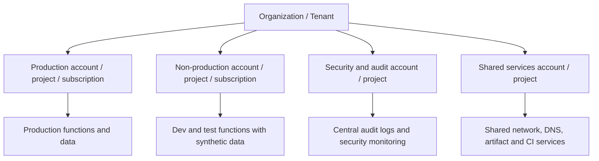
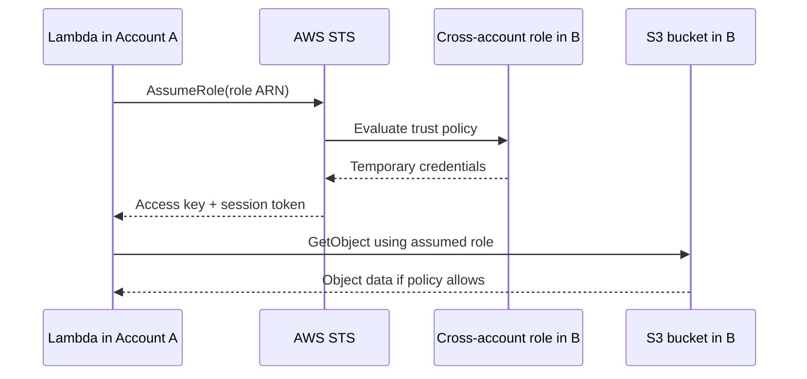

# Giới hạn truy cập giữa account, project và subscription

Ứng dụng serverless thường được chia thành nhiều function và dịch vụ chạy trong các môi trường, team hoặc miền nghiệp vụ khác nhau. Một function có thể cần đọc dữ liệu từ storage ở account khác, nhận message từ queue của project khác hoặc gọi API nội bộ nằm trong subscription khác. Nếu mọi workload dùng chung một account, project hoặc subscription với quyền rộng, một lỗi cấu hình hoặc một function bị chiếm quyền có thể lan sang nhiều hệ thống.

Các cloud provider cung cấp những cấp quản lý như **account**, **project** và **subscription** để tổ chức tài nguyên, quyền, billing và chính sách. Chúng không hoàn toàn tương đương, nhưng đều có thể được dùng để thiết lập ranh giới quản trị và giới hạn blast radius. Bên cạnh ranh giới quản lý, hệ thống còn cần ranh giới danh tính và mạng: ai được gọi service, service được truy cập dữ liệu nào, traffic đi qua đường nào và dữ liệu có được phép rời khỏi vùng tin cậy hay không.

Trong module Cloud Serverless, việc giới hạn truy cập phải theo toàn bộ đường đi của request hoặc event: trigger → function → service identity → API/broker → data store. IAM cho phép một principal thực hiện hành động; network policy quyết định có đường kết nối; resource policy và encryption policy có thể thêm điều kiện. Không lớp nào trong số đó tự thay thế các lớp còn lại.

## 1. Phân biệt ranh giới quản trị, danh tính và mạng

Ba khái niệm thường bị gộp làm một:

- **Ranh giới quản trị (administrative boundary):** phạm vi để quản lý resource, billing, quota, policy và quyền quản trị. Ví dụ AWS account, Google Cloud project, Azure subscription.
- **Ranh giới danh tính (identity boundary):** nơi principal được xác thực và quyền được đánh giá. Ví dụ AWS IAM role, Google service account, Microsoft Entra service principal hoặc managed identity.
- **Ranh giới mạng (network boundary):** nơi traffic được định tuyến, cho phép hoặc chặn. Ví dụ VPC, VNet, subnet, firewall, security group, private endpoint và service perimeter.

Một account/project/subscription có thể chứa nhiều network và nhiều workload identity. Ngược lại, một ứng dụng có thể cần truy cập tài nguyên nằm ngoài phạm vi quản trị của nó. Do đó, “cùng account” không đồng nghĩa “được phép truy cập”, và “có private network route” cũng không đồng nghĩa “được phép đọc dữ liệu”.

| Lớp kiểm soát | Câu hỏi cần trả lời | Ví dụ |
|---|---|---|
| Organization guardrail | Tổ chức có cho phép tạo hoặc sử dụng loại resource này không? | AWS SCP, Google Organization Policy, Azure Policy |
| Identity/IAM | Principal nào được gọi action nào? | `sqs:ReceiveMessage`, `roles/pubsub.subscriber`, Azure `Storage Blob Data Reader` |
| Resource policy | Resource chấp nhận principal nào? | SQS queue policy, S3 bucket policy, Key Vault RBAC |
| Network | Có đường kết nối từ nguồn đến đích không? | VPC route, VNet integration, firewall, PrivateLink |
| Data protection | Dữ liệu được mã hóa và khóa được ai sử dụng? | KMS key policy, Cloud KMS IAM, Key Vault key permissions |
| Application authorization | Caller có quyền trên đúng record/tenant không? | Tenant predicate, ownership check, domain policy |

Một request chỉ nên thành công khi tất cả điều kiện bắt buộc đều thỏa mãn. Ví dụ, Lambda có IAM permission đọc S3 nhưng không có network path tới private database thì vẫn không truy cập được database. Ngược lại, function có thể kết nối được tới database qua VPC nhưng bị database role từ chối truy vấn.

## 2. Resource hierarchy của ba cloud provider

### AWS: Organization, OU và Account

Hierarchy thường gặp:

```text
AWS Organization
  └── Organizational Unit (OU)
        └── AWS Account
              └── Region
                    └── VPC / service resources
```

AWS account là ranh giới quan trọng cho IAM, billing, quota và quản trị resource. AWS Organizations cho phép gom nhiều account vào một organization, nhóm account bằng OU và áp dụng Service Control Policies (SCP) làm guardrail. SCP giới hạn quyền tối đa có thể được cấp trong account/member account; SCP không tự cấp quyền cho role hoặc user.

Mô hình multi-account thường tách production, non-production, security/log archive, shared services và sandbox. Nếu một workload production bị xâm nhập, việc tách account giúp giảm phạm vi tài nguyên mà credential của workload có thể chạm tới, đồng thời cho phép đặt billing, quota, audit và network boundary riêng.

### Google Cloud: Organization, Folder và Project

Hierarchy thường gặp:

```text
Google Cloud Organization
  └── Folder
        └── Project
              └── Region / Zone resources
```

Project là đơn vị quan trọng để bật API, quản lý resource, billing association, quota và IAM policy. Folder giúp nhóm project theo môi trường, team hoặc miền nghiệp vụ. IAM policy có thể được kế thừa từ organization hoặc folder xuống project/resource, vì vậy một binding ở cấp cao có thể ảnh hưởng nhiều workload bên dưới.

Nên tách project theo môi trường hoặc miền tin cậy. Ví dụ `orders-prod`, `orders-nonprod` và `security-logging` có quyền, quota và vòng đời khác nhau. Tránh dùng một project dùng chung cho production và thử nghiệm chỉ vì tiện chia sẻ service account hoặc network.

### Azure: Management Group, Subscription và Resource Group

Hierarchy thường gặp:

```text
Microsoft Entra tenant
  └── Management Group
        └── Subscription
              └── Resource Group
                    └── Resource
```

Subscription là đơn vị billing/quota và là scope phổ biến để quản trị Azure resource. Management Groups nhóm subscription để áp dụng Azure Policy và RBAC ở cấp cao hơn. Resource Group gom resource có vòng đời hoặc quyền quản trị liên quan.

Microsoft Entra tenant là ranh giới danh tính riêng với subscription hierarchy. Một subscription gắn với một Entra tenant tại một thời điểm, nhưng một tenant có thể quản lý nhiều subscription. Khi chia sẻ resource giữa tenant, cần xem xét cross-tenant identity, guest/workload identity, quyền resource và network riêng.

### Bảng so sánh

| Khái niệm | AWS | Google Cloud | Azure |
|---|---|---|---|
| Ranh giới tổ chức | AWS Organization | Organization | Entra tenant + Management Groups |
| Nhóm quản trị trung gian | OU | Folder | Management Group / Resource Group |
| Đơn vị tài nguyên/billing phổ biến | Account | Project | Subscription |
| Danh tính workload | IAM role | Service account | Managed identity / service principal |
| Guardrail tổ chức | SCP | Organization Policy, IAM Deny khi phù hợp | Azure Policy, deny assignment theo ngữ cảnh |
| Network riêng | VPC | VPC network | VNet |

Các cấp này không có semantics giống nhau hoàn toàn. Khi thiết kế multi-cloud, hãy xác định mục tiêu của ranh giới (billing, blast radius, identity, compliance, network) thay vì cố ánh xạ một-một tên gọi giữa các provider.

## 3. Chọn account, project và subscription boundary

Một ranh giới nên được chọn theo mức độ tin cậy và vòng đời, không chỉ theo tên team. Các tiêu chí chính:

- **Environment:** production, staging, development, sandbox cần mức quyền và dữ liệu khác nhau.
- **Data classification:** dữ liệu nhạy cảm hoặc regulated có thể cần project/account/subscription riêng để áp dụng policy, audit và network chặt hơn.
- **Ownership:** team nào chịu trách nhiệm vận hành, ngân sách và incident response?
- **Blast radius:** nếu credential hoặc deployment pipeline bị chiếm quyền, phạm vi tối đa bị ảnh hưởng là gì?
- **Quota và billing:** workload nào cần quota, budget hoặc cost allocation riêng?
- **Compliance và residency:** dữ liệu phải nằm ở region, account hoặc subscription nào?
- **Lifecycle:** resource nào được tạo/xóa cùng nhau, resource nào cần sống lâu hơn ứng dụng?
- **Connectivity:** các service có cần giao tiếp thường xuyên qua private network hay chỉ cần API/event contract?

### Mô hình phân tách thường dùng



Production và non-production nên có identity, data, secrets, queue, database và deployment role riêng. Shared services có thể cung cấp DNS, artifact repository hoặc network transit, nhưng quyền truy cập cần được cấp theo service contract. Security/logging account nên có quyền thu thập log mà workload không thể tùy tiện sửa hoặc xóa.

Không nên tạo account/project/subscription mới cho mọi function nhỏ nếu chi phí vận hành lớn hơn lợi ích. Hãy tách theo ranh giới tin cậy, ownership và blast radius; trong cùng một scope, vẫn có thể tách execution role, resource policy và network segment.

## 4. Identity của workload và nguyên tắc least privilege

Mỗi function hoặc nhóm function nên có danh tính workload riêng. Danh tính đó chỉ được cấp quyền cho những thao tác cần thiết và resource cần thiết.

| Provider | Danh tính thường dùng | Cách cấp quyền |
|---|---|---|
| AWS | Lambda execution role | IAM identity policy, resource policy, trust policy và organization guardrail |
| Google Cloud | User-managed service account gắn với Cloud Run/Functions | IAM role binding trên project hoặc resource; service account impersonation khi cần |
| Azure | System-assigned hoặc user-assigned managed identity | Azure RBAC role assignment ở management group, subscription, resource group hoặc resource |

Tránh dùng user credential của developer làm runtime credential. Tránh gắn cùng một role/service account/managed identity quá mạnh cho mọi function trong ứng dụng. Một function gửi email không cần quyền đọc toàn bộ database; một function xử lý đơn hàng không cần quyền sửa IAM role.

### Quyền runtime và quyền deploy là hai loại khác nhau

- **Runtime identity** được function sử dụng khi xử lý request/event.
- **Deployment identity** được pipeline dùng để tạo hoặc cập nhật function, role, queue, network và policy.
- **Human admin identity** được operator dùng để cấu hình hoặc ứng phó sự cố.

Không dùng runtime role để deploy hạ tầng. Không cấp deployment role cho function. Không dùng một credential dài hạn cho cả CI, developer và production workload. Tách vai trò giúp một lỗi ở code runtime không tự động trở thành quyền sửa hạ tầng.

### Scope nhỏ nhất có thể

Ưu tiên cấp quyền tại resource cụ thể thay vì toàn account/project/subscription. Nếu function chỉ đọc một queue, cấp quyền trên ARN/queue đó. Nếu chỉ đọc một bucket prefix, giới hạn bucket/prefix. Nếu Azure Function chỉ đọc một secret, cấp role trên vault hoặc secret scope phù hợp thay vì subscription. Nếu GCP function chỉ consume một Pub/Sub subscription, cấp role trên subscription đó khi dịch vụ hỗ trợ.

Quyền cấp ở scope cao có thể được kế thừa xuống nhiều resource. Khi review, phải kiểm tra cả policy trực tiếp và policy được kế thừa; một binding nhỏ ở resource không làm mất quyền rộng đã có từ project/account/subscription.

## 5. Cross-account access trên AWS

AWS hỗ trợ truy cập giữa account bằng identity-based policy kết hợp resource-based policy hoặc bằng cách assume role trong account đích.

### Assume role vào account đích

Một Lambda ở account A cần đọc dữ liệu trong account B. Một cách phổ biến:

1. Lambda execution role ở account A được phép gọi `sts:AssumeRole` vào role được chỉ định trong account B.
2. Trust policy của role account B cho phép đúng principal account A (hoặc role cụ thể) assume.
3. Role account B có identity policy chỉ cho phép hành động cần thiết trên resource đích.
4. Lambda dùng temporary credentials từ STS để gọi service ở account B.



Ví dụ trust policy tối giản cho role ở account B:

```json
{
  "Version": "2012-10-17",
  "Statement": [{
    "Effect": "Allow",
    "Principal": {
      "AWS": "arn:aws:iam::111122223333:role/orders-worker-role"
    },
    "Action": "sts:AssumeRole"
  }]
}
```

Execution role của Lambda ở account A cần quyền `sts:AssumeRole` trên ARN role ở B. Role ở B có thể có policy chỉ cho `s3:GetObject` trên một prefix cụ thể. Với tích hợp của bên thứ ba, dùng `ExternalId` trong trust policy để giảm rủi ro confused deputy; external ID không phải secret thay cho trust policy.

### Resource-based policy

Một số AWS resource hỗ trợ resource policy cho phép principal từ account khác truy cập trực tiếp. Ví dụ S3 bucket policy, SQS queue policy, SNS topic policy, Lambda resource policy và EventBridge event bus policy. Cần xem quyền ở cả phía principal lẫn resource; một policy cho phép ở một phía chưa chắc đủ nếu phía còn lại không cho phép.

### Organization guardrail và permission boundary

SCP giới hạn quyền tối đa có thể được sử dụng trong member account; SCP không cấp quyền. Permission boundary giới hạn quyền tối đa mà identity policy có thể cấp cho principal. Session policy có thể thu hẹp quyền của session. Resource policy quyết định resource chấp nhận principal nào. Khi debug `AccessDenied`, cần xem cả các lớp này, không chỉ tìm `Allow` trong một IAM policy.

## 6. Cross-project access trên Google Cloud

Google Cloud dùng service account làm principal phổ biến cho workload. Một Cloud Function/Cloud Run service có thể chạy dưới service account ở project A và truy cập resource trong project B nếu IAM policy của resource/project B cấp quyền phù hợp.

Ví dụ:

1. Tạo service account riêng cho function ở project A.
2. Gắn service account đó vào function runtime.
3. Ở project B, cấp role cần thiết cho principal `serviceAccount:...` trên đúng resource.
4. Function dùng Application Default Credentials để lấy credential từ môi trường runtime.
5. Google client library tự dùng credential đó để gọi API được cấp quyền.

Không cấp `Editor` hoặc `Owner` ở project B chỉ để function đọc một bucket hoặc consume một subscription. Cấp role chuyên biệt như Storage Object Viewer trên bucket hoặc Pub/Sub Subscriber trên subscription phù hợp.

### IAM inheritance và organization policy

IAM policy có thể được kế thừa từ organization hoặc folder xuống project và resource. Một service account có thể nhận quyền từ nhiều binding; cần xem effective permissions thay vì chỉ đọc policy tại resource.

Organization Policy là guardrail quản lý cách resource được cấu hình (ví dụ giới hạn vị trí, loại domain hoặc cách dùng service account tùy constraint). Nó không thay thế IAM permission để cho phép principal đọc dữ liệu. IAM Deny policy có thể chặn một số quyền ở phạm vi hỗ trợ; khi debug, xem cả allow và deny policies.

### Shared VPC và project boundary

Shared VPC cho phép service project dùng network được quản lý trong host project. Điều này giúp tách ownership của workload khỏi ownership của network. Tuy nhiên, quyền quản lý network, quyền tạo workload và quyền truy cập data plane vẫn cần tách riêng. Không cấp quyền network admin của host project cho mọi developer chỉ vì họ triển khai function ở service project.

VPC Service Controls có thể tạo service perimeter để giảm nguy cơ exfiltration từ các dịch vụ được hỗ trợ. Đây là lớp bảo vệ data perimeter, không phải firewall thay thế VPC firewall hoặc IAM. Cần xem xét ingress/egress rules và các dịch vụ hỗ trợ trước khi áp dụng.

## 7. Cross-subscription access trên Azure

Azure RBAC role assignment có thể được đặt ở management group, subscription, resource group hoặc resource. Một managed identity của Function App trong subscription A có thể được cấp role trên resource ở subscription B nếu các subscription nằm trong tenant và cấu hình danh tính cho phép.

Ví dụ:

1. Bật system-assigned hoặc gắn user-assigned managed identity cho Function App ở subscription A.
2. Lấy principal/object ID của identity.
3. Trên resource hoặc resource group ở subscription B, tạo role assignment cho principal đó.
4. Function dùng Azure Identity SDK/Managed Identity để lấy token và gọi service.
5. Resource kiểm tra token và Azure RBAC data-plane permission.

Không cấp Contributor trên subscription B chỉ để function đọc một blob. Dùng role data-plane như `Storage Blob Data Reader` ở storage account hoặc scope phù hợp. Với Key Vault, chọn đúng authorization model (Azure RBAC hoặc access policies) và role đọc secret cần thiết.

### Tenant boundary khác subscription boundary

Subscription không phải Entra tenant. Khi truy cập giữa subscription trong cùng tenant, principal có thể được tham chiếu trực tiếp trong role assignment theo quyền quản trị phù hợp. Khi truy cập giữa tenant, cần thêm cấu hình cross-tenant identity như guest/service principal, workload identity federation hoặc cơ chế được dịch vụ hỗ trợ; token và role assignment phải được cấp trong tenant/resource đích.

Không giả định một managed identity tự động có mặt trong tenant khác. Kiểm tra issuer/tenant của token, audience của resource, service principal ở tenant đích và role assignment. Network peering giữa hai tenant cũng không tự cấp danh tính hoặc quyền dữ liệu.

### Azure Policy và RBAC

Azure Policy kiểm soát trạng thái cấu hình resource, ví dụ yêu cầu private endpoint hoặc chặn public network access theo policy. Azure RBAC quyết định principal được thực hiện hành động quản lý hoặc data-plane nào. Hai cơ chế bổ sung cho nhau: policy có thể yêu cầu resource phải private, nhưng function vẫn cần role đọc dữ liệu.

## 8. Network segmentation cho serverless workload

Serverless compute thường được quản lý bởi provider; function không nhất thiết có một máy chủ cố định. Nhưng network path vẫn phải được thiết kế. Cần phân biệt:

- **Ingress:** ai có thể gọi function/API?
- **Egress:** function có thể gọi destination nào?
- **Private service access:** function truy cập database, storage hoặc API nội bộ bằng đường riêng nào?
- **Service-to-service path:** các function, broker và data store giao tiếp qua endpoint nào?
- **DNS:** hostname có phân giải về địa chỉ private/public đúng với thiết kế không?

### AWS Lambda trong VPC

Lambda mặc định có thể gọi các dịch vụ công khai qua network do AWS quản lý. Khi gắn function vào VPC, Lambda tạo network interface trong subnet/security group được chọn để truy cập tài nguyên trong VPC. VPC attachment không tự làm function thành private HTTP endpoint và cũng không tự cấp quyền đọc resource.

Nếu function cần internet egress từ private subnet, thường cần NAT Gateway/NAT instance hoặc egress path được thiết kế phù hợp. Để truy cập một số AWS service mà không đi qua internet/NAT, cân nhắc VPC endpoints (gateway endpoint cho dịch vụ hỗ trợ như S3/DynamoDB; interface endpoint/PrivateLink cho nhiều dịch vụ khác). Endpoint policy có thể giới hạn hành động qua endpoint nhưng không thay thế IAM/resource policy.

Security group kiểm soát traffic ở network interface; route table và NACL cũng ảnh hưởng kết nối. Lambda invocation từ API Gateway/EventBridge/SQS vẫn được điều khiển bằng quyền invoke/event source và cấu hình trigger, không chỉ bởi security group.

### Google Cloud serverless networking

Cloud Run và Cloud Functions có các chế độ ingress/egress và cách kết nối VPC khác nhau theo generation/runtime. Có thể dùng Direct VPC egress hoặc Serverless VPC Access connector khi được hỗ trợ để truy cập private IP trong VPC. Ingress setting có thể giới hạn nguồn gọi; IAM Invoker vẫn cần được cấu hình cho principal được phép.

Shared VPC cho phép workload ở service project dùng network của host project. Private Service Connect có thể cung cấp đường truy cập private đến dịch vụ được hỗ trợ. Firewall rule, route, DNS và IAM vẫn là các lớp riêng.

### Azure Functions networking

Azure Functions có thể dùng VNet integration cho outbound access đến tài nguyên trong VNet và private endpoint. Private endpoint cho Function App có thể giới hạn inbound access; VNet integration và private endpoint giải quyết hai hướng khác nhau. Cần cấu hình private DNS zone, route và network security phù hợp.

Service endpoint và private endpoint không giống nhau. Service endpoint mở đường từ subnet được chọn đến dịch vụ Azure qua backbone và gắn quyền network với subnet; private endpoint tạo network interface có private IP trong VNet cho dịch vụ hỗ trợ. Chọn theo yêu cầu private addressing, DNS, exfiltration control và kiến trúc kết nối.

### Bảng so sánh network

| Nhu cầu | AWS | Google Cloud | Azure |
|---|---|---|---|
| Network riêng | VPC | VPC network | VNet |
| Phân đoạn subnet | Subnet theo AZ | Regional subnet | Subnet trong VNet |
| Firewall cấp workload/network | Security Group, NACL | VPC firewall rules | NSG, Azure Firewall |
| Private service endpoint | VPC Endpoint / PrivateLink | Private Service Connect | Private Endpoint |
| Kết nối serverless vào VPC | Lambda VPC configuration | Direct VPC egress / connector | Function VNet integration |
| Kết nối mạng giữa scope | VPC peering, Transit Gateway, shared VPC patterns | Shared VPC, VPC peering, PSC | VNet peering, VPN, ExpressRoute |

## 9. Quyền truy cập giữa các scope cho trigger và event

Một function có thể được gọi từ queue hoặc event bus ở account/project/subscription khác. Cần kiểm tra cả quyền publish/subscribe ở broker lẫn quyền invoke/consume của function.

### AWS: SQS/SNS/EventBridge/Lambda

- Cross-account SQS: queue policy cho phép principal gửi/nhận; producer/consumer role cũng cần identity permission phù hợp.
- SNS topic: topic policy giới hạn account/principal được publish hoặc subscribe.
- EventBridge bus: event bus resource policy cho phép account/principal được `PutEvents`; rule target có role hoặc permission invoke phù hợp.
- Lambda: resource-based policy cho phép dịch vụ hoặc account khác invoke function; execution role của function là quyền function dùng sau khi được gọi.
- KMS: nếu queue/topic/event data dùng customer-managed key, key policy hoặc grant phải cho phép principal/service cần thiết.

### Google Cloud: Pub/Sub/Eventarc/Cloud Run

- Producer service account cần quyền publish trên topic.
- Consumer service account hoặc service agent cần quyền consume/subscribe theo loại trigger.
- Cloud Run service cần quyền invoke cho principal hoặc service agent phù hợp.
- Eventarc trigger có thể cần service agent permission và quyền invoke target; không cấp Owner cho service agent để chữa lỗi trigger.
- Với cross-project resource, cấp IAM binding ở resource đích và kiểm tra service identity/agent được dùng thực tế.

### Azure: Service Bus/Event Grid/Functions

- Publisher/consumer dùng managed identity hoặc service principal với role data-plane phù hợp.
- Service Bus sender/receiver role cần được cấp ở namespace, queue hoặc topic theo phạm vi được hỗ trợ.
- Event Grid subscription cần identity/delivery permission thích hợp cho destination.
- Function trigger identity và target resource identity có thể khác nhau; kiểm tra extension version và cấu hình identity-based connection.
- Với cross-subscription, role assignment phải nằm ở resource đích và identity phải được resolve đúng tenant.

Không dùng tên event, queue hoặc subscription trong payload để quyết định quyền. Quyền phải được enforce bằng IAM/resource policy và application authorization.

## 10. Mã hóa và quyền sử dụng key qua ranh giới

Mã hóa at rest chỉ bảo vệ dữ liệu nếu key policy cũng được giới hạn đúng. Một function có quyền đọc object nhưng không được phép decrypt KMS key sẽ không đọc được nội dung khi bucket dùng customer-managed key. Ngược lại, một principal có quyền decrypt quá rộng có thể giải mã dữ liệu từ nhiều resource nếu key policy và encryption context cho phép.

Các điểm cần kiểm tra:

- Key thuộc account/project/subscription nào và ai sở hữu vòng đời?
- Principal nào được encrypt, decrypt, sign hoặc verify?
- Có giới hạn encryption context, resource ARN hoặc service principal không?
- Cross-account key use có cần key policy ở account chủ và IAM policy ở account gọi không?
- Rotation, disable, deletion window và backup được quản lý ra sao?
- Log/audit có ghi nhận ai dùng key và từ resource nào không?

Tách quyền quản trị key khỏi quyền đọc dữ liệu. Workload thường chỉ cần `Decrypt` hoặc `Encrypt` trong phạm vi service; không cần quyền tạo, xóa hoặc đổi policy key. Với Azure Key Vault và Google Cloud KMS, áp dụng nguyên tắc tương tự qua role/permission chuyên biệt.

## 11. Java: truy cập AWS account khác bằng AssumeRole

AWS SDK for Java 2.x có thể dùng STS để lấy temporary credentials từ role ở account đích. Ví dụ dưới đây minh họa role chaining từ Lambda execution role.

```java
import software.amazon.awssdk.auth.credentials.AwsCredentialsProvider;
import software.amazon.awssdk.services.sts.StsClient;
import software.amazon.awssdk.services.sts.auth.StsAssumeRoleCredentialsProvider;
import software.amazon.awssdk.services.sts.model.AssumeRoleRequest;

public final class CrossAccountCredentials {
    public static AwsCredentialsProvider assumeRole(String roleArn) {
        StsClient sts = StsClient.create();

        AssumeRoleRequest request = AssumeRoleRequest.builder()
                .roleArn(roleArn)
                .roleSessionName("orders-reader")
                .durationSeconds(3600)
                .build();

        return StsAssumeRoleCredentialsProvider.builder()
                .stsClient(sts)
                .refreshRequest(request)
                .build();
    }

    private CrossAccountCredentials() {}
}
```

Trong production, tái sử dụng `StsClient` và credentials provider theo vòng đời application instance, đóng client khi không còn dùng và không tự lưu access key/session token vào file. `roleArn` nên đến từ cấu hình tin cậy, không nhận ARN tùy ý từ HTTP request. Role đích cần trust policy chính xác; role nguồn cần `sts:AssumeRole` đúng ARN; policy của role đích giới hạn resource/action.

## 12. Java: dùng Managed Identity trên Azure

Với Azure SDK for Java, `DefaultAzureCredential` có thể sử dụng Managed Identity khi chạy trong Function App và developer credential khi chạy local. Ví dụ đọc blob từ storage account ở subscription khác:

```java
import com.azure.identity.DefaultAzureCredentialBuilder;
import com.azure.storage.blob.BlobServiceClient;
import com.azure.storage.blob.BlobServiceClientBuilder;

public final class AzureStorageAccess {
    public static BlobServiceClient create(String accountUrl) {
        return new BlobServiceClientBuilder()
                .endpoint(accountUrl)
                .credential(new DefaultAzureCredentialBuilder().build())
                .buildClient();
    }

    private AzureStorageAccess() {}
}
```

Function App identity cần role data-plane như `Storage Blob Data Reader` trên storage account/container scope phù hợp ở subscription đích. Nếu storage account chặn public network, cần VNet integration/private endpoint/DNS tương ứng. SDK credential không tự tạo network route.

## 13. Java: dùng service account trên Google Cloud

Trong môi trường Google Cloud, Application Default Credentials thường lấy credential từ service account gắn với runtime. Client library dùng credential đó để gọi API; IAM policy ở project/resource đích quyết định quyền.

```java
import com.google.cloud.storage.Storage;
import com.google.cloud.storage.StorageOptions;

public final class GcsAccess {
    public static Storage create() {
        // Uses Application Default Credentials from the runtime identity.
        return StorageOptions.getDefaultInstance().getService();
    }

    private GcsAccess() {}
}
```

Không tải service account JSON key vào function nếu có thể gắn service account hoặc dùng Workload Identity Federation/impersonation. Nếu cần truy cập project khác, cấp role cho principal service account trên bucket/resource đích thay vì chuyển sang một key dài hạn có quyền rộng.

## 14. Guardrail ở cấp tổ chức

Guardrail giới hạn những gì account/project/subscription có thể làm, kể cả khi một administrator hoặc deployment pipeline cố tạo cấu hình không phù hợp.

| Provider | Guardrail thường dùng | Ví dụ mục tiêu |
|---|---|---|
| AWS | SCP, permission boundaries, IAM conditions, account-level controls | Chặn tắt CloudTrail, giới hạn region, ngăn public resource theo policy |
| Google Cloud | Organization Policy, IAM Deny, folder/project hierarchy | Hạn chế service account key creation, giới hạn domain/region hoặc cấu hình resource |
| Azure | Azure Policy, Management Group policy assignments, deny assignments theo dịch vụ | Yêu cầu private access, encryption, allowed locations hoặc chặn cấu hình public |

Guardrail cần được kiểm thử trước khi áp dụng diện rộng. Một policy quá chặt có thể làm deployment hoặc service-managed operation thất bại. Dùng audit mode/dry-run khi dịch vụ hỗ trợ, áp dụng theo OU/folder/management group và theo dõi violation trước khi chuyển sang deny.

Không dùng guardrail để thay thế runtime least privilege. SCP/Organization Policy/Azure Policy thường quản lý giới hạn hoặc cấu hình resource; function vẫn cần IAM/RBAC cụ thể để thực hiện nghiệp vụ.

## 15. Cross-boundary access có kiểm soát

Khi một workload cần truy cập resource ở scope khác, hãy thiết kế một access contract:

1. **Owner:** account/project/subscription nào sở hữu resource và chịu trách nhiệm dữ liệu?
2. **Caller:** function hoặc service identity nào cần truy cập?
3. **Action:** chỉ cần đọc, ghi, publish, consume hay invoke?
4. **Resource scope:** resource ARN/ID, bucket prefix, queue, topic, subscription hoặc database cụ thể nào?
5. **Network path:** public endpoint, private endpoint, peering, transit hay service perimeter?
6. **Data protection:** encryption key và encryption context nào cần thiết?
7. **Lifecycle:** credential/role assignment được cấp, rotate và thu hồi ra sao?
8. **Audit:** log nào chứng minh ai truy cập và khi nào?
9. **Failure behavior:** xử lý AccessDenied, network timeout, quota và partial failure thế nào?

Không mở toàn bộ VPC/VNet hoặc cấp role cấp subscription chỉ để giải quyết một kết nối đơn lẻ. Ưu tiên API/service endpoint có hợp đồng rõ, principal riêng và quyền resource cụ thể.

### Mẫu bảng access matrix

| Caller | Scope nguồn | Resource đích | Action | Network path | Owner/expiry |
|---|---|---|---|---|---|
| `orders-worker-prod` | Account A / project X | Orders queue | Receive/Delete | Broker endpoint | Orders team / review hàng quý |
| `reporting-function` | Project Y | Analytics bucket | Read prefix `daily/` | Private endpoint | Data team / đến ngày xác định |
| `billing-function` | Subscription M | Invoice API | Invoke | Private VNet path | Finance platform / review theo release |

Access matrix giúp phát hiện quyền thừa, caller không rõ owner hoặc grant tồn tại vô thời hạn. Mỗi cross-scope grant cần owner, lý do, scope và thời hạn review.

## 16. Các lỗi thiết kế thường gặp

| Lỗi | Hậu quả | Cách xử lý |
|---|---|---|
| Dùng một account/project/subscription cho mọi môi trường | Credential hoặc lỗi deploy ở dev có thể ảnh hưởng production | Tách scope theo environment và trust boundary |
| Coi project/account là ranh giới mạng | Resource vẫn có thể public hoặc kết nối qua route khác | Thiết kế network segmentation riêng |
| Cấp quyền ở scope quá cao | Function có thể đọc/sửa resource không liên quan | Cấp IAM/RBAC tại resource hoặc scope nhỏ nhất |
| Dùng chung runtime identity | Khó quy trách nhiệm và tăng blast radius | Identity riêng theo function/trách nhiệm |
| Chỉ cấu hình IAM mà quên resource policy | Cross-account invocation/publish vẫn bị từ chối hoặc mở sai | Kiểm tra cả identity và resource side |
| Chỉ cấu hình private endpoint mà quên IAM | Network đến được nhưng data access bị từ chối | Kiểm tra identity, role và data-plane permission |
| Mở public endpoint để sửa lỗi kết nối | Tăng attack surface và nguy cơ exfiltration | Dùng private path, DNS và policy đúng |
| Dùng service account key/access key dài hạn | Secret có thể bị sao chép và tồn tại sau khi workload bị xóa | Managed identity/role/federation và temporary credentials |
| Cấp quyền cho deployment role vào runtime | Code runtime có thể sửa hạ tầng | Tách deploy identity và runtime identity |
| Không review quyền kế thừa | Quyền rộng ở folder/OU/management group bị bỏ sót | Đánh giá effective permissions toàn hierarchy |
| Không audit cross-scope grants | Quyền tồn tại lâu sau khi tích hợp kết thúc | Owner, expiry, periodic access review |

## 17. Kiểm thử và xác minh ranh giới

Kiểm thử phải chứng minh cả trường hợp được phép và bị từ chối. Một bài test chỉ chứng minh function đọc được resource chưa đủ; cần chứng minh function không thể đọc resource ngoài scope.

| Loại test | Điều cần xác minh |
|---|---|
| Positive authorization | Function A đọc/ghi đúng resource đã được cấp quyền |
| Negative authorization | Function A bị từ chối khi truy cập resource của team/account/project khác |
| Network isolation | Không thể kết nối đến endpoint không được phép; private DNS phân giải đúng |
| Cross-account/project/subscription | Principal và resource policy hai phía cho kết quả đúng |
| Tenant isolation | Caller tenant A không đọc hoặc cập nhật dữ liệu tenant B |
| Key access | Function chỉ decrypt bằng key được cấp và không thể sửa/delete key |
| Event trigger | Chỉ producer được phép publish/invoke; consumer không có quyền consume queue khác |
| Revocation | Thu hồi role/identity khiến access bị từ chối sau propagation hợp lý |
| Guardrail | Deployment vi phạm policy bị chặn hoặc phát cảnh báo theo chế độ đã chọn |
| Audit | Có log actor, resource, action, outcome và correlation phù hợp |

Chạy negative test bằng principal thực tế hoặc role test có quyền gần giống production. Đừng dùng administrator credential để kiểm tra runtime access vì nó che giấu lỗi thiếu quyền. Định kỳ rà soát role assignment, trust policy, resource policy, firewall rule, peering và endpoint policy.

## 18. Audit và vận hành quyền truy cập

Theo dõi các hoạt động thay đổi quyền và truy cập dữ liệu:

- AWS: CloudTrail ghi nhận hoạt động API/control plane; bật data events cho các resource cần audit như S3/Lambda theo yêu cầu và chi phí. AWS Config có thể đánh giá cấu hình resource.
- Google Cloud: Cloud Audit Logs gồm Admin Activity, System Event, Data Access và Policy Denied theo loại dịch vụ/cấu hình; Data Access logs có thể cần bật hoặc cấu hình retention/exports phù hợp.
- Azure: Activity Log ghi nhận hoạt động control plane ở subscription; resource logs/diagnostic settings và Entra audit/sign-in logs bổ sung dữ liệu data-plane/identity theo dịch vụ.

Centralize log vào account/project/subscription bảo mật mà workload không có quyền xóa. Cảnh báo cho thay đổi role assignment, policy, trust relationship, public endpoint, firewall, service account key, access key và cross-scope grant bất thường.

Một access review nên trả lời: principal còn tồn tại không, owner còn chịu trách nhiệm không, resource còn cần chia sẻ không, scope có thể thu hẹp không và quyền có thời hạn không. Thu hồi grant khi integration kết thúc; không để quyền tạm thời thành quyền vĩnh viễn.

## 19. Checklist thiết kế

- [ ] Đã xác định mục tiêu của từng boundary: billing, ownership, blast radius, identity, network hay compliance.
- [ ] Production, non-production và security/logging được phân tách phù hợp.
- [ ] Đã hiểu resource hierarchy của provider và quyền kế thừa từ cấp cao xuống thấp.
- [ ] Mỗi function có runtime identity riêng hoặc nhóm quyền có lý do rõ ràng.
- [ ] Runtime, deployment và human admin identity được tách biệt.
- [ ] Cross-account/project/subscription grant có caller, action, resource scope, owner và expiry/review date.
- [ ] Đã kiểm tra identity policy, resource policy, trust policy và organization guardrail.
- [ ] Đã phân biệt quyền control-plane và data-plane.
- [ ] Network ingress, egress, DNS, private endpoint, route và firewall được thiết kế độc lập với IAM.
- [ ] Không có public endpoint hoặc outbound path ngoài nhu cầu đã phê duyệt.
- [ ] KMS/key policy cho phép đúng principal và service; quyền quản trị key được tách riêng.
- [ ] Event broker, queue, topic và function invocation có policy giới hạn principal.
- [ ] Tenant/resource authorization được kiểm tra trong application service.
- [ ] Negative tests chứng minh truy cập ngoài scope bị từ chối.
- [ ] Audit log được tập trung, bảo vệ integrity và có cảnh báo thay đổi quyền.
- [ ] Cross-scope grant được rà soát và thu hồi khi không còn cần thiết.

Giới hạn truy cập giữa account, project và subscription là sự kết hợp của phân tách quản trị, danh tính workload, IAM/RBAC, resource policy, network segmentation và bảo vệ dữ liệu. Ranh giới quản trị giúp giảm blast radius; identity xác định principal; IAM quyết định hành động; network kiểm soát đường đi; application authorization bảo vệ từng resource và tenant. Với Java function serverless, hãy cấp quyền theo từng trigger và nhiệm vụ, dùng credential ngắn hạn, ưu tiên private connectivity khi cần và kiểm thử cả truy cập hợp lệ lẫn truy cập phải bị từ chối.
