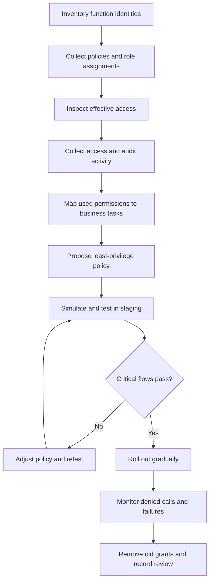

# Rà soát IAM, access log và phát hiện quyền vượt nhu cầu

Một Java function thường chạy với danh tính của workload để đọc secret, truy cập database, ghi object, nhận message hoặc gọi dịch vụ khác. Nếu danh tính đó có quyền quá rộng, một lỗi trong code, dependency bị khai thác hoặc credential bị lộ có thể gây ảnh hưởng vượt xa nhiệm vụ của function. Vì vậy, bảo mật serverless cần được kiểm tra liên tục: function thực sự cần quyền gì, quyền nào đã được sử dụng, request nào đã truy cập tài nguyên và có quyền nào đang dư thừa.

**IAM review** là việc rà soát danh tính, role, policy, trust relationship và phạm vi tài nguyên. **Access log** ghi lại request hoặc thao tác truy cập để điều tra và đo lường. **Audit log** ghi nhận ai đã thay đổi cấu hình/quyền hoặc thực hiện hành động quan trọng. Ba nguồn dữ liệu này bổ sung cho nhau: policy cho biết điều gì được phép; log cho biết điều gì đã xảy ra; phân tích quyền sử dụng giúp nhận diện phần quyền có thể thu hẹp.

Bài học tập trung vào Java serverless trên AWS, Azure và Google Cloud. Mục tiêu là thiết kế danh tính theo từng function, phát hiện quyền vượt nhu cầu, sử dụng audit/access logs đúng cách và thu hẹp quyền an toàn mà không làm gián đoạn xử lý.

## 1. Phân biệt authentication, authorization và audit

Ba khái niệm thường bị trộn lẫn:

- **Authentication (xác thực):** xác định caller là ai. Ví dụ API Gateway xác thực JWT, Azure Functions xác thực Microsoft Entra ID hoặc một service account gọi Cloud Run.
- **Authorization (phân quyền):** quyết định danh tính đó được làm gì trên tài nguyên nào. Ví dụ execution role được `s3:GetObject` trên một bucket/prefix cụ thể.
- **Audit/observability:** ghi nhận request, hành động, kết quả và thay đổi cấu hình để điều tra hoặc chứng minh tuân thủ.

Một HTTP API có ít nhất hai ranh giới danh tính:

1. **Caller identity:** người dùng hoặc service gọi HTTP endpoint. Danh tính này quyết định caller được xem/sửa dữ liệu nghiệp vụ nào.
2. **Workload identity:** danh tính của Java function khi gọi AWS/Azure/GCP service. Danh tính này quyết định function có thể đọc secret, ghi database hoặc publish message nào.

Không được coi việc HTTP request đã qua API key hoặc JWT là bằng chứng function có quyền truy cập mọi dữ liệu. Ngược lại, execution role có quyền đọc một bucket không có nghĩa mọi người dùng gọi API đều được phép tải object trong bucket đó. Authorization nghiệp vụ phải kiểm tra quyền trên từng tenant/resource.

## 2. IAM là gì trong môi trường serverless?

IAM (Identity and Access Management) quản lý danh tính và quyền truy cập. Một policy thường xác định:

| Thành phần | Câu hỏi |
| --- | --- |
| Principal/identity | Ai hoặc workload nào đang yêu cầu truy cập? |
| Action/permission | Được phép thực hiện thao tác nào? |
| Resource | Thao tác áp dụng lên tài nguyên nào? |
| Condition | Trong điều kiện nào quyền được áp dụng? |
| Effect | Cho phép hay từ chối? |

Trong serverless, danh tính runtime thường được gắn vào function hoặc service. Mỗi function có thể có role/service account riêng. Khi runtime gọi cloud SDK, nền tảng cấp credential tạm thời cho danh tính đó; ứng dụng không cần lưu access key dài hạn trong source code.

Một thiết kế an toàn nên phân tách:

- Quyền runtime cần để thực hiện nghiệp vụ.
- Quyền quản lý function/deployment mà CI/CD hoặc operator cần.
- Quyền đọc log và điều tra dành cho người vận hành/security team.
- Quyền thay đổi IAM policy dành cho nhóm quản trị có kiểm soát.

Không cấp quyền quản trị cloud cho execution role chỉ vì function gặp lỗi AccessDenied. Trước tiên xác định action/resource bị từ chối và cấp đúng quyền cần thiết.

## 3. Least privilege: quyền tối thiểu theo function và tác vụ

Least privilege yêu cầu mỗi danh tính chỉ có quyền tối thiểu để hoàn thành nhiệm vụ của nó, trong phạm vi tài nguyên và thời gian cần thiết.

Ví dụ một hệ thống xử lý hóa đơn có ba function:

| Function | Nhiệm vụ | Quyền runtime dự kiến |
| --- | --- | --- |
| `upload-api` | Tạo upload session và metadata | Ghi record upload; sinh URL upload giới hạn cho một object/prefix; ghi log |
| `invoice-worker` | Đọc file và trích xuất dữ liệu | Đọc object trong prefix đầu vào; ghi kết quả; đọc secret cần thiết; cập nhật trạng thái |
| `notification-worker` | Gửi thông báo | Đọc record thông báo; publish tới một topic/queue; không cần đọc file hóa đơn gốc |

Nếu cả ba function dùng chung một role có quyền `AdministratorAccess` hoặc `*` trên mọi bucket, database và queue, một lỗi trong notification worker có thể trở thành đường truy cập dữ liệu hóa đơn. Tách role theo trách nhiệm làm giảm phạm vi ảnh hưởng.

### Quy tắc thiết kế policy

1. Bắt đầu từ danh sách use case và thao tác cụ thể, không bắt đầu từ một policy mẫu quá rộng.
2. Giới hạn resource theo ARN, resource ID, bucket/prefix, table, secret hoặc queue cần dùng.
3. Chỉ cấp action đọc/ghi/xóa tương ứng; không cấp `Delete*` nếu function chỉ cần đọc.
4. Dùng condition như tenant/resource tag, source ARN, VPC endpoint hoặc encryption context khi phù hợp.
5. Tách quyền đọc secret khỏi quyền tạo/rotate secret.
6. Tách quyền deploy/cấu hình khỏi quyền chạy nghiệp vụ.
7. Đặt review date và owner cho policy có ngoại lệ.

Không phải mọi cloud provider đều biểu diễn quyền theo cùng cú pháp. AWS policy thường nêu action/resource/condition; Azure RBAC gán role ở scope management plane hoặc data plane; Google Cloud IAM gán role chứa permission lên resource hierarchy. Dù cú pháp khác nhau, mục tiêu vẫn là principal đúng, permission vừa đủ và scope hẹp nhất.

## 4. Phân biệt identity policy, resource policy và trust policy

Trong AWS, cần hiểu các loại policy khác nhau:

- **Identity-based policy:** gắn với user, group hoặc role; nêu action/resource principal được phép truy cập.
- **Resource-based policy:** gắn trực tiếp với resource như S3 bucket, SQS queue, SNS topic hoặc Lambda function; nêu principal nào được resource chấp nhận.
- **Trust policy:** gắn với IAM role; xác định principal/service nào được phép assume role.
- **Permissions boundary:** giới hạn quyền tối đa mà identity policy có thể cấp cho một principal.
- **Service control policy (SCP):** giới hạn quyền tối đa trong AWS Organizations account/OU.
- **Session policy:** có thể thu hẹp quyền của một role session.

Một request thành công có thể phụ thuộc nhiều policy cùng lúc. Explicit Deny thường có ưu tiên cao hơn Allow. Không thể nhìn riêng identity policy rồi kết luận toàn bộ quyền hiệu lực; cần xét resource policy, SCP, permissions boundary, session policy và condition liên quan.

Ví dụ Lambda cần đọc object từ một bucket:

```json
{
  "Version": "2012-10-17",
  "Statement": [
    {
      "Sid": "ReadInvoiceInputOnly",
      "Effect": "Allow",
      "Action": ["s3:GetObject"],
      "Resource": "arn:aws:s3:::invoice-input/tenant/*"
    }
  ]
}
```

Policy này không cho phép liệt kê bucket, ghi object hoặc xóa object. Nếu code cần `s3:ListBucket`, hãy thêm statement riêng trên ARN bucket và điều kiện prefix phù hợp; không đổi thành `s3:*` trên `*` chỉ để sửa lỗi.

### Trust policy của Lambda execution role

Execution role cần trust policy cho phép Lambda service assume role. Đây là quyền để runtime nhận danh tính, không phải quyền đọc S3/Secrets Manager. Quyền truy cập dữ liệu nằm trong permission policy của role.

Một trust policy tối giản thường có principal là `lambda.amazonaws.com` và action `sts:AssumeRole`. Khi cấp quyền invoke Lambda từ EventBridge/S3/API Gateway, đó là một ranh giới khác: resource policy của function hoặc cơ chế invoke tương ứng phải cho phép nguồn gọi.

## 5. Tách quyền invoke function khỏi quyền function truy cập dữ liệu

Một lỗi thiết kế phổ biến là gom hai hướng quyền vào một khái niệm:

1. **Ai được gọi function?** Ví dụ API Gateway, EventBridge, S3 notification hoặc một service account khác được phép invoke.
2. **Function được gọi service nào?** Ví dụ đọc secret, ghi S3, publish SQS hoặc truy vấn DynamoDB.

Trong AWS, quyền invoke có thể nằm trong Lambda resource-based policy hoặc IAM permission của caller tùy kiểu gọi. Execution role là danh tính function dùng sau khi invocation bắt đầu.

Trong Azure, quyền gọi HTTP endpoint (function key, Entra ID hoặc ingress auth) khác với managed identity mà function dùng để truy cập Key Vault/Storage. Trong Google Cloud, quyền invoke Cloud Run/Function khác với service account runtime dùng để gọi Google APIs.

Hãy review hai chiều độc lập. Một function không nên public chỉ vì execution role bị giới hạn; và một function private vẫn có thể gây rủi ro nếu runtime identity có quyền quá rộng.

## 6. IAM cho Java trên AWS Lambda

AWS Lambda dùng execution role để cấp credential tạm thời cho code. AWS SDK for Java v2 có default credentials provider chain, tự lấy credential từ môi trường Lambda khi chạy trong AWS. Không đặt `AWS_ACCESS_KEY_ID` hoặc `AWS_SECRET_ACCESS_KEY` dài hạn trong biến môi trường production.

Ví dụ Java đọc một object bằng SDK v2:

```java
import software.amazon.awssdk.regions.Region;
import software.amazon.awssdk.services.s3.S3Client;
import software.amazon.awssdk.services.s3.model.GetObjectRequest;

public final class InvoiceReader {
    private final S3Client s3 = S3Client.builder()
            .region(Region.AP_SOUTHEAST_1)
            .build();

    public byte[] read(String bucket, String key) {
        var request = GetObjectRequest.builder()
                .bucket(bucket)
                .key(key)
                .build();
        try (var input = s3.getObject(request)) {
            return input.readAllBytes();
        } catch (java.io.IOException e) {
            throw new IllegalStateException("Unable to read invoice", e);
        }
    }
}
```

Ví dụ chỉ phù hợp với object nhỏ vì `readAllBytes()` nạp toàn bộ nội dung vào heap. Với file lớn, dùng stream hoặc xử lý theo buffer. Quyền `s3:GetObject` phải được cấp cho execution role trên đúng bucket/prefix. Java code không cần biết access key; SDK lấy credential từ role.

### Các quyền thường gặp và lỗi cấp quá rộng

| Nhu cầu | Action ví dụ | Rủi ro khi cấp quá rộng |
| --- | --- | --- |
| Ghi log | `logs:CreateLogStream`, `logs:PutLogEvents` và quyền tạo log group nếu cần | Quyền logs trên `*` có thể cho phép ghi vào nhiều nhóm log |
| Đọc secret | `secretsmanager:GetSecretValue` | Đọc toàn bộ secrets trong account thay vì một secret |
| Đọc object | `s3:GetObject` | Đọc mọi bucket hoặc prefix chứa dữ liệu tenant khác |
| Ghi object | `s3:PutObject` | Ghi đè/xóa nội dung logic hoặc tạo dữ liệu độc hại ở prefix khác |
| Ghi DynamoDB | `dynamodb:PutItem`, `UpdateItem` | Thay đổi bảng không liên quan hoặc dữ liệu tenant khác |
| Gửi SQS | `sqs:SendMessage` | Gửi message vào mọi queue và kích hoạt workflow không mong muốn |
| Publish SNS | `sns:Publish` | Phát event tới topic nhạy cảm hoặc gây fan-out ngoài dự kiến |

Tên action chỉ là ví dụ; một thao tác có thể cần thêm action phụ như KMS decrypt, describe hoặc tag condition. Dùng IAM Access Analyzer policy generation và CloudTrail activity để tìm quyền thực sự được sử dụng, sau đó kiểm thử policy mới trong staging.

## 7. IAM cho Azure Functions

Azure Functions có thể dùng system-assigned hoặc user-assigned managed identity. Managed identity được Entra ID cấp token ngắn hạn; ứng dụng Java dùng `DefaultAzureCredential` hoặc credential phù hợp để gọi Azure SDK.

Ví dụ Java đọc blob bằng managed identity:

```java
import com.azure.identity.DefaultAzureCredentialBuilder;
import com.azure.storage.blob.BlobClient;
import com.azure.storage.blob.BlobClientBuilder;

public final class AzureBlobReader {
    private final BlobClient blob;

    public AzureBlobReader(String accountUrl, String container, String blobName) {
        this.blob = new BlobClientBuilder()
                .endpoint(accountUrl)
                .containerName(container)
                .blobName(blobName)
                .credential(new DefaultAzureCredentialBuilder().build())
                .buildClient();
    }

    public void downloadTo(java.nio.file.Path destination) {
        blob.downloadToFile(destination.toString(), true);
    }
}
```

Trong production, gán role data-plane phù hợp như `Storage Blob Data Reader` trên đúng container/account cần đọc. Role `Reader` ở management plane chỉ cho phép đọc metadata resource Azure; nó không mặc nhiên cho phép đọc nội dung blob. Đây là điểm thường gây nhầm lẫn giữa quyền quản lý resource và quyền truy cập dữ liệu.

### Scope của Azure RBAC

Role assignment có thể được gán ở management group, subscription, resource group, resource hoặc scope con được dịch vụ hỗ trợ. Quyền thường kế thừa xuống scope con. Vì vậy, gán role ở subscription có thể rộng hơn nhiều so với function chỉ cần đọc một container.

Nên ưu tiên scope nhỏ nhất mà dịch vụ hỗ trợ. Với Storage, dùng data role phù hợp và scope account/container. Với Key Vault, dùng role quản lý secret ở vault hoặc secret scope tùy mô hình quyền. Không cấp `Owner` hoặc `Contributor` cho managed identity chỉ để đọc dữ liệu.

### Managed identity và role assignment

System-assigned identity gắn với vòng đời Function App; xóa Function App có thể xóa identity. User-assigned identity độc lập hơn và có thể được dùng bởi nhiều workload, nhưng cần review kỹ vì chia sẻ identity làm tăng phạm vi ảnh hưởng. Nếu hai function có nhiệm vụ và mức nhạy cảm khác nhau, identity riêng thường dễ audit và thu hẹp quyền hơn.

## 8. IAM cho Cloud Run và Google Cloud Functions

Google Cloud Run/Functions sử dụng service account gắn với workload. Google Cloud Java client libraries dùng Application Default Credentials (ADC), lấy credential từ service account runtime trong môi trường Google Cloud. Không tải JSON service account key dài hạn vào container nếu không có yêu cầu đặc biệt.

Ví dụ Java tạo client Storage dùng ADC:

```java
import com.google.cloud.storage.Storage;
import com.google.cloud.storage.StorageOptions;

public final class GcsObjectReader {
    private final Storage storage = StorageOptions.getDefaultInstance()
            .getService();

    public byte[] read(String bucket, String objectName) {
        var blob = storage.get(bucket, objectName);
        if (blob == null) {
            throw new IllegalArgumentException("Object not found");
        }
        return blob.getContent();
    }
}
```

`getContent()` nạp toàn bộ object vào memory; chỉ dùng cho object nhỏ. Với dữ liệu lớn, dùng read channel/stream. Service account runtime cần role phù hợp trên bucket, ví dụ `roles/storage.objectViewer` nếu chỉ đọc object. Tránh gán `roles/storage.admin` ở project khi function chỉ cần đọc một bucket.

### Role và permission trong Google Cloud

Google Cloud IAM role là tập hợp permission. Có predefined roles theo dịch vụ, basic roles rộng như Owner/Editor/Viewer và custom roles do tổ chức quản lý. Nên ưu tiên predefined role hẹp hoặc custom role được kiểm soát; tránh basic role rộng cho runtime production.

Gán role ở project sẽ áp dụng rộng hơn gán ở bucket, secret hoặc resource cụ thể nếu dịch vụ hỗ trợ. Với service account, phân biệt:

- **Service account runtime:** function dùng để truy cập tài nguyên.
- **Service account deployer:** pipeline dùng để tạo/cập nhật function hoặc service.
- **Service account trigger/invoker:** identity Eventarc hoặc nguồn sự kiện dùng để gọi đích khi cần.

Không dùng một service account cho cả deploy, runtime và trigger nếu có thể tách vai trò.

## 9. Access log, audit log và application log khác nhau

Các loại log thường trả lời những câu hỏi khác nhau:

| Loại log | Ghi nhận | Dùng để |
| --- | --- | --- |
| Application log | Logic ứng dụng, business key, lỗi, kết quả xử lý | Debug và hiểu hành vi function |
| HTTP access log | Method, path, status, latency, caller metadata, request ID | Theo dõi API traffic và điều tra request |
| Data access log | Đọc/ghi dữ liệu ở resource như object, secret, table hoặc API | Biết principal nào đã truy cập dữ liệu |
| Audit/management log | Thay đổi IAM, cấu hình, deployment, role assignment, resource | Điều tra thay đổi và kiểm toán quản trị |
| Network flow log | Kết nối mạng được accept/reject giữa interface/subnet | Phân tích đường mạng và traffic bất thường |

Không nên bật mọi log với mức chi tiết tối đa mà không có mục tiêu. Data access log có thể có chi phí, dung lượng và tác động quyền riêng tư đáng kể. Hãy xác định resource nhạy cảm, retention, quyền đọc log và yêu cầu audit trước khi bật.

### Application log không phải audit log

Một dòng log do Java code ghi như `user updated invoice` không tự động là bằng chứng audit đáng tin cậy. Ứng dụng có thể ghi thiếu, sai hoặc bị sửa bởi chính workload. Audit log từ control plane/data plane của cloud provider giúp ghi nhận hành động ở lớp nền tảng; application audit event bổ sung ngữ cảnh nghiệp vụ như order ID, tenant ID, actor và lý do thay đổi.

Với thao tác nghiệp vụ quan trọng, nên ghi audit event bền vững trong cùng transaction với thay đổi dữ liệu hoặc qua transactional outbox. Sau đó chuyển event sang hệ thống log/audit tập trung. Không dựa hoàn toàn vào một log statement sau khi commit vì process có thể chết giữa commit và ghi log.

## 10. AWS: CloudTrail, CloudWatch Logs và Access Analyzer

### CloudTrail

AWS CloudTrail ghi nhận API activity của account. Cần phân biệt:

- **Management events:** thao tác quản lý tài nguyên và cấu hình, ví dụ tạo role, sửa policy, deploy Lambda hoặc thay đổi security group.
- **Data events:** thao tác trên data plane, ví dụ đọc/ghi object S3 hoặc một số thao tác invoke/access theo loại resource được hỗ trợ. Data events thường cần được cấu hình trong trail/event data store và có thể phát sinh phí.
- **CloudTrail Insights:** có thể giúp phát hiện hoạt động API bất thường ở một số loại event khi được bật và dịch vụ hỗ trợ.

CloudTrail Event history cung cấp lịch sử management event gần đây trong account; nếu cần lưu trữ, truy vấn dài hạn hoặc data events, cấu hình trail/Lake phù hợp và retention. Không giả định mọi lần `GetObject` hoặc mọi lần function truy cập dữ liệu đều có trong Event history mặc định.

### CloudWatch Logs

Lambda thường gửi stdout/stderr và logger vào CloudWatch Logs theo log group của function. Application log hữu ích cho request ID, event ID và business context. CloudWatch Logs không tự thay thế CloudTrail: một function có thể không ghi log cho mọi API call, và log ứng dụng không chứng minh đầy đủ quyền hiệu lực.

### IAM Access Analyzer

IAM Access Analyzer giúp phát hiện resource policy cho phép truy cập từ bên ngoài account/organization hoặc các finding về quyền không mong muốn tùy analyzer type. Analyzer có thể rà soát quyền truy cập bên ngoài đối với resource được hỗ trợ. Ngoài ra, có thể dùng policy generation dựa trên CloudTrail activity để tạo policy đề xuất cho role trong khoảng thời gian quan sát.

Policy generation chỉ thấy hoạt động đã được ghi nhận trong CloudTrail và thời gian phân tích. Nếu một function chạy tác vụ theo quý hoặc chỉ chạy khi có incident, khoảng quan sát ngắn có thể bỏ sót quyền cần thiết. Không xóa action chỉ vì chưa thấy nó trong vài ngày log.

### IAM last accessed information

Thông tin last accessed có thể giúp nhận diện service/action không được dùng gần đây, nhưng dữ liệu không phải bằng chứng tuyệt đối rằng quyền không cần thiết. Cần xem xét thời gian quan sát, loại action được hỗ trợ tracking, service-linked role và tác vụ hiếm.

## 11. Azure: Activity Log, diagnostic logs và Entra audit

Azure có nhiều lớp log:

- **Azure Activity Log:** ghi nhận hoạt động control plane trên subscription như tạo resource, thay đổi cấu hình và role assignment. Đây không phải log đầy đủ cho mọi thao tác đọc/ghi data plane.
- **Resource diagnostic logs:** được cấu hình qua Diagnostic Settings để gửi log/metric từ resource tới Log Analytics workspace, Storage hoặc Event Hubs. Ví dụ Storage data-plane logs có thể ghi read/write/delete request khi category tương ứng được hỗ trợ và bật.
- **Microsoft Entra audit/sign-in logs:** ghi nhận thay đổi danh tính, đăng nhập và hoạt động liên quan Entra ID theo loại log.
- **Application Insights:** thu thập telemetry của Function App, request, dependency, trace và exception.

Một Function App gọi Key Vault thành công có thể cần kiểm tra Key Vault diagnostic/audit logs để biết secret nào được đọc và bởi identity nào. Activity Log của subscription chỉ ghi thay đổi quản lý resource; nó không thay thế log data-plane của Key Vault.

### Azure RBAC review

Dùng role assignment listing, Access Reviews và công cụ quản trị quyền để xác định:

- Principal nào được gán role ở subscription/resource group/resource.
- Role có scope rộng hơn yêu cầu không.
- Có role assignment trực tiếp và kế thừa trùng lặp không.
- Managed identity nào không còn gắn với workload hoạt động.
- Quyền data-plane có bị nhầm với quyền management-plane không.

Azure Policy có thể hỗ trợ kiểm soát cấu hình và tuân thủ, nhưng không thay thế review quyền hiệu lực. Với quyền đặc quyền của con người, dùng Privileged Identity Management (PIM), eligible assignment và thời hạn khi phù hợp thay cho permanent Owner/Contributor.

## 12. Google Cloud: Cloud Audit Logs và IAM Policy Intelligence

Cloud Audit Logs có các loại log chính:

- **Admin Activity:** thay đổi cấu hình hoặc metadata của resource; thường được ghi mặc định.
- **Data Access:** thao tác đọc/ghi dữ liệu hoặc gọi data-plane API; với nhiều dịch vụ cần bật cấu hình Data Access logging, có thể phát sinh chi phí.
- **System Event:** hành động do hệ thống Google Cloud thực hiện.
- **Policy Denied:** request bị từ chối bởi policy, hữu ích để điều tra permission failure khi loại log được hỗ trợ và bật.

Không giả định mọi lần đọc object hoặc secret đều có trong log mặc định. Xác định service cần audit, bật Data Access log ở đúng project/folder/organization scope và đặt retention/permission cho log sink.

### IAM Policy Intelligence

Google Cloud cung cấp các công cụ trong Policy Intelligence:

- **Policy Analyzer:** phân tích principal nào có thể truy cập resource nào qua policy và quan hệ kế thừa.
- **IAM Recommender:** đề xuất role hoặc permission có thể loại bỏ dựa trên lịch sử sử dụng và phân tích.
- **Policy Troubleshooter:** giải thích vì sao một principal được hoặc không được phép thực hiện action trên resource.
- **Service Account Insights:** cung cấp tín hiệu về service account không hoạt động hoặc có quyền cần xem xét.

Recommendation là đầu vào cho review, không phải lệnh tự động xóa quyền. Tác vụ hiếm, scheduled job và disaster recovery path có thể không xuất hiện trong cửa sổ quan sát.

## 13. Thiết kế access log có ích cho Java function

Một log record hữu ích cần đủ ngữ cảnh để nối request với function invocation và thao tác nghiệp vụ, nhưng không được chứa secret hoặc payload nhạy cảm.

Các trường thường có ích:

| Trường | Mục đích |
| --- | --- |
| `timestamp` | Thời điểm sự kiện |
| `service` / `function` | Function hoặc service thực hiện thao tác |
| `invocationId` / `requestId` | Nối log với invocation/request của nền tảng |
| `correlationId` / `traceId` | Theo dõi luồng qua nhiều service |
| `principal` / `serviceAccount` | Danh tính workload hoặc caller đã xác thực |
| `action` | Hành động nghiệp vụ hoặc thao tác resource |
| `resource` | Resource ID đã được phân loại an toàn |
| `tenantId` | Phân vùng nghiệp vụ nếu được phép ghi |
| `result` | Success, denied, failure hoặc retry |
| `reasonCode` | Mã lỗi đã chuẩn hóa, không chứa secret |
| `durationMs` | Thời gian xử lý |

Không log access token, cookie, password, API key, private key, presigned URL hoặc toàn bộ request body. Nếu cần lưu user ID/tenant ID, áp dụng masking/pseudonymization theo chính sách. Tránh đưa các ID có cardinality cao vào metric label; dùng log/trace để điều tra chi tiết.

### Java structured logging

Ví dụ minh họa ghi log có cấu trúc bằng SLF4J:

```java
import org.slf4j.Logger;
import org.slf4j.LoggerFactory;

public final class AccessAuditLogger {
    private static final Logger log =
            LoggerFactory.getLogger(AccessAuditLogger.class);

    public void recordRead(
            String invocationId,
            String correlationId,
            String principal,
            String resourceId,
            boolean allowed
    ) {
        log.atInfo()
                .addKeyValue("event", "resource_access")
                .addKeyValue("invocationId", invocationId)
                .addKeyValue("correlationId", correlationId)
                .addKeyValue("principal", principal)
                .addKeyValue("resourceId", resourceId)
                .addKeyValue("result", allowed ? "allowed" : "denied")
                .log("Resource access decision");
    }
}
```

SLF4J fluent key-value logging yêu cầu phiên bản API/provider hỗ trợ. Nếu phiên bản đang dùng không hỗ trợ, dùng structured JSON encoder hoặc logger phù hợp. Log application decision không thay thế audit event từ cloud provider; nó bổ sung business context.

### Correlation và trace propagation

Khi function gọi service khác, truyền trace context chuẩn như W3C Trace Context (`traceparent`) hoặc correlation ID được hệ thống thống nhất. Không tự tạo một ID mới ở mọi hop nếu muốn nối toàn bộ luồng. Khi nhận message/event, lưu correlation ID trong message attributes hoặc event metadata và đưa nó vào log của consumer.

## 14. Phát hiện quyền vượt nhu cầu

Quyền vượt nhu cầu thường xuất hiện theo các dấu hiệu:

- Action wildcard như `s3:*`, `dynamodb:*`, `secretsmanager:*` hoặc `*`.
- Resource wildcard `*` ở policy runtime dù dịch vụ hỗ trợ scope cụ thể.
- Role có `AdministratorAccess`, Owner, Editor hoặc Contributor cho workload chỉ cần một số thao tác.
- Function đọc được secret hoặc bucket không thuộc trách nhiệm của nó.
- Role cho phép ghi/xóa dù function chỉ cần đọc.
- Function có quyền assume role khác mà không cần use case rõ.
- Resource policy cho phép principal ngoài account/project rộng hơn dự kiến.
- Quyền được gán ở subscription/project/account thay vì resource scope nhỏ hơn.
- Role không còn được workload sử dụng nhưng vẫn tồn tại hoặc vẫn có quyền.
- Quyền chỉ phục vụ debug tạm thời chưa bị thu hồi sau sự cố.

### Tìm bằng chứng từ policy và activity

Kết hợp ít nhất bốn nguồn:

1. **Declared policy:** quyền được khai báo trong IAM/RBAC và Infrastructure as Code.
2. **Effective access:** quyền thực tế sau khi tính policy inheritance, resource policy, deny, boundary và condition.
3. **Observed usage:** action/resource thực sự xuất hiện trong access/data logs hoặc permission usage analysis.
4. **Business requirement:** nhiệm vụ function và các tình huống hiếm như backup, failover, scheduled task hoặc recovery.

Không thể kết luận một quyền dư thừa chỉ vì nó không xuất hiện trong access log. Log có thể chưa bật, retention có thể ngắn hoặc workload chỉ chạy theo lịch hiếm. Hãy quan sát đủ chu kỳ nghiệp vụ và hỏi owner trước khi thu hẹp.

## 15. Quy trình review và thu hẹp IAM an toàn

Một quy trình thực tế:

1. **Inventory:** liệt kê function, owner, môi trường, runtime identity, trigger và resource phụ thuộc.
2. **Collect:** lấy identity policy, resource policy, role assignment, trust policy và policy inheritance.
3. **Analyze:** tìm wildcard, quyền admin, scope rộng, principal bên ngoài và role không còn dùng.
4. **Observe:** bật access/data logs cần thiết và thu thập permission usage qua một chu kỳ đủ dài.
5. **Map:** liên kết mỗi action với use case, code path, trigger và resource cụ thể.
6. **Propose:** tạo policy hẹp hơn, tách role hoặc đổi sang workload identity.
7. **Simulate/test:** dùng policy simulator/troubleshooter hoặc staging để kiểm tra cả luồng thành công và failure/recovery.
8. **Deploy gradually:** rollout policy mới, theo dõi AccessDenied, retry, DLQ và business error.
9. **Remove old grants:** chỉ thu hồi quyền cũ sau khi xác nhận workload mới hoạt động.
10. **Document:** ghi owner, lý do, scope, ngày review và ngoại lệ còn lại.



### Bắt đầu ở chế độ quan sát

Nếu hệ thống chưa có log data access, không nên lập tức xóa quyền dựa trên giả định. Trước tiên bật log có chọn lọc, kiểm tra chi phí/retention và thu thập đủ dữ liệu. Với workload production quan trọng, thử policy hẹp trên staging hoặc một phần traffic trước khi rollout toàn bộ.

## 16. Công cụ phát hiện quyền dư thừa theo cloud

| Cloud | Công cụ/tín hiệu | Dùng để |
| --- | --- | --- |
| AWS | IAM Access Analyzer external access findings | Tìm resource policy mở truy cập từ account/principal ngoài phạm vi tin cậy |
| AWS | IAM Access Analyzer policy generation | Đề xuất policy dựa trên CloudTrail activity của role |
| AWS | IAM last accessed / credential report | Xem service/action hoặc credential ít/không được sử dụng |
| AWS | IAM Policy Simulator, Access Analyzer validation | Kiểm tra policy và quyền hiệu lực trong tình huống mô phỏng |
| Azure | Azure RBAC role assignment review, Access Reviews, PIM | Tìm role rộng, quyền tồn tại lâu và principal không còn cần quyền |
| Azure | Entra sign-in/audit logs, Activity Log, resource diagnostic logs | Đối chiếu danh tính, thay đổi quản trị và data-plane activity |
| Google Cloud | IAM Recommender, Service Account Insights | Nhận diện role/permission có thể thu hẹp và service account không hoạt động |
| Google Cloud | Policy Analyzer, Policy Troubleshooter | Phân tích ai có thể truy cập resource và lý do allow/deny |
| Google Cloud | Cloud Audit Logs | Theo dõi admin, data access, system event và policy denied |

Các công cụ có giới hạn về resource type, loại permission, thời gian quan sát và dữ liệu log. Đọc kết quả cùng policy gốc và yêu cầu nghiệp vụ; không tự động xóa quyền chỉ dựa trên một recommendation.

## 17. Kiểm tra quyền hiệu lực, không chỉ policy được khai báo

Một policy có thể trông hẹp nhưng quyền hiệu lực lại rộng do kế thừa hoặc resource policy. Ví dụ:

- Azure role được gán ở subscription và kế thừa xuống resource group/function.
- Google Cloud role được gán ở project và áp dụng cho nhiều bucket/secret con.
- AWS resource policy cho phép một principal khác, dù identity policy của role hiện tại không nêu quyền đó.
- AWS SCP hoặc permissions boundary chặn một action dù identity policy có Allow.
- Condition dựa trên principal tag hoặc resource tag không được áp dụng như dự định.

Review nên trả lời cả hai câu hỏi: “Policy nào đã khai báo?” và “Principal này thực sự có thể làm gì với resource này?”. Dùng Policy Analyzer, IAM simulator, Access Analyzer hoặc công cụ tương đương để xác minh quyền hiệu lực.

### Quyền cross-account/cross-project

Khi function truy cập resource ở account/project khác, cần kiểm tra cả phía caller và phía resource. AWS thường cần identity policy ở account caller và resource policy/trust phù hợp ở account đích. Azure cần role assignment và tenant/identity trust theo mô hình dịch vụ. Google Cloud cần role trên resource project và service account impersonation/federation nếu có. Không mở principal wildcard chỉ để làm cho kết nối cross-account hoạt động.

## 18. Event source và service-to-service identity

Một function có thể được gọi bởi EventBridge, S3, SQS, Eventarc, Pub/Sub, Azure Event Grid hoặc Service Bus. Cần xác định identity nào được phép gửi event và identity nào được phép invoke function.

- Giới hạn event source theo bucket/topic/queue cụ thể.
- Dùng resource policy hoặc IAM invoke permission đúng service principal/source ARN khi nền tảng yêu cầu.
- Với Eventarc, giới hạn event type, source, filter và service account có quyền invoke đích.
- Với Azure, kiểm tra managed identity, RBAC của nguồn và trigger connection.
- Xác thực payload và event metadata; không coi nội dung message là bằng chứng principal.
- Dùng idempotency theo event ID/business key vì event có thể được giao lại.

Đừng cấp quyền `lambda:InvokeFunction` hoặc quyền invoke Cloud Run cho mọi principal nếu chỉ một scheduler/topic/service cần gọi. Tương tự, một function không nên có quyền publish tới mọi queue/topic chỉ vì nó nhận event từ một queue.

## 19. Application-level authorization và multi-tenancy

IAM của cloud thường xác định quyền của workload trên resource cloud, không tự giải quyết quyền của người dùng cuối trong ứng dụng. Một Java API multi-tenant cần kiểm tra tenant/resource ownership ngay cả khi execution role có quyền đọc database hoặc object storage.

Ví dụ nguy hiểm:

1. Caller A gửi `GET /documents/doc-200`.
2. Java function dùng execution role có quyền `s3:GetObject` trên toàn bucket.
3. Code đọc object theo key từ request mà không kiểm tra document thuộc tenant A.
4. Caller A có thể đọc file của tenant B.

Execution role có quyền rộng để function làm việc; authorization nghiệp vụ phải ngăn caller truy cập record ngoài tenant. Có thể giảm rủi ro bằng prefix/partition theo tenant, query có tenant predicate, presigned URL ngắn hạn được sinh sau khi kiểm tra ownership và role tách theo workload. Tuy nhiên, không thay thế kiểm tra quyền bằng cách chỉ dựa trên object key.

## 20. Logging an toàn và retention

Access/audit logs có thể chứa principal, resource ID, IP, path, query parameter và metadata nhạy cảm. Hãy thiết kế logging theo nguyên tắc:

- Không ghi secret, token, cookie, authorization header hoặc payload nhạy cảm.
- Mask/redact identifier nếu chính sách yêu cầu.
- Tách quyền đọc log khỏi quyền vận hành function.
- Dùng log sink/account/project tập trung và chống sửa/xóa trái phép khi cần.
- Đặt retention theo yêu cầu pháp lý, incident response và chi phí.
- Bật data access log cho resource nhạy cảm thay vì bật mọi category không chọn lọc.
- Đồng bộ thời gian và giữ correlation/request ID để nối sự kiện.
- Cảnh báo cho hành vi bất thường: đọc secret ngoài lịch, truy cập nhiều tenant, xóa object hàng loạt, assume role lạ hoặc tăng đột biến AccessDenied.

Không lưu dữ liệu cá nhân quá mức chỉ để debug. Với yêu cầu audit, xác định rõ event nào cần lưu, ai được xem và thời gian lưu. Log không có retention/owner dễ trở thành một kho dữ liệu nhạy cảm thứ hai.

## 21. Phát hiện hành vi bất thường

Một số tín hiệu có thể giúp phát hiện function hoặc identity bị sử dụng sai:

- Function đọc secret không liên quan đến nhiệm vụ hoặc đọc nhiều secret trong thời gian ngắn.
- Role assume bởi principal/region/IP khác thường.
- Function ghi/xóa số lượng object lớn bất thường.
- Một workload truy cập resource của nhiều tenant dù bình thường chỉ phục vụ một tenant.
- Tăng đột biến API call, data transfer, denied request hoặc queue publish.
- Thay đổi policy/role assignment ngoài pipeline hoặc maintenance window.
- Function mới được cấp quyền admin hoặc wildcard resource.
- Service account/managed identity không còn gắn với workload nhưng vẫn có role.

Đặt baseline theo function và workload, không chỉ theo account tổng thể. Một batch worker có thể đọc nhiều object vào đầu tháng là bình thường; cùng hành vi đó từ notification function có thể đáng ngờ. Alert cần gắn owner, severity và playbook điều tra.

## 22. Khi phát hiện quyền quá rộng hoặc bị lạm dụng

Khi review phát hiện policy rộng, thu hẹp theo quy trình rollout. Khi có dấu hiệu credential bị lộ hoặc quyền đang bị khai thác, xử lý như incident:

1. Xác định principal, function, resource, action và thời gian.
2. Kiểm tra audit/data access logs và request trace để biết phạm vi truy cập.
3. Tạm thời disable role/session, revoke credential hoặc thêm explicit deny theo quy trình incident nếu cần ngăn thiệt hại.
4. Cô lập function/trigger hoặc giảm concurrency nếu đang phát sinh hành động độc hại.
5. Bảo toàn log và bằng chứng; không xóa log hoặc artifact liên quan.
6. Xác minh dữ liệu bị đọc/sửa/xóa và đánh giá nghĩa vụ thông báo.
7. Tạo role/credential mới với quyền tối thiểu và rollout an toàn.
8. Kiểm tra các function khác dùng chung identity; tách role nếu phạm vi ảnh hưởng quá rộng.
9. Khắc phục nguyên nhân, cập nhật policy-as-code và kiểm thử regression.
10. Ghi lại timeline, owner, quyết định và biện pháp phòng ngừa.

Không thu hồi hàng loạt quyền khi chưa hiểu dependency trong một hoạt động review bình thường; điều đó có thể gây outage. Trong incident đang diễn ra, containment có thể cần ưu tiên hơn availability và phải theo quy trình phản ứng sự cố của tổ chức.

## 23. Policy as Code và kiểm soát thay đổi IAM

Định nghĩa IAM bằng Infrastructure as Code giúp review thay đổi qua pull request, so sánh diff và tái tạo môi trường. Policy có thể được kiểm tra tự động để tìm wildcard, admin role, public access và scope quá rộng.

Các biện pháp:

- Quản lý role/policy trong Terraform, CloudFormation, Bicep hoặc công cụ IaC tương ứng.
- Pin module/provider version và review thay đổi permission như thay đổi code.
- Chạy policy validation/linter trong CI.
- Chặn resource policy public hoặc wildcard ngoài exception được phê duyệt.
- Không để function tự sửa role/policy của chính nó.
- Dùng deployment identity riêng và short-lived credential/OIDC federation cho CI/CD.
- Ghi audit event cho thay đổi role assignment và policy.

Policy-as-code không tự phát hiện mọi quyền hiệu lực nếu không xét inheritance, resource policy và runtime identity. Kết hợp kiểm tra IaC với công cụ phân tích quyền trên cloud thật.

## 24. Ví dụ: thu hẹp quyền của một Java worker

Giả sử `invoice-worker` ban đầu có policy rộng:

```json
{
  "Version": "2012-10-17",
  "Statement": [
    {
      "Effect": "Allow",
      "Action": "s3:*",
      "Resource": "*"
    },
    {
      "Effect": "Allow",
      "Action": "secretsmanager:*",
      "Resource": "*"
    }
  ]
}
```

Sau khi xem code path, CloudTrail activity, resource inventory và test, worker chỉ cần đọc file từ prefix input, ghi kết quả vào prefix output và đọc một secret database. Policy mục tiêu có thể được chia thành statement hẹp:

```json
{
  "Version": "2012-10-17",
  "Statement": [
    {
      "Sid": "ReadInvoiceInput",
      "Effect": "Allow",
      "Action": ["s3:GetObject"],
      "Resource": "arn:aws:s3:::invoice-data/incoming/*"
    },
    {
      "Sid": "WriteInvoiceResults",
      "Effect": "Allow",
      "Action": ["s3:PutObject"],
      "Resource": "arn:aws:s3:::invoice-data/processed/*"
    },
    {
      "Sid": "ReadDatabaseCredential",
      "Effect": "Allow",
      "Action": ["secretsmanager:GetSecretValue"],
      "Resource": "arn:aws:secretsmanager:ap-southeast-1:123456789012:secret:prod/invoice-db-*"
    }
  ]
}
```

Đây là policy minh họa, cần điều chỉnh ARN, account, region và các action phụ thực tế. Nếu bucket dùng SSE-KMS với customer-managed key, có thể cần `kms:Decrypt`/`kms:GenerateDataKey` tương ứng cùng key policy. Nếu worker cần `ListBucket`, thêm quyền riêng với condition prefix; không cấp `s3:ListAllMyBuckets` hoặc `s3:*` trên `*`.

Quy trình rollout:

1. Gắn policy mới vào role thử nghiệm hoặc staging.
2. Chạy unit/integration test và mô phỏng event thật.
3. Kiểm tra log AccessDenied và các nhánh xử lý hiếm.
4. Rollout policy mới lên một nhóm function hoặc revision.
5. Theo dõi queue age, retry, DLQ, business error và downstream access.
6. Sau khi ổn định, bỏ policy cũ và lưu bằng chứng review.

## 25. Checklist rà soát IAM và access logs

- [ ] Mỗi function có workload identity riêng hoặc nhóm identity có cùng trách nhiệm rõ ràng.
- [ ] Runtime identity được tách khỏi deployment/admin identity.
- [ ] Không dùng access key/service account key dài hạn nếu workload identity đáp ứng được.
- [ ] Policy không có wildcard action/resource ngoài ngoại lệ được phê duyệt.
- [ ] Scope được giới hạn theo bucket/prefix, table, queue, secret hoặc resource cụ thể.
- [ ] Identity policy, resource policy, trust policy và quyền invoke được review riêng.
- [ ] Đã kiểm tra quyền hiệu lực sau khi tính inheritance, boundary, SCP và condition.
- [ ] HTTP caller authorization được tách khỏi workload IAM permission.
- [ ] Application log, access log, data access log và audit log được phân biệt rõ.
- [ ] Data access logging được bật cho resource nhạy cảm cần audit.
- [ ] Log không chứa token, password, cookie, secret hoặc payload nhạy cảm.
- [ ] Retention, quyền đọc log, log sink và chi phí đã được xác định.
- [ ] Có công cụ phát hiện external access, unused permission hoặc role quá rộng.
- [ ] Review đủ chu kỳ nghiệp vụ hiếm trước khi xóa quyền không thấy trong log.
- [ ] Policy change được quản lý bằng IaC/PR và có test/simulation.
- [ ] Có alert cho access bất thường, role assignment thay đổi và AccessDenied tăng đột biến.
- [ ] Có quy trình rollout, rollback và incident response khi quyền bị lạm dụng.
- [ ] Mỗi policy/exception có owner, lý do và ngày review tiếp theo.

Rà soát IAM trong serverless là một vòng lặp: xác định workload identity, hiểu quyền hiệu lực, thu thập access/audit activity, so sánh với nhiệm vụ thực tế rồi thu hẹp policy có kiểm soát. AWS CloudTrail/Access Analyzer, Azure Activity/Diagnostic Logs và RBAC review, Google Cloud Audit Logs/Policy Intelligence cung cấp các góc nhìn khác nhau; Java application log bổ sung ngữ cảnh nghiệp vụ. Khi tách quyền invoke khỏi quyền runtime, dùng least privilege theo từng function và duy trì audit có chọn lọc, hệ thống giảm được phạm vi ảnh hưởng của lỗi hoặc credential compromise mà vẫn giữ khả năng điều tra và vận hành.

## Tài liệu tham khảo chính thức

- [AWS IAM best practices](https://docs.aws.amazon.com/IAM/latest/UserGuide/best-practices.html)
- [AWS Lambda execution role](https://docs.aws.amazon.com/lambda/latest/dg/lambda-intro-execution-role.html)
- [AWS CloudTrail event types](https://docs.aws.amazon.com/awscloudtrail/latest/userguide/cloudtrail-events.html)
- [AWS IAM Access Analyzer](https://docs.aws.amazon.com/IAM/latest/UserGuide/what-is-access-analyzer.html)
- [Azure managed identities overview](https://learn.microsoft.com/entra/identity/managed-identities-azure-resources/overview)
- [Azure RBAC best practices](https://learn.microsoft.com/azure/role-based-access-control/best-practices)
- [Azure Activity Log](https://learn.microsoft.com/azure/azure-monitor/platform/activity-log)
- [Google Cloud IAM best practices](https://cloud.google.com/iam/docs/using-iam-securely)
- [Google Cloud Audit Logs overview](https://cloud.google.com/logging/docs/audit)
- [Google Cloud Policy Intelligence](https://cloud.google.com/policy-intelligence/docs/overview)
