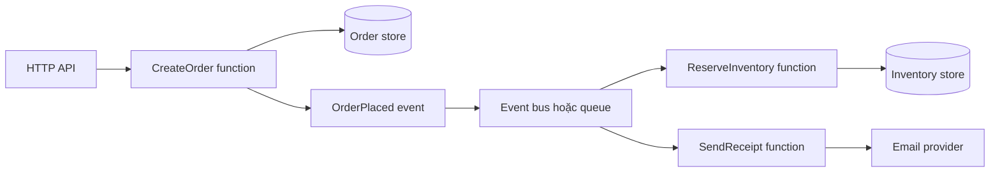

# Thiết kế function đơn nhiệm và hạn chế phụ thuộc chéo

Trong kiến trúc serverless, function thường là đơn vị triển khai, cấp quyền, mở rộng và theo dõi lỗi. Cách chia function vì thế ảnh hưởng trực tiếp đến khả năng thay đổi hệ thống, độ tin cậy và chi phí vận hành. Một function được thiết kế tốt có một mục đích nghiệp vụ rõ ràng, sở hữu một hợp đồng đầu vào và đầu ra dễ hiểu, đồng thời có thể được triển khai và mở rộng mà không buộc nhiều phần không liên quan phải thay đổi cùng lúc.

Đơn nhiệm không có nghĩa là mỗi function chỉ được thực hiện một câu lệnh hoặc gọi một dịch vụ. Function có thể thực hiện nhiều bước nếu các bước đó cùng phục vụ một kết quả nghiệp vụ và cần chung ranh giới nhất quán, quyền truy cập, chính sách retry hoặc đặc tính tải. Mục tiêu là giữ các phần có lý do thay đổi khác nhau ở những ranh giới độc lập, đồng thời tránh chia nhỏ đến mức một thao tác đơn giản phải đi qua quá nhiều lần gọi mạng.

## 1. Xác định đúng trách nhiệm của function

Hãy bắt đầu từ kết quả nghiệp vụ mà một lần kích hoạt cần tạo ra, sau đó xác định trigger và hợp đồng xử lý. Trong hệ thống Java serverless, trigger thường là HTTP request, message từ queue hoặc event do một dịch vụ khác phát ra. Mỗi loại trigger có cách giao nhận, thời hạn xử lý và cơ chế lỗi khác nhau; chúng không nên bị che giấu trong một function tổng hợp nếu chính sách vận hành của chúng khác nhau.

Một function có trách nhiệm rõ ràng thường trả lời được các câu hỏi sau:

- Nó phục vụ khả năng nghiệp vụ nào, chẳng hạn tạo đơn hàng, ghi nhận thanh toán hoặc gửi thông báo?
- Nó nhận loại dữ liệu nào và hợp đồng đó được phiên bản hóa ra sao?
- Thành công có nghĩa là điều gì đã được hoàn tất hoặc được ghi nhận?
- Lỗi nào có thể retry, lỗi nào cần trả về cho caller hoặc đưa vào dead-letter queue (DLQ)?
- Function cần quyền truy cập đến tài nguyên nào?
- Tải, độ trễ và yêu cầu sẵn sàng của nó có khác các chức năng lân cận không?

Nếu một function vừa xử lý HTTP, vừa tiêu thụ queue, vừa chạy lịch định kỳ, lại dùng chung một nhánh điều kiện lớn để phân loại công việc, đó thường là dấu hiệu các trách nhiệm đang bị trộn lẫn. Những trigger này có thể cần timeout, retry, xác thực, giới hạn đồng thời và cách phản hồi khác nhau. Tách adapter theo trigger giúp mỗi hợp đồng được thể hiện rõ và giúp lỗi ở một luồng ít ảnh hưởng đến luồng khác.

### Ranh giới theo lý do thay đổi

Nên cân nhắc tách function khi một phần có thể thay đổi độc lập, có chủ sở hữu khác, cần quyền truy cập khác, có mô hình tải khác hoặc cần chính sách retry và timeout khác. Ví dụ, xử lý yêu cầu tạo đơn hàng cần phản hồi HTTP nhanh, trong khi gửi email có thể chạy bất đồng bộ và retry trong thời gian dài. Hai công việc này có vòng đời và cách xử lý lỗi khác nhau nên phù hợp với hai function.

Ngược lại, không nên tách chỉ vì một function có nhiều bước nội bộ. Nếu kiểm tra quy tắc đơn hàng, tính tổng tiền và ghi đơn hàng là một ca sử dụng cần cùng quyết định nghiệp vụ, chúng có thể ở trong cùng một luồng ứng dụng. Việc tách chúng thành nhiều function chỉ để mỗi function làm một thao tác nhỏ sẽ tạo thêm giao tiếp mạng, độ trễ, điểm lỗi và chi phí điều phối.

| Tiêu chí | Nên giữ cùng một function | Nên cân nhắc tách function |
|---|---|---|
| Mục tiêu nghiệp vụ | Các bước cùng tạo một kết quả nghiệp vụ | Các bước phục vụ kết quả hoặc khả năng độc lập |
| Tính nhất quán | Cần cùng một ranh giới ghi nhận hoặc quyết định | Có thể giao tiếp qua hợp đồng bền vững, bất đồng bộ |
| Trigger và phản hồi | Cùng loại trigger, timeout và cách phản hồi | HTTP, queue, lịch hoặc event có chính sách khác nhau |
| Retry và lỗi | Cần được retry như một đơn vị | Có thể thành công/thất bại độc lập |
| Quyền truy cập | Cùng tập quyền tối thiểu | Cần tách quyền hoặc ranh giới bảo mật |
| Tải và hiệu năng | Cùng đặc tính tải và yêu cầu độ trễ | Cần mở rộng, giới hạn đồng thời hoặc tối ưu riêng |
| Vận hành và sở hữu | Cùng nhóm chịu trách nhiệm và vòng đời | Có thể triển khai, theo dõi hoặc phát hành độc lập |

## 2. Tách adapter khỏi logic nghiệp vụ

Một function thường nhận dữ liệu từ nền tảng, chuyển dữ liệu đó thành lệnh nghiệp vụ, gọi logic ứng dụng và chuyển kết quả thành phản hồi hoặc trạng thái xử lý. Nếu toàn bộ việc phân tích HTTP, đọc message, kiểm tra quy tắc, truy cập cơ sở dữ liệu và gọi dịch vụ ngoài nằm trong một handler lớn, logic nghiệp vụ sẽ phụ thuộc trực tiếp vào công nghệ kích hoạt.

Có thể tổ chức mã Java theo các lớp trách nhiệm sau:

1. **Adapter đầu vào** đọc cấu trúc đặc thù của trigger, xác thực dữ liệu ở biên và ánh xạ sang lệnh hoặc sự kiện nội bộ.
2. **Ca sử dụng ứng dụng** điều phối một hành động nghiệp vụ, xác định thứ tự các bước và ranh giới giao tiếp với các cổng phụ thuộc.
3. **Miền nghiệp vụ** chứa quy tắc, trạng thái và bất biến quan trọng của nghiệp vụ; phần này không cần biết HTTP, queue hay nhà cung cấp cloud.
4. **Adapter đầu ra** triển khai các cổng để truy cập cơ sở dữ liệu, gọi API, phát event hoặc ghi log theo công nghệ cụ thể.

Ví dụ dưới đây minh họa một ca sử dụng tạo đơn hàng. Các interface là hợp đồng nội bộ để ca sử dụng không phụ thuộc trực tiếp vào thư viện HTTP hoặc SDK của nhà cung cấp cloud.

```java
import java.math.BigDecimal;
import java.util.List;
import java.util.Optional;

public record OrderLine(String productId, int quantity, BigDecimal unitPrice) {}

public record PlaceOrderCommand(
        String customerId,
        List<OrderLine> lines,
        String idempotencyKey
) {}

public record PlaceOrderResult(String orderId, BigDecimal total) {}

public interface OrderRepository {
    Optional<PlaceOrderResult> findResultByIdempotencyKey(String key);
    PlaceOrderResult saveIfAbsent(Order order);
}

public final class PlaceOrder {
    private final OrderRepository orders;

    public PlaceOrder(OrderRepository orders) {
        this.orders = orders;
    }

    public PlaceOrderResult execute(PlaceOrderCommand command) {
        if (command.idempotencyKey() == null || command.idempotencyKey().isBlank()) {
            throw new IllegalArgumentException("idempotencyKey is required");
        }
        Optional<PlaceOrderResult> previous =
                orders.findResultByIdempotencyKey(command.idempotencyKey());
        if (previous.isPresent()) {
            return previous.get();
        }

        Order order = Order.create(command.customerId(), command.lines(), command.idempotencyKey());
        return orders.saveIfAbsent(order);
    }
}
```

`Order` và các lớp adapter cụ thể được lược bỏ để tập trung vào ranh giới phụ thuộc. `saveIfAbsent` phải được triển khai bằng ràng buộc duy nhất hoặc thao tác ghi có điều kiện, sau đó trả lại kết quả đã lưu nếu một invocation khác thắng cuộc đua ghi cùng khóa. Cách này giúp request lặp lại nhận cùng kết quả và không tạo đơn mới. Các side effect như ủy quyền thanh toán nên có khóa idempotency riêng ở hệ thống đích hoặc được điều phối qua workflow/outbox; ví dụ trên chỉ minh họa việc tạo đơn trong một ranh giới lưu trữ.

Handler HTTP chỉ chuyển request thành `PlaceOrderCommand`, gọi ca sử dụng và ánh xạ kết quả sang mã trạng thái HTTP. Consumer của queue hoặc event có thể gọi một ca sử dụng khác phù hợp với trách nhiệm của nó. Cả hai adapter có thể dùng chung một thư viện miền hoặc ứng dụng ổn định nếu chúng thực sự chia sẻ quy tắc; chúng không nên phụ thuộc vào lớp handler của nhau.

## 3. Hạn chế phụ thuộc chéo giữa các function

Phụ thuộc chéo xuất hiện khi một function cần biết chi tiết triển khai, cấu trúc dữ liệu nội bộ hoặc vòng đời triển khai của function khác. Ví dụ, function A gọi trực tiếp endpoint riêng của function B và phải biết chính xác payload, mã lỗi, timeout cùng cách xác thực của B. Khi B đổi hợp đồng, A cũng phải sửa và phát hành lại. Chuỗi gọi đồng bộ dài còn khiến độ trễ và lỗi của các dịch vụ phía sau truyền ngược về caller.

### Giao tiếp qua hợp đồng rõ ràng

Các function nên trao đổi thông qua hợp đồng được công bố và quản lý phiên bản. Tùy yêu cầu, hợp đồng có thể là:

- API đồng bộ khi caller cần kết quả ngay, cần kiểm tra quyền và có thể xử lý timeout hoặc lỗi từ dịch vụ đích.
- Message hoặc event bất đồng bộ khi caller chỉ cần công bố một sự kiện hay yêu cầu công việc, còn bên nhận có thể xử lý độc lập.
- Workflow/orchestrator khi cần điều phối nhiều bước, chờ kết quả, rẽ nhánh, timeout hoặc xử lý bù trừ có trạng thái.

Event nên mô tả điều đã xảy ra, chẳng hạn `OrderPlaced`, trong khi command mô tả công việc được yêu cầu, chẳng hạn `SendOrderReceipt`. Tên và ý nghĩa rõ ràng giúp consumer không phải suy đoán ý định từ một payload tổng quát. Schema cần có phiên bản hoặc quy tắc tương thích; khi thêm field, consumer cũ nên tiếp tục hoạt động nếu field mới không bắt buộc. Khi đổi ý nghĩa field hoặc loại bỏ dữ liệu, cần có kế hoạch chuyển đổi và triển khai theo giai đoạn.



Trong ví dụ này, function tạo đơn hàng sở hữu việc ghi nhận đơn và phát sự kiện `OrderPlaced`. Function giữ kho và function gửi biên nhận tiêu thụ sự kiện theo nhu cầu riêng. Nếu gửi email tạm thời lỗi, việc xử lý giữ kho vẫn có thể tiếp tục. Mỗi consumer có thể mở rộng, retry và cấp quyền riêng. Hệ thống vẫn cần xác định rõ trạng thái nghiệp vụ khi một consumer thất bại, ví dụ đơn hàng ở trạng thái chờ giữ kho hoặc cần quy trình bù trừ.

### Tránh chuỗi gọi đồng bộ không cần thiết

Một chuỗi A gọi B, B gọi C, C gọi D làm tăng tổng thời gian phản hồi và số điểm có thể thất bại. Timeout ở một tầng có thể khiến tầng trước hết thời gian dù công việc phía sau vẫn tiếp tục. Nếu caller retry trong khi lần gọi trước chưa rõ kết quả, tác vụ có thể bị thực hiện hai lần.

Hãy dùng gọi đồng bộ khi cần phản hồi tức thời và chuỗi phụ thuộc ngắn, có timeout rõ ràng. Dùng queue hoặc event khi công việc có thể tách khỏi request ban đầu. Dùng workflow khi cần theo dõi tiến trình nhiều bước. Không chuyển mọi lời gọi sang bất đồng bộ một cách máy móc: nếu caller cần quyết định ngay dựa trên kết quả, việc ẩn kết quả sau một event sẽ làm hợp đồng khó hiểu hơn.

### Dùng thư viện dùng chung có chọn lọc

Thư viện Java dùng chung có ích cho mã ổn định như kiểu dữ liệu hợp đồng, quy tắc định dạng hoặc tiện ích kỹ thuật đã được kiểm soát. Tuy nhiên, một thư viện chứa nhiều quy tắc nghiệp vụ và được nhiều function cùng nhập có thể khiến các function phải nâng phiên bản đồng thời. Thay đổi nhỏ trong thư viện cũng có thể kéo theo việc đóng gói và phát hành lại hàng loạt function.

Trước khi đưa mã vào thư viện dùng chung, hãy kiểm tra liệu các bên có thật sự cần cùng một quy tắc và có thể chấp nhận cùng nhịp phát hành hay không. Giữ dependency graph gọn, khóa phiên bản thư viện, theo dõi lỗ hổng phụ thuộc và tránh để một module tiện ích trở thành nơi chứa mọi logic. Hợp đồng tích hợp nên được quản lý độc lập với chi tiết triển khai của từng consumer.

## 4. Thiết kế trạng thái, retry và idempotency theo ranh giới xử lý

Function serverless có thể được gọi lại do timeout, lỗi tạm thời, nền tảng giao nhận message hoặc caller không nhận được phản hồi. Với nhiều hệ thống event và queue, giao nhận thường có ngữ nghĩa ít nhất một lần (at-least-once). Vì vậy, cùng một message có thể đến nhiều lần. Không nên giả định mỗi event chỉ được xử lý đúng một lần.

Idempotency nghĩa là khi cùng một yêu cầu được xử lý lặp lại, trạng thái nghiệp vụ cuối cùng vẫn tương đương với việc xử lý một lần. Để đạt điều đó:

1. Xác định khóa idempotency ổn định từ request hoặc event, chẳng hạn `eventId`, mã giao dịch hoặc khóa do client gửi.
2. Lưu dấu đã xử lý cùng kết quả hoặc trạng thái xử lý trong kho dữ liệu bền vững.
3. Dùng ghi có điều kiện, ràng buộc duy nhất hoặc giao dịch để tránh hai invocation đồng thời cùng xử lý một khóa.
4. Khi gọi hệ thống ngoài, truyền khóa idempotency nếu hệ thống đó hỗ trợ; nếu không, thiết kế bước đối soát hoặc bù trừ.
5. Xác định thời gian lưu dấu xử lý dựa trên cửa sổ retry và thời gian một event có thể được phát lại.

Biến toàn cục hoặc bộ nhớ trong một execution environment không phải nơi lưu trạng thái idempotency. Nền tảng có thể tái sử dụng instance, tạo instance mới hoặc chạy nhiều instance song song. Dữ liệu trong bộ nhớ chỉ nên phục vụ cache không bắt buộc hoặc đối tượng dùng chung an toàn giữa các invocation.

Retry cần có giới hạn, khoảng chờ tăng dần và jitter nếu phù hợp để tránh nhiều instance cùng retry một lúc. Phân biệt lỗi tạm thời như mất kết nối ngắn hạn với lỗi dữ liệu không thể khắc phục bằng retry. Message lỗi kéo dài nên được chuyển đến DLQ hoặc nơi lưu trữ để điều tra và phát lại có kiểm soát. Với batch, cần xác định cách báo lỗi từng bản ghi nếu nền tảng hỗ trợ partial batch response; nếu chỉ báo lỗi cả batch, các bản ghi đã thành công có thể bị giao lại.

Ranh giới function quyết định đơn vị retry. Nếu một function thực hiện ba side effect rồi thất bại ở bước cuối, lần retry có thể lặp lại hai side effect đầu. Có thể giảm rủi ro bằng cách chia các bước có thể thất bại độc lập thành các message riêng, lưu tiến trình trong workflow hoặc dùng outbox để ghi thay đổi dữ liệu và sự kiện trong cùng giao dịch cục bộ. Việc tách phải đi kèm thiết kế trạng thái và bù trừ để hệ thống không rơi vào trạng thái nghiệp vụ mơ hồ.

## 5. Quản lý trạng thái và quyền truy cập độc lập

Function nên được thiết kế gần với mô hình stateless: mỗi invocation nhận đủ dữ liệu cần thiết từ request, event hoặc kho trạng thái bền vững. Không dựa vào thứ tự hai invocation chạy trên cùng instance, cũng không dùng biến static để lưu thông tin người dùng, giỏ hàng hoặc tiến trình nghiệp vụ. Có thể tái sử dụng client kết nối, bộ chuyển đổi cấu hình bất biến hoặc cache có giới hạn nếu chúng an toàn khi nhiều invocation dùng chung.

Trong Java, khởi tạo client và dependency dùng chung ngoài phương thức handler có thể giảm công việc lặp lại trong mỗi invocation. Những đối tượng đó phải an toàn luồng và không giữ dữ liệu riêng của request. Dữ liệu nhạy cảm theo người dùng phải được lấy từ danh tính đã xác thực và kho lưu trữ thích hợp, không được lưu trong field static hoặc log.

Mỗi function nên có danh tính thực thi và quyền tối thiểu phù hợp với nhiệm vụ. Function chỉ gửi email không cần quyền ghi vào kho đơn hàng; function giữ kho không cần quyền đọc bí mật thanh toán nếu không sử dụng. Tách function theo ranh giới quyền giúp giảm phạm vi ảnh hưởng khi một function bị khai thác hoặc cấu hình sai. Secrets nên được quản lý qua dịch vụ quản lý bí mật hoặc cơ chế cấu hình an toàn của nền tảng, với quyền đọc được cấp riêng.

Không nên dùng một execution role quá rộng cho mọi function chỉ để đơn giản hóa triển khai. Khi nhiều function dùng chung role, việc rà soát quyền và xác định nguồn gốc một hành động trở nên khó hơn. Hãy cấp quyền theo tài nguyên, hành động và môi trường; rà soát quyền khi trách nhiệm function thay đổi.

## 6. Tác động đến cold start, mở rộng và chi phí

Tách function tạo khả năng mở rộng độc lập. Ví dụ, lượng event giữ kho có thể tăng mạnh trong khi lượng yêu cầu gửi biên nhận vẫn thấp. Hai consumer riêng cho phép giới hạn concurrency và phân bổ tài nguyên theo tải thực tế. Nhưng mỗi ranh giới mới cũng có thể tạo thêm lần gọi, message, lần ghi dữ liệu, cấu hình, log và công việc triển khai.

Với Java, cold start có thể chịu ảnh hưởng bởi kích thước artifact, số dependency, công việc khởi tạo static, framework và runtime. Giữ dependency gọn, tránh quét classpath hoặc khởi tạo kết nối không cần thiết, và khởi tạo các client có thể tái sử dụng ở đúng vòng đời là những cách giảm thời gian khởi động. Cần đo trên runtime và cấu hình triển khai thực tế vì kết quả phụ thuộc nền tảng, mức tài nguyên và đặc điểm ứng dụng. Các biện pháp như provisioned concurrency hoặc native compilation chỉ nên chọn sau khi đo độ trễ và chi phí.

Chi phí FaaS thường chịu ảnh hưởng bởi số request, thời gian thực thi, cấu hình bộ nhớ hoặc CPU, số lần truyền message, dịch vụ tích hợp, lưu trữ và quan sát hệ thống. Một thiết kế chia nhỏ quá mức có thể tăng số invocation và giao tiếp giữa các function. Một function quá lớn có thể giữ tài nguyên lâu, mở rộng theo một phần tải không cần thiết hoặc buộc mọi luồng cùng chịu một cấu hình.

Khi tách function, hãy đánh giá tổng chi phí của cả luồng: thời gian chạy của từng function, số message, số lần gọi API, lưu lượng mạng, retry, log và chi phí dịch vụ điều phối. Đặt giới hạn concurrency để bảo vệ cơ sở dữ liệu và API phía sau. Queue có thể hấp thụ đỉnh tải, nhưng cần kiểm soát tốc độ tiêu thụ để không làm quá tải downstream. Theo dõi độ dài queue, tuổi message lâu nhất, tỷ lệ lỗi, thời gian xử lý và số lần retry để phát hiện tắc nghẽn.

## 7. Quan sát và phát hành theo ranh giới độc lập

Mỗi function cần log có cấu trúc, metric và trace đủ để trả lời: invocation đến từ đâu, đang xử lý yêu cầu nghiệp vụ nào, kết quả là gì và lỗi phát sinh ở bước nào. Truyền correlation ID hoặc trace context qua API, message và event để nối các bước trong một luồng. Không ghi token, secret, dữ liệu thanh toán hoặc thông tin cá nhân không cần thiết vào log.

Theo dõi cả metric kỹ thuật lẫn metric nghiệp vụ. Metric kỹ thuật gồm invocation, duration, error, throttling, concurrency, cold start nếu nền tảng cung cấp và DLQ depth. Metric nghiệp vụ có thể gồm số đơn tạo thành công, số thanh toán bị từ chối hoặc số event quá hạn. Khi một function có trách nhiệm hẹp, các metric này dễ gắn với một kết quả và một nhóm sở hữu hơn.

Hợp đồng giữa các function cần tương thích trong quá trình phát hành. Một cách triển khai an toàn là mở rộng schema trước, triển khai consumer có thể đọc cả dữ liệu cũ và mới, sau đó mới phát hành producer gửi field hoặc phiên bản mới. Chỉ loại bỏ field cũ khi mọi consumer đã chuyển đổi. Nếu cần thay đổi không tương thích, dùng phiên bản hợp đồng hoặc luồng chuyển tiếp có thời hạn, đồng thời xác định cách rollback.

## 8. Các kiểu thiết kế dễ gây vấn đề

| Kiểu thiết kế | Hệ quả | Hướng điều chỉnh |
|---|---|---|
| Một function xử lý mọi trigger và nghiệp vụ | Handler nhiều nhánh, quyền rộng, timeout và retry khó thống nhất | Tách theo trách nhiệm và hợp đồng trigger |
| Một function cho từng thao tác rất nhỏ | Nhiều lần gọi mạng, độ trễ và chi phí điều phối tăng | Giữ các bước cùng ca sử dụng và ranh giới nhất quán |
| Function gọi trực tiếp sâu qua nhiều function khác | Lỗi và độ trễ lan truyền, khó retry an toàn | Dùng API có giới hạn hoặc message/event/workflow phù hợp |
| Chia sẻ cơ sở dữ liệu nội bộ mà không có hợp đồng | Consumer phụ thuộc schema và cách ghi của producer | Công bố hợp đồng dữ liệu, kiểm soát quyền và thay đổi schema |
| Dùng biến static làm trạng thái nghiệp vụ | Dữ liệu mất khi instance thay đổi và có thể lẫn giữa invocation | Lưu trạng thái bền vững với thao tác đồng thời an toàn |
| Retry toàn bộ side effect mà không có idempotency | Có thể tạo đơn, trừ tiền hoặc gửi thông báo nhiều lần | Dùng khóa idempotency, ghi có điều kiện và bù trừ |
| Dùng chung role và thư viện quá rộng | Tăng phụ thuộc triển khai và phạm vi quyền | Thu hẹp quyền, chia module và quản lý phiên bản rõ ràng |

## 9. Quy trình thiết kế một luồng serverless

Khi bắt đầu thiết kế, có thể đi theo trình tự sau:

1. **Mô tả kết quả nghiệp vụ.** Viết rõ điều gì phải đúng sau khi invocation thành công.
2. **Chọn trigger và hợp đồng.** Xác định HTTP, queue, event hay lịch; mô tả payload, xác thực và phiên bản.
3. **Xác định ranh giới nhất quán.** Ghi rõ dữ liệu nào cần được cập nhật cùng nhau, side effect nào có thể tách và bước nào cần bù trừ.
4. **Chọn ranh giới function.** Dựa trên lý do thay đổi, quyền, retry, timeout, tải, chủ sở hữu và yêu cầu triển khai.
5. **Định nghĩa giao tiếp.** Chọn API, message, event hoặc workflow; tránh phụ thuộc vào cấu trúc nội bộ của function khác.
6. **Thiết kế xử lý lặp và lỗi.** Chọn idempotency key, nơi lưu trạng thái, retry, DLQ, timeout và cách phát lại.
7. **Định nghĩa quyền và quan sát.** Cấp quyền tối thiểu; thêm correlation ID, log, metric và cảnh báo gắn với mục tiêu nghiệp vụ.
8. **Đo hiệu năng và chi phí.** Kiểm tra cold start, concurrency, tải downstream, số invocation và chi phí của toàn luồng.

Trước khi chốt thiết kế, hãy thử trả lời một tình huống lỗi cụ thể: request tạo đơn đã ghi dữ liệu nhưng phản hồi HTTP bị timeout; caller gửi lại request. Hệ thống có nhận ra yêu cầu trùng không? Nếu event `OrderPlaced` được giao hai lần, consumer giữ kho có giữ hàng hai lần không? Nếu consumer gửi email thất bại, đơn hàng có bị tạo lại không? Nếu không thể trả lời rõ ràng, ranh giới xử lý hoặc cơ chế trạng thái vẫn cần được hoàn thiện.

## 10. Ví dụ quyết định ranh giới

Giả sử một ứng dụng bán hàng có các bước tạo đơn, giữ hàng, xác nhận thanh toán và gửi biên nhận. Có thể thiết kế luồng như sau:

- Function HTTP tạo đơn kiểm tra request, áp dụng quy tắc tạo đơn và lưu trạng thái ban đầu. Nó trả về mã đơn cùng trạng thái tiếp nhận.
- Event `OrderPlaced` được phát sau khi đơn được ghi nhận. Outbox hoặc cơ chế tương đương giúp tránh trường hợp dữ liệu đã commit nhưng event không được phát.
- Function giữ hàng tiêu thụ event, dùng `eventId` hoặc khóa nghiệp vụ để chống xử lý lặp, rồi ghi kết quả giữ hàng.
- Workflow hoặc các event trạng thái tiếp theo điều phối bước thanh toán và xử lý kết quả thành công/thất bại. Nếu cần hoàn tác giữ hàng, đó là một hành động bù trừ có trạng thái riêng.
- Function gửi biên nhận tiêu thụ event xác nhận phù hợp. Lỗi gửi email được retry độc lập và không làm phát sinh lại đơn hàng.

Trong thiết kế này, mỗi function có một trách nhiệm và quyền truy cập riêng. Các bước liên kết bằng hợp đồng và trạng thái nghiệp vụ có thể quan sát được. Việc chia function chỉ có ý nghĩa khi các ranh giới đó tương ứng với khả năng độc lập về retry, tải, quyền hoặc vòng đời; nếu quy mô nhỏ và các bước cần cùng một giao dịch, giữ chúng trong một ca sử dụng có thể đơn giản và đáng tin cậy hơn.

## Kết luận

Thiết kế function đơn nhiệm là tìm ranh giới phù hợp giữa tính gắn kết và tính độc lập. Hãy gom các bước cùng phục vụ một kết quả nghiệp vụ, cần chung ranh giới nhất quán và có cùng chính sách vận hành. Hãy tách các trách nhiệm có trigger, quyền, tải, retry hoặc vòng đời khác nhau. Giữa các function, dùng hợp đồng rõ ràng, quản lý phiên bản và thiết kế idempotency cho giao nhận lặp. Khi ranh giới được chọn đúng, hệ thống Java serverless dễ mở rộng, kiểm soát lỗi, cấp quyền và tính chi phí hơn.
