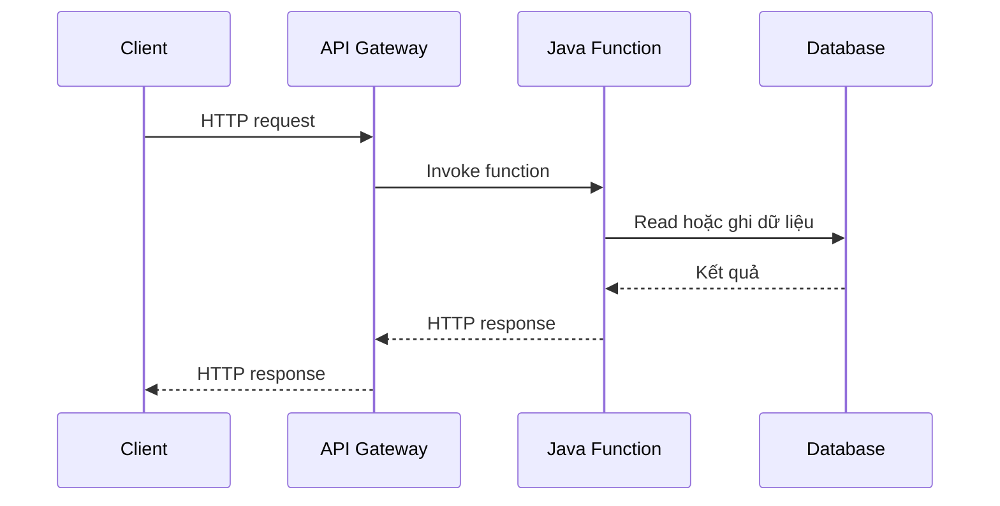
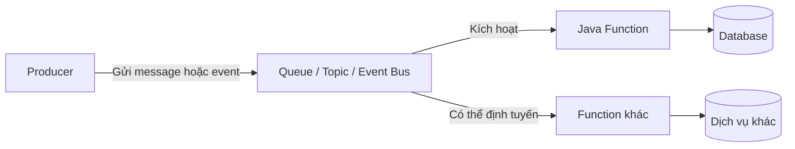
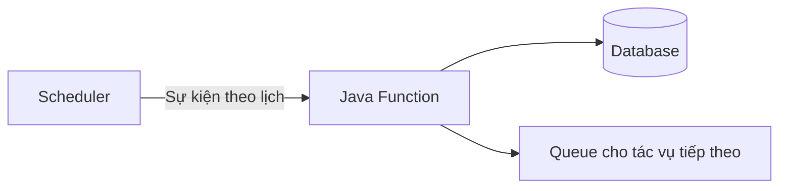
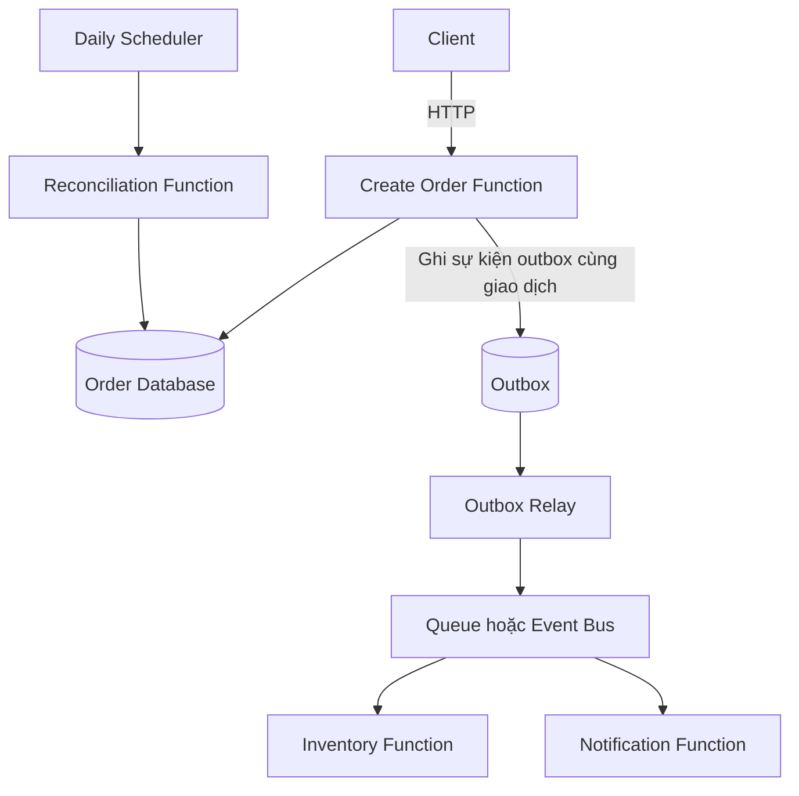

# Kiến trúc đồng bộ, bất đồng bộ và xử lý theo lịch

Trong ứng dụng serverless, một function thường được thực thi khi có yêu cầu HTTP, khi một thông điệp hoặc sự kiện xuất hiện, hoặc khi đến thời điểm đã đặt lịch. Cách kích hoạt quyết định cách các thành phần giao tiếp, cách lỗi được truyền đi, cách hệ thống mở rộng và cách tính chi phí.

Khi phát triển và triển khai Java function theo mô hình FaaS, cần chọn kiểu kiến trúc theo yêu cầu của nghiệp vụ. Một yêu cầu cần kết quả ngay thường phù hợp với xử lý đồng bộ. Một công việc có thể hoàn tất sau, cần tách rời khỏi luồng người dùng hoặc cần phân phối cho nhiều bộ xử lý thường phù hợp với xử lý bất đồng bộ. Công việc lặp lại theo giờ hoặc ngày phù hợp với bộ lập lịch. Một hệ thống thực tế thường kết hợp cả ba kiểu.

## 1. Ba cách kích hoạt function

### 1.1. Kiến trúc đồng bộ: yêu cầu và phản hồi

Trong kiến trúc đồng bộ, bên gọi gửi yêu cầu và chờ function xử lý xong để nhận phản hồi. Với HTTP, luồng thường đi qua API Gateway hoặc HTTP endpoint của nền tảng, sau đó đến function và các dịch vụ mà function cần sử dụng.



Kiểu này phù hợp khi bên gọi cần kết quả để tiếp tục: đọc thông tin, kiểm tra dữ liệu, tạo một bản ghi đơn giản hoặc xác nhận một thao tác. Hợp đồng HTTP nên thể hiện rõ mã trạng thái, cấu trúc dữ liệu trả về và lỗi có thể xảy ra.

Ví dụ, API tạo đơn hàng có thể xác thực dữ liệu, ghi đơn hàng và trả về mã đơn hàng. Nếu xử lý tiếp theo như gửi email, tạo vận đơn hoặc đồng bộ với hệ thống kế toán mất nhiều thời gian, API không nên giữ kết nối mở chỉ để chờ tất cả công việc đó. API có thể trả về `201 Created` khi tài nguyên đã được tạo, rồi phát sự kiện để các bước phụ chạy bất đồng bộ. Với một công việc dài chưa thể hoàn tất ngay, API có thể trả `202 Accepted` cùng `jobId`; client dùng một endpoint trạng thái để kiểm tra tiến độ.

Ưu điểm của xử lý đồng bộ là luồng đơn giản và kết quả xuất hiện ngay trong phản hồi. Đổi lại, thời gian xử lý nằm trên đường đi của request. Client có thể gặp timeout khi function khởi động chậm, phụ thuộc bên ngoài phản hồi chậm hoặc tác vụ vượt giới hạn thời gian của nền tảng. Lỗi từ function cũng thường được truyền trực tiếp về bên gọi, khiến hai phía phụ thuộc chặt vào nhau về tính sẵn sàng.

Vì vậy, đường xử lý đồng bộ nên ngắn, có giới hạn thời gian rõ ràng và chỉ gọi những phụ thuộc cần thiết để trả lời request. Không nên nối quá nhiều function đồng bộ thành một chuỗi dài nếu có thể chuyển phần việc độc lập sang hàng đợi hoặc sự kiện.

### 1.2. Kiến trúc bất đồng bộ: gửi thông điệp hoặc phát sự kiện

Trong kiến trúc bất đồng bộ, bên gửi chuyển một thông điệp hoặc sự kiện cho dịch vụ trung gian rồi tiếp tục công việc của mình. Function tiêu thụ thông điệp được kích hoạt sau đó. Bên gửi không cần giữ kết nối đến khi toàn bộ quá trình hoàn tất.



Các dịch vụ trung gian có vai trò khác nhau:

- **Queue (hàng đợi)** giữ thông điệp cho đến khi consumer xử lý và xác nhận. Nhiều instance của cùng một consumer có thể chia nhau xử lý để tăng thông lượng. Queue hữu ích khi cần đệm tải và điều tiết tốc độ xử lý.
- **Topic hoặc cơ chế pub/sub** phân phối một sự kiện đến nhiều nhóm subscriber độc lập. Ví dụ, sự kiện `OrderCreated` có thể được gửi đến bộ xử lý kho, dịch vụ thông báo và hệ thống phân tích.
- **Event bus** thường định tuyến sự kiện theo loại sự kiện, nguồn phát hoặc thuộc tính trong payload. Nó phù hợp khi nhiều dịch vụ cần trao đổi sự kiện theo các quy tắc định tuyến.

Kiến trúc bất đồng bộ giảm phụ thuộc thời gian giữa producer và consumer. Nếu consumer tạm thời chậm hoặc không sẵn sàng, queue có thể giữ thông điệp để xử lý sau, tùy cấu hình và giới hạn lưu trữ của dịch vụ. Tuy nhiên, việc hoàn tất không còn nằm trong phản hồi ban đầu. Hệ thống phải chấp nhận độ trễ, theo dõi trạng thái xử lý và có cách xử lý thông điệp thất bại.

Một điểm cần thiết kế rõ là **ngữ nghĩa giao nhận**. Nhiều nguồn sự kiện và queue phổ biến giao thông điệp theo kiểu *at least once*: một thông điệp có thể được giao lại nếu consumer xử lý xong nhưng chưa xác nhận thành công, hoặc nền tảng không nhận được xác nhận. Vì vậy, consumer phải chịu được việc nhận cùng một sự kiện nhiều lần. Không nên giả định rằng mỗi sự kiện chỉ chạy đúng một lần.

### 1.3. Kiến trúc theo lịch: kích hoạt theo thời gian

Với xử lý theo lịch, một dịch vụ scheduler phát sự kiện vào thời điểm hoặc chu kỳ đã cấu hình. Function được gọi theo lịch đó, chẳng hạn mỗi năm phút, lúc nửa đêm hoặc vào ngày đầu tháng.



Các trường hợp thường gặp gồm tổng hợp báo cáo hằng ngày, dọn dữ liệu hết hạn, đối soát giao dịch, đồng bộ dữ liệu định kỳ và kiểm tra các bản ghi đang chờ xử lý. Scheduler chỉ chịu trách nhiệm xác định thời điểm kích hoạt; phần nghiệp vụ vẫn nằm trong function hoặc dịch vụ mà function gọi.

Không nên giữ một function chạy liên tục chỉ để chờ đến giờ thực hiện công việc. Cách làm đó tiêu tốn tài nguyên trong thời gian chờ và không tận dụng mô hình kích hoạt theo sự kiện. Hãy dùng dịch vụ lập lịch của nền tảng để gọi function khi đến hạn.

Khi thiết kế lịch, cần xác định múi giờ, quy tắc giờ mùa hè nếu có, hành vi khi lịch bị trễ hoặc bỏ lỡ, và khả năng hai lần chạy bị chồng lấn. Sự kiện theo lịch cũng có thể được gửi lại hoặc chạy trùng tùy dịch vụ và cấu hình, do đó tác vụ vẫn cần idempotency. Nếu tác vụ chỉ được phép chạy một lần cho mỗi ngày nghiệp vụ, hãy dùng khóa duy nhất theo ngày hoặc cơ chế lease/lock có thời hạn để ngăn hai instance cùng xử lý.

## 2. So sánh và chọn kiểu kiến trúc

| Tiêu chí | Đồng bộ | Bất đồng bộ | Theo lịch |
|---|---|---|---|
| Cách kích hoạt | Request, thường là HTTP | Message hoặc event | Mốc thời gian hoặc chu kỳ |
| Bên gọi chờ kết quả? | Có | Thường không | Không có client chờ trực tiếp |
| Phù hợp với | API cần phản hồi ngay | Công việc nền, xử lý phân tán, fan-out | Báo cáo, dọn dẹp, đối soát định kỳ |
| Ghép nối giữa các thành phần | Chặt theo thời gian phản hồi | Lỏng hơn nhờ broker | Lỏng theo thời điểm chạy |
| Cần chú ý | Timeout, cold start, lỗi phản hồi | Giao trùng, retry, DLQ, thứ tự | Múi giờ, chạy trễ, chạy chồng lấn |
| Cách quan sát | Latency, tỷ lệ lỗi, timeout | Queue depth, tuổi message, retry, DLQ | Lần chạy gần nhất, độ trễ lịch, kết quả từng lần chạy |

Có thể dùng ba câu hỏi để chọn nhanh:

1. Bên gọi có cần kết quả ngay để quyết định bước tiếp theo không? Nếu có, ưu tiên xử lý đồng bộ và giữ đường request ngắn.
2. Công việc có thể hoàn tất sau, cần đệm tải, cần retry độc lập hoặc cần nhiều consumer cùng phản ứng không? Nếu có, dùng queue, topic hoặc event bus.
3. Công việc có phụ thuộc vào thời điểm hoặc chu kỳ cố định không? Nếu có, dùng scheduler để kích hoạt function.

Không phải mọi tác vụ nền đều cần event bus. Một queue đơn giản có thể đủ nếu chỉ có một nhóm consumer cần xử lý. Ngược lại, nếu nhiều dịch vụ cần phản ứng độc lập với cùng một sự kiện nghiệp vụ, pub/sub hoặc event bus thường phù hợp hơn. Hãy chọn cơ chế nhỏ nhất đáp ứng được nhu cầu định tuyến, lưu giữ, thứ tự và khả năng mở rộng.

## 3. Kết hợp ba kiểu trong một hệ thống

Xét quy trình đặt hàng. Client gọi API đồng bộ để tạo đơn. Function kiểm tra dữ liệu và ghi đơn hàng ở trạng thái `PENDING`. Sau khi giao dịch được lưu, các công việc như giữ hàng, gửi email và cập nhật hệ thống phân tích được xử lý bất đồng bộ. Một function chạy theo lịch có thể đối soát các đơn bị kẹt ở trạng thái `PENDING` quá lâu.



Trong sơ đồ, API trả lời sau khi đơn hàng được lưu. Các consumer xử lý phần việc riêng của chúng. Scheduler kiểm tra những trường hợp mà luồng sự kiện thông thường có thể chưa hoàn tất. Đây là cách kết hợp giúp request phản hồi nhanh, các bước nền mở rộng độc lập và công việc định kỳ có cơ chế phục hồi.

Nếu ứng dụng ghi đơn hàng vào database rồi mới gửi message trực tiếp, có thể xảy ra tình huống database đã commit nhưng thao tác gửi message thất bại. Ngược lại, message có thể được gửi đi nhưng giao dịch database rollback. **Transactional outbox** giải quyết khoảng trống này bằng cách ghi bản ghi nghiệp vụ và bản ghi sự kiện outbox trong cùng một giao dịch database. Một relay riêng đọc outbox và chuyển sự kiện sang broker; relay có thể gửi lại nếu gặp lỗi. Consumer vẫn phải idempotent vì relay hoặc broker có thể giao trùng.

## 4. Thiết kế function Java cho từng kiểu kích hoạt

Nên tách phần chuyển đổi sự kiện của nền tảng khỏi logic nghiệp vụ. Adapter của AWS Lambda, Azure Functions hoặc Google Cloud Functions nhận kiểu event riêng của nền tảng, kiểm tra và chuyển dữ liệu sang command/event của ứng dụng. Lõi nghiệp vụ Java có thể được kiểm thử độc lập và không phụ thuộc vào định dạng HTTP hay message cụ thể.

### 4.1. Xử lý đồng bộ qua HTTP

Ví dụ sau minh họa phần nghiệp vụ của function tạo đơn. Adapter HTTP chịu trách nhiệm chuyển request thành `CreateOrderCommand` và chuyển kết quả thành response phù hợp với runtime đang dùng.

```java
public record CreateOrderCommand(String customerId, List<String> productIds) {}

public record OrderResult(String orderId, String status) {}

public final class CreateOrderService {
    private final OrderRepository orders;

    public CreateOrderService(OrderRepository orders) {
        this.orders = orders;
    }

    public OrderResult create(CreateOrderCommand command) {
        // Xác thực nghiệp vụ và lưu đơn trong một giao dịch.
        Order order = orders.create(command.customerId(), command.productIds());
        return new OrderResult(order.id(), order.status());
    }
}
```

Ở lớp HTTP, hãy kiểm tra đầu vào, xác thực danh tính người gọi, ánh xạ lỗi nghiệp vụ sang mã HTTP nhất quán và không trả thông tin nhạy cảm trong thông báo lỗi. Nếu request có thể được gửi lại do client timeout, cân nhắc nhận `Idempotency-Key` để một lần thử lại không tạo thêm đơn hàng ngoài ý muốn.

### 4.2. Xử lý sự kiện bất đồng bộ có idempotency

Consumer nên dùng một định danh ổn định của sự kiện, chẳng hạn `eventId`, để nhận biết lần giao lại. Ví dụ dưới đây thể hiện nguyên tắc xử lý trong một giao dịch: kiểm tra sự kiện đã xử lý chưa, thực hiện thay đổi nghiệp vụ và ghi nhận `eventId`.

```java
public record OrderCreated(
        String eventId,
        String orderId,
        Instant occurredAt
) {}

public final class OrderCreatedHandler {
    private final TransactionRunner transactions;
    private final ProcessedEventRepository processedEvents;
    private final FulfillmentService fulfillment;

    public OrderCreatedHandler(
            TransactionRunner transactions,
            ProcessedEventRepository processedEvents,
            FulfillmentService fulfillment) {
        this.transactions = transactions;
        this.processedEvents = processedEvents;
        this.fulfillment = fulfillment;
    }

    public void handle(OrderCreated event) {
        transactions.run(() -> {
            if (processedEvents.exists(event.eventId())) {
                return;
            }

            fulfillment.prepare(event.orderId());
            processedEvents.insert(event.eventId());
        });
    }
}
```

`TransactionRunner` và các repository ở đây là giao diện minh họa của ứng dụng. Trong triển khai thực tế, thao tác kiểm tra, cập nhật nghiệp vụ và ghi nhận sự kiện đã xử lý cần có tính nguyên tử, thường bằng một giao dịch database và ràng buộc unique trên `eventId`. Nếu tác vụ gọi một dịch vụ bên ngoài, giao dịch database không thể tự hoàn tác tác động bên ngoài; hãy dùng idempotency key do dịch vụ đó hỗ trợ, outbox/inbox hoặc một quy trình bù trừ phù hợp.

Với batch message, cần hiểu cách runtime xác nhận thành công. Nếu một message trong batch lỗi, một số nền tảng có thể giao lại cả batch trừ khi cấu hình báo lỗi từng bản ghi. Hãy chọn kích thước batch, timeout và chính sách retry phù hợp; tránh để một message lỗi liên tục chặn các message khác.

### 4.3. Tác vụ chạy theo lịch có khóa nghiệp vụ

Một tác vụ đối soát hằng ngày có thể nhận ngày nghiệp vụ từ sự kiện scheduler hoặc tính ngày theo múi giờ đã cấu hình. Dùng ngày nghiệp vụ làm khóa giúp nhận diện lần chạy và tránh tạo kết quả trùng khi scheduler gửi lại sự kiện.

```java
public final class DailyReconciliationHandler {
    private final ReconciliationRepository reconciliations;
    private final ReconciliationService service;

    public DailyReconciliationHandler(
            ReconciliationRepository reconciliations,
            ReconciliationService service) {
        this.reconciliations = reconciliations;
        this.service = service;
    }

    public void handle(LocalDate businessDate) {
        if (reconciliations.isCompleted(businessDate)) {
            return;
        }

        service.reconcile(businessDate);
        reconciliations.markCompleted(businessDate);
    }
}
```

Đoạn mã chỉ minh họa ý tưởng. Trong hệ thống có thể có nhiều instance chạy đồng thời, thao tác kiểm tra rồi đánh dấu hoàn tất phải được bảo vệ bằng giao dịch, unique constraint hoặc lease/lock phù hợp. Nếu tác vụ kéo dài hơn thời gian chạy tối đa của một lần gọi function, hãy chia công việc thành các phần nhỏ và đưa từng phần vào queue thay vì cố giữ một lần thực thi thật dài.

## 5. Retry, lỗi và khả năng phục hồi

Retry giúp xử lý lỗi tạm thời như mất kết nối ngắn hạn hoặc dịch vụ phụ thuộc quá tải. Nhưng retry không làm cho một thao tác không an toàn trở nên an toàn. Trước khi bật retry, hãy xác định thao tác có thể được thực hiện lặp lại hay không và cách phát hiện kết quả đã hoàn tất.

- **Đồng bộ:** trả mã lỗi phù hợp để client quyết định có thử lại hay không. Với thao tác ghi dữ liệu, dùng idempotency key hoặc mã tài nguyên ổn định để request lặp không tạo tác động trùng. Không retry mù quáng các lỗi nghiệp vụ như dữ liệu không hợp lệ.
- **Bất đồng bộ:** cấu hình số lần thử, khoảng chờ tăng dần và thời hạn lưu message. Sau khi vượt ngưỡng, chuyển message lỗi sang dead-letter queue (DLQ) hoặc nơi lưu lỗi tương đương để điều tra và phát lại có kiểm soát. Theo dõi tuổi của message cũ nhất và số lượng message trong DLQ.
- **Theo lịch:** ghi lại thời điểm dự kiến, thời điểm thực sự bắt đầu, kết quả và số lần thử. Xác định rõ chính sách chạy bù khi một lần chạy bị bỏ lỡ. Với tác vụ quan trọng, cần có khả năng chạy lại một ngày cụ thể một cách an toàn.

Phân biệt lỗi tạm thời với lỗi không thể tự phục hồi. Timeout, throttling hoặc lỗi mạng có thể phù hợp với retry có giới hạn. Payload sai định dạng, thiếu trường bắt buộc hoặc vi phạm quy tắc nghiệp vụ thường cần đưa vào luồng xử lý lỗi để con người hoặc quy trình sửa dữ liệu can thiệp. Retry vô hạn có thể làm tăng chi phí, gây nghẽn queue và tạo tải lớn hơn lên dịch vụ đang gặp sự cố.

## 6. Trạng thái, bảo mật và quan sát vận hành

Function nên được thiết kế theo hướng stateless: mỗi lần gọi nhận đủ dữ liệu cần thiết từ event/request và lưu trạng thái nghiệp vụ trong database, object storage hoặc dịch vụ phù hợp. Biến toàn cục hay bộ nhớ của instance có thể dùng để tái sử dụng kết nối hoặc cache tối ưu hiệu năng, nhưng không được coi là nơi lưu trạng thái bền vững vì instance có thể bị dừng, thay thế hoặc chạy song song.

Mỗi function chỉ nên có quyền tối thiểu để đọc queue, ghi database hoặc gọi dịch vụ mà nó thực sự cần. Xác thực người gọi ở biên HTTP; kiểm tra nguồn phát và quyền truy cập khi nhận sự kiện; quản lý secret bằng dịch vụ quản lý bí mật của nền tảng. Không đặt khóa truy cập trong payload, log hoặc mã nguồn.

Để theo dõi một quy trình đi qua nhiều function, truyền `correlationId` hoặc trace context xuyên suốt request, message và lần chạy theo lịch. Log nên có định danh sự kiện hoặc công việc, nhưng tránh ghi dữ liệu cá nhân và bí mật. Các chỉ số hữu ích gồm:

- Với HTTP: số request, độ trễ p50/p95/p99, tỷ lệ lỗi, timeout, throttling và số lần khởi động lạnh nếu nền tảng cung cấp.
- Với message: số message đang chờ, tuổi message cũ nhất, tốc độ tiêu thụ, số lần retry, số message vào DLQ và thời gian xử lý mỗi message.
- Với scheduler: lần chạy gần nhất, lần chạy kế tiếp, độ trễ so với lịch, thời lượng, trạng thái thành công/thất bại và số lần chạy chồng lấn.

Cold start có thể làm tăng độ trễ của lần gọi đầu khi nền tảng cần chuẩn bị môi trường thực thi. Với HTTP nhạy độ trễ, hãy đo ở tải thực tế, tối ưu kích thước artifact, thời gian khởi tạo và số lượng phụ thuộc. Một số nền tảng cung cấp cấu hình giữ môi trường sẵn sàng hoặc concurrency được cấp trước; chỉ nên dùng khi lợi ích độ trễ xứng đáng với chi phí bổ sung.

## 7. Giới hạn thời gian, mở rộng và chi phí

FaaS thường mở rộng số instance theo số request hoặc message, nhưng tốc độ mở rộng và giới hạn concurrency phụ thuộc nền tảng. Tăng concurrency không đồng nghĩa database hay API bên ngoài cũng chịu được tải tăng tương ứng. Cần đặt giới hạn đồng thời, connection pool và batch size sao cho không làm quá tải phụ thuộc dùng chung.

Mỗi kiểu kiến trúc tạo ra một dạng chi phí khác nhau:

- Xử lý đồng bộ chịu chi phí theo số lần gọi, thời gian thực thi, cấu hình tài nguyên và các dịch vụ được gọi trên đường request.
- Xử lý bất đồng bộ còn có chi phí lưu trữ và truyền message, event routing, retry và thời gian consumer chạy. Message tồn đọng lâu có thể làm tăng lưu trữ và độ trễ nghiệp vụ.
- Xử lý theo lịch có thể ít lần gọi nhưng vẫn phát sinh chi phí cho function, scheduler và các dịch vụ mà tác vụ sử dụng. Một lịch chạy quá dày hoặc tác vụ quét toàn bộ dữ liệu mỗi lần có thể gây chi phí đáng kể.

Hãy ước lượng dựa trên số lần kích hoạt, thời lượng trung bình và cực đại, bộ nhớ hoặc CPU, số message, kích thước payload, retry và lưu lượng giữa các dịch vụ. Đồng thời đặt timeout hữu hạn, giới hạn retry và cảnh báo khi concurrency, queue depth hoặc chi phí vượt ngưỡng dự kiến.

## 8. Checklist thiết kế

Trước khi triển khai Java function, hãy trả lời các câu hỏi sau:

1. Trigger là HTTP, message/event hay lịch? Thành phần nào chịu trách nhiệm xác thực và định tuyến trigger?
2. Bên gọi có cần kết quả ngay không? Nếu không, có thể trả `202 Accepted` và cung cấp mã theo dõi công việc không?
3. Trạng thái nghiệp vụ được lưu ở đâu? Hệ thống có phụ thuộc vào bộ nhớ của một instance không?
4. Message hoặc lịch có thể được giao/chạy nhiều lần không? Khóa idempotency nào bảo vệ tác động nghiệp vụ?
5. Retry tối đa bao nhiêu lần, chờ bao lâu và lỗi cuối cùng được chuyển đến đâu? Ai hoặc quy trình nào xử lý DLQ?
6. Có thể xảy ra chạy song song hoặc sai thứ tự không? Nếu thứ tự quan trọng, cơ chế nào bảo đảm hoặc phát hiện sai thứ tự?
7. Quyền truy cập có theo nguyên tắc tối thiểu không? Log và payload có chứa dữ liệu nhạy cảm không?
8. Đã có metric, log, trace và cảnh báo để phát hiện timeout, throttling, message tồn đọng, lịch bị trễ và chi phí tăng chưa?

## Kết luận

Đồng bộ phù hợp với thao tác cần phản hồi ngay và có thời gian xử lý ngắn. Bất đồng bộ phù hợp với công việc nền, xử lý phân tán, đệm tải và phát sự kiện cho nhiều consumer. Xử lý theo lịch phù hợp với nghiệp vụ phụ thuộc vào thời gian. Khi kết hợp chúng, hãy thiết kế rõ ranh giới giao dịch, trạng thái, idempotency, retry, quyền truy cập và khả năng quan sát. Những yếu tố đó quyết định một kiến trúc serverless có thể mở rộng và phục hồi ổn định hay không.
