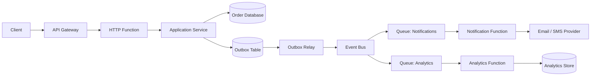

# Kết hợp API gateway, function, kho dữ liệu và event bus

Một ứng dụng serverless hoàn chỉnh thường được ghép từ nhiều dịch vụ có trách nhiệm riêng: API gateway tiếp nhận yêu cầu, function thực thi nghiệp vụ, kho dữ liệu lưu trạng thái lâu dài và event bus phân phối sự kiện đến các phần xử lý tiếp theo. Giá trị của kiến trúc này đến từ cách phối hợp các thành phần, đặc biệt ở ranh giới đồng bộ và bất đồng bộ, quyền truy cập dữ liệu, xử lý lỗi và khả năng mở rộng.

Trong mô hình Cloud Serverless, function có thể được kích hoạt bởi HTTP, thông điệp trong hàng đợi hoặc sự kiện từ một dịch vụ khác. Function thường chỉ tồn tại trong thời gian xử lý một lần gọi; vì vậy trạng thái nghiệp vụ phải được lưu ở dịch vụ bền vững. Kiến trúc cần tính đến việc function có thể chạy đồng thời trên nhiều bản sao, một sự kiện có thể được giao lại và một lần gọi có thể kết thúc trước khi hoàn thành toàn bộ quy trình.

## 1. Bức tranh kiến trúc

Các thành phần thường được kết hợp theo hai luồng chính:

- **Luồng yêu cầu đồng bộ:** client gọi API gateway; gateway xác thực và định tuyến yêu cầu đến function HTTP; function kiểm tra quy tắc nghiệp vụ, đọc hoặc ghi kho dữ liệu rồi trả phản hồi.
- **Luồng sự kiện bất đồng bộ:** sau khi một thay đổi nghiệp vụ được ghi nhận, hệ thống phát sự kiện lên event bus; bus định tuyến sự kiện đến một hoặc nhiều hàng đợi hoặc function tiêu thụ; các consumer tiếp tục xử lý độc lập.

Sơ đồ dưới đây minh họa một dịch vụ đặt hàng. Các tên dịch vụ là vai trò logic; khi triển khai trên một nền tảng cụ thể, chúng được ánh xạ sang dịch vụ tương ứng của nhà cung cấp cloud.



API gateway và function xử lý đường đi của yêu cầu. Database giữ trạng thái đơn hàng. Outbox relay chuyển các sự kiện đã được ghi cùng giao dịch sang event bus. Event bus phân phối sự kiện đến các consumer phù hợp. Hàng đợi ở giữa bus và consumer giúp hấp thụ đột biến tải, giới hạn tốc độ xử lý và giữ lại thông điệp khi consumer tạm thời không hoạt động.

Không phải hệ thống nào cũng cần đủ mọi thành phần. Một API nhỏ có thể chỉ cần gateway, function và database. Event bus trở nên hữu ích khi một thay đổi cần kích hoạt nhiều hành động độc lập hoặc khi các nhóm dịch vụ cần giảm phụ thuộc trực tiếp vào nhau.

## 2. Ranh giới trách nhiệm của từng thành phần

| Thành phần | Trách nhiệm chính | Không nên đảm nhiệm |
|---|---|---|
| API gateway | Điểm vào HTTP, định tuyến, xác thực ở biên, giới hạn tốc độ, kiểm tra định dạng cơ bản, quản lý phiên bản API | Quy tắc nghiệp vụ nhiều bước, truy cập trực tiếp database thay cho tầng nghiệp vụ |
| Function | Chạy mã xử lý theo một lần gọi, điều phối nghiệp vụ, chuyển đổi dữ liệu vào/ra, gọi các cổng tích hợp | Giữ trạng thái nghiệp vụ trong bộ nhớ giữa các lần gọi |
| Kho dữ liệu | Lưu trạng thái bền vững, bảo đảm ràng buộc và giao dịch trong phạm vi được hỗ trợ | Là kênh phát tán mọi thay đổi đến tất cả dịch vụ khác |
| Event bus | Nhận, lọc và định tuyến sự kiện đến các subscriber | Thay thế database hoặc bảo đảm một quy trình nghiệp vụ nhiều bước tự hoàn tất |
| Queue | Giữ thông điệp chờ xử lý, làm phẳng tải, hỗ trợ retry và dead-letter queue | Tự quyết định ý nghĩa nghiệp vụ của thông điệp |

Gateway nên giữ phần xử lý ở biên. Ví dụ, gateway có thể xác minh token và giới hạn số yêu cầu, nhưng function vẫn cần kiểm tra người dùng có quyền xem hoặc sửa đúng tài nguyên cụ thể hay không. Xác thực danh tính và phân quyền trên một đối tượng là hai kiểm tra khác nhau.

Function nên chứa hoặc gọi logic nghiệp vụ có thể kiểm thử độc lập. Phần nhận sự kiện từ nhà cung cấp cloud, giải mã payload và tạo phản hồi HTTP là adapter. Giữ adapter mỏng giúp logic nghiệp vụ ít phụ thuộc vào định dạng trigger và dễ chạy trong kiểm thử.

Kho dữ liệu nên có chủ sở hữu rõ ràng. Một function thuộc miền đơn hàng có thể sở hữu dữ liệu đơn hàng; miền thông báo không nên tự ý cập nhật bảng đơn hàng. Các miền khác cần thông tin thì dùng API hoặc sự kiện đã công bố. Ranh giới sở hữu giúp thay đổi schema có kiểm soát và giảm liên kết chéo.

Event bus phù hợp với **sự kiện đã xảy ra**, chẳng hạn `OrderCreated` hoặc `PaymentCaptured`. Một lệnh như `CreateOrder` diễn tả việc người gọi muốn hệ thống làm gì. Phân biệt lệnh và sự kiện giúp consumer hiểu rằng sự kiện là dữ kiện trong quá khứ, không phải yêu cầu có thể tùy ý thực hiện lại theo cách khác.

## 3. Luồng HTTP đồng bộ qua API gateway

Một luồng tạo tài nguyên thường diễn ra như sau:

1. Client gửi `POST /orders` đến API gateway, kèm thông tin xác thực và khóa idempotency.
2. Gateway kiểm tra token, giới hạn tốc độ, kích thước request và định tuyến đến function phù hợp.
3. Function chuyển request thành command của ứng dụng, kiểm tra dữ liệu và quyền truy cập theo người dùng.
4. Application service ghi dữ liệu nghiệp vụ trong giao dịch; nếu cần phát sự kiện, service ghi thêm bản ghi outbox trong cùng giao dịch.
5. Function trả kết quả cho client. Tiến trình relay đọc outbox đã commit và chuyển sự kiện lên event bus.

Ví dụ request:

```http
POST /orders HTTP/1.1
Authorization: Bearer <access-token>
Idempotency-Key: 4b1f2f1a-9c9d-4e3c-a3d3-9b4d9d8d4a21
Content-Type: application/json

{
  "customerId": "customer-42",
  "items": [
    { "productId": "book-17", "quantity": 2 }
  ]
}
```

Nếu đơn hàng đã được tạo và tài nguyên có thể truy cập ngay, API có thể trả `201 Created` cùng mã đơn hàng. Nếu API chỉ tiếp nhận một quy trình dài và kết quả nghiệp vụ sẽ có sau, `202 Accepted` phù hợp hơn; phản hồi nên cung cấp mã theo dõi hoặc URL trạng thái để client biết cách kiểm tra tiến độ. Không nên giữ một request HTTP mở trong khi chờ các bước bất đồng bộ kéo dài.

Gateway thường có giới hạn timeout và kích thước payload. Với tác vụ xử lý tệp lớn, một mẫu phổ biến là gateway/function cấp URL tải lên có thời hạn; client tải trực tiếp tệp vào object storage. Sự kiện object-created sau đó kích hoạt function xử lý tệp. Cách này tránh đưa toàn bộ nội dung tệp qua gateway và bộ nhớ của function.

## 4. Luồng sự kiện bất đồng bộ qua event bus

Sau khi một sự kiện được phát, event bus áp dụng quy tắc định tuyến để chuyển nó đến các subscriber. Ví dụ `OrderCreated` có thể được gửi đến queue thông báo, queue phân tích và một function cập nhật chỉ mục tìm kiếm. Mỗi consumer có thể triển khai, mở rộng và triển khai phiên bản riêng.

```json
{
  "eventId": "evt-01J9Q7M2",
  "eventType": "OrderCreated",
  "schemaVersion": 1,
  "occurredAt": "2026-11-17T12:00:00Z",
  "aggregateId": "order-1052",
  "correlationId": "req-8f2c",
  "data": {
    "orderId": "order-1052",
    "customerId": "customer-42",
    "total": 125000
  }
}
```

Một envelope sự kiện nên có định danh duy nhất, loại sự kiện, phiên bản schema, thời điểm phát và định danh đối tượng nghiệp vụ. `correlationId` giúp nối các log của một quy trình; `eventId` hỗ trợ phát hiện giao trùng. Payload chỉ nên chứa dữ liệu consumer thực sự cần, tránh gửi thông tin bí mật hoặc dữ liệu cá nhân không cần thiết.

Event bus và queue giải quyết hai vấn đề khác nhau. Bus quyết định **sự kiện đi đến đâu**; queue quyết định **công việc được giữ và tiêu thụ như thế nào**. Nếu nhiều consumer cần nhận cùng một sự kiện, bus có thể định tuyến đến nhiều queue độc lập. Nếu một nhóm worker cùng xử lý một loại công việc, các worker có thể cùng tiêu thụ một queue để chia tải.

Đối với consumer trực tiếp từ event bus, cần kiểm tra giới hạn retry, thời gian lưu sự kiện và khả năng phát lại theo dịch vụ cụ thể. Với tải tăng đột biến hoặc consumer phụ thuộc hệ thống chậm, queue thường tạo ranh giới điều tiết tốt hơn. Đặt giới hạn concurrency cho consumer để tốc độ xử lý không vượt quá khả năng database hoặc API bên ngoài.

## 5. Giữ nhất quán giữa database và event bus bằng Outbox

Một lỗi phổ biến xuất hiện khi function ghi database rồi phát sự kiện bằng hai thao tác độc lập. Nếu ghi database thành công nhưng function dừng trước khi publish, trạng thái nghiệp vụ đã thay đổi nhưng consumer không nhận được sự kiện. Nếu publish thành công rồi ghi database thất bại, consumer có thể xử lý một sự kiện mô tả thay đổi chưa từng được commit.

Transactional outbox giảm khoảng trống này bằng cách ghi trạng thái nghiệp vụ và bản ghi sự kiện vào cùng một giao dịch database:

1. Giao dịch tạo đơn hàng và thêm `OrderCreated` vào bảng outbox.
2. Database commit cả hai thay đổi hoặc rollback cả hai.
3. Một relay định kỳ, worker hoặc tiến trình CDC đọc các bản ghi outbox chưa phát và publish lên event bus.
4. Sau khi publish, relay đánh dấu bản ghi đã gửi hoặc lưu checkpoint tương ứng.

Outbox không tự tạo ra bảo đảm exactly-once. Nếu relay publish thành công nhưng gặp lỗi trước khi đánh dấu bản ghi, nó có thể publish lại cùng sự kiện. Vì vậy event ID phải ổn định và consumer vẫn phải idempotent. Bản ghi outbox cũng cần chính sách dọn dẹp sau khi đã phát và hết thời gian lưu cần thiết.

Nếu database và event bus cùng hỗ trợ một giao dịch phân tán thì vẫn cần cân nhắc độ phức tạp, giới hạn và chi phí. Trong nhiều kiến trúc serverless, outbox cùng consumer idempotent là cách thực tế hơn để đạt tính nhất quán cuối cùng mà không buộc nhiều dịch vụ tham gia một giao dịch dài.

## 6. Ví dụ Java: ghi nghiệp vụ và outbox trong cùng giao dịch

Đoạn mã sau minh họa ranh giới ứng dụng. Các interface repository và transaction được triển khai bằng database hoặc framework cụ thể; handler HTTP của nền tảng chỉ cần chuyển request thành `CreateOrderCommand` rồi gọi service này.

```java
import java.util.List;
import java.util.Optional;

public record CreateOrderCommand(String customerId, List<OrderItem> items) {}
public record OrderItem(String productId, int quantity) {}
public record CreateOrderResult(String orderId, String status) {}

public interface TransactionRunner {
    <T> T execute(java.util.function.Supplier<T> work);
}

public interface OrderRepository {
    void insert(Order order);
}

public interface IdempotencyRepository {
    Optional<StoredResult> find(String key);
    void insert(String key, String requestFingerprint, CreateOrderResult result);
}

public interface OutboxRepository {
    void append(DomainEvent event);
}

public final class CreateOrderService {
    private final TransactionRunner transactions;
    private final OrderRepository orders;
    private final IdempotencyRepository idempotency;
    private final OutboxRepository outbox;

    public CreateOrderService(
            TransactionRunner transactions,
            OrderRepository orders,
            IdempotencyRepository idempotency,
            OutboxRepository outbox) {
        this.transactions = transactions;
        this.orders = orders;
        this.idempotency = idempotency;
        this.outbox = outbox;
    }

    public CreateOrderResult create(String key, CreateOrderCommand command) {
        if (key == null || key.isBlank()) {
            throw new IllegalArgumentException("Idempotency-Key is required");
        }

        String fingerprint = RequestFingerprint.of(command);
        return transactions.execute(() -> {
            Optional<StoredResult> previous = idempotency.find(key);
            if (previous.isPresent()) {
                previous.get().assertSameRequest(fingerprint);
                return previous.get().result();
            }

            Order order = Order.create(command);
            orders.insert(order);

            CreateOrderResult result =
                    new CreateOrderResult(order.id(), "CREATED");
            outbox.append(OrderCreated.from(order));
            idempotency.insert(key, fingerprint, result);
            return result;
        });
    }
}
```

Các repository trong ví dụ phải tham gia **cùng một transaction context**. Cột idempotency key cần unique constraint hoặc cơ chế khóa tương đương để hai request đồng thời không cùng tạo hai đơn hàng. Khi xảy ra xung đột unique, adapter nên đọc kết quả đã lưu và trả lại kết quả đó nếu fingerprint khớp; cùng một key nhưng payload khác phải bị từ chối. `RequestFingerprint`, `StoredResult`, `Order` và `DomainEvent` là kiểu miền được lược giản để tập trung vào luồng giao dịch.

Relay có thể chạy theo lịch hoặc được kích hoạt khi có bản ghi outbox mới. Relay chỉ publish các bản ghi đã commit. Nếu relay bị dừng giữa lúc gửi và đánh dấu đã gửi, sự kiện có thể được gửi lần nữa; consumer phải xử lý được tình huống đó.

## 7. Idempotency, retry và dead-letter queue

Trong môi trường phân tán, timeout không cho biết chắc thao tác phía server đã thất bại. Client có thể gửi lại request sau khi không nhận được phản hồi, queue có thể giao lại message khi consumer chưa xác nhận hoàn tất, và event bus có thể retry khi endpoint tạm thời lỗi. Thiết kế nên giả định một thông điệp có thể được xử lý nhiều lần.

**Idempotency cho HTTP:** client gửi một `Idempotency-Key` cho mỗi thao tác logic. Server lưu key, fingerprint của request và kết quả đã tạo. Khi nhận lại cùng key và cùng nội dung, server trả kết quả cũ. Khi key giống nhau nhưng nội dung khác, server trả lỗi xung đột. Bản ghi key cần thời hạn lưu phù hợp với cửa sổ retry của client và yêu cầu nghiệp vụ.

**Idempotency cho event consumer:** consumer lưu `eventId` đã xử lý, thường kèm tên consumer. Việc ghi dấu đã xử lý và cập nhật trạng thái nghiệp vụ cần nằm trong cùng transaction database. Nếu ghi dấu trước rồi function dừng trước khi cập nhật nghiệp vụ, lần giao lại sẽ bị bỏ qua dù công việc chưa hoàn thành. Nếu side effect nằm ở hệ thống bên ngoài, hãy dùng idempotency key của hệ thống đó khi có hỗ trợ hoặc thiết kế một quy trình bù trừ có thể chạy lại an toàn.

**Retry có kiểm soát:**

- Retry lỗi tạm thời như timeout, throttling hoặc lỗi dịch vụ 5xx; dùng exponential backoff và jitter để tránh nhiều function thử lại cùng lúc.
- Không retry vô hạn lỗi dữ liệu hoặc lỗi nghiệp vụ không thể tự hết, chẳng hạn payload sai schema hay tài khoản không hợp lệ.
- Đặt số lần nhận tối đa hoặc giới hạn thời gian retry. Khi vượt ngưỡng, chuyển thông điệp sang dead-letter queue (DLQ) hoặc cơ chế lưu lỗi tương đương.
- Theo dõi tuổi của message cũ nhất, số message trong DLQ và tỷ lệ xử lý thất bại. Có quy trình kiểm tra nguyên nhân, sửa dữ liệu hoặc mã rồi mới redrive.
- Cấu hình visibility timeout hoặc thời gian lease của queue dài hơn thời gian xử lý tối đa dự kiến và có khoảng đệm. Nếu lease hết khi function vẫn đang chạy, message có thể được giao cho worker khác.

Không nên khẳng định hệ thống có exactly-once chỉ vì một dịch vụ queue hoặc event bus cung cấp tính năng chống trùng trong một phạm vi nhất định. Tính duy nhất của một quy trình phải được xem xét xuyên suốt từ lúc client gửi yêu cầu, database commit, relay publish đến consumer tạo side effect. Mục tiêu thực tế thường là giao ít nhất một lần kết hợp xử lý idempotent.

Thứ tự sự kiện cũng cần được xác định rõ. Nếu nghiệp vụ yêu cầu tuần tự theo từng đơn hàng, dùng khóa phân vùng hoặc nhóm thông điệp dựa trên `aggregateId`, kèm số thứ tự phiên bản của aggregate. Không giả định mọi event bus đều bảo đảm thứ tự toàn cục; phạm vi thứ tự phụ thuộc dịch vụ và cấu hình.

## 8. Quản lý trạng thái và dữ liệu

Function nên được thiết kế như một đơn vị xử lý stateless: mỗi lần gọi nhận đủ dữ liệu cần thiết qua request, event hoặc truy vấn dịch vụ bền vững. Biến static, bộ nhớ heap và thư mục tạm có thể được tái sử dụng trong một số môi trường, nhưng không phải nơi lưu trạng thái nghiệp vụ vì runtime có thể bị thu hồi hoặc khởi tạo lại bất kỳ lúc nào.

Chọn kho dữ liệu dựa trên kiểu truy cập và ràng buộc:

- Cơ sở dữ liệu quan hệ phù hợp khi cần transaction nhiều bản ghi, ràng buộc toàn vẹn, join và truy vấn linh hoạt.
- Kho NoSQL phù hợp khi access pattern rõ, cần thông lượng lớn và có thể thiết kế partition key, sort key hoặc index theo truy vấn dự kiến.
- Object storage phù hợp với tệp, ảnh, bản xuất dữ liệu và nội dung lớn; metadata nghiệp vụ có thể lưu trong database.
- Cache giúp giảm độ trễ và tải đọc nhưng dữ liệu cache có thể cũ; phải xác định TTL và cách vô hiệu hóa.

Serverless function có thể tăng concurrency nhanh hơn khả năng mở kết nối của database. Nếu mỗi instance tạo một connection pool riêng, tổng kết nối có thể tăng theo số instance. Hãy giới hạn concurrency, tái sử dụng client khi runtime còn sống, dùng connection proxy/pooler phù hợp và theo dõi số kết nối, độ trễ truy vấn cùng giới hạn của database. Với workload bursty, queue có thể điều tiết tốc độ ghi để database không bị quá tải.

Đừng chia sẻ quyền ghi trực tiếp vào cùng một bảng giữa nhiều miền nghiệp vụ nếu không có hợp đồng sở hữu rõ ràng. Khi một consumer cần dữ liệu để truy vấn nhanh, có thể xây dựng read model hoặc projection riêng từ sự kiện. Cách này tạo eventual consistency: read model có thể chậm hơn database gốc một khoảng thời gian. API cần phản ánh điều đó trong trải nghiệm người dùng, ví dụ trả trạng thái `PROCESSING`, cung cấp endpoint kiểm tra hoặc cập nhật giao diện khi có kết quả.

Khi một quy trình đi qua nhiều database hoặc dịch vụ độc lập, không nên cố giả lập một transaction ACID xuyên suốt. Dùng saga hoặc workflow orchestration để biểu diễn các bước, trạng thái và hành động bù trừ. Ví dụ, nếu giữ chỗ tồn kho thành công nhưng thanh toán thất bại, quy trình có thể phát lệnh giải phóng tồn kho. Hành động bù trừ là một thao tác nghiệp vụ riêng, cũng cần idempotency và quan sát được.

## 9. Bảo mật ở các ranh giới

Mỗi kết nối giữa gateway, function, database, event bus và consumer là một ranh giới bảo mật:

1. **Danh tính người gọi:** gateway xác minh token, chứng thư hoặc cơ chế xác thực phù hợp. Function kiểm tra quyền trên tài nguyên cụ thể, tenant và hành động được yêu cầu.
2. **Quyền của function:** cấp quyền tối thiểu theo từng function. Function tạo đơn hàng chỉ cần quyền ghi các bảng đơn hàng/outbox và quyền đọc những dữ liệu cần thiết; không cấp quyền quản trị toàn bộ tài khoản cloud.
3. **Quyền phát và nhận sự kiện:** giới hạn principal được publish vào bus, được đăng ký rule hoặc được consume queue. Xác minh nguồn và schema của event trước khi xử lý.
4. **Bí mật và dữ liệu:** lấy secret từ secret manager hoặc cơ chế quản lý bí mật của nền tảng; mã hóa dữ liệu khi truyền và khi lưu; tránh ghi token, secret hoặc payload nhạy cảm vào log.
5. **Cô lập mạng và tenant:** dùng private endpoint hoặc network policy khi cần; kiểm tra tenant ở tầng nghiệp vụ và áp dụng điều kiện truy vấn theo tenant ở mọi đường đọc/ghi.

Không coi việc một function chỉ được gọi từ API gateway là bằng chứng rằng mọi dữ liệu đầu vào đều đáng tin cậy. Event có thể đến từ một publisher khác, bản ghi cũ được replay hoặc payload bị lỗi do phiên bản producer không tương thích. Mỗi consumer vẫn cần xác thực nguồn, kiểm tra cấu trúc và xác nhận các điều kiện nghiệp vụ cần thiết.

## 10. Cold start, mở rộng và giới hạn tải

Khi function được gọi sau một khoảng nghỉ hoặc cần thêm instance để xử lý tải tăng, nền tảng có thể phải khởi tạo runtime, tải mã và tạo dependency trước khi chạy handler. Khoảng trễ bổ sung này thường được gọi là cold start. Mức ảnh hưởng phụ thuộc runtime, kích thước gói, thư viện, cấu hình mạng, vùng triển khai và nền tảng.

Một số cách giảm cold start:

- Giảm kích thước artifact và số dependency; tránh khởi tạo client hoặc tải cấu hình không cần thiết.
- Khởi tạo các client dùng chung ở phạm vi instance khi điều đó an toàn, nhưng không đặt trạng thái nghiệp vụ có thể thay đổi vào biến dùng chung.
- Chọn memory/CPU phù hợp và đo thời gian khởi tạo trong môi trường gần production.
- Với endpoint nhạy độ trễ, cân nhắc provisioned concurrency, snapshot runtime hoặc tính năng tương đương nếu nền tảng hỗ trợ; các lựa chọn này có chi phí duy trì.
- Chuyển công việc không cần phản hồi tức thì sang queue hoặc event để client không phải chờ thời gian xử lý dài.

Mở rộng tự động không đồng nghĩa mọi thành phần phía sau cũng mở rộng vô hạn. Nếu gateway nhận 5.000 request mỗi giây và function tăng concurrency tương ứng, database, dịch vụ thanh toán hoặc API đối tác có thể trở thành nút thắt. Đặt giới hạn concurrency theo năng lực phụ thuộc, dùng queue để hấp thụ burst, batch khi phù hợp và áp dụng rate limit/circuit breaker cho hệ thống bên ngoài.

## 11. Quan sát và vận hành

Một request có thể đi qua gateway, function, database, outbox relay, event bus, queue và nhiều consumer. Nếu mỗi thành phần chỉ ghi một request ID riêng, việc tìm nguyên nhân lỗi sẽ khó khăn. Hãy truyền `correlationId` xuyên suốt quy trình, giữ `eventId` ổn định khi retry và dùng distributed tracing nếu nền tảng hỗ trợ.

Các chỉ số nên theo dõi gồm:

- **Gateway:** số request, độ trễ p50/p95/p99, tỷ lệ 4xx/5xx, throttling và request bị từ chối.
- **Function:** invocation, duration, lỗi, timeout, throttling, concurrency và cold start nếu có số liệu.
- **Database:** kết nối đang mở, độ trễ truy vấn, deadlock, throttling, dung lượng và mức sử dụng I/O.
- **Outbox và event bus:** số bản ghi chờ phát, tuổi bản ghi cũ nhất, publish failure, số lần retry và độ trễ phân phối.
- **Queue/consumer:** queue depth, tuổi message cũ nhất, thời gian xử lý, tỷ lệ lỗi, số lần giao lại và DLQ depth.
- **Nghiệp vụ:** đơn hàng tạo thành công, thời gian từ tạo đến hoàn tất, tỷ lệ quy trình bị bù trừ và số thao tác trùng bị chặn.

Log nên có cấu trúc, chứa định danh tương quan và thông tin đủ để chẩn đoán. Không ghi toàn bộ request body theo mặc định vì payload có thể chứa dữ liệu cá nhân hoặc bí mật. Cần có cảnh báo gắn với hành động cụ thể, chẳng hạn DLQ tăng, tuổi message vượt ngưỡng, outbox bị ùn hoặc tỷ lệ lỗi gateway tăng kéo dài.

## 12. Chi phí và triển khai

Chi phí của kiến trúc không chỉ là số lần function chạy. Cần tính cả số request gateway, thời gian thực thi và cấu hình tài nguyên của function, lượt đọc/ghi và dung lượng database, số sự kiện qua bus, thời gian lưu queue, log/trace, truyền dữ liệu giữa vùng và chi phí mạng. Một sự kiện fan-out đến nhiều consumer có thể làm tăng số lần xử lý và dung lượng log. Retry quá nhiều cũng làm tăng chi phí trong khi không cải thiện khả năng phục hồi.

Để kiểm soát chi phí, hãy lọc sự kiện ngay tại bus, chỉ gửi trường cần thiết, batch message khi nghiệp vụ cho phép, đặt TTL/lifecycle cho dữ liệu tạm, giới hạn thời gian lưu log theo chính sách và đo chi phí theo chức năng hoặc miền nghiệp vụ. So sánh chi phí theo một đơn vị nghiệp vụ, ví dụ chi phí cho một đơn hàng hoàn tất, hữu ích hơn việc chỉ nhìn tổng hóa đơn cloud.

Triển khai nên quản lý gateway route, function, quyền IAM, database, event bus, queue, DLQ và cảnh báo bằng Infrastructure as Code. Dùng môi trường riêng cho development, staging và production; cấu hình secret theo môi trường; phát hành function qua version/alias hoặc cơ chế tương đương để có thể canary và rollback. Khi thay đổi event schema, ưu tiên thay đổi tương thích ngược: consumer mới đọc được event cũ trong thời gian chuyển tiếp và producer không loại bỏ field ngay khi còn consumer cũ.

Trước khi đưa một luồng vào production, cần kiểm tra cả đường thành công và đường lỗi: request trùng, event trùng, database timeout, consumer bị dừng sau khi ghi dữ liệu, message độc hại, DLQ redrive, event schema cũ, tải tăng đột biến và rollback phiên bản. Các kiểm tra này giúp xác nhận hệ thống phục hồi được khi một thành phần gặp lỗi độc lập.

## 13. Khi nào nên dùng cách kết hợp này?

| Đặc điểm workload | Cách kết hợp phù hợp | Lý do |
|---|---|---|
| API có lưu lượng biến động, thời gian xử lý ngắn | API gateway + HTTP function + database | Gateway quản lý điểm vào; function chỉ chạy khi có yêu cầu |
| Một thay đổi cần kích hoạt nhiều tác vụ độc lập | Function + outbox + event bus + các consumer | Producer không cần gọi trực tiếp từng consumer |
| Tải tăng đột biến hoặc consumer chậm | Event bus + queue + function consumer có giới hạn concurrency | Queue hấp thụ burst và điều tiết tốc độ xử lý |
| Cần cập nhật dữ liệu đọc hoặc chỉ mục riêng | Event bus + consumer tạo projection | Read model có thể được xây dựng độc lập với database gốc |
| Tác vụ dài, cần nhiều bước và hành động bù trừ | Queue/workflow orchestration + các function theo bước | Trạng thái tiến trình được quản lý bền vững thay vì giữ một invocation dài |

FaaS không phải lựa chọn mặc định cho mọi workload. Một dịch vụ chạy liên tục với tải ổn định, tác vụ dài, yêu cầu giữ kết nối lâu hoặc cần độ trễ rất thấp có thể phù hợp hơn với container/service luôn hoạt động. Quyết định nên dựa trên mô hình tải, giới hạn thời gian thực thi, độ trễ cold start, chi phí ở mức concurrency dự kiến, khả năng vận hành và mức độ phụ thuộc vào dịch vụ cloud.

## 14. Checklist thiết kế

- [ ] Mỗi thành phần có trách nhiệm và chủ sở hữu dữ liệu rõ ràng.
- [ ] Gateway xác thực ở biên; function vẫn kiểm tra quyền trên tài nguyên và tenant.
- [ ] Function không dựa vào bộ nhớ instance để giữ trạng thái nghiệp vụ.
- [ ] Database và outbox được ghi trong cùng transaction khi một thay đổi cần phát sự kiện.
- [ ] Request HTTP có idempotency key cho thao tác mà client có thể retry.
- [ ] Consumer có cơ chế chống xử lý trùng và cập nhật dấu đã xử lý cùng transaction nghiệp vụ khi có thể.
- [ ] Retry có giới hạn, backoff, jitter, DLQ và quy trình redrive.
- [ ] Queue và concurrency được cấu hình theo khả năng của database và dịch vụ phụ thuộc.
- [ ] Event có event ID, schema version, correlation ID và payload tối thiểu.
- [ ] Có metric, log, trace và cảnh báo cho gateway, function, database, bus, queue và DLQ.
- [ ] Chi phí được đo theo cả compute, dữ liệu, sự kiện, mạng và quan sát.
- [ ] Hạ tầng được quản lý bằng mã; event schema và API được thay đổi tương thích trong giai đoạn triển khai.

Kiến trúc serverless hoạt động tốt khi các thành phần phối hợp qua hợp đồng rõ ràng. API gateway quản lý lưu lượng HTTP, function thực thi một đơn vị công việc, database giữ trạng thái bền vững và event bus thông báo các sự kiện đã xảy ra. Khi kết hợp thêm outbox, idempotency, retry có giới hạn, quyền tối thiểu và quan sát xuyên suốt, hệ thống có thể mở rộng theo nhu cầu mà vẫn kiểm soát được lỗi, trạng thái và chi phí.
