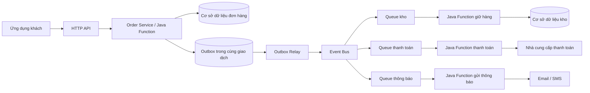

# Áp dụng kiến trúc hướng sự kiện cho nghiệp vụ

## 1. Vì sao nghiệp vụ cần kiến trúc hướng sự kiện?

Trong một ứng dụng nghiệp vụ, một hành động thường kéo theo nhiều việc khác. Khi khách hàng đặt hàng, hệ thống có thể cần ghi nhận đơn, giữ hàng trong kho, thu tiền, gửi email xác nhận, cập nhật điểm thành viên và thông báo cho đơn vị vận chuyển. Nếu một dịch vụ gọi đồng bộ tất cả dịch vụ còn lại, luồng đặt hàng sẽ phụ thuộc vào trạng thái và tốc độ của từng thành phần. Chỉ một dịch vụ gửi email chậm cũng có thể làm người dùng phải chờ lâu hoặc khiến toàn bộ yêu cầu thất bại.

Kiến trúc hướng sự kiện (Event-Driven Architecture — EDA) tổ chức các thành phần quanh những sự kiện nghiệp vụ đã xảy ra. Thành phần phát sự kiện công bố một sự thật, chẳng hạn `OrderCreated`; các thành phần quan tâm đăng ký nhận sự kiện và tự thực hiện phần việc của mình. Dịch vụ đơn hàng không cần biết có bao nhiêu dịch vụ đang xử lý sự kiện đó.

Trong mô hình serverless, EDA kết hợp tự nhiên với function-as-a-service (FaaS). Hàng đợi, event bus hoặc nền tảng sự kiện kích hoạt Java function khi có thông điệp mới. Function xử lý một phần việc ngắn, lưu kết quả vào hệ thống lưu trữ bền vững rồi kết thúc. Nền tảng có thể tăng hoặc giảm số phiên bản function theo lượng sự kiện đến. Cách tổ chức này giúp tách rời các nhóm nghiệp vụ, hấp thụ lưu lượng tăng đột biến và chỉ dùng năng lực tính toán khi có việc cần xử lý.

EDA không tự động làm cho hệ thống đáng tin cậy hay đơn giản hơn. Nó chuyển một phần độ phức tạp từ lời gọi đồng bộ sang giao tiếp bất đồng bộ: thông điệp có thể đến trễ, đến nhiều lần hoặc sai thứ tự; một consumer có thể tạm thời ngừng hoạt động; quy trình có thể kéo dài qua nhiều phút hoặc nhiều ngày. Vì vậy, cần thiết kế cả luồng nghiệp vụ, trạng thái, quyền truy cập và cách phục hồi ngay từ đầu.

## 2. Phân biệt sự kiện, lệnh và thông báo

Ba khái niệm này thường xuất hiện cùng nhau nhưng có ý nghĩa khác nhau:

| Khái niệm | Ý nghĩa | Ví dụ | Bên nhận cần làm gì? |
|---|---|---|---|
| Sự kiện (event) | Một điều đã xảy ra trong nghiệp vụ; thường đặt tên ở thì quá khứ | `OrderCreated`, `PaymentAuthorized` | Tự quyết định có quan tâm và phản ứng hay không |
| Lệnh (command) | Yêu cầu một thành phần thực hiện một hành động | `ReserveInventory`, `AuthorizePayment` | Thực hiện hoặc từ chối hành động được yêu cầu |
| Thông báo (notification) | Thông tin được gửi để một bên biết về trạng thái hoặc kết quả | Email xác nhận đơn hàng | Hiển thị hoặc chuyển thông tin đến người nhận |

Ví dụ, `ReserveInventory` là lệnh gửi đến dịch vụ kho. Khi kho giữ hàng thành công, dịch vụ kho phát sự kiện `InventoryReserved`. Nếu không còn hàng, nó có thể phát `InventoryReservationRejected`. Một sự kiện mô tả kết quả đã xảy ra; nó không nên được dùng như một lệnh trá hình buộc mọi consumer phải thực hiện cùng một hành động.

Sự kiện miền (domain event) mô tả điều có ý nghĩa trong mô hình nghiệp vụ, ví dụ `SubscriptionRenewed`. Sự kiện tích hợp (integration event) là hợp đồng được công bố ra ngoài ranh giới một dịch vụ để các hệ thống khác có thể sử dụng. Hai loại có thể liên quan nhưng không nhất thiết giống hệt nhau. Không nên phát nguyên đối tượng nội bộ của ứng dụng hoặc cấu trúc bảng cơ sở dữ liệu làm hợp đồng tích hợp, vì thay đổi nội bộ khi đó sẽ vô tình phá vỡ consumer.

Một sự kiện tốt thường có các đặc điểm sau:

- Mô tả một sự thật đã xảy ra, có tên rõ ràng và ổn định.
- Có định danh duy nhất để phân biệt các sự kiện, kể cả khi nội dung giống nhau.
- Có thời điểm xảy ra và định danh đối tượng nghiệp vụ liên quan.
- Chứa đủ dữ liệu để consumer xử lý, hoặc chứa tham chiếu ổn định để consumer lấy dữ liệu cần thiết.
- Không thay đổi sau khi công bố. Nếu cần sửa thông tin nghiệp vụ, hãy phát một sự kiện mới mô tả thay đổi đó.
- Có phiên bản hợp đồng và quy tắc tương thích để consumer cũ không bị hỏng khi producer phát triển.

Không nên tạo sự kiện cho mọi thay đổi kỹ thuật nhỏ. Hãy chọn những mốc có ý nghĩa đối với nghiệp vụ hoặc ranh giới tích hợp. `OrderCreated` thường có ý nghĩa; `OrderRowInsertedIntoTable` thường tiết lộ chi tiết lưu trữ và không phải một hợp đồng nghiệp vụ tốt.

## 3. Chọn giao tiếp đồng bộ hay bất đồng bộ

Không phải mọi tương tác đều cần event bus. Hãy chọn kiểu giao tiếp theo yêu cầu của nghiệp vụ:

| Tình huống | Cách phù hợp | Lý do |
|---|---|---|
| Người dùng cần kết quả ngay để tiếp tục thao tác | HTTP đồng bộ | Có thể trả kết quả hoặc lỗi ngay trong cùng yêu cầu |
| Một việc có thể hoàn thành sau khi trả lời người dùng | Hàng đợi hoặc sự kiện bất đồng bộ | Tách thời gian xử lý khỏi thời gian phản hồi |
| Nhiều hệ thống độc lập cần biết cùng một sự kiện | Event bus với nhiều subscription | Phân phối một sự kiện đến nhiều consumer |
| Một consumer cần xử lý từng thông điệp với khả năng điều tiết và retry riêng | Queue riêng cho consumer | Cô lập lỗi, tải và tốc độ xử lý |
| Quy trình có nhiều bước, chờ phản hồi hoặc cần bù trừ | Workflow hoặc saga | Theo dõi trạng thái dài hạn và điều phối bước tiếp theo |

Ví dụ, API tạo đơn hàng có thể trả `202 Accepted` cùng mã đơn và trạng thái `PENDING` sau khi đã ghi nhận yêu cầu bền vững. Việc giữ hàng, thu tiền và gửi email tiếp tục ở nền. Giao diện có thể truy vấn trạng thái hoặc nhận thông báo khi đơn chuyển sang `CONFIRMED`. Nếu người dùng cần biết ngay rằng mã sản phẩm không tồn tại, API vẫn nên kiểm tra và trả lỗi đồng bộ ở ranh giới phù hợp.

Một quy tắc thực tế là giữ phần đồng bộ đủ ngắn để xác nhận yêu cầu đã được tiếp nhận hợp lệ; chuyển các công việc độc lập, tốn thời gian hoặc có thể thử lại sang xử lý bất đồng bộ. Không trả `202 Accepted` trước khi yêu cầu đã được lưu bền vững hoặc đã được bàn giao an toàn cho một thành phần chịu trách nhiệm lưu trữ.

## 4. Mô hình triển khai EDA trên serverless

Một luồng phổ biến có thể được tổ chức như sau:



Các thành phần có trách nhiệm riêng:

1. **HTTP API** xác thực người gọi, kiểm tra dữ liệu đầu vào và tiếp nhận yêu cầu tạo đơn.
2. **Order Service** áp dụng quy tắc tạo đơn và lưu trạng thái ban đầu.
3. **Outbox** ghi sự kiện cần phát trong cùng giao dịch cơ sở dữ liệu với thay đổi đơn hàng.
4. **Outbox Relay** đọc các bản ghi chưa phát và chuyển chúng đến event bus. Relay có thể phát lại nếu bị gián đoạn.
5. **Event Bus** định tuyến sự kiện theo loại, nguồn hoặc thuộc tính nghiệp vụ đến các subscription phù hợp.
6. **Queue riêng cho từng consumer** lưu thông điệp trong khi consumer bận hoặc tạm ngừng, đồng thời cung cấp chính sách retry và dead-letter riêng.
7. **Java Function** xử lý một thông điệp hoặc một batch, ghi kết quả bền vững và xác nhận thông điệp khi xử lý đã an toàn.

Event bus và queue giải quyết hai nhu cầu khác nhau. Event bus phù hợp để định tuyến và fan-out một sự kiện đến nhiều nhóm quan tâm. Queue phù hợp để đệm công việc cho một nhóm consumer, điều tiết tốc độ và quản lý retry. Trong nhiều hệ thống, event bus chuyển sự kiện đến queue của từng consumer để mỗi nhóm có thể mở rộng và phục hồi độc lập.

Nếu chỉ có một consumer và cần xử lý tuần tự, một queue có thể là đủ. Nếu một quy trình có nhiều nhánh độc lập, event bus giúp thêm consumer mà không cần sửa producer. Tránh thêm broker, topic hoặc queue nếu chúng không giải quyết một yêu cầu cụ thể; mỗi thành phần bổ sung đều tạo thêm cấu hình, quyền truy cập, chi phí và điểm cần giám sát.

## 5. Thiết kế hợp đồng sự kiện

Hợp đồng sự kiện là giao diện giữa producer và consumer. Hãy xác định tên, cấu trúc, phiên bản, ý nghĩa từng trường, quy tắc null, đơn vị đo, múi giờ và chính sách lưu giữ trước khi nhiều consumer phụ thuộc vào nó.

Ví dụ một sự kiện `OrderCreated` theo cấu trúc CloudEvents:

```json
{
  "specversion": "1.0",
  "id": "evt-01J9M8K3Q6",
  "source": "/commerce/orders",
  "type": "com.example.order.created.v1",
  "subject": "orders/ORD-2048",
  "time": "2026-11-17T10:15:30Z",
  "datacontenttype": "application/json",
  "data": {
    "orderId": "ORD-2048",
    "customerId": "CUS-81",
    "currency": "VND",
    "totalAmount": 450000,
    "lines": [
      { "sku": "BOOK-01", "quantity": 2 }
    ]
  }
}
```

Các thuộc tính ở lớp ngoài giúp consumer nhận diện sự kiện mà không cần hiểu toàn bộ dữ liệu nghiệp vụ. `id` định danh một lần phát sự kiện; `source` chỉ ra nguồn phát; `type` xác định loại sự kiện và có thể mang phiên bản; `subject` liên kết sự kiện với đối tượng nghiệp vụ; `time` là thời điểm xảy ra. Trường `data` chứa phần dữ liệu riêng của nghiệp vụ.

Trong hệ thống thực tế, nên cân nhắc thêm `correlationId`, `causationId`, mã tenant hoặc `traceparent` nếu cần truy vết một quy trình qua nhiều dịch vụ. Các trường này cần có quy ước nhất quán. Không dùng một mã yêu cầu HTTP mới làm `eventId` cho mọi lần phát lại; định danh sự kiện phải giữ nguyên khi cùng một sự kiện được giao lại.

Có hai cách phổ biến để cung cấp dữ liệu cho consumer:

- **Event mang dữ liệu cần thiết (event-carried state transfer):** consumer xử lý ngay từ payload. Cách này giảm số lần gọi ngược về producer và giữ được dữ liệu tại thời điểm sự kiện xảy ra, nhưng payload lớn hơn và có thể chứa dữ liệu nhạy cảm.
- **Event mang tham chiếu (event notification):** payload chứa định danh đối tượng hoặc URI logic để consumer đọc dữ liệu mới nhất từ API của producer. Cách này giảm dữ liệu truyền qua broker nhưng tạo phụ thuộc vào API và có thể khiến consumer nhìn thấy trạng thái đã thay đổi sau thời điểm phát sự kiện.

Chọn theo yêu cầu nhất quán và quyền sở hữu dữ liệu. Nếu consumer cần biết chính xác trạng thái tại thời điểm `OrderCreated`, payload phải mang đủ dữ liệu hoặc tham chiếu đến một phiên bản bất biến. Nếu chỉ cần trạng thái hiện tại, việc đọc API có thể hợp lý. Không đưa mật khẩu, token, dữ liệu thẻ thanh toán hoặc dữ liệu cá nhân không cần thiết vào thông điệp.

### Quản lý phiên bản

Ưu tiên thay đổi tương thích ngược: thêm trường tùy chọn có giá trị mặc định, giữ nguyên ý nghĩa trường cũ và để consumer bỏ qua trường chưa biết. Không đổi kiểu dữ liệu, xóa trường hoặc đổi ý nghĩa trường trong cùng phiên bản. Khi thay đổi phá vỡ tương thích, phát loại sự kiện phiên bản mới, ví dụ `order.created.v2`, rồi chuyển consumer theo lộ trình. Có thể dùng schema registry hoặc kiểm tra schema trong CI để phát hiện thay đổi không tương thích trước khi triển khai.

Consumer cần chịu được trường không biết và dữ liệu thiếu theo đúng hợp đồng. Producer cần công bố ví dụ, mô tả đơn vị và quy tắc thời gian. Một trường `amount` không rõ là đồng hay xu có thể gây lỗi nghiệp vụ nghiêm trọng dù JSON vẫn hợp lệ.

## 6. Xử lý sự kiện bằng Java Function

Java function thường có ba phần: adapter nhận sự kiện từ nền tảng, lớp ứng dụng thực hiện quy tắc nghiệp vụ và lớp hạ tầng lưu trạng thái hoặc gọi dịch vụ bên ngoài. Giữ quy tắc nghiệp vụ độc lập với kiểu trigger giúp có thể kiểm thử bằng unit test và thay đổi nền tảng nhận sự kiện mà không phải viết lại toàn bộ logic.

Ví dụ dưới đây minh họa function xử lý `OrderCreated` để giữ hàng. Adapter của nhà cung cấp cloud sẽ chuyển payload sang đối tượng Java rồi gọi `accept`:

```java
import java.util.List;

public record OrderLine(String sku, int quantity) {}

public record OrderCreated(
        String eventId,
        String orderId,
        List<OrderLine> lines) {}

public interface InventoryApplicationService {
    /**
     * Thực hiện giữ hàng theo cách idempotent.
     * eventId có unique constraint trong cùng giao dịch với cập nhật tồn kho.
     */
    void reserveOnce(String eventId, String orderId, List<OrderLine> lines);
}

public final class ReserveInventoryFunction {
    private final InventoryApplicationService inventory;

    public ReserveInventoryFunction(InventoryApplicationService inventory) {
        this.inventory = inventory;
    }

    public void accept(OrderCreated event) {
        if (event == null || event.eventId() == null || event.orderId() == null) {
            throw new IllegalArgumentException("Invalid OrderCreated event");
        }

        inventory.reserveOnce(
                event.eventId(),
                event.orderId(),
                event.lines());
    }
}
```

Điểm quan trọng nằm trong hợp đồng của `reserveOnce`: việc ghi nhận `eventId` đã xử lý và cập nhật tồn kho phải nằm trong cùng giao dịch cơ sở dữ liệu. Cột `event_id` có unique constraint. Nếu cùng thông điệp được giao lại, thao tác ghi nhận trùng sẽ khiến lần xử lý sau trả về kết quả đã áp dụng mà không trừ tồn kho lần nữa. Nếu cập nhật tồn kho thất bại giữa chừng, giao dịch rollback cả bản ghi idempotency để lần retry có thể thực hiện lại.

Khi hết hàng, đây có thể là kết quả nghiệp vụ hợp lệ chứ không phải lỗi hạ tầng. Dịch vụ kho nên lưu kết quả từ chối một cách bền vững và phát `InventoryReservationRejected` qua outbox. Không ném lỗi retry vô hạn cho một đơn hàng chắc chắn không thể giữ hàng. Ngược lại, lỗi kết nối cơ sở dữ liệu tạm thời có thể được ném ra để nền tảng thử lại.

Đoạn code chỉ thể hiện lớp ứng dụng và hợp đồng idempotency. Adapter thực tế còn phải xử lý định dạng sự kiện, xác thực nguồn, giới hạn batch, timeout, cơ chế acknowledgement và kiểu phản hồi theo nền tảng serverless đang dùng. Không đưa việc khởi tạo kết nối nặng hoặc tải cấu hình từ xa vào mỗi lần xử lý nếu runtime cho phép tái sử dụng đối tượng an toàn giữa các lần gọi; đồng thời không lưu trạng thái nghiệp vụ chỉ trong biến tĩnh hoặc bộ nhớ của function.

## 7. Bảo đảm không xử lý trùng: idempotency

Nhiều nền tảng giao thông điệp theo ngữ nghĩa **at-least-once**: một thông điệp có thể được giao lại khi consumer timeout, mất kết nối trước acknowledgement hoặc nền tảng không biết chắc lần xử lý trước đã hoàn tất hay chưa. Vì vậy, hãy thiết kế consumer để xử lý cùng một sự kiện nhiều lần mà kết quả nghiệp vụ vẫn đúng.

Một thao tác idempotent có thể được gọi lặp lại với cùng khóa mà không tạo thêm hiệu ứng nghiệp vụ. Các cách triển khai thường gặp:

- Lưu `eventId` hoặc khóa nghiệp vụ trong bảng đã xử lý với unique constraint.
- Ghi dấu đã xử lý và cập nhật dữ liệu nghiệp vụ trong cùng một giao dịch.
- Dùng idempotency key do consumer truyền cho API bên ngoài nếu nhà cung cấp hỗ trợ.
- Với thao tác không thể gói trong một giao dịch, lưu trạng thái tiến trình bền vững và có cơ chế đối soát hoặc bù trừ.

Không đánh dấu sự kiện hoàn tất trước khi hiệu ứng nghiệp vụ được lưu an toàn. Nếu function ghi dấu trước rồi chết trước khi trừ tồn kho, lần giao lại sẽ bị bỏ qua và đơn hàng không được xử lý. Nếu function trừ tồn kho trước rồi chết trước khi ghi dấu, lần giao lại có thể trừ kho hai lần. Unique constraint và giao dịch chung giải quyết khoảng hở này khi các thay đổi nằm trong cùng một cơ sở dữ liệu.

Với lời gọi đến hệ thống bên ngoài, giao dịch cơ sở dữ liệu cục bộ không thể bao trùm toàn bộ thao tác mạng. Hãy dùng idempotency key ổn định, ví dụ `payment:{orderId}:v1`, nếu cổng thanh toán hỗ trợ. Nếu không có hỗ trợ, cần ghi nhận trạng thái yêu cầu, tra cứu kết quả trước khi gửi lại và xây dựng quy trình đối soát. Không thể mặc định rằng “function chạy một lần” đồng nghĩa với “tác động nghiệp vụ xảy ra đúng một lần”.

Thời gian lưu khóa idempotency phải dài hơn khoảng thời gian thông điệp có thể retry, được giữ trong DLQ và được replay. Nếu xóa khóa quá sớm, một thông điệp cũ được phát lại có thể tạo tác động trùng. Cũng cần phân biệt `eventId` với idempotency key của thao tác: hai sự kiện khác nhau đôi khi vẫn đại diện cho cùng một yêu cầu nghiệp vụ cần được chống trùng theo khóa nghiệp vụ.

## 8. Retry, dead-letter queue và lỗi nghiệp vụ

Retry giúp hệ thống tự phục hồi trước lỗi tạm thời, nhưng retry không có chính sách có thể tạo vòng lặp tốn kém và làm nghẽn dịch vụ. Hãy phân loại lỗi:

| Loại lỗi | Ví dụ | Cách xử lý thường phù hợp |
|---|---|---|
| Tạm thời (transient) | Timeout, giới hạn tốc độ, dịch vụ phụ thuộc đang gián đoạn | Retry có backoff và jitter; đặt giới hạn số lần hoặc thời gian |
| Dữ liệu không hợp lệ | Thiếu `orderId`, sai schema, trường bắt buộc sai kiểu | Đưa vào vùng cách ly hoặc DLQ, cảnh báo và xử lý dữ liệu |
| Từ chối nghiệp vụ | Không đủ tồn kho, tài khoản bị khóa | Lưu kết quả nghiệp vụ và phát sự kiện kết quả; không retry như lỗi hạ tầng |
| Lỗi lập trình | Null không dự kiến, lỗi chuyển đổi, vi phạm invariant | Giới hạn retry, đưa thông điệp vào DLQ và sửa lỗi trước khi replay |

Backoff theo cấp số nhân làm khoảng chờ tăng dần sau mỗi lần thất bại; jitter thêm độ ngẫu nhiên để nhiều consumer không cùng retry tại một thời điểm. Đặt timeout của lời gọi phụ thuộc thấp hơn timeout tổng thể của function để còn thời gian ghi log, lưu trạng thái hoặc kết thúc an toàn. Chọn visibility timeout hoặc thời gian khóa thông điệp đủ dài cho một lần xử lý bình thường; nếu xử lý có thể kéo dài, cần gia hạn khóa theo cơ chế nền tảng hỗ trợ.

Sau số lần thử hoặc thời hạn quy định, chuyển thông điệp sang dead-letter queue (DLQ). DLQ là nơi lưu thông điệp không thể xử lý tự động để điều tra và phục hồi. Cần giám sát số lượng thông điệp, tuổi của thông điệp cũ nhất và tốc độ tăng DLQ; có quy trình xác định nguyên nhân, sửa dữ liệu hoặc code, rồi replay có kiểm soát. Trước khi replay, xác minh consumer đã idempotent và schema tương thích. Không xóa DLQ chỉ để làm chỉ số đẹp.

Với queue xử lý batch, một bản ghi lỗi có thể khiến cả batch được giao lại tùy cấu hình. Hãy dùng cơ chế partial batch response nếu nền tảng hỗ trợ để chỉ yêu cầu giao lại các bản ghi thất bại. Xác nhận từng thông điệp sau khi kết quả của nó đã được lưu bền vững. Không acknowledgement trước rồi mới thực hiện công việc nền, vì khi function dừng đột ngột, thông điệp có thể mất khỏi luồng xử lý.

## 9. Thứ tự sự kiện và trạng thái quy trình

Không phải event bus nào cũng bảo đảm thứ tự toàn cục. Nhiều hệ thống chỉ bảo đảm thứ tự trong một partition hoặc message group. Nếu thứ tự quan trọng, hãy xác định rõ phạm vi cần giữ thứ tự, thường là theo `aggregateId` như `orderId`. Có thể dùng message group theo mã đơn, số phiên bản tăng dần hoặc optimistic locking khi cập nhật trạng thái.

Ví dụ, `OrderShipped` không nên ghi đè một đơn hàng đã ở trạng thái `CANCELLED`. Consumer cần kiểm tra trạng thái hiện tại và phiên bản đơn hàng trước khi áp dụng sự kiện. Một sự kiện có phiên bản cũ hơn trạng thái đã lưu có thể được bỏ qua hoặc đưa vào luồng đối soát theo quy tắc nghiệp vụ. Không dựa vào thời gian nhận thông điệp để suy ra thứ tự xảy ra.

Function serverless nên được xem là stateless giữa các lần gọi. Trạng thái cần tồn tại qua nhiều bước phải được lưu trong cơ sở dữ liệu, kho trạng thái hoặc dịch vụ workflow. Không dựa vào bộ nhớ tiến trình, file tạm hoặc biến static để nhớ rằng một đơn hàng đã qua bước nào; nền tảng có thể tạo instance mới, tái sử dụng instance khác hoặc chạy nhiều instance song song.

Với quy trình kéo dài qua nhiều dịch vụ, có thể dùng saga. Saga chia quy trình thành các giao dịch cục bộ; mỗi bước phát sự kiện kết quả hoặc yêu cầu bước tiếp theo. Nếu bước sau thất bại, hệ thống có thể chạy hành động bù trừ (compensation) đã được định nghĩa, chẳng hạn giải phóng hàng đã giữ hoặc hoàn tiền. Bù trừ là một hành động nghiệp vụ mới, không phải rollback cơ sở dữ liệu xuyên nhiều dịch vụ. Cần lưu trạng thái saga, timeout, số lần thử và kết quả từng bước để có thể tiếp tục sau khi function bị dừng.

Có hai cách điều phối thường gặp:

- **Choreography:** mỗi dịch vụ phản ứng với sự kiện và phát sự kiện tiếp theo. Cách này giảm một bộ điều phối trung tâm, phù hợp với các nhánh độc lập và ít bước. Khi quy trình có quá nhiều sự kiện nối tiếp, luồng tổng thể có thể khó theo dõi.
- **Orchestration:** một workflow hoặc saga coordinator lưu trạng thái và quyết định bước kế tiếp. Cách này làm rõ tiến trình, timeout và bù trừ, phù hợp với quy trình dài hoặc có nhiều nhánh điều kiện. Bộ điều phối cần được triển khai bền vững và không trở thành nơi chứa toàn bộ logic của các dịch vụ.

Không cần áp dụng event sourcing chỉ vì hệ thống dùng EDA. EDA truyền các sự kiện giữa dịch vụ; event sourcing lưu chuỗi sự kiện làm nguồn dữ liệu chính để dựng lại trạng thái. Event sourcing hữu ích khi cần lịch sử thay đổi đầy đủ hoặc tái dựng trạng thái, nhưng làm tăng yêu cầu về schema, replay, snapshot và xử lý dữ liệu nhạy cảm. Với nhiều nghiệp vụ, cơ sở dữ liệu trạng thái hiện tại cộng với integration event là đủ.

## 10. Transactional outbox: tránh mất sự kiện khi ghi dữ liệu

Một lỗi thường gặp là cập nhật cơ sở dữ liệu rồi mới gửi sự kiện trong hai thao tác độc lập. Nếu ghi đơn hàng thành công nhưng gửi sự kiện thất bại, các consumer không biết đơn đã được tạo. Nếu gửi sự kiện thành công nhưng giao dịch ghi đơn hàng rollback, consumer nhận được một sự kiện không phản ánh dữ liệu đã commit.

Transactional outbox giải quyết vấn đề này bằng cách ghi thay đổi nghiệp vụ và bản ghi sự kiện vào cùng một giao dịch:

1. Bắt đầu giao dịch cơ sở dữ liệu.
2. Ghi đơn hàng mới.
3. Ghi một bản ghi outbox chứa `eventId`, loại sự kiện, payload và thời điểm tạo.
4. Commit giao dịch.
5. Một relay đọc các bản ghi outbox chưa phát, gửi đến broker rồi đánh dấu đã phát.

Nếu giao dịch rollback, cả đơn hàng và outbox đều không tồn tại. Nếu relay gửi thành công nhưng chết trước khi đánh dấu đã phát, nó có thể gửi lại; vì vậy consumer vẫn phải idempotent. Outbox tránh mất sự kiện giữa hai hệ thống, nhưng không tự tạo ra giao nhận exactly-once xuyên suốt.

Relay có thể chạy theo lịch, theo cơ chế polling hoặc dùng log change-data-capture. Cần xử lý bản ghi cũ, retry gửi broker, khóa hoặc phân vùng để nhiều relay không tranh cùng một bản ghi, và chính sách dọn dữ liệu sau khi phát. Với tải nhỏ, polling đơn giản có thể đủ; với tải lớn, CDC có thể giảm truy vấn lặp nhưng tăng yêu cầu vận hành.

## 11. Bảo mật và quyền truy cập

Mỗi function chỉ nên có quyền tối thiểu cần thiết cho nhiệm vụ của nó. Function giữ hàng có thể cần đọc và cập nhật kho cùng đọc queue kho; nó không cần quyền đọc toàn bộ dữ liệu khách hàng hay gửi email. Phân quyền riêng cho producer, event bus, queue và consumer để một thành phần bị xâm nhập không thể tự do phát hoặc đọc mọi sự kiện.

Với trigger HTTP, xác thực người gọi, kiểm tra quyền trên tài nguyên và giới hạn tốc độ trước khi chấp nhận yêu cầu. Với trigger từ queue hoặc event bus, xác minh chính sách nguồn phát, quyền publish/subscribe và cấu hình mã hóa khi truyền cũng như khi lưu. Kiểm tra schema và giới hạn kích thước payload để giảm rủi ro dữ liệu độc hại hoặc thông điệp bất thường.

Không đưa secret vào payload sự kiện hoặc log. Dữ liệu cá nhân nên được tối thiểu hóa; nếu consumer cần thêm thông tin, hãy cân nhắc cấp quyền đọc qua API có kiểm soát. Thiết kế retention và quyền truy cập DLQ cẩn thận vì thông điệp lỗi có thể chứa dữ liệu nhạy cảm. Ghi log định danh và kết quả xử lý thay vì ghi toàn bộ payload nếu không cần thiết.

## 12. Mở rộng, cold start và chi phí

FaaS có thể tăng số instance khi lượng sự kiện tăng, nhưng tốc độ mở rộng không đồng nghĩa với khả năng xử lý vô hạn. Nếu consumer mở rộng nhanh hơn cơ sở dữ liệu hoặc API phụ thuộc, hệ thống có thể tạo ra một đợt tải lớn làm dịch vụ phía sau quá tải. Hãy đặt giới hạn concurrency, batch size và tốc độ tiêu thụ phù hợp với năng lực của dependency. Queue tạo vùng đệm để consumer xử lý theo tốc độ mà hệ thống phía sau chịu được.

Với Java, cold start có thể tăng độ trễ lần gọi đầu do khởi tạo JVM, nạp class, dependency injection và kết nối. Để giảm tác động:

- Giữ dependency gọn và tránh khởi tạo không cần thiết.
- Tái sử dụng client hoặc connection pool an toàn giữa các lần gọi khi runtime cho phép.
- Đặt giới hạn connection để nhiều instance không mở quá nhiều kết nối đến cơ sở dữ liệu.
- Đo cold start và độ trễ thực tế trước khi chọn provisioned concurrency, snapshot hoặc biên dịch native/AOT.
- Đặt timeout, memory và CPU theo số liệu đo được; tăng memory có thể đồng thời tăng CPU ở một số nền tảng.

Chi phí serverless không chỉ là thời gian chạy function. Cần tính cả số lần invocation, thời lượng và cấu hình tài nguyên, số thông điệp, lượt publish/consume, lưu trữ queue và DLQ, dữ liệu truyền, log/trace, cơ sở dữ liệu và dịch vụ bên ngoài. Một sự kiện fan-out đến nhiều consumer sẽ tạo thêm lượt xử lý. Retry quá nhiều, polling quá dày hoặc log payload lớn có thể làm chi phí tăng mà không tạo thêm giá trị nghiệp vụ.

Đo lưu lượng bình thường và lúc cao điểm, thời gian xử lý p95/p99, tỷ lệ retry, số thông điệp tồn đọng và chi phí trên mỗi giao dịch nghiệp vụ. Có thể batch các thông điệp nhỏ để giảm invocation, nhưng phải cân nhắc độ trễ, giới hạn payload và khả năng xử lý từng bản ghi lỗi. Không chọn kiến trúc phức tạp chỉ để tối ưu một khoản chi phí chưa được đo.

## 13. Quan sát và vận hành luồng sự kiện

Một yêu cầu nghiệp vụ có thể đi qua API, outbox relay, event bus, nhiều queue và nhiều function. Nếu mỗi thành phần chỉ ghi log cục bộ, việc tìm nguyên nhân đơn hàng bị treo sẽ khó khăn. Hãy truyền `correlationId` xuyên suốt quy trình và dùng `traceparent` hoặc cơ chế tracing tương đương để nối các span khi nền tảng hỗ trợ.

Log có cấu trúc nên ghi các trường như `eventId`, `eventType`, `aggregateId`, `correlationId`, tên consumer, kết quả xử lý, thời gian xử lý và số lần thử. Tránh ghi dữ liệu bí mật hoặc toàn bộ payload. Các chỉ số quan trọng gồm:

- Số sự kiện được phát và xử lý theo loại.
- Độ trễ từ thời điểm sự kiện xảy ra đến khi consumer hoàn tất.
- Số thông điệp đang chờ và tuổi của thông điệp cũ nhất.
- Tỷ lệ lỗi, retry, thông điệp bị loại và số lượng DLQ.
- Tỷ lệ trùng được phát hiện bởi cơ chế idempotency.
- Thời gian chạy function, cold start, concurrency và lỗi từ dịch vụ phụ thuộc.

Đặt cảnh báo theo ngưỡng có ý nghĩa với nghiệp vụ. Ví dụ, queue thanh toán có thông điệp cũ hơn thời gian cho phép có thể cần cảnh báo ngay; queue gửi email có thể chấp nhận độ trễ dài hơn. Mỗi DLQ cần có người hoặc nhóm chịu trách nhiệm, hướng dẫn điều tra và quy trình replay. Một hệ thống có thể không báo lỗi function nhưng vẫn thất bại ở cấp nghiệp vụ nếu đơn hàng bị kẹt ở `PENDING` quá lâu; vì vậy cần giám sát cả trạng thái quy trình.

## 14. Quy trình thiết kế một luồng nghiệp vụ hướng sự kiện

Khi chuyển một nghiệp vụ sang EDA, có thể thực hiện theo các bước sau:

1. **Xác định kết quả nghiệp vụ:** mô tả điều người dùng hoặc tổ chức cần đạt được, các trạng thái hợp lệ và điều kiện hoàn tất.
2. **Vẽ ranh giới dịch vụ:** xác định dịch vụ nào sở hữu dữ liệu và quy tắc của từng phần. Consumer không nên ghi trực tiếp vào cơ sở dữ liệu do dịch vụ khác sở hữu.
3. **Chọn điểm phát sự kiện:** chỉ phát sau khi thay đổi nghiệp vụ đã commit. Xác định sự kiện là sự thật đã xảy ra hay lệnh yêu cầu hành động.
4. **Định nghĩa hợp đồng:** thống nhất tên, payload, định danh, phiên bản, dữ liệu nhạy cảm và chính sách tương thích.
5. **Chọn cơ chế truyền:** quyết định dùng HTTP, queue, event bus hay workflow dựa trên số consumer, yêu cầu thứ tự, retry, thời gian xử lý và tải.
6. **Thiết kế lỗi trước:** phân loại lỗi tạm thời, lỗi dữ liệu và kết quả nghiệp vụ; xác định retry, timeout, DLQ và cách replay.
7. **Thiết kế idempotency và trạng thái:** chọn khóa chống trùng, nơi lưu trạng thái bền vững, ranh giới giao dịch và cách xử lý thao tác bên ngoài.
8. **Thiết kế bảo mật và quan sát:** cấp quyền tối thiểu, truyền correlation ID, log có cấu trúc và đặt cảnh báo theo yêu cầu nghiệp vụ.
9. **Kiểm thử tình huống phân tán:** thử giao trùng, giao sai thứ tự, consumer dừng giữa chừng, broker gián đoạn, schema mới và tải tăng đột biến.
10. **Triển khai theo lộ trình:** phát hành consumer tương thích trước, sau đó mới phát producer hoặc phiên bản schema mới; theo dõi DLQ và trạng thái nghiệp vụ sau khi chuyển tải.

### Ví dụ: luồng xác nhận đơn hàng

Giả sử nghiệp vụ cần xác nhận đơn khi kho đã giữ hàng và thanh toán được chấp thuận. Một thiết kế có thể gồm:

1. API tiếp nhận đơn, lưu `PENDING` cùng outbox event `OrderCreated`, rồi trả mã đơn cho người dùng.
2. Consumer kho nhận `OrderCreated`, giữ hàng idempotent và phát `InventoryReserved` hoặc `InventoryReservationRejected`.
3. Consumer thanh toán chỉ bắt đầu khi đơn đã đủ điều kiện theo quy tắc nghiệp vụ; yêu cầu thanh toán dùng idempotency key theo đơn.
4. Workflow hoặc saga theo dõi hai kết quả. Khi kho và thanh toán đều thành công, nó yêu cầu cập nhật đơn thành `CONFIRMED` và phát `OrderConfirmed`.
5. Nếu thanh toán bị từ chối sau khi kho đã giữ hàng, saga yêu cầu giải phóng hàng. Nếu bước giải phóng thất bại tạm thời, trạng thái saga vẫn được lưu và bước bù trừ được retry.
6. Consumer thông báo nhận `OrderConfirmed` để gửi email hoặc SMS. Lỗi nhà cung cấp thông báo không làm giao dịch thanh toán bị thực hiện lại.

Trạng thái cần được định nghĩa rõ, ví dụ `PENDING`, `RESERVING`, `AWAITING_PAYMENT`, `CONFIRMED`, `REJECTED`, `COMPENSATING` và `CANCELLED`. Các chuyển trạng thái phải có điều kiện hợp lệ. Một sự kiện đến trễ không được phép làm trạng thái quay ngược từ `CONFIRMED` về `PENDING`.

## 15. Khi nào nên và không nên dùng EDA?

EDA phù hợp khi nhiều phần nghiệp vụ cần phản ứng độc lập với một thay đổi, khi công việc có thể xử lý bất đồng bộ, khi lưu lượng đến không đều hoặc khi cần cô lập lỗi giữa các consumer. Nó đặc biệt hữu ích cho thông báo, xử lý đơn hàng, đồng bộ dữ liệu, xử lý tệp, kiểm toán, cập nhật chỉ mục tìm kiếm và tích hợp hệ thống.

Một lời gọi HTTP trực tiếp thường dễ hiểu và dễ vận hành hơn nếu chỉ có một bên nhận, cần kết quả ngay, quy trình ngắn và không có nhu cầu tách tải. EDA có thể không phù hợp nếu đội ngũ chưa có khả năng theo dõi thông điệp, quản lý schema, xử lý DLQ và vận hành quy trình bất đồng bộ. Dùng event bus cho mọi lời gọi sẽ tạo thêm độ trễ và khó truy vết mà không đem lại lợi ích tương xứng.

Trước khi chọn EDA, hãy trả lời được: ai sở hữu dữ liệu; sự kiện nào đánh dấu thay đổi nghiệp vụ; consumer nào cần nhận; điều gì xảy ra nếu thông điệp trùng, trễ hoặc sai thứ tự; trạng thái nào cần lưu; ai xử lý DLQ; và người dùng nhìn thấy trạng thái trung gian ra sao. Nếu chưa trả lời được các câu hỏi này, hãy làm rõ nghiệp vụ trước khi thêm broker hoặc function.

## 16. Checklist rà soát thiết kế

- [ ] Tên sự kiện mô tả sự thật nghiệp vụ đã xảy ra.
- [ ] Producer chỉ phát sự kiện sau khi dữ liệu nghiệp vụ được commit; có outbox hoặc cơ chế tương đương khi cần bảo đảm không mất sự kiện.
- [ ] Hợp đồng có định danh, thời điểm, loại, phiên bản và quy tắc dữ liệu rõ ràng.
- [ ] Consumer có thể xử lý thông điệp trùng mà không tạo hiệu ứng nghiệp vụ lặp.
- [ ] Retry có backoff, giới hạn, timeout và phân loại lỗi.
- [ ] Có DLQ, cảnh báo, người chịu trách nhiệm và quy trình replay.
- [ ] Thứ tự được bảo đảm ở đúng phạm vi cần thiết; consumer kiểm tra phiên bản hoặc trạng thái khi cập nhật.
- [ ] Trạng thái dài hạn được lưu bền vững; saga có timeout và hành động bù trừ nếu cần.
- [ ] Function có quyền tối thiểu, payload không chứa secret và dữ liệu cá nhân không cần thiết.
- [ ] Có correlation ID, log có cấu trúc, metric độ trễ và giám sát trạng thái nghiệp vụ.
- [ ] Concurrency, batch size và kết nối được giới hạn theo năng lực của dependency.
- [ ] Chi phí được đánh giá trên toàn luồng, bao gồm broker, retry, lưu trữ, quan sát và dịch vụ bên ngoài.

## Kết luận

Kiến trúc hướng sự kiện giúp các phần nghiệp vụ phản ứng độc lập với thay đổi đã xảy ra. Khi kết hợp với serverless, queue và event bus kích hoạt Java function theo nhu cầu, hỗ trợ hấp thụ tải và cô lập lỗi. Để mô hình vận hành đúng, cần coi giao nhận trùng là điều bình thường, lưu trạng thái bền vững, thiết kế idempotency, retry và DLQ, quản lý thứ tự và phiên bản sự kiện, đồng thời quan sát toàn bộ quy trình. Lựa chọn EDA nên xuất phát từ yêu cầu nghiệp vụ về tính độc lập, độ trễ và khả năng phục hồi; không phải từ việc công nghệ có sẵn một event bus hay FaaS.
