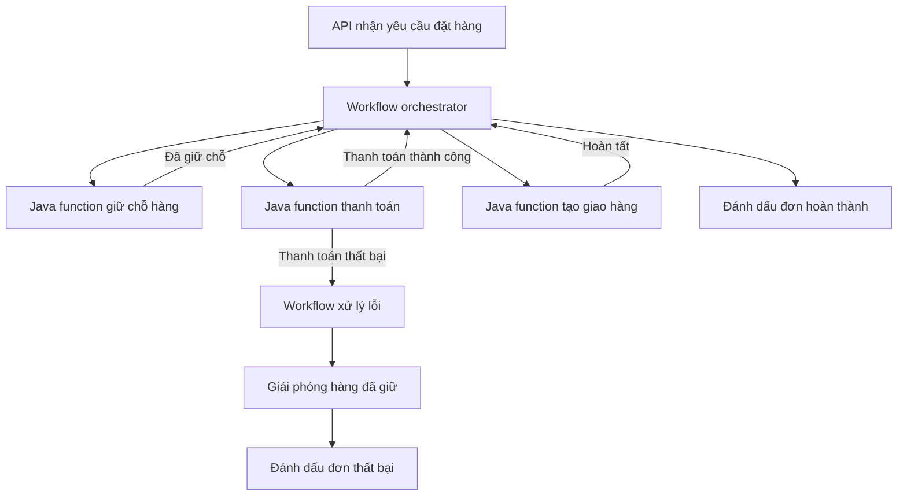
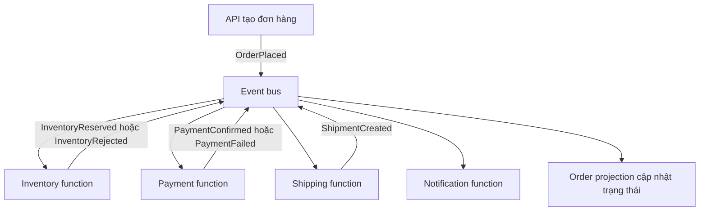

# Phân biệt orchestration và choreography

## Mục tiêu học tập

Sau bài học, bạn có thể:

- Giải thích cách orchestration và choreography phối hợp nhiều thành phần trong một quy trình nghiệp vụ.
- Nhận biết nơi lưu trạng thái, nơi quyết định bước tiếp theo và cách các function giao tiếp trong từng mô hình.
- Phân tích ảnh hưởng của retry, sự kiện trùng lặp, sự kiện đến sai thứ tự và lỗi giữa chừng.
- Chọn mô hình phù hợp cho một ứng dụng serverless viết bằng Java, đồng thời biết khi nào nên kết hợp cả hai.

## 1. Vì sao cần phối hợp nhiều function?

Một Java function thường nên đảm nhiệm một phần việc có phạm vi rõ ràng: xác thực yêu cầu HTTP, giữ chỗ hàng tồn kho, tính phí thanh toán, gửi thông báo hoặc xử lý một sự kiện. Khi một nghiệp vụ cần nhiều phần việc, hệ thống phải quyết định ai chịu trách nhiệm điều phối chúng.

Ví dụ, khi khách hàng đặt hàng, hệ thống có thể phải:

1. Kiểm tra và giữ chỗ sản phẩm.
2. Thanh toán.
3. Tạo yêu cầu giao hàng.
4. Gửi xác nhận cho khách hàng.

Các bước có quan hệ phụ thuộc. Không thể giao hàng nếu chưa có hàng; không nên xác nhận đơn đã thanh toán nếu cổng thanh toán từ chối; nếu thanh toán thành công nhưng bước tạo giao hàng thất bại, hệ thống phải có cách xử lý trạng thái đơn.

Trong mô hình serverless, các bước này thường chạy ở những function hoặc dịch vụ độc lập. Một function có thể được gọi bởi HTTP, một function khác được kích hoạt bởi thông điệp, còn function thứ ba phản ứng với sự kiện trên event bus. Mỗi lần gọi có thể chạy trên một instance khác nhau. Bộ nhớ của instance không phải nơi lưu trạng thái lâu dài của toàn bộ quy trình.

Hai mẫu phối hợp phổ biến là **orchestration** và **choreography**. Cả hai đều có thể dùng function, thông điệp và sự kiện bất đồng bộ. Điểm khác biệt nằm ở nơi nắm quyền điều khiển luồng nghiệp vụ.

## 2. Orchestration: một bộ điều phối quản lý luồng

Trong orchestration, một thành phần điều phối (orchestrator) biết quy trình gồm những bước nào, bước nào được chạy tiếp theo và phải xử lý ra sao khi một bước thành công hoặc thất bại. Các function thực hiện công việc chuyên biệt rồi trả kết quả về cho bộ điều phối.



Orchestrator có thể là một workflow engine được quản lý, một durable function framework hoặc một dịch vụ điều phối chuyên dụng. Ví dụ về công nghệ có thể triển khai mô hình này gồm AWS Step Functions, Azure Durable Functions và Google Workflows. Tên sản phẩm khác nhau, nhưng ý tưởng chung là lưu trạng thái thực thi và tiếp tục quy trình qua nhiều lần gọi function.

### 2.1. Trách nhiệm của orchestrator

Orchestrator thường chịu trách nhiệm:

- Khởi tạo quy trình với một mã định danh, chẳng hạn `orderId` hoặc `workflowId`.
- Gọi đúng function cho từng bước và truyền dữ liệu đầu vào cần thiết.
- Lưu trạng thái hiện tại, kết quả bước đã hoàn tất và bước kế tiếp.
- Áp dụng timeout, retry và nhánh xử lý lỗi theo chính sách của quy trình.
- Kích hoạt hành động bù trừ khi một bước sau thất bại và các bước trước cần được hoàn tác về mặt nghiệp vụ.
- Cung cấp trạng thái để hệ thống khác tra cứu quy trình đang chạy, đã hoàn tất hay thất bại.

Function được điều phối nên tập trung vào một thao tác nghiệp vụ. Function không cần tự tìm function kế tiếp hoặc tự hiểu toàn bộ quy trình đặt hàng. Điều này giúp mỗi function dễ kiểm thử và tái sử dụng trong nhiều workflow.

### 2.2. Trạng thái quy trình được lưu ở đâu?

Một workflow có thể kéo dài vài giây, vài phút hoặc lâu hơn, ví dụ chờ nhà cung cấp xác nhận hoặc chờ một sự kiện từ bên ngoài. Không nên giữ một Java function chạy liên tục để chờ toàn bộ quy trình kết thúc. Function có giới hạn thời gian thực thi, instance có thể bị thu hồi và việc giữ tài nguyên trong lúc chờ thường tốn kém.

Với orchestration serverless, workflow engine lưu trạng thái thực thi ở bên ngoài function. Khi cần chạy bước tiếp theo, engine khởi chạy function tương ứng và truyền dữ liệu đã lưu. Nếu quy trình phải chờ, engine có thể tạm dừng rồi tiếp tục khi đến thời điểm hoặc khi nhận được tín hiệu phù hợp.

Ví dụ trạng thái của một đơn hàng có thể được biểu diễn như sau:

| Trạng thái workflow | Ý nghĩa | Bước tiếp theo có thể xảy ra |
|---|---|---|
| `STARTED` | Quy trình vừa được tạo | Giữ chỗ hàng |
| `INVENTORY_RESERVED` | Hàng đã được giữ | Thanh toán |
| `PAYMENT_CONFIRMED` | Thanh toán đã được xác nhận | Tạo giao hàng |
| `COMPLETED` | Các bước bắt buộc đã hoàn tất | Kết thúc |
| `COMPENSATING` | Một bước thất bại, đang chạy hành động bù trừ | Giải phóng hàng hoặc hoàn tiền |
| `FAILED` | Quy trình kết thúc với lỗi nghiệp vụ hoặc lỗi không thể tự phục hồi | Chuyển xử lý thủ công nếu cần |

Tên trạng thái chỉ là ví dụ. Một hệ thống thực tế cần định nghĩa trạng thái theo nghiệp vụ, tránh dùng trạng thái kỹ thuật như `FUNCTION_2_DONE` làm trạng thái đơn hàng.

### 2.3. Ví dụ luồng orchestration

Một workflow đặt hàng có thể được mô tả bằng giả mã sau:

```text
Workflow FulfillOrder(orderId):
    inventory = ReserveInventory(orderId)

    nếu inventory không thành công:
        RejectOrder(orderId, reason = "OUT_OF_STOCK")
        kết thúc

    payment = ChargePayment(orderId)

    nếu payment không thành công:
        ReleaseInventory(orderId)
        RejectOrder(orderId, reason = "PAYMENT_FAILED")
        kết thúc

    shipment = CreateShipment(orderId)

    nếu shipment không thành công:
        RefundPayment(orderId)
        ReleaseInventory(orderId)
        MarkOrderForManualReview(orderId)
        kết thúc

    CompleteOrder(orderId)
```

Đây là mô tả logic, không phải cú pháp của một workflow engine cụ thể. Khi triển khai, mỗi thao tác thường là một task gọi Java function hoặc một tích hợp dịch vụ. Các nhánh, retry và timeout được khai báo trong workflow definition hoặc cấu hình tương ứng.

### 2.4. Ưu điểm và giới hạn

Orchestration phù hợp khi luồng nghiệp vụ có thứ tự rõ ràng, nhiều nhánh điều kiện, thời gian chờ dài hoặc cần một nơi để theo dõi trạng thái tổng thể. Người vận hành có thể xem workflow đang dừng ở bước nào và nguyên nhân bước đó thất bại. Quy tắc retry và hành động bù trừ cũng tập trung hơn.

Đổi lại, orchestrator phải hiểu các bước và hợp đồng của những thành phần tham gia. Khi quy trình thay đổi thường xuyên, workflow definition có thể trở thành nơi tập trung nhiều logic. Nếu mọi nghiệp vụ nhỏ đều phải đi qua một workflow trung tâm, hệ thống có thể tăng số lần chuyển trạng thái, chi phí thực thi và sự phụ thuộc vào thành phần điều phối.

Orchestrator cũng cần được thiết kế để chịu lỗi. Một workflow engine được quản lý thường lưu trạng thái bền vững, nhưng ứng dụng vẫn phải xử lý timeout, lỗi tích hợp, giới hạn quota và khả năng một task được gọi lại.

## 3. Choreography: các dịch vụ phối hợp qua sự kiện

Trong choreography, không có một thành phần trung tâm nắm toàn bộ luồng nghiệp vụ và ra lệnh cho từng bước. Mỗi dịch vụ tự thực hiện trách nhiệm của mình, phát ra sự kiện mô tả điều đã xảy ra, và dịch vụ quan tâm sẽ phản ứng với sự kiện đó.



Sơ đồ minh họa một luồng thành công. Trong thực tế, mỗi function chỉ đăng ký nhận những loại sự kiện mà nó cần. Ví dụ, function thanh toán chỉ phản ứng với `InventoryReserved`; function giao hàng chỉ phản ứng với `PaymentConfirmed`. Function không gọi trực tiếp function tiếp theo và cũng không cần biết toàn bộ danh sách dịch vụ sẽ nhận sự kiện.

### 3.1. Sự kiện là thông tin về điều đã xảy ra

Sự kiện nên mang ý nghĩa quá khứ hoặc sự thật đã được xác nhận, ví dụ:

- `OrderPlaced`: đơn hàng đã được tạo.
- `InventoryReserved`: hàng đã được giữ.
- `InventoryReservationRejected`: yêu cầu giữ hàng bị từ chối.
- `PaymentConfirmed`: thanh toán đã được xác nhận.
- `PaymentFailed`: thanh toán thất bại.
- `ShipmentCreated`: yêu cầu giao hàng đã được tạo.

Phân biệt **event** và **command** rất quan trọng:

- Command yêu cầu một thành phần thực hiện việc gì đó, ví dụ `ReserveInventory` hoặc `ChargePayment`.
- Event thông báo một việc đã xảy ra, ví dụ `InventoryReserved` hoặc `PaymentConfirmed`.

Một event không nên được đặt tên như một mệnh lệnh chưa chắc đã thành công. `PaymentConfirmed` là một sự kiện; `ChargePayment` là một yêu cầu thực hiện thao tác. Trong hệ thống lớn, command thường được gửi đến một chủ thể có trách nhiệm xử lý, còn event có thể được nhiều consumer đăng ký nhận.

### 3.2. Trách nhiệm nằm ở từng dịch vụ

Mỗi dịch vụ cần biết:

- Những sự kiện nào có ý nghĩa đối với nó.
- Điều kiện nào cho phép xử lý sự kiện.
- Trạng thái nghiệp vụ cục bộ cần cập nhật.
- Sự kiện tiếp theo nào cần phát ra sau khi xử lý thành công hoặc thất bại.

Ví dụ, dịch vụ kho hàng nhận `OrderPlaced`, kiểm tra tồn kho và phát `InventoryReserved` hoặc `InventoryReservationRejected`. Dịch vụ thanh toán không cần biết cách kho hàng tính tồn kho; nó chỉ cần biết quy tắc nghiệp vụ của mình và phản ứng với `InventoryReserved`.

Event bus hoặc message broker chịu trách nhiệm định tuyến, lưu đệm và chuyển thông điệp theo cấu hình. Một số lựa chọn phổ biến là Amazon EventBridge, Azure Event Grid hoặc Service Bus, và Google Pub/Sub hoặc Eventarc. Event bus là hạ tầng dùng chung, nhưng nó không nhất thiết là nơi quyết định toàn bộ quy trình nghiệp vụ.

### 3.3. Trạng thái tổng thể được hình thành như thế nào?

Trong choreography, mỗi dịch vụ thường sở hữu trạng thái thuộc phạm vi của nó. Dịch vụ kho hàng quản lý việc giữ hàng; dịch vụ thanh toán quản lý giao dịch thanh toán; dịch vụ giao hàng quản lý vận đơn. Một màn hình theo dõi đơn hàng có thể xây dựng một bản chiếu (projection) bằng cách tiêu thụ các event và cập nhật trạng thái hiển thị.

Điều này tạo ra tính nhất quán cuối cùng (eventual consistency). Sau khi thanh toán thành công, có thể mất một khoảng thời gian ngắn trước khi màn hình đơn hàng hiển thị trạng thái mới. Ứng dụng cần xác định trạng thái trung gian như `PAYMENT_PENDING` hoặc `PROCESSING`, thay vì giả định mọi dịch vụ cập nhật đồng thời.

Nếu nghiệp vụ cần biết một quy trình đã hoàn tất hay bị kẹt quá lâu, hệ thống phải có cơ chế tổng hợp trạng thái hoặc phát hiện quy trình quá hạn. Choreography không tự động cung cấp một màn hình trạng thái end-to-end.

### 3.4. Ưu điểm và giới hạn

Choreography phù hợp khi nhiều dịch vụ cần phản ứng độc lập với cùng một sự kiện, khi muốn thêm consumer mà không sửa trực tiếp producer, hoặc khi các bước có thể tiến triển bất đồng bộ. Dịch vụ giữ quyền sở hữu logic và dữ liệu của mình; event contract là ranh giới tích hợp.

Tuy nhiên, luồng nghiệp vụ trở nên phân tán. Để hiểu tại sao một đơn hàng chưa hoàn tất, người vận hành có thể phải ghép log và trạng thái từ nhiều dịch vụ. Khi một event kích hoạt nhiều consumer, các phụ thuộc và nhánh xử lý khó nhìn thấy hơn. Nếu nhiều dịch vụ phát event để kích hoạt lẫn nhau mà không có quy tắc rõ ràng, hệ thống có thể tạo vòng lặp hoặc hiệu ứng dây chuyền.

Choreography cũng không loại bỏ coupling. Producer và consumer vẫn phụ thuộc vào ý nghĩa, cấu trúc và quy tắc tương thích của event. Thay đổi tên field, ý nghĩa trạng thái hoặc thứ tự phát event có thể ảnh hưởng nhiều consumer.

## 4. So sánh trực tiếp

| Tiêu chí | Orchestration | Choreography |
|---|---|---|
| Nơi điều khiển luồng | Orchestrator hoặc workflow engine | Phân tán trong các dịch vụ tham gia |
| Cách phối hợp | Orchestrator gọi task và quyết định bước tiếp theo | Dịch vụ phát event; consumer phản ứng |
| Nhận biết toàn bộ quy trình | Tập trung trong workflow definition và trạng thái workflow | Phải tổng hợp từ event và trạng thái của nhiều dịch vụ |
| Thay đổi quy trình | Thường sửa workflow definition hoặc logic điều phối | Thường sửa một hay nhiều consumer và event contract liên quan |
| Tái sử dụng function | Function có thể được gọi bởi nhiều workflow | Consumer có thể phản ứng với event dùng chung |
| Theo dõi lỗi | Dễ xác định bước hiện tại nếu workflow engine lưu trạng thái tốt | Cần correlation, tracing và công cụ tổng hợp trạng thái |
| Fan-out cho nhiều consumer | Orchestrator phải biết hoặc cấu hình các nhánh | Event bus có thể định tuyến đến nhiều consumer |
| Phụ thuộc chính | Phụ thuộc vào workflow engine và định nghĩa quy trình | Phụ thuộc vào event contract, broker và hành vi consumer |
| Phù hợp khi | Luồng có thứ tự, nhánh, timeout và bù trừ rõ | Nhiều phản ứng độc lập, bất đồng bộ và mở rộng consumer |

Không có mô hình nào luôn tốt hơn. Quyết định phụ thuộc vào việc hệ thống cần một nơi điều khiển quy trình rõ ràng hay cần các dịch vụ phản ứng độc lập với sự kiện.

## 5. Cùng một nghiệp vụ có thể triển khai theo hai cách

Xét quy trình đặt hàng gồm giữ hàng, thanh toán, tạo giao hàng và gửi thông báo.

Với orchestration, workflow engine gọi function giữ hàng. Khi nhận kết quả thành công, engine gọi function thanh toán; sau đó gọi function giao hàng và function thông báo. Nếu thanh toán thất bại, engine gọi function giải phóng hàng. Nếu tạo giao hàng thất bại sau khi thanh toán thành công, workflow có thể gọi function hoàn tiền và đưa đơn vào trạng thái cần xem xét.

Với choreography, API phát `OrderPlaced`. Dịch vụ kho hàng tiêu thụ event này rồi phát `InventoryReserved` hoặc `InventoryReservationRejected`. Dịch vụ thanh toán chỉ xử lý `InventoryReserved`, sau đó phát `PaymentConfirmed` hoặc `PaymentFailed`. Dịch vụ giao hàng xử lý `PaymentConfirmed`. Dịch vụ thông báo có thể nhận `OrderPlaced`, `PaymentConfirmed` hoặc `ShipmentCreated` tùy nội dung thông báo cần gửi.

Khác biệt dễ thấy nhất là nơi quyết định bước kế tiếp. Trong orchestration, workflow engine quyết định dựa trên kết quả task. Trong choreography, việc phát event và đăng ký nhận event tạo nên luồng xử lý. Cả hai cách đều có thể dùng message broker, retry và function bất đồng bộ.

Một thiết kế hybrid cũng rất phổ biến: workflow engine điều phối các bước quan trọng của đơn hàng như giữ hàng, thanh toán và tạo giao hàng; sau khi đơn hàng chuyển sang trạng thái phù hợp, dịch vụ phát event để các consumer độc lập xử lý email, phân tích dữ liệu, cập nhật tìm kiếm hoặc gửi thông báo. Như vậy, phần nghiệp vụ cần kiểm soát chặt có luồng rõ ràng, còn các phản ứng phụ có thể mở rộng độc lập.

## 6. Xử lý lỗi trong cả hai mô hình

Function serverless có thể gặp timeout, lỗi mạng, giới hạn quota, lỗi xác thực, dữ liệu không hợp lệ hoặc lỗi từ dịch vụ bên ngoài. Một function có thể đã thực hiện tác động nghiệp vụ nhưng phản hồi bị mất. Vì vậy, không thể suy luận rằng “không nhận được kết quả” đồng nghĩa với “thao tác chưa xảy ra”.

### 6.1. Retry chỉ dành cho lỗi có khả năng phục hồi

Retry hữu ích với lỗi tạm thời như timeout ngắn, giới hạn tốc độ hoặc dịch vụ phụ thuộc đang quá tải. Nên cấu hình số lần thử tối đa, khoảng chờ tăng dần (exponential backoff), jitter và giới hạn tổng thời gian. Không retry vô hạn.

Lỗi nghiệp vụ như hết hàng, thẻ bị từ chối hoặc dữ liệu không hợp lệ thường không tự biến mất sau vài lần gọi. Những lỗi này nên đi theo nhánh nghiệp vụ tương ứng, ví dụ từ chối đơn hàng hoặc yêu cầu người dùng cập nhật thông tin.

Trong orchestration, retry thường được định nghĩa theo task hoặc bước của workflow. Trong choreography, retry có thể được thực hiện bởi event source, broker hoặc chính sách của consumer. Cần biết chính xác thành phần nào đang retry để tránh nhiều lớp retry nhân lên và tạo tải lớn.

### 6.2. Idempotency để chịu được xử lý lặp

Nhiều nền tảng serverless và message broker cung cấp cơ chế giao nhận ít nhất một lần (at-least-once) trong một số luồng xử lý. Điều đó có nghĩa một event hoặc task có thể được giao lại. Một timeout cũng có thể khiến caller thử lại dù thao tác trước đó đã thành công.

Một thao tác idempotent có thể được thực hiện nhiều lần với cùng một khóa mà không tạo thêm tác động nghiệp vụ ngoài ý muốn. Ví dụ, yêu cầu thanh toán nên dùng idempotency key dựa trên mã đơn hàng hoặc mã lần thanh toán. Consumer có thể lưu `eventId` đã xử lý trong một inbox table có ràng buộc duy nhất. Khi nhận lại cùng event, consumer nhận ra event đã được xử lý và không tạo thêm giao dịch.

Không nên dựa vào một biến trong bộ nhớ của Java function để chống trùng lặp, vì lần gọi tiếp theo có thể chạy trên instance khác. Dấu vết idempotency phải được lưu bền vững trong cơ sở dữ liệu hoặc dịch vụ lưu trữ phù hợp.

### 6.3. Transactional outbox và inbox

Một lỗi thường gặp là cập nhật cơ sở dữ liệu rồi phát event như hai thao tác tách rời. Nếu cập nhật thành công nhưng function dừng trước khi publish, consumer sẽ không biết thay đổi đã xảy ra. Nếu publish thành công nhưng cập nhật thất bại, consumer có thể nhận một event không phản ánh trạng thái đã commit.

Transactional outbox giải quyết khoảng hở này bằng cách ghi thay đổi nghiệp vụ và bản ghi event vào cùng một transaction của cơ sở dữ liệu. Một tiến trình hoặc function riêng đọc outbox rồi publish event; nếu publish thất bại, nó thử lại. Vì publisher có thể gửi lại sau khi đã gửi thành công nhưng chưa kịp đánh dấu bản ghi, consumer vẫn phải idempotent.

Inbox là cơ chế tương ứng ở phía consumer: lưu mã event đã nhận và xử lý cập nhật nghiệp vụ trong cùng transaction phù hợp. Kết hợp inbox và outbox giúp giảm nguy cơ mất event hoặc xử lý trùng, nhưng không thay thế việc thiết kế khóa idempotency và xử lý lỗi ở các dịch vụ bên ngoài.

### 6.4. Compensation và Saga

Một quy trình phân tán thường không thể dùng một transaction ACID duy nhất bao trùm nhiều dịch vụ. Nếu bước thứ ba thất bại sau khi hai bước đầu đã commit, hệ thống cần hành động bù trừ (compensation) để đưa nghiệp vụ về trạng thái chấp nhận được.

Ví dụ:

| Hành động đã hoàn tất | Hành động bù trừ có thể dùng |
|---|---|
| Giữ chỗ hàng | Giải phóng hàng |
| Trừ tiền | Hoàn tiền hoặc tạo giao dịch đảo |
| Tạo nhãn giao hàng | Hủy nhãn nếu nhà vận chuyển còn cho phép |
| Gửi email | Thường không thể thu hồi; có thể gửi thông báo đính chính |

Chuỗi bước nghiệp vụ cùng các hành động bù trừ thường được gọi là **Saga**. Saga có thể được triển khai theo orchestration hoặc choreography. Orchestrated Saga có một bộ điều phối gọi các bước và compensation. Choreographed Saga để từng dịch vụ phản ứng với event thành công hoặc thất bại rồi phát event tiếp theo.

Compensation không phải rollback kỹ thuật. Hoàn tiền không xóa giao dịch thanh toán ban đầu; nó tạo một giao dịch mới có ý nghĩa nghiệp vụ. Một số tác động không thể đảo ngược hoàn toàn, ví dụ email đã gửi hoặc hàng đã rời kho. Khi đó, quy trình cần trạng thái xử lý thủ công hoặc hành động khắc phục khác.

Đặc biệt, nếu lời gọi thanh toán bị timeout, trước khi hoàn tiền hoặc gọi thanh toán lại, hệ thống phải kiểm tra kết quả theo idempotency key hoặc truy vấn trạng thái giao dịch. Nếu không, có thể hoàn tiền cho một khoản chưa bị trừ hoặc trừ tiền hai lần.

### 6.5. Dead-letter queue và phát lại

Sau khi vượt quá số lần retry, event có thể được chuyển vào dead-letter queue (DLQ) hoặc vùng lưu lỗi tương đương. DLQ giúp giữ lại thông điệp để điều tra thay vì làm mất dấu lỗi. Khi xử lý DLQ, cần xác định nguyên nhân, sửa lỗi dữ liệu hoặc code, rồi quyết định phát lại có kiểm soát.

Phát lại event có thể kích hoạt lại nhiều consumer. Vì vậy, cần bảo đảm idempotency, giữ lại `eventId` gốc hoặc tạo quy trình replay có dấu vết riêng, đồng thời đánh giá tác động lên trạng thái hiện tại. Không nên xóa DLQ hoặc replay hàng loạt chỉ để làm sạch cảnh báo.

## 7. Ví dụ Java: consumer trong mô hình choreography

Một event envelope nên có metadata đủ để định danh, tương quan và kiểm tra thứ tự. Ví dụ sau minh họa cấu trúc dữ liệu; cách serialize và cấu hình trigger phụ thuộc nền tảng serverless đang dùng.

```java
import java.time.Instant;

public record EventEnvelope<T>(
    String eventId,
    String eventType,
    int schemaVersion,
    String aggregateId,
    long aggregateVersion,
    Instant occurredAt,
    String correlationId,
    String causationId,
    T payload
) {}

public record OrderPlaced(
    String orderId,
    String customerId
) {}
```

`eventId` định danh một lần phát event; `aggregateId` thường là mã đối tượng nghiệp vụ như `orderId`; `aggregateVersion` giúp phát hiện event cũ hoặc sai thứ tự; `correlationId` liên kết các hoạt động thuộc cùng một quy trình; `causationId` cho biết event nào dẫn đến event hiện tại. `schemaVersion` hỗ trợ thay đổi cấu trúc event có kiểm soát.

Một consumer xử lý `OrderPlaced` có thể có dạng minh họa như sau:

```java
public final class InventoryConsumer {
    private final InboxRepository inbox;
    private final InventoryService inventory;
    private final OutboxRepository outbox;
    private final TransactionRunner transaction;

    public InventoryConsumer(
            InboxRepository inbox,
            InventoryService inventory,
            OutboxRepository outbox,
            TransactionRunner transaction) {
        this.inbox = inbox;
        this.inventory = inventory;
        this.outbox = outbox;
        this.transaction = transaction;
    }

    public void handle(EventEnvelope<OrderPlaced> event) {
        transaction.execute(() -> {
            // insertIfAbsent phải có ràng buộc duy nhất theo eventId.
            if (!inbox.insertIfAbsent(event.eventId())) {
                return; // Event đã được xử lý trước đó.
            }

            var result = inventory.reserve(event.payload().orderId());
            var nextEvent = result.toEvent(
                    event.correlationId(),
                    event.eventId());

            // Ghi outbox cùng transaction với thay đổi tồn kho.
            outbox.append(nextEvent);
        });
    }
}
```

Các interface như `InboxRepository`, `InventoryService`, `OutboxRepository` và `TransactionRunner` là thành phần minh họa, không thuộc Java chuẩn. Điểm quan trọng là thao tác ghi inbox, cập nhật dữ liệu nghiệp vụ cục bộ và ghi outbox phải có ranh giới transaction phù hợp, thường cùng một cơ sở dữ liệu. Một tiến trình riêng sẽ chuyển outbox thành event trên broker.

Không đặt một lời gọi mạng đến dịch vụ kho hàng từ xa bên trong transaction cơ sở dữ liệu rồi giả định hai hệ thống commit nguyên tử. Nếu kho hàng là một dịch vụ độc lập, consumer nên gửi command hoặc event đến dịch vụ đó và xử lý kết quả bất đồng bộ theo hợp đồng đã định nghĩa.

Với orchestrated workflow, Java function có thể được triển khai như task handler. Workflow engine chịu trách nhiệm gọi task, lưu kết quả và quyết định bước tiếp theo. Task handler vẫn cần idempotency vì workflow có thể retry sau timeout hoặc lỗi tạm thời.

## 8. Các vấn đề vận hành cần thiết kế từ đầu

### 8.1. Thứ tự và tính nhất quán của event

Không nên giả định mọi event trên một broker đều được xử lý theo đúng thứ tự toàn cục. Nếu nghiệp vụ yêu cầu thứ tự theo từng đơn hàng, hãy dùng khóa phân vùng hoặc cơ chế ordering theo `aggregateId` nếu nền tảng hỗ trợ. Đồng thời lưu `aggregateVersion` để consumer nhận biết event cũ, event bị lặp hoặc event đến trước event mà nó phụ thuộc.

Khi event đến sai thứ tự, consumer có thể bỏ qua event cũ, lưu event để xử lý sau, hoặc đọc lại trạng thái chuẩn từ dịch vụ sở hữu dữ liệu. Cách chọn phụ thuộc nghiệp vụ; không có một chiến lược chung cho mọi loại event.

### 8.2. Thiết kế event contract

Event là hợp đồng giữa producer và consumer. Nên ưu tiên thay đổi tương thích ngược: thêm field tùy chọn, giữ nguyên ý nghĩa field cũ và không tái sử dụng một tên event cho ý nghĩa mới. Khi có thay đổi không tương thích, cần versioning, thời gian chuyển đổi và kế hoạch cập nhật consumer.

Không đưa toàn bộ bản ghi cơ sở dữ liệu vào event nếu consumer chỉ cần một phần dữ liệu. Chỉ gửi dữ liệu cần thiết để phản ứng, cùng định danh cho phép consumer tra cứu thêm khi được phép. Tránh đưa mật khẩu, token, bí mật hoặc dữ liệu cá nhân không cần thiết vào payload, log và DLQ.

### 8.3. Quan sát quy trình end-to-end

Log riêng của từng function chưa đủ để hiểu một đơn hàng đã đi qua những bước nào. Hãy truyền `correlationId` hoặc trace context xuyên suốt các lời gọi và event. Log nên có `eventId`, `aggregateId`, tên bước, kết quả và mã lỗi; không ghi dữ liệu nhạy cảm.

Các chỉ số hữu ích gồm:

- Thời gian từ khi bắt đầu đến khi hoàn tất một quy trình.
- Thời gian xử lý và tỷ lệ lỗi của từng bước.
- Số lần retry, số event trùng và số thông điệp trong DLQ.
- Số workflow đang chờ quá lâu hoặc bị kẹt ở một trạng thái.
- Tỷ lệ compensation thành công và số quy trình cần can thiệp thủ công.
- Chi phí theo workflow, function invocation, event publish/delivery và thời gian lưu trữ.

Trong orchestration, workflow engine thường cung cấp lịch sử thực thi hữu ích. Trong choreography, cần kết hợp distributed tracing, log có cấu trúc và một projection hoặc công cụ truy vấn trạng thái nghiệp vụ.

### 8.4. Bảo mật và quyền truy cập

Mỗi function chỉ nên có quyền publish, subscribe, đọc hoặc ghi vào đúng tài nguyên cần thiết. Không cấp quyền rộng cho mọi function chỉ vì chúng cùng dùng một event bus. Xác thực schema và nguồn phát event; kiểm tra tenant hoặc quyền sở hữu đối tượng trước khi thực hiện tác động nghiệp vụ.

DLQ, workflow history và log có thể chứa dữ liệu nghiệp vụ. Cần kiểm soát quyền đọc, mã hóa, thời hạn lưu trữ và quy trình xóa dữ liệu phù hợp. Event bus không nên trở thành kênh truyền bí mật chỉ vì nó tiện cho việc chia sẻ dữ liệu.

### 8.5. Tải tăng đột biến và chi phí

Serverless có thể tự mở rộng số lượng function instance, nhưng hệ thống phụ thuộc phía sau có thể không mở rộng tương ứng. Một event fan-out đến nhiều consumer có thể tạo tải lớn lên cơ sở dữ liệu hoặc API thanh toán. Cần đặt concurrency limit, rate limit, batch size, queue depth alarm và backpressure phù hợp.

Orchestration phát sinh chi phí theo workflow execution, state transition hoặc thời gian thực thi tùy nền tảng. Choreography phát sinh chi phí publish, delivery, lưu trữ event, retry và vận hành broker. Ngoài chi phí trực tiếp, hãy tính cả chi phí quan sát, xử lý DLQ và công sức điều tra lỗi phân tán.

## 9. Chọn mô hình nào?

Hãy bắt đầu từ yêu cầu nghiệp vụ và cách nhóm vận hành cần hiểu quy trình.

| Tình huống | Hướng lựa chọn thường phù hợp | Lý do |
|---|---|---|
| Quy trình có thứ tự bắt buộc và nhiều nhánh điều kiện | Orchestration | Luồng điều khiển và trạng thái được thể hiện tập trung |
| Quy trình kéo dài, có thời gian chờ hoặc cần timeout rõ ràng | Orchestration | Workflow engine có thể lưu trạng thái và tiếp tục sau khi chờ |
| Nhiều hệ thống độc lập cần phản ứng với cùng một sự kiện | Choreography | Có thể thêm consumer mà producer không cần điều phối từng consumer |
| Các bước nghiệp vụ thuộc nhiều bounded context và cần quyền tự chủ cao | Choreography hoặc hybrid | Mỗi dịch vụ giữ logic và dữ liệu trong phạm vi của mình |
| Cần theo dõi một Saga với nhiều compensation | Orchestration thường dễ quan sát hơn | Có một nơi thể hiện tiến trình và nhánh bù trừ |
| Sau một bước nghiệp vụ cần phát thông báo, cập nhật chỉ mục hoặc phân tích | Choreography | Các tác vụ phụ có thể tiêu thụ event độc lập |
| Luồng vừa cần kiểm soát nghiệp vụ chặt vừa cần fan-out | Hybrid | Workflow quản lý bước cốt lõi, event phục vụ các phản ứng độc lập |

Trước khi chọn, hãy trả lời các câu hỏi sau:

1. Có cần một thành phần biết chắc bước kế tiếp của quy trình không?
2. Có cần xem trạng thái end-to-end và biết chính xác quy trình đang chờ ở đâu không?
3. Có bao nhiêu dịch vụ cần phản ứng với cùng một sự kiện, và các consumer có thay đổi độc lập không?
4. Khi một bước thất bại, những bước nào cần retry và những tác động nào cần compensation?
5. Hệ thống có chịu được nhất quán cuối cùng không, hay cần phản hồi đồng bộ ngay cho người gọi?
6. Nhóm có đủ khả năng vận hành tracing, event contract, DLQ và replay khi luồng bị phân tán không?

Đừng chọn choreography chỉ vì hệ thống đã có event bus. Event bus là hạ tầng truyền thông điệp; nó không tự làm cho quy trình dễ hiểu hoặc đáng tin cậy. Tương tự, đừng đưa mọi thao tác vào một workflow lớn nếu chúng chỉ là phản ứng phụ độc lập.

## 10. Những lỗi thiết kế thường gặp

- **Dùng một function làm orchestrator dài hạn:** function giữ vòng lặp và chờ nhiều dịch vụ sẽ dễ chạm timeout, mất trạng thái khi instance bị thu hồi và khó mở rộng. Dùng workflow engine hoặc cơ chế durable execution cho quy trình kéo dài.
- **Coi event delivery là exactly-once:** giao nhận trùng vẫn có thể xảy ra. Thiết kế consumer idempotent và lưu dấu xử lý bền vững.
- **Retry mọi lỗi:** lỗi nghiệp vụ không tự phục hồi khi thử lại. Phân loại lỗi tạm thời và lỗi không thể phục hồi.
- **Không có compensation:** một bước sau thất bại có thể để lại tài nguyên bị giữ hoặc tiền đã thu. Xác định hành động bù trừ và giới hạn của chúng trước khi triển khai.
- **Phát event trước khi dữ liệu commit:** consumer có thể nhận thông tin không khớp với trạng thái đã lưu. Cân nhắc transactional outbox.
- **Đặt logic quy trình trong tên topic hoặc quy tắc định tuyến khó hiểu:** event contract cần thể hiện sự kiện nghiệp vụ; luồng không nên phụ thuộc vào những quy ước ngầm khó tìm.
- **Không truyền correlation ID:** khi có lỗi, nhóm không thể nối các lần gọi và event thuộc cùng một nghiệp vụ.
- **Không quản lý version của event:** một thay đổi payload có thể làm hỏng consumer cũ đang chạy.
- **Để mọi consumer có quyền đọc mọi event:** điều này làm tăng phạm vi ảnh hưởng và rủi ro lộ dữ liệu.
- **Không đặt giới hạn concurrency:** function mở rộng nhanh có thể làm quá tải cơ sở dữ liệu hoặc dịch vụ thanh toán.

## 11. Quy trình thiết kế một luồng serverless

Có thể áp dụng trình tự sau cho cả orchestration và choreography:

1. **Xác định ranh giới nghiệp vụ.** Viết rõ sự kiện bắt đầu, kết quả thành công, kết quả thất bại và chủ sở hữu dữ liệu của từng bước.
2. **Vẽ luồng và các nhánh lỗi.** Đánh dấu bước đồng bộ, bước bất đồng bộ, điều kiện chuyển trạng thái và thời gian chờ.
3. **Chọn nơi điều khiển.** Dùng orchestrator nếu cần một workflow rõ ràng; dùng choreography nếu các dịch vụ phản ứng độc lập; chọn hybrid nếu hai nhu cầu cùng tồn tại.
4. **Định nghĩa hợp đồng.** Với task, xác định input/output và lỗi có thể trả về. Với event, xác định tên, payload, version, event ID, aggregate ID và correlation ID.
5. **Thiết kế trạng thái bền vững.** Không lưu trạng thái quy trình chỉ trong bộ nhớ function. Xác định nơi lưu workflow history, trạng thái domain, inbox và outbox.
6. **Thiết kế retry và idempotency.** Quy định lỗi nào được retry, số lần tối đa, backoff, khóa idempotency và cách xử lý event trùng.
7. **Thiết kế compensation.** Liệt kê tác động đã commit và cách khắc phục nếu bước sau thất bại; xác định điểm cần người vận hành can thiệp.
8. **Thiết kế vận hành và bảo mật.** Thêm tracing, metric, cảnh báo, DLQ, quyền tối thiểu, kiểm tra schema và chính sách lưu trữ.
9. **Kiểm thử lỗi thực tế.** Mô phỏng timeout sau khi dịch vụ đã thực hiện thao tác, event trùng, event sai thứ tự, consumer dừng giữa chừng và dịch vụ phụ thuộc quá tải.

Khi kiểm thử, đừng chỉ kiểm tra đường thành công. Một quy trình serverless đáng tin cậy phải có hành vi xác định khi một lần gọi bị lặp, một phản hồi bị mất hoặc một dịch vụ chỉ hoạt động trở lại sau vài phút.

## 12. Tự kiểm tra

**Câu 1.** Điểm khác biệt cốt lõi giữa orchestration và choreography là gì?

**Gợi ý trả lời:** Orchestration có một thành phần điều phối quyết định bước tiếp theo và quản lý trạng thái luồng. Choreography phân tán việc phối hợp: dịch vụ phát event, consumer quan tâm tự phản ứng.

**Câu 2.** Choreography có nghĩa là các function không cần biết gì về nhau không?

**Gợi ý trả lời:** Không. Chúng vẫn phụ thuộc vào event contract, ngữ nghĩa nghiệp vụ và quy tắc tương thích. Choreography giảm phụ thuộc gọi trực tiếp, nhưng không loại bỏ phụ thuộc về dữ liệu và hành vi.

**Câu 3.** Vì sao không nên giữ một Java function chạy trong lúc chờ khách hàng xác nhận trong vài giờ?

**Gợi ý trả lời:** Function có giới hạn thời gian và instance không phải nơi lưu trạng thái bền vững. Nên lưu trạng thái bằng workflow engine hoặc kho dữ liệu và tiếp tục quy trình khi nhận tín hiệu.

**Câu 4.** Nếu consumer nhận cùng một `OrderPlaced` hai lần, điều gì bảo vệ hệ thống khỏi giữ hàng hai lần?

**Gợi ý trả lời:** Consumer cần idempotency dựa trên `eventId` hoặc khóa nghiệp vụ, được lưu bền vững và cập nhật nhất quán với thay đổi dữ liệu. Không dựa vào bộ nhớ của function.

**Câu 5.** Khi thanh toán thành công nhưng tạo giao hàng thất bại, retry và compensation khác nhau thế nào?

**Gợi ý trả lời:** Retry thử lại bước tạo giao hàng nếu lỗi có khả năng phục hồi. Compensation thực hiện hành động nghiệp vụ bù trừ, chẳng hạn hoàn tiền hoặc chuyển đơn sang xử lý thủ công, nếu bước đó không thể hoàn tất.

**Bài tập tình huống:** Một đơn hàng sau khi thanh toán sẽ phát sinh ba việc độc lập: gửi email, cập nhật chỉ mục tìm kiếm và gửi dữ liệu sang hệ thống phân tích. Hãy đề xuất cách phối hợp, nêu event cần phát, cách xử lý khi một consumer lỗi kéo dài và cách tránh gửi email hoặc ghi dữ liệu phân tích hai lần. Sau đó giải thích vì sao không nhất thiết phải thêm cả ba việc vào workflow cốt lõi của đơn hàng.

**Gợi ý:** Một lựa chọn hợp lý là phát event `PaymentConfirmed` sau khi trạng thái thanh toán được commit. Ba consumer riêng đăng ký nhận event và có retry/DLQ, idempotency theo `eventId` hoặc khóa nghiệp vụ, cùng correlation ID để truy vết. Nếu các tác vụ này không quyết định đơn hàng có được xem là đã thanh toán hay không, chúng có thể tiến triển độc lập; trạng thái gửi email hoặc đồng bộ chỉ mục được theo dõi trong phạm vi từng consumer.

## Kết luận

Orchestration đặt luồng điều khiển vào một workflow engine hoặc thành phần điều phối; choreography để các dịch vụ phối hợp thông qua event. Orchestration thường dễ mô tả và theo dõi quy trình có nhiều nhánh, thời gian chờ và compensation. Choreography thường phù hợp với các phản ứng bất đồng bộ, độc lập và cần mở rộng consumer. Trong cả hai mô hình, độ tin cậy vẫn phụ thuộc vào trạng thái bền vững, idempotency, retry có giới hạn, xử lý lỗi, quan sát end-to-end và quyền truy cập phù hợp. Một kiến trúc serverless thực tế có thể kết hợp cả hai theo ranh giới nghiệp vụ.
