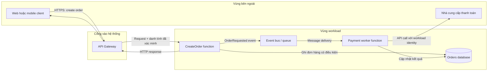

# Thiết kế luồng dữ liệu và xác định ranh giới tin cậy

Một ứng dụng serverless thường gồm nhiều hàm nhỏ, API gateway, hàng đợi, event bus, kho dữ liệu và dịch vụ bên ngoài. Mỗi thành phần có thể được triển khai và mở rộng độc lập, nhưng dữ liệu đi qua chúng vẫn thuộc cùng một quy trình nghiệp vụ. Nếu chỉ thiết kế từng function riêng lẻ, nhóm phát triển dễ bỏ sót nơi dữ liệu được xác thực, nơi quyền truy cập được kiểm tra, hoặc điều gì xảy ra khi một thông điệp được gửi lại.

Thiết kế luồng dữ liệu giúp trả lời dữ liệu bắt đầu ở đâu, đi qua những thành phần nào, được biến đổi và lưu ở đâu, ai có thể đọc hoặc thay đổi dữ liệu, và hệ thống phản ứng thế nào khi một bước thất bại. Xác định ranh giới tin cậy giúp chỉ ra những điểm mà dữ liệu hoặc danh tính đi qua một vùng có giả định bảo mật khác. Hai việc này cần được thực hiện cùng nhau: mỗi đường đi của dữ liệu phải có chủ sở hữu, hợp đồng, cơ chế xác thực và quy tắc xử lý lỗi rõ ràng.

Trong phạm vi kiến trúc serverless, các luồng thường bắt đầu từ HTTP request, thông điệp trong queue, sự kiện từ event bus hoặc thay đổi trong object storage. Function xử lý một lần gọi thường không giữ trạng thái bền vững giữa các lần chạy. Vì vậy, thiết kế phải tính đến việc truyền ngữ cảnh, lưu trạng thái ở dịch vụ bên ngoài, retry, xử lý trùng lặp, mở rộng đồng thời và chi phí của mỗi lần kích hoạt.

## 1. Mô hình hóa luồng dữ liệu trước khi triển khai

Một sơ đồ luồng dữ liệu (Data Flow Diagram, DFD) mô tả bốn loại thành phần:

- **Tác nhân hoặc nguồn bên ngoài:** người dùng, ứng dụng di động, hệ thống đối tác, dịch vụ thanh toán hoặc một nhà cung cấp sự kiện.
- **Tiến trình xử lý:** API gateway, function, workflow hoặc dịch vụ thực hiện xác thực, kiểm tra dữ liệu và quy tắc nghiệp vụ.
- **Kho dữ liệu:** cơ sở dữ liệu, object storage, cache, kho bí mật hoặc nơi lưu trạng thái workflow.
- **Luồng dữ liệu:** request, response, event, message, tệp hoặc kết quả truy vấn đi giữa các thành phần.

Với mỗi mũi tên, hãy ghi rõ dữ liệu nào được truyền, giao thức hoặc cơ chế kích hoạt, định dạng hợp đồng, danh tính thực hiện lời gọi, nơi kiểm tra quyền, và cách xử lý khi đích không sẵn sàng. Một đường nối chỉ ghi “gọi function” là chưa đủ để đánh giá an toàn và độ tin cậy.

Ví dụ, luồng tạo đơn hàng có thể được mô hình hóa như sau:



Sơ đồ này cho thấy hai luồng khác nhau. Đường HTTP trả kết quả tiếp nhận yêu cầu cho client; đường event xử lý thanh toán bất đồng bộ. Việc API trả về thành công có thể chỉ có nghĩa là đơn hàng đã được ghi nhận và sự kiện đã được phát đi, không có nghĩa thanh toán đã hoàn tất. Hợp đồng API cần diễn đạt rõ trạng thái đó, chẳng hạn trả về mã đơn hàng cùng trạng thái `PENDING_PAYMENT`.

Khi lập sơ đồ, hãy đánh dấu thêm:

1. Điểm vào mà dữ liệu chưa được tin cậy.
2. Điểm xác thực danh tính và điểm phân quyền tài nguyên.
3. Nơi kiểm tra cấu trúc, kích thước và ý nghĩa dữ liệu.
4. Kho dữ liệu cùng quyền đọc, ghi, xóa.
5. Điểm gọi ra ngoài hệ thống.
6. Điểm phát sinh side effect, retry, lưu trạng thái hoặc phát lại sự kiện.

Không cần vẽ mọi lời gọi thư viện nội bộ. Hãy tập trung vào các thành phần có ranh giới triển khai, quyền truy cập, lưu trữ, mạng hoặc trách nhiệm vận hành riêng.

## 2. Ranh giới tin cậy là nơi giả định bảo mật thay đổi

Ranh giới tin cậy (trust boundary) xuất hiện khi dữ liệu hoặc quyền điều khiển đi từ một miền có chính sách bảo mật này sang miền có chính sách khác. Ranh giới có thể nằm giữa Internet và API công khai, giữa hai function có quyền IAM khác nhau, giữa hai tenant, giữa tài khoản cloud của hai tổ chức, hoặc giữa hệ thống nội bộ và API của đối tác.

Ranh giới tin cậy không đồng nghĩa với ranh giới mạng. Hai function nằm trong cùng một virtual network vẫn có thể có quyền và mức độ tin cậy khác nhau. Ngược lại, một dịch vụ cloud được quản lý có thể nằm ngoài mạng riêng của ứng dụng nhưng vẫn xác thực workload identity và áp dụng chính sách truy cập chặt chẽ.

Có thể bắt đầu bằng cách phân loại các miền sau:

| Miền | Giả định cần kiểm tra | Kiểm soát thường dùng |
|---|---|---|
| Client và Internet | Request, header, file và tham số đều có thể bị giả mạo | TLS, xác thực, giới hạn kích thước, schema validation, rate limit |
| API gateway | Danh tính được chuyển tiếp có thể đáng tin nếu gateway xác minh đúng và không cho client tự ghi đè | Xác minh token, audience, issuer, thời hạn; loại bỏ header danh tính do client tự gửi |
| Function hoặc workload | Mã chạy với quyền của execution role được cấp | IAM tối thiểu theo từng function, tách quyền đọc và ghi, quản lý secret |
| Queue hoặc event bus | Producer được phép gửi không có nghĩa mọi trường trong payload đều đúng | Chính sách producer/consumer, kiểm tra schema, xác minh tenant và trạng thái nghiệp vụ |
| Database và object storage | Dữ liệu đã lưu vẫn có thể sai, cũ, thiếu hoặc thuộc tenant khác | Phân quyền theo tài nguyên, mã hóa, kiểm tra quyền ở tầng ứng dụng, retention |
| Hệ thống đối tác | Phản hồi, webhook và thời gian sẵn sàng phụ thuộc bên ngoài | Xác thực hai chiều khi phù hợp, chữ ký webhook, timeout, allowlist egress, retry có giới hạn |

Mỗi khi dữ liệu vượt qua ranh giới, hãy đặt các câu hỏi:

- Ai tạo dữ liệu và danh tính của họ được xác minh bằng cách nào?
- Thành phần nhận có quyền thực hiện hành động nào?
- Dữ liệu có được bảo vệ khi truyền và khi lưu không?
- Dữ liệu có thể bị sửa, phát lại, gửi trùng hoặc gửi sai thứ tự không?
- Có thể dùng dữ liệu này để truy cập tài nguyên của tenant khác không?
- Khi không thể xác minh, hệ thống từ chối, cách ly hay đưa thông điệp vào hàng đợi lỗi?

Một nguyên tắc quan trọng là **xác thực nguồn gửi không thay thế việc kiểm tra nội dung**. Một message đến từ queue hợp lệ vẫn có thể chứa trường sai, dữ liệu cũ hoặc một yêu cầu không còn được phép thực hiện. Tương tự, token hợp lệ chứng minh một danh tính đã được xác minh, nhưng không tự động chứng minh danh tính đó được phép đọc mọi đơn hàng.

## 3. Tách xác thực, phân quyền và kiểm tra dữ liệu

Ba bước này giải quyết ba câu hỏi khác nhau:

- **Xác thực (authentication):** ai đang gọi?
- **Phân quyền (authorization):** danh tính đó được phép làm gì trên tài nguyên nào?
- **Kiểm tra dữ liệu (validation):** dữ liệu có đúng định dạng, giới hạn và quy tắc nghiệp vụ không?

Với HTTP trigger, API gateway có thể xác minh chữ ký, issuer, audience và thời hạn của access token. Function nhận danh tính đã xác minh từ context do nền tảng hoặc gateway cung cấp. Không nên lấy `userId`, `role` hoặc `tenantId` từ JSON body hay header tùy ý của client rồi coi đó là danh tính đã xác thực. Nếu gateway chuyển tiếp identity qua header, gateway phải loại bỏ giá trị cùng tên do client gửi trước khi tự thêm giá trị đáng tin.

Sau xác thực, function vẫn cần kiểm tra quyền trên tài nguyên cụ thể. Ví dụ, người dùng có thể được phép tạo đơn hàng trong tenant của họ nhưng không được đọc đơn hàng thuộc tenant khác. Quyền nên được kiểm tra ở nơi thực hiện thao tác dữ liệu, đặc biệt khi có nhiều đường gọi cùng truy cập một repository hoặc database.

Một luồng xử lý HTTP thường có thứ tự:

1. Kiểm tra request có kích thước và content type được chấp nhận.
2. Xác minh danh tính hoặc nhận identity context đã được xác minh.
3. Parse và validate payload theo schema.
4. Kiểm tra quyền trên tenant và tài nguyên đích.
5. Kiểm tra idempotency key nếu thao tác có side effect.
6. Thực hiện nghiệp vụ và ghi trạng thái bền vững.
7. Trả response không làm lộ secret hoặc dữ liệu nội bộ.

Ví dụ Java dưới đây minh họa cách phân tách trách nhiệm. Các kiểu `Request`, `VerifiedIdentity`, `Authorization` và `IdempotencyStore` là abstraction của ứng dụng; cách tạo `VerifiedIdentity` phụ thuộc adapter của API gateway hoặc framework đang dùng.

```java
public Response createOrder(
        Request request,
        VerifiedIdentity identity) {

    // Parse và kiểm tra cấu trúc, giới hạn, quy tắc đầu vào.
    CreateOrderCommand command =
            requestValidator.validateAndMap(request.body());

    // Identity phải đến từ bước xác minh token đáng tin cậy.
    // tenantId trong body không được dùng thay cho identity.
    authorization.requireCanCreateOrder(
            identity,
            command.tenantId()
    );

    String key = request.requireHeader("Idempotency-Key");

    return idempotencyStore.execute(
            identity.tenantId() + ":" + identity.subject() + ":" + key,
            () -> orderService.create(command, identity.subject())
    );
}
```

Trong triển khai thật, idempotency store cần bảo đảm thao tác nhận key là nguyên tử, lưu kết quả hoặc trạng thái xử lý, và có chính sách hết hạn phù hợp. Nếu chỉ kiểm tra key rồi ghi riêng ở hai bước không nguyên tử, hai invocation đồng thời vẫn có thể tạo hai đơn hàng.

Với message trigger, function không có HTTP request để hỏi người dùng. Danh tính của producer được kiểm soát bằng quyền publish vào queue hoặc event bus, execution role của consumer được giới hạn theo queue/topic và tài nguyên cần truy cập. Consumer vẫn phải kiểm tra schema, tenant, trạng thái nghiệp vụ và quyền thực hiện side effect. Không dùng riêng trường `producer` hoặc `tenantId` trong payload làm bằng chứng xác thực.

## 4. Thiết kế hợp đồng dữ liệu cho HTTP, message và event

Hợp đồng dữ liệu (data contract) quy định cấu trúc, ý nghĩa, phiên bản và quy tắc tương thích của dữ liệu giữa producer và consumer. Trong hệ thống phân tán, producer và consumer có thể được triển khai ở thời điểm khác nhau. Vì vậy, thay đổi payload cần có chiến lược tương thích rõ ràng.

Một event có thể dùng envelope như sau:

```json
{
  "eventId": "evt-8f31",
  "eventType": "orders.created",
  "schemaVersion": 1,
  "occurredAt": "2026-11-17T10:15:30Z",
  "producer": "orders-api",
  "tenantId": "tenant-42",
  "correlationId": "req-91ac",
  "causationId": "cmd-22bd",
  "data": {
    "orderId": "ord-1042",
    "currency": "VND",
    "totalAmount": 250000
  }
}
```

Các trường có mục đích riêng:

- `eventId` nhận diện một event để phát hiện gửi trùng.
- `eventType` mô tả sự kiện nghiệp vụ, không nên chỉ dùng tên class Java.
- `schemaVersion` giúp consumer biết cách diễn giải payload.
- `occurredAt` ghi thời điểm nghiệp vụ xảy ra; nó khác thời điểm consumer nhận message.
- `producer` hỗ trợ truy vết và chẩn đoán, nhưng bản thân chuỗi này không chứng minh danh tính producer.
- `tenantId` cung cấp ngữ cảnh định tuyến hoặc phân vùng; consumer cần đối chiếu với chính sách và dữ liệu liên quan.
- `correlationId` liên kết nhiều bước trong cùng một quy trình.
- `causationId` chỉ ra command hoặc event đã gây ra event hiện tại.
- `data` chứa phần payload nghiệp vụ tối thiểu mà consumer cần.

Không đưa access token, mật khẩu, API key hoặc dữ liệu cá nhân không cần thiết vào event. Message có thể được lưu trong queue, log, DLQ hoặc hệ thống replay lâu hơn dự kiến. Nếu consumer cần lấy thêm dữ liệu nhạy cảm, hãy cân nhắc truyền một định danh tham chiếu và để consumer đọc dữ liệu qua quyền riêng của nó.

Khi tiến hóa schema:

- Ưu tiên thêm trường tùy chọn có giá trị mặc định rõ ràng.
- Không đổi ý nghĩa của trường cũ mà vẫn giữ nguyên version.
- Không tái sử dụng tên trường cho một khái niệm khác.
- Có kế hoạch cho consumer cũ, consumer mới và message còn tồn trong queue.
- Kiểm tra tương thích schema trong CI hoặc tại bước publish.
- Chỉ phát hành version mới khi thay đổi không tương thích thực sự cần thiết.

Validation nên diễn ra ở cả biên hệ thống và trước thao tác quan trọng. Validation ở gateway giúp chặn request sai sớm; validation trong function bảo vệ logic khi function được gọi từ nhiều trigger; kiểm tra ở domain layer bảo vệ bất biến nghiệp vụ trước khi ghi dữ liệu. Đừng giả định mọi producer đều dùng cùng một gateway.

## 5. Thiết kế riêng cho từng loại trigger

### HTTP trigger

HTTP phù hợp với thao tác cần phản hồi trực tiếp. API cần xác định rõ request timeout, response status, giới hạn payload, xác thực, phân quyền và cách client retry.

Nếu function đã ghi đơn hàng nhưng response bị mất trên đường truyền, client có thể gửi lại request. Idempotency key giúp hai lần gọi cùng một ý định tạo ra một kết quả nghiệp vụ duy nhất. Key nên được ràng buộc với danh tính hoặc tenant và loại thao tác; không dùng một key toàn cục dễ va chạm giữa người dùng.

Với tác vụ kéo dài, API nên trả về mã tài nguyên hoặc trạng thái xử lý để client truy vấn sau. Đừng giữ HTTP invocation mở trong khi chờ nhiều hệ thống bên ngoài nếu quy trình có thể chuyển sang xử lý bất đồng bộ.

### Queue và event trigger

Queue tách producer khỏi consumer và hấp thụ tải tăng đột biến. Nhiều nền tảng giao message theo cơ chế ít nhất một lần (at-least-once), vì vậy một message có thể được xử lý lại. Một số hệ thống còn có thể giao message sai thứ tự hoặc song song. Consumer cần được thiết kế để chịu được các tình huống này.

Một quy trình xử lý message an toàn thường là:

1. Nhận message và kiểm tra envelope, schema, tenant cùng trạng thái nghiệp vụ.
2. Tạo hoặc kiểm tra khóa idempotency dựa trên event ID hay định danh nghiệp vụ ổn định.
3. Thực hiện cập nhật dữ liệu trong transaction phù hợp.
4. Chỉ xác nhận message sau khi kết quả đã được ghi bền vững theo semantics của nền tảng.
5. Với lỗi tạm thời, cho phép retry có giới hạn và backoff.
6. Với lỗi không thể tự phục hồi, chuyển message sang dead-letter queue (DLQ) hoặc cơ chế cách ly để điều tra.

Không retry vô hạn một payload sai schema hoặc một yêu cầu bị từ chối bởi quy tắc nghiệp vụ. Cần phân biệt lỗi tạm thời như timeout, throttling và lỗi vĩnh viễn như dữ liệu không hợp lệ. Khi phát lại message từ DLQ, giữ nguyên event ID hoặc khóa nghiệp vụ để cơ chế idempotency vẫn hoạt động.

Nếu một thao tác phải cập nhật database và phát event, hai hành động đó có thể thất bại độc lập. Ghi database thành công nhưng publish thất bại sẽ làm consumer không biết thay đổi đã xảy ra. Transactional outbox giải quyết khoảng trống này bằng cách ghi dữ liệu nghiệp vụ và bản ghi outbox trong cùng transaction; một tiến trình riêng phát các bản ghi outbox thành event và đánh dấu đã gửi. Consumer vẫn cần idempotency vì việc phát hoặc giao lại có thể lặp.

### Webhook và sự kiện từ đối tác

Webhook là dữ liệu đến từ ranh giới tổ chức. Hãy xác minh chữ ký bằng secret được quản lý an toàn, kiểm tra timestamp trong một khoảng chấp nhận được và dùng event ID để chống phát lại. So sánh chữ ký theo cách an toàn về thời gian nếu thư viện cung cấp hỗ trợ. Không tin một request chỉ vì URL webhook khó đoán.

Sau khi xác minh, ghi nhận event bền vững rồi trả phản hồi nhanh cho đối tác. Xử lý nghiệp vụ dài nên chạy bất đồng bộ qua queue. Điều này giảm nguy cơ đối tác retry do endpoint phản hồi chậm, đồng thời cho phép áp dụng retry và DLQ ở consumer.

### Object storage trigger

Sự kiện tạo object có thể đến lặp hoặc đến sau khi object đã bị thay đổi hay xóa. Event thường chỉ nên được xem là tín hiệu để đọc object và kiểm tra trạng thái hiện tại. Function cần xác minh bucket/container, key, version hoặc generation nếu nền tảng hỗ trợ, kích thước, định dạng thực và quyền truy cập.

Không ghép object key từ input tùy ý để đọc file mà không kiểm tra phạm vi. Nếu người dùng upload file, có thể dùng vùng quarantine, giới hạn kích thước, kiểm tra nội dung thực thay vì chỉ tin extension hoặc content type, rồi mới chuyển file sang vùng được ứng dụng tin cậy.

## 6. Quản lý trạng thái, side effect và tính nhất quán

Function thường được khởi tạo để xử lý một invocation rồi có thể bị dừng bất kỳ lúc nào. Nền tảng có thể tái sử dụng execution environment, nhưng bộ nhớ cục bộ không phải nơi lưu trạng thái bền vững hoặc chia sẻ giữa các instance.

Hãy phân loại trạng thái:

| Loại trạng thái | Nơi lưu phù hợp | Lưu ý |
|---|---|---|
| Dữ liệu nghiệp vụ | Database hoặc dịch vụ lưu trữ phù hợp | Có transaction, phân quyền, backup và retention |
| Tệp và nội dung lớn | Object storage | Dùng versioning, lifecycle, kiểm tra quyền và nội dung |
| Khóa idempotency | Database hoặc kho key-value có ghi có điều kiện | Cần thao tác nguyên tử và thời hạn lưu |
| Trạng thái quy trình nhiều bước | Workflow engine hoặc database | Mô hình hóa timeout, retry, compensation và trạng thái trung gian |
| Cache | Cache dùng chung | Có thể mất hoặc hết hạn; không là nguồn sự thật duy nhất |
| Cấu hình và secret | Configuration service hoặc secret manager | Tách cấu hình thường khỏi bí mật, giới hạn quyền đọc |

Tránh lưu dữ liệu người dùng hoặc token trong biến static của Java với kỳ vọng invocation tiếp theo sẽ chạy trên cùng instance. Instance có thể được tái sử dụng, nhưng cũng có thể bị thay thế hoặc chạy song song. Dữ liệu nhạy cảm còn có nguy cơ tồn tại trong bộ nhớ lâu hơn một request. Nếu cần cache cấu hình bất biến để giảm cold start, phải có chính sách refresh và không để cache trở thành cơ chế phân quyền.

Mỗi side effect cần có quy tắc lặp lại an toàn. Ví dụ, trước khi trừ tiền, consumer cần kiểm tra trạng thái thanh toán và ghi nhận một payment operation ID duy nhất. Trước khi gửi email, hệ thống có thể lưu trạng thái gửi hoặc dùng khóa nghiệp vụ để tránh gửi lặp ngoài ý muốn. Không phải side effect nào cũng có thể hoàn tác; với quy trình nhiều bước, dùng saga hoặc workflow có bước bù trừ (compensation) thay vì giả định toàn bộ quy trình nằm trong một transaction phân tán.

Định nghĩa rõ trạng thái nghiệp vụ, ví dụ:

```text
CREATED -> PENDING_PAYMENT -> PAID
                         \-> PAYMENT_FAILED
PAID -> FULFILLMENT_PENDING -> FULFILLED
```

Mỗi chuyển trạng thái cần điều kiện hợp lệ và thao tác ghi có kiểm soát đồng thời (optimistic locking, conditional update hoặc transaction). Event cũ đến muộn không được phép làm trạng thái quay ngược từ `PAID` về `PENDING_PAYMENT`. Có thể so sánh version của aggregate, sequence number hoặc trạng thái hiện tại trước khi áp dụng event.

## 7. Giới hạn quyền và bảo vệ dữ liệu ở mọi chặng

Trong serverless, mỗi function thường có execution role hoặc service identity riêng. Hãy cấp quyền theo nhiệm vụ cụ thể: function tạo đơn hàng có thể ghi bảng đơn hàng và publish một event nhất định; payment worker có thể đọc queue thanh toán và cập nhật các trường thanh toán; một function khác không cần các quyền đó thì không được dùng chung role rộng.

Một số nguyên tắc thực hành:

- Dùng quyền tối thiểu theo function, queue/topic, bucket, bảng và hành động.
- Tách quyền publish khỏi quyền consume; tách quyền đọc khỏi quyền ghi khi có thể.
- Dùng workload identity hoặc cơ chế xác thực dịch vụ của nền tảng thay vì nhúng access key dài hạn vào mã nguồn.
- Lưu secret trong secret manager, giới hạn principal được đọc và có quy trình xoay vòng.
- Mã hóa dữ liệu khi truyền bằng TLS và khi lưu bằng cơ chế mã hóa của dịch vụ hoặc khóa do tổ chức quản lý.
- Kiểm tra tenant ở phía server trên mọi thao tác truy cập dữ liệu; không chỉ dựa vào bộ lọc do client gửi.
- Giới hạn egress tới các đích cần thiết. Khi gọi URL do người dùng cung cấp, kiểm tra scheme, hostname, IP sau phân giải DNS và chặn địa chỉ nội bộ để giảm nguy cơ SSRF.
- Đặt giới hạn request, concurrency và quota để giảm lạm dụng hoặc chi phí bất thường.
- Chỉ log dữ liệu cần cho vận hành; che token, secret, thông tin thanh toán và dữ liệu cá nhân.

Mã hóa không thay thế phân quyền. Một function có quyền giải mã hoặc đọc database vẫn có thể truy cập quá nhiều dữ liệu nếu IAM và kiểm tra tenant quá rộng. Tương tự, đặt function trong private network không tự động làm request hoặc event trở nên đáng tin.

## 8. Retry, timeout và quan sát xuyên suốt luồng

Một luồng dữ liệu serverless thường gồm nhiều timeout độc lập: client, API gateway, function, database, queue và dịch vụ đối tác. Hãy thiết kế chúng theo thứ tự có chủ đích. Timeout của lời gọi đến một dependency nên ngắn hơn thời gian còn lại của invocation; tổng thời gian retry phải nằm trong giới hạn mà nghiệp vụ chấp nhận.

Retry cần có giới hạn, backoff tăng dần và jitter để tránh nhiều invocation cùng gọi lại một dependency đúng một thời điểm. Chỉ retry lỗi có khả năng phục hồi. Với HTTP, xác định rõ client có thể retry status nào và phải gửi lại idempotency key ra sao. Với queue, điều chỉnh visibility timeout hoặc thời gian khóa message phù hợp với thời gian xử lý tối đa và cơ chế retry của nền tảng.

Khi tải tăng, queue có thể tích tụ message trong khi function mở rộng concurrency. Nếu database hoặc API đối tác không mở rộng tương ứng, việc tăng concurrency có thể làm sự cố nặng hơn. Dùng giới hạn concurrency, batch size, rate limit và backpressure để bảo vệ dependency. Theo dõi độ sâu queue, tuổi message lâu nhất, tỷ lệ retry và số message vào DLQ.

Để truy vết một quy trình xuyên nhiều function, truyền `correlationId`, `eventId` và trace context phù hợp qua message. Mỗi function nên ghi log có cấu trúc với tên function, trigger, kết quả, thời gian xử lý và định danh tương quan. Không đưa payload nhạy cảm vào log chỉ để tiện debug.

Các chỉ số hữu ích gồm:

- Số invocation, lỗi, timeout, throttling và thời gian xử lý theo function.
- Độ trễ đầu cuối từ lúc nhận yêu cầu đến khi hoàn tất nghiệp vụ.
- Queue depth, message age, retry count và DLQ count.
- Tỷ lệ duplicate bị idempotency chặn.
- Tỷ lệ lỗi xác thực, phân quyền và validation.
- Số lần gọi, độ trễ và tỷ lệ lỗi của dependency bên ngoài.
- Chi phí theo function hoặc theo luồng nghiệp vụ, nếu nền tảng hỗ trợ gắn nhãn phù hợp.

Quan sát phải giúp phân biệt lỗi kỹ thuật với quyết định nghiệp vụ. Một request bị từ chối vì không đủ quyền không nên bị tính giống một database timeout; một message vào DLQ do schema không hợp lệ cần có thông tin đủ để xác định producer và version mà không làm lộ dữ liệu nhạy cảm.

## 9. Quy trình thiết kế một luồng dữ liệu an toàn

Có thể áp dụng quy trình sau cho từng use case:

1. **Bắt đầu từ nghiệp vụ.** Viết rõ ai khởi tạo, kết quả mong muốn, trạng thái trung gian và điều kiện hoàn tất.
2. **Liệt kê nguồn và đích.** Ghi client, gateway, function, queue, workflow, database, object storage và hệ thống đối tác có tham gia.
3. **Vẽ các đường dữ liệu.** Với mỗi đường, ghi payload, giao thức, trigger, chủ sở hữu, tần suất và kích thước dự kiến.
4. **Đánh dấu ranh giới tin cậy.** Đánh dấu nơi đổi principal, tenant, tài khoản, tổ chức, vùng mạng hoặc loại dữ liệu.
5. **Định nghĩa danh tính và quyền.** Chỉ rõ ai xác thực producer, consumer chạy với role nào, và quyền được kiểm tra trên tài nguyên nào.
6. **Định nghĩa hợp đồng.** Chọn schema, version, quy tắc tương thích, giới hạn kích thước và trường định danh tương quan.
7. **Thiết kế trạng thái và tính lặp an toàn.** Xác định nơi lưu bền vững, transaction, idempotency key, thứ tự event và cách xử lý side effect.
8. **Đặt chính sách lỗi.** Xác định timeout, retry, DLQ, replay, compensation và phản hồi cho client.
9. **Kiểm tra dữ liệu và quyền ở mọi biên.** Thử payload sai, token hết hạn, tenant không khớp, event cũ, message trùng và dependency không sẵn sàng.
10. **Theo dõi và tối ưu.** Gắn correlation ID, đo độ trễ, tỷ lệ lỗi, tải và chi phí; cập nhật sơ đồ khi luồng thay đổi.

Một bài kiểm tra thiết kế hữu ích là lần theo một dữ liệu cụ thể từ lúc được tạo đến lúc bị xóa. Ví dụ với `orderId`, hãy trả lời được client nào có thể tạo nó, function nào được phép đọc, event nào mang nó, consumer nào cập nhật trạng thái, log nào ghi lại tham chiếu, và dữ liệu được giữ trong bao lâu. Nếu không thể trả lời, sơ đồ hoặc chính sách truy cập vẫn chưa đủ rõ.

## 10. Khi nào mô hình luồng dữ liệu cho thấy FaaS phù hợp?

FaaS phù hợp khi một bước xử lý có đầu vào và đầu ra rõ ràng, có thể kích hoạt bằng HTTP, message hoặc event, thời gian chạy nằm trong giới hạn nền tảng, và trạng thái bền vững được quản lý ở dịch vụ phù hợp. Việc tách luồng qua queue hoặc event bus có thể giúp từng phần mở rộng độc lập và chỉ tiêu thụ tài nguyên khi có công việc.

Cần xem xét workflow engine hoặc một dịch vụ chạy liên tục khi quy trình có nhiều bước kéo dài, cần điều phối trạng thái phức tạp, cần kết nối lâu dài, có tải liên tục khiến chi phí invocation không còn phù hợp, hoặc cần kiểm soát tài nguyên hệ thống ở mức thấp. Không nên chia nhỏ function chỉ để có nhiều thành phần hơn; mỗi ranh giới mới làm tăng số hợp đồng, quyền truy cập, lần gọi mạng, điểm retry và chi phí quan sát.

Thiết kế tốt là thiết kế mà nhóm có thể giải thích rõ dữ liệu đi đâu, ai được phép xử lý, trạng thái được lưu ở đâu, điều gì xảy ra khi cùng một event đến hai lần, và cách phục hồi khi một dependency ngừng hoạt động. Khi các câu trả lời đó được thể hiện trong sơ đồ, hợp đồng và kiểm soát thực thi, kiến trúc serverless sẽ dễ bảo mật, vận hành và mở rộng hơn.

