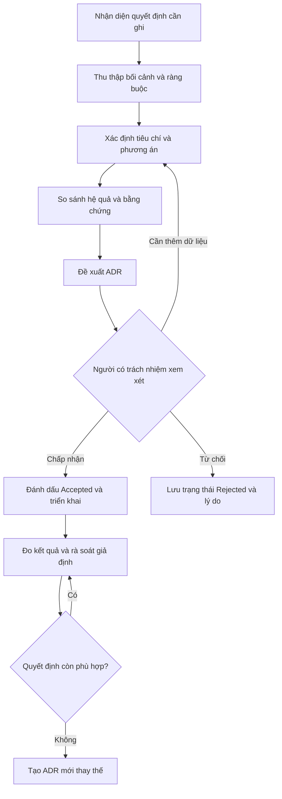

# Ghi lại quyết định kiến trúc và tiêu chí đánh đổi

Kiến trúc serverless gồm nhiều lựa chọn có ảnh hưởng lâu dài: dùng HTTP đồng bộ hay message bất đồng bộ, chia function theo ranh giới nào, lưu trạng thái ở đâu, chọn dịch vụ quản lý nào, cấp quyền ra sao và đặt giới hạn mở rộng như thế nào. Không có một lựa chọn tốt nhất cho mọi hệ thống. Mỗi lựa chọn giải quyết một số nhu cầu và tạo ra chi phí hoặc rủi ro ở những mặt khác.

Ghi lại quyết định kiến trúc giúp nhóm hiểu vì sao một phương án được chọn, những phương án nào đã được cân nhắc, giả định nào làm cơ sở cho lựa chọn và hệ quả cần quản lý. Tài liệu này thường được gọi là *Architecture Decision Record* (ADR). ADR có giá trị khi nó ghi lại lập luận và điều kiện của quyết định, để người đọc sau này có thể đánh giá quyết định trong đúng bối cảnh thay vì chỉ nhìn thấy sơ đồ hoặc cấu hình cuối cùng.

Với ứng dụng Java serverless, ADR cần kết nối quyết định kỹ thuật với cách function được kích hoạt, triển khai, cấp quyền, retry, lưu trạng thái, mở rộng và tính chi phí. Một quyết định chỉ nên được xem là hợp lý khi nó đáp ứng các yêu cầu quan trọng trong bối cảnh thực tế và những đánh đổi của nó đã được chấp nhận rõ ràng.

## 1. ADR ghi lại điều gì?

ADR là một bản ghi ngắn, tập trung vào một quyết định kiến trúc có ý nghĩa. Nó trả lời các câu hỏi: vấn đề nào cần giải quyết, bối cảnh và ràng buộc là gì, có những phương án nào, nhóm chọn phương án nào, vì sao, và lựa chọn đó kéo theo điều gì.

Ví dụ, câu “hệ thống dùng queue” chỉ mô tả một thành phần. Một ADR tốt hơn sẽ giải thích rằng API tạo đơn cần phản hồi nhanh, việc giữ hàng có thể chậm hoặc tạm thời không sẵn sàng, nhóm chọn ghi nhận đơn ở trạng thái `PENDING` rồi phát lệnh xử lý qua queue, và chấp nhận rằng kết quả cuối cùng sẽ xuất hiện bất đồng bộ. ADR cũng ghi rõ cách chống xử lý lặp, theo dõi message quá hạn và khôi phục khi consumer lỗi.

ADR nên được tạo khi quyết định:

- Ảnh hưởng đến cấu trúc hệ thống, ranh giới function, hợp đồng giữa các thành phần hoặc luồng dữ liệu.
- Làm thay đổi thuộc tính chất lượng như độ trễ, độ sẵn sàng, tính nhất quán, bảo mật, khả năng mở rộng hoặc khả năng bảo trì.
- Tạo cam kết dài hạn về nền tảng cloud, runtime Java, dịch vụ dữ liệu, event bus, workflow hoặc công cụ triển khai.
- Khó đảo ngược, tốn kém khi thay đổi hoặc ảnh hưởng đến nhiều nhóm.
- Có nhiều phương án hợp lý và nhóm cần giải thích rõ lý do chọn một phương án.

Không cần tạo ADR cho mọi chi tiết triển khai nhỏ. Đổi tên biến, sửa một câu log hoặc điều chỉnh một hàm nội bộ thường không tạo ra quyết định kiến trúc. Nếu mọi thay đổi đều có ADR, tài liệu sẽ nhiều đến mức người đọc khó tìm thấy quyết định quan trọng. Hãy tập trung vào quyết định có ảnh hưởng đáng kể hoặc cần được hiểu lại trong tương lai.

ADR cũng không thay thế tài liệu thiết kế chi tiết, API specification, sơ đồ triển khai, runbook hay mã nguồn. Những tài liệu đó mô tả hệ thống hiện tại hoặc cách vận hành. ADR giải thích lý do và hệ quả của một lựa chọn. Khi có thay đổi, các tài liệu triển khai vẫn cần được cập nhật tương ứng.

## 2. Cấu trúc của một ADR dễ đọc

Một ADR có thể dùng cấu trúc sau. Nhóm có thể điều chỉnh tên mục, nhưng nên giữ thông tin đủ để người đọc hiểu quyết định mà không cần dựa vào trí nhớ của người viết.

| Thành phần | Nội dung cần ghi |
|---|---|
| ID và tiêu đề | Mã ổn định, tên thể hiện một quyết định cụ thể |
| Trạng thái | Proposed, Accepted, Rejected, Deprecated hoặc Superseded |
| Ngày và người chịu trách nhiệm | Thời điểm ghi nhận, người đề xuất và người phê duyệt nếu quy trình yêu cầu |
| Bối cảnh | Vấn đề, kiến trúc hiện tại, mục tiêu, ràng buộc và giả định |
| Động lực quyết định | Các yêu cầu hoặc thuộc tính chất lượng quan trọng nhất |
| Phương án | Những lựa chọn thực sự đã được cân nhắc, gồm cả giữ nguyên hiện trạng nếu phù hợp |
| Quyết định | Lựa chọn được chấp nhận, phạm vi áp dụng và lý do |
| Hệ quả | Lợi ích, chi phí, rủi ro, giới hạn và trách nhiệm phát sinh |
| Kế hoạch kiểm chứng | Chỉ số, thử nghiệm, mốc xem xét hoặc điều kiện khiến nhóm phải đánh giá lại |
| Liên kết | ADR liên quan, issue, sơ đồ, benchmark, threat model hoặc tài liệu hợp đồng |

### Bối cảnh phải đủ cụ thể

Tránh ghi bối cảnh chung chung như “hệ thống cần hiệu năng tốt” hoặc “cần khả năng mở rộng cao”. Hãy mô tả ai đang sử dụng hệ thống, tải dự kiến, kiểu truy cập, dữ liệu nào quan trọng, điều gì xảy ra khi một dịch vụ phụ thuộc bị lỗi và giới hạn nền tảng hiện có.

Một yêu cầu chất lượng nên có tình huống và cách đo. Có thể dùng mẫu:

1. **Tác nhân/kích thích:** điều gì xảy ra, ví dụ một đợt tăng request hoặc một message được giao lại.
2. **Bối cảnh:** hệ thống đang ở trạng thái bình thường, tải cao hay một dịch vụ phụ thuộc bị lỗi.
3. **Phản hồi mong muốn:** hệ thống phải làm gì khi nhận kích thích đó.
4. **Thước đo:** điều kiện nào chứng minh phản hồi đạt yêu cầu.

Ví dụ: “Khi lưu lượng API tăng gấp ba lần mức tải bình thường trong 10 phút, hệ thống tiếp nhận request hợp lệ mà tỷ lệ lỗi do quá tải vẫn dưới ngưỡng đã thống nhất; độ dài queue không tăng liên tục và cơ sở dữ liệu không vượt giới hạn kết nối.” Con số và ngưỡng cụ thể cần lấy từ yêu cầu sản phẩm, SLO và kết quả đo của dự án; không nên tự đặt số để làm ADR có vẻ chính xác.

### Phân biệt ràng buộc và tiêu chí ưu tiên

Ràng buộc là điều kiện bắt buộc mà phương án phải đáp ứng, chẳng hạn dữ liệu phải ở một khu vực được phép, hệ thống phải dùng Java vì tiêu chuẩn nội bộ, hoặc ngân sách không vượt một giới hạn đã phê duyệt. Phương án vi phạm ràng buộc cần bị loại, dù có điểm số cao ở tiêu chí khác.

Tiêu chí ưu tiên dùng để so sánh các phương án còn lại. Ví dụ, thời gian phản hồi có thể quan trọng hơn chi phí ở một API giao dịch, trong khi chi phí mỗi tác vụ có thể quan trọng hơn ở một công việc nền có khối lượng lớn. Việc phân biệt này tránh tình trạng một điểm số tốt bù trừ cho vi phạm bảo mật hoặc tuân thủ.

## 3. Xác định tiêu chí đánh đổi trong serverless

Không nên chọn tiêu chí chỉ vì chúng phổ biến. Hãy bắt đầu từ mục tiêu sản phẩm, SLO, ràng buộc dữ liệu và cách nhóm vận hành hệ thống. Với Java serverless, các nhóm tiêu chí sau thường hữu ích.

### Độ trễ và trải nghiệm người dùng

Xem xét thời gian phản hồi mà người dùng thực sự cảm nhận, không chỉ thời gian chạy của một function. Một API gọi tuần tự nhiều function và dịch vụ ngoài có thể có độ trễ tổng lớn hơn thời gian của từng invocation. Cold start, khởi tạo framework, kết nối dữ liệu, retry và thời gian chờ trong queue đều có thể ảnh hưởng đến trải nghiệm.

Phân biệt độ trễ tiếp nhận yêu cầu với thời gian hoàn thành nghiệp vụ. API có thể trả về `202 Accepted` rất nhanh trong khi công việc còn ở trạng thái chờ. Cách này phù hợp nếu sản phẩm cho phép xử lý bất đồng bộ và cung cấp cách truy vấn trạng thái; nó không đáp ứng yêu cầu nếu người dùng phải nhận kết quả cuối cùng ngay trong cùng request.

### Độ tin cậy và khả năng phục hồi

Đánh giá cách hệ thống phản ứng khi function timeout, message được giao lại, queue tăng độ dài, dịch vụ ngoài không sẵn sàng hoặc một vùng triển khai gặp sự cố. Cần xem xét retry, backoff, DLQ, idempotency, timeout, circuit breaker khi phù hợp và quy trình phát lại.

Một chuỗi gọi đồng bộ ngắn có thể dễ hiểu, nhưng caller phụ thuộc vào độ sẵn sàng của mọi thành phần phía sau. Luồng bất đồng bộ giúp tách thời điểm tiếp nhận khỏi thời điểm xử lý, nhưng phát sinh trạng thái chờ, xử lý trùng, thứ tự event và quy trình bù trừ. ADR phải ghi nhận các cơ chế cần có để lựa chọn thực sự đạt độ tin cậy mong muốn.

### Tính nhất quán và quyền sở hữu dữ liệu

Hãy xác định nơi dữ liệu được ghi nhận chính thức, ai có quyền thay đổi dữ liệu và khi nào trạng thái được xem là hoàn tất. Một giao dịch cơ sở dữ liệu cục bộ có thể đảm bảo một nhóm thay đổi cùng commit. Khi luồng đi qua nhiều function và dịch vụ, không nên mặc định có một giao dịch phân tán bao trùm mọi bước.

Nếu chấp nhận eventual consistency, sản phẩm cần hiểu các trạng thái trung gian và cách xử lý khi một bước thất bại. Có thể cần transactional outbox, workflow, saga hoặc hành động bù trừ. Những lựa chọn này làm tăng cấu trúc và chi phí vận hành; đó là hệ quả cần được ghi trong ADR.

### Khả năng mở rộng và kiểm soát tải

FaaS có thể tăng số instance theo tải, nhưng tốc độ tăng không đồng nghĩa mọi dependency phía sau đều có thể chịu tải đó. Đánh giá giới hạn concurrency, tốc độ tiêu thụ queue, connection pool, quota API và khả năng của cơ sở dữ liệu.

Tách function có thể giúp từng loại công việc mở rộng độc lập. Đổi lại, nhiều function hơn đồng nghĩa nhiều cấu hình, quyền, dashboard, hợp đồng và đường đi lỗi hơn. Cần cân nhắc liệu lợi ích mở rộng có đáng với độ phức tạp vận hành hay không.

### Bảo mật và tuân thủ

So sánh cách xác thực caller, danh tính thực thi, quyền IAM, quản lý secret, mã hóa, mạng riêng, lưu vết truy cập và phạm vi dữ liệu được xử lý. Một function chỉ gửi thông báo thường không cần quyền đọc dữ liệu thanh toán. Quyền tối thiểu theo function có thể làm cấu hình nhiều hơn nhưng giảm phạm vi ảnh hưởng khi xảy ra sự cố.

Các ràng buộc về vị trí dữ liệu, lưu giữ, kiểm toán hoặc xử lý dữ liệu cá nhân thường là điều kiện bắt buộc. Ghi rõ cách từng phương án đáp ứng các ràng buộc này và bằng chứng cần có để xác nhận.

### Chi phí toàn luồng

Chi phí serverless không chỉ là số lần gọi function. Cần tính cả thời gian thực thi, cấu hình bộ nhớ/CPU, request API, message, event, workflow, lưu trữ, log, trace, truyền dữ liệu, retry và các cấu hình giữ tài nguyên sẵn sàng. Một phương án giảm thời gian phản hồi bằng provisioned capacity có thể làm tăng chi phí khi tải thấp. Một phương án chia nhỏ function có thể tăng invocation và giao tiếp giữa dịch vụ.

So sánh chi phí theo cùng một giả định về tải, tỷ lệ lỗi, kích thước payload và thời gian lưu dữ liệu. Ghi rõ phần nào là số liệu đo, phần nào là ước tính. Nếu chưa có dữ liệu, nêu khoảng bất định và kế hoạch đo sau khi triển khai.

### Khả năng bảo trì, kỹ năng và phụ thuộc nhà cung cấp

Xem xét độ dễ hiểu của code Java, hệ sinh thái thư viện, thời gian phát hành, khả năng kiểm thử cục bộ, mức độ phụ thuộc SDK, event format, IAM và dịch vụ workflow đặc thù. Dịch vụ quản lý của cloud có thể giảm gánh nặng vận hành nhưng làm tăng chi phí chuyển đổi nếu kiến trúc gắn sâu với API riêng.

Không nên coi vendor lock-in luôn là điều xấu. Nếu dịch vụ đặc thù giúp đáp ứng yêu cầu quan trọng và nhóm chấp nhận chi phí chuyển đổi, đó có thể là lựa chọn hợp lý. Hãy ghi rõ phần nào phụ thuộc nhà cung cấp, dữ liệu và hợp đồng nào có thể mang đi, cùng phương án thoát nếu rủi ro thay đổi.

## 4. So sánh phương án một cách có kỷ luật

Trước khi chấm điểm, hãy tạo danh sách phương án thực tế. Thường nên có từ hai đến bốn phương án đủ khác biệt, bao gồm giữ nguyên hiện trạng hoặc trì hoãn nếu đó là lựa chọn khả thi. Không nên tạo ra các phương án yếu chỉ để làm nổi bật phương án đã được ưa thích từ đầu.

Với mỗi phương án, mô tả cách nó hoạt động trong cùng một kịch bản. Ví dụ, nếu so sánh HTTP đồng bộ với queue, hãy mô tả rõ nơi lưu trạng thái, cách caller nhận kết quả, cách xử lý lỗi, cách retry và ai sở hữu dữ liệu. So sánh tên công nghệ mà không so sánh hành vi sẽ dẫn đến kết luận hời hợt.

### Ma trận quyết định có trọng số

Khi có nhiều tiêu chí, nhóm có thể dùng ma trận để làm rõ ưu tiên. Quy trình đơn giản:

1. Loại bỏ phương án vi phạm ràng buộc bắt buộc.
2. Chọn các tiêu chí thực sự ảnh hưởng đến quyết định.
3. Gán trọng số cho từng tiêu chí; tổng trọng số bằng 100% hoặc 1.
4. Chấm mỗi phương án theo thang điểm thống nhất, ví dụ 1 là rất kém và 5 là rất tốt.
5. Nhân điểm với trọng số rồi cộng lại.
6. Kiểm tra độ nhạy: nếu thay đổi một trọng số hợp lý, kết quả có đảo chiều không?

Công thức:

\[
\text{Điểm phương án} = \sum_{i=1}^{n} \text{Trọng số}_i \times \text{Điểm}_{i}
\]

Ma trận là công cụ hỗ trợ thảo luận, không phải bằng chứng khách quan tuyệt đối. Điểm số vẫn dựa trên giả định và nhận định của nhóm. Hãy ghi lý do cho điểm cao/thấp và mức độ tin cậy của dữ liệu.

Ví dụ minh họa: một API tạo đơn có thể ghi nhận yêu cầu nhanh, còn các bước giữ hàng và gửi biên nhận chạy sau. Nhóm đang so sánh phương án A xử lý tuần tự trong request với phương án B ghi đơn ở trạng thái chờ rồi phát event cho các consumer. Giả sử sản phẩm chấp nhận kết quả cuối cùng bất đồng bộ và cần chịu được lỗi tạm thời ở dịch vụ phụ thuộc.

| Tiêu chí | Trọng số | A: xử lý đồng bộ | B: xử lý bất đồng bộ |
|---|---:|---:|---:|
| Phản hồi tiếp nhận nhanh | 10% | 3 | 5 |
| Chịu lỗi tạm thời của dịch vụ phụ thuộc | 25% | 2 | 4 |
| Có kết quả cuối cùng ngay trong request | 15% | 5 | 2 |
| Quản lý trạng thái và nhất quán | 15% | 4 | 3 |
| Mở rộng từng công đoạn độc lập | 15% | 2 | 5 |
| Độ đơn giản khi vận hành | 10% | 4 | 2 |
| Chi phí ở mức tải giả định | 10% | 4 | 3 |
| **Điểm có trọng số** | **100%** | **3,25/5** | **3,50/5** |

Các điểm trên chỉ là ví dụ để minh họa cách thảo luận, không phải benchmark hay kết luận chung cho mọi nền tảng. Phương án B đạt điểm cao hơn trong bối cảnh giả định vì khả năng tiếp nhận nhanh và cô lập lỗi quan trọng hơn việc trả kết quả cuối cùng trong cùng request. Nếu yêu cầu sản phẩm bắt buộc xác nhận thanh toán hoặc giữ hàng trước khi phản hồi, trọng số và điểm liên quan sẽ thay đổi; phương án A có thể trở thành lựa chọn phù hợp hơn.

Khi hai phương án có điểm gần nhau, đừng cố tạo ra một người thắng bằng cách điều chỉnh trọng số cho đến khi đạt kết quả mong muốn. Hãy xác định yếu tố nào chưa rõ, chạy prototype hoặc thử tải để thu thập bằng chứng. Có thể quyết định theo giai đoạn, giữ một điểm mở để đánh giá lại sau khi có dữ liệu.

## 5. Ví dụ ADR cho ứng dụng Java serverless

Phần dưới đây là một ADR mẫu. Tên dịch vụ và các ngưỡng chỉ mang tính minh họa; khi áp dụng vào hệ thống thật, nhóm phải thay bằng dữ liệu và ràng buộc đã xác nhận.

### ADR-001: Tiếp nhận đơn hàng bằng HTTP và xử lý các bước sau qua event

**Trạng thái:** Accepted

**Bối cảnh:** API Java nhận yêu cầu tạo đơn. Việc lưu đơn là bước cần xác nhận trong thời gian phản hồi ngắn; giữ hàng và gửi biên nhận phụ thuộc vào các dịch vụ có thời gian phản hồi và độ sẵn sàng khác nhau. Caller có thể gửi lại request nếu không nhận được phản hồi. Message có thể được giao lại sau timeout hoặc lỗi consumer. Sản phẩm cho phép đơn hàng ở trạng thái chờ trong lúc các bước sau hoàn tất và có màn hình truy vấn trạng thái.

**Động lực quyết định:**

- API cần xác nhận đã tiếp nhận đơn mà không chờ email hoàn tất.
- Lỗi tạm thời của dịch vụ gửi email không được làm mất đơn đã ghi nhận.
- Consumer giữ hàng cần mở rộng theo lượng event riêng.
- Xử lý lặp phải không tạo ra nhiều đơn hoặc giữ hàng nhiều lần.
- Nhóm cần theo dõi được trạng thái từ lúc tiếp nhận đến khi hoàn tất hoặc thất bại.

**Phương án đã cân nhắc:**

1. Thực hiện toàn bộ việc tạo đơn, giữ hàng và gửi biên nhận tuần tự trong một HTTP invocation.
2. Ghi đơn ở trạng thái chờ, phát event và để các consumer xử lý các bước độc lập.
3. Dùng workflow có trạng thái để điều phối giữ hàng, thanh toán và các hành động bù trừ; API chỉ khởi tạo tiến trình và trả mã theo dõi.

**Quyết định:** Chọn phương án 2 cho luồng tiếp nhận đơn và các tác vụ có thể xử lý độc lập. API xác thực request, kiểm tra khóa idempotency và ghi đơn ban đầu cùng bản ghi outbox trong một giao dịch cục bộ. Một publisher chuyển outbox thành event `OrderPlaced`. Consumer giữ hàng và consumer gửi biên nhận xử lý theo hợp đồng riêng. Trạng thái đơn được cập nhật để client có thể truy vấn.

**Lý do:** Phương án này giảm thời gian API phải chờ dịch vụ ngoài, cho phép consumer mở rộng độc lập và cô lập lỗi gửi biên nhận khỏi bước tạo đơn. Outbox giải quyết khoảng trống giữa commit dữ liệu đơn hàng và việc phát event. Khóa idempotency cùng thao tác ghi có điều kiện bảo vệ khỏi request lặp.

**Hệ quả tích cực:** API có thể xác nhận tiếp nhận sớm; tác vụ nền có retry riêng; consumer có thể triển khai độc lập; hệ thống có thể quan sát backlog và trạng thái từng công đoạn.

**Hệ quả cần chấp nhận:** Kết quả cuối cùng không có ngay trong phản hồi HTTP; phải quản lý trạng thái trung gian, outbox, retry, DLQ và phát lại; dữ liệu giữa các thành phần có thể nhất quán sau một khoảng thời gian; nhóm cần dashboard và quy trình xử lý event bị kẹt.

**Biện pháp kiểm soát:** Lưu idempotency key với đơn; đặt ràng buộc duy nhất ở kho dữ liệu; consumer ghi nhận event đã xử lý theo cách an toàn đồng thời; cấu hình retry có giới hạn và DLQ; truyền correlation ID; cảnh báo khi tuổi message hoặc backlog vượt ngưỡng đã thống nhất; cung cấp thao tác đối soát và phát lại có kiểm soát.

**Điều kiện đánh giá lại:** Nếu yêu cầu sản phẩm thay đổi và bắt buộc phải xác nhận giữ hàng hoặc thanh toán trước khi API trả thành công, cần đánh giá lại ranh giới đồng bộ và workflow. Cũng cần đánh giá lại nếu chi phí event, vận hành outbox hoặc độ trễ hoàn tất vượt giới hạn chấp nhận.

Ví dụ này cho thấy ADR cần ghi cả quyết định lẫn phần việc mới được tạo ra bởi quyết định. Nếu chỉ ghi “chọn event-driven vì dễ mở rộng”, nhóm sẽ bỏ sót trạng thái chờ, idempotency, outbox, DLQ và vận hành phát lại — những yếu tố quyết định hệ thống có hoạt động tin cậy hay không.

## 6. Ghi nhận các hệ quả có thể kiểm chứng

Một ADR hữu ích chuyển các đánh đổi thành việc cần đo, quan sát hoặc kiểm soát. Không nên dừng ở danh sách ưu và nhược điểm chung chung.

| Quyết định | Hệ quả có thể phát sinh | Cách kiểm chứng hoặc kiểm soát |
|---|---|---|
| Chuyển xử lý sang queue | Có độ trễ hoàn tất và backlog | Theo dõi tuổi message, queue depth và thời gian từ tiếp nhận đến hoàn tất |
| Chia thành nhiều function | Tăng số hợp đồng, invocation và điểm lỗi | Theo dõi trace xuyên suốt, tỷ lệ lỗi từng bước và chi phí toàn luồng |
| Dùng workflow quản lý tiến trình | Phát sinh trạng thái và chi phí điều phối | Kiểm thử timeout, retry, nhánh lỗi và hành động bù trừ |
| Tăng concurrency | Có thể làm quá tải database hoặc API phía sau | Đặt giới hạn, theo dõi connection, throttling và tỷ lệ lỗi downstream |
| Dùng provisioned capacity | Giảm một phần cold start nhưng tăng chi phí nền | So sánh p95/p99 latency và chi phí theo cùng mẫu tải |
| Dùng SDK đặc thù của cloud | Tăng tốc tích hợp nhưng tăng phụ thuộc nhà cung cấp | Cô lập adapter, khóa phiên bản và ghi nhận phạm vi chuyển đổi |
| Dùng quyền riêng theo function | Cấu hình IAM nhiều hơn | Kiểm tra quyền tự động, audit log và rà soát quyền định kỳ |

Đặt trước cách đo và thời điểm xem xét lại. Ví dụ, ADR có thể yêu cầu thử tải trước khi tăng concurrency, đo chi phí sau một chu kỳ tải đại diện hoặc kiểm tra tỷ lệ event phải vào DLQ sau khi phát hành. Các ngưỡng cần liên kết với SLO hoặc giới hạn vận hành đã được thống nhất.

### Không bỏ qua giả định và độ bất định

Mỗi quyết định đều dựa trên giả định. Ví dụ, nhóm có thể giả định tải tăng theo mùa, nhà cung cấp hỗ trợ idempotency, queue giữ message đủ lâu hoặc runtime Java khởi động trong giới hạn chấp nhận. Nếu giả định sai, quyết định có thể không còn phù hợp.

Hãy ghi rõ:

- Giả định nào đã được xác nhận bằng số liệu hoặc thử nghiệm.
- Giả định nào mới là ước tính hoặc nhận định.
- Rủi ro nào có xác suất thấp nhưng tác động lớn.
- Bằng chứng hoặc sự kiện nào sẽ khiến nhóm đánh giá lại.

Khi thiếu dữ liệu, prototype nhỏ hoặc benchmark có mục tiêu thường hữu ích hơn một bảng điểm nhiều con số nhưng không có căn cứ. Thử nghiệm nên đại diện cho runtime, cấu hình bộ nhớ, dependency, payload và mô hình tải dự kiến; kết quả từ máy phát triển không nhất thiết phản ánh cold start hoặc concurrency trên nền tảng triển khai.

## 7. Quy trình tạo, xem xét và duy trì ADR

Có thể tổ chức quy trình thành các bước ngắn, gắn với vòng đời phát triển:

**Bước 1 — Nhận diện và xác định phạm vi.** Viết một câu mô tả quyết định cần đưa ra. Tránh gộp nhiều quyết định độc lập vào một ADR lớn. Ví dụ, chọn cách giao tiếp bất đồng bộ và chọn cơ sở dữ liệu là hai quyết định có thể liên quan nhưng có tiêu chí và phương án khác nhau.

**Bước 2 — Thu thập bối cảnh.** Đọc yêu cầu sản phẩm, SLO, giới hạn nền tảng và kiến trúc hiện tại. Xác định người dùng, nhóm sở hữu, dữ liệu nhạy cảm, tải và kịch bản lỗi. Phân biệt thông tin đã xác nhận với giả định.

**Bước 3 — Xác định tiêu chí và phương án.** Chọn một số tiêu chí quan trọng nhất, nêu rõ ràng buộc bắt buộc và trọng số ưu tiên. Mô tả các phương án đủ cụ thể để có thể so sánh cùng một kịch bản.

**Bước 4 — Thu thập bằng chứng.** Dùng prototype, kiểm thử tích hợp, benchmark, ước tính chi phí, threat modeling hoặc phân tích vận hành tùy quyết định. Gắn liên kết tới kết quả và ghi giới hạn của bằng chứng.

**Bước 5 — Xem xét và quyết định.** Người chịu trách nhiệm xem lại bối cảnh, phương án, hệ quả và rủi ro. Ghi quyết định cùng trạng thái và người phê duyệt theo quy trình nhóm. Nếu chưa đủ dữ liệu, ADR có thể ở trạng thái Proposed trong khi nhóm thực hiện thử nghiệm.

**Bước 6 — Triển khai và kiểm chứng.** Chuyển hệ quả thành task, metric, cảnh báo, cập nhật runbook và tiêu chí nghiệm thu. Kiểm tra hệ thống thực tế có hành xử như ADR dự kiến hay không.

**Bước 7 — Rà soát khi bối cảnh đổi.** Khi tải, SLO, nhà cung cấp, quy định hoặc cấu trúc nhóm thay đổi, kiểm tra lại quyết định liên quan. ADR cũ vẫn là bằng chứng lịch sử về lựa chọn ở thời điểm đó.

### Quản lý trạng thái và lịch sử

Một bộ trạng thái thường dùng:

- `Proposed`: đang được thảo luận, chưa được chấp nhận.
- `Accepted`: đã được chấp nhận và là quyết định hiện hành.
- `Rejected`: đã xem xét nhưng không chọn; giữ lại lý do để tránh lặp lại tranh luận.
- `Deprecated`: không còn được khuyến nghị, nhưng chưa có quyết định thay thế hoàn chỉnh.
- `Superseded`: đã được một ADR mới thay thế; cần liên kết tới ADR mới.

Khi một quyết định Accepted thay đổi, nên tạo ADR mới và liên kết `supersedes` hoặc `superseded by` với ADR cũ. Không âm thầm sửa phần quyết định lịch sử để làm như nhóm luôn chọn phương án mới. Có thể sửa lỗi chính tả hoặc bổ sung liên kết, nhưng nội dung quyết định và lý do ban đầu cần giữ nguyên để truy vết.

Đặt ADR trong kho mã nguồn hoặc nơi nhóm có thể tìm kiếm, xem lịch sử và review cùng thay đổi liên quan. Dùng mã ổn định, tiêu đề dễ tìm và liên kết tới pull request, issue hoặc tài liệu kỹ thuật. Có thể tổ chức thư mục theo thứ tự số hoặc ngày; quan trọng là cách đặt tên nhất quán và không phụ thuộc vào vị trí của một người.

## 8. Những lỗi thường gặp khi ghi quyết định

| Lỗi | Vì sao gây khó khăn | Cách cải thiện |
|---|---|---|
| Chỉ ghi công nghệ được chọn | Không giải thích vấn đề và lý do | Ghi bối cảnh, tiêu chí, phương án và hệ quả |
| Dùng từ chung chung như “nhanh”, “rẻ”, “dễ mở rộng” | Không thể kiểm chứng hoặc so sánh | Mô tả kịch bản, thước đo và giả định |
| Chỉ liệt kê ưu điểm | Che khuất chi phí và rủi ro | Ghi rõ điều phải đánh đổi và cách kiểm soát |
| Chọn trọng số sau khi đã biết kết quả mong muốn | Ma trận trở thành cách hợp thức hóa lựa chọn | Thống nhất tiêu chí trước, kiểm tra độ nhạy và lưu lý do |
| So sánh phương án không cùng giả định | Điểm số không có ý nghĩa | Dùng cùng tải, payload, SLO và kịch bản lỗi |
| Gộp nhiều quyết định vào một ADR | Khó xem xét và khó thay thế từng phần | Mỗi ADR tập trung vào một quyết định chính |
| Không cập nhật khi bối cảnh thay đổi | Tài liệu dẫn dắt người đọc theo quyết định lỗi thời | Rà soát, tạo ADR thay thế và liên kết lịch sử |
| Không gắn hệ quả với vận hành | Rủi ro đã biết nhưng không ai theo dõi | Tạo metric, cảnh báo, task và chủ sở hữu cụ thể |
| Viết ADR như tài liệu quảng bá phương án | Không thể hiện được các phương án đã cân nhắc thật | Trình bày công bằng và ghi cả lý do loại phương án |

Một ADR không cần dài để có giá trị. Nó cần đủ cụ thể để người đọc hiểu vì sao quyết định được đưa ra, những gì phải chấp nhận và điều kiện nào khiến quyết định cần xem xét lại. Nếu một đoạn không giúp giải thích hoặc kiểm chứng quyết định, có thể chuyển nội dung chi tiết sang tài liệu thiết kế liên quan.

## 9. Checklist trước khi chấp nhận ADR

Trước khi đánh dấu một ADR là Accepted, nhóm có thể tự rà soát:

- [ ] Quyết định được mô tả trong một câu rõ ràng và có phạm vi xác định.
- [ ] Bối cảnh, mục tiêu, ràng buộc và giả định được nêu rõ.
- [ ] Các yêu cầu chất lượng quan trọng có thước đo hoặc kịch bản cụ thể.
- [ ] Ràng buộc bắt buộc được phân biệt với tiêu chí ưu tiên.
- [ ] Những phương án khả thi, gồm hiện trạng nếu phù hợp, đã được cân nhắc công bằng.
- [ ] Lý do chọn phương án gắn với nhu cầu và bằng chứng của hệ thống.
- [ ] Hệ quả tích cực, tiêu cực, rủi ro và công việc vận hành đã được ghi lại.
- [ ] Các vấn đề retry, idempotency, trạng thái, bảo mật và chi phí được xem xét nếu liên quan.
- [ ] Có cách kiểm chứng sau triển khai và điều kiện đánh giá lại.
- [ ] Người chịu trách nhiệm, trạng thái và liên kết tới tài liệu liên quan đã rõ.

Checklist không thay thế phán đoán kiến trúc. Nó giúp nhóm phát hiện phần còn thiếu trước khi cam kết với một lựa chọn có ảnh hưởng lâu dài.

## 10. Áp dụng ADR trong dự án Java serverless

Trong dự án Java FaaS, nên bắt đầu bằng các quyết định có ảnh hưởng trực tiếp đến cách phát triển và vận hành:

**Ranh giới function và ca sử dụng.** Ghi rõ vì sao một nghiệp vụ nằm trong một function hay được chia thành nhiều function. Nêu các yếu tố như quyền IAM, trigger, tải, retry, thời gian timeout và khả năng triển khai độc lập. Tránh tách function chỉ theo số lượng phương thức.

**Hợp đồng trigger và dữ liệu.** Ghi lại vì sao chọn HTTP, queue, event hay lịch; schema được phiên bản hóa thế nào; ai sở hữu producer và consumer; thay đổi không tương thích được triển khai theo giai đoạn ra sao.

**Trạng thái và tính đúng đắn.** Ghi nơi lưu trạng thái bền vững, khóa idempotency, thời gian lưu dấu xử lý, cách xử lý message trùng hoặc sai thứ tự, và chiến lược khi một side effect đã xảy ra nhưng invocation timeout.

**Runtime và cold start.** Ghi phiên bản Java, mô hình đóng gói, framework, cấu hình bộ nhớ/CPU và lý do chọn biện pháp tối ưu. Dùng benchmark đại diện cho artifact thật; ghi rõ p95/p99, tỷ lệ cold start nếu đo được và chi phí của cấu hình giữ sẵn.

**Concurrency và bảo vệ downstream.** Ghi giới hạn concurrency, tốc độ tiêu thụ queue, giới hạn kết nối và cách phản ứng khi downstream throttling. Một function mở rộng nhanh có thể làm cạn connection pool hoặc vượt quota của hệ thống khác.

**Quyền và secret.** Ghi nguyên tắc cấp quyền theo nhiệm vụ, danh tính thực thi, tài nguyên được phép truy cập và cách luân chuyển secret. Nếu chọn một role dùng chung vì lý do cụ thể, phải ghi rủi ro và biện pháp giảm phạm vi ảnh hưởng.

**Quan sát và khôi phục.** Ghi correlation ID, trace context, metric, cảnh báo, DLQ, cách replay và ai chịu trách nhiệm khi luồng bị kẹt. ADR nên chỉ ra trạng thái nào có thể nhìn thấy từ bên ngoài và cách đối soát dữ liệu.

**Chi phí và phụ thuộc nhà cung cấp.** Ghi giả định về số invocation, thời gian chạy, message, lưu trữ, log và lưu lượng mạng. Nêu phần nào phụ thuộc API hoặc dịch vụ cloud cụ thể, cùng chi phí chuyển đổi dự kiến nếu hệ thống cần di chuyển.

Một quyết định kiến trúc không kết thúc ở lúc merge code. Khi hệ thống chạy thật, nhóm cần so sánh hành vi với giả định trong ADR. Nếu độ trễ, chi phí, tỷ lệ lỗi hoặc độ phức tạp vận hành khác dự kiến, hãy dùng dữ liệu đó để điều chỉnh quyết định và tạo bản ghi thay thế khi cần.

## Kết luận

ADR giúp nhóm lưu lại bối cảnh, tiêu chí, phương án, lý do lựa chọn và hệ quả của các quyết định kiến trúc. Để quyết định có thể kiểm chứng, hãy mô tả yêu cầu bằng tình huống và thước đo, phân biệt ràng buộc với ưu tiên, so sánh các phương án trên cùng giả định và ghi rõ phần phải đánh đổi. Trong Java serverless, cần xem xét đồng thời trigger, trạng thái, retry, idempotency, quyền, cold start, concurrency, quan sát và chi phí toàn luồng. Khi bối cảnh thay đổi, tạo quyết định mới có liên kết với lịch sử để kiến trúc tiếp tục phản ánh nhu cầu thực tế.
