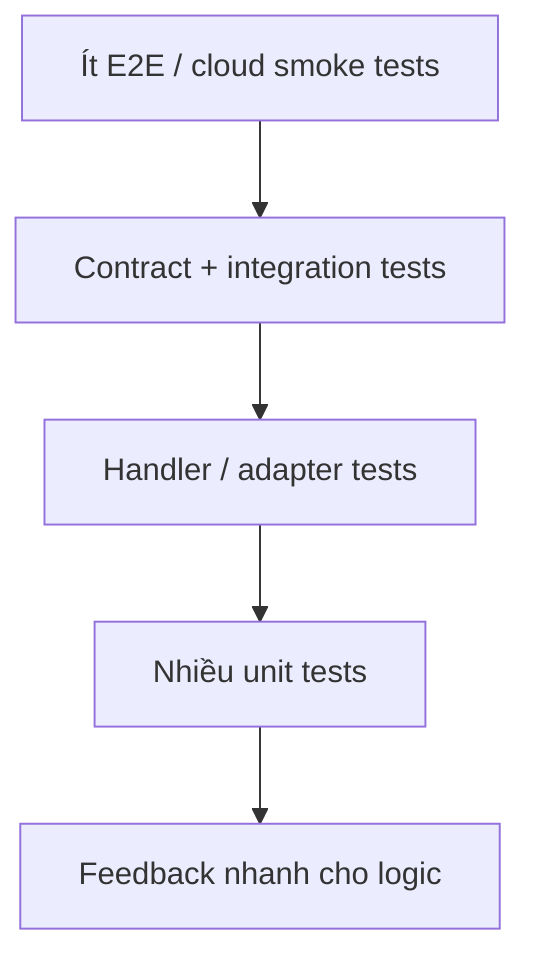
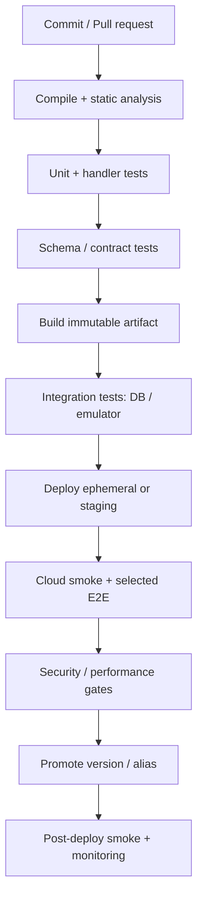

# Thiết kế chiến lược unit, integration, contract và end-to-end test

Ứng dụng serverless thường gồm nhiều thành phần độc lập: HTTP handler, function runtime, queue, event bus, database, object storage, IAM policy và dịch vụ điều phối. Một function có thể chạy đúng khi gọi trực tiếp nhưng vẫn thất bại khi được kích hoạt từ SQS, webhook hoặc API Gateway vì event envelope khác, quyền truy cập thiếu, timeout không phù hợp hoặc nền tảng giao lại event.

Vì vậy, kiểm thử serverless cần bao phủ cả logic Java lẫn cách function tương tác với trigger và dịch vụ bên ngoài. Unit test xác nhận quy tắc nghiệp vụ; integration test kiểm tra adapter và dependency thật; contract test bảo vệ cấu trúc event/API giữa các bên; end-to-end test xác nhận toàn bộ luồng triển khai hoạt động trong môi trường gần production.

Bài này xây dựng chiến lược kiểm thử cho Java function/FaaS. Mục tiêu là chọn đúng loại test cho từng rủi ro, giữ test nhanh và ổn định, đồng thời vẫn phát hiện được lỗi chỉ xuất hiện khi chạy trên nền tảng serverless.

## 1. Vì sao kiểm thử serverless cần nhiều lớp?

### 1.1. Function không chạy độc lập

Một function thường phụ thuộc vào các hợp đồng bên ngoài:

- trigger gửi HTTP request, queue message, stream record hoặc event envelope;
- runtime tìm handler, deserialize input và serialize output;
- IAM xác định function được gọi dịch vụ nào;
- network quyết định function có thể kết nối database hoặc private endpoint không;
- queue/event source quyết định acknowledgement, retry, batch và DLQ;
- timeout, memory, concurrency và ephemeral storage giới hạn quá trình thực thi.

Unit test không thể chứng minh IAM policy production đúng. Mock SQS không thể chứng minh event source mapping xử lý partial batch response như mong muốn. Một end-to-end test duy nhất cũng không thể thay thế hàng trăm unit test vì nó chậm, khó xác định nguyên nhân và dễ thất bại do hạ tầng.

### 1.2. Các lớp kiểm thử

| Lớp | Kiểm tra điều gì? | Dependency | Tốc độ và phạm vi |
| --- | --- | --- | --- |
| Unit | Quy tắc nghiệp vụ, validation, retry decision, idempotency logic | Không có hoặc mock/fake nhỏ | Rất nhanh, nhiều test |
| Handler/adapter test | Chuyển đổi event, response, exception và context | Handler Java trực tiếp, fixture | Nhanh, kiểm tra ranh giới function |
| Integration | Repository, JDBC, serialization, queue/storage client và cấu hình thật | Database/container/emulator hoặc dịch vụ test | Trung bình, ít hơn unit |
| Contract | Schema HTTP/event, header, status, version và semantics giữa producer/consumer | Schema/fixture/provider verification | Nhanh đến trung bình |
| End-to-end | Trigger → function → dependency → kết quả cuối | Môi trường cloud/stack tích hợp | Chậm, số lượng nhỏ |
| Non-functional | Load, concurrency, cold start, timeout, security, resilience | Môi trường gần production | Có kiểm soát, chạy theo lịch hoặc trước release |

Không cần mỗi function có cùng số lượng test ở mọi lớp. Hãy phân bổ theo rủi ro: một function tính thuế cần nhiều unit test; một consumer SQS cần thêm test batch, duplicate và retry; một HTTP API cần contract và authorization test; một workflow nhiều bước cần end-to-end test cho các nhánh quan trọng.

### 1.3. Test pyramid và feedback loop



Unit test nên chiếm số lượng lớn vì chạy nhanh và chỉ ra lỗi cụ thể. Integration và contract test kiểm tra các ranh giới có khả năng lệch giữa code và dependency. E2E test giữ số lượng nhỏ, tập trung vào các luồng nghiệp vụ quan trọng và cấu hình triển khai thực tế.

Đây không phải quy tắc cứng về tỷ lệ phần trăm. Một hệ thống event-driven có thể cần nhiều integration/contract test hơn ứng dụng CRUD đơn giản. Tiêu chí là mỗi test phải kiểm tra một rủi ro mà lớp thấp hơn không thể phát hiện.

## 2. Chuẩn bị code để có thể kiểm thử

### 2.1. Tách handler khỏi nghiệp vụ

Handler nên làm nhiệm vụ chuyển input thành command, gọi application service và chuyển kết quả thành output. Logic nghiệp vụ nên nằm trong class Java thông thường, không phụ thuộc `Context`, event SDK hoặc static global.

```java
public record CreateOrderCommand(
        String customerId,
        String productId,
        int quantity,
        String idempotencyKey) {
}

public record CreateOrderResult(
        String orderId,
        String status) {
}

public interface OrderRepository {
    void save(Order order);
}

public interface InventoryService {
    boolean reserve(String productId, int quantity, String key);
}

public final class CreateOrderService {
    private final OrderRepository orders;
    private final InventoryService inventory;

    public CreateOrderService(
            OrderRepository orders,
            InventoryService inventory) {
        this.orders = orders;
        this.inventory = inventory;
    }

    public CreateOrderResult execute(CreateOrderCommand command) {
        if (command.quantity() <= 0) {
            throw new IllegalArgumentException("quantity must be positive");
        }
        if (command.idempotencyKey() == null
                || command.idempotencyKey().isBlank()) {
            throw new IllegalArgumentException("idempotency key is required");
        }

        boolean reserved = inventory.reserve(
                command.productId(),
                command.quantity(),
                command.idempotencyKey());
        if (!reserved) {
            throw new OutOfStockException(command.productId());
        }

        Order order = Order.create(
                command.customerId(),
                command.productId(),
                command.quantity(),
                command.idempotencyKey());
        orders.save(order);
        return new CreateOrderResult(order.id(), "CREATED");
    }
}
```

Các class `Order` và `OutOfStockException` là domain types của ứng dụng. Service không biết nó được gọi từ API Gateway, SQS hay một test. Nhờ vậy, unit test có thể kiểm tra logic mà không cần khởi động Lambda runtime.

### 2.2. Tránh static global và side effect trong constructor

Không khởi tạo kết nối database, gọi Secret Manager hoặc ghi dữ liệu nghiệp vụ trong static initializer. Constructor của handler nên nhận dependency hoặc chỉ tạo client nhẹ có vòng đời rõ ràng. Các thao tác bên ngoài nên nằm sau interface để test thay thế được.

Trong production, có thể dùng factory hoặc dependency injection để tạo client dùng chung theo execution environment. Trong test, truyền fake hoặc mock. Không dùng chung mutable state giữa các test hoặc invocation.

### 2.3. Inject clock, ID generator và retry policy

Các yếu tố như thời gian, UUID, random backoff và retry policy khiến test khó lặp lại nếu lấy trực tiếp từ hệ thống. Bọc chúng bằng abstraction:

```java
public interface IdGenerator {
    String nextId();
}

public final class OrderExpiryPolicy {
    private final java.time.Clock clock;

    public OrderExpiryPolicy(java.time.Clock clock) {
        this.clock = clock;
    }

    public boolean isExpired(java.time.Instant expiresAt) {
        return !expiresAt.isAfter(clock.instant());
    }
}
```

Unit test có thể dùng `Clock.fixed(...)` để kiểm tra chính xác ranh giới thời gian. Với retry/backoff, inject policy hoặc random source để test không phải chờ thật và không phụ thuộc số ngẫu nhiên.

## 3. Unit test cho domain và application service

### 3.1. Những gì nên kiểm tra

Unit test tập trung vào kết quả quan sát được của logic:

- input hợp lệ và không hợp lệ;
- business rule và chuyển trạng thái;
- phân biệt business rejection với technical failure;
- idempotency key và xử lý duplicate;
- retry decision theo loại lỗi;
- giới hạn số lần thử và deadline;
- cách xử lý dữ liệu thiếu, null hoặc biên;
- side effect được yêu cầu có xảy ra đúng số lần hay không.

Không viết test cho chi tiết triển khai nội bộ như số lần gọi một helper private nếu điều đó không phải hợp đồng. Test nên vẫn đúng khi refactor cấu trúc class nhưng giữ nguyên hành vi.

### 3.2. Ví dụ JUnit 5 và Mockito

```java
import static org.junit.jupiter.api.Assertions.*;
import static org.mockito.Mockito.*;

import org.junit.jupiter.api.BeforeEach;
import org.junit.jupiter.api.Test;

class CreateOrderServiceTest {
    private OrderRepository orders;
    private InventoryService inventory;
    private CreateOrderService service;

    @BeforeEach
    void setUp() {
        orders = mock(OrderRepository.class);
        inventory = mock(InventoryService.class);
        service = new CreateOrderService(orders, inventory);
    }

    @Test
    void createsOrderWhenInventoryIsAvailable() {
        when(inventory.reserve("sku-1", 2, "req-123"))
                .thenReturn(true);

        CreateOrderResult result = service.execute(
                new CreateOrderCommand("customer-1", "sku-1", 2, "req-123"));

        assertEquals("CREATED", result.status());
        assertNotNull(result.orderId());
        verify(inventory).reserve("sku-1", 2, "req-123");
        verify(orders).save(any(Order.class));
    }

    @Test
    void rejectsNonPositiveQuantityBeforeCallingDependencies() {
        assertThrows(IllegalArgumentException.class, () ->
                service.execute(new CreateOrderCommand(
                        "customer-1", "sku-1", 0, "req-123")));

        verifyNoInteractions(inventory, orders);
    }

    @Test
    void reportsOutOfStockWithoutSavingOrder() {
        when(inventory.reserve("sku-1", 2, "req-123"))
                .thenReturn(false);

        assertThrows(OutOfStockException.class, () ->
                service.execute(new CreateOrderCommand(
                        "customer-1", "sku-1", 2, "req-123")));

        verify(orders, never()).save(any());
    }
}
```

Mock giúp xác minh service tương tác với dependency theo hợp đồng. Với logic có nhiều trạng thái hoặc thuật toán, fake in-memory có thể dễ hiểu và ít coupling hơn mock. Không mock mọi object: nếu test chỉ kiểm tra một getter trên object đơn giản, hãy dùng object thật.

### 3.3. Test idempotency ở cấp nghiệp vụ

Một test quan trọng là cùng một idempotency key không tạo hai đơn hàng hoặc hai lần trừ kho. Fake repository có thể mô phỏng unique constraint; integration test sau đó xác nhận database thực sự bảo vệ invariant.

Kiểm tra cả hai trường hợp:

- cùng key và cùng payload: trả lại kết quả trước hoặc kết quả tương đương mà không lặp side effect;
- cùng key nhưng payload khác: từ chối vì key đã được dùng cho request khác.

Không chỉ test “function nhận event hai lần”. Cần test invariant cuối cùng ở database hoặc hệ thống side effect.

### 3.4. Property-based và boundary tests

Với parser, validation, pricing hoặc retry policy, test theo nhiều dữ liệu biên có thể phát hiện lỗi mà một vài ví dụ cố định bỏ sót. Property-based testing có thể sinh input theo generator và kiểm tra thuộc tính như:

- quantity âm/zero luôn bị từ chối;
- tổng tiền không âm và tuân theo rounding policy;
- retry delay không vượt max delay;
- mọi path archive được chấp nhận đều nằm dưới destination root;
- cùng idempotency key không tạo hơn một kết quả nghiệp vụ.

Luôn thêm regression test cho lỗi đã từng xảy ra để lỗi không quay lại.

## 4. Handler và adapter tests

### 4.1. Kiểm tra handler mà không khởi động cloud runtime

Với Java `RequestHandler<I,O>`, có thể gọi trực tiếp `handleRequest(input, context)` trong test. Dùng fixture event chính xác và mock/fake `Context` nếu logic cần request ID hoặc remaining time.

Handler test cần kiểm tra:

- deserialize/input mapping và xử lý field thiếu;
- response status, headers, body và content type;
- mapping exception thành HTTP response hoặc invocation failure;
- correlation/request ID được truyền đúng;
- batch event và partial failure response;
- không trả thành công giả khi dependency thất bại;
- timeout budget được kiểm tra trước thao tác dài.

### 4.2. Ví dụ HTTP handler test

Giả sử handler chuyển `APIGatewayProxyRequestEvent` thành command và trả `APIGatewayProxyResponseEvent`:

```java
import static org.junit.jupiter.api.Assertions.*;
import static org.mockito.Mockito.*;

import com.amazonaws.services.lambda.runtime.Context;
import com.amazonaws.services.lambda.runtime.events.APIGatewayProxyRequestEvent;
import com.amazonaws.services.lambda.runtime.events.APIGatewayProxyResponseEvent;
import org.junit.jupiter.api.Test;

class OrdersHttpHandlerTest {
    @Test
    void returnsBadRequestWhenOrderIdIsMissing() {
        CreateOrderService service = mock(CreateOrderService.class);
        OrdersHttpHandler handler = new OrdersHttpHandler(service);
        APIGatewayProxyRequestEvent request =
                new APIGatewayProxyRequestEvent().withPathParameters(null);
        Context context = mock(Context.class);

        APIGatewayProxyResponseEvent response =
                handler.handleRequest(request, context);

        assertEquals(400, response.getStatusCode());
        verifyNoInteractions(service);
    }
}
```

Constructor nhận service là một seam phục vụ test và dependency injection. Nếu runtime yêu cầu constructor mặc định, có thể cung cấp factory/no-arg constructor cho production và constructor package-private/public cho test. Tránh để test phải sửa static singleton hoặc biến môi trường toàn cục.

### 4.3. Fixture event có tính đại diện

Lưu payload mẫu cho từng trigger trong `src/test/resources/events/`:

```text
src/test/resources/events/
  api-gateway-create-order.json
  sqs-order-created.json
  sqs-partial-batch.json
  eventbridge-order-paid.json
  s3-object-created.json
  webhook-provider-a.json
```

Fixture nên lấy từ schema/documentation chính thức hoặc event đã được ẩn dữ liệu nhạy cảm. Không tự tạo JSON “gần giống” rồi giả định đó là event thực tế. Giữ fixture versioned để thay đổi schema được review như thay đổi API.

### 4.4. Kiểm tra serialization/deserialization

Test riêng việc deserialize event JSON vào class Java và serialize response ra JSON. Kiểm tra:

- field bắt buộc và field tùy chọn;
- timestamp format và timezone;
- enum value không nhận diện;
- số lớn, null và Unicode;
- body HTTP có thể là chuỗi JSON được encode;
- base64-encoded body nếu trigger sử dụng;
- header có thể viết hoa/thường khác nhau;
- payload version mới có thêm field mà consumer cũ cần bỏ qua an toàn.

Không chỉ gọi constructor Java rồi bỏ qua bước JSON mapping nếu runtime thực tế sử dụng serializer. Một lỗi naming strategy hoặc default constructor có thể chỉ xuất hiện khi deserialize.

## 5. Integration test cho dependency

### 5.1. Khi nào cần integration test?

Integration test xác minh các thành phần thực sự tương tác được với nhau. Ví dụ:

- repository JDBC chạy đúng SQL và transaction;
- schema database có migration tương thích;
- JSON serializer tạo payload đúng;
- queue client gửi/nhận message đúng attributes;
- object storage upload, metadata và versioning hoạt động;
- Secret Manager client đọc đúng version với identity được cấu hình;
- SDK retry/timeout được truyền đúng.

Mock không chứng minh SQL hợp lệ, IAM permission đúng hoặc queue visibility timeout được cấu hình như mong muốn. Những ranh giới này cần integration hoặc cloud test.

### 5.2. Database test với Testcontainers

Testcontainers có thể khởi động database thật trong container cho test repository. Ví dụ PostgreSQL:

```java
import org.junit.jupiter.api.AfterAll;
import org.junit.jupiter.api.BeforeAll;
import org.testcontainers.containers.PostgreSQLContainer;

class OrderRepositoryIT {
    static PostgreSQLContainer<?> postgres =
            new PostgreSQLContainer<>("postgres:16-alpine")
                    .withDatabaseName("orders_test")
                    .withUsername("test")
                    .withPassword("test");

    @BeforeAll
    static void startDatabase() {
        postgres.start();
        // Tạo DataSource từ JDBC URL/credentials của container.
        // Chạy migration và khởi tạo repository thật.
    }

    @AfterAll
    static void stopDatabase() {
        postgres.stop();
    }
}
```

Đoạn code là khung minh họa; cần dependency Testcontainers PostgreSQL/JUnit và cấu hình `DataSource`, migration, cleanup thực tế. Dùng version image cố định, không dùng `latest`, để test có thể lặp lại. Nếu CI không hỗ trợ Docker, có thể dùng database test service được quản lý nhưng phải cô lập dữ liệu.

Integration test nên kiểm tra unique constraint của idempotency key, rollback khi một bước thất bại, isolation, optimistic locking và migration từ schema cũ. Dùng database engine tương thích production; H2 không phải lúc nào cũng mô phỏng đúng PostgreSQL/MySQL.

### 5.3. Emulators và local cloud stacks

Một số dịch vụ có emulator hoặc local test environment, ví dụ Pub/Sub emulator, Firestore emulator hoặc LocalStack cho một số API AWS. Chúng giúp test nhanh luồng client/serialization và giảm chi phí cloud test.

Nhưng emulator có thể khác dịch vụ thật ở:

- IAM và policy evaluation;
- retry/backoff và redelivery semantics;
- consistency, transaction và ordering;
- batch behavior, visibility timeout và DLQ;
- quota, throttling, cold start và concurrency;
- network, DNS, VPC và encryption integration.

Dùng emulator cho feedback nhanh; vẫn cần một số test trên cloud thật cho hành vi phụ thuộc provider. Ghi rõ những khác biệt đã biết để tránh xem test local pass là bằng chứng đầy đủ.

### 5.4. Test object storage

Với upload pipeline, integration test cần xác nhận:

- object được tạo đúng bucket/key;
- metadata và content type được lưu như dự kiến;
- version/generation ID được lấy đúng;
- scanner đọc đúng object version;
- object quarantine không public;
- promote/copy sang clean storage giữ checksum và metadata cần thiết;
- cleanup/lifecycle không xóa object đang xử lý.

Đối với presigned URL, test URL method, expiry, object scope và các header được ký. Một URL ký sẵn vẫn cần kiểm tra quyền sau khi upload; test không nên chỉ xác nhận URL trả HTTP 200.

## 6. Contract test cho HTTP, event và message

### 6.1. Contract là thỏa thuận giữa producer và consumer

Contract mô tả cấu trúc và semantics mà một bên cung cấp cho bên còn lại. Với serverless, contract có thể là:

- HTTP method/path, headers, status code, response schema và error code;
- event envelope, `source`, `type`, `detail`, schema version và timestamp;
- queue message body, attributes, ordering key và deduplication ID;
- webhook signature, retry response và event ID;
- partial batch response format của event source adapter.

Một JSON hợp lệ về cú pháp vẫn có thể vi phạm contract nếu đổi tên field, enum, semantics hoặc status code.

### 6.2. Consumer-driven contract

Consumer-driven contract bắt đầu từ nhu cầu thực tế của consumer. Consumer mô tả những field nó đọc và hành vi nó kỳ vọng; provider xác minh implementation vẫn đáp ứng contract đó.

Ví dụ, consumer chỉ cần `orderId`, `eventId` và `occurredAt` của `OrderPaid`. Provider có thể thêm field tùy chọn mới mà không phá consumer, nhưng đổi `orderId` thành `id` hoặc thay timestamp format có thể là breaking change.

Quy tắc tương thích thường dùng:

- thêm field tùy chọn có thể tương thích nếu consumer bỏ qua field chưa biết;
- xóa hoặc đổi tên field đang dùng thường là breaking change;
- đổi kiểu dữ liệu hoặc enum có thể làm consumer cũ lỗi;
- đổi semantics mà không đổi schema vẫn có thể phá nghiệp vụ;
- version event/API và quy trình deprecation phải rõ ràng.

### 6.3. Schema validation

Dùng JSON Schema, OpenAPI, AsyncAPI hoặc schema registry phù hợp với hệ thống để kiểm tra payload. Schema nên mô tả required fields, type, format, enum và version. Có thể chạy schema validation trong unit/contract test để phát hiện payload sai ngay trong CI.

Schema không thay thế test semantics. Ví dụ schema cho phép `quantity` là số nguyên dương nhưng không chứng minh consumer xử lý tồn kho đúng. Kết hợp schema test với consumer/provider behavior tests.

### 6.4. Contract cho event versioning

Khi nâng event schema:

1. Xác định consumer hiện tại và field họ sử dụng.
2. Thêm field mới theo hướng tương thích nếu có thể.
3. Consumer cũ phải bỏ qua field không biết.
4. Nếu cần breaking change, publish event type/version mới hoặc triển khai migration có giai đoạn.
5. Chạy contract suite cho mọi consumer đang được hỗ trợ.
6. Theo dõi tỷ lệ consumer xử lý version cũ trước khi ngừng phát.

Không thay đổi payload production rồi chỉ cập nhật test fixture theo payload mới; việc đó có thể khiến test đồng thuận với lỗi.

### 6.5. Contract cho webhook

Webhook cần kiểm tra cả payload lẫn cách xác minh nguồn:

- chữ ký được tính trên đúng raw request body;
- thuật toán và header signature đúng provider contract;
- timestamp/replay window được kiểm tra;
- event ID được lưu để chống duplicate;
- response code và thời gian acknowledgement phù hợp;
- unknown event type được xử lý theo policy;
- secret rotation không làm mất khả năng xác minh event hợp lệ.

Test phải có fixture chữ ký hợp lệ, chữ ký sai, body bị sửa sau khi ký, timestamp quá cũ và event ID trùng. Không dùng mock verifier để thay thế test crypto/signature implementation.

## 7. Kiểm thử retry, duplicate và idempotency

### 7.1. Xác định ai retry

Không phải mọi exception đều khiến FaaS retry. Cần xác định retry owner:

| Trigger/invocation | Thành phần có thể retry | Điều cần test |
| --- | --- | --- |
| HTTP synchronous | HTTP client, gateway policy hoặc caller | Status code, timeout, retry budget và idempotency key |
| Direct synchronous invoke | SDK caller | Function error response và retry phía caller |
| Async invocation | Platform delivery policy | Retry count/window và failure destination theo cấu hình |
| Queue event source | Queue/event source mapping | Visibility timeout, max receive, batch failure, DLQ |
| Stream source | Event source mapping/checkpoint | Ordering, shard/partition blocking và poison record policy |
| Workflow orchestrator | Workflow state machine | Retry/Catch, backoff, timeout và compensation |

Test ở cấp application cần kiểm tra quyết định phân loại lỗi; test cloud cần xác nhận platform/trigger thực hiện retry theo cấu hình thật.

### 7.2. Test duplicate delivery

Event-driven function thường phải chịu at-least-once delivery. Viết test gửi cùng event nhiều lần và xác nhận chỉ có một side effect nghiệp vụ. Sau đó kiểm tra duplicate đến đồng thời, không chỉ tuần tự.

Các tình huống cần có:

- cùng event ID được giao hai lần;
- hai invocation xử lý đồng thời cùng idempotency key;
- handler commit database nhưng mất kết nối trước acknowledgement;
- worker hoàn tất side effect nhưng timeout trước khi trả success;
- event cũ đến sau event mới;
- cùng key nhưng payload khác;
- idempotency record hết TTL trong khi event replay vẫn có thể đến.

### 7.3. Kiểm tra idempotency tại persistence boundary

Một unit test có thể xác nhận service gọi repository đúng cách, nhưng integration test phải xác nhận unique constraint/transaction thực sự ngăn duplicate. Với side effect bên ngoài, cần test idempotency key ở provider hoặc dùng outbox/inbox pattern.

Ví dụ invariant:

```text
Given: eventId = evt-123 được giao nhiều lần
When: consumer xử lý tất cả delivery
Then: chỉ một order transition được commit
And: chỉ một outbox event nghiệp vụ được tạo
And: các delivery lặp trả kết quả đã xử lý
```

Không chỉ kiểm tra số lần gọi mock. Hãy đọc lại trạng thái database hoặc số bản ghi cuối cùng.

### 7.4. Test retry classifier và backoff

Phân loại lỗi:

- validation/business rejection: không retry;
- permission/configuration error: dừng và báo vận hành;
- timeout, connection reset hoặc throttling: có thể retry với backoff;
- kết quả side effect không xác định: đối soát trước khi retry;
- lỗi vượt retry budget: đưa vào DLQ/failure path.

Inject clock/random source để test exponential backoff, jitter, max delay và deadline mà không dùng `Thread.sleep()`. Xác nhận tổng thời gian retry không vượt invocation/workflow deadline và không tạo retry storm.

## 8. Kiểm thử batch, queue và stream trigger

### 8.1. Batch failure semantics

Với batch event, một record lỗi có thể làm cả batch được giao lại. Nếu nền tảng hỗ trợ partial batch response, test chính xác định dạng response và các record identifier thất bại.

Các test cần kiểm tra:

- batch rỗng hoặc batch tối đa;
- một record lỗi giữa batch;
- nhiều record lỗi;
- record duplicate;
- record không đúng schema;
- exception trước khi xử lý record đầu tiên;
- timeout sau khi một số record đã commit;
- response partial failure bị serialize đúng.

### 8.2. Không xác nhận batch khi chưa xử lý bền vững

Nếu handler trả success sau khi chỉ đưa record vào bộ nhớ, message có thể bị xác nhận trước khi side effect được lưu. Nếu function bị dừng, dữ liệu mất. Test cần mô phỏng failure sau mỗi ranh giới commit/ack để xác nhận không mất và không nhân đôi nghiệp vụ.

### 8.3. Poison message

Poison message là event luôn làm consumer thất bại. Test max receive count, DLQ routing, redrive và khả năng cô lập một record lỗi để không chặn toàn bộ queue/partition. Với stream giữ ordering, test cần xác nhận chính sách xử lý record lỗi không làm shard bị kẹt vô hạn.

## 9. End-to-end test trên môi trường triển khai

### 9.1. E2E test cần xác minh điều gì?

E2E test kiểm tra một luồng từ trigger thật đến kết quả nghiệp vụ cuối cùng. Ví dụ:

- HTTP request đi qua gateway, invoke Java function, ghi database và trả response;
- upload object vào quarantine, event kích hoạt scanner, object được promote sau khi clean;
- publish message vào queue, consumer xử lý, cập nhật database và gửi event tiếp theo;
- webhook được xác minh chữ ký, deduplicate và tạo một business record;
- workflow retry một dependency tạm thời rồi hoàn thành hoặc đi vào compensation.

E2E test nên dùng môi trường ephemeral hoặc staging được cô lập, dữ liệu test riêng và quyền tối thiểu. Không chạy test destructive trên production data.

### 9.2. Test deployment artifact thực tế

Chạy test trên chính JAR/container image được phát hành, không chỉ classpath của IDE. Điều này phát hiện:

- handler string sai;
- dependency bị thiếu trong shaded/fat JAR;
- resource/schema không được đóng gói;
- runtime Java/architecture không tương thích;
- environment variable hoặc secret reference thiếu;
- cấu hình timeout, memory, concurrency hoặc VPC sai.

Một smoke test sau deploy có thể invoke function với payload đơn giản, xác nhận response, log và kết nối dependency. Smoke test không thay thế toàn bộ E2E suite.

### 9.3. Test IAM và network thật

Mock IAM client không xác minh policy production. Trong staging, dùng runtime service account/role giống cấu trúc production và thử:

- function được phép gọi đúng resource;
- function bị từ chối khi truy cập resource ngoài phạm vi;
- trigger principal có quyền invoke;
- function không thể đọc secret không được cấp;
- private database endpoint có thể kết nối qua VPC;
- public egress và DNS hoạt động đúng policy.

Kiểm tra cả positive và negative authorization. Một test “kết nối được” không chứng minh quyền đã được giới hạn đúng.

### 9.4. Dọn tài nguyên test

E2E test thường tạo queue, object, database record, function version hoặc workflow execution. Dùng prefix/namespace riêng, TTL và cleanup trong `finally`/pipeline teardown. Nếu test thất bại giữa chừng, vẫn cần quy trình dọn orphan resource.

Không xóa bucket/database dùng chung theo tên rộng. Cleanup phải biết chính xác resource được test tạo ra và chỉ xóa chúng.

## 10. Kiểm thử hiệu năng, concurrency và cold start

### 10.1. Những chỉ số cần đo

- p50/p95/p99 invocation duration;
- cold start/init duration và warm duration;
- throughput và concurrent executions;
- timeout, error, throttle và retry rate;
- CPU/memory peak và GC pause;
- queue age/backlog và batch processing time;
- database connection count và query latency;
- cost per successful business operation.

Không dùng một lần chạy local để kết luận cold start hoặc concurrency trên cloud. Runtime, region, VPC, memory, architecture và deployment package đều ảnh hưởng kết quả.

### 10.2. Load test theo profile thực tế

Mô hình tải nên có:

- baseline ổn định;
- ramp-up và ramp-down;
- burst đột ngột;
- peak kéo dài;
- payload nhỏ/lớn;
- dependency chậm hoặc throttled;
- duplicate/retry nếu workload event-driven.

Theo dõi cả function và dependency. Lambda có thể scale thành công nhưng database hết connection hoặc downstream API bị throttling. Giới hạn concurrency theo sức chịu tải của hệ thống phía sau.

### 10.3. Cold start test

Để đo cold start, cần tạo execution environment mới hoặc dùng cơ chế triển khai/scale phù hợp, ghi nhận init duration và phân biệt cold/warm invocation. Không giả định mỗi lần gọi test tạo cold start mới; nền tảng có thể tái sử dụng environment.

So sánh các cấu hình:

- JAR nhỏ và JAR có framework lớn;
- eager initialization và lazy initialization;
- memory/CPU setting khác nhau;
- provisioned/minimum instances nếu có;
- JVM và native image nếu phù hợp.

Đo latency phân vị và chi phí cùng nhau. Giảm cold start bằng cách giữ warm instance làm tăng chi phí idle; quyết định phải dựa trên SLA.

### 10.4. Kiểm thử timeout và graceful failure

Giả lập dependency chậm hơn deadline, connection reset và thread interruption. Xác nhận handler:

- truyền timeout xuống HTTP/JDBC client;
- dừng bước mới khi không còn đủ thời gian;
- rollback/cleanup trong giới hạn an toàn;
- không trả thành công giả;
- ghi log có correlation ID;
- để trigger/workflow áp dụng retry đúng policy.

## 11. Security test cho function và pipeline

Kiểm thử bảo mật cần bao gồm:

- unauthenticated và unauthorized invocation;
- tenant isolation và object-level authorization;
- secret không xuất hiện trong log/error response;
- payload injection, malformed JSON và oversized request;
- replay/duplicate webhook;
- path traversal và Zip Slip;
- archive bomb giới hạn byte/entry/depth/time;
- SSRF hoặc outbound request đến host không được phép nếu function fetch URL do user cung cấp;
- IAM least privilege và negative permission test;
- dependency/image vulnerability scan.

Với upload scanner, dùng test fixture an toàn được thiết kế để kiểm tra antivirus như EICAR theo quy trình nội bộ, không dùng malware thật. Archive bomb nên dùng mẫu nhỏ có giới hạn tài nguyên để xác minh guardrail; không tạo payload có thể làm cạn máy CI.

Không chỉ test rằng request độc hại bị trả 4xx. Cần xác nhận object không được promote, trạng thái là `REJECTED`, dữ liệu quarantine được giữ theo policy và không có download path công khai.

## 12. Kiểm thử resilience và failure injection

Serverless có nhiều failure mode phân tán. Có thể kiểm tra có kiểm soát:

- database unavailable hoặc connection pool exhausted;
- queue delivery duplicate hoặc delayed;
- event đến sai thứ tự;
- storage timeout khi copy/promote object;
- Secret Manager hoặc external API throttling;
- function timeout sau commit nhưng trước acknowledgement;
- một batch có record poison;
- scanner process OOM hoặc bị kill;
- deployment version mới có schema không tương thích.

Mục tiêu là xác nhận hệ thống phục hồi đúng, không tạo side effect trùng, không mất dữ liệu và không mở rộng sự cố. Chỉ chạy failure injection trong môi trường được phép, giới hạn blast radius và có điều kiện dừng rõ ràng.

## 13. Tổ chức test suite và CI/CD

### 13.1. Cấu trúc project gợi ý

```text
src/
  main/java/...
  test/java/...
  test/resources/
    events/
    contracts/
    files/
```

Quy ước đặt tên:

- `*Test`: unit và handler tests chạy nhanh;
- `*IT`: integration tests cần database/container/emulator;
- `*ContractTest`: schema/provider/consumer contract suite;
- `*E2ETest`: test cần môi trường cloud đã triển khai.

Cấu hình Maven Surefire cho test nhanh và Failsafe cho integration test là một cách phổ biến. Với Gradle, có thể tạo source set/task riêng cho integration test. Điều quan trọng là CI có thể chọn lớp test theo stage và không vô tình chạy cloud test trong mỗi lần compile.

### 13.2. Pipeline gợi ý



Pull request nên chạy các test nhanh, deterministic và contract test. Integration test chạy trong CI khi có dependency container/emulator. Cloud E2E và load/security test có thể chạy trước release hoặc theo lịch, tùy chi phí và thời gian. Sau deploy cần smoke test trên artifact thực tế.

### 13.3. Quản lý test data và môi trường

- Mỗi test có dữ liệu riêng và định danh duy nhất.
- Dùng fixture đã ẩn thông tin cá nhân/secret.
- Không chia sẻ mutable resource giữa test chạy song song nếu chưa cô lập.
- Tạo namespace/prefix riêng cho mỗi pipeline run.
- Dọn queue, object, database row và function version do test tạo.
- Dùng credential ngắn hạn và IAM role tối thiểu.
- Không commit cloud key hoặc secret vào repository.
- Ghi lại runtime version, region, architecture và cấu hình test để tái hiện lỗi.

### 13.4. Tránh flaky test

Flaky test thường đến từ sleep cố định, phụ thuộc thứ tự, clock thật, dữ liệu dùng chung, eventual consistency hoặc cleanup không đầy đủ.

Biện pháp:

- dùng polling với deadline thay vì `Thread.sleep()` cố định;
- inject clock và random source;
- chờ điều kiện nghiệp vụ quan sát được;
- dùng unique test ID và namespace;
- không phụ thuộc thứ tự event nếu contract không bảo đảm ordering;
- retry chỉ cho thao tác quan sát trạng thái, không retry side effect một cách mù quáng;
- lưu log/trace và payload đã redact khi test thất bại.

## 14. Ví dụ test contract cho event JSON

Một consumer Java nhận event `OrderPaid`. Có thể dùng Jackson để deserialize fixture và kiểm tra field bắt buộc trước khi gọi service.

```java
import static org.junit.jupiter.api.Assertions.*;

import com.fasterxml.jackson.databind.ObjectMapper;
import org.junit.jupiter.api.Test;

class OrderPaidContractTest {
    private final ObjectMapper mapper = new ObjectMapper();

    @Test
    void acceptsPublishedOrderPaidFixture() throws Exception {
        String json = """
                {
                  "specversion": "1.0",
                  "id": "evt-123",
                  "source": "/orders",
                  "type": "com.example.order.paid.v1",
                  "time": "2026-11-17T10:15:30Z",
                  "data": {
                    "orderId": "order-42",
                    "customerId": "customer-7"
                  }
                }
                """;

        CloudEvent<OrderPaidData> event = mapper.readValue(
                json,
                mapper.getTypeFactory().constructParametricType(
                        CloudEvent.class,
                        OrderPaidData.class));

        assertEquals("evt-123", event.id());
        assertEquals("com.example.order.paid.v1", event.type());
        assertEquals("order-42", event.data().orderId());
    }
}

record CloudEvent<T>(
        String specversion,
        String id,
        String source,
        String type,
        java.time.Instant time,
        T data) {
}

record OrderPaidData(String orderId, String customerId) {
}
```

Ví dụ minh họa CloudEvents-style envelope; tên field và serialization phải khớp contract thực tế của producer/trigger. Cần cấu hình Jackson module hỗ trợ Java time nếu dùng `Instant`, thêm `jackson-datatype-jsr310` và đăng ký `JavaTimeModule`. Trong project thật, nên đọc fixture từ `src/test/resources` thay vì hard-code payload trong test.

## 15. Ma trận kiểm thử theo loại function

| Loại function | Unit | Integration/contract | E2E và non-functional |
| --- | --- | --- | --- |
| HTTP API | Validation, domain rule, error mapping | OpenAPI/schema, serializer, DB/client | Gateway auth, route, status, latency, concurrency |
| Queue consumer | Record processing, idempotency, retry classifier | Batch schema, queue client, persistence uniqueness | Redelivery, DLQ, partial batch, backlog, poison message |
| Stream consumer | Transformation, ordering rule, checkpoint decision | Record envelope, partition key, DB | Shard lag, poison record, replay và failover |
| Object upload/scanner | File policy, path validation, archive limits | Storage version, checksum, scanner integration | Upload → scan → promote, malware rejection, quota và cleanup |
| Webhook | Signature logic, replay window, event mapping | Provider payload/signature contract | Public endpoint, duplicate delivery, secret rotation |
| Workflow step | Transition, compensation, retry classification | Workflow input/output và persistence | Retry/Catch, timeout, execution history và recovery |

Ma trận này là điểm khởi đầu. Thêm test theo rủi ro riêng như dữ liệu nhạy cảm, multi-tenant, payment, file upload hoặc dependency bên ngoài.

## 16. Checklist xây dựng chiến lược test

- [ ] Logic nghiệp vụ tách khỏi cloud SDK và handler adapter.
- [ ] Unit test bao phủ business rule, validation và boundary condition.
- [ ] Handler test dùng event fixture gần với payload thật.
- [ ] Serialization/deserialization được kiểm tra, không chỉ gọi constructor.
- [ ] Contract HTTP/event/webhook được version và kiểm tra trong CI.
- [ ] Integration test dùng database/queue/storage tương thích đủ với dependency thật.
- [ ] Khác biệt giữa emulator và cloud service được ghi nhận.
- [ ] IAM/network/secret có test trên môi trường cloud cô lập.
- [ ] Retry owner, retry budget và DLQ được xác định theo trigger.
- [ ] Duplicate delivery và concurrent idempotency được kiểm tra ở persistence boundary.
- [ ] Batch/partial failure/poison message được kiểm tra nếu function nhận batch.
- [ ] E2E test xác nhận trigger thật, artifact thật và kết quả nghiệp vụ cuối.
- [ ] Load, concurrency, cold start, timeout và downstream pressure được đo.
- [ ] Security test bao gồm negative authorization, replay, oversized payload và parser/archive cases.
- [ ] Failure injection có giới hạn blast radius và kế hoạch dừng.
- [ ] CI phân biệt unit, integration, contract, cloud E2E và performance stages.
- [ ] Test data, credential và resource được cô lập/dọn sau mỗi run.
- [ ] Flaky test được xử lý bằng deterministic clock, polling deadline và fixture riêng.
- [ ] Post-deploy smoke test và monitoring gate được thiết lập.

## Kết luận

Chiến lược kiểm thử serverless hiệu quả kết hợp unit, handler, integration, contract và end-to-end test. Unit test bảo vệ logic nghiệp vụ với feedback nhanh; handler và contract test bảo vệ event/API boundary; integration test xác nhận database, storage và client SDK tương tác đúng; E2E test kiểm tra trigger, IAM, network và artifact trong môi trường triển khai.

Với function bất đồng bộ, cần kiểm tra duplicate delivery, retry, batch failure, DLQ và idempotency tại nơi side effect được commit. Với HTTP và webhook, kiểm tra schema, status, authentication, signature và replay. Với mọi loại function, đo concurrency, cold start, timeout và tải của dependency thay vì chỉ nhìn duration của handler.

Đưa test nhanh vào pull request, test dependency vào CI, và một số cloud smoke/E2E/performance test vào staging hoặc release pipeline. Test tốt không chỉ chứng minh function chạy được một lần; nó chứng minh hệ thống vẫn giữ đúng hợp đồng và trạng thái khi event đến lặp, dependency lỗi, tải tăng hoặc deployment thay đổi.
