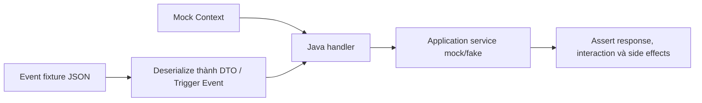
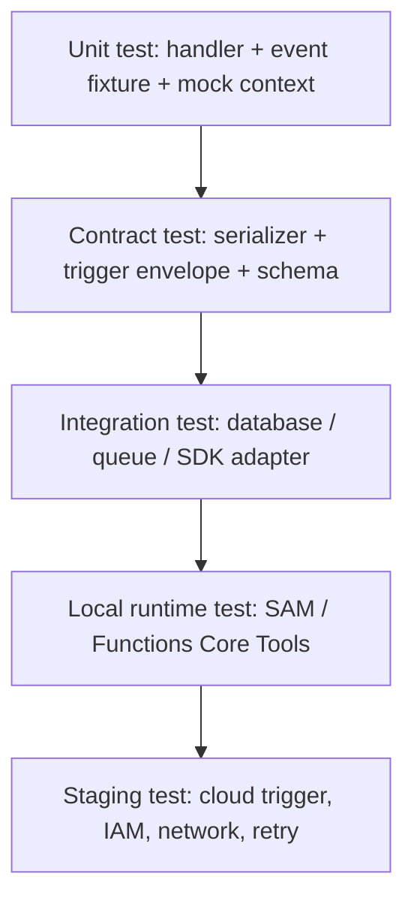

# Kiểm thử handler bằng event mẫu và context giả lập

Java function trong môi trường serverless thường được runtime gọi bằng một event và một đối tượng context. Event chứa dữ liệu nghiệp vụ hoặc envelope do trigger tạo ra; context cung cấp thông tin invocation như request ID, thời gian còn lại và logger. Khi kiểm thử handler, có thể tạo **event mẫu (fixture)** để mô phỏng input và **context giả lập (mock/fake)** để kiểm soát các thông tin runtime cung cấp.

Cách kiểm thử này giúp xác minh logic của handler nhanh, lặp lại được và không cần triển khai function lên cloud cho mỗi lần chạy. Tuy nhiên, mock context không mô phỏng toàn bộ runtime, trigger, IAM hay cách nền tảng chuyển đổi payload. Vì vậy, cần kết hợp unit test với contract test cho event và integration test ở ranh giới nền tảng.

## 1. Handler nhận event và context như thế nào?

Một invocation thường có hai nhóm đầu vào:

- **Event:** dữ liệu kích hoạt function. Có thể là DTO nghiệp vụ, HTTP request envelope, SQS record batch, timer event hoặc payload do event bus gửi.
- **Context:** metadata của invocation và tiện ích do runtime cung cấp, chẳng hạn invocation/request ID, function name, remaining execution time và logger.



Ví dụ AWS Lambda Java dùng `RequestHandler`:

```java
public interface RequestHandler<I, O> {
    O handleRequest(I input, Context context);
}
```

Runtime gọi `handleRequest` với input đã được deserialize và một `Context` thực. Trong unit test, ta gọi trực tiếp method này với DTO được tạo từ JSON fixture và một mock `Context`.

Với Azure Functions Java, trigger và context thường xuất hiện dưới dạng tham số của method được đánh dấu `@FunctionName`. Ví dụ queue-triggered function nhận message body và `ExecutionContext`. Test có thể gọi trực tiếp method với message mẫu và `ExecutionContext` giả lập.

## 2. Chuẩn bị event fixture

Fixture là dữ liệu đầu vào cố định, được lưu cùng test để nhiều test có thể sử dụng lại. Fixture nên giống payload thực tế mà nền tảng gửi đến function, bao gồm tên trường, kiểu dữ liệu, cấu trúc lồng nhau và metadata cần thiết.

Một cấu trúc Maven đơn giản:

```text
src/
├── main/
│   └── java/com/example/orders/
│       ├── OrderCreatedEvent.java
│       ├── ProcessingResult.java
│       ├── OrderService.java
│       └── OrderCreatedHandler.java
└── test/
    ├── java/com/example/orders/
    │   └── OrderCreatedHandlerTest.java
    └── resources/
        └── events/
            ├── order-created.json
            ├── order-created-missing-id.json
            └── order-created-duplicate.json
```

Ví dụ `order-created.json`:

```json
{
  "eventId": "evt-1001",
  "orderId": "ord-2048",
  "customerRef": "cust-ref-82"
}
```

DTO Java tương ứng:

```java
package com.example.orders;

public record OrderCreatedEvent(
        String eventId,
        String orderId,
        String customerRef) {
}
```

Record phù hợp với event DTO bất biến và giúp test dễ đọc. Nếu serializer hoặc framework của dự án yêu cầu constructor rỗng/getter/setter, hãy dùng POJO tương ứng. Quan trọng là fixture phải được deserialize bằng cấu hình serializer tương thích với production.

### 2.1. Event DTO và trigger envelope là hai lớp khác nhau

Không phải mọi trigger đều gửi trực tiếp DTO nghiệp vụ. Ví dụ:

- HTTP API Gateway gửi một envelope có method, path, headers, query parameters và body.
- SQS gửi một envelope chứa mảng `Records`; mỗi record có `messageId`, `body`, attributes và metadata nguồn.
- EventBridge gửi envelope có `id`, `source`, `detail-type`, `time` và `detail`.
- Azure Queue Trigger thường truyền message body vào tham số trigger, còn metadata invocation nằm trong context hoặc binding khác.

Nếu function nhận `SQSEvent`, fixture phải có cấu trúc `Records`; không thể dùng JSON của `OrderCreatedEvent` trực tiếp làm input của handler rồi mong runtime tự bọc nó thành SQS event. Nếu body của SQS là JSON nghiệp vụ, test nên kiểm tra cả bước đọc envelope và bước parse `record.body`.

Ví dụ SQS event rút gọn:

```json
{
  "Records": [
    {
      "messageId": "msg-501",
      "receiptHandle": "receipt-placeholder",
      "body": "{\"eventId\":\"evt-1001\",\"orderId\":\"ord-2048\",\"customerRef\":\"cust-ref-82\"}",
      "attributes": {},
      "messageAttributes": {},
      "md5OfBody": "placeholder",
      "eventSource": "aws:sqs",
      "eventSourceARN": "arn:aws:sqs:ap-southeast-1:123456789012:orders-test",
      "awsRegion": "ap-southeast-1"
    }
  ]
}
```

Fixture rút gọn phù hợp để kiểm tra các trường handler đang sử dụng. Khi kiểm thử hợp đồng trigger đầy đủ, lấy payload mẫu từ tài liệu chính thức hoặc bản ghi đã được làm sạch dữ liệu nhạy cảm; tránh dùng receipt handle, token hoặc dữ liệu production thật.

## 3. Tạo context giả lập cho AWS Lambda Java

AWS Lambda cung cấp `com.amazonaws.services.lambda.runtime.Context`. Context thực được runtime tạo cho mỗi invocation. Unit test có thể dùng Mockito để giả lập những method mà handler gọi.

Ví dụ handler:

```java
package com.example.orders;

import com.amazonaws.services.lambda.runtime.Context;
import com.amazonaws.services.lambda.runtime.RequestHandler;
import java.util.Objects;

public final class OrderCreatedHandler
        implements RequestHandler<OrderCreatedEvent, ProcessingResult> {

    private final OrderService orderService;

    public OrderCreatedHandler() {
        this(new DefaultOrderService());
    }

    OrderCreatedHandler(OrderService orderService) {
        this.orderService = Objects.requireNonNull(orderService);
    }

    @Override
    public ProcessingResult handleRequest(
            OrderCreatedEvent event,
            Context context) {

        Objects.requireNonNull(event, "event is required");
        Objects.requireNonNull(context, "context is required");

        if (event.eventId() == null || event.eventId().isBlank()) {
            throw new IllegalArgumentException("eventId is required");
        }

        if (context.getRemainingTimeInMillis() < 1_000) {
            throw new IllegalStateException("Not enough time to process event");
        }

        context.getLogger().log("Processing eventId=" + event.eventId());
        return orderService.process(event);
    }
}
```

Interface và service minh họa:

```java
package com.example.orders;

public interface OrderService {
    ProcessingResult process(OrderCreatedEvent event);
}
```

```java
package com.example.orders;

public record ProcessingResult(String status) {
}
```

```java
package com.example.orders;

final class DefaultOrderService implements OrderService {
    @Override
    public ProcessingResult process(OrderCreatedEvent event) {
        // Thay bằng nghiệp vụ thật hoặc adapter tới repository.
        return new ProcessingResult("COMPLETED");
    }
}
```

Constructor không tham số cho phép Lambda Java runtime khởi tạo handler theo quy ước thông thường. Constructor nhận `OrderService` package-private giúp test truyền mock vào mà không cần kết nối database. Trong ứng dụng thật, `DefaultOrderService` sẽ gọi application service/repository đã được cấu hình; có thể dùng framework DI nếu runtime adapter hỗ trợ.

### 3.1. Tạo mock Context và LambdaLogger

`Context` là interface; chỉ stub method mà handler thực sự dùng. Không cần tự triển khai toàn bộ context nếu test chỉ quan tâm logger và thời gian còn lại.

```java
Context context = mock(Context.class);
LambdaLogger logger = mock(LambdaLogger.class);

when(context.getRemainingTimeInMillis()).thenReturn(5_000);
when(context.getLogger()).thenReturn(logger);
```

Các giá trị này giúp test điều khiển được tình huống. Ví dụ, đặt remaining time là 5.000 ms cho happy path và 200 ms để kiểm tra handler từ chối bắt đầu công việc khi sắp hết deadline.

## 4. Viết unit test với JUnit 5 và Mockito

Maven cần có dependency production và test tương ứng. Ví dụ phần dependency tối thiểu:

```xml
<dependencies>
    <dependency>
        <groupId>com.amazonaws</groupId>
        <artifactId>aws-lambda-java-core</artifactId>
        <version>1.2.3</version>
    </dependency>

    <dependency>
        <groupId>com.fasterxml.jackson.core</groupId>
        <artifactId>jackson-databind</artifactId>
        <version>2.18.2</version>
    </dependency>

    <dependency>
        <groupId>org.junit.jupiter</groupId>
        <artifactId>junit-jupiter</artifactId>
        <version>5.11.4</version>
        <scope>test</scope>
    </dependency>

    <dependency>
        <groupId>org.mockito</groupId>
        <artifactId>mockito-junit-jupiter</artifactId>
        <version>5.15.2</version>
        <scope>test</scope>
    </dependency>
</dependencies>
```

Các version trên minh họa một bộ version tương thích; dự án thực tế nên dùng version đã được kiểm duyệt trong dependency management/BOM của tổ chức. Cần cấu hình Maven Surefire hỗ trợ JUnit 5 nếu phiên bản Maven/plugin của dự án chưa bật sẵn.

### 4.1. Happy path: event hợp lệ được xử lý

```java
package com.example.orders;

import static org.junit.jupiter.api.Assertions.assertEquals;
import static org.junit.jupiter.api.Assertions.assertFalse;
import static org.junit.jupiter.api.Assertions.assertNotNull;
import static org.junit.jupiter.api.Assertions.assertThrows;
import static org.mockito.Mockito.mock;
import static org.mockito.Mockito.verify;
import static org.mockito.Mockito.verifyNoInteractions;
import static org.mockito.Mockito.when;

import com.amazonaws.services.lambda.runtime.Context;
import com.amazonaws.services.lambda.runtime.LambdaLogger;
import com.fasterxml.jackson.databind.ObjectMapper;
import java.io.InputStream;
import org.junit.jupiter.api.BeforeEach;
import org.junit.jupiter.api.Test;

class OrderCreatedHandlerTest {
    private final ObjectMapper objectMapper = new ObjectMapper();
    private OrderService orderService;
    private Context context;
    private LambdaLogger logger;
    private OrderCreatedHandler handler;

    @BeforeEach
    void setUp() {
        orderService = mock(OrderService.class);
        context = mock(Context.class);
        logger = mock(LambdaLogger.class);

        when(context.getRemainingTimeInMillis()).thenReturn(5_000);
        when(context.getLogger()).thenReturn(logger);

        handler = new OrderCreatedHandler(orderService);
    }

    @Test
    void processesValidEvent() throws Exception {
        OrderCreatedEvent event;
        try (InputStream input = getClass().getResourceAsStream(
                "/events/order-created.json")) {
            if (input == null) {
                throw new IllegalStateException("Missing event fixture");
            }
            event = objectMapper.readValue(input, OrderCreatedEvent.class);
        }

        when(orderService.process(event))
                .thenReturn(new ProcessingResult("COMPLETED"));

        ProcessingResult result = handler.handleRequest(event, context);

        assertEquals("COMPLETED", result.status());
        verify(orderService).process(event);
        verify(logger).log("Processing eventId=evt-1001");
    }

    private OrderCreatedEvent loadEvent(String resource) throws Exception {
        try (InputStream input = getClass().getResourceAsStream(resource)) {
            if (input == null) {
                throw new IllegalStateException("Missing event fixture: " + resource);
            }
            return objectMapper.readValue(input, OrderCreatedEvent.class);
        }
    }
}
```

Test này xác minh bốn điều: fixture được deserialize thành DTO; handler nhận event và context; service được gọi với đúng event; kết quả và log được tạo như mong đợi. Service là mock nên test không cần database hoặc queue thật.

### 4.2. Context gần hết thời gian

```java
@Test
void doesNotStartWorkWhenDeadlineIsNear() {
    OrderCreatedEvent event = new OrderCreatedEvent(
            "evt-1002", "ord-2049", "cust-ref-83");
    when(context.getRemainingTimeInMillis()).thenReturn(200);

    assertThrows(
            IllegalStateException.class,
            () -> handler.handleRequest(event, context));

    verifyNoInteractions(orderService);
}
```

Test này xác minh handler không bắt đầu công việc khi remaining time dưới ngưỡng. Trong hệ thống thực tế, ngưỡng phải đủ cho thao tác nghiệp vụ và cleanup. Không nên dùng context mock để giả định runtime sẽ luôn cấp đúng một lượng thời gian; test đang kiểm tra quyết định của code khi nhận giá trị context đã cho.

Có thể kiểm tra dữ liệu bắt buộc ngay tại handler:

```java
@Test
void rejectsEventWithoutEventId() {
    OrderCreatedEvent event = new OrderCreatedEvent(
            null, "ord-2049", "cust-ref-83");

    assertThrows(
            IllegalArgumentException.class,
            () -> handler.handleRequest(event, context));

    verifyNoInteractions(orderService);
}
```

### 4.3. Lỗi nghiệp vụ phải được truyền ra đúng cách

```java
@Test
void propagatesRetryableServiceFailure() {
    OrderCreatedEvent event = new OrderCreatedEvent(
            "evt-1003", "ord-2050", "cust-ref-84");
    when(orderService.process(event))
            .thenThrow(new IllegalStateException("Temporary failure"));

    assertThrows(
            IllegalStateException.class,
            () -> handler.handleRequest(event, context));
}
```

Nếu lỗi cần runtime/broker retry, handler phải để exception đi ra hoặc trả kết quả lỗi theo đúng contract của trigger. Không bắt mọi exception rồi log và trả `COMPLETED`, vì nền tảng có thể coi invocation là thành công và xác nhận message. Với HTTP trigger, lỗi thường cần ánh xạ thành HTTP status/body; không áp dụng retry semantics của queue cho HTTP request.

## 5. Kiểm tra event serialization và schema contract

Một handler có thể xử lý DTO đúng khi test tạo DTO trực tiếp, nhưng thất bại khi runtime deserialize JSON vì tên field, kiểu dữ liệu hoặc serializer khác nhau. Vì vậy, nên có test đọc fixture JSON bằng cùng cấu hình serializer được ứng dụng sử dụng.

Ví dụ kiểm tra field bắt buộc:

```java
@Test
void fixtureContainsRequiredEventFields() throws Exception {
    OrderCreatedEvent event = loadEvent("/events/order-created.json");

    assertNotNull(event.eventId());
    assertFalse(event.eventId().isBlank());
    assertNotNull(event.orderId());
    assertFalse(event.orderId().isBlank());
}
```

Các fixture bổ sung nên đại diện cho:

- Field bắt buộc bị thiếu hoặc `null`.
- Field có kiểu sai, ví dụ số thay cho chuỗi.
- Field mới được thêm vào schema.
- Enum hoặc event type không được hỗ trợ.
- Payload rỗng hoặc JSON không hợp lệ.
- Event phiên bản cũ vẫn còn trong queue/stream.
- Message trùng event ID.

Quy tắc xử lý field lạ phụ thuộc serializer. Một số cấu hình Jackson bỏ qua unknown properties; cấu hình khác có thể từ chối. Hãy kiểm tra chính sách tương thích schema mà hệ thống mong muốn, không để hành vi mặc định của thư viện quyết định ngoài ý muốn.

Với SQS, nên có một test fixture cho envelope `SQSEvent` và một test riêng parse body thành `OrderCreatedEvent`. Với API Gateway, test envelope request và việc chuyển `pathParameters`, `queryStringParameters`, headers hoặc body. Với EventBridge, test `detail-type`, `source` và `detail`. Mỗi trigger có contract riêng.

## 6. Kiểm thử Azure Functions ExecutionContext

Azure Functions Java dùng `com.microsoft.azure.functions.ExecutionContext`. Interface này cung cấp logger, tên function và invocation ID. Có thể mock nó bằng Mockito giống AWS Context.

Ví dụ method xử lý message:

```java
import com.microsoft.azure.functions.ExecutionContext;
import com.microsoft.azure.functions.annotation.FunctionName;
import com.microsoft.azure.functions.annotation.QueueTrigger;
import java.util.logging.Logger;

interface AzureOrderService {
    void processMessage(String message);
}

public final class AzureOrderFunction {
    private final AzureOrderService orderService;

    public AzureOrderFunction() {
        this(message -> {
            // Thay bằng application service xử lý queue message.
        });
    }

    AzureOrderFunction(AzureOrderService orderService) {
        this.orderService = orderService;
    }

    @FunctionName("processAzureOrder")
    public void run(
            @QueueTrigger(
                    name = "message",
                    queueName = "orders",
                    connection = "StorageConnection")
            String message,
            ExecutionContext context) {

        context.getLogger().info(
                "Processing invocationId=" + context.getInvocationId());
        orderService.processMessage(message);
    }
}
```

Test method trực tiếp:

```java
import static org.mockito.Mockito.mock;
import static org.mockito.Mockito.verify;
import static org.mockito.Mockito.when;

@Test
void processesQueueMessageWithFakeExecutionContext() {
    AzureOrderService service = mock(AzureOrderService.class);
    AzureOrderFunction function = new AzureOrderFunction(service);
    ExecutionContext context = mock(ExecutionContext.class);
    Logger logger = mock(Logger.class);

    when(context.getInvocationId()).thenReturn("invocation-test-01");
    when(context.getLogger()).thenReturn(logger);

    function.run("ord-2048", context);

    verify(service).processMessage("ord-2048");
    verify(logger).info("Processing invocationId=invocation-test-01");
}
```

Ví dụ giả định `AzureOrderService.processMessage(String)` là hợp đồng của service xử lý queue trong ứng dụng. Khi chạy local hoặc trên Azure, Functions host sẽ tạo `ExecutionContext` thật và binding sẽ chuyển queue message vào tham số `message`. Unit test gọi trực tiếp method nên không kiểm tra host có đọc đúng queue, binding connection có hợp lệ hay message được deserialize đúng hay không.

## 7. Fake hay mock context: chọn cách nào?

| Cách | Mô tả | Khi phù hợp |
|---|---|---|
| Mockito mock | Tạo object giả và stub method cần dùng | Kiểm tra nhanh nhánh logic phụ thuộc invocation ID, logger hoặc deadline |
| Fake implementation | Viết class test tự giữ giá trị và trả về từ method | Khi cần context có hành vi đơn giản, ổn định và dùng lại nhiều test |
| Real context từ runtime | Để Functions host/Lambda runtime tạo context | Integration test hoặc kiểm tra local/cloud |

Với AWS `Context`, fake implementation phải triển khai nhiều method; Mockito thường ngắn hơn. Với Azure `ExecutionContext`, mock cũng thuận tiện. Không nên mock quá nhiều method không được handler sử dụng vì test sẽ gắn chặt vào chi tiết implementation và khó bảo trì.

Context là metadata runtime, không phải nơi lưu trạng thái nghiệp vụ. Không đặt kết quả xử lý vào context hoặc giả định context tồn tại qua nhiều invocation. Nếu cần truyền correlation ID hoặc tenant ID, đưa chúng qua event/header đã được xác thực và kiểm tra contract rõ ràng.

## 8. Kiểm tra idempotency và side effect

Serverless trigger có thể retry hoặc giao lại event. Test handler cần kiểm tra cách code phản ứng khi cùng một event xuất hiện nhiều lần, nhưng nên đặt logic idempotency trong application service/repository để có thể test độc lập.

Ví dụ các tình huống nên kiểm thử:

| Tình huống | Điều cần xác minh |
|---|---|
| Event ID mới | Nghiệp vụ được thực hiện và lưu processed marker |
| Event ID đã xử lý | Không tạo đơn hàng, thanh toán hoặc email lần thứ hai |
| Database commit lỗi | Processed marker và thay đổi nghiệp vụ rollback cùng transaction |
| Commit thành công nhưng ACK bị mất | Lần giao lại được nhận diện và không lặp side effect |
| Hai invocation cùng event ID | Ràng buộc unique/transaction ngăn xử lý đồng thời hai lần |
| Downstream timeout không rõ kết quả | Retry dùng idempotency key hoặc kiểm tra trạng thái trước khi lặp |

Không dùng mock service để khẳng định database transaction hoặc unique constraint hoạt động. Với các tính chất này, cần repository integration test trên database tương thích hoặc test container phù hợp. Unit test chỉ xác minh handler chuyển event đúng và xử lý kết quả/lỗi đúng.

## 9. Kiểm thử theo từng tầng

Một chiến lược hiệu quả chia kiểm thử thành nhiều tầng:



| Tầng | Kiểm tra | Có cần cloud thật? |
|---|---|---|
| Unit | Logic handler, validation, mapping, context branch, service interaction | Không |
| Contract | JSON fixture, serializer, trigger envelope, schema compatibility | Không nhất thiết |
| Integration | Repository, transaction, queue client, external adapter | Có thể dùng container/local service hoặc sandbox |
| Local runtime | Runtime adapter, handler discovery, binding metadata và event invocation | Không nhất thiết; cần runtime tooling |
| Staging | IAM/RBAC, resource policy, trigger delivery, retry, timeout, VPC/VNet và scale | Có |

### 9.1. AWS Lambda local test

AWS SAM CLI có thể gọi function local bằng event fixture:

```bash
sam local invoke OrderCreatedFunction \
  --event src/test/resources/events/order-created.json
```

Template SAM cần khai báo function resource và runtime/package tương ứng. Lệnh này kiểm tra thêm runtime adapter và serialization so với unit test trực tiếp, nhưng không tái tạo hoàn toàn IAM, event source mapping, concurrency hoặc dịch vụ cloud. Có thể dùng integration test trong AWS sandbox để xác minh các lớp đó.

### 9.2. Azure Functions local test

Azure Functions Core Tools chạy Functions host local:

```bash
mvn clean package
func start
```

Với HTTP trigger, gửi request đến endpoint local. Với queue, timer hoặc Service Bus trigger, cần cấu hình local connection phù hợp, ví dụ Azurite hoặc namespace test. `local.settings.json` không nên chứa secret production và không commit vào source control.

## 10. Các lỗi thường gặp khi test handler

| Triệu chứng | Nguyên nhân | Cách khắc phục |
|---|---|---|
| Test chạy nhưng cloud deserialize lỗi | Fixture không đúng trigger envelope hoặc serializer config khác | Dùng payload thực tế đã làm sạch và cùng ObjectMapper/config |
| `NullPointerException` từ context | Mock chưa stub method handler gọi | Stub đúng method hoặc tạo fake context |
| Test phụ thuộc thứ tự | Dùng static mutable state hoặc mock dùng chung | Tạo mock/fixture mới cho mỗi test và dọn state |
| Test qua nhưng event source không kích hoạt function | Unit test không kiểm tra binding/permission/trigger | Bổ sung local runtime và staging integration test |
| Test kỳ vọng retry nhưng không thấy retry | Handler nuốt exception hoặc test chỉ gọi method trực tiếp | Kiểm tra exception contract; kiểm retry ở runtime integration |
| Test log thất bại do message khác | Assertion bám vào câu log không ổn định | Kiểm tra event ID/correlation field hoặc dùng captor |
| Test deadline không ổn định | Dùng thời gian thực hoặc `Thread.sleep` | Stub remaining time hoặc inject `Clock` |
| Duplicate test qua nhưng database vẫn ghi trùng | Chỉ mock repository, không kiểm tra unique constraint/transaction | Dùng integration test với database tương thích |

## 11. Nguyên tắc để test ổn định và dễ bảo trì

- **Dùng fixture nhỏ và có ý nghĩa:** mỗi file đại diện cho một tình huống; tên file thể hiện dữ liệu hợp lệ, thiếu trường, lỗi hoặc duplicate.
- **Không dùng dữ liệu production:** ẩn danh ID, email, token, receipt handle và thông tin khách hàng.
- **Stub đúng phần context được dùng:** không cần dựng toàn bộ runtime khi test chỉ đọc remaining time và logger.
- **Inject dependency:** service, repository, clock và client nên được đưa vào handler/application service qua constructor hoặc factory để test thay thế dễ dàng.
- **Không gọi cloud trong unit test:** unit test phải chạy nhanh và không phụ thuộc credential, network hoặc account cloud.
- **Không sleep để chờ:** dùng clock giả, awaitility hoặc cơ chế đồng bộ test phù hợp khi kiểm tra bất đồng bộ.
- **Kiểm tra hành vi quan trọng:** kết quả, lời gọi service, exception và side effect; tránh kiểm tra quá nhiều chi tiết private.
- **Giữ fixture theo schema version:** khi event contract thay đổi, cập nhật fixture và test tương thích ngược có chủ đích.
- **Kiểm tra log an toàn:** không để event fixture chứa secret hoặc test vô tình ghi toàn bộ payload nhạy cảm.

## 12. Checklist kiểm thử handler

1. Event fixture có đúng cấu trúc trigger thực tế và schema version không?
2. DTO có deserialize được bằng serializer/cấu hình giống production không?
3. Test có bao gồm event hợp lệ, thiếu trường, sai kiểu và event phiên bản cũ không?
4. Context mock/fake đã cung cấp đúng invocation ID, logger và remaining time mà handler sử dụng chưa?
5. Handler có gọi đúng application service và trả đúng kết quả không?
6. Exception cần retry có được truyền ra theo đúng contract trigger không?
7. Event trùng có tránh tạo side effect lặp không?
8. Test có tách biệt logic handler với transaction/database và external API không?
9. Đã có contract test cho API Gateway, SQS, EventBridge hoặc Azure trigger envelope tương ứng chưa?
10. Đã có local runtime hoặc staging test cho binding, IAM/RBAC, network và retry chưa?
11. Fixture/log có loại bỏ secret và dữ liệu cá nhân không?
12. Test chạy độc lập, không phụ thuộc thứ tự, thời gian thực hoặc cloud credential không?

## Kết luận

Kiểm thử handler bằng event mẫu và context giả lập cho phép kiểm tra nhanh logic Java trong điều kiện xác định. Fixture cần phản ánh đúng payload và trigger envelope; mock context chỉ cung cấp các metadata runtime mà handler sử dụng. Dùng JUnit và Mockito để kiểm tra happy path, validation, deadline, exception và tương tác với application service. Sau đó bổ sung contract test, integration test và local/staging runtime test để xác minh serializer, binding, quyền, retry và hành vi nền tảng. Cách phân tầng này giúp phát hiện lỗi sớm mà vẫn giữ được kiểm tra thực tế ở những ranh giới unit test không thể mô phỏng.

## Tài liệu tham khảo chính thức

- [AWS Lambda Java handler](https://docs.aws.amazon.com/lambda/latest/dg/java-handler.html)
- [AWS Lambda Java context object](https://docs.aws.amazon.com/lambda/latest/dg/java-context.html)
- [AWS Lambda Java events library](https://github.com/aws/aws-lambda-java-libs)
- [AWS SAM local invoke](https://docs.aws.amazon.com/serverless-application-model/latest/developerguide/using-sam-cli-local-invoke.html)
- [Azure Functions Java developer guide](https://learn.microsoft.com/en-us/azure/azure-functions/functions-reference-java)
- [ExecutionContext interface for Azure Functions Java](https://learn.microsoft.com/en-us/java/api/com.microsoft.azure.functions.executioncontext)
- [Azure Functions Core Tools](https://learn.microsoft.com/en-us/azure/azure-functions/functions-run-local)
