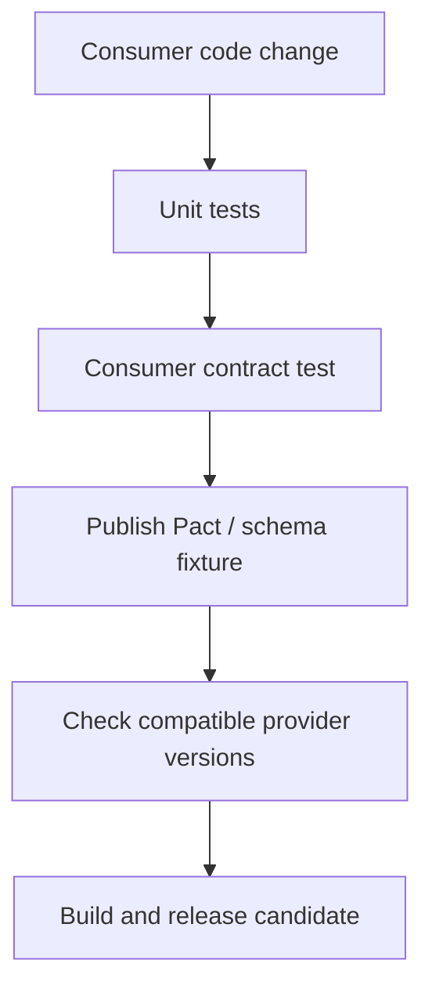
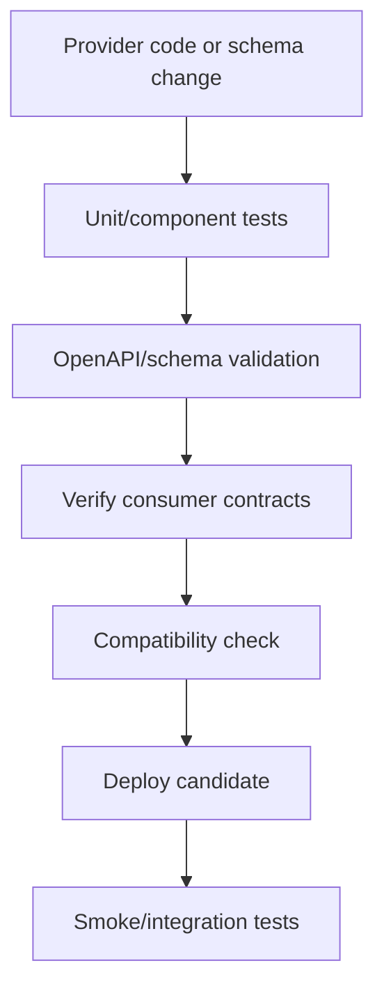

# Contract test cho HTTP API và schema sự kiện

## 1. Vì sao cần contract test trong hệ thống serverless?

Ứng dụng serverless thường được ghép từ nhiều function và dịch vụ độc lập. Một HTTP function có thể gọi API của dịch vụ đơn hàng; một queue consumer nhận event từ function khác; một webhook handler phụ thuộc vào payload do đối tác gửi. Mỗi thành phần có thể được build và triển khai riêng, nhưng vẫn phải hiểu đúng request, response và message của thành phần còn lại.

Một thay đổi nhỏ có thể làm hỏng tích hợp mà unit test của từng function vẫn pass. Ví dụ, producer đổi tên field `orderId` thành `id`, đổi kiểu `amount` từ số sang chuỗi hoặc chuyển một field từ optional thành required. Producer vẫn chạy đúng theo test nội bộ; consumer cũ lại không parse được event hoặc xử lý sai dữ liệu.

**Contract test** kiểm tra thỏa thuận giữa hai phía giao tiếp: bên gửi cam kết cung cấp dữ liệu và hành vi nào, bên nhận dựa vào dữ liệu và hành vi nào. Contract có thể là tài liệu OpenAPI cho HTTP, JSON Schema cho payload, AsyncAPI cho message channel hoặc một consumer-driven contract như Pact. Test xác minh implementation thực tế vẫn tuân theo thỏa thuận đó.

Trong serverless, contract test đặc biệt hữu ích vì function thường được deploy độc lập, trigger và event source có envelope riêng, message có thể được retry hoặc giao nhiều lần, và thay đổi schema có thể lan qua nhiều consumer. Contract test giúp phát hiện lỗi tương thích trước khi triển khai, giảm phụ thuộc vào việc dựng toàn bộ cloud environment cho mọi lần kiểm tra.

Contract test không thay thế unit test, integration test, end-to-end test hay kiểm thử độ tin cậy. Nó tập trung vào ranh giới giao tiếp. Một bộ kiểm thử tốt kết hợp các lớp này để xác nhận logic nội bộ, contract, tích hợp với dịch vụ thật và hành vi vận hành.

## 2. Contract gồm những gì?

### 2.1. Contract của HTTP API

Một HTTP contract không chỉ là JSON response. Nó mô tả ít nhất:

- HTTP method và route/path parameter.
- Query parameter, header và content type.
- Cơ chế xác thực/ủy quyền và các yêu cầu về scope/role.
- Request body: field, kiểu dữ liệu, required/optional, format và giới hạn.
- Response status code cho từng kết quả.
- Response header và body.
- Cấu trúc lỗi, mã lỗi ổn định và correlation/request ID nếu có.
- Pagination, filtering, sorting và semantics của empty result.
- Idempotency, timeout, retry và hành vi khi request được gửi lại.
- Versioning và chính sách tương thích.

Ví dụ, API `POST /orders` có thể cam kết nhận `customerId` và danh sách item, trả `201 Created` cùng `Location` khi tạo mới, trả `409 Conflict` khi idempotency key được dùng lại với payload khác, và trả `422 Unprocessable Content` khi dữ liệu hợp lệ về cú pháp nhưng vi phạm quy tắc nghiệp vụ.

### 2.2. Contract của event/message

Event contract mô tả:

- Envelope: event ID, source, type, subject, time, schema version.
- Payload: tên field, kiểu, required/optional, nullability và format.
- Semantics: event thể hiện sự kiện đã xảy ra hay yêu cầu xử lý.
- Ordering, partition key và khả năng duplicate delivery.
- Retry, acknowledgement, visibility timeout, dead-letter và replay.
- Cách xử lý field không biết, event version mới và event cũ.
- Quyền truy cập, dữ liệu nhạy cảm và retention.

Một message `OrderPaid` nên thể hiện sự kiện thanh toán đã hoàn tất. Consumer không nên suy diễn nó là yêu cầu thu tiền lần nữa. Event ID giúp deduplicate; `orderId` liên kết với aggregate nghiệp vụ; `schemaVersion` hoặc `dataschema` xác định cấu trúc payload.

### 2.3. Provider và consumer

Trong contract testing, **provider** là bên cung cấp API hoặc phát event; **consumer** là bên gọi API hoặc nhận event.

| Vai trò | Trách nhiệm |
| --- | --- |
| Consumer | Mô tả phần contract mà nó thực sự sử dụng; kiểm tra code client/handler với contract đó |
| Provider | Xác minh implementation của mình đáp ứng contract của các consumer hoặc schema đã công bố |
| Contract artifact | Lưu trữ OpenAPI, AsyncAPI, JSON Schema hoặc Pact pact file có version |
| CI/CD | Chạy kiểm tra contract trước khi phát hành và xác minh tổ hợp version tương thích |

Consumer-driven contract (CDC) bắt đầu từ nhu cầu thực tế của consumer. Provider-driven contract thường bắt đầu từ một API/schema chuẩn do provider công bố. Hai cách có thể bổ trợ nhau: OpenAPI/AsyncAPI là tài liệu chuẩn chung; Pact kiểm tra những tương tác cụ thể mà consumer đang dựa vào.

## 3. Contract test khác các loại test khác như thế nào?

| Loại test | Phạm vi | Ví dụ |
| --- | --- | --- |
| Unit test | Một hàm hoặc lớp, cô lập dependency | Kiểm tra mapper đổi `OrderCreatedEvent` thành command |
| Component test | Một function/service với dependency giả lập hoặc local | Gọi HTTP handler và kiểm tra response |
| Contract test | Ranh giới giữa provider và consumer | Consumer yêu cầu field/status nào; provider có đáp ứng không? |
| Integration test | Nhiều thành phần thật kết nối với nhau | Function ghi DynamoDB hoặc nhận message từ Service Bus |
| End-to-end test | Luồng nghiệp vụ qua nhiều dịch vụ | Tạo đơn qua API, thanh toán, nhận event và xác nhận trạng thái |
| Resilience test | Hành vi khi lỗi, quá tải hoặc gián đoạn | Queue redelivery, timeout, DLQ và recovery |

Contract test thường nhanh và có phạm vi hẹp hơn end-to-end test. Nó có thể dùng mock server, generated stub hoặc schema validator thay vì gọi cloud service thật. Tuy nhiên, contract pass không chứng minh IAM, network, event source mapping, retry configuration hay database behavior đang được cấu hình đúng.

## 4. Thiết kế contract cho HTTP API bằng OpenAPI

### 4.1. OpenAPI là gì?

OpenAPI là đặc tả mô tả HTTP API độc lập với ngôn ngữ triển khai. Tệp OpenAPI thường định nghĩa paths, operations, parameters, requestBody, responses, schemas, security schemes và server URLs. Có thể dùng nó để tạo tài liệu, client SDK, mock server, lint rule và kiểm thử contract.

OpenAPI nên được quản lý như source artifact có version. Tránh chỉ cập nhật tài liệu sau khi code đã đổi; khi đó tài liệu có thể không còn phản ánh implementation. Tốt hơn là review thay đổi contract cùng pull request thay đổi API.

### 4.2. Ví dụ OpenAPI rút gọn

```yaml
openapi: 3.1.0
info:
  title: Order API
  version: 1.0.0
paths:
  /orders:
    post:
      operationId: createOrder
      security:
        - bearerAuth: []
      parameters:
        - name: Idempotency-Key
          in: header
          required: true
          schema:
            type: string
            minLength: 8
      requestBody:
        required: true
        content:
          application/json:
            schema:
              $ref: '#/components/schemas/CreateOrderRequest'
      responses:
        '201':
          description: Order created
          content:
            application/json:
              schema:
                $ref: '#/components/schemas/Order'
        '400':
          description: Invalid request
        '401':
          description: Authentication required
        '409':
          description: Idempotency conflict
components:
  securitySchemes:
    bearerAuth:
      type: http
      scheme: bearer
  schemas:
    CreateOrderRequest:
      type: object
      required: [customerId, items]
      properties:
        customerId:
          type: string
        items:
          type: array
          minItems: 1
          items:
            $ref: '#/components/schemas/OrderItem'
    OrderItem:
      type: object
      required: [sku, quantity]
      properties:
        sku:
          type: string
        quantity:
          type: integer
          minimum: 1
    Order:
      type: object
      required: [id, status]
      properties:
        id:
          type: string
        status:
          type: string
          enum: [PENDING, CONFIRMED, CANCELLED]
        createdAt:
          type: string
          format: date-time
```

Đây là contract minh họa. API thực tế cần định nghĩa rõ error body, response headers, pagination, maximum length, decimal precision, currency, timezone, rate limit và các status code liên quan. Nếu API Gateway hoặc nền tảng serverless chuyển đổi request/response, cần kiểm tra contract ở cả gateway boundary và function handler.

### 4.3. Những gì nên kiểm tra trong HTTP contract

- Method/path đúng với operation.
- Required header/query/path parameter có được kiểm tra.
- Content type và encoding được hỗ trợ.
- Body hợp lệ và không hợp lệ có response tương ứng.
- Status code không thay đổi ngoài contract.
- Response body có field/kiểu dữ liệu đúng.
- Unknown field được xử lý theo chính sách đã công bố.
- Error response có mã lỗi ổn định, không lộ stack trace/secret.
- Authentication failure và authorization failure được phân biệt hợp lý.
- Idempotency key và duplicate request có semantics được định nghĩa.

Không nên chỉ kiểm tra rằng response JSON có chứa một field. Cần kiểm tra field đó có đúng kiểu, nullability, format và semantics. Ví dụ `amount` không thể đổi từ integer minor units sang floating point mà không có thay đổi contract rõ ràng.

## 5. Consumer-driven contract với Pact

### 5.1. Pact hoạt động như thế nào?

Pact là một công cụ consumer-driven contract testing. Consumer test mô tả một tương tác cụ thể mà nó cần từ provider. Pact tạo file contract (pact file) chứa request/response hoặc message expectation. Provider verification chạy contract đó với implementation provider để xác nhận provider đáp ứng các kỳ vọng.

Quy trình thường gồm:

1. Consumer viết test dựa trên cách nó thực sự gọi provider.
2. Test chạy với mock server do Pact cung cấp.
3. Pact file được tạo và publish lên Pact Broker hoặc nơi lưu trữ artifact.
4. Provider tải pact file của consumer và chạy verification.
5. Kết quả verification được publish kèm version/branch của provider.
6. Pipeline kiểm tra tổ hợp consumer/provider nào có thể triển khai an toàn.

Pact kiểm tra tương tác được consumer khai báo, không thay thế OpenAPI documentation hay toàn bộ kiểm thử nghiệp vụ. Nếu consumer test không mô tả một header hoặc field mà code thực tế đang phụ thuộc, contract sẽ không bảo vệ phần phụ thuộc đó.

### 5.2. Ví dụ consumer contract cho HTTP

Đoạn Java dưới đây minh họa ý tưởng Pact DSL. Package/import và annotation test cần khớp phiên bản Pact JVM đang dùng trong dự án.

```java
@Pact(consumer = "OrderPortal", provider = "OrderApi")
public RequestResponsePact orderExists(PactDslWithProvider builder) {
    return builder
        .given("order 42 exists")
        .uponReceiving("a request for order 42")
            .path("/orders/42")
            .method("GET")
        .willRespondWith()
            .status(200)
            .headers(Map.of("Content-Type", "application/json"))
            .body(new PactDslJsonBody()
                .stringType("id", "42")
                .stringType("status", "PAID"))
        .toPact();
}
```

Consumer test tiếp theo gọi client HTTP thật của ứng dụng đến Pact mock server và xác minh code client parse/handle response. Không chỉ gọi mock server bằng một HTTP client viết riêng cho test, vì như vậy có thể bỏ qua code client production.

### 5.3. Provider verification

Provider verification chạy pact interaction với provider thật trong môi trường test. Provider có thể cần state setup như “order 42 exists”. State setup nên tạo dữ liệu tối thiểu và có thể lặp lại, không phụ thuộc môi trường production.

Provider verification cần kiểm tra:

- Request được định tuyến đúng endpoint.
- Authentication/headers theo contract.
- Response status và body đáp ứng matcher.
- Provider state được thiết lập trước mỗi interaction.
- Dữ liệu test được cô lập và dọn sau khi chạy.
- Contract của mọi consumer đang được hỗ trợ đều pass.

Provider không nên làm test pass bằng cách mock chính implementation cần kiểm tra. Nếu verification chỉ gọi một fake controller thay vì handler/service thực tế, nó không chứng minh provider contract.

### 5.4. Matchers và contract linh hoạt

Pact hỗ trợ matcher cho kiểu dữ liệu, regex, array, object và giá trị ví dụ. Hãy mô tả điều consumer cần, không khóa mọi giá trị vào fixture cứng nếu giá trị thực có thể thay đổi hợp lệ.

Ví dụ, consumer có thể yêu cầu `status` là string và thuộc tập giá trị mà nó hiểu. Nếu consumer chỉ cần biết `id` tồn tại, không nhất thiết phải yêu cầu toàn bộ response có đúng thứ tự field. JSON object không có semantics phụ thuộc thứ tự key.

Contract quá lỏng có thể bỏ sót breaking change; contract quá chặt có thể ngăn provider thêm field tương thích. Chọn matcher theo dependency thật của consumer.

## 6. Contract cho schema sự kiện

### 6.1. Event envelope và payload

Nên tách envelope dùng chung khỏi payload domain. Envelope chứa metadata để định tuyến, theo dõi và quản lý version; payload chứa dữ liệu nghiệp vụ.

Ví dụ event `OrderPaid`:

```json
{
  "specversion": "1.0",
  "id": "evt-7f9a",
  "source": "/payments/service",
  "type": "com.example.payment.paid.v1",
  "subject": "orders/order-42",
  "time": "2026-11-17T10:15:30Z",
  "datacontenttype": "application/json",
  "dataschema": "https://schemas.example.com/payment-paid/1.0.0.json",
  "data": {
    "paymentId": "pay-88",
    "orderId": "order-42",
    "amountMinor": 120000,
    "currency": "VND",
    "status": "PAID"
  }
}
```

Đây là ví dụ theo cấu trúc CloudEvents ở chế độ structured JSON. CloudEvents giúp chuẩn hóa metadata như `id`, `source`, `type`, `subject`, `time`, `datacontenttype` và `dataschema`. Nó không tự định nghĩa schema domain bên trong `data`; phần đó vẫn cần JSON Schema, Avro, Protobuf hoặc một contract riêng.

### 6.2. JSON Schema

JSON Schema mô tả cấu trúc và constraint của JSON payload. Ví dụ schema rút gọn cho `OrderPaid`:

```json
{
  "$schema": "https://json-schema.org/draft/2020-12/schema",
  "$id": "https://schemas.example.com/payment-paid/1.0.0.json",
  "title": "OrderPaidData",
  "type": "object",
  "required": ["paymentId", "orderId", "amountMinor", "currency", "status"],
  "properties": {
    "paymentId": { "type": "string", "minLength": 1 },
    "orderId": { "type": "string", "minLength": 1 },
    "amountMinor": { "type": "integer", "minimum": 0 },
    "currency": { "type": "string", "pattern": "^[A-Z]{3}$" },
    "status": { "const": "PAID" }
  },
  "additionalProperties": true
}
```

`additionalProperties: true` cho phép consumer nhận thêm field mà nó chưa biết. Đây thường là lựa chọn thân thiện với tiến hóa schema cho consumer cần bỏ qua field lạ. Nếu đặt `false`, việc producer thêm field mới cũng có thể làm validation fail. Cần chọn theo chính sách tương thích và mức độ nghiêm ngặt của domain.

### 6.3. Event schema registry

Khi nhiều producer/consumer dùng chung event, có thể quản lý schema trong một repository hoặc schema registry. Registry lưu schema theo subject/type/version, hỗ trợ kiểm tra compatibility khi publish schema mới và giúp consumer biết phiên bản payload.

Schema registry không thay thế contract test. Nó kiểm tra schema compatibility theo rule đã cấu hình; contract test còn xác nhận code consumer thực tế có thể xử lý payload và provider phát ra dữ liệu đúng như kỳ vọng.

## 7. AsyncAPI và contract cho message channel

AsyncAPI mô tả API hướng message/event: server, channel, operation, message, payload, header, correlation ID và binding của broker. Nó hữu ích khi hệ thống dùng Azure Service Bus, Event Hubs, AWS SNS/SQS, Kafka hoặc broker tương tự.

Ví dụ AsyncAPI rút gọn:

```yaml
asyncapi: 3.0.0
info:
  title: Order Events
  version: 1.0.0
servers:
  broker:
    host: events.example.com
    protocol: kafka
channels:
  orderPaid:
    address: order.paid
    messages:
      OrderPaid:
        $ref: '#/components/messages/OrderPaid'
operations:
  consumeOrderPaid:
    action: receive
    channel:
      $ref: '#/channels/orderPaid'
    messages:
      - $ref: '#/channels/orderPaid/messages/OrderPaid'
components:
  messages:
    OrderPaid:
      name: OrderPaid
      contentType: application/cloudevents+json
      payload:
        $ref: 'schemas/order-paid-1.0.0.json'
```

Đây là cấu trúc minh họa; khi sử dụng AsyncAPI cần validate theo phiên bản specification và syntax của toolchain. Broker-specific binding có thể bổ sung consumer group, queue/topic, routing key, acknowledgement hoặc message key.

Contract cho message cần mô tả cả payload lẫn delivery semantics. Ví dụ, queue có thể giao ít nhất một lần; consumer phải idempotent. Kafka consumer có thể dựa vào partition key và offset; ordering chỉ được bảo đảm trong phạm vi partition. Không nên ghi một lời hứa “exactly once” chung chung nếu hệ thống thực tế không cung cấp semantics đó xuyên suốt side effect.

## 8. Tiến hóa schema và backward compatibility

### 8.1. Thay đổi thường tương thích

Một số thay đổi thường có khả năng tương thích nếu consumer tuân theo nguyên tắc bỏ qua field không biết và schema có default phù hợp:

- Thêm một field optional mới.
- Thêm metadata không ảnh hưởng ý nghĩa event.
- Nới constraint của field mà consumer cũ vẫn xử lý được.
- Thêm một event type mới mà consumer có thể bỏ qua loại không đăng ký.

Tuy nhiên, “thêm field” không luôn luôn an toàn. Nếu consumer dùng strict schema validation với `additionalProperties: false`, hoặc deserialize Java với cấu hình từ chối unknown property, field mới có thể làm consumer cũ fail.

### 8.2. Thay đổi thường breaking

- Xóa field đang được consumer sử dụng.
- Đổi tên field hoặc đổi JSON path.
- Đổi kiểu dữ liệu, ví dụ integer thành string hoặc object thành array.
- Biến field optional thành required mà producer cũ không cung cấp.
- Đổi semantics nhưng giữ nguyên tên và kiểu field.
- Thu hẹp enum/constraint khiến giá trị cũ không còn hợp lệ.
- Thay timezone/đơn vị hoặc precision mà không version hóa.

Thêm enum value cũng có thể phá consumer viết `switch` exhaustive hoặc từ chối giá trị lạ. Nếu producer có thể thêm trạng thái mới, consumer cần có nhánh `UNKNOWN`/default hoặc schema contract phải quy định rõ cách xử lý.

### 8.3. Forward và backward compatibility

| Loại tương thích | Ý nghĩa |
| --- | --- |
| Backward compatibility | Consumer mới đọc được dữ liệu do producer cũ phát ra |
| Forward compatibility | Consumer cũ vẫn đọc được dữ liệu do producer mới phát ra |
| Full compatibility | Đáp ứng cả hai hướng theo quy tắc schema đã chọn |
| Breaking change | Một hoặc nhiều consumer/provider hiện có không còn đáp ứng contract |

Khả năng tương thích phụ thuộc cả schema và cách code xử lý dữ liệu. Ví dụ JSON Schema có thể cho phép unknown field, nhưng Java mapper vẫn có thể được cấu hình strict; ngược lại, mapper bỏ qua field lạ nhưng business logic có thể giả định enum chỉ có ba giá trị.

### 8.4. Versioning strategy

Có thể version event bằng type name (`com.example.order.created.v2`), schema URI/version hoặc field `schemaVersion`. Chọn một chiến lược nhất quán và công bố thời gian hỗ trợ version cũ.

Không cần tạo version mới cho mọi field optional. Version mới phù hợp khi thay đổi không thể tương thích hoặc semantics event thay đổi đáng kể. Trong thời gian chuyển đổi, có thể phát song song v1/v2 hoặc consumer đọc cả hai phiên bản, nhưng cần tránh xử lý cùng một business event hai lần.

## 9. Viết schema contract test bằng Java

### 9.1. Kiểm tra JSON payload với JSON Schema

Có thể dùng một JSON Schema validator trong Java test để kiểm tra payload mẫu hoặc event thật được producer serialize. Ví dụ sau dùng Jackson để đọc JSON; phần `schemaValidator` đại diện cho thư viện JSON Schema validator đã chọn trong dự án.

```java
import com.fasterxml.jackson.databind.JsonNode;
import com.fasterxml.jackson.databind.ObjectMapper;
import org.junit.jupiter.api.Test;

import static org.junit.jupiter.api.Assertions.assertTrue;

class OrderPaidSchemaTest {
    private final ObjectMapper mapper = new ObjectMapper();

    @Test
    void producerPayloadMatchesPublishedSchema() throws Exception {
        OrderPaidEvent event = new OrderPaidEvent(
                "pay-88", "order-42", 120000, "VND", "PAID");

        JsonNode payload = mapper.valueToTree(event);
        boolean valid = schemaValidator.validate(
                "schemas/order-paid-1.0.0.json", payload);

        assertTrue(valid, "Serialized event must satisfy the published schema");
    }
}
```

`OrderPaidEvent` là DTO của producer; `schemaValidator` là adapter đến validator thực tế. Trong test production, nên giữ schema trong source control hoặc tải artifact đã version từ registry, và báo lỗi validation chi tiết theo JSON Pointer để dễ sửa.

### 9.2. Kiểm tra consumer với payload producer thực tế

Schema validation chỉ chứng minh payload đúng cấu trúc. Cần test consumer với payload đại diện để xác nhận:

- Deserialize thành DTO thành công.
- Field optional/missing/null được xử lý đúng.
- Unknown field không làm consumer crash nếu contract cho phép.
- Enum mới có nhánh fallback an toàn.
- Event type/schema version không hỗ trợ được từ chối hoặc đưa DLQ theo chính sách.
- Duplicate event ID không lặp side effect.

Ví dụ DTO Java:

```java
public record OrderPaidEvent(
        String paymentId,
        String orderId,
        long amountMinor,
        String currency,
        String status) {}
```

Nếu dùng Jackson, cần xác định rõ cấu hình unknown properties, naming strategy, date/time module, null handling và enum behavior. Đừng để default cấu hình của môi trường local khác production.

### 9.3. Contract test cho HTTP client

Với HTTP consumer, test nên chạy code client thực tế với Pact mock server hoặc WireMock đã cấu hình theo contract. Ví dụ khái niệm:

```java
@Test
void orderClientReadsProviderResponse() {
    // Pact mock server đã được khởi động theo interaction trong test.
    OrderClient client = new OrderClient(mockServerBaseUrl);

    Order order = client.getOrder("42");

    assertEquals("42", order.id());
    assertEquals("PAID", order.status());
}
```

`mockServerBaseUrl` phải trỏ đến mock server do contract test quản lý. Không mock `OrderClient` trong test này, vì mục tiêu là xác minh serialization, URL, header và response mapping của client thật.

## 10. Contract test cho serverless HTTP handler

### 10.1. Kiểm tra boundary của function

Một HTTP function có thể nhận request qua API Gateway, Azure Functions HTTP trigger hoặc HTTP ingress của nền tảng khác. Test cần xác minh cả adapter/boundary:

- Path và method được route đúng.
- Header/query/body được map chính xác.
- Identity/claims được chuyển vào handler theo đúng contract.
- Response status, header và body phù hợp với gateway integration.
- Lỗi validation/authentication được ánh xạ ổn định.
- Request lớn, malformed JSON và content type sai được xử lý đúng.

Nếu gateway có mapping template hoặc policy biến đổi request, chỉ test function handler sẽ không phát hiện sai mapping. Cần một lớp test riêng cho cấu hình gateway hoặc chạy contract test qua gateway trong môi trường tích hợp.

### 10.2. HTTP response contract

Ví dụ response thành công:

```http
HTTP/1.1 201 Created
Content-Type: application/json
Location: /orders/order-42
X-Request-Id: req-91

{"id":"order-42","status":"PENDING"}
```

Ví dụ error contract:

```json
{
  "type": "https://api.example.com/problems/validation-error",
  "title": "Request validation failed",
  "status": 400,
  "code": "INVALID_ORDER_ITEM",
  "detail": "quantity must be greater than zero",
  "requestId": "req-91"
}
```

Có thể dùng Problem Details theo RFC 9457 cho lỗi HTTP. Nếu dùng định dạng riêng, hãy giữ schema ổn định và không đưa exception class, SQL statement, stack trace hoặc secret vào response.

### 10.3. Idempotency và retry trong HTTP contract

Nếu API nhận `Idempotency-Key`, contract cần quy định:

- Phạm vi duy nhất của key: tenant, user, endpoint hay operation.
- Thời gian giữ kết quả idempotency.
- Cùng key và cùng payload trả kết quả nào.
- Cùng key nhưng payload khác trả status/error nào.
- Hành vi khi operation đang `IN_PROGRESS`.
- Điều gì xảy ra khi request đầu timeout nhưng side effect đã hoàn tất.

Contract test nên có test case gửi lại cùng key và xác nhận provider không tạo resource hoặc charge thứ hai. Đây là kiểm tra hành vi nghiệp vụ; chỉ kiểm tra header có mặt là chưa đủ.

## 11. Contract test cho queue và event-driven function

### 11.1. Test event adapter riêng với domain handler

Event source của mỗi cloud provider có envelope khác nhau. Ví dụ, SQS gửi batch records, EventBridge có `detail-type` và `detail`, Azure Service Bus có message properties, Kafka có key/partition/offset. Không nên để domain logic phụ thuộc trực tiếp vào envelope của provider.

Tách hai lớp:

1. **Trigger adapter:** parse envelope, kiểm tra metadata, ánh xạ message sang DTO chuẩn của ứng dụng.
2. **Domain handler:** xử lý event nghiệp vụ, idempotency và side effect.

Contract test adapter xác nhận payload provider được chuyển đúng thành DTO. Contract test domain consumer xác nhận DTO/version được hỗ trợ và logic xử lý đúng.

### 11.2. Ví dụ CloudEvents Java DTO

```java
public record CloudEvent<T>(
        String specversion,
        String id,
        String source,
        String type,
        String subject,
        String time,
        String datacontenttype,
        String dataschema,
        T data) {}

public record OrderPaidData(
        String paymentId,
        String orderId,
        long amountMinor,
        String currency,
        String status) {}
```

Đây là DTO minh họa cho structured event. Khi dùng CloudEvents SDK hoặc binding cụ thể, nên dùng implementation chuẩn của SDK để xử lý attribute, extension attribute, binary mode và validation thay vì tự parse mọi biến thể bằng một DTO cố định.

### 11.3. Partial batch failure

Một số queue trigger giao nhiều message trong một invocation. Nếu một message lỗi, provider có thể giao lại cả batch trừ khi function dùng cơ chế partial batch response được hỗ trợ. Contract và test phải xác định:

- Message nào đã xử lý thành công.
- Message nào cần retry.
- Cách báo danh sách item failure theo đúng event source mapping contract.
- Consumer có idempotent khi message thành công bị giao lại không.
- Khi nào message được chuyển sang DLQ.

Không áp dụng cùng một giả định cho mọi trigger. SQS, Kinesis, Event Hubs và Service Bus có semantics acknowledgement/checkpoint khác nhau. Phải kiểm tra cấu hình trigger thực tế cùng với handler contract.

### 11.4. Ordering và partition

Schema contract cần ghi rõ consumer có phụ thuộc thứ tự event không. Kafka chỉ bảo đảm thứ tự trong một partition; FIFO queue có thể bảo đảm thứ tự theo message group; các event bus thông thường có thể không bảo đảm ordering toàn cục.

Nếu consumer cần cập nhật trạng thái theo version/sequence, payload nên có aggregate version hoặc sequence number. Consumer có thể phát hiện event cũ, event đến muộn hoặc khoảng trống sequence và quyết định retry, buffer hoặc đối soát.

## 12. Schema evolution cho event producer/consumer

### 12.1. Quy tắc thiết kế DTO bền vững

- Dùng tên field ổn định, có ý nghĩa nghiệp vụ.
- Dùng kiểu dữ liệu rõ: integer minor units cho tiền, ISO-8601/UTC cho thời gian, string cho ID.
- Phân biệt field thiếu, null và giá trị mặc định.
- Thêm field mới ở dạng optional khi consumer cũ cần tiếp tục hoạt động.
- Consumer bỏ qua field không biết nếu contract cho phép.
- Có fallback cho enum/type mới.
- Không tái sử dụng field cũ với semantics mới.
- Định danh schema version hoặc event type rõ ràng.

### 12.2. Expand-and-contract migration

Khi cần thay đổi breaking, dùng chiến lược expand-and-contract:

1. **Expand:** producer bắt đầu cung cấp field mới nhưng vẫn giữ field cũ.
2. **Consumer migration:** triển khai consumer đọc được cả hai field/version.
3. **Switch:** producer chuyển consumer sang field mới sau khi xác nhận mọi consumer được hỗ trợ.
4. **Observe:** theo dõi consumer version và lỗi parse/validation.
5. **Contract:** ngừng phát field cũ sau thời gian deprecation đã công bố.

Với event bất đồng bộ, message cũ có thể còn nằm trong queue, retention hoặc DLQ. Không xóa schema cũ ngay sau khi producer ngừng phát; consumer có thể replay message lịch sử nhiều ngày hoặc nhiều tháng sau.

### 12.3. Consumer compatibility test

Lưu một tập fixture đại diện cho các schema version còn được hỗ trợ. Mỗi lần thay đổi consumer, chạy tất cả fixture cũ và mới. Mỗi lần thay đổi producer, chạy contract/schema validation và provider verification trước khi phát hành.

Fixture nên có:

- Payload tối thiểu với field required.
- Payload đầy đủ.
- Field optional bị thiếu.
- Field optional có null nếu được phép.
- Unknown field.
- Enum value mới/không hỗ trợ.
- Payload lỗi kiểu hoặc thiếu field bắt buộc.
- Payload version cũ còn trong queue/DLQ.

## 13. Công cụ Java thường dùng

| Công cụ | Vai trò | Khi dùng |
| --- | --- | --- |
| JUnit 5 | Test framework | Unit, component và contract test |
| Pact JVM | Consumer-driven contract cho HTTP/message | Consumer test, pact artifact và provider verification |
| OpenAPI Generator | Sinh client/server model từ OpenAPI | Giảm sai khác giữa contract và code, nhưng vẫn cần test implementation |
| Swagger Parser / OpenAPI validators | Parse, lint và kiểm tra OpenAPI | Validate tài liệu API trong CI |
| JSON Schema validator | Validate event/request payload | Kiểm tra producer output và consumer fixture |
| AsyncAPI tooling | Validate/generate message contract | Mô tả channel, message và broker binding |
| WireMock | HTTP mock server | Test HTTP client với behavior có kiểm soát |
| Testcontainers | Chạy dependency trong container | Integration test với broker/database thật hoặc tương đương |
| Awaitility | Chờ điều kiện bất đồng bộ trong test | Kiểm tra eventual state mà không dùng sleep cố định |

Không nên dùng quá nhiều công cụ cho cùng một mục tiêu. Chọn một nguồn contract chính, một công cụ validation schema phù hợp và một cách kiểm thử consumer/provider dễ duy trì.

## 14. Tổ chức contract artifact và CI/CD

### 14.1. Lưu trữ và version

Contract artifact cần được version cùng code hoặc publish lên registry/broker. Gắn metadata như service name, version, branch, commit SHA và môi trường. Không ghi đè một contract version đã được phát hành vì consumer/provider có thể đang tham chiếu nó.

OpenAPI/AsyncAPI và JSON Schema thường phù hợp với Git để review diff. Pact file có thể publish lên Pact Broker để theo dõi consumer/provider version và kết quả verification.

### 14.2. Pipeline consumer



Consumer pipeline xác nhận code gọi API hoặc parse event đúng theo contract mà consumer khai báo. Nếu consumer thay đổi nhu cầu, pact/schema artifact mới phải được publish để provider có thể verify.

### 14.3. Pipeline provider



Provider pipeline kiểm tra contract trước khi triển khai. Nếu provider có nhiều consumer, cần xác định consumer nào còn được hỗ trợ và version nào đang triển khai. Không nên bỏ qua pact verification chỉ vì một consumer không còn hoạt động trong môi trường test; cần có quy trình deprecation rõ ràng.

### 14.4. Deployment safety và can-i-deploy

Một contract pass trên branch chưa đủ chứng minh version sẽ tương thích với mọi deployment đang chạy. Với Pact Broker, có thể dùng kết quả verification và version/branch metadata để kiểm tra tổ hợp consumer/provider trước khi deploy. Nguyên tắc chung là chỉ triển khai khi provider version đã verify với consumer versions còn được hỗ trợ.

Nếu không dùng Pact Broker, có thể duy trì compatibility matrix trong pipeline hoặc registry. Điều quan trọng là biết consumer nào đang chạy ở production, provider nào đang được phát hành và contract nào đã được verify.

## 15. Kiểm thử contract cho event-driven serverless

Một bộ kiểm thử nên chia theo ranh giới:

| Ranh giới | Test đề xuất | Điều cần xác minh |
| --- | --- | --- |
| Producer function → event schema | Serialize output và validate JSON Schema | Payload đúng schema, envelope đúng type/version |
| Broker → trigger adapter | Fixture event source hoặc local broker | Envelope được parse và metadata được map đúng |
| Adapter → domain handler | Consumer contract test | DTO và schema version được hỗ trợ |
| Consumer → database/API | Integration test | Mapping, idempotency và transaction đúng |
| Queue delivery → handler | Resilience test | Duplicate, retry, partial failure, DLQ và ordering |
| HTTP gateway → function | Gateway/contract test | Route, auth, mapping, status và response headers |

Nếu producer và consumer cùng thuộc một repository, vẫn nên kiểm tra contract ở ranh giới. Chia sẻ một DTO Java library có thể giúp tránh trùng kiểu, nhưng không chứng minh producer thực tế serialize đúng hoặc consumer runtime có cùng version library. Shared library cũng tạo coupling version; contract artifact vẫn có ích để xác nhận behavior.

## 16. Những lỗi thường gặp

| Lỗi | Hậu quả | Cách khắc phục |
| --- | --- | --- |
| Chỉ kiểm tra OpenAPI parse được | Tài liệu hợp lệ nhưng implementation có thể sai | Chạy provider verification hoặc test implementation với spec |
| Consumer test dùng mock client thay vì client thật | Không phát hiện sai URL/header/serialization trong code production | Gọi client thật đến Pact/WireMock mock server |
| Contract quá chặt | Thêm field tương thích cũng làm test fail | Dùng matcher và schema policy phản ánh nhu cầu consumer |
| Contract quá lỏng | Breaking change lọt qua | Khai báo required field, type, status và semantics consumer thực sự cần |
| Chỉ test schema mới nhất | Message cũ trong queue/DLQ không đọc được | Giữ fixture và schema version cũ còn hỗ trợ |
| Coi field optional và nullable là giống nhau | Consumer parse sai khi field null hoặc thiếu | Định nghĩa rõ missing/null/default trong schema và DTO |
| Không test unknown enum value | Consumer crash khi producer thêm trạng thái | Có fallback và test giá trị chưa biết |
| Bỏ qua duplicate/retry trong event contract | Side effect chạy nhiều lần | Test idempotency và delivery semantics |
| Chỉ test function, bỏ qua gateway mapping | Route/header/body bị biến đổi ngoài dự kiến | Test contract qua API gateway hoặc kiểm tra mapping riêng |
| Publish schema mà không quản lý version | Consumer không biết schema tương ứng với event nào | Version artifact và giữ schema cũ theo retention |
| Chia sẻ DTO library nhưng không kiểm tra wire format | Java type giống nhau nhưng JSON khác nhau | Validate serialized payload thực tế |

## 17. Checklist contract test

- [ ] Xác định provider, consumer và owner của từng contract.
- [ ] Chọn OpenAPI cho HTTP, AsyncAPI cho message channel và JSON Schema/format phù hợp cho payload.
- [ ] Mô tả method, path, headers, auth, status, error và idempotency của HTTP API.
- [ ] Mô tả event envelope, type, ID, schema version, ordering và delivery semantics.
- [ ] Viết consumer contract từ code client/handler thực tế.
- [ ] Chạy provider verification với implementation thật trong môi trường test.
- [ ] Kiểm tra raw body và signature boundary cho webhook nếu có.
- [ ] Kiểm tra missing/null/unknown fields và enum value mới.
- [ ] Test duplicate event, retry, partial batch failure và DLQ behavior.
- [ ] Lưu fixture cho schema version cũ còn được hỗ trợ.
- [ ] Kiểm tra backward/forward compatibility trong CI.
- [ ] Gắn contract artifact với commit, branch và release version.
- [ ] Kiểm tra consumer/provider version compatibility trước deploy.
- [ ] Có quy trình deprecation và migration cho breaking change.
- [ ] Không đưa secret hoặc dữ liệu production nhạy cảm vào fixture/log.

## 18. Kết luận

Contract test giúp các function và dịch vụ serverless thay đổi độc lập mà vẫn giao tiếp đúng. Với HTTP, contract cần bao phủ method, route, request/response, status, headers, security và idempotency. Với event, contract cần mô tả envelope, payload, schema version, ordering, retry và duplicate delivery.

OpenAPI và AsyncAPI cung cấp đặc tả có thể review, validate và dùng để sinh công cụ. JSON Schema xác nhận payload theo cấu trúc đã công bố. Pact kiểm tra tương tác mà consumer thực sự cần và xác minh provider đáp ứng kỳ vọng đó. Trong Java, có thể kết hợp JUnit, Pact JVM, JSON Schema validator, WireMock và Testcontainers để kiểm tra các ranh giới.

Điều quan trọng là quản lý contract như một artifact có version, test cả producer lẫn consumer, giữ tương thích với message cũ và đưa kiểm tra vào CI/CD. Contract test không thay thế integration test trên cloud, nhưng giúp phát hiện sớm phần lớn sai khác về giao tiếp trước khi chúng trở thành lỗi production.
