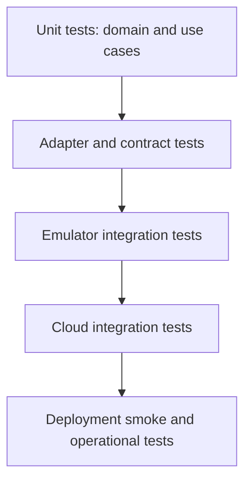
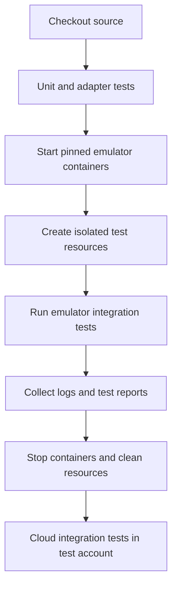

# Giả lập cloud service và nhận diện giới hạn emulator

Java serverless function thường phụ thuộc vào dịch vụ cloud như object storage, queue, event bus, database, secret store và API gateway. Nếu mọi lần chạy unit test đều phải kết nối cloud thật, vòng phản hồi sẽ chậm, tốn chi phí và khó tái lập. Emulator và test double giúp kiểm thử nhiều luồng ngay trên máy phát triển hoặc CI, nhưng chúng không tái tạo đầy đủ hành vi của nhà cung cấp cloud.

Điểm quan trọng là chọn đúng loại kiểm thử cho câu hỏi cần trả lời. Mock có thể xác minh application service gọi port đúng; emulator có thể kiểm tra code tích hợp với API dịch vụ; chỉ môi trường cloud thật mới xác minh được một số hành vi như IAM, managed identity, network policy, retry của nền tảng, scale-out, cold start và billing. Một bài test pass với emulator không đồng nghĩa function chắc chắn hoạt động giống hệt production.

Trong phạm vi **CLOUD_SERVERLESS**, bài học tập trung vào phát triển và triển khai Java function được kích hoạt bởi HTTP, message hoặc event, đồng thời xử lý trigger, trạng thái, quyền truy cập, retry, idempotency, cold start, mở rộng và chi phí. Bài này trình bày cách dùng emulator để tăng tốc kiểm thử, cách nhận diện fidelity gap và cách kết hợp kiểm thử local với kiểm thử trên cloud thật.

## 1. Mock, fake, stub và emulator khác nhau thế nào?

Các kỹ thuật này thường được gọi chung là test double, nhưng mục đích và mức độ giống hệ thống thật khác nhau.

| Loại | Cách hoạt động | Phù hợp để kiểm tra | Giới hạn chính |
|---|---|---|---|
| Stub | Trả về dữ liệu đã định trước | Nhánh xử lý khi dependency trả kết quả cụ thể | Không mô phỏng đầy đủ hành vi dependency |
| Mock | Ghi nhận lời gọi và cho phép kiểm tra tương tác | Application service gọi đúng port, đúng tham số | Test có thể phụ thuộc quá nhiều vào chi tiết triển khai |
| Fake | Cài đặt đơn giản nhưng có hành vi thực tế ở mức cần thiết | Repository in-memory, clock giả, idempotency store đơn giản | Không có đặc tính production như transaction hoặc phân tán |
| Emulator | Mô phỏng API/hành vi của một dịch vụ cloud | Tích hợp SDK, serialization, query và luồng dữ liệu cơ bản | Không bảo đảm tương thích hoàn toàn với dịch vụ thật |
| Cloud integration test | Gọi dịch vụ cloud thật trong tài khoản test | IAM, networking, trigger delivery, retry và giới hạn thật | Chậm hơn, tốn phí và cần quản lý tài nguyên |

Không nên dùng mock cho mọi thứ. Nếu test cần xác minh câu lệnh DynamoDB hoặc cách SDK gửi request S3, một emulator có thể phát hiện lỗi tích hợp mà mock không thấy. Ngược lại, nếu chỉ kiểm tra quy tắc nghiệp vụ tạo đơn, một fake repository thường nhanh và rõ ràng hơn việc khởi chạy cả LocalStack.

## 2. Xây dựng chiến lược kiểm thử theo nhiều tầng

Một Java function nên được kiểm thử ở nhiều mức, từ nhanh và cô lập đến gần production hơn.



| Tầng | Ví dụ | Tốc độ/chi phí tương đối | Câu hỏi trả lời |
|---|---|---|---|
| Unit | Domain rule, idempotency policy, validation | Nhanh, thấp | Business logic có đúng? |
| Adapter/contract | HTTP mapping, event JSON, schema version | Nhanh, thấp | Input/output có đúng hợp đồng? |
| Emulator | S3 API, DynamoDB query, Pub/Sub publish | Trung bình, thấp đến vừa | SDK và tích hợp cơ bản có hoạt động? |
| Cloud integration | IAM, KMS, queue delivery, event source mapping | Chậm hơn, có phí | Cấu hình và hành vi dịch vụ thật có đúng? |
| Smoke/operational | Deploy function, gửi request/message thật | Chậm hơn, có phí | Artifact, trigger, quyền và quan sát production path có hoạt động? |

Không cần chạy toàn bộ tầng cloud integration cho mỗi lần sửa một hàm thuần Java. Chạy unit và adapter test thường xuyên; emulator tests ở CI; cloud integration và deployment smoke tests theo pull request quan trọng, nightly build hoặc trước release tùy mức rủi ro.

## 3. Emulator giúp kiểm tra được điều gì?

Emulator hữu ích khi muốn kiểm tra hành vi giao tiếp ở mức giao thức/API mà không cần phụ thuộc vào cloud account.

- SDK client có endpoint, region, credential provider và serialization đúng không.
- Code có tạo bucket, queue, topic, table hoặc subscription theo cấu hình không.
- Object có được upload/download với key và metadata đúng không.
- Query/put/get cơ bản có hoạt động với dữ liệu thử không.
- Message/event có được serialize và deserialize đúng schema không.
- Handler có xử lý được payload, batch và các trường hợp lỗi cơ bản không.
- Test có thể tạo và dọn dữ liệu cô lập, chạy lặp lại mà không ảnh hưởng môi trường khác không.

Emulator đặc biệt có ích cho integration test của adapter. Ví dụ, `S3ObjectStoreAdapter` có thể được kiểm tra với LocalStack để xác minh AWS SDK v2 gửi đúng request và đọc được object đã ghi.

## 4. Những điều emulator thường không mô phỏng đầy đủ

Emulator thường ưu tiên API phổ biến và luồng phát triển cơ bản. Hành vi nội bộ, giới hạn dịch vụ và các tích hợp giữa nhiều dịch vụ có thể khác cloud thật.

| Nhóm hành vi | Khoảng trống thường gặp | Nơi nên kiểm tra |
|---|---|---|
| IAM/RBAC | Policy evaluation, resource policy, condition, role assumption có thể đơn giản hóa | Cloud integration với identity thật |
| Network | VPC, private endpoint, firewall, DNS và routing không được tái tạo đầy đủ | Staging cloud environment |
| Event delivery | Retry, duplicate, ordering, batch failure và timeout có thể khác | Gửi event qua dịch vụ thật |
| Scaling | Concurrency, autoscaling, throttling và quota không giống production | Load test trên cloud |
| Runtime | Cold start, CPU/memory allocation và lifecycle instance không giống thật | Deploy đúng runtime/plan |
| Consistency | Eventual consistency, transaction và race condition có thể khác | Test dịch vụ thật với dữ liệu cạnh tranh |
| Security | KMS, secret, managed identity, audit và token exchange có thể không đầy đủ | Test IAM/KMS/identity trên cloud |
| Cost/quotas | Billing, regional quota, throttling và service limits không được tính đúng | Monitoring/budget trong tài khoản test |

Vì vậy, hãy ghi rõ emulator được dùng để kiểm tra phần nào. Không dùng kết quả emulator để tuyên bố đã xác minh IAM production, retry semantics hoặc khả năng scale của function.

## 5. AWS SAM CLI và kiểm thử function tại máy local

AWS SAM CLI hỗ trợ chạy Lambda function local bằng runtime container, gọi function với event fixture và chạy HTTP API local. Điều này giúp kiểm tra handler, deserialize event và response mapping trước khi deploy.

Ví dụ gọi function bằng event fixture:

```bash
sam build
sam local invoke OrderFunction --event events/order-created.json
```

Ví dụ chạy HTTP API local:

```bash
sam local start-api
```

Sau khi server local khởi động, có thể gửi HTTP request đến endpoint local tương ứng với route trong template. `sam local invoke` và `sam local start-api` mô phỏng việc khởi chạy function và một phần event/API path; chúng không tự tái tạo đầy đủ API Gateway authorizer, IAM policy, network, throttling hoặc hành vi scale của Lambda.

Với SQS/SNS/S3 event, có thể tạo JSON fixture đại diện và gọi function trực tiếp. Việc đưa một object vào S3 local rồi xác minh Lambda tự được gọi là bài test khác: cần emulator hỗ trợ event wiring hoặc một môi trường cloud integration. Hai bài test không nên bị đánh đồng.

## 6. LocalStack cho AWS service integration

LocalStack cung cấp môi trường local mô phỏng nhiều AWS API. Có thể dùng để kiểm tra một số tích hợp như S3, SQS, SNS, DynamoDB, EventBridge và Lambda tùy service, phiên bản và edition.

Ví dụ chạy LocalStack bằng Docker:

```bash
docker run --rm -d \
  --name localstack-serverless-test \
  -p 4566:4566 \
  -e SERVICES=s3,sqs,dynamodb \
  localstack/localstack:VERSION
```

Thay tag `VERSION` bằng phiên bản đã được nhóm kiểm thử phê duyệt. Không dùng `latest` trong CI nếu muốn test tái lập được.

Tạo bucket bằng AWS CLI trỏ endpoint local:

```bash
aws --endpoint-url=http://localhost:4566 \
  --region=us-east-1 \
  s3 mb s3://serverless-test-bucket
```

Tạo queue:

```bash
aws --endpoint-url=http://localhost:4566 \
  --region=us-east-1 \
  sqs create-queue --queue-name orders-test
```

LocalStack thường dùng credential giả cho môi trường local; không đưa credential production vào container. Khả năng hỗ trợ API và mức độ fidelity thay đổi theo phiên bản/edition. Trước khi dựa vào một tính năng như event notification, IAM condition hoặc Step Functions, cần kiểm tra service coverage của đúng phiên bản đang pin.

## 7. DynamoDB Local

DynamoDB Local cho phép chạy DynamoDB-compatible API trên máy phát triển hoặc CI. Nó phù hợp để kiểm tra thao tác cơ bản như `PutItem`, `GetItem`, `Query`, key schema và một số biểu thức condition.

Ví dụ chạy bằng Docker:

```bash
docker run --rm -d \
  --name dynamodb-local-test \
  -p 8000:8000 \
  amazon/dynamodb-local:VERSION \
  -jar DynamoDBLocal.jar -sharedDb -inMemory
```

AWS SDK for Java 2.x có thể kết nối đến endpoint local bằng `endpointOverride` và credential giả. Với local test, cần đặt region rõ ràng và không dùng credential của tài khoản thật.

DynamoDB Local không phải bản sao hoàn chỉnh của dịch vụ DynamoDB được quản lý. Các tính năng liên quan đến IAM, backup/restore, autoscaling, throttling, global tables, streams và một số hành vi vận hành cần được xác minh theo tài liệu/phiên bản hiện tại và test trên AWS thật. Không dùng emulator để kết luận table production có throughput hoặc latency như mong đợi.

## 8. Google Cloud Pub/Sub emulator

Google Cloud SDK cung cấp Pub/Sub emulator để kiểm tra publish/subscribe cơ bản trong môi trường local. Có thể khởi chạy:

```bash
gcloud emulators pubsub start \
  --project=serverless-test \
  --host-port=127.0.0.1:8085
```

Trong test process, cấu hình Pub/Sub client trỏ đến emulator endpoint và dùng no-credentials provider theo hướng dẫn của thư viện Java đang sử dụng. Biến `PUBSUB_EMULATOR_HOST` thường được dùng để các client tương thích nhận biết endpoint emulator.

Emulator giúp kiểm tra topic/subscription, publish/receive và mapping payload cơ bản. Nó không xác minh IAM production, service account, quota, network path, retry behavior của toàn bộ Eventarc/Cloud Functions pipeline hoặc throughput thật. Nếu function được kích hoạt qua Eventarc, cần test thêm event envelope và delivery path trên cloud test project.

## 9. Azure Storage emulator Azurite

Azurite mô phỏng một phần Azure Storage API cho Blob, Queue và Table storage. Nó hữu ích khi Java function dùng Azure Storage binding hoặc SDK để đọc/ghi blob, enqueue/dequeue message và thao tác table cơ bản.

Ví dụ chạy container:

```bash
docker run --rm -d \
  --name azurite-test \
  -p 10000:10000 \
  -p 10001:10001 \
  -p 10002:10002 \
  mcr.microsoft.com/azure-storage/azurite:VERSION \
  azurite --blobHost 0.0.0.0 --queueHost 0.0.0.0 --tableHost 0.0.0.0
```

Trong local development, Azure Storage SDK thường có thể dùng connection string phát triển như `UseDevelopmentStorage=true` khi cấu hình endpoint mặc định của Azurite. Nếu dùng hostname/container network riêng, cần đặt endpoint phù hợp.

Azurite không mô phỏng toàn bộ Azure. Nó không thay thế test với Azure Service Bus, Event Hubs, Event Grid, managed identity, RBAC, private endpoint hoặc các dịch vụ khác. Một queue trong Azure Storage cũng khác Service Bus queue về settlement, sessions và semantics; không dùng Azurite để xác minh Service Bus trigger.

## 10. Chọn emulator theo dịch vụ đang dùng

| Cloud/service | Công cụ local thường dùng | Nên kiểm tra | Không nên suy ra |
|---|---|---|---|
| AWS Lambda runtime/API | AWS SAM CLI | Handler invocation, HTTP mapping, event fixture | IAM, scale, cold start và mọi event-source behavior |
| AWS S3/SQS/DynamoDB | LocalStack hoặc DynamoDB Local | SDK calls và luồng API được hỗ trợ | Tương thích tuyệt đối với AWS hoặc production IAM |
| Google Pub/Sub | Pub/Sub emulator | Topic/subscription và publish/receive cơ bản | IAM, Eventarc delivery, quota và production throughput |
| Azure Blob/Queue/Table | Azurite | Storage API và local binding cơ bản | Service Bus/Event Hubs hoặc managed identity |
| HTTP handler | Framework test client/Functions Framework | Routing, request parsing, response/error mapping | Gateway authorizer, WAF, ingress và network policy |
| Database | Testcontainers database tương ứng | SQL, migration và transaction ở engine được chạy | Database managed service, IAM auth, failover và scale |

Một dự án có thể dùng nhiều emulator. Hãy giữ mỗi emulator đúng vai trò và không coi tên API giống nhau là bằng chứng semantics giống nhau.

## 11. Dùng Testcontainers trong Java

Testcontainers giúp test Java khởi chạy dependency trong container, đợi dịch vụ sẵn sàng, lấy endpoint động và dọn container sau test. Điều này giảm phụ thuộc vào Docker Compose được khởi chạy thủ công và giúp CI tái lập môi trường hơn.

Dependency Maven minh họa cho JUnit 5 và LocalStack module:

```xml
<dependency>
  <groupId>org.testcontainers</groupId>
  <artifactId>junit-jupiter</artifactId>
  <scope>test</scope>
</dependency>
<dependency>
  <groupId>org.testcontainers</groupId>
  <artifactId>localstack</artifactId>
  <scope>test</scope>
</dependency>
```

Hãy quản lý version qua Testcontainers BOM và pin version LocalStack image tương thích. Không sao chép version minh họa mà không kiểm tra dependency management của dự án.

Ví dụ test S3 adapter với AWS SDK v2:

```java
import static org.junit.jupiter.api.Assertions.assertEquals;

import org.junit.jupiter.api.Test;
import org.testcontainers.containers.localstack.LocalStackContainer;
import org.testcontainers.junit.jupiter.Container;
import org.testcontainers.junit.jupiter.Testcontainers;
import org.testcontainers.utility.DockerImageName;
import software.amazon.awssdk.auth.credentials.AwsBasicCredentials;
import software.amazon.awssdk.auth.credentials.StaticCredentialsProvider;
import software.amazon.awssdk.regions.Region;
import software.amazon.awssdk.services.s3.S3Client;
import software.amazon.awssdk.services.s3.S3Configuration;
import software.amazon.awssdk.services.s3.model.CreateBucketRequest;
import software.amazon.awssdk.services.s3.model.GetObjectRequest;
import software.amazon.awssdk.services.s3.model.PutObjectRequest;
import software.amazon.awssdk.core.sync.RequestBody;

@Testcontainers
class S3AdapterIntegrationTest {
    @Container
    static final LocalStackContainer cloud =
            new LocalStackContainer(
                    DockerImageName.parse("localstack/localstack:VERSION"))
                    .withServices(LocalStackContainer.Service.S3);

    @Test
    void storesAndReadsObjectThroughS3Api() {
        try (S3Client s3 = S3Client.builder()
                .endpointOverride(cloud.getEndpointOverride(
                        LocalStackContainer.Service.S3))
                .credentialsProvider(StaticCredentialsProvider.create(
                        AwsBasicCredentials.create(
                                cloud.getAccessKey(), cloud.getSecretKey())))
                .region(Region.of(cloud.getRegion()))
                .serviceConfiguration(S3Configuration.builder()
                        .pathStyleAccessEnabled(true)
                        .build())
                .build()) {

            String bucket = "serverless-test-bucket";
            String key = "incoming/sample.txt";
            String expected = "hello from local S3";

            s3.createBucket(CreateBucketRequest.builder()
                    .bucket(bucket).build());
            s3.putObject(PutObjectRequest.builder()
                            .bucket(bucket).key(key).build(),
                    RequestBody.fromString(expected));

            String actual = s3.getObjectAsBytes(GetObjectRequest.builder()
                            .bucket(bucket).key(key).build())
                    .asUtf8String();

            assertEquals(expected, actual);
        }
    }
}
```

Thay placeholder image bằng phiên bản đã pin. Test này xác minh AWS SDK v2 giao tiếp được với S3 API do LocalStack cung cấp và dữ liệu có thể ghi/đọc. Nó không chứng minh S3 notification thực sự gọi Lambda, Lambda permission được đánh giá như AWS, hoặc IAM execution role có quyền đúng. Những phần đó cần test riêng và có thể cần AWS test account.

## 12. Test adapter bằng fake thay vì khởi chạy emulator khi phù hợp

Nếu mục tiêu là kiểm tra use case, hãy định nghĩa port và dùng fake implementation. Ví dụ:

```java
import java.util.Map;
import java.util.Optional;
import java.util.concurrent.ConcurrentHashMap;

public interface ObjectStore {
    Optional<byte[]> read(String bucket, String key);
    void write(String bucket, String key, byte[] content);
}

final class InMemoryObjectStore implements ObjectStore {
    private final Map<String, byte[]> objects = new ConcurrentHashMap<>();

    @Override
    public Optional<byte[]> read(String bucket, String key) {
        return Optional.ofNullable(objects.get(bucket + "/" + key));
    }

    @Override
    public void write(String bucket, String key, byte[] content) {
        objects.put(bucket + "/" + key, content.clone());
    }
}
```

Fake này đủ để kiểm tra application service gọi read/write đúng và xử lý object không tồn tại. Nó không kiểm tra AWS SDK, S3 key encoding, IAM hoặc metadata. Vì vậy, nên có một số integration tests với emulator cho adapter S3 bên cạnh unit tests dùng fake.

## 13. Event fixture cho HTTP, queue và event trigger

Function thường nhận payload do gateway hoặc dịch vụ nguồn tạo ra. Test fixture cần phản ánh đúng envelope của trigger.

Ví dụ fixture HTTP gateway:

```json
{
  "version": "2.0",
  "routeKey": "POST /orders",
  "rawPath": "/orders",
  "headers": {"content-type": "application/json"},
  "body": "{\"customerId\":\"cus-100\",\"items\":[{\"sku\":\"A-1\",\"quantity\":2}]}",
  "isBase64Encoded": false
}
```

Ví dụ message payload:

```json
{
  "messageId": "msg-123",
  "eventType": "OrderSubmitted",
  "schemaVersion": 1,
  "data": {
    "orderId": "ord-456",
    "customerId": "cus-100"
  }
}
```

Ví dụ CloudEvents envelope:

```json
{
  "specversion": "1.0",
  "id": "evt-789",
  "source": "/orders/service",
  "type": "com.example.order.submitted",
  "subject": "orders/ord-456",
  "time": "2026-11-17T08:30:00Z",
  "datacontenttype": "application/json",
  "data": {
    "orderId": "ord-456"
  }
}
```

Fixture nên được lưu cùng test, có schema version và nguồn tạo rõ ràng. Tránh tự viết một JSON gần giống payload thật nhưng thiếu field quan trọng như encoded body, event version, message attributes, bucket/key encoding hoặc batch wrapper.

## 14. Kiểm thử retry và idempotency

Emulator có thể hỗ trợ gửi lại message hoặc tạo lại request, nhưng không phải lúc nào cũng tái tạo đúng lịch retry, lock expiry hoặc at-least-once delivery của cloud thật.

Trong unit test, kiểm tra use case với cùng idempotency key nhiều lần và xác nhận side effect chỉ được ghi nhận một lần. Trong adapter test, gửi lại cùng event fixture và xác minh handler chuyển đúng event ID đến use case. Trong emulator integration test, kiểm tra hành vi queue/API cơ bản. Cuối cùng, dùng cloud integration test để xác minh retry policy, visibility timeout, lock renewal, DLQ và event source mapping thực tế.

Ví dụ kịch bản cần có:

| Kịch bản | Kết quả mong đợi |
|---|---|
| Cùng event ID được giao hai lần | Không tạo hai đơn hàng hoặc hai khoản thanh toán |
| Dependency trả lỗi tạm thời | Invocation có thể retry theo policy đã cấu hình |
| Payload sai schema | Không retry vô hạn; ghi nhận hoặc cách ly theo policy |
| Function timeout sau khi ghi DB nhưng trước khi ack | Lần retry nhận ra side effect đã hoàn tất |
| Batch có một record lỗi | Hành vi partial failure đúng với event source thực tế |
| Event đến sai thứ tự | State transition không bị ghi đè bởi event cũ |

## 15. Kiểm thử quyền truy cập

Emulator thường dùng credential giả hoặc một tập hành vi IAM đơn giản. Test pass với credential giả không chứng minh role production có quyền tối thiểu và đúng scope.

Nên tách kiểm thử quyền thành ba phần:

1. **Application authorization:** unit test xác minh user/tenant có quyền thực hiện hành động trên resource hay không.
2. **Policy validation:** static analysis hoặc policy-as-code kiểm tra IAM/RBAC policy không cấp quyền rộng ngoài ý muốn.
3. **Cloud identity integration:** triển khai function vào project/account test, gắn service account/execution role thật và kiểm tra truy cập S3, KMS, Pub/Sub, Service Bus hoặc secret store.

Không đưa access key production vào emulator. Trong cloud test, dùng service account/role chuyên dụng, scope hẹp và dữ liệu giả. Kiểm tra cả trường hợp được phép và bị từ chối; chỉ test thành công không phát hiện policy quá rộng.

## 16. Kiểm thử trigger và event wiring

Gọi handler trực tiếp bằng JSON fixture kiểm tra code xử lý payload, nhưng không kiểm tra cấu hình trigger. Một trigger end-to-end cần xác minh:

- Event source có được cấu hình đúng bucket, queue, topic hoặc subscription không.
- Function có quyền nhận/invoke event không.
- Batch size, filter, consumer group và event source mapping có đúng không.
- Message có được ack/complete hoặc checkpoint sau khi xử lý không.
- Lỗi có dẫn đến retry hoặc DLQ theo policy không.
- Thay đổi cấu hình có được áp dụng sau deployment không.

Local emulator có thể hỗ trợ một phần event wiring. Hãy đọc service coverage của emulator và phiên bản extension; nếu không hỗ trợ, dùng event fixture để test handler rồi tạo cloud integration test cho đường trigger thật.

## 17. Test container lifecycle và cô lập dữ liệu

Testcontainers hoặc Docker Compose có thể khởi chạy emulator cho test suite. Mỗi test cần dữ liệu cô lập để chạy song song và không phụ thuộc thứ tự.

Thực hành tốt:

- Dùng bucket/table/queue name có suffix duy nhất cho test hoặc suite.
- Tạo resource trong setup và xóa trong teardown.
- Dùng database/schema riêng cho từng test suite.
- Không chia sẻ mutable global state giữa test chạy song song.
- Chờ health check/readiness của emulator thay vì dùng sleep cố định.
- Pin image version và lưu cấu hình emulator trong repository.
- Giới hạn port expose và không bind ra mạng công cộng nếu không cần.
- Dọn volume/container sau CI để tránh dữ liệu cũ làm test pass giả.

Nếu emulator lưu dữ liệu bền vững qua lần chạy, test phải có bước reset rõ ràng. Một test pass do đọc lại object từ lần chạy trước là false positive.

## 18. Những fidelity gap cần ghi lại

Mỗi emulator integration nên có một ghi chú ngắn về hành vi đã được kiểm tra và phần chưa được xác minh.

Ví dụ:

| Emulator/test | Đã xác minh | Chưa xác minh |
|---|---|---|
| LocalStack S3 | AWS SDK v2 tạo bucket, put/get object | S3-to-Lambda delivery, IAM resource policy, KMS condition, region behavior |
| DynamoDB Local | Key schema, put/get/query cơ bản | IAM, autoscaling, throttling, global table và production latency |
| Pub/Sub emulator | Publish/subscribe và deserialize payload | IAM, Eventarc delivery, quota, throughput và production retry |
| Azurite | Blob/Queue API cơ bản | Managed identity, RBAC, Service Bus semantics và private endpoint |
| SAM local | Lambda handler invocation và HTTP event mapping | AWS account policy, VPC, scale, cold start và billing |

Danh sách trên chỉ là ví dụ; service coverage thay đổi theo phiên bản. Cập nhật ghi chú khi nâng cấp emulator hoặc extension. Không dựa vào một bài test cũ để kết luận tính năng mới được hỗ trợ.

## 19. CI pipeline cho emulator tests

CI nên chạy emulator bằng container có phiên bản pin, tạo resource test, thực hiện integration tests rồi dọn môi trường. Ví dụ quy trình:



Không nên để emulator tests chạy với `latest` vì behavior có thể thay đổi mà không có commit nào trong repository. Pin version, kiểm tra release notes khi nâng cấp và chạy lại test contract.

Với cloud integration stage, dùng account/project riêng, giới hạn quyền, budget/alert và cơ chế tự dọn tài nguyên có TTL. Nếu test thất bại giữa chừng, cleanup job vẫn cần chạy để tránh để lại bucket, queue, function hoặc database tính phí.

## 20. Kiểm thử cloud thật có kiểm soát

Một số câu hỏi chỉ có thể trả lời bằng môi trường cloud thật:

- Function có assume execution role/service account đúng không?
- Resource policy có cho phép đúng event source gọi function không?
- KMS key policy, secret access và network path có hoạt động không?
- Event source có retry, timeout, batch và DLQ như cấu hình không?
- Function có scale theo burst và giữ downstream trong giới hạn không?
- Cold start và memory/CPU usage trên runtime thật ra sao?
- Trigger có hoạt động sau deployment hoặc revision rollout không?

Cloud integration test nên dùng dữ liệu giả, tài nguyên có prefix/tag riêng và account/project không chứa dữ liệu production. Hãy giới hạn concurrency, timeout và số lần retry để tránh test tạo chi phí hoặc event storm.

## 21. Kiểm thử hiệu năng, cold start và chi phí

Emulator chạy trên máy phát triển không đại diện cho CPU, network, disk, scheduler và autoscaler của cloud provider. Không dùng kết quả latency local để dự đoán cold start hoặc chi phí production.

Trên cloud test environment, đo:

- Cold start latency và warm invocation latency riêng biệt.
- p50, p95, p99 của HTTP request hoặc event processing.
- Memory peak, CPU utilization và số instance/concurrency.
- Queue backlog, consumer lag, retry count và DLQ count.
- Database connection count, pool wait và downstream throttling.
- Chi phí request, duration, memory, storage, logs và network.

Chạy tải ổn định và burst, có thời gian idle để quan sát cold start. Kiểm thử các giới hạn max concurrency/instances và xác minh backpressure. Giữ test đủ ngắn, có budget và tự dừng khi đạt ngưỡng an toàn.

## 22. Kiểm tra schema và contract độc lập với emulator

Event contract nên được kiểm tra bằng schema và fixture versioned. Một emulator không tự đảm bảo producer và consumer đang dùng cùng schema.

Với JSON event, kiểm tra:

- Trường bắt buộc, kiểu dữ liệu, enum và format timestamp.
- Schema version và quy tắc backward/forward compatibility.
- Unknown field có được bỏ qua an toàn không.
- Event ID, correlation ID và idempotency key có mặt khi cần không.
- Payload quá lớn, thiếu field hoặc sai encoding được xử lý thế nào.

Nếu dùng JSON Schema, Avro hoặc Protobuf, có thể validate fixture trong unit/contract tests trước khi gửi đến emulator. Contract test cũng có thể xác minh consumer chấp nhận event do producer mới tạo và producer không phá vỡ schema của consumer cũ.

## 23. Lỗi thường gặp khi dựa quá nhiều vào emulator

| Triệu chứng | Nguyên nhân | Cách cải thiện |
|---|---|---|
| Local pass nhưng cloud bị AccessDenied | Emulator không mô phỏng IAM policy đầy đủ | Thêm cloud identity integration test |
| Function không được trigger dù handler test pass | Chỉ gọi handler trực tiếp, chưa test event wiring | Test source mapping/notification trên cloud |
| Retry behavior khác production | Emulator không tái tạo lock/ack/checkpoint đầy đủ | Kiểm thử retry trên dịch vụ thật |
| Test thỉnh thoảng fail | Container chưa ready hoặc dữ liệu test dùng chung | Dùng health check và resource cô lập |
| Test pass nhờ dữ liệu cũ | Emulator volume không được reset | Cleanup hoặc tạo namespace duy nhất |
| Local latency tốt nhưng production chậm | Môi trường local không đại diện cold start/network | Benchmark trên cloud runtime |
| Nâng version emulator làm test đổi hành vi | Service compatibility thay đổi | Pin version, review release notes và cập nhật contract |
| Test tốn nhiều thời gian | Khởi chạy emulator cho cả unit tests | Chỉ dùng emulator ở tầng cần integration |
| Dữ liệu/secret production lọt vào local | Dùng nhầm credential hoặc dump payload thật | Credential giả và fixture đã làm sạch |

## 24. Checklist thiết kế emulator test

| Câu hỏi | Bằng chứng cần có |
|---|---|
| Test đang kiểm tra business rule hay cloud API? | Chọn unit fake/mock hoặc emulator đúng mục đích |
| Emulator có hỗ trợ API cần dùng? | Service coverage của phiên bản/edition đã pin |
| Fixture có phản ánh trigger thật? | Event JSON versioned và contract validation |
| Credential local có an toàn? | Credential giả, không có access key production |
| Endpoint được cấu hình rõ? | SDK endpoint override hoặc emulator environment setting |
| Test có cô lập dữ liệu? | Resource riêng và cleanup trong teardown |
| Container có sẵn sàng trước test? | Health/readiness check thay vì sleep tùy ý |
| Test có ghi fidelity gap? | Danh sách behavior đã và chưa được xác minh |
| Có cloud integration test? | IAM, network, event delivery, retry và KMS được kiểm tra thật |
| Có kiểm thử hiệu năng trên cloud? | Cold start, scaling, latency, quota và cost được đo |
| CI có tái lập được? | Emulator image pin, log và test report được lưu |
| Có cleanup khi pipeline lỗi? | Job teardown và TTL cho tài nguyên cloud test |

## 25. Cách chọn mức kiểm thử phù hợp

Với thay đổi domain logic, chạy unit tests và fake repository. Với thay đổi HTTP/event mapping, chạy adapter tests cùng fixture. Khi thay đổi AWS SDK, Azure SDK, Google Cloud client hoặc repository adapter, chạy emulator integration tests. Khi thay đổi IAM, trigger configuration, retry, event source mapping, KMS, network hoặc scaling, bổ sung cloud integration tests.

Emulator là công cụ tăng tốc phát triển và kiểm tra hợp đồng API. Nó không phải cloud provider thu nhỏ hoàn chỉnh. Một chiến lược kiểm thử tốt ghi rõ điều gì đã được xác minh ở local, điều gì cần cloud thật và bằng chứng nào phải có trước release. Cách phân tầng này giúp Java serverless được kiểm thử nhanh trong vòng phát triển hằng ngày mà vẫn phát hiện được lỗi chỉ xuất hiện khi chạy trên nền tảng thực tế.
