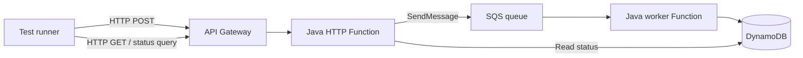
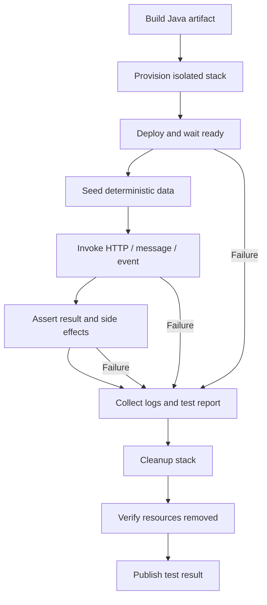

# Integration test trên môi trường cloud cô lập

## 1. Integration test trên cloud là gì?

Integration test kiểm tra nhiều thành phần cùng hoạt động qua ranh giới thật của chúng. Với ứng dụng serverless, một luồng nghiệp vụ có thể đi qua API Gateway, Java Lambda, queue, một Lambda worker, database và dịch vụ phát sự kiện. Kiểm thử từng class hoặc gọi method trực tiếp không chứng minh được các thành phần đã được cấu hình đúng, có quyền gọi nhau và xử lý event theo đúng semantics khi chạy trên cloud.

Integration test trên môi trường cloud cô lập triển khai một phiên bản hạ tầng và ứng dụng dành riêng cho một lần chạy kiểm thử hoặc một nhóm test. Test gửi request qua endpoint thật, publish message/event qua dịch vụ thật, rồi kiểm tra kết quả ở ranh giới dịch vụ. Sau khi hoàn tất, pipeline thu hồi tài nguyên tạm.

Ví dụ, một test tạo đơn hàng có thể đi qua luồng:



Test xác minh request HTTP được chấp nhận, message được xử lý, trạng thái đơn hàng được lưu và API trả về trạng thái cuối. Như vậy, test kiểm tra cả integration giữa API, Lambda, SQS, IAM, database và logic nghiệp vụ.

Trong module CLOUD_SERVERLESS, integration test cần bao quát cách function được kích hoạt bởi HTTP, message hoặc event; cách trạng thái được lưu; quyền truy cập; retry; idempotency; cold start; scale và chi phí. Môi trường cô lập giúp thực hiện các kiểm tra đó mà không làm thay đổi dữ liệu hoặc traffic production.

## 2. Integration test khác unit test và end-to-end test như thế nào?

| Loại test | Phạm vi | Ví dụ | Phát hiện tốt |
|---|---|---|---|
| Unit test | Một method/class, dependency được mock | Test `OrderValidator` | Quy tắc nghiệp vụ nhỏ, nhánh lỗi |
| Component test | Một component chạy với dependency giả/lokal | Function handler với LocalStack hoặc emulator | Mapping event, serialization, wiring nội bộ |
| Cloud integration test | Một nhóm dịch vụ triển khai thật trong account/môi trường cô lập | API Gateway → Lambda → SQS → DynamoDB | IAM, trigger thật, network, retry, service configuration |
| End-to-end test | Toàn bộ hành trình người dùng qua nhiều hệ thống | Tạo đơn hàng rồi nhận email xác nhận | Hợp đồng và hành vi xuyên hệ thống |
| Contract test | Hợp đồng giữa producer và consumer | JSON event schema của `OrderCreated` | Tương thích payload và version |

Không cần chạy mọi test trên cloud. Unit test chạy nhanh và rẻ; emulator hữu ích cho feedback sớm; cloud integration test xác minh hành vi phụ thuộc dịch vụ thật; end-to-end test nên giữ số lượng nhỏ vì chậm và khó chẩn đoán.

Một test có thể vừa là integration test vừa là một phần của end-to-end flow. Điều quan trọng là xác định ranh giới, dependency thật và bằng chứng cần thu thập để không biến mọi kiểm thử thành một kịch bản dài khó ổn định.

## 3. Khi nào cần môi trường cloud cô lập?

Nên chạy cloud integration test khi kết quả phụ thuộc vào cấu hình hoặc semantics thật của cloud service, ví dụ:

- API Gateway có route, authorizer, mapping hoặc timeout cần xác minh.
- Lambda cần runtime Java, environment variables, layer, memory, architecture hoặc permission thật.
- SQS/SNS/EventBridge/Kinesis kích hoạt function và có retry, visibility timeout hoặc ordering.
- Function cần truy cập database, object storage, secret hoặc dịch vụ qua private network.
- IAM role/resource policy có thể khiến request bị `AccessDenied` dù unit test chạy qua.
- Cần đo cold start, concurrency, throttling, event age hoặc scale behavior.
- Cần xác minh deployment artifact, environment configuration và infrastructure-as-code.

Không cần tạo cloud environment cho mỗi test method. Một environment có thể phục vụ một test suite hoặc một lần chạy pipeline, miễn là dữ liệu và resource được namespace riêng, test không chạy đua trên cùng state và cleanup có thể thu hồi toàn bộ.

## 4. Các cấp độ cô lập

Có nhiều cách tạo ranh giới cô lập. Chọn mức phù hợp với rủi ro, chi phí và tốc độ.

| Mức cô lập | Cách thực hiện | Ưu điểm | Hạn chế |
|---|---|---|---|
| Account riêng cho mỗi test run | Tạo account/sandbox tạm hoặc account trong organization | Ranh giới IAM, quota, network và billing rõ | Provision account chậm, cần governance |
| Account test dùng chung, stack riêng | Một CloudFormation/CDK stack cho mỗi run | Dễ tự động hóa, resource riêng | IAM và quota vẫn dùng chung account |
| Stack dùng chung, namespace riêng | Prefix queue/table/key theo run ID | Ít resource, chi phí thấp | Dễ rò dữ liệu nếu code quên namespace |
| Môi trường cố định dùng chung | Một integration environment cho nhiều pipeline | Tạo nhanh | Test xung đột, khó tái lập và dễ ảnh hưởng nhau |

Với test cần xác minh IAM, resource policy, VPC hoặc account boundary, account riêng có giá trị cao. Với test chức năng thông thường, stack riêng theo pipeline run thường là điểm cân bằng tốt. Namespace riêng chỉ phù hợp khi mọi resource hỗ trợ phân vùng rõ ràng và test có thể bảo đảm không truy cập chéo.

Không dùng production account hoặc production data làm môi trường test. Nếu cần so sánh dữ liệu, tạo fixture tổng hợp hoặc bản sao đã masking/anonymization và giới hạn quyền truy cập.

## 5. Thiết kế một môi trường cô lập cho mỗi lần chạy

Mỗi lần chạy test cần một định danh duy nhất, ví dụ:

```text
TEST_RUN_ID=it-20261117-482-3
CloudFormation stack=orders-it-20261117-482-3
Queue=orders-it-20261117-482-3
DLQ=orders-it-20261117-482-3-dlq
Table=orders-it-20261117-482-3
```

Trong hệ thống CI, có thể tạo ID từ repository, PR/run number và attempt. Không đưa dữ liệu cá nhân vào tên resource. Tuân thủ giới hạn độ dài và ký tự của từng dịch vụ; nếu dùng branch name, hãy chuẩn hóa và nối hash để tránh collision.

Môi trường test cần:

- Hạ tầng được tạo bằng IaC (CDK, CloudFormation, Terraform hoặc công cụ tương đương).
- Artifact Java được build từ commit đang kiểm thử.
- Endpoint và resource name được xuất ra cho test runner.
- Dữ liệu khởi tạo có thể lặp lại và xác định trước.
- IAM role giới hạn trong tài nguyên của test run.
- Logging/metrics có thể truy vấn theo `testRunId` hoặc correlation ID.
- TTL/cleanup xử lý cả trường hợp test fail hoặc pipeline bị hủy.

Tag tài nguyên như `EnvironmentType=integration`, `TestRunId`, `OwnerRepo`, `CommitSha`, `CreatedAt` và `ExpiresAt`. Tags hỗ trợ inventory và cleanup, nhưng không thay thế IAM authorization hoặc xác minh ownership trước khi xóa.

## 6. Quy trình tổng thể: provision, test, collect, cleanup

Một pipeline cloud integration test nên chia thành các giai đoạn độc lập:

1. **Build:** compile, unit test và đóng gói Java function.
2. **Provision:** tạo stack/tài nguyên cô lập và gắn ownership tags.
3. **Deploy:** triển khai artifact, cấu hình trigger, quyền và network.
4. **Wait ready:** đợi CloudFormation hoàn tất, function/API hoạt động và health check thành công.
5. **Seed data:** tạo dữ liệu fixture với ID duy nhất.
6. **Execute:** gọi HTTP endpoint, gửi message hoặc publish event.
7. **Assert:** kiểm tra response, trạng thái cuối, side effect, log hoặc metric cần thiết.
8. **Collect evidence:** lưu test report, request/correlation ID, log và CloudFormation events khi thất bại.
9. **Cleanup:** xóa stack và tài nguyên ngoài stack thuộc test run.
10. **Reconcile:** một job định kỳ tìm stack test quá TTL còn sót do runner bị mất hoặc workflow bị hủy.



Cleanup phải chạy dù build/deploy/test thất bại sau khi resource đã được tạo. Nếu deploy thất bại giữa chừng, CloudFormation có thể vẫn có resource hoặc đang rollback; cleanup cần kiểm tra trạng thái stack trước khi xóa.

## 7. Chuẩn bị fixture và dữ liệu kiểm thử

Một test tốt phải biết dữ liệu đầu vào và trạng thái mong đợi. Dùng fixture có thể tái tạo thay vì phụ thuộc vào dữ liệu đang tồn tại.

Ví dụ fixture đơn hàng:

```json
{
  "orderId": "it-482-3-9f12a6",
  "customerId": "customer-test-01",
  "items": [
    { "sku": "SKU-TEST-001", "quantity": 2 }
  ],
  "currency": "USD",
  "total": 25.50
}
```

Quy tắc dữ liệu:

- Dùng ID ngẫu nhiên hoặc ID có namespace test run để tránh đụng dữ liệu của lần chạy khác.
- Không dùng customer, email, số điện thoại hoặc payment token thật.
- Ghi lại fixture để khi test fail có thể tái hiện.
- Dùng clock/fixed timestamp nếu logic phụ thuộc thời gian.
- Xác định rõ dữ liệu cần tồn tại trước test và dữ liệu cần xóa sau test.
- Nếu test schema migration, tạo database/table/schema tạm và xóa riêng sau khi hoàn tất.
- Không dựa vào thứ tự chạy test hoặc state do test trước tạo ra.

Nếu test suite chạy song song, mỗi worker cần namespace riêng hoặc dữ liệu độc lập. Chỉ dùng chung fixture bất biến; không để nhiều test cùng cập nhật một record.

## 8. Kiểm tra HTTP trigger qua endpoint thật

HTTP integration test cần gọi endpoint đã triển khai qua URL của API Gateway, Azure Functions hoặc dịch vụ HTTP tương ứng. Gọi trực tiếp method handler không kiểm tra được routing, authorizer, TLS, request mapping, timeout và gateway integration.

Những điều nên kiểm tra:

- HTTP method, path và query parameter được định tuyến đúng.
- Authentication/authorization cho phép principal hợp lệ và từ chối principal không hợp lệ.
- Request body sai schema trả status code phù hợp.
- Response body, header, content type và status code đúng contract.
- Correlation ID được truyền từ gateway đến function và downstream.
- Timeout và giới hạn payload hoạt động theo cấu hình.
- Request trùng không tạo side effect trùng nếu API hỗ trợ idempotency key.
- CORS và custom domain nếu client thực tế cần chúng.

Không chỉ kiểm tra HTTP 200. Với API nhận công việc bất đồng bộ, response `202 Accepted` có thể là kết quả đúng; test cần tiếp tục đợi trạng thái nghiệp vụ hoàn tất qua API đọc hoặc database test.

## 9. Java HTTP integration test với JUnit 5

Ví dụ dưới đây gọi API tạo đơn hàng. API trả `202 Accepted`; test gửi `orderId` do chính nó tạo trước, worker xử lý message bất đồng bộ và cập nhật trạng thái thành `COMPLETED`. Test gọi endpoint thật rồi polling trạng thái trong một thời hạn giới hạn.

```java
import com.fasterxml.jackson.databind.JsonNode;
import com.fasterxml.jackson.databind.ObjectMapper;
import org.junit.jupiter.api.Test;

import java.net.URI;
import java.net.http.HttpClient;
import java.net.http.HttpRequest;
import java.net.http.HttpResponse;
import java.time.Duration;
import java.util.UUID;

import static org.junit.jupiter.api.Assertions.assertEquals;
import static org.junit.jupiter.api.Assertions.fail;

class OrdersCloudIntegrationTest {
    private static final HttpClient HTTP = HttpClient.newBuilder()
            .connectTimeout(Duration.ofSeconds(3))
            .build();
    private static final ObjectMapper JSON = new ObjectMapper();
    private static final String BASE_URL = requiredEnv("TEST_BASE_URL");

    @Test
    void createsOrderAndEventuallyCompletesIt() throws Exception {
        String orderId = "it-" + UUID.randomUUID();
        String correlationId = "corr-" + UUID.randomUUID();

        String payload = """
                {
                  "orderId": "%s",
                  "customerId": "customer-test-01",
                  "items": [{"sku":"SKU-TEST-001","quantity":2}]
                }
                """.formatted(orderId);

        HttpRequest create = HttpRequest.newBuilder()
                .uri(URI.create(BASE_URL + "/orders"))
                .timeout(Duration.ofSeconds(5))
                .header("Content-Type", "application/json")
                .header("X-Correlation-Id", correlationId)
                .header("Idempotency-Key", orderId)
                .POST(HttpRequest.BodyPublishers.ofString(payload))
                .build();

        HttpResponse<String> accepted = HTTP.send(
                create, HttpResponse.BodyHandlers.ofString());

        assertEquals(202, accepted.statusCode(), accepted.body());
        awaitCompleted(orderId);
    }

    private static void awaitCompleted(String orderId) throws Exception {
        long deadline = System.nanoTime() + Duration.ofSeconds(40).toNanos();
        URI statusUri = URI.create(BASE_URL + "/orders/" + orderId);

        while (System.nanoTime() < deadline) {
            HttpRequest request = HttpRequest.newBuilder()
                    .uri(statusUri)
                    .timeout(Duration.ofSeconds(3))
                    .GET()
                    .build();

            HttpResponse<String> response = HTTP.send(
                    request, HttpResponse.BodyHandlers.ofString());

            if (response.statusCode() == 200) {
                JsonNode body = JSON.readTree(response.body());
                if ("COMPLETED".equals(body.path("status").asText())) {
                    return;
                }
                if ("FAILED".equals(body.path("status").asText())) {
                    fail("Order processing failed: " + response.body());
                }
            } else if (response.statusCode() != 404 && response.statusCode() != 202) {
                fail("Unexpected status response: " + response.statusCode()
                        + " body=" + response.body());
            }

            Thread.sleep(250);
        }

        fail("Order did not reach COMPLETED before the deadline: " + orderId);
    }

    private static String requiredEnv(String name) {
        String value = System.getenv(name);
        if (value == null || value.isBlank()) {
            throw new IllegalStateException("Missing environment variable: " + name);
        }
        return value;
    }
}
```

Test dùng `TEST_BASE_URL` do pipeline lấy từ stack output. Nó không hardcode endpoint hoặc đợi một khoảng sleep cố định rồi giả định công việc đã xong; polling kết thúc khi đạt trạng thái cuối hoặc hết deadline. Trong project thật, thêm dependency JUnit 5 và Jackson, điều chỉnh endpoint/response schema theo API. Nếu endpoint yêu cầu token, lấy token test ngắn hạn từ cơ chế bảo mật của pipeline và không in token ra log.

Test trên xác minh luồng qua API, nhưng chỉ có thể kết luận database được cập nhật nếu endpoint trạng thái đọc từ cùng nguồn dữ liệu chuẩn. Nếu cần kiểm tra trực tiếp data store, có thể dùng AWS SDK/Azure SDK trong một test runner được cấp quyền chỉ đọc đúng resource của test run; không cấp quyền rộng cho toàn bộ test suite.

## 10. Kiểm tra message trigger và xử lý bất đồng bộ

Với queue trigger, test phải xác minh cả việc message được nhận lẫn side effect sau xử lý. Một lần `SendMessage` thành công chỉ chứng minh queue nhận message, không chứng minh worker đã chạy.

Một test queue thường thực hiện:

1. Gửi message có `eventId`/`messageId` duy nhất.
2. Chờ worker xử lý trong thời hạn xác định.
3. Đọc trạng thái nghiệp vụ ở API hoặc data store test.
4. Xác minh side effect đúng và chỉ xảy ra một lần.
5. Kiểm tra message không còn ở queue chính hoặc được chuyển đến DLQ nếu cố ý tạo lỗi.

Với SQS Standard, delivery có thể lặp. Không assert rằng function chỉ được invoke đúng một lần. Assert trạng thái cuối và số side effect nghiệp vụ; dùng idempotency key/unique constraint để chống duplicate.

Với FIFO queue, kiểm tra `MessageGroupId`, `MessageDeduplicationId` và thứ tự xử lý nếu nghiệp vụ phụ thuộc ordering. Test cần dùng queue FIFO thật khi muốn xác minh semantics FIFO.

## 11. Kiểm tra event trigger

Event-driven integration test cần publish event theo schema thực tế và kiểm tra consumer xử lý đúng. Ví dụ với EventBridge, test có thể gửi `OrderCreated` vào event bus riêng của test run, sau đó truy vấn kết quả ở data store.

Các điều cần kiểm tra:

- Event source có chấp nhận event đúng schema không.
- Rule/event filter định tuyến đến đúng target.
- Event version và required fields tương thích với consumer.
- Event bị filter không kích hoạt consumer không mong muốn.
- Consumer xử lý event trùng theo idempotency key.
- Retry, age limit và failure destination hoạt động khi consumer lỗi.
- Event không bị gửi sang bus hoặc consumer production.

Với Kinesis/DynamoDB Streams, test cần tính đến checkpoint, shard ordering và retention. Không giả định một record lỗi sẽ chỉ retry riêng record đó; tùy cấu hình, cả batch hoặc phần record sau checkpoint có thể được xử lý lại. Nếu cần kiểm tra partial batch response, tạo record lỗi có chủ đích và xác minh checkpoint/failure destination.

## 12. Chờ eventual consistency đúng cách

Queue, event bus và stream thường xử lý bất đồng bộ. Kết quả có thể chưa xuất hiện ngay sau khi gửi event. Dùng polling có deadline thay vì `Thread.sleep(10000)` rồi giả định công việc đã xong.

Một polling loop tốt cần:

- Có deadline tổng rõ ràng.
- Có khoảng polling hợp lý, tránh gọi API quá dày.
- Kết thúc sớm khi đạt trạng thái thành công hoặc lỗi cuối.
- Ghi nhận correlation ID và trạng thái cuối để chẩn đoán.
- Không biến timeout thành pass chỉ vì test runner ngừng chờ.
- Phân biệt trạng thái chưa có record (`404`/`PENDING`) với lỗi xác thực hoặc lỗi hệ thống (`401`, `403`, `5xx`).

Nếu thời gian xử lý có phân phối dài, dùng exponential backoff có giới hạn hoặc polling interval tăng dần. Không retry vô hạn một assertion thất bại; timeout phải làm test fail với thông tin hữu ích.

## 13. Kiểm tra retry, duplicate và idempotency

Một integration suite tốt không chỉ kiểm tra happy path. Cần xác minh function hoạt động đúng khi nhận lại cùng event hoặc dependency tạm thời lỗi.

Các kịch bản:

| Kịch bản | Cách kích hoạt | Kết quả cần xác minh |
|---|---|---|
| Duplicate message | Gửi hai message cùng `eventId` hoặc redrive lại | Side effect nghiệp vụ chỉ xảy ra một lần |
| Transient dependency error | Dùng dependency test trả lỗi tạm thời có kiểm soát | Retry xảy ra và cuối cùng thành công hoặc hết policy |
| Poison message | Payload cố ý không hợp lệ | Message được cách ly/DLQ theo cấu hình, không chặn vô hạn |
| Function timeout | Handler test chờ vượt timeout hoặc dependency bị treo | Invocation thất bại có thể quan sát và retry đúng policy |
| Throttling | Giới hạn concurrency hoặc tạo tải kiểm soát | Backoff/queue age không vượt SLA ngoài dự kiến |
| Partial batch failure | Một record trong batch lỗi | Record thành công không bị xử lý lại không cần thiết |
| Replay | Đưa event từ DLQ/failure destination trở lại | Event gốc được phục hồi an toàn, không tạo side effect trùng |

Không nên dùng lỗi ngẫu nhiên trong production dependency để tạo test. Hãy dùng dependency giả lập có thể điều khiển hoặc endpoint fault-injection chỉ tồn tại trong môi trường test.

Idempotency nên được kiểm tra qua dữ liệu bền vững. Ví dụ, gửi cùng `eventId` hai lần rồi xác minh chỉ có một payment/order transition hoặc một ledger entry. Kiểm tra count/unique constraint ở database đáng tin cậy hơn việc chỉ đếm số lần handler log “processed”.

## 14. Kiểm tra DLQ và failure destination

DLQ là nơi lưu event/message thất bại sau khi hết retry hoặc vượt giới hạn. Test cần xác minh:

- Message được chuyển đúng queue/topic hoặc failure destination.
- Payload/metadata đủ để điều tra và replay.
- Quyền IAM cho phép function gửi record đến destination.
- Retention đủ dài cho thời gian xử lý lỗi.
- Message không bị chuyển sang DLQ trước khi retry policy mong muốn.
- Redrive dùng đúng event ID/idempotency key ban đầu.

Phân biệt DLQ của nguồn và destination của Lambda. Với SQS event source mapping, redrive policy/DLQ nằm trên queue nguồn. Với asynchronous invocation, Lambda có thể dùng on-failure destination hoặc function-level DLQ. Test phải cấu hình đúng cơ chế theo trigger, không chỉ kiểm tra một queue bất kỳ có message.

## 15. Kiểm tra IAM và quyền truy cập thật

Local test thường chạy bằng credential developer có quyền rộng nên không phát hiện thiếu quyền của Lambda execution role. Cloud integration test cần xác minh principal runtime thực sự có quyền cần thiết.

Ví dụ:

- API Gateway được phép invoke Lambda.
- Lambda producer có `sqs:SendMessage` trên đúng queue.
- Lambda consumer có quyền nhận/xóa message trên queue nguồn.
- Worker có quyền đọc/ghi đúng DynamoDB table.
- Function đọc secret qua managed identity/execution role phù hợp.
- KMS key policy cho phép encrypt/decrypt theo nhu cầu.
- Resource policy không vô tình mở tài nguyên cho principal ngoài dự kiến.

Kiểm thử cả quyền cho phép và quyền từ chối. Một test security có thể xác minh role của function không đọc được secret production hoặc queue của test run khác. Không dùng role deploy có quyền CloudFormation admin để đại diện cho execution role trong test nghiệp vụ.

## 16. Network và test runner

Nếu function chạy trong VPC hoặc dịch vụ chỉ có Private Endpoint, test runner cũng cần đường mạng phù hợp. Một laptop có thể truy cập API public trong khi runner cloud không phân giải được private DNS; ngược lại, runner trong VPC có thể truy cập endpoint mà máy developer không thể.

Chọn một trong các cách:

- Runner self-hosted trong VPC test.
- Runner trong subnet có route qua VPN/peering đến test VPC.
- API test public có xác thực và giới hạn IP cho runner.
- Bastion/proxy test được quản lý và audit.

Kiểm tra DNS, route, NSG/security group, firewall, TLS và return path từ đúng vị trí chạy test. Không mở database hoặc private endpoint ra Internet chỉ để đơn giản hóa test.

## 17. Kiểm tra cold start và scale behavior

Cold start và scale-out là hành vi runtime/platform, không thể đánh giá chỉ bằng unit test. Có thể tạo test riêng đo:

- Thời gian từ invocation đầu tiên sau deploy đến response.
- Phân vị latency p50/p95/p99 trong một tải xác định.
- Thời gian scale từ 1 instance lên nhiều instance.
- Concurrency và throttling khi burst.
- Kết nối database/connection pool khi nhiều instance cùng khởi động.
- Tác động của VPC, dependency initialization, JIT hoặc native image.

Để đo cold start, cần phân biệt function vừa deploy, function đã warm và function sau idle. Không dùng cùng một endpoint đã được gọi liên tục để kết luận cold-start latency. Ghi lại runtime, memory, architecture, package size, region, concurrency và trạng thái provisioned concurrency nếu có.

Performance test cần tách khỏi functional integration suite. Tải cao có thể tạo chi phí, ảnh hưởng quota hoặc làm nhiễu các test khác. Dùng account, window và budget riêng; đặt rate limit và dừng tải khi đạt ngưỡng an toàn.

## 18. Dữ liệu, state và cleanup sau test

Cloud function thường stateless, nhưng các dịch vụ mà function gọi lại giữ state. Integration test phải có chiến lược tạo và dọn state đó.

- Dùng database/table/schema riêng theo test run nếu có thể.
- Nếu dùng bảng chung, khóa record bằng `testRunId` và chỉ xóa partition/prefix của test.
- Dùng queue riêng để cleanup có thể xóa cả queue mà không ảnh hưởng test khác.
- Đặt S3 object prefix riêng, sau đó xóa đúng prefix.
- Không purge queue, truncate table hoặc xóa bucket dùng chung.
- Giữ test evidence cần thiết trước khi xóa môi trường.
- Có TTL reaper để dọn resource khi runner mất hoặc workflow bị hủy.

Cleanup phải idempotent: chạy lần hai khi resource đã xóa không gây lỗi ngoài dự kiến. Nếu stack deletion thất bại, ghi `CleanupPending`, thu thập CloudFormation events và cảnh báo thay vì bỏ qua.

## 19. Pipeline CI/CD cho cloud integration test

Pipeline nên tách quyền build/test khỏi quyền provision/cleanup. Mã test có thể thực thi lệnh tùy ý; không cấp deploy credential hoặc production secret cho test suite chỉ vì nó cần gọi cloud.

Ví dụ workflow GitHub Actions rút gọn:

```yaml
name: Cloud integration tests

on:
  pull_request:
    types: [opened, synchronize, reopened]

permissions:
  contents: read

jobs:
  build:
    runs-on: ubuntu-latest
    steps:
      - uses: actions/checkout@v4
      - uses: actions/setup-java@v4
        with:
          distribution: temurin
          java-version: '21'
      - run: mvn -B test package
      - uses: actions/upload-artifact@v4
        with:
          name: application-artifacts
          path: '**/target/*.jar'

  provision:
    needs: build
    if: github.event.pull_request.head.repo.full_name == github.repository
    runs-on: ubuntu-latest
    environment: integration-sandbox
    permissions:
      contents: read
      id-token: write
    outputs:
      stack_name: ${{ steps.meta.outputs.stack_name }}
      api_url: ${{ steps.deploy.outputs.api_url }}
    steps:
      - uses: actions/checkout@v4
        with:
          # Use deployment code from the protected default branch.
          # The PR-built JAR remains an untrusted artifact.
          ref: ${{ github.event.repository.default_branch }}
      - uses: actions/download-artifact@v4
        with:
          name: application-artifacts
          path: artifacts
      - uses: aws-actions/configure-aws-credentials@v4
        with:
          role-to-assume: ${{ vars.INTEGRATION_DEPLOY_ROLE_ARN }}
          aws-region: ${{ vars.AWS_REGION }}
      - id: meta
        run: echo "stack_name=orders-it-${GITHUB_RUN_ID}-${GITHUB_RUN_ATTEMPT}" >> "$GITHUB_OUTPUT"
      - id: deploy
        env:
          STACK_NAME: orders-it-${{ github.run_id }}-${{ github.run_attempt }}
        run: |
          ./scripts/deploy-integration-stack.sh "$STACK_NAME"
          URL=$(aws cloudformation describe-stacks --stack-name "$STACK_NAME" \
            --query "Stacks[0].Outputs[?OutputKey=='ApiUrl'].OutputValue | [0]" --output text)
          echo "api_url=$URL" >> "$GITHUB_OUTPUT"

  integration-test:
    needs: provision
    runs-on: ubuntu-latest
    permissions:
      contents: read
    env:
      TEST_BASE_URL: ${{ needs.provision.outputs.api_url }}
    steps:
      - uses: actions/checkout@v4
      - uses: actions/setup-java@v4
        with:
          distribution: temurin
          java-version: '21'
      - run: mvn -B -Pintegration verify
      - if: always()
        uses: actions/upload-artifact@v4
        with:
          name: integration-test-results
          path: |
            **/target/surefire-reports/**
            **/target/failsafe-reports/**
          if-no-files-found: ignore

  cleanup:
    needs: [provision, integration-test]
    if: >-
      always() &&
      github.event.pull_request.head.repo.full_name == github.repository
    runs-on: ubuntu-latest
    environment: integration-sandbox
    permissions:
      contents: read
      id-token: write
    steps:
      - uses: aws-actions/configure-aws-credentials@v4
        with:
          role-to-assume: ${{ vars.INTEGRATION_CLEANUP_ROLE_ARN }}
          aws-region: ${{ vars.AWS_REGION }}
      - name: Delete test stack if it exists
        env:
          STACK_NAME: orders-it-${{ github.run_id }}-${{ github.run_attempt }}
        run: |
          if ! STACK_JSON=$(aws cloudformation describe-stacks --stack-name "$STACK_NAME" 2>&1); then
            case "$STACK_JSON" in
              *"does not exist"*) echo "Test stack already removed."; exit 0 ;;
              *) printf '%s\n' "$STACK_JSON"; exit 1 ;;
            esac
          fi
          ENV_TYPE=$(printf '%s' "$STACK_JSON" | jq -r '.Stacks[0].Tags[]? | select(.Key == "EnvironmentType") | .Value')
          TEST_RUN_ID=$(printf '%s' "$STACK_JSON" | jq -r '.Stacks[0].Tags[]? | select(.Key == "TestRunId") | .Value')
          OWNER_REPO=$(printf '%s' "$STACK_JSON" | jq -r '.Stacks[0].Tags[]? | select(.Key == "OwnerRepo") | .Value')
          EXPECTED_RUN_ID="it-${GITHUB_RUN_ID}-${GITHUB_RUN_ATTEMPT}"
          if [ "$ENV_TYPE" != "integration" ] || [ "$TEST_RUN_ID" != "$EXPECTED_RUN_ID" ] || [ "$OWNER_REPO" != "$GITHUB_REPOSITORY" ]; then
            echo "Refusing to delete a stack not owned by this test run."
            exit 1
          fi
          aws cloudformation delete-stack --stack-name "$STACK_NAME"
          aws cloudformation wait stack-delete-complete --stack-name "$STACK_NAME"
```

Đây là khung minh họa, cần bổ sung script deploy, CloudFormation output, CDK/CLI version và cấu hình Maven profile trong repository thật. Nếu `provision` thất bại trước khi xuất output, cleanup vẫn dựng lại stack name từ `run_id`/`run_attempt` để xóa stack tạo dở. Trong hệ thống production, GitHub Environment `integration-sandbox` nên có branch restrictions/required reviewers; OIDC trust policy phải giới hạn repository, environment và audience. Cleanup xác minh tags `EnvironmentType`, `OwnerRepo` và `TestRunId` trước khi xóa.

Nếu PR đến từ fork, điều kiện của job `provision` không cho phép lấy AWS credential; các bước build vẫn có thể chạy nhưng integration test trên cloud bị bỏ qua. Khi cần kiểm thử thay đổi IaC nằm trong chính PR, hãy dùng sandbox account, workflow deploy được bảo vệ và phê duyệt trước khi cấp quyền; không chạy script IaC không được review bằng role có thể truy cập môi trường dùng chung.

Job `integration-test` không nhận AWS OIDC permission trong ví dụ vì nó chỉ gọi API qua `TEST_BASE_URL`. Nếu cần đọc database/queue trực tiếp, hãy dùng một role chỉ đọc trong sandbox với scope đúng test run; không dùng deploy role. Đối với PR từ fork hoặc code chưa tin cậy, không cấp token hay AWS credential cho mã test có thể exfiltrate chúng. Có thể chạy test trong sandbox cô lập với approval, hoặc chỉ chạy cloud integration test trên branch/PR đáng tin cậy.

Trong GitHub Actions, `if: always()` giúp cleanup chạy sau khi dependency job fail hoặc bị skip, nhưng không bảo đảm runner luôn tồn tại. TTL reaper ở phía cloud vẫn cần thiết để xử lý runner bị hủy, timeout toàn workflow hoặc sự cố Git provider.

## 20. Thu thập bằng chứng khi test thất bại

Một test fail chỉ hữu ích khi có thể tìm được nguyên nhân. Lưu các thông tin sau:

- Test run ID, commit SHA, stack name, account và region.
- Request ID, API Gateway request ID, Lambda request ID và correlation ID.
- Event/message ID, queue ARN, event source mapping UUID và retry count nếu có.
- CloudFormation events và trạng thái resource khi deploy/cleanup lỗi.
- CloudWatch log stream liên quan và trace ID.
- Test input đã loại bỏ secret/PII và expected result.
- Thời gian bắt đầu/kết thúc, deadline và trạng thái cuối.

Không log bearer token, secret, connection string hoặc dữ liệu khách hàng thật. Lưu test report và log với retention ngắn phù hợp; khi test pass, không cần giữ toàn bộ môi trường để tái hiện.

## 21. Flaky test và cách giảm nhiễu

Cloud integration test có thể không ổn định do eventual consistency, throttling, shared quota, DNS propagation, cold start hoặc dependency bên ngoài.

Giảm flaky test bằng cách:

- Dùng environment riêng cho mỗi run và ID duy nhất cho từng test.
- Poll có deadline thay vì sleep cố định.
- Chờ trạng thái resource `Ready` trước khi gửi traffic.
- Dùng fixture xác định và clock kiểm soát được khi có thể.
- Giới hạn test song song theo quota và capacity của dependency.
- Không phụ thuộc thứ tự test hoặc dữ liệu còn lại từ run trước.
- Mock/sandbox dịch vụ bên ngoài không thuộc phạm vi cần xác minh.
- Ghi correlation ID và trace để phân biệt lỗi ứng dụng với lỗi nền tảng.

Không tự động rerun mọi test fail rồi báo pass nếu lần sau thành công. Retry test có thể che giấu lỗi thật. Nếu cần retry để chống lỗi hạ tầng tạm thời, ghi rõ lần đầu thất bại, số lần retry và nguyên nhân cuối cùng.

## 22. Phân biệt lỗi ứng dụng, cấu hình và nền tảng

| Triệu chứng | Nhóm nguyên nhân có thể | Bằng chứng cần kiểm tra |
|---|---|---|
| HTTP 403 | Authorizer, IAM/resource policy, API key hoặc access restriction | API access log, authorizer log, policy và principal |
| Lambda không được invoke | Route/integration, permission hoặc event source mapping | API config, Lambda resource policy, mapping state |
| `AccessDenied` trong handler | Execution role, resource policy hoặc KMS key policy | CloudWatch log, IAM policy simulator và CloudTrail |
| Function timeout | Dependency chậm, route/DNS, connection pool hoặc timeout quá thấp | Trace, VPC flow log, dependency metric |
| Message không được xử lý | Queue mapping disabled, permission hoặc batch error | Queue depth, mapping state, Lambda errors |
| Event bị xử lý nhiều lần | At-least-once delivery, visibility timeout hoặc idempotency thiếu | Event ID, processed-event table, retry metrics |
| Record vào DLQ | Poison message, code error hoặc dependency không phục hồi | DLQ payload, receive count, function logs |
| Test chỉ fail khi chạy song song | Shared data, resource name collision hoặc quota | TestRunId, resource namespace, throttling metrics |
| Cleanup không xóa được stack | Resource retain, bucket còn object, permission hoặc stack đang update | CloudFormation events và resource inventory |

Đừng tăng timeout hoặc cấp quyền `*` trước khi xác định nguyên nhân. Một lỗi network cần sửa DNS/route; lỗi permission cần cấp đúng action/resource; lỗi duplicate cần idempotency; lỗi quota cần giới hạn concurrency hoặc tăng quota có kiểm soát.

## 23. Quản lý chi phí và quota của test cloud

Cloud integration test tiêu thụ tài nguyên thật. Một suite chạy liên tục có thể tốn tiền do Lambda invocation, API request, queue, database, log ingestion, NAT Gateway, VPC endpoint hoặc test data tồn tại sau khi test kết thúc.

Các biện pháp kiểm soát:

- Chạy cloud integration test theo PR quan trọng, nightly hoặc trước release; không nhất thiết chạy cho mọi thay đổi tài liệu.
- Dùng stack nhỏ và resource phù hợp với test scope.
- Giới hạn concurrency và thời lượng test.
- Đặt timeout cho pipeline và TTL cho stack.
- Dùng log retention ngắn cho môi trường test.
- Tránh tạo NAT Gateway/VPC riêng cho mỗi run nếu không cần kiểm tra network.
- Dùng DynamoDB on-demand hoặc database ephemeral nhỏ khi phù hợp.
- Dùng AWS Budgets/cost alert cho sandbox account.
- Gắn tags để phân bổ chi phí theo repository, commit và test run.
- Dùng reaper quét resource quá TTL và báo orphan.

Theo dõi chi phí theo test run hoặc theo PR giúp tìm ra suite tốn kém. Nếu một test chỉ cần kiểm tra mapping JSON, hãy giữ nó ở unit/component test; chỉ dùng cloud thật khi ranh giới dịch vụ cần được xác minh.

## 24. Khác biệt giữa các nền tảng cloud

Nguyên tắc cô lập và lifecycle giống nhau giữa các nhà cung cấp, nhưng resource và công cụ triển khai khác nhau.

| Khía cạnh | AWS | Azure | Google Cloud |
|---|---|---|---|
| Đơn vị hạ tầng | Account, CloudFormation stack/CDK app | Subscription/resource group, Bicep/ARM | Project, Terraform/Deployment Manager tương ứng |
| Function | AWS Lambda | Azure Functions | Cloud Run functions / Cloud Functions theo thế hệ hỗ trợ |
| HTTP entry | API Gateway, ALB hoặc Function URL | HTTP trigger, API Management | API Gateway, HTTPS trigger |
| Queue/event | SQS, SNS, EventBridge, Kinesis | Service Bus, Event Grid, Event Hubs, Storage Queue | Pub/Sub, Eventarc |
| State/data | DynamoDB, S3, RDS | Cosmos DB, Storage, Azure SQL | Firestore, Cloud Storage, Cloud SQL |
| Logs/trace | CloudWatch, X-Ray | Application Insights, Azure Monitor | Cloud Logging, Cloud Trace |
| Cleanup | Delete CloudFormation stack, TTL reaper | Delete resource group/deployment, scheduled cleanup | Delete project/resource, scheduled cleanup |

Khi dùng Azure Functions, môi trường test có thể là resource group riêng theo run ID, Function App và Storage/Service Bus riêng, rồi xóa resource group sau test. Với Google Cloud, có thể dùng project test riêng hoặc namespace tài nguyên theo run ID và xóa project sau khi hoàn tất. Trong mọi trường hợp, không xóa resource group/project/account dùng chung chỉ vì một test run kết thúc.

## 25. Checklist trước khi đưa cloud integration test vào CI

- [ ] Đã xác định rõ ranh giới cần kiểm tra và dependency nào phải là dịch vụ thật.
- [ ] Có account/stack/resource namespace riêng cho mỗi test run hoặc suite.
- [ ] Mọi tài nguyên có ownership tag và test run ID.
- [ ] Build artifact được lấy từ đúng commit đang kiểm thử.
- [ ] Hạ tầng được provision bằng IaC và có output endpoint/resource ID.
- [ ] Runner có route/DNS/auth phù hợp để truy cập môi trường.
- [ ] Test data là synthetic/masked, có thể tái tạo và không đụng production.
- [ ] HTTP, queue và event trigger được kiểm tra qua đường gọi thật.
- [ ] Async assertion dùng polling deadline và phân biệt trạng thái pending/failure.
- [ ] Retry, duplicate, idempotency, partial batch và DLQ được kiểm tra khi phù hợp.
- [ ] IAM test dùng đúng runtime principal và least privilege.
- [ ] Secret không được log hoặc cấp cho code PR không tin cậy.
- [ ] Có test riêng cho cold start/scale khi SLA yêu cầu.
- [ ] Test report, request ID, correlation ID và log được thu thập khi fail.
- [ ] Cleanup chạy khi test fail và có thể retry an toàn.
- [ ] TTL reaper dọn môi trường còn sót nếu runner/pipeline bị hủy.
- [ ] Cleanup xác minh ownership và không xóa resource dùng chung.
- [ ] Có quota, concurrency limit, budget và cost tags.
- [ ] Đã thử kịch bản deploy fail, test timeout và cleanup fail.

## Tài liệu tham khảo

- [AWS Lambda testing guidance](https://docs.aws.amazon.com/lambda/latest/dg/testing-guide.html)
- [AWS Serverless Application Testing](https://docs.aws.amazon.com/serverless-application-model/latest/developerguide/serverless-test-and-debug.html)
- [AWS CDK testing](https://docs.aws.amazon.com/cdk/v2/guide/testing.html)
- [AWS Lambda with Amazon SQS](https://docs.aws.amazon.com/lambda/latest/dg/with-sqs.html)
- [AWS Lambda asynchronous error handling](https://docs.aws.amazon.com/lambda/latest/dg/invocation-async-error-handling.html)
- [GitHub Actions OIDC in AWS](https://docs.github.com/actions/deployment/security-hardening-your-deployments/configuring-openid-connect-in-amazon-web-services)
- [JUnit 5 User Guide](https://junit.org/junit5/docs/current/user-guide/)
- [Azure Functions testing strategies](https://learn.microsoft.com/azure/azure-functions/functions-test-a-function)

## Kết luận

Integration test trên cloud cô lập xác minh rằng Java function, trigger, IAM, queue, database và network thực sự phối hợp đúng trên nền tảng đích. Một quy trình đáng tin cậy tạo môi trường theo test run, dùng fixture riêng, gọi trigger thật, chờ kết quả bất đồng bộ bằng deadline, kiểm tra retry/idempotency và thu thập log khi lỗi. Sau test, pipeline thu hồi stack theo ownership; TTL reaper xử lý các môi trường còn sót. Kết hợp cô lập dữ liệu, quyền tối thiểu, test runner đúng mạng và giới hạn chi phí giúp kiểm thử cloud thực tế mà không ảnh hưởng production.
