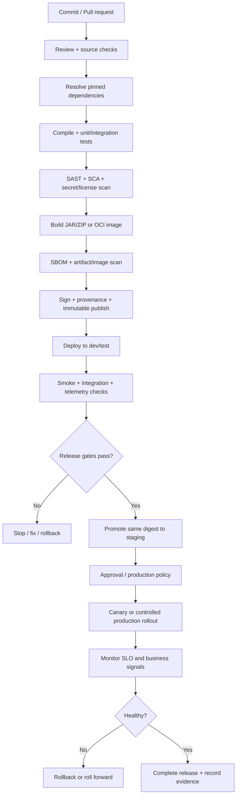

# Thiết kế pipeline từ mã nguồn đến artifact và môi trường đích

Một Java serverless function có thể được triển khai dưới dạng JAR/ZIP lên runtime được quản lý hoặc đóng gói trong OCI container image. Dù cách đóng gói khác nhau, pipeline CI/CD cần đưa thay đổi từ commit đã review qua build, test, kiểm tra bảo mật, tạo artifact, phát hành và triển khai tới môi trường đích một cách có thể lặp lại.

Mục tiêu của pipeline tốt là **build một lần, kiểm tra artifact đó, rồi promote chính artifact đã kiểm tra qua các môi trường**. Không build lại một phiên bản khác khi chuyển từ staging sang production. Không nhúng secret hoặc cấu hình riêng của môi trường vào artifact. Mỗi release cần truy vết được về commit, dependency, build workflow, artifact digest, SBOM, kết quả kiểm tra và deployment đang chạy.

Bài học này tập trung vào cách thiết kế pipeline cho Java FaaS được kích hoạt bởi HTTP, message hoặc event. Nội dung bao gồm cả function deploy dạng package và function/container deploy; ví dụ dùng GitHub Actions và lệnh CLI ở mức minh họa, có thể điều chỉnh cho GitLab CI, Azure DevOps, Jenkins hoặc hệ thống CI/CD khác.

## 1. CI và CD trong serverless

**Continuous Integration (CI)** tự động kiểm tra mỗi thay đổi khi developer tạo pull request hoặc push commit: compile, unit test, integration test, kiểm tra dependency, security scan và đóng gói thử.

**Continuous Delivery/Deployment (CD)** lấy artifact đã qua CI để phát hành tới môi trường. Continuous Delivery thường yêu cầu một bước phê duyệt trước production; Continuous Deployment có thể tự động đưa thay đổi production khi tất cả điều kiện đạt.

Một pipeline serverless thường có các giai đoạn:

1. Validate source và pull request.
2. Resolve dependency theo version đã khóa.
3. Compile, test và phân tích chất lượng.
4. Scan source/dependency/secret và tạo SBOM.
5. Đóng gói JAR/ZIP hoặc OCI image.
6. Scan artifact/image, ký và lưu provenance.
7. Publish artifact bất biến vào registry/repository.
8. Deploy vào môi trường đích bằng cấu hình/IaC riêng.
9. Chạy smoke test, integration check và quan sát sau deploy.
10. Promote cùng artifact sang staging/production hoặc rollback theo release policy.



CI/CD không chỉ là chuỗi lệnh build và deploy. Nó còn là cách kiểm soát quyền, bằng chứng, cấu hình, thay đổi dữ liệu và quyết định phát hành.

## 2. Thiết kế pipeline theo artifact type

Trước khi viết pipeline, xác định chính xác đơn vị được deploy:

| Kiểu triển khai | Artifact chính | Những gì pipeline phải kiểm soát |
| --- | --- | --- |
| AWS Lambda Java ZIP/JAR | ZIP chứa JAR/dependency hoặc shaded/uber JAR | Handler, runtime, package layout, dependency, hash và cấu hình Lambda |
| AWS Lambda container | OCI image trong registry | Image digest, base image, image scan, entry point và Lambda container contract |
| Azure Functions Java | Package triển khai chứa function artifact và metadata | Java/runtime version, Functions host, binding extension, package và app settings |
| Google Cloud Run service/job | OCI image | Digest, port/command, service account, resource limits và revision/job config |
| Google Cloud Run function | Source/buildpack artifact hoặc image do nền tảng tạo | Functions Framework entry point, build configuration, runtime và trigger |
| Nền tảng khác | JAR/ZIP, image hoặc package riêng | Contract entry point, trigger, runtime, version và deploy metadata |

Không dùng một quy trình đóng gói cho mọi nền tảng. Cùng một use case Java có thể chia sẻ source/domain module, nhưng adapter và deployment artifact có thể khác nhau. Pipeline nên có stage dùng chung cho compile/test/security và stage đóng gói/deploy chuyên biệt theo target.

### Source artifact và deployable artifact

Source bundle là mã nguồn cùng build metadata. Deployable artifact là binary đã được build: JAR/ZIP hoặc image. Với source-based deployment, nền tảng có thể build lại từ source khi deploy; cần ghi nhận builder, buildpack/runtime version và output artifact nếu muốn tái lập chính xác.

Nếu yêu cầu kiểm soát chặt, hãy build artifact/container trong pipeline đã kiểm soát, scan và lưu nó; sau đó deploy đúng artifact đã tạo. Với nền tảng chỉ nhận source package, cố định commit, toolchain và build environment, đồng thời lưu deployment package/digest mà nền tảng tạo hoặc trả về nếu có.

## 3. Cấu trúc repository hỗ trợ CI/CD

Một repository Java serverless có thể tổ chức theo module để tách business logic, adapter và hạ tầng:

```text
orders-serverless/
├── pom.xml
├── mvnw
├── .mvn/wrapper/
├── src/
│   ├── main/java/com/example/orders/
│   │   ├── domain/
│   │   ├── application/
│   │   ├── adapter/http/
│   │   └── adapter/events/
│   └── test/java/com/example/orders/
├── infra/
│   ├── dev/
│   ├── staging/
│   └── production/
├── deploy/
│   ├── lambda/
│   ├── azure-functions/
│   └── cloud-run/
├── Dockerfile
├── .dockerignore
└── .github/workflows/
    ├── ci.yml
    └── release.yml
```

Đây là ví dụ, không phải cấu trúc bắt buộc. Nếu các function có vòng đời release độc lập, có thể dùng multi-module Maven/Gradle hoặc repository riêng. Tránh một monorepo pipeline build và deploy mọi function mỗi khi một module nhỏ thay đổi nếu dependency graph có thể xác định chính xác phạm vi bị ảnh hưởng.

### Build wrapper và toolchain

- Commit Maven Wrapper hoặc Gradle Wrapper để developer/CI dùng cùng phiên bản build tool.
- Pin JDK/toolchain và compiler target theo runtime của nền tảng.
- Pin version của plugin, annotation processor và dependency quan trọng.
- Dùng lockfile/dependency verification nếu build tool hỗ trợ.
- Tránh dùng `latest`, version động hoặc SNAPSHOT trong release build.
- Lưu build metadata: commit SHA, version, build number, toolchain và dependency lock state.

Wrapper giúp chuẩn hóa phiên bản build tool, nhưng pipeline vẫn cần kiểm tra wrapper distribution URL/checksum và cập nhật wrapper có review.

## 4. Branch, pull request và điều kiện merge

Pipeline nên chạy kiểm tra sớm trước khi thay đổi được merge vào nhánh phát hành.

| Sự kiện | Kiểm tra thường chạy | Có deploy không? |
| --- | --- | --- |
| Pull request | Compile, unit test, static analysis, SCA, secret scan, IaC validation | Không deploy production; có thể tạo preview/dev ephemeral |
| Push vào nhánh chính | Build artifact, test đầy đủ, SBOM, scan, publish snapshot/release candidate | Có thể deploy dev/test |
| Tag release | Xác minh version, build/retrieve release artifact, sign, publish immutable | Deploy staging hoặc bắt đầu promotion |
| Phê duyệt production | Verify artifact, policy, approval và environment config | Deploy production |
| Scheduled security scan | Re-scan dependency/image/SBOM và kiểm tra runtime versions | Thường không build/deploy trừ khi remediation được tạo |

Yêu cầu review code, status checks bắt buộc, branch protection và CODEOWNERS cho thư mục `infra/`, `deploy/` hoặc IAM policy. Thay đổi permission hoặc network nên được review bởi owner phù hợp.

Không để pull request từ fork chạy workflow có quyền đọc production secret. Dùng permission mặc định tối thiểu cho CI token; chỉ cấp quyền publish/deploy ở workflow/release stage cần thiết.

## 5. Giai đoạn build và test Java

Một CI build thường gồm:

1. Checkout đúng commit SHA, không dùng branch head thay đổi trong lúc pipeline chạy.
2. Cài JDK và build tool version đã pin.
3. Restore cache dependency có key dựa trên lock/POM/Gradle files.
4. Compile và kiểm tra format/static analysis.
5. Chạy unit test.
6. Chạy integration test với database/queue emulator hoặc service test environment.
7. Tạo JAR/ZIP/image candidate.
8. Xuất test report và build metadata.

Ví dụ Maven:

```bash
./mvnw -B -ntp clean verify
```

`verify` chạy các phase trước đó và plugin được bind vào lifecycle, thường bao gồm compile/test/package và các integration/verification plugin đã cấu hình. Nếu project không bind integration test vào lifecycle, lệnh trên không tự động chứng minh integration test đã chạy; kiểm tra `pom.xml` và report.

Ví dụ Gradle:

```bash
./gradlew --no-daemon clean check
```

`check` chạy các verification task được gắn vào lifecycle. Hãy bảo đảm task integration test, contract test và static analysis được cấu hình rõ. Không dùng `-x test` hoặc `-DskipTests` trong release pipeline chỉ để tiết kiệm thời gian mà không có một stage test tương đương.

### Test theo trigger

Java serverless cần kiểm thử contract của adapter ngoài unit test nghiệp vụ:

| Trigger | Những gì cần test |
| --- | --- |
| HTTP | Method/path/header/body, auth, status code, timeout, idempotency key |
| Queue | Duplicate message, visibility/lock expiry, poison/DLQ, retry và batch behavior |
| Event | Schema/version, source/type, event ID, ordering nếu có, redelivery |
| Timer | Timezone, schedule expression, missed run và idempotent execution |
| Object storage | File lớn, content type/signature, object version/ETag và retry |

Test không nên chỉ gọi method handler trực tiếp. Khi cần, chạy adapter qua local runtime/emulator hoặc deploy một integration environment để xác minh binding/trigger thực tế.

## 6. Security gates trước khi tạo release

Pipeline nên thực hiện các kiểm tra phù hợp với loại artifact:

- Secret scanning trên source, Git diff và build context.
- SAST và linting cho code.
- SCA/dependency vulnerability scan và license policy.
- SBOM cho dependency runtime.
- IaC scanning cho IAM, network, public endpoint, encryption và resource policy.
- Container image scan cho OS package, JRE và application dependency nếu deploy image.
- Artifact signing/provenance nếu pipeline và nền tảng hỗ trợ.

Policy gate cần dựa trên severity, exploitability, exposure và fix availability. Ví dụ, secret thật bị commit hoặc critical vulnerability có exploit và reachable có thể chặn release. Finding test-only hoặc false positive cần được xác minh và ghi exception có owner, phạm vi và thời hạn; không suppress toàn bộ severity.

Một security scan xanh tại thời điểm build không bảo đảm artifact không có lỗ hổng mới trong tương lai. Lưu SBOM và image digest để re-scan định kỳ sau deploy.

## 7. Tạo artifact bất biến và truy vết được

Artifact phải được nhận diện bằng version/hash bất biến:

- JAR/ZIP: lưu version release và SHA-256 checksum.
- OCI image: deploy bằng image digest `sha256:...`, không dựa vào tag mutable như `latest`.
- SBOM/provenance: gắn với artifact digest hoặc build ID rõ ràng.
- Release metadata: ghi commit SHA, build run ID, toolchain, dependency snapshot, scan report và thời điểm build.

Không build lại khi promote staging sang production. Nếu staging đã kiểm tra image digest A, production phải deploy đúng digest A. Nếu thay base image, dependency hoặc build argument làm artifact đổi, đó là artifact mới và cần test/scan lại.

### Versioning

Có thể dùng Semantic Versioning cho ứng dụng/thư viện (ví dụ `2.4.1`) kết hợp commit SHA/build number. Với mỗi release:

```text
service: orders-function
version: 2.4.1
commit: 7a3f...
artifact: orders-function-2.4.1.zip
sha256: 9d2c...
environment: staging
```

Không nhúng tên môi trường hoặc secret vào binary. Cùng một artifact có thể được deploy lên dev, staging và production với app settings, IAM role, network và resource configuration khác nhau.

## 8. Package Java function dạng JAR/ZIP

Với managed runtime, nền tảng có thể cung cấp JVM và host. Pipeline đóng gói code cùng dependency theo contract của provider.

### AWS Lambda Java package

AWS Lambda Java có thể nhận JAR/ZIP với handler được cấu hình. Artifact phải chứa dependency cần thiết hoặc dùng cơ chế dependency layer/runtime phù hợp. Với Maven, có thể tạo shaded JAR hoặc package ZIP theo cấu trúc deploy của dự án.

Pipeline nên xác minh:

- Handler class/method đúng với cấu hình function.
- Runtime Java được hỗ trợ và target bytecode tương thích.
- Dependency runtime có trong artifact hoặc layer được version hóa.
- Không đóng gói credential hoặc `application-prod.properties` chứa secret.
- Artifact hash được lưu cùng release metadata.
- Test handler/event shape tương ứng API Gateway, SQS, EventBridge hoặc trigger thực tế.

Ví dụ lệnh deploy package bằng AWS CLI:

```bash
aws lambda update-function-code \
  --function-name orders-handler \
  --zip-file fileb://target/orders-function.zip
```

Đây là lệnh cập nhật code cho function đã tồn tại; nó không cấu hình runtime, handler, IAM role, environment variables, VPC hay trigger. Các cấu hình đó nên được quản lý bằng IaC hoặc deploy command có version hóa. Với production, có thể publish Lambda version rồi chuyển alias qua version mới để tách release artifact khỏi traffic.

### Azure Functions Java package

Azure Functions Maven plugin có thể build và deploy package Java cùng metadata function. Pipeline nên kiểm tra `host.json`, function metadata, binding extension, JDK/runtime compatibility và app settings. Không đưa `local.settings.json` có secret vào package production.

Ví dụ package build:

```bash
./mvnw -B clean package
```

Sau khi xác minh output của plugin, lưu đúng package deployable làm artifact CI. Deployment có thể dùng Azure Functions Maven plugin hoặc package deployment/API tương ứng. Cấu hình runtime, app settings, managed identity và networking được quản lý riêng bằng Bicep/Terraform/ARM hoặc pipeline configuration.

### Google Cloud Functions / Cloud Run functions

Function Java thường dùng Functions Framework và buildpack/source deployment theo runtime. Pipeline cần xác minh entry point, dependency, runtime version, trigger configuration và service account. Nếu nền tảng build image từ source, ghi nhận builder/runtime và deployment revision; nếu cần kiểm soát image, cân nhắc container-based deployment theo mô hình được hỗ trợ.

Không nhầm source bundle với image cuối cùng. Khi build được image, lưu digest và scan image đó; nếu build do nền tảng thực hiện, lưu build provenance và revision/image reference mà nền tảng cung cấp.

## 9. Package Java function bằng OCI container image

Với Lambda container, Cloud Run service/job hoặc nền tảng container khác, pipeline thường build OCI image:

```bash
docker build --pull -t registry.example.com/orders-function:2.4.1 .
docker push registry.example.com/orders-function:2.4.1
```

Trong production, không chỉ dựa vào tag. Sau push, lấy digest từ registry, scan digest đó, ký digest và deploy bằng digest. Build stage cần:

- Multi-stage Dockerfile để không đưa Maven/Gradle cache và compiler vào runtime image.
- Base image JRE được duy trì, pin digest và có quy trình cập nhật.
- Non-root user, `.dockerignore` và không copy secret.
- Process entry point/port đúng contract của target.
- Graceful shutdown và log ra stdout/stderr.
- Image SBOM và scan OS/JRE/application packages.

Ví dụ tag giúp người vận hành đọc release; digest giúp xác định chính xác nội dung. Không dùng tag `latest` làm tham chiếu deploy production vì tag có thể bị ghi đè.

## 10. Infrastructure as Code và tách cấu hình khỏi artifact

Infrastructure as Code (IaC) mô tả resource và cấu hình cloud bằng file có version control. Có thể dùng Terraform, AWS SAM/CloudFormation, Azure Bicep/ARM hoặc Google Cloud Deployment Manager/Terraform tùy tổ chức.

IaC có thể quản lý:

- Function/service/job resource và runtime/handler/container digest.
- IAM role, managed identity, service account và resource policy.
- HTTP endpoint, queue/topic, event subscription, scheduler và dead-letter queue.
- Environment variables không nhạy cảm, secret references và identity binding.
- Memory/CPU, timeout, concurrency, min/max instances và retry.
- VPC/subnet/security group/private endpoint/network egress.
- Log group, retention, metric, alert và dashboard.
- Database, bucket, registry và supporting resources.

### Configuration per environment

Artifact giống nhau nhưng môi trường có thể khác:

| Cấu hình | Dev | Staging | Production |
| --- | --- | --- | --- |
| Database | Database dev | Bản staging có dữ liệu test | Database production |
| IAM identity | Quyền sandbox | Quyền staging | Quyền production tối thiểu |
| Queue/topic | Queue dev | Queue staging | Queue production |
| Memory/timeout | Đủ test nhanh | Gần production | Theo workload/SLO |
| Concurrency | Giới hạn thấp | Kiểm tra scale | Theo tải và downstream capacity |
| Secret | Secret dev | Secret staging | Secret production riêng |
| Logging | Debug có giới hạn | Structured logs/traces | Retention/alert theo chính sách |

Không build một JAR khác cho production chỉ để thay URL database. Dùng app settings, secret manager và IaC variables. Tuy nhiên, configuration schema phải được validate; thiếu biến môi trường quan trọng nên làm deployment/health check thất bại sớm với thông báo không chứa secret.

## 11. Identity của pipeline và identity của runtime

Pipeline và function là hai workload khác nhau, cần hai danh tính khác nhau:

- **CI identity:** checkout/build/test, publish artifact, tạo release metadata.
- **Deploy identity:** cập nhật function/service/job, IaC và traffic routing.
- **Runtime identity:** function truy cập secret, database, queue, storage hoặc API khi chạy.

Không dùng execution role của function để deploy chính function đó. Không cấp quyền production cho mọi job CI. Ưu tiên OIDC federation hoặc cơ chế workload identity để pipeline lấy credential ngắn hạn thay vì lưu cloud access key lâu dài trong CI secret store.

### Ví dụ nguyên tắc quyền

| Identity | Quyền nên có | Quyền không nên có mặc định |
| --- | --- | --- |
| PR test job | Read source/dependency, run tests | Deploy production, đọc secret production |
| Artifact publisher | Push vào repository/registry được chỉ định | Thay IAM policy hoặc đọc dữ liệu runtime |
| Deploy staging | Cập nhật staging resource và traffic | Admin toàn account/subscription/project |
| Deploy production | Deploy artifact đã duyệt vào resource production | Đọc business data không cần thiết |
| Function runtime | Chỉ gọi dịch vụ cần cho nhiệm vụ | Deploy, sửa IAM hoặc đọc secret của function khác |

Tách environment protection và approval. Với production, giới hạn ai có thể approve, ai có thể deploy và artifact nào được phép promote.

## 12. Quản lý secret trong pipeline

Secret dùng khi build/deploy có thể gồm registry credential, signing key, cloud deployment identity hoặc token cho package repository. Secret runtime gồm database password/API key. Hai nhóm này không nên dùng chung.

- Dùng OIDC/workload identity federation để lấy credential cloud ngắn hạn.
- Dùng secret manager cho credential cần thiết; không echo ra terminal/log.
- Không truyền secret qua command line nếu process list hoặc log có thể lộ.
- Không expose secret cho pull request từ fork hoặc workflow chạy trên branch không tin cậy.
- Mask log là lớp bảo vệ bổ sung, không thay thế việc không in secret.
- Rotate deploy credential và signing identity theo policy.
- Dùng secret reference trong IaC; không commit plaintext value.

Pipeline nên chỉ lấy secret ở stage cần thiết. Ví dụ unit test không cần đọc production database password; build image không cần runtime API key.

## 13. Migrations và thay đổi schema dữ liệu

Deploy code mới không đồng nghĩa database schema có thể thay đổi cùng lúc một cách phá vỡ. Trong serverless, nhiều function version có thể chạy đồng thời trong thời gian rollout; queue có thể giữ message cũ và retry sau khi schema đã thay đổi.

Áp dụng expand-and-contract:

1. **Expand:** thêm column/table/index mới theo cách code cũ vẫn hoạt động.
2. **Deploy compatible code:** code mới có thể đọc schema cũ/mới và ghi theo cách tương thích.
3. **Backfill:** chuyển dữ liệu theo batch/job có checkpoint.
4. **Switch:** chuyển consumer/producer sang field hoặc format mới.
5. **Observe:** xác nhận không còn code/message cũ cần schema cũ.
6. **Contract:** xóa field/index cũ trong release sau khi đã an toàn.

Không chạy migration phá hủy trước khi tất cả function/consumer cũ đã được drain. Migration cần idempotent hoặc có trạng thái/checkpoint để tiếp tục sau lỗi. Với event schema, dùng versioning và consumer tương thích ngược.

## 14. Deploy strategy cho serverless

Không phải mọi nền tảng đều hỗ trợ cùng một chiến lược rollout. Chọn strategy theo loại trigger, khả năng version/traffic split và yêu cầu availability.

| Chiến lược | Ý nghĩa | Khi phù hợp |
| --- | --- | --- |
| Rolling/replace | Thay code/config của resource theo cơ chế nền tảng | Workload ít rủi ro hoặc không hỗ trợ traffic split |
| Blue/green | Dựng target mới, kiểm tra rồi chuyển traffic | API cần rollback nhanh và môi trường mới độc lập |
| Canary | Chuyển một phần traffic sang revision mới, tăng dần | API có metric đủ tốt để so sánh |
| Weighted traffic split | Chia traffic giữa nhiều revision/version | Cloud Run service hoặc Lambda alias hỗ trợ |
| Event consumer cutover | Tạo consumer version mới, chuyển trigger/alias hoặc queue subscription có kiểm soát | Message/event workload cần tránh xử lý trùng hoặc mất message |

### AWS Lambda version và alias

Lambda có thể publish version bất biến của function và dùng alias như `staging` hoặc `production` trỏ tới version. Alias có thể được dùng để chuyển traffic giữa version theo cấu hình hỗ trợ. Pipeline nên publish version sau khi cập nhật code/config, chạy smoke test bằng version/alias staging rồi chuyển alias production. Với weighted alias, theo dõi lỗi và latency trước khi tăng tỷ lệ.

### Cloud Run revisions

Cloud Run service tạo revision mới khi cấu hình/deployment thay đổi. Có thể giữ traffic ở revision cũ, chuyển một phần sang revision mới và tăng dần sau khi kiểm tra. Đảm bảo image digest và service configuration gắn với revision đã kiểm thử.

### Azure Functions

Azure Functions có deployment slots trên các hosting plan hỗ trợ. Slot staging có thể được deploy và kiểm tra trước khi swap với production; cần hiểu slot-specific settings, trigger behavior, storage/host ID và giới hạn của plan. Nếu không có slot hoặc trigger không phù hợp với swap, dùng chiến lược deploy/rollback theo khả năng thực tế của plan.

### Event-driven cutover

Với queue/event trigger, rollout không chỉ là chuyển HTTP traffic. Cần kiểm soát:

- Event source mapping/trigger nào đang bật.
- Consumer version nào đang nhận message.
- Visibility timeout/lock và thời gian drain invocation.
- Duplicate event và idempotency khi hai consumer cùng hoạt động.
- Schema tương thích giữa producer cũ và consumer mới.
- DLQ, retry và replay sau deployment.

Không bật hai consumer không idempotent trên cùng một queue rồi giả định chúng sẽ tự chia message an toàn theo ý muốn. Kiểm tra semantics của trigger và cơ chế scale cụ thể.

## 15. Smoke test và health check sau deploy

Deploy thành công ở control plane chỉ xác nhận resource được cập nhật, không chứng minh function xử lý nghiệp vụ đúng.

Một smoke test nên xác minh:

- Function/service có thể được invoke và trả response mong đợi.
- Runtime identity đọc được secret/config cần thiết.
- Kết nối database/queue/object storage hoạt động.
- Trigger/binding đã đăng ký đúng và event mẫu được xử lý.
- Log/trace xuất hiện với release ID và correlation ID.
- Permission denied, timeout và retry không tăng bất thường.
- Endpoint không vô tình trở thành public hoặc mất auth.

Smoke test không nên tạo giao dịch production không thể hoàn tác. Dùng test tenant, synthetic event, resource canary hoặc operation có thể cleanup. Với queue, xác minh message được xử lý đúng và không để lại side effect giả.

### Readiness và liveness

Container service có thể cung cấp health endpoint; function managed runtime có thể có health/telemetry riêng. Đừng tạo một health check chỉ kiểm tra process đang sống rồi gọi là readiness nghiệp vụ. Readiness có thể kiểm tra config và dependency cần thiết với timeout ngắn, nhưng không nên gọi mọi dependency nặng ở mỗi request health. Liveness không nên restart liên tục chỉ vì một downstream tạm thời lỗi.

## 16. Promotion giữa dev, staging và production

Một mô hình promotion rõ ràng:

| Stage | Mục tiêu | Điều kiện đi tiếp |
| --- | --- | --- |
| Dev | Kiểm tra tích hợp sớm với dịch vụ sandbox | Smoke test và log đúng |
| Test/QA | Kiểm tra behavior, contract, failure và regression | Test suite pass, không có blocker |
| Staging | Xác minh cấu hình gần production, tải và deploy strategy | SLO/acceptance criteria đạt, security gate pass |
| Production | Phục vụ traffic thật | Approval, artifact digest verified, change window/policy đạt |

Promotion nên dùng cùng artifact digest nhưng cấu hình môi trường riêng. Không rebuild để đổi biến `DATABASE_URL`, queue name hoặc IAM role. Nếu platform cần build lại từ source cho mỗi environment, ghi rõ build identity và bảo đảm source commit/toolchain giống nhau; tốt hơn là promote package/image đã build nếu nền tảng hỗ trợ.

### Approval gate

Production approval nên xem được:

- Commit và pull request liên quan.
- Artifact/image digest và checksum.
- SBOM, SCA/image scan, policy exception.
- Test report và smoke test staging.
- IaC plan/diff và permission changes.
- Database migration plan.
- Rollback/roll-forward plan.
- Owner và thời gian triển khai.

Approval không nên chỉ là nút bấm không có bằng chứng. Các thay đổi IAM/network/database có thể cần reviewer khác với người review application code.

## 17. Rollback và roll-forward

Rollback là đưa traffic hoặc deployment về phiên bản trước. Roll-forward là phát hành bản sửa mới khi rollback không an toàn hoặc schema/data đã thay đổi.

Trước khi release cần biết:

- Artifact/revision/version trước đó là gì và còn được giữ ở đâu.
- Có thể chuyển alias/traffic về version cũ không.
- Database migration có tương thích với code cũ không.
- Message/event schema có thể được consumer cũ đọc không.
- Secret/key/config có còn hợp lệ cho version cũ không.
- Side effect đã thực hiện có thể đảo ngược hay cần compensation.

Không rollback code một cách mù quáng sau migration phá hủy. Nếu code mới đã ghi dữ liệu theo schema không tương thích, cần roll-forward hoặc migration bù. Với event-driven function, message đã xử lý không tự quay lại khi rollback; nếu cần replay, phải có quy trình chọn lọc và idempotency.

### Tiêu chí kích hoạt rollback

Đặt ngưỡng cụ thể, ví dụ:

- Tỷ lệ HTTP 5xx vượt ngưỡng trong một cửa sổ quan sát.
- p95/p99 latency vượt SLO.
- Function timeout/throttle hoặc retry/DLQ tăng mạnh.
- Business error như thanh toán thất bại hoặc đơn hàng trùng tăng.
- Kết nối database/queue cạn hoặc dependency error tăng.
- Security/authentication failure tăng bất thường.

Ngưỡng và cửa sổ phải phù hợp baseline; một lỗi đơn lẻ không nhất thiết cần rollback toàn bộ nếu có thể cô lập một tenant hoặc dependency.

## 18. IaC plan, drift và thay đổi môi trường

Pipeline nên review thay đổi hạ tầng trước khi apply:

- Terraform: `plan` và lưu plan output; apply plan đã được duyệt.
- AWS SAM/CloudFormation: validate/template/package và xem change set trước deploy.
- Azure Bicep/ARM: validate/what-if trước khi deploy.
- Google Cloud: validate cấu hình và dùng Terraform/Config Controller hoặc công cụ IaC đã chuẩn hóa.

Không chạy `terraform apply` trực tiếp từ pull request không tin cậy. State backend phải được bảo vệ, lock và backup; quyền state storage không nên cấp cho runtime function. Review drift định kỳ vì console/manual change có thể khiến cấu hình thật khác IaC.

Tách state/workspace hoặc stack theo environment và account/subscription/project khi cần isolation. Tránh dùng một state có quyền thay đổi mọi production resource cho mọi pipeline job.

## 19. Ví dụ GitHub Actions cho CI Java Maven

Workflow dưới đây minh họa CI kiểm tra Java project. Đây là khung có thể điều chỉnh, không phải pipeline deploy hoàn chỉnh cho một provider cụ thể:

```yaml
name: java-ci

on:
  pull_request:
  push:
    branches: [main]

permissions:
  contents: read

jobs:
  verify:
    runs-on: ubuntu-latest
    steps:
      - name: Checkout exact commit
        uses: actions/checkout@v4

      - name: Set up JDK
        uses: actions/setup-java@v4
        with:
          distribution: temurin
          java-version: '21'
          cache: maven

      - name: Verify
        run: ./mvnw -B -ntp clean verify

      - name: Upload test reports
        if: always()
        uses: actions/upload-artifact@v4
        with:
          name: test-reports
          path: '**/target/surefire-reports/**'
```

Trong production, pin action theo commit SHA hoặc policy của tổ chức; version tag `@v4` chỉ minh họa. Thêm SAST/SCA/secret scan, license policy, SBOM, artifact packaging và retention. Không cấp `id-token: write` hoặc quyền package/deploy cho job chỉ chạy test nếu không cần.

## 20. Ví dụ GitHub Actions build và publish OCI image

Pipeline image nên build một lần, lấy digest, scan và publish metadata. Khung sau minh họa thứ tự; các action đăng nhập registry, scan và signing cần được pin theo policy và cấu hình OIDC phù hợp:

```yaml
name: release-image

on:
  push:
    tags: ['v*']

permissions:
  contents: read
  packages: write
  id-token: write

jobs:
  build:
    runs-on: ubuntu-latest
    steps:
      - uses: actions/checkout@v4

      - uses: actions/setup-java@v4
        with:
          distribution: temurin
          java-version: '21'
          cache: maven

      - name: Test and package
        run: ./mvnw -B -ntp clean verify

      - name: Build image
        run: docker build -t ghcr.io/example/orders:${GITHUB_SHA} .

      - name: Publish image
        run: |
          docker push ghcr.io/example/orders:${GITHUB_SHA}
          docker image inspect ghcr.io/example/orders:${GITHUB_SHA} \
            --format '{{index .RepoDigests 0}}' > image-digest.txt

      - name: Preserve release metadata
        uses: actions/upload-artifact@v4
        with:
          name: release-metadata
          path: image-digest.txt
```

Đây vẫn là ví dụ tối giản: `GITHUB_SHA` được dùng làm tag để tránh trùng commit, nhưng cần bước login/push registry thực tế, SBOM, image scan, signature/provenance, retention và deploy. Trong môi trường thật, không giả định `docker image inspect` sau push luôn trả đúng digest từ registry trong mọi driver/setup; có thể lấy digest từ build/push action hoặc registry API. Deploy stage phải đọc digest đã lưu, không tự build image lần nữa.

## 21. Ví dụ deploy theo nền tảng

Các lệnh sau minh họa cách cập nhật artifact; cần thay tên resource, region, account/project và cấu hình theo môi trường.

### AWS Lambda

Với ZIP/JAR:

```bash
aws lambda update-function-code \
  --function-name orders-handler \
  --zip-file fileb://orders-function.zip

aws lambda publish-version \
  --function-name orders-handler
```

Sau khi publish, pipeline có thể cập nhật alias staging/production tới version đã kiểm tra. Với container image, cập nhật function code bằng image URI có digest trong ECR/registry được hỗ trợ. IAM role, VPC, environment variables và event source mapping nên được quản lý bằng IaC và release policy.

### Azure Functions Java

Pipeline build package bằng Maven plugin, publish artifact, sau đó deploy package vào Function App. Tùy hosting plan và cấu hình, có thể dùng deployment slot để kiểm tra rồi swap. App settings, managed identity, networking, trigger connection và extension configuration được tách khỏi package.

Không đưa `local.settings.json` vào artifact production. Kiểm tra slot-specific settings và trigger behavior trước khi swap, đặc biệt với timer/queue trigger và host storage.

### Google Cloud Run service

Deploy image theo digest để tạo revision:

```bash
gcloud run deploy orders-api \
  --image REGION-docker.pkg.dev/PROJECT/REPOSITORY/orders@sha256:DIGEST \
  --region REGION
```

Sau đó kiểm tra revision và traffic split. Có thể chuyển một phần traffic sang revision mới rồi tăng dần khi metric đạt.

### Google Cloud Run job

Deploy job image theo digest và execute:

```bash
gcloud run jobs deploy invoice-import \
  --image REGION-docker.pkg.dev/PROJECT/REPOSITORY/importer@sha256:DIGEST \
  --region REGION

gcloud run jobs execute invoice-import --region REGION
```

Job không nhận HTTP traffic như service; pipeline cần theo dõi execution/task status và output. Nếu job tạo dữ liệu lớn, lưu execution ID và manifest/checkpoint để retry/đối soát.

## 22. Canary, traffic split và release validation

Canary rollout giảm blast radius bằng cách đưa một phần traffic hoặc workload sang version mới trước.

Một quy trình có thể là:

1. Deploy revision/version mới nhưng chưa chuyển toàn bộ traffic.
2. Chạy synthetic request/event để xác minh startup và dependency.
3. Chuyển tỷ lệ nhỏ traffic, ví dụ 5% hoặc 10%, nếu nền tảng hỗ trợ.
4. Quan sát error rate, latency, timeout, throttle, retry, DLQ và business metric.
5. Tăng tỷ lệ theo các bước định trước nếu tín hiệu ổn định.
6. Chuyển toàn bộ traffic và giữ version cũ trong cửa sổ rollback.

Với event-driven function, canary có thể phức tạp hơn HTTP vì event source không phải lúc nào cũng hỗ trợ chia traffic. Có thể dùng queue/topic riêng, subscription canary, alias/version routing hoặc replay một tập event test. Phải tránh xử lý side effect trùng giữa consumer cũ và mới.

Không chỉ quan sát CPU và invocation count. Business metric như số đơn trùng, thanh toán thất bại, event bị bỏ, dữ liệu sai hoặc thời gian hoàn tất workflow mới cho thấy release có đúng nghiệp vụ hay không.

## 23. Quản lý trigger và event source trong release

Một function có thể được invoke trực tiếp, qua API gateway, event source mapping, scheduler hoặc event router. Pipeline cần quản lý trigger như một phần của release:

- Tên/ARN/endpoint và permission của trigger.
- Batch size, concurrency, retry, visibility timeout/lock duration.
- Dead-letter queue hoặc failure destination.
- Event schema/version và filter criteria.
- Mapping giữa function version/alias và event source.
- Cách disable/enable trigger khi deploy hoặc rollback.

Khi đổi schema message, triển khai theo hướng backward-compatible: consumer mới đọc được event cũ; producer mới chỉ phát event schema mới sau khi consumer đã sẵn sàng. Nếu không thể giữ tương thích, version hóa topic/queue hoặc dùng adapter translation trong giai đoạn chuyển tiếp.

## 24. Observability và release evidence

Mỗi release cần gắn metadata vào log/trace/metric hoặc deployment record:

- Release version và commit SHA.
- Artifact digest hoặc package checksum.
- Function version, alias, revision hoặc job execution.
- Environment và region.
- Pipeline run ID và approver.
- Correlation ID, invocation ID và event ID khi xử lý request.

Theo dõi tối thiểu:

| Nhóm | Tín hiệu |
| --- | --- |
| Availability | HTTP success/error, invocation success, task completion |
| Latency | p50/p95/p99, cold start, downstream duration |
| Reliability | Timeout, retry, throttle, DLQ, duplicate event |
| Capacity | Concurrency, max instances, memory, CPU, database connections |
| Business | Transaction success, order/payment error, workflow age, data correctness |
| Security | AccessDenied, secret read anomalies, IAM change, image vulnerability |
| Cost | Cost per invocation/job/result, data egress, idle/min instances |

Release marker giúp so sánh metric trước/sau deployment. Đặt alert và rollback threshold trước khi triển khai, không chờ đến khi có incident mới quyết định ngưỡng.

## 25. Quản lý release cho nhiều môi trường và nhiều function

Một module có thể có nhiều function với trigger và nhịp phát hành khác nhau. Pipeline nên biết function nào bị ảnh hưởng bởi thay đổi:

- Nếu chỉ đổi shared domain module, các function phụ thuộc module đó cần build/test lại.
- Nếu chỉ đổi adapter HTTP, queue worker không nhất thiết phải deploy nếu artifact tách riêng.
- Nếu đổi shared dependency version, mọi artifact chứa dependency đó cần được đánh giá.
- Nếu đổi IaC hoặc IAM, review/deploy hạ tầng có thể cần tách khỏi release code.
- Nếu đổi event schema, producer và consumer có thể cần phát hành theo thứ tự tương thích.

Trong monorepo, dùng dependency graph hoặc path filter nhưng phải bảo đảm thay đổi shared module kích hoạt đúng downstream build. Không dựa vào path filter đơn giản nếu nó có thể bỏ sót dependency gián tiếp.

## 26. Các lỗi thường gặp trong CI/CD serverless

1. **Build lại artifact ở mỗi môi trường.** Binary có thể khác nhau dù cùng commit; build một lần và promote digest.
2. **Dùng tag mutable để deploy.** Tag có thể bị ghi đè; lưu và deploy image digest.
3. **Nhúng secret vào JAR/image hoặc build arg.** Secret có thể tồn tại trong layer, log và artifact cache.
4. **Dùng chung identity cho CI, deploy và runtime.** Một token bị lộ có thể vừa deploy vừa truy cập dữ liệu production.
5. **Deploy code nhưng quên trigger/IAM/config.** Function tồn tại nhưng không được invoke hoặc có quyền sai.
6. **Không test event redelivery và idempotency.** Function chạy đúng một lần nhưng lỗi khi retry.
7. **Chạy migration phá hủy cùng lúc rollout.** Function version cũ có thể vẫn chạy và không đọc được schema mới.
8. **Không có smoke test sau deploy.** Control plane báo thành công nhưng runtime không truy cập được secret/database.
9. **Rollback code mà không xét dữ liệu.** Schema hoặc side effect có thể khiến version cũ không còn tương thích.
10. **Không giữ artifact cũ.** Khi cần rollback phải build lại từ source/dependency đã thay đổi.
11. **Cấp production secret cho pull request.** Code không tin cậy có thể exfiltrate credential.
12. **Không re-scan sau deploy.** Advisory mới có thể ảnh hưởng artifact đang chạy.
13. **Không kiểm soát concurrency khi canary.** Hai version cùng xử lý một event hoặc vượt giới hạn downstream.
14. **Chỉ đo kỹ thuật.** API trả 200 nhưng business event có thể bị mất hoặc ghi sai.

## 27. Checklist thiết kế pipeline

### Source và build

- [ ] Pull request có review và required status checks.
- [ ] CI checkout commit SHA chính xác và dùng JDK/build tool đã pin.
- [ ] Dependency/plugin version được quản lý; không dùng version động trong release.
- [ ] Unit, integration, contract và adapter tests được cấu hình rõ.
- [ ] Build không phụ thuộc secret production.

### Artifact và security

- [ ] Đã xác định deployable artifact là JAR/ZIP hay OCI image.
- [ ] Artifact được build một lần và có version/hash/digest bất biến.
- [ ] SCA, SAST, secret scan, license scan và IaC scan đã chạy.
- [ ] SBOM được tạo và gắn với đúng artifact/image digest.
- [ ] Image scan bao gồm JRE/OS package nếu dùng container.
- [ ] Artifact/image được ký và có provenance khi pipeline hỗ trợ.
- [ ] Artifact đã scan chính là artifact được publish và deploy.

### Identity và environment

- [ ] CI, deploy và runtime dùng identity riêng.
- [ ] OIDC/workload identity được ưu tiên thay credential dài hạn.
- [ ] Production environment có approval/protection phù hợp.
- [ ] Secret/config được cấp ngoài artifact và tách theo môi trường.
- [ ] IAM, network, trigger và resource được quản lý bằng IaC.
- [ ] IaC plan/diff được review trước apply.

### Deploy và vận hành

- [ ] Smoke/integration test chạy sau deploy.
- [ ] Trigger, batch, retry, DLQ và event schema được quản lý cùng release.
- [ ] Có canary/blue-green/slot/alias nếu nền tảng hỗ trợ và workload cần.
- [ ] Database migration backward-compatible và có checkpoint/rollback plan.
- [ ] Rollback/roll-forward được diễn tập với artifact cũ.
- [ ] Log/metric/trace có release ID, request/event ID và business context.
- [ ] Có ngưỡng rollback dựa trên SLO và business metric.
- [ ] SBOM/image được re-scan định kỳ sau deployment.

## 28. Quy trình release tham khảo

Một quy trình có thể chuẩn hóa cho mỗi release Java serverless:

1. Developer mở pull request; reviewer kiểm tra code, IaC và quyền.
2. CI chạy compile, unit/integration test, SAST, SCA, secret và license scan.
3. Merge vào main; pipeline build JAR/ZIP hoặc OCI image từ commit chính xác.
4. Tạo checksum/digest, SBOM, scan report và provenance; ký artifact nếu được hỗ trợ.
5. Publish artifact bất biến và lưu release manifest.
6. Deploy vào dev/test bằng IaC và environment config; chạy smoke/integration test.
7. Promote cùng digest vào staging; kiểm thử load, retry, permission và event contract.
8. Reviewer phê duyệt production dựa trên bằng chứng và kế hoạch rollback.
9. Deploy production theo canary/slot/alias/traffic split hoặc chiến lược phù hợp.
10. Theo dõi technical và business signals; tự động dừng/tái chuyển traffic khi vượt ngưỡng.
11. Hoàn tất release record, giữ artifact trước đó và cập nhật inventory đang chạy.
12. Re-scan SBOM/image theo advisory mới và lên lịch remediation.

Pipeline CI/CD cho Java serverless cần quản lý toàn bộ đường đi từ commit tới runtime: build có thể tái lập, artifact bất biến, kiểm tra bảo mật, cấu hình môi trường tách biệt, identity tối thiểu, IaC có review, rollout có quan sát và rollback phù hợp với dữ liệu/event. Khi pipeline promote đúng artifact đã kiểm tra và lưu đủ bằng chứng release, nhóm phát triển có thể triển khai nhanh hơn mà vẫn biết chính xác code nào đang chạy, được cấp quyền gì và cách khôi phục khi thay đổi gây lỗi.

## Tài liệu tham khảo chính thức

- [GitHub Actions – Building and testing Java with Maven](https://docs.github.com/actions/automating-builds-and-tests/building-and-testing-java-with-maven)
- [GitHub Actions – OpenID Connect](https://docs.github.com/actions/security-for-github-actions/security-hardening-your-deployments/about-security-hardening-with-openid-connect)
- [AWS Lambda – Deploying function code](https://docs.aws.amazon.com/lambda/latest/dg/deploying-lambda-apps.html)
- [AWS Lambda – Versions and aliases](https://docs.aws.amazon.com/lambda/latest/dg/configuration-versions.html)
- [Azure Functions – Deployment technologies](https://learn.microsoft.com/azure/azure-functions/functions-deployment-technologies)
- [Azure Functions – Maven plugin](https://learn.microsoft.com/azure/azure-functions/functions-create-first-java-maven)
- [Google Cloud Run – Continuous deployment](https://cloud.google.com/run/docs/continuous-deployment)
- [Google Cloud Run – Traffic migration](https://cloud.google.com/run/docs/rollouts-rollbacks-traffic-migration)
- [SLSA – Build provenance](https://slsa.dev/spec/v1.0/provenance)
- [OpenSSF Scorecard](https://scorecard.dev/)
