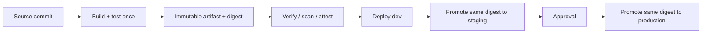
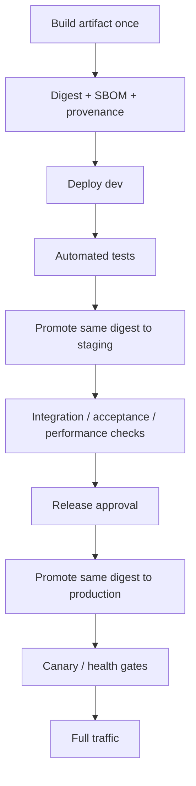

# Đóng gói artifact bất biến và thăng cấp giữa các môi trường

Một pipeline CI/CD đáng tin cậy cần bảo đảm rằng artifact đã được kiểm thử chính là artifact được triển khai ở staging và production. Nếu mỗi môi trường build lại từ source, dependency hoặc toolchain có thể thay đổi giữa các lần build; khi production gặp lỗi, nhóm khó chứng minh binary đang chạy có đúng là binary đã được kiểm thử hay không.

Với Java serverless, artifact có thể là JAR/ZIP cho function runtime hoặc OCI container image cho nền tảng chạy container. Cách phát hành an toàn là **build một lần, xác định danh tính artifact bằng digest, kiểm thử artifact đó, rồi promote chính artifact đó qua các môi trường**. Cấu hình môi trường, secret, IAM và hạ tầng được quản lý riêng, nhưng phải tương thích với phiên bản code được promote.

Bài này trình bày cách đóng gói artifact bất biến, xác minh nguồn gốc và tính toàn vẹn, tách cấu hình theo môi trường, tổ chức CI/CD, triển khai dần, rollback và quản lý thay đổi database/event contract cho Java function/FaaS.

## 1. Artifact bất biến là gì?

### 1.1. Artifact là đầu ra có thể triển khai

Artifact là sản phẩm được tạo từ source code và dependency đã xác định, sẵn sàng để triển khai. Tùy nền tảng:

| Kiểu triển khai | Artifact thường gặp | Nội dung |
| --- | --- | --- |
| Java function runtime | JAR hoặc ZIP | Class handler, dependency, resource và metadata cần thiết |
| Container-based function | OCI image | Application JAR, runtime/base image và cấu hình container |
| Framework/serverless package | ZIP/package do build tool tạo | Function code, dependency và deployment metadata |

Artifact bất biến là artifact đã được tạo và công bố dưới một định danh duy nhất; nội dung không bị thay đổi sau khi build. Nếu cần sửa code hoặc dependency, phải tạo artifact mới và digest mới.

### 1.2. Version tag và digest

Một version dễ đọc có thể là:

```text
orders-api:1.8.2
orders-api:git-a4c91e7
orders-api:release-2026-11-17.3
```

Tag hữu ích cho con người nhưng có thể bị ghi đè nếu registry cho phép. Digest nội dung như SHA-256 xác định chính xác bytes của artifact:

```text
sha256:4d8c... (digest minh họa)
```

Với OCI image, triển khai bằng digest (`image@sha256:...`) giúp bảo đảm runtime nhận đúng image đã kiểm thử. Với JAR/ZIP, lưu SHA-256 checksum trong artifact manifest và xác minh trước khi deploy.

Checksum chứng minh nội dung không thay đổi so với giá trị đã ghi nhận; tự nó không chứng minh ai tạo artifact hoặc source nào được dùng. Để xác minh nguồn gốc, cần thêm provenance/attestation và chữ ký tin cậy.

### 1.3. Tại sao không build riêng cho từng môi trường?

Giả sử commit `a4c91e7` được build ba lần:

- dev build lúc 09:00 dùng dependency resolution tại thời điểm đó;
- staging build lúc 11:00 dùng một base image tag vừa được cập nhật;
- production build lúc 15:00 dùng plugin hoặc dependency đã thay đổi.

Dù source commit giống nhau, ba artifact có thể khác bytes và hành vi. Pipeline build once/promote same artifact loại bỏ sự khác biệt này ở lớp binary.



Các môi trường vẫn có thể có cấu hình khác nhau, nhưng binary được triển khai phải giữ nguyên. Nếu cần build khác cho production, đó là một release candidate khác và phải đi qua quy trình kiểm thử mới.

## 2. Xác định version và metadata của artifact

### 2.1. Artifact identity

Mỗi artifact nên có metadata đủ để trả lời:

- được build từ repository và commit nào;
- build bằng Java version, Maven/Gradle version và toolchain nào;
- dependency version nào được resolve;
- pipeline run nào tạo ra artifact;
- artifact digest là gì;
- test, scan và policy gate nào đã pass;
- artifact được publish ở registry/repository nào;
- môi trường nào đã nhận artifact và thời điểm triển khai.

Không dùng tên file `app-final.jar`, `app-final-2.jar` hoặc tag `latest` làm định danh release. Tên dễ đọc có thể đi kèm digest, nhưng digest là tham chiếu nội dung cần được lưu trong release record.

### 2.2. Artifact manifest

Có thể tạo manifest bên cạnh JAR/ZIP:

```json
{
  "application": "orders-api",
  "version": "1.8.2",
  "source": {
    "repository": "git@example.com/platform/orders-api.git",
    "commit": "a4c91e7"
  },
  "build": {
    "pipelineRun": "ci-4821",
    "java": "21",
    "maven": "3.9.x"
  },
  "artifact": {
    "file": "orders-api-1.8.2.jar",
    "sha256": "REPLACE_WITH_REAL_SHA256"
  }
}
```

Các giá trị trên chỉ là minh họa. Manifest nên được tạo tự động từ pipeline, không nhập tay. Không đưa secret, token hoặc thông tin nội bộ nhạy cảm vào manifest. Manifest phải được lưu cùng release metadata và được bảo vệ khỏi sửa đổi trái phép.

### 2.3. Semantic versioning và build metadata

Semantic versioning (`MAJOR.MINOR.PATCH`) có thể giúp biểu đạt mức độ thay đổi API/behavior. Commit SHA và build number phân biệt các artifact được tạo từ cùng một nhánh hoặc version. Version label không thay thế digest.

Một cách đặt tên:

```text
1.8.2+git.a4c91e7.build.4821
```

Không tái sử dụng cùng version cho hai nội dung khác nhau. Nếu release đã publish, sửa lỗi phải tạo version mới.

## 3. Tạo build có thể lặp lại

### 3.1. Pin toolchain

Kết quả build có thể thay đổi khi toolchain thay đổi. Quản lý rõ:

- Java toolchain/runtime version;
- Maven hoặc Gradle wrapper version;
- compiler và build plugin version;
- dependency version và repository;
- base container image digest nếu build image;
- build arguments và environment ảnh hưởng binary;
- generated source/resource và quy tắc timestamp.

Commit Maven Wrapper (`mvnw`, `.mvn/wrapper`) hoặc Gradle Wrapper (`gradlew`, `gradle/wrapper`) để CI dùng phiên bản build tool đã xác định. Dùng dependency management/BOM và tránh version động như `1.+`, `LATEST` hoặc snapshot không kiểm soát trong release build.

### 3.2. Kiểm soát dependency

Dependency cần được resolve từ repository tin cậy và có version cố định. Với Maven, dùng `dependencyManagement` hoặc BOM; với Gradle, dùng version catalog và dependency locking. Lưu thông tin dependency đã resolve để có thể điều tra một artifact cũ.

Kiểm tra:

- dependency tree và dependency conflict;
- thư viện transitive;
- license policy;
- CVE/vulnerability;
- checksum hoặc provenance của dependency khi khả thi;
- artifact có chứa dependency cần thiết cho runtime hay không.

Không tải dependency từ URL không xác định trong bước deploy. Deploy stage nên lấy artifact đã build và không thực hiện lại dependency resolution.

### 3.3. Build sạch và reproducible build

Một build có thể lặp lại cần cùng source, toolchain, dependency và input tạo ra cùng nội dung artifact hoặc ít nhất cho phép xác minh chính xác provenance. Timestamp, generated metadata và archive ordering có thể làm hai JAR khác digest dù logic giống nhau.

Các thực hành hữu ích:

- dùng clean build trong CI;
- cố định plugin và dependency version;
- tránh lấy dữ liệu mạng không pin trong build;
- chuẩn hóa timestamp/archive metadata nếu build tool hỗ trợ;
- dùng cùng container/toolchain image cho build;
- lưu build log, test report và dependency/SBOM metadata;
- định kỳ thử build lại để phát hiện nguồn không tái lập.

Reproducible build là mục tiêu mạnh hơn “build pass”. Tuy nhiên, ngay cả khi build chưa hoàn toàn reproducible, pipeline vẫn phải promote chính xác artifact đã kiểm thử thay vì build lại.

### 3.4. Maven build cho Java function

Một lệnh build thường dùng:

```bash
./mvnw --batch-mode --no-transfer-progress clean verify
```

`verify` chạy các phase trước đó, gồm compile, test, package và các verification plugin được cấu hình. Với Lambda Java, cần kiểm tra JAR/ZIP có handler class và dependency đúng. Với Cloud Run/container function, cần build image từ artifact đã kiểm tra và pin base image.

Ví dụ tạo checksum sau build:

```bash
sha256sum target/orders-api-1.8.2.jar > target/orders-api-1.8.2.jar.sha256
```

Trên Windows runner, dùng công cụ checksum tương ứng của runner. Điều quan trọng là tạo digest từ chính file sẽ publish, sau đó lưu checksum cùng release record.

## 4. Đóng gói Java serverless artifact

### 4.1. JAR/ZIP cho function runtime

JAR/ZIP cần chứa:

- handler class và class ứng dụng;
- dependency runtime;
- resource/schema/template cần thiết;
- metadata phù hợp với runtime/deployment package;
- không chứa credential hoặc file cấu hình bí mật.

Kiểm tra nội dung bằng `jar tf` hoặc giải nén ZIP trong pipeline. Kiểm tra handler string trỏ đúng class/method. Không chỉ dựa vào việc Maven build thành công; class có thể không được đóng gói hoặc bị relocation sai.

### 4.2. Container image cho Java function

Với container-based runtime, image gồm application artifact và base image/runtime. Nên:

- dùng base image theo digest thay vì tag mutable;
- chạy process bằng user không phải root nếu nền tảng hỗ trợ;
- loại bỏ build tool và file source không cần thiết khỏi runtime layer;
- không bake secret vào image layer;
- scan image và dependency;
- gắn OCI labels cho source revision/version;
- publish image một lần và deploy bằng digest.

Không build image khác nhau cho dev/staging/prod chỉ để nhúng endpoint hoặc password. Cấu hình nên được inject lúc deploy/runtime.

### 4.3. Không đưa environment config vào binary

Artifact chứa code và dependency. Các giá trị thay đổi theo môi trường nên được cung cấp bên ngoài:

- database host/instance reference;
- queue/topic/bucket identifier;
- feature flag;
- log level;
- timeout hoặc concurrency setting;
- secret reference và version policy.

Một số cấu hình compile-time có thể là ngoại lệ, nhưng phải được xem như build input và tạo artifact riêng nếu thực sự thay đổi binary. Với serverless, externalized configuration giúp cùng một artifact chạy ở nhiều môi trường.

## 5. Xác minh integrity, provenance và supply chain

### 5.1. Checksum

Checksum phát hiện artifact bị hỏng hoặc thay đổi trong quá trình lưu/truyền. Khi deploy:

1. tải artifact theo ID/digest đã được release pipeline ghi nhận;
2. tính lại SHA-256;
3. so sánh với checksum trong manifest/release record;
4. dừng deploy nếu không khớp.

Checksum không chống được kẻ tấn công có quyền sửa cả artifact lẫn manifest. Vì vậy, manifest và checksum phải được lưu ở nơi có kiểm soát quyền, audit và tính bất biến phù hợp.

### 5.2. Provenance/attestation

Provenance mô tả artifact được tạo ra như thế nào: source repository/commit, builder identity, build parameters và pipeline run. Attestation là bằng chứng được ký hoặc bảo vệ mật mã để bên deploy có thể xác minh provenance.

Một release policy có thể yêu cầu:

- source repository nằm trong allowlist;
- commit đã được review và branch protection pass;
- build chạy trên pipeline/builder tin cậy;
- test và scan report liên kết với digest;
- provenance xác nhận artifact được tạo từ commit dự kiến;
- artifact không bị sửa sau build.

Các khái niệm như SLSA provenance và in-toto attestation cung cấp cách biểu diễn nguồn gốc và chuỗi cung ứng. Tổ chức có thể áp dụng mức độ phù hợp; không nên tuyên bố đạt một cấp SLSA nếu chưa đáp ứng đầy đủ yêu cầu của cấp đó.

### 5.3. SBOM

Software Bill of Materials (SBOM) liệt kê component/dependency trong artifact. SBOM giúp:

- tìm các ứng dụng chứa một thư viện có CVE mới;
- kiểm tra license;
- đánh giá dependency transitive;
- hỗ trợ incident response và compliance;
- đối chiếu artifact đã triển khai với danh sách thành phần.

Tạo SBOM từ artifact hoặc build dependency graph, gắn SBOM với digest và lưu cùng release metadata. SBOM cần được cập nhật khi artifact thay đổi; không dùng một SBOM chung cho mọi version.

### 5.4. Chữ ký artifact

Chữ ký cho phép xác minh artifact/attestation được tạo bởi identity tin cậy và không bị thay đổi. Với OCI image, có thể dùng công cụ ký image như Sigstore Cosign; với JAR, có thể dùng JAR signing hoặc cơ chế ký/attestation artifact của hệ thống build.

Chữ ký chỉ hữu ích khi deploy pipeline kiểm tra signer identity và trust policy. Không chấp nhận bất kỳ chữ ký hợp lệ nào; chỉ chấp nhận builder/release identity đã được cho phép.

### 5.5. Vulnerability và license gates

Quét dependency, JAR/container image và base image. Policy có thể chặn release khi:

- có critical/high vulnerability chưa có exception;
- dependency không rõ nguồn;
- license bị cấm;
- image chứa secret hoặc credential;
- artifact thiếu SBOM/provenance/signature theo policy.

Exception cần có owner, lý do, thời hạn và kế hoạch khắc phục. Không nên để một lỗ hổng bị ignore vô thời hạn chỉ vì pipeline đang cần pass.

## 6. Lưu trữ artifact và quản lý retention

### 6.1. Artifact repository/registry

Lưu artifact trong repository/registry có kiểm soát quyền, audit và retention. Ví dụ:

- Maven repository cho JAR;
- object storage versioned cho ZIP/package;
- OCI registry cho container image.

Không dùng workspace của CI runner làm kho release. Runner có thể bị hủy hoặc tái sử dụng; artifact phải được publish đến nơi có thể truy xuất ổn định.

### 6.2. Immutable tag và retention

Bật immutable tag nếu registry hỗ trợ. Dù vậy, lưu digest và deploy theo digest vẫn là cách xác định nội dung chắc chắn hơn. Không xóa artifact đang được production hoặc môi trường rollback tham chiếu.

Retention policy nên giữ:

- artifact hiện đang chạy ở production;
- các release trước còn trong thời hạn rollback;
- artifact đang được staging/QA kiểm thử;
- manifest, SBOM, provenance, signature và test report;
- artifact cần giữ theo yêu cầu audit/compliance.

Khi xóa artifact, phải xác minh không còn alias/version/deployment nào cần nó. Việc xóa image đang được revision cũ sử dụng có thể không dừng container hiện tại ngay lập tức, nhưng sẽ làm mất khả năng scale lại hoặc rollback.

### 6.3. Không dùng `latest` trong production

`latest` là tag dễ bị thay đổi và không biểu đạt release cụ thể. Production config nên trỏ đến version immutable hoặc digest. Nếu cần alias dễ đọc như `prod`, alias chỉ nên trỏ đến version đã xác định; release record vẫn lưu digest thực.

## 7. Tách cấu hình theo môi trường

### 7.1. Code giống nhau, cấu hình khác nhau

Một artifact có thể được triển khai ở dev, staging và production với cấu hình riêng:

| Cấu hình | Dev | Staging | Production |
| --- | --- | --- | --- |
| Database | DB dev | DB staging | DB production |
| Queue/topic | Resource dev | Resource staging | Resource production |
| Secret reference | Secret dev | Secret staging | Secret production |
| Runtime identity | SA/role dev | SA/role staging | SA/role production |
| Concurrency | Thấp | Gần production | Theo capacity/SLA |
| Log level | Debug có kiểm soát | Info | Info/warn theo policy |
| Network | Dev VPC | Staging VPC | Production VPC |

Không copy secret production sang staging. Không dùng chung database hoặc queue giữa môi trường nếu test có thể gây side effect lên dữ liệu thật.

### 7.2. Configuration schema và validation

Ứng dụng nên validate cấu hình lúc khởi động:

- biến bắt buộc có giá trị;
- URL/hostname hợp lệ;
- port nằm trong phạm vi hợp lệ;
- timeout/concurrency dương và trong giới hạn;
- secret reference tồn tại theo identity;
- environment name thuộc allowlist;
- feature flag có giá trị hợp lệ.

Fail fast khi cấu hình sai thay vì để function nhận traffic rồi lỗi ở request đầu tiên. Không in giá trị secret khi validate thất bại; chỉ log tên cấu hình hoặc secret resource ID đã được phép hiển thị.

### 7.3. Secrets và runtime identity

Credential nên lấy từ secret manager hoặc workload identity/role theo nền tảng. Deploy pipeline không nên đọc rồi nhúng secret vào artifact. Runtime identity chỉ được quyền đọc secret cần thiết trong môi trường tương ứng.

Nếu secret rotation làm thay đổi version, hãy xác định ứng dụng đọc `latest`, version cụ thể hay cache theo TTL. Cấu hình secret reference có thể thay đổi giữa môi trường, nhưng binary vẫn giữ nguyên.

### 7.4. Feature flags

Feature flag cho phép bật/tắt hành vi theo environment hoặc nhóm traffic mà không cần build binary mới. Dùng flag để rollout dần, nhưng cần:

- owner và mục đích rõ;
- default an toàn;
- audit thay đổi;
- thời hạn dọn flag cũ;
- không dùng flag thay thế authorization hoặc security control.

Flag thay đổi behavior và có thể ảnh hưởng schema/state. Test các tổ hợp flag quan trọng, tránh số lượng tổ hợp bùng nổ.

## 8. Infrastructure as Code và release configuration

### 8.1. Quản lý hạ tầng như source

Function, trigger, IAM policy, queue, DLQ, API route, network và monitoring nên được khai báo bằng IaC như AWS SAM/CDK/CloudFormation, Terraform, Google Cloud deployment tooling hoặc Azure Bicep theo nền tảng.

IaC giúp review thay đổi, tạo lại môi trường và phát hiện drift. Pipeline cần:

1. format/validate template;
2. kiểm tra policy/security;
3. tạo plan/preview;
4. review thay đổi có ảnh hưởng lớn;
5. apply theo environment và quyền tối thiểu;
6. lưu state/outputs và deployment record.

### 8.2. Tách artifact release khỏi infrastructure change

Một release có thể chỉ đổi code, chỉ đổi cấu hình hạ tầng hoặc đổi cả hai. Tách chúng thành các bước/record giúp xác định nguyên nhân khi deploy lỗi.

Ví dụ:

- artifact digest `sha256:abc...` đã được promote;
- IaC revision `infra-91bd2f` tạo queue mới;
- config revision `prod-config-2026-11-17.2` đổi timeout;
- function version `42` trỏ đến artifact digest trên.

Release record nên liên kết các revision này. Không nhất thiết phải publish chúng thành một file; quan trọng là có thể truy xuất chính xác code, config và infrastructure đã chạy cùng nhau.

### 8.3. Tránh drift giữa môi trường

Dev/staging/prod có thể khác về resource ID, secret và capacity, nhưng cấu trúc hạ tầng nên nhất quán. Dùng cùng IaC module/template và parameter theo environment. Kiểm tra drift định kỳ; không sửa thủ công production rồi quên cập nhật source of truth.

Nếu cần hotfix thủ công, phải đưa thay đổi về IaC/repository ngay sau đó và tạo audit record. Nếu không, lần apply tiếp theo có thể ghi đè hotfix.

## 9. CI pipeline: build, test và publish một lần

### 9.1. Các stage của CI

Một CI pipeline cho Java function có thể gồm:

1. Checkout commit đã review.
2. Xác định Java/Maven/Gradle toolchain.
3. Compile và static analysis.
4. Unit/handler/contract tests.
5. Integration tests với database/container/emulator.
6. Build JAR/ZIP hoặc OCI image.
7. Kiểm tra artifact content và handler entry point.
8. Tạo checksum, SBOM và provenance.
9. Quét vulnerability/license/secret.
10. Ký artifact/attestation nếu policy yêu cầu.
11. Publish artifact bất biến vào registry.
12. Lưu release metadata và test reports.

Không publish artifact nếu test hoặc policy gate bắt buộc chưa pass. Không sửa file JAR sau khi tính checksum; nếu cần sửa, phải build lại, tạo digest mới và chạy lại các gate.

### 9.2. Ví dụ workflow GitHub Actions cho JAR

Workflow rút gọn dưới đây minh họa build một lần và publish artifact cùng checksum. Cần điều chỉnh action version, permission, repository và artifact storage theo tổ chức.

```yaml
name: build-orders-function

on:
  push:
    branches: [main]
  pull_request:

permissions:
  contents: read

jobs:
  build:
    runs-on: ubuntu-latest
    steps:
      - uses: actions/checkout@v4

      - uses: actions/setup-java@v4
        with:
          distribution: temurin
          java-version: '21'
          cache: maven

      - name: Verify and package
        run: ./mvnw --batch-mode --no-transfer-progress clean verify

      - name: Calculate digest
        run: |
          cd target
          sha256sum orders-api.jar > orders-api.jar.sha256

      - name: Publish build output
        uses: actions/upload-artifact@v4
        with:
          name: orders-api-${{ github.sha }}
          path: |
            target/orders-api.jar
            target/orders-api.jar.sha256
          if-no-files-found: error
          retention-days: 30
```

Tên JAR cần khớp với Maven build configuration. Workflow minh họa lưu artifact CI; trong production, nên publish vào artifact repository/registry có retention, immutable version và quyền truy cập phù hợp. Với container image, publish image và ghi lại digest từ registry.

### 9.3. Build artifact một lần

Sau khi publish:

- không chạy Maven package lại trong deploy job;
- không thay dependency hoặc resource trong artifact;
- không sửa JAR để chèn environment variable;
- không build image riêng cho staging và production;
- chỉ tạo config/deployment revision riêng theo môi trường.

Deploy job phải tải đúng artifact theo build ID/digest, xác minh checksum và dùng artifact đó. Nếu artifact CI tạm thời hết hạn, lấy lại từ release repository; không build lại rồi gán cùng version.

## 10. Promotion giữa dev, staging và production

### 10.1. Promotion là gì?

Promotion là việc đưa cùng một artifact đã qua gate sang môi trường có mức tin cậy cao hơn. Promotion không tạo binary mới.



Mỗi môi trường có deployment record gồm artifact digest, config revision, IaC revision, runtime version, target function/version/alias và kết quả health check.

### 10.2. Xác minh trước khi deploy

Deploy stage cần kiểm tra:

- artifact ID/digest đúng với release được phê duyệt;
- checksum hoặc registry digest hợp lệ;
- chữ ký/provenance hợp lệ nếu policy yêu cầu;
- SBOM và vulnerability gate đã pass;
- artifact được phép deploy vào environment này;
- config/secret reference cần thiết tồn tại;
- IaC/network/IAM prerequisite đã sẵn sàng;
- schema/event contract tương thích với version đang chạy.

Không để deployer chọn một file bất kỳ từ workspace. Release candidate nên được chọn qua ID bất biến đã được CI publish.

### 10.3. Promotion manifest

Một promotion record có thể chứa:

```yaml
release:
  application: orders-api
  version: 1.8.2
  sourceCommit: a4c91e7
  artifactDigest: sha256:REPLACE_WITH_REAL_DIGEST
  artifactUri: registry.example.com/orders-api@sha256:REPLACE_WITH_REAL_DIGEST
  sbomUri: artifacts/orders-api/1.8.2/sbom.cdx.json
  provenanceUri: artifacts/orders-api/1.8.2/provenance.json

deployment:
  environment: staging
  configRevision: staging-config-17
  infrastructureRevision: infra-91bd2f
  deployedAt: 2026-11-17T10:00:00Z
  deployedBy: release-pipeline
```

Manifest này chỉ minh họa cấu trúc release record. Không lưu secret value hoặc token trong manifest. `artifactUri` nên trỏ trực tiếp đến digest; `version` và tag chỉ phục vụ tra cứu.

### 10.4. Approval gates

Approval có thể tự động hoặc thủ công tùy rủi ro. Ví dụ:

- PR review và branch protection trước build;
- unit/contract/integration tests pass;
- security/license policy pass;
- staging acceptance test pass;
- performance/error budget không vi phạm;
- database migration plan được review;
- owner/operations approve production release;
- canary health gate pass trước khi tăng traffic.

Approval phải gắn với artifact digest cụ thể. Nếu binary thay đổi sau approval, cần tạo release candidate mới và chạy lại các gate liên quan.

## 11. Chiến lược triển khai serverless

### 11.1. Direct replacement

Thay version hiện tại bằng version mới trong một lần. Cách này đơn giản nhưng blast radius lớn hơn. Chỉ phù hợp với workload ít rủi ro, có rollback nhanh và không cần kiểm tra traffic dần.

### 11.2. Blue/green

Triển khai version mới thành green trong khi blue vẫn nhận traffic. Chạy smoke/acceptance test trên green, sau đó chuyển traffic. Nếu lỗi, chuyển lại blue.

Ưu điểm là rollback nhanh và dễ kiểm tra version mới. Nhược điểm là cần capacity chạy song song, schema/database phải tương thích và side effect của green trong quá trình test phải được kiểm soát.

### 11.3. Canary

Chuyển một tỷ lệ nhỏ traffic đến version mới, quan sát lỗi/latency/business metric rồi tăng dần. Ví dụ:

```text
5% → 10% → 25% → 50% → 100%
```

Các bước và thời gian quan sát phải dựa trên traffic đủ đại diện. Nếu traffic thấp, 5% có thể chỉ là vài request và không đủ dữ liệu để kết luận.

### 11.4. Linear rollout

Tăng traffic theo các bước đều nhau, ví dụ 10% mỗi khoảng thời gian. Linear rollout dễ vận hành và tạo cơ hội quan sát, nhưng có thể kéo dài release. Cần đặt timeout và tiêu chí dừng rõ ràng.

### 11.5. Rolling deployment

Thay instance/pod theo từng nhóm trong khi service tiếp tục hoạt động. Phù hợp với nền tảng container/Kubernetes. Cần readiness/liveness probe, capacity dư, graceful shutdown và tương thích giữa các phiên bản trong thời gian rollout.

### 11.6. Tùy chọn theo nền tảng

| Nền tảng | Cơ chế thường dùng |
| --- | --- |
| AWS Lambda | Publish immutable function version; alias có thể trỏ version và hỗ trợ weighted routing theo cấu hình |
| Google Cloud Run | Mỗi deploy tạo revision; có thể chia traffic giữa các revision |
| Cloud Functions thế hệ mới | Tùy mô hình sản phẩm có thể triển khai qua revision/Cloud Run semantics; kiểm tra khả năng cụ thể |
| Azure Functions | Deployment slots/slot swap với các hosting plan hỗ trợ; cần kiểm tra trigger và plan semantics |
| Kubernetes/Knative | Revision/traffic split, rolling update hoặc blue/green qua ingress/gateway |

Không phải trigger bất đồng bộ nào cũng hỗ trợ weighted traffic giống HTTP. Với queue/stream, có thể phải triển khai consumer version song song, thay event source mapping hoặc điều phối routing riêng. Hãy kiểm tra khả năng của trigger và nền tảng trước khi chọn chiến lược.

## 12. Health gate và tiêu chí dừng rollout

### 12.1. Theo dõi cả metric kỹ thuật và nghiệp vụ

Metric kỹ thuật:

- invocation error rate;
- timeout/throttle;
- p95/p99 duration;
- cold start/init duration;
- concurrency và memory;
- queue age/backlog và DLQ depth;
- dependency error/latency.

Metric nghiệp vụ:

- đơn hàng tạo thành công;
- payment success/failure;
- event được xử lý hoàn tất;
- tỷ lệ validation rejection;
- số side effect trùng;
- thời gian từ event đến business completion.

Một function có thể trả 200 nhưng ghi sai dữ liệu hoặc đưa event vào queue không đúng. Health gate cần nhìn đến kết quả nghiệp vụ, không chỉ HTTP status.

### 12.2. Định nghĩa rollback threshold

Ví dụ policy:

- error rate version mới cao hơn baseline một ngưỡng đã thống nhất;
- p95 latency vượt SLA trong thời gian quan sát;
- DLQ hoặc queue age tăng liên tục;
- business success rate giảm;
- database connection/CPU vượt capacity budget;
- security/permission error xuất hiện sau deploy.

Ngưỡng phải được xác định từ SLO/baseline thực tế, không sao chép con số chung. Có thời gian quan sát tối thiểu và điều kiện sample size để tránh rollback do một lỗi đơn lẻ khi traffic rất thấp.

### 12.3. Tự động dừng và rollback

Pipeline có thể tự động dừng tăng traffic khi health gate fail. Tự động rollback chỉ nên bật khi:

- metric đủ tin cậy;
- rollback action an toàn và đã kiểm thử;
- database/event contract tương thích;
- rollback không gây side effect lặp hoặc mất dữ liệu;
- có thông báo và audit trail cho người vận hành.

Nếu trạng thái dữ liệu không rõ hoặc migration không thể đảo ngược, pipeline nên dừng rollout và yêu cầu xử lý có kiểm soát thay vì tự động quay về binary cũ.

## 13. Rollback và tương thích dữ liệu

### 13.1. Rollback artifact không tự rollback database

Đưa function về version cũ không tự đảo ngược schema migration, dữ liệu đã ghi hoặc event đã phát. Một release có thể đã:

- thêm cột database;
- ghi định dạng payload mới;
- tạo object mới;
- gửi event mà consumer cũ không hiểu;
- thực hiện payment hoặc side effect bên ngoài.

Trước release, xác định những thay đổi nào có thể đảo ngược và những thay đổi nào cần forward fix/compensation.

### 13.2. Expand-and-contract migration

Để giữ tương thích khi hai version chạy song song:

1. **Expand:** thêm cột/table/field mới theo cách không phá code cũ.
2. **Dual-compatible release:** code mới có thể đọc dữ liệu cũ và mới; code cũ vẫn hoạt động.
3. **Backfill:** chuyển dữ liệu theo batch có kiểm soát.
4. **Switch:** chuyển traffic/consumer sang code mới.
5. **Observe:** xác nhận không còn version cũ đọc field cũ.
6. **Contract:** xóa cột/field cũ trong release sau khi chắc chắn không còn consumer phụ thuộc.

Không drop/rename column trong cùng release mà code cũ vẫn có thể chạy. Với event schema, dùng versioning và giai đoạn dual-read/dual-publish nếu cần.

### 13.3. Event compatibility

Trong thời gian rollout, producer và consumer có thể ở version khác nhau. Giữ schema tương thích ngược/tiến theo khả năng hệ thống:

- thêm field tùy chọn thay vì đổi field bắt buộc;
- consumer bỏ qua field chưa biết;
- không đổi semantics âm thầm;
- dùng event type/version mới cho breaking change;
- duy trì consumer cũ cho đến khi backlog và replay window kết thúc;
- kiểm tra DLQ/redrive với schema mới.

Với queue, event đã được publish trước release có thể vẫn nằm trong backlog sau khi consumer mới triển khai. Cần test cả message cũ và mới.

### 13.4. Rollback và side effects

Nếu function đã gửi payment, email hoặc command đến thiết bị, rollback code không thể xóa side effect đã xảy ra. Cần idempotency, outbox/inbox, compensation hoặc reconciliation. Ghi release/version vào event/log để biết version nào thực hiện side effect.

## 14. CI/CD cho function bất đồng bộ

HTTP traffic có thể chia theo revision hoặc alias, nhưng queue/event trigger có semantics khác. Một số cách triển khai:

- deploy consumer version mới nhưng chưa gắn trigger, chạy test bằng message mẫu;
- tạo event source mapping mới với concurrency giới hạn;
- chuyển routing hoặc subscription sang consumer mới;
- chạy song song hai consumer nhưng dùng idempotency và kiểm soát side effect;
- drain backlog trước khi tắt consumer cũ nếu ordering/compatibility yêu cầu;
- giữ DLQ và replay path cho message chưa xử lý.

Không để hai consumer cùng xử lý một message nếu nghiệp vụ không idempotent. Nếu chạy shadow consumer để so sánh kết quả, shadow phải không tạo side effect production hoặc phải dùng sandbox destination.

## 15. Release record, audit và khả năng truy vết

Mỗi lần deploy nên lưu:

- application/service và environment;
- artifact version, URI và digest;
- source commit và repository;
- build pipeline/run ID;
- SBOM/provenance/signature reference;
- test report và security gate result;
- IaC/config revision;
- function version/revision/alias hoặc container image digest;
- trigger/event source mapping version;
- người hoặc pipeline phê duyệt;
- thời điểm deploy, rollout step và health result;
- rollback target và kết quả rollback nếu có.

Release record giúp điều tra “code nào đang chạy ở đâu”, so sánh dev/staging/prod và xác định artifact đã được kiểm thử. Không cần lưu toàn bộ log vào manifest; hãy liên kết đến hệ thống log/trace có retention và quyền truy cập phù hợp.

## 16. Checklist trước khi promote production

- [ ] Artifact được build một lần từ commit đã review.
- [ ] Java/toolchain/build plugin/dependency version được pin.
- [ ] JAR/ZIP/container image đã được kiểm tra nội dung và entry point.
- [ ] Artifact có version và digest bất biến; không deploy bằng `latest`.
- [ ] Checksum được xác minh trước deploy.
- [ ] SBOM và provenance được tạo, gắn với digest.
- [ ] Chữ ký/attestation được xác minh theo trust policy nếu yêu cầu.
- [ ] Vulnerability, license và secret scanning đã pass hoặc có exception có hạn.
- [ ] Artifact được publish vào repository/registry có retention và audit.
- [ ] Deploy stage tải đúng artifact, không build lại.
- [ ] Cấu hình, secret và runtime identity được quản lý riêng theo environment.
- [ ] IaC revision và config revision được ghi trong release record.
- [ ] Dev/staging test dùng cùng artifact digest dự kiến promote.
- [ ] Production approval gắn với digest cụ thể.
- [ ] Deployment strategy phù hợp với HTTP hoặc async trigger semantics.
- [ ] Canary/health gate có metric kỹ thuật và nghiệp vụ.
- [ ] Rollback target còn được lưu trong registry.
- [ ] Database migration theo expand-and-contract khi cần tương thích hai version.
- [ ] Event schema và backlog tương thích với consumer cũ/mới.
- [ ] Side effect có idempotency/compensation/reconciliation phù hợp.
- [ ] Post-deploy smoke test và audit trail được lưu.

## Kết luận

Đóng gói artifact bất biến giúp đội ngũ biết chính xác binary nào đã được kiểm thử và đang chạy ở mỗi môi trường. Với Java serverless, artifact có thể là JAR/ZIP hoặc OCI image; hãy gắn version và digest, lưu checksum, SBOM, provenance và chữ ký theo mức kiểm soát cần thiết. Deploy stage phải lấy lại đúng artifact đã publish và xác minh trước khi triển khai.

Promotion giữa dev, staging và production nên thay đổi cấu hình, secret, IAM và hạ tầng theo môi trường nhưng giữ nguyên artifact digest. CI/CD cần có test/security gates, approval gắn với release candidate, rollout dần và health gate dựa trên cả metric kỹ thuật lẫn nghiệp vụ.

Rollback chỉ an toàn khi code, database schema, event contract và side effect được thiết kế để tương thích trong thời gian hai version cùng tồn tại. Kết hợp immutable artifact, IaC, expand-and-contract migration, idempotency và release record giúp việc phát hành serverless có thể kiểm chứng, lặp lại và phục hồi khi có sự cố.
