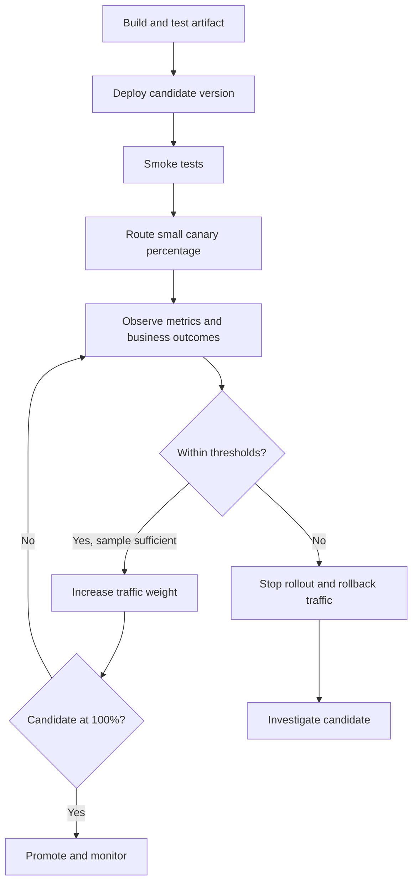
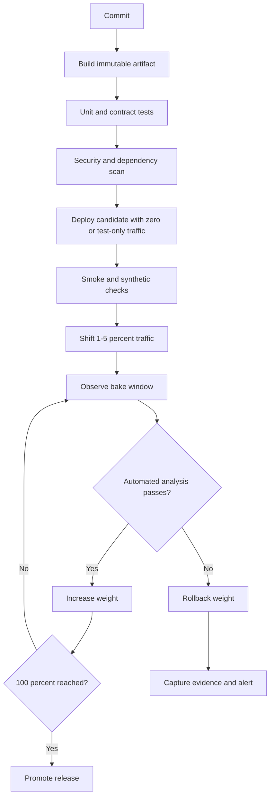

# Triển khai canary và chuyển traffic theo tỷ lệ

## 1. Canary deployment là gì?

Canary deployment là cách phát hành phiên bản mới cho một phần nhỏ traffic trước, quan sát kết quả rồi mới tăng dần tỷ lệ người dùng hoặc sự kiện đi qua phiên bản đó. Nếu phiên bản mới hoạt động tốt, nhóm tiếp tục mở rộng traffic cho đến khi toàn bộ hệ thống dùng phiên bản mới. Nếu phát hiện lỗi, nhóm chuyển traffic về phiên bản ổn định.

Tên gọi “canary” xuất phát từ việc đưa một phần nhỏ vào môi trường mới trước để phát hiện vấn đề sớm. Trong serverless, có thể triển khai hai version của function hoặc hai revision của service, sau đó định tuyến một tỷ lệ request đến bản mới. Việc này giảm phạm vi ảnh hưởng khi có lỗi về code, dependency, cấu hình hoặc hiệu năng.

Ví dụ, một HTTP function xử lý thanh toán đang chạy phiên bản `v17`. Nhóm phát hành `v18` và ban đầu chỉ chuyển 5% request đến phiên bản mới. Sau khi quan sát error rate, latency, timeout và kết quả nghiệp vụ, nhóm tăng lên 10%, 25%, 50% rồi 100%. Nếu lỗi vượt ngưỡng, traffic được chuyển lại `v17`.

Canary không chỉ là deploy một bản mới và chờ. Một đợt canary có chất lượng cần có:

- Artifact/version bất biến và có thể nhận diện chính xác.
- Hai phiên bản cùng tồn tại trong giai đoạn thử nghiệm.
- Quy tắc phân phối traffic rõ ràng.
- Chỉ số sức khỏe và baseline của phiên bản ổn định.
- Thời gian quan sát và số lượng request tối thiểu.
- Ngưỡng tiếp tục, dừng hoặc rollback được định nghĩa trước.
- Cơ chế xử lý dữ liệu và side effect khi hai phiên bản chạy đồng thời.

Trong module CLOUD_SERVERLESS, canary cần được xem xét cho HTTP function, queue/event consumer và các dịch vụ Java chạy trên nền tảng serverless. Mỗi loại trigger có cách phân phối traffic và semantics retry khác nhau; không phải mọi trigger đều có thể chia phần trăm theo cùng một cách.

## 2. Canary, blue-green và rolling deployment

Ba chiến lược này thường được dùng cùng nhau nhưng có cách chuyển traffic khác nhau.

| Chiến lược | Cách triển khai | Cách chuyển traffic | Khi phù hợp |
| --- | --- | --- | --- |
| Canary | Chạy bản mới song song với bản hiện tại | Tăng dần tỷ lệ đến bản mới theo các bước | Muốn giới hạn blast radius và đánh giá bằng traffic thật |
| Blue-green | Duy trì hai môi trường tương đương | Chuyển phần lớn hoặc toàn bộ traffic từ blue sang green tại một thời điểm | Muốn chuyển đổi nhanh và có môi trường cũ để quay lại |
| Rolling | Thay dần từng instance/replica trong nhóm | Scheduler thay từng phần instance theo batch | Nền tảng có nhiều instance lâu dài và hỗ trợ rollout theo replica |

Canary tập trung vào tỷ lệ người dùng hoặc request được tiếp xúc với bản mới. Blue-green tập trung vào hai môi trường đầy đủ và một lần chuyển traffic lớn. Rolling thay instance dần; tỷ lệ traffic thực tế có thể thay đổi theo số replica và load balancing.

Một rollout có thể kết hợp các cách: tạo môi trường green, đưa 1% traffic sang green, tăng dần đến 100%, sau đó giữ blue trong thời gian rollback. Khi đó blue-green cung cấp môi trường dự phòng, còn canary điều khiển quá trình chuyển đổi.

## 3. Các cách phân phối traffic

### 3.1. Weighted routing

Weighted routing chia request giữa nhiều phiên bản theo trọng số. Ví dụ:

| Version | Weight |
| --- | ---: |
| Stable `v17` | 95% |
| Candidate `v18` | 5% |

Với một lượng request đủ lớn và bộ định tuyến hoạt động đúng, số request đến mỗi version sẽ gần với tỷ lệ cấu hình. Đây là phân phối xác suất, không phải cam kết mỗi nhóm 100 request sẽ có chính xác 5 request đến canary. Một batch nhỏ có thể lệch đáng kể so với tỷ lệ kỳ vọng.

Weighted routing thường phù hợp với HTTP request độc lập. Bộ định tuyến có thể chọn version theo từng request, theo kết nối, cookie hoặc cơ chế hash. Cần hiểu chính xác semantics của nền tảng: tỷ lệ theo request, theo kết nối hay theo session sẽ tạo ra kết quả khác nhau.

### 3.2. Header, cookie, tenant hoặc user cohort

Thay vì chọn ngẫu nhiên, có thể định tuyến theo thuộc tính:

- Header nội bộ như `X-Canary: true` dành cho tester.
- Cookie để một browser tiếp tục đi đến cùng version.
- Tenant hoặc customer cohort để triển khai theo nhóm khách hàng.
- Hash ổn định từ user ID hoặc account ID.
- Region, partner hoặc loại request cụ thể.

Sticky routing giúp một người dùng không liên tục chuyển giữa hai version trong cùng phiên. Điều này hữu ích khi UI, session hoặc cache có thể bị ảnh hưởng bởi khác biệt phiên bản. Tuy nhiên, sticky routing có thể làm phân phối lệch nếu một tenant tạo phần lớn traffic.

Không cho client bên ngoài tự đặt header canary để truy cập tính năng chưa được phê duyệt. Header điều khiển rollout phải được gateway tin cậy thiết lập hoặc được xác thực và giới hạn theo danh sách tester.

### 3.3. Shadow traffic

Shadow traffic gửi bản sao của request/event đến phiên bản mới để quan sát kết quả mà không dùng response của bản mới làm kết quả chính. Cách này giúp kiểm tra khả năng parse, hiệu năng hoặc sự khác biệt đầu ra mà không ảnh hưởng trực tiếp người dùng.

Shadow mode chỉ an toàn khi phiên bản shadow không tạo side effect. Nếu cả hai version cùng gửi email, thu tiền, cập nhật database hoặc tạo resource, hệ thống có thể thực hiện hành động hai lần. Cần dùng read-only mode, mock downstream hoặc dữ liệu cô lập.

Với dữ liệu nhạy cảm, phải kiểm tra quyền sử dụng và chính sách dữ liệu trước khi sao chép request sang một môi trường khác. Không gửi dữ liệu production sang môi trường thử nghiệm nếu chưa có biện pháp bảo vệ phù hợp.

## 4. Tính toán tỷ lệ và kích thước mẫu

### 4.1. Tỷ lệ kỳ vọng

Nếu tổng số request trong thời gian quan sát là `N`, tỷ lệ canary là `p`, số request kỳ vọng đến canary là:

\[
E[canary] = N \times p
\]

Ví dụ, với 2.000 request và tỷ lệ 5%, canary kỳ vọng nhận khoảng 100 request. Với 20 request và tỷ lệ 5%, kỳ vọng chỉ là một request; mẫu nhỏ như vậy không đủ để kết luận chắc chắn về chất lượng.

### 4.2. Xác suất chưa có request nào đến canary

Nếu mỗi request được chọn độc lập với xác suất `p`, xác suất không có request nào đến canary sau `N` request là:

\[
P(0) = (1-p)^N
\]

Với 5% canary và chỉ 20 request, xác suất không có request nào đến bản mới xấp xỉ 35,8%. Vì vậy, một khoảng thời gian canary ngắn với traffic thấp có thể chưa thực sự kiểm tra được phiên bản mới.

Đây là mô hình đơn giản. Nếu nền tảng định tuyến theo connection, cookie hoặc hash cohort, các request không độc lập và phân phối thực tế có thể khác. Khi đánh giá, hãy dùng số invocation thực tế của từng version thay vì chỉ dựa vào phần trăm cấu hình.

### 4.3. Thời gian bake

Bake time là khoảng thời gian giữ một tỷ lệ canary trước khi quyết định tăng traffic. Bake time nên đủ để:

- Thu thập một số lượng request/event có ý nghĩa.
- Bao phủ chu kỳ tải đặc trưng, ví dụ giờ cao điểm hoặc một đợt batch.
- Quan sát lỗi chậm như timeout, memory leak hoặc downstream throttling.
- Kiểm tra kết quả nghiệp vụ và dữ liệu được ghi.
- Đánh giá các phân khúc traffic quan trọng.

Không dùng một khoảng chờ cố định giống nhau cho mọi service. API có hàng nghìn request mỗi phút có thể đạt sample size nhanh; function chỉ chạy vài lần mỗi ngày cần thời gian quan sát dài hơn hoặc một bộ test chủ động.

## 5. Quy trình canary tổng quát

Một rollout điển hình gồm các bước:

1. Build và test artifact mới.
2. Publish artifact bất biến, gắn version/commit/digest.
3. Triển khai version mới mà chưa chuyển traffic production hoặc chỉ cho phép truy cập kiểm thử.
4. Chạy smoke test và kiểm tra health cơ bản.
5. Chuyển một tỷ lệ nhỏ traffic, ví dụ 1% hoặc 5%.
6. Theo dõi chỉ số của stable và canary trong thời gian bake.
7. Nếu đạt điều kiện, tăng tỷ lệ theo từng bước.
8. Nếu vi phạm ngưỡng, dừng rollout và chuyển traffic về stable.
9. Khi đạt 100%, tiếp tục theo dõi và chỉ xóa version cũ sau thời gian rollback đã định.
10. Ghi nhận kết quả, version, tỷ lệ, thời gian và quyết định phát hành.



Các bước tăng tỷ lệ có thể là 1% → 5% → 10% → 25% → 50% → 100%. Đây chỉ là ví dụ; chọn tỷ lệ dựa trên lưu lượng, mức độ rủi ro, khả năng rollback và mức tin cậy của metric.

## 6. Những gì cần đo trong canary

### 6.1. Chỉ số kỹ thuật

| Chỉ số | Vì sao cần theo dõi |
| --- | --- |
| Error rate theo version | Phát hiện exception, lỗi response và lỗi runtime của candidate |
| p50/p95/p99 latency | Phát hiện độ trễ tăng, đặc biệt tail latency |
| Timeout rate | Phát hiện function không hoàn thành trong deadline |
| Throttling/concurrency | Phát hiện giới hạn concurrency hoặc downstream capacity |
| Memory/CPU | Phát hiện thiếu memory, GC hoặc chi phí tài nguyên tăng |
| Cold start/init duration | Phát hiện package/framework mới làm chậm invocation đầu |
| Retry và DLQ count | Phát hiện lỗi event handler hoặc message processing |
| Queue age/backlog | Phát hiện consumer mới xử lý chậm hơn tốc độ producer |
| Dependency errors | Phân biệt lỗi candidate với lỗi database/API dùng chung |

Phải gắn nhãn version/revision/alias vào metric để so sánh stable và canary. Nếu chỉ xem metric tổng của toàn function, lỗi của 5% candidate có thể bị che khuất bởi 95% stable.

### 6.2. Chỉ số nghiệp vụ

Chỉ số kỹ thuật pass chưa chắc nghiệp vụ đúng. Nên theo dõi thêm:

- Tỷ lệ thanh toán thành công/thất bại.
- Tỷ lệ tạo đơn, xác nhận đơn hoặc hủy đơn.
- Số giao dịch bị trùng hoặc bị bỏ sót.
- Tỷ lệ hoàn tiền hoặc compensation.
- Tỷ lệ người dùng hoàn thành một hành trình.
- Sai khác giữa số event nhận, xử lý và ghi nhận.
- Số request bị từ chối do validation hoặc authorization.

Các metric nghiệp vụ cần được phân đoạn theo version mà không đưa dữ liệu cá nhân vào label. Với event consumer, cần đối chiếu số message đã nhận, số message đã ack/checkpoint, số duplicate và số message vào DLQ.

### 6.3. So sánh với baseline

Không nên chỉ kiểm tra candidate có error rate dưới một con số tuyệt đối. Cần so sánh với stable trong cùng khoảng thời gian và cùng phân khúc traffic. Ví dụ, nếu stable có error rate 0,1% nhưng canary là 1,5%, candidate có thể đang gây regression dù vẫn dưới một ngưỡng cảnh báo chung 2%.

Baseline phải tính đến sự cố downstream dùng chung. Nếu database đang quá tải và cả hai version cùng tăng latency, không nên quy lỗi cho candidate. Có thể dùng metric theo dependency, trace và cohort để xác định nguyên nhân.

### 6.4. Ngưỡng tiếp tục và rollback

Đặt điều kiện rõ ràng trước khi rollout. Ví dụ:

| Điều kiện | Hành động gợi ý |
| --- | --- |
| Candidate error rate tăng đáng kể so với stable | Dừng tăng traffic; rollback nếu vượt ngưỡng đã định |
| p99 latency vượt SLO trong thời gian liên tục | Dừng rollout và điều tra |
| Tỷ lệ payment failure tăng | Rollback ngay theo ngưỡng nghiệp vụ |
| DLQ hoặc retry tăng bất thường | Dừng tăng tỷ lệ consumer mới |
| Sample size chưa đủ | Giữ tỷ lệ hiện tại và tiếp tục quan sát |
| Downstream đang gặp sự cố trên cả hai version | Tạm dừng quyết định, phân tích nguyên nhân chung |

Ngưỡng cụ thể phải theo SLO, error budget và rủi ro nghiệp vụ của hệ thống. Không dùng con số ví dụ làm policy chung cho mọi function.

## 7. Canary cho HTTP function

### 7.1. Định tuyến ở lớp gateway hoặc alias

Với HTTP function, traffic có thể được chia ở nhiều lớp:

- API gateway hoặc ingress chọn backend/function version.
- Load balancer chia traffic giữa hai service/revision.
- Function platform cung cấp alias hoặc deployment slot có weighted routing.
- Một release controller thay đổi weight trong cấu hình routing.

Chọn một nơi chịu trách nhiệm phân phối traffic và ghi rõ nơi đó trong kiến trúc. Nếu gateway đã chia 5% traffic sang service mới, trong khi service mới lại chia tiếp 10% sang function candidate, tỷ lệ cuối cùng là tích của hai weight (0,5% trong ví dụ), không phải 10%.

### 7.2. AWS Lambda: version và weighted alias

Lambda version đã publish là snapshot bất biến của code và một phần cấu hình function. Alias là tên có thể trỏ đến version cụ thể. Alias có thể cấu hình weighted routing đến một version phụ, giúp chuyển một phần invocation qua version mới.

Ví dụ khái niệm:

```text
Alias: production
  primary version: 17
  additional version: 18
  additional version weight: 0.05
```

Trong ví dụ này, phần lớn invocation qua alias `production` đi đến version 17 và một tỷ lệ mục tiêu 5% được định tuyến đến version 18. Caller phải gọi alias ARN thay vì gọi trực tiếp version hoặc `$LATEST` nếu muốn weight có hiệu lực.

AWS CodeDeploy có thể điều phối Lambda canary hoặc linear deployment configuration. Pipeline có thể publish version, cập nhật alias, chờ CloudWatch alarm và tự rollback nếu alarm kích hoạt. Tên deployment configuration và semantics cần kiểm tra theo cấu hình AWS đang dùng.

Lưu ý:

- Weighted routing chỉ áp dụng cho invocation đi qua alias có routing configuration.
- Một số tích hợp hoặc event source có semantics retry/batch riêng; không suy ra mọi nguồn event đều được chia traffic như HTTP request độc lập.
- Chỉ số cần phân đoạn theo executed version, không chỉ theo alias tổng.
- Version cũ phải còn tồn tại trong thời gian rollback.
- Thay đổi IAM, environment variable, layer hoặc runtime cũng cần được xem xét cùng code version.

### 7.3. Azure Functions: deployment slots và traffic routing

Azure Functions có thể dùng deployment slots trên các plan hỗ trợ. Mỗi slot là một môi trường triển khai riêng với cấu hình và endpoint riêng; một số cấu hình có thể được đánh dấu là slot setting để không bị hoán đổi. Có thể dùng slot traffic routing để gửi một tỷ lệ HTTP request đến slot thử nghiệm, hoặc dùng slot swap để chuyển phiên bản.

Khi dùng slot cho canary, cần xác minh:

- Plan và loại Function App có hỗ trợ slot theo yêu cầu.
- Trigger nào thực sự được phân phối theo traffic routing; không giả định queue/timer trigger được chia phần trăm giống HTTP.
- App settings và connection string nào là slot-sticky.
- Hai slot có thể cùng chạy listener/consumer và gây xử lý message trùng hay không.
- Storage, host ID và tài nguyên dùng chung có thể gây xung đột không.
- Rollback bằng cách đổi traffic hoặc swap có khôi phục được cả cấu hình cần thiết không.

Với background trigger, thường cần chiến lược riêng như tạm dừng listener ở slot staging, dùng queue/subscription riêng hoặc triển khai consumer candidate có kiểm soát. Cần đọc đúng semantics của trigger và plan thay vì áp dụng tỷ lệ HTTP cho mọi function.

### 7.4. Google Cloud Run: revision traffic splitting

Cloud Run triển khai container thành revision. Service có thể chia tỷ lệ traffic giữa các revision, ví dụ 95% cho revision stable và 5% cho revision mới. Đây là mô hình phù hợp với HTTP service chạy trên Cloud Run; Cloud Run là nền tảng serverless container, không phải cùng mô hình function runtime với mọi FaaS.

Khi sử dụng revision traffic splitting:

- Gắn tag/version cho revision để kiểm thử trực tiếp nếu phù hợp.
- Đảm bảo cấu hình service, secret và service account tương thích.
- Theo dõi request count, error rate, latency và instance scaling theo revision.
- Kiểm tra session affinity nếu service có stateful session.
- Rollback bằng cách điều chỉnh traffic về revision ổn định.

Không lưu session hoặc dữ liệu nghiệp vụ chỉ trong bộ nhớ container vì revision có thể scale về zero hoặc bị thay thế.

## 8. Canary cho queue consumer và event-driven function

### 8.1. Không phải mọi event đều có thể chia theo tỷ lệ HTTP

Với HTTP, router thường chọn một version cho từng request. Với queue hoặc event stream, việc chia consumer cần xét acknowledgement, checkpoint, ordering, batch và retry. Nếu hai consumer group độc lập cùng đọc một topic, cả hai có thể nhận toàn bộ event chứ không phải mỗi bên nhận một phần.

Các cách triển khai thường gặp:

- Dùng broker subscription/filter để gửi một tập event được chọn đến consumer candidate.
- Chia theo tenant, event type, partition hoặc message key.
- Tạo queue/subscription riêng cho canary và định tuyến một phần message sang đó.
- Dùng event router/rule có điều kiện để chọn target.
- Với stream, kiểm soát partition assignment hoặc tạo một luồng thử nghiệm đã được tách rõ.
- Chạy shadow consumer chỉ đọc và không tạo side effect.

Không cho stable và candidate cùng xử lý một message nghiệp vụ nếu cả hai có thể cập nhật trạng thái hoặc gọi downstream. Nếu cần so sánh kết quả, dùng shadow mode, idempotency chung hoặc dữ liệu cô lập.

### 8.2. Canary theo tenant hoặc partition

Đối với event có ordering theo aggregate, chọn một tập tenant hoặc partition ổn định có thể an toàn hơn chia ngẫu nhiên từng message. Ví dụ, tất cả event của tenant `tenant-42` đi đến candidate trong giai đoạn canary. Điều này giúp các event liên quan của cùng aggregate được xử lý bởi cùng một phiên bản.

Tuy nhiên, partition key có thể phân phối tải không đều. Nếu một tenant lớn được chọn, candidate có thể nhận tỷ lệ traffic thực tế cao hơn nhiều so với tỷ lệ tenant. Hãy đo cả số tenant lẫn số message/byte xử lý.

### 8.3. Retry và DLQ

Khi candidate xử lý event lỗi, broker có thể giao lại message. Nếu stable cũng đang xử lý cùng event hoặc consumer group chuyển đổi giữa version, side effect có thể lặp. Cần:

- Dùng idempotency key theo event ID và consumer operation.
- Phân biệt lỗi tạm thời và lỗi vĩnh viễn.
- Cấu hình retry/backoff và DLQ phù hợp.
- Theo dõi oldest message age và backlog.
- Kiểm tra partial batch failure nếu trigger hỗ trợ.
- Có kế hoạch replay DLQ sau khi sửa lỗi, kèm schema version tương thích.

Canary không nên làm mất checkpoint hoặc bỏ qua event. Với stream, thay đổi consumer group hoặc offset cần được kiểm soát để không đọc lại hoặc bỏ sót dữ liệu ngoài dự kiến.

## 9. Tương thích dữ liệu giữa hai version

Trong canary, stable và candidate cùng hoạt động. Vì vậy, cả hai phải có khả năng đọc/ghi dữ liệu trong một khoảng chuyển tiếp.

### 9.1. Expand-and-contract database migration

Giả sử phiên bản mới muốn đổi cột `customer_name` thành `display_name`. Nếu xóa cột cũ ngay khi deploy candidate, stable đang chạy có thể lỗi. Dùng expand-and-contract:

1. **Expand:** thêm cột mới, giữ cột cũ.
2. **Dual compatibility:** cập nhật code để đọc được dữ liệu cũ/mới; nếu cần, ghi cả hai trong giai đoạn chuyển tiếp.
3. **Backfill:** chuyển dữ liệu cũ sang cột mới bằng job có thể retry.
4. **Canary:** triển khai candidate và kiểm tra đọc/ghi với cả hai version.
5. **Promote:** tăng traffic sau khi xác nhận dữ liệu tương thích.
6. **Contract:** chỉ xóa cột cũ sau khi mọi version cũ đã ngừng chạy và thời gian rollback đã hết.

Không chạy migration phá hủy dữ liệu trong cùng bước với canary đầu tiên. Rollback code không thể khôi phục một cột đã xóa hoặc dữ liệu đã chuyển đổi mất thông tin.

### 9.2. Event schema compatibility

Nếu candidate phát event schema mới trong khi consumer cũ vẫn chạy, consumer cũ phải có khả năng đọc event mới hoặc producer phải phát version tương thích. Có thể dùng field optional, versioned event type và expand-and-contract cho schema.

Đối với message đã nằm trong queue hoặc DLQ, giữ consumer hỗ trợ schema cũ trong thời gian retention/replay. Canary cần kiểm tra cả event mới lẫn fixture event cũ.

### 9.3. Feature flags

Feature flag cho phép deploy code mới nhưng bật tính năng theo user/tenant/region. Nó bổ trợ cho traffic routing:

- Traffic routing chọn version code nào nhận request.
- Feature flag chọn behavior nào được bật trong version đó.

Không dùng feature flag thay cho rollback deployment. Nếu code candidate có lỗi khởi tạo hoặc dependency incompatibility, tắt flag không giúp request chạy trên version stable. Cần có cả khả năng điều chỉnh behavior và khả năng chuyển traffic.

## 10. Java-specific considerations khi canary

### 10.1. Artifact bất biến

Mỗi version nên được build từ commit xác định và có checksum/digest. Không rebuild cùng tag sau khi đã canary vì artifact có thể thay đổi mà version identifier không đổi. Lưu metadata:

- Git commit SHA.
- Build number và thời điểm build.
- Java release/runtime version.
- Dependency lock/BOM và SBOM nếu có.
- Container image digest hoặc deployment package checksum.
- Cấu hình build-time và extension/module liên quan.

Khi rollback, phải biết chính xác version nào đã chạy trước đó và artifact tương ứng vẫn còn có thể triển khai.

### 10.2. Cold start và warm-up

Candidate có thể có cold start khác stable do thay đổi JDK, framework, package size, dependency hoặc native image. Một canary có tỷ lệ thấp có thể chỉ tạo ít environment; những request đầu tiên có thể phản ánh cold start chứ không phải warm latency.

Theo dõi riêng:

- Init duration/cold start.
- Warm invocation latency.
- p95/p99 theo version.
- Memory peak và timeout.
- Số environment/concurrency theo version.

Không tạo warm-up request có side effect nghiệp vụ. Nếu cần pre-warm, dùng endpoint hoặc event kiểm tra an toàn và không tính nhầm vào metric nghiệp vụ.

### 10.3. Java runtime, framework và serialization

Nếu candidate nâng Java runtime hoặc framework như Quarkus/Micronaut, cần test:

- Serialization/deserialization của request và event.
- Reflection, dependency injection và native-image metadata nếu dùng native executable.
- TLS/certificate và HTTP client behavior.
- Connection pool và giới hạn database.
- Logging/tracing agent hoặc Lambda extension.
- Timeout và thread/executor configuration.

Hai version chạy đồng thời có thể tạo số connection database gần gấp đôi nếu mỗi version có pool riêng. Tính tổng connection theo peak concurrency của cả hai version, không chỉ từng version.

### 10.4. Không lưu state nghiệp vụ trong process

Candidate và stable có thể chạy trên nhiều instance. Session, idempotency, lock và workflow state phải được lưu ở nơi bền vững. Nếu version mới thay đổi format cache hoặc serialized session, cần có compatibility strategy hoặc cache namespace riêng để tránh hai version đọc/ghi dữ liệu không tương thích.

## 11. Rollback và phục hồi

### 11.1. Rollback traffic nhanh

Rollback đơn giản nhất là đưa weight candidate về 0% và route toàn bộ traffic về stable. Với alias/slot/revision, thao tác cụ thể phụ thuộc nền tảng. Pipeline nên giữ sẵn thông tin version ổn định và có quyền thực hiện rollback mà không cần build lại.

Rollback traffic chỉ khôi phục code path cho request mới. Nó không tự động:

- Hủy invocation candidate đang chạy.
- Hoàn tác thanh toán hoặc email đã gửi.
- Khôi phục dữ liệu database đã bị thay đổi.
- Đưa message đã ack trở lại queue.
- Khôi phục event đã bị xử lý sai.

Do đó, phải có idempotency, compensation, reconciliation hoặc replay strategy cho side effect. Một số sự cố cần tạm dừng consumer, đưa message vào quarantine hoặc chạy job sửa dữ liệu trước khi tiếp tục.

### 11.2. Automated rollback

Có thể tự động rollback khi CloudWatch/Azure Monitor/Cloud Monitoring alarm vượt ngưỡng hoặc khi deployment controller nhận kết quả health check thất bại. Automated rollback hữu ích khi điều kiện khách quan và ngưỡng đã được kiểm chứng.

Không nên tự động rollback chỉ vì một spike đơn lẻ trong một metric nhiễu. Có thể dùng:

- Cửa sổ đánh giá liên tục.
- Ngưỡng tối thiểu về số request.
- So sánh candidate với stable.
- Nhiều tín hiệu độc lập như error rate và latency.
- Ngưỡng nghiêm ngặt hơn cho metric nghiệp vụ như double charge.
- Cooldown để tránh rollout/rollback dao động liên tục.

Với lỗi gây mất tiền, rò dữ liệu hoặc sai quyền truy cập, có thể cần rollback ngay cả khi sample size thấp. Đặt ưu tiên theo mức độ rủi ro chứ không chỉ theo thống kê.

### 11.3. Rollback không thay thế roll-forward

Một số lỗi cần sửa bằng phiên bản mới hơn thay vì quay về version cũ, ví dụ khi dữ liệu đã được migrate theo định dạng mới mà stable không thể đọc. Hãy có kế hoạch roll-forward và script sửa dữ liệu được kiểm soát.

Không xóa version cũ ngay sau khi promote. Giữ artifact và cấu hình đủ lâu để rollback hoặc điều tra. Thời gian giữ phải phù hợp retention, chi phí và yêu cầu audit.

## 12. Pipeline CI/CD cho canary

### 12.1. Các stage đề xuất



Pipeline cần giữ trạng thái rollout và ghi lại mỗi lần đổi weight. Nếu pipeline bị restart giữa chừng, nó phải đọc trạng thái thực tế của deployment trước khi tiếp tục; không được giả định stage trước đã hoàn tất chỉ vì job bắt đầu lại.

### 12.2. Pseudoconfiguration

Ví dụ cấu hình trung lập với nhà cung cấp:

```yaml
release:
  service: order-api
  stableVersion: v17
  candidateVersion: v18
  strategy: canary
  steps:
    - weight: 1
      bakeMinutes: 5
    - weight: 5
      bakeMinutes: 10
    - weight: 10
      bakeMinutes: 15
    - weight: 25
      bakeMinutes: 20
    - weight: 50
      bakeMinutes: 20
    - weight: 100
  analysis:
    minimumRequests: 500
    maxErrorRateIncreasePercentagePoints: 0.5
    maxP99LatencyRegressionPercent: 10
    rollbackOnBusinessInvariantViolation: true
```

Đây là pseudoconfiguration để minh họa cấu trúc policy, không phải schema triển khai cho AWS, Azure hay Google Cloud. Các ngưỡng chỉ là ví dụ; phải hiệu chỉnh theo SLO, baseline và mức độ rủi ro.

### 12.3. Kiểm tra trước khi promote

Pipeline nên xác minh:

- Candidate artifact đã được scan và ký/định danh.
- Smoke test qua đúng ingress/alias/revision đã cấu hình.
- Health check không chỉ kiểm tra process sống mà còn xác minh dependency thiết yếu.
- Contract với API consumer và event consumer còn tương thích.
- Migration dữ liệu tương thích với stable và candidate.
- Metric có nhãn version và sample size đủ.
- Không có alarm nghiêm trọng hoặc DLQ/backlog tăng bất thường.
- Rollback command đã được kiểm tra và có quyền thực hiện.

## 13. Ví dụ định tuyến canary ở mức ứng dụng

Trong một hệ thống tự quản lý routing, có thể dùng một release controller hoặc gateway để chọn target. Ví dụ pseudocode:

```java
import java.util.concurrent.ThreadLocalRandom;
import java.util.concurrent.atomic.AtomicReference;

public final class VersionRouter {
    private final AtomicReference<RoutingConfig> config;

    public VersionRouter(AtomicReference<RoutingConfig> config) {
        this.config = config;
    }

    public Target chooseTarget() {
        RoutingConfig current = config.get();
        int draw = ThreadLocalRandom.current().nextInt(10_000);
        int candidateThreshold = (int) (current.candidateWeight() * 10_000);
        return draw < candidateThreshold
                ? current.candidate()
                : current.stable();
    }
}
```

Đây chỉ là ví dụ thuật toán chia ngẫu nhiên trong một process. Không nên tự triển khai router phân tán bằng `AtomicReference` trong từng function instance vì mỗi instance có cấu hình riêng, có thể cập nhật không đồng bộ và không cung cấp tỷ lệ toàn cục chính xác. Production nên dùng routing capability của gateway/platform hoặc một control plane tập trung có consistency rõ ràng.

Nếu cần sticky routing, thay random selection bằng hash ổn định trên principal/tenant ID. Phải kiểm tra phân phối tải và không dùng ID do client có thể tùy ý thay đổi để vượt qua giới hạn canary.

## 14. Kiểm thử chiến lược canary

Trước khi dùng canary cho production, kiểm thử cả quá trình chuyển traffic và rollback:

- Candidate nhận đúng tỷ lệ dự kiến trong lượng request đủ lớn.
- Stable vẫn nhận traffic còn lại.
- Version label xuất hiện đúng trong metric/log/trace.
- Cookie/header/tenant routing giữ đúng cohort nếu có.
- Candidate lỗi thì traffic quay về stable trong thời gian mục tiêu.
- Request đang chạy không bị mất response ngoài chính sách.
- Invocation candidate có side effect không bị lặp khi rollback.
- Schema và database vẫn tương thích trong giai đoạn hai version cùng chạy.
- Alarm không kích hoạt sai khi traffic thấp hoặc downstream có sự cố chung.
- Pipeline resume an toàn sau khi job bị gián đoạn.
- Event consumer không bỏ sót, xử lý trùng hoặc làm lệch checkpoint.

Nên dùng synthetic traffic hoặc test tenant để xác nhận candidate trước khi đưa người dùng thật vào. Synthetic request phải không tạo side effect thật hoặc phải dùng tài nguyên test có thể dọn.

## 15. Lỗi thường gặp

| Lỗi | Hậu quả | Cách khắc phục |
| --- | --- | --- |
| Chỉ deploy candidate nhưng không phân đoạn metric | Lỗi canary bị che trong metric tổng | Gắn version/revision label và so sánh hai nhóm |
| Tăng traffic chỉ theo thời gian | Sample size có thể quá nhỏ | Kết hợp bake time với minimum request/event count |
| Dùng cùng tỷ lệ cho mọi service | Workload thấp/cao có mức rủi ro khác nhau | Chọn tỷ lệ theo traffic, SLO và impact |
| Để hai consumer xử lý cùng event | Side effect hoặc dữ liệu bị nhân đôi | Chia event ở broker, shadow read-only hoặc idempotency |
| Dùng sticky cohort nhưng không đo lệch tải | Một tenant lớn có thể chiếm phần lớn canary | Đo request/byte theo cohort và cân bằng lựa chọn |
| Rollback traffic nhưng không xử lý side effect | Dữ liệu hoặc thanh toán vẫn sai | Compensation, reconciliation và replay có kiểm soát |
| Migration database phá vỡ stable | Rollback code không còn hoạt động | Expand-and-contract, giữ schema tương thích |
| Canary dùng header do client tự đặt | Người dùng có thể tự vào bản thử nghiệm | Gateway xác thực và kiểm soát cohort |
| Tự chia traffic trong mỗi function instance | Weight không nhất quán giữa instance | Dùng platform router hoặc control plane tập trung |
| Xóa version stable ngay khi promote | Không thể rollback nhanh | Giữ artifact và cấu hình trong rollback window |
| Dùng metric kỹ thuật mà bỏ qua nghiệp vụ | Có thể phát hành lỗi double charge hoặc mất đơn | Thêm business invariant và reconciliation metric |

## 16. Checklist triển khai canary

- [ ] Có stable version và candidate version bất biến, truy xuất được artifact.
- [ ] Xác định lớp chịu trách nhiệm chia traffic và semantics của weight.
- [ ] Chọn tỷ lệ khởi đầu, các bước tăng và bake time.
- [ ] Đặt minimum sample size cho từng bước.
- [ ] Có baseline và metric phân đoạn theo version.
- [ ] Theo dõi error rate, p95/p99, timeout, cold start, memory và concurrency.
- [ ] Theo dõi metric nghiệp vụ, duplicate, retry, DLQ và backlog.
- [ ] Định nghĩa điều kiện continue, pause và rollback.
- [ ] Có quyền và automation rollback đã kiểm tra.
- [ ] Database và event schema tương thích khi hai version cùng chạy.
- [ ] Side effect có idempotency hoặc compensation phù hợp.
- [ ] Không để client không tin cậy tự chọn canary cohort.
- [ ] Kiểm tra behavior riêng cho HTTP, queue, stream và timer trigger.
- [ ] Giữ stable artifact trong thời gian rollback.
- [ ] Có phương án roll-forward khi rollback không an toàn.
- [ ] Ghi lại kết quả, version, weight, thời gian và quyết định phát hành.

## 17. Kết luận

Canary deployment giảm rủi ro phát hành bằng cách đưa phiên bản mới đến một phần traffic, quan sát rồi tăng dần tỷ lệ. Weighted routing phù hợp với HTTP request độc lập; routing theo header, cookie hoặc tenant giúp kiểm soát cohort; shadow traffic hỗ trợ so sánh nhưng phải tránh side effect trùng.

Với serverless, cần hiểu khả năng cụ thể của nền tảng: Lambda version/weighted alias, Azure Functions deployment slots và Cloud Run revision traffic có cơ chế khác nhau. Queue và event stream cần chiến lược chia message riêng vì batch, ordering, acknowledgement và retry không giống HTTP. Trong suốt giai đoạn stable và candidate cùng chạy, database, event schema, cache và side effect phải tương thích.

Một canary an toàn kết hợp artifact bất biến, routing có kiểm soát, metric theo version, sample size đủ, ngưỡng rollback và phương án phục hồi dữ liệu. Khi pipeline tự động hóa được các bước này, nhóm có thể phát hành thường xuyên hơn với blast radius nhỏ và bằng chứng rõ ràng trước khi promote phiên bản mới.
