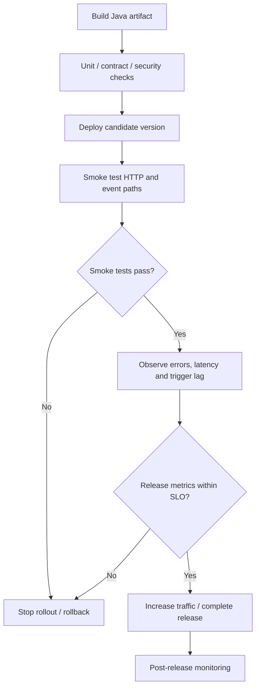
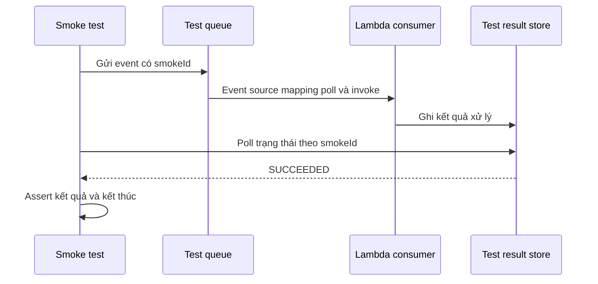

# Smoke test, kiểm tra sau phát hành và tự động chặn bản lỗi

Một bản Java function triển khai thành công chưa chắc đã hoạt động đúng. Artifact có thể được upload thành công nhưng handler sai, biến môi trường thiếu, IAM/RBAC không đủ quyền, API Gateway trỏ nhầm version hoặc trigger không đọc được message. Vì vậy, pipeline cần kiểm tra function sau khi phát hành và có cơ chế dừng rollout hoặc quay lại version ổn định khi phát hiện lỗi.

**Smoke test** là nhóm kiểm tra nhanh, có phạm vi nhỏ, xác nhận đường đi quan trọng nhất vẫn hoạt động sau deployment. Kết quả smoke test nên là một release gate: nếu kiểm tra thất bại, pipeline không tiếp tục mở rộng traffic hoặc đánh dấu release thành công. Với serverless, cần kết hợp kiểm tra HTTP, event trigger, log/metric và các phụ thuộc quan trọng.

## 1. Phân biệt smoke test, health check và synthetic test

Các loại kiểm tra có mục tiêu gần nhau nhưng phạm vi khác nhau:

| Loại kiểm tra | Mục tiêu | Ví dụ |
|---|---|---|
| Health check | Cho biết ứng dụng hoặc thành phần có sẵn sàng theo một tiêu chí cụ thể không | Endpoint `/health` trả trạng thái; kiểm tra cấu hình bắt buộc đã nạp |
| Smoke test | Xác nhận luồng quan trọng nhất hoạt động sau deployment | Gọi API tạo yêu cầu thử nghiệm và nhận response hợp lệ |
| Synthetic test | Mô phỏng hành vi người dùng hoặc producer theo lịch để phát hiện lỗi liên tục | Gửi request định kỳ từ một location/agent và kiểm tra response |
| Regression test | Kiểm tra các hành vi cũ vẫn đúng sau thay đổi | Bộ test nghiệp vụ, contract và integration đầy đủ |
| Load/performance test | Kiểm tra khả năng xử lý tải và độ trễ | Tăng concurrency, đo p95/p99 và throttling |

Smoke test không thay thế bộ regression test hoặc load test. Nó chỉ nên đủ nhỏ để chạy nhanh sau mỗi lần deploy và đủ thực tế để phát hiện lỗi cấu hình hoặc tích hợp nghiêm trọng.

### 1.1. Liveness và readiness trong môi trường FaaS

Với một serverless function, không có tiến trình web server cố định để probe liên tục như một container chạy lâu dài. Mỗi lần gọi HTTP health endpoint là một invocation mới hoặc một request đi vào instance đang có. Do đó:

- **Liveness-style check:** xác nhận endpoint và handler có thể được gọi, runtime có thể deserialize event và trả response.
- **Readiness-style check:** xác nhận các cấu hình và dependency thiết yếu mà luồng nghiệp vụ cần có thể sử dụng.
- **Business smoke test:** thực hiện một giao dịch thử nghiệm an toàn qua đúng API/trigger mà người dùng hoặc producer sẽ dùng.

Không để health endpoint thực hiện migration, gửi email, tạo đơn hàng thật hoặc chạy truy vấn nặng. Một health check nên nhẹ, có timeout ngắn và không tạo side effect. Nếu kiểm tra dependency, chỉ kiểm tra phần tối thiểu và tránh để một dependency phụ không thiết yếu làm toàn bộ function bị đánh dấu lỗi.

## 2. Xác định release gate trước khi triển khai

Release gate là điều kiện bắt buộc phải đạt trước khi pipeline đi sang bước tiếp theo. Với serverless, nên kiểm tra cả artifact, cấu hình, đường gọi và kết quả quan sát được.



Các gate thường được đặt theo thứ tự:

1. **Artifact gate:** build thành công, test pass, package có version/hash xác định, dependency và image đã được scan.
2. **Configuration gate:** runtime, handler, environment, identity, timeout, memory và trigger mapping đúng với môi trường.
3. **Deployment gate:** platform báo version/resource đã cập nhật; alias hoặc slot trỏ đúng candidate.
4. **Smoke gate:** HTTP và event path chính trả kết quả mong đợi.
5. **Telemetry gate:** errors, latency, throttling, queue age và các metric nghiệp vụ không vượt ngưỡng trong cửa sổ quan sát.
6. **Promotion gate:** chỉ tăng traffic hoặc hoàn tất swap khi tất cả điều kiện bắt buộc đạt.

Không nên chỉ kiểm tra exit code của lệnh deploy. Exit code thành công chỉ xác nhận thao tác triển khai được chấp nhận; nó không chứng minh function đã xử lý được event thật.

## 3. Chuẩn bị smoke test có thể chạy lặp lại

Một smoke test tốt cần có đầu vào xác định, kết quả có thể kiểm tra và cách dọn dữ liệu sau test.

### 3.1. Dùng dữ liệu thử nghiệm riêng

- Dùng tenant, account hoặc resource dành riêng cho test.
- Đặt correlation ID hoặc release ID để tìm invocation trong log.
- Đặt tên dữ liệu có tiền tố rõ ràng, ví dụ `smoke-<build-id>`.
- Không dùng dữ liệu khách hàng thật và không gọi thanh toán/gửi email thật.
- Nếu luồng cần side effect, dùng sandbox downstream hoặc một địa chỉ nhận test được kiểm soát.
- Dọn dữ liệu sau test hoặc đặt TTL để dữ liệu thử nghiệm tự hết hạn.

Smoke test phải an toàn khi chạy nhiều lần. Nếu test gửi cùng một event nhiều lần, dùng idempotency key riêng và xác minh không tạo side effect trùng. Nếu function gửi message, gửi vào queue/topic test hoặc payload có cờ test mà consumer biết cách xử lý an toàn.

### 3.2. Kiểm tra đúng version vừa phát hành

Mỗi artifact nên có build ID, commit SHA hoặc release version. Có thể expose version không nhạy cảm qua health response hoặc custom metric để xác nhận request đang đến đúng version. Không đưa secret, branch chứa thông tin nhạy cảm hoặc toàn bộ environment vào response.

Khi dùng alias hoặc slot, smoke test phải gọi candidate cụ thể trước khi mở traffic production. Sau khi promotion, kiểm tra lại endpoint production để xác nhận route đang trỏ đến version mới.

## 4. Smoke test HTTP function

Với HTTP-triggered function, kiểm tra tối thiểu:

- DNS/TLS và endpoint có thể truy cập từ network phù hợp.
- Authentication/authorization hoạt động; request không có token hoặc key không hợp lệ phải bị từ chối theo thiết kế.
- HTTP status code, content type và response schema đúng.
- Function xử lý được một request nghiệp vụ an toàn.
- Response có correlation ID hoặc request ID để truy vết.
- Latency không vượt giới hạn hợp lý của luồng chính.

Ví dụ script Bash gọi health endpoint:

```bash
#!/usr/bin/env bash
set -euo pipefail

: "${BASE_URL:?BASE_URL is required}"

response_file="$(mktemp)"
trap 'rm -f "$response_file"' EXIT

status_code="$(curl --silent --show-error \
  --output "$response_file" \
  --write-out '%{http_code}' \
  --max-time 10 \
  "$BASE_URL/health")"

if [ "$status_code" != "200" ]; then
  echo "Smoke test failed: HTTP $status_code"
  cat "$response_file"
  exit 1
fi

jq -e '.status == "ok"' "$response_file" >/dev/null
echo "HTTP health smoke test passed"
```

Script trên giả định endpoint trả JSON có trường `status: "ok"`; điều chỉnh assertion theo contract của ứng dụng. Trong pipeline, truyền `BASE_URL` từ output của deployment stage hoặc environment configuration. Nếu endpoint yêu cầu JWT/API key, lấy credential từ secret store của pipeline và truyền bằng header an toàn; không ghi token ra log.

### 4.1. Kiểm tra lỗi xác thực

Một smoke suite nên có cả positive và negative check. Ví dụ gọi endpoint được bảo vệ mà không có credential và xác nhận nhận `401` hoặc `403` theo thiết kế. Điều này phát hiện trường hợp cấu hình vô tình chuyển API từ authenticated sang public.

Không coi mọi `4xx` là lỗi release. `400` cho payload không hợp lệ có thể là hành vi đúng. Smoke test cần xác định rõ status mong đợi cho từng request.

## 5. Smoke test event-driven function

HTTP test không chứng minh queue, stream hoặc event bus hoạt động. Với function được kích hoạt bởi message/event, cần kiểm tra cả đường producer → source → trigger → function → kết quả.

Ví dụ luồng SQS:



Một event smoke test có thể chứa `eventId`, `eventType`, `schemaVersion`, `smokeId` và payload thử nghiệm. Consumer ghi kết quả vào test store hoặc phát một acknowledgement event. Test chờ trong giới hạn thời gian, sau đó xác nhận kết quả và kiểm tra DLQ không tăng ngoài dự kiến.

Khi test event source mapping:

- Gửi message vào queue/topic test riêng hoặc dùng payload có thể phân biệt và cô lập.
- Xác nhận event source mapping đang enabled và function được gọi.
- Kiểm tra kết quả xử lý, không chỉ kiểm tra message đã rời queue.
- Xác nhận message lỗi được retry hoặc chuyển DLQ theo contract.
- Kiểm tra không có duplicate side effect khi retry.
- Dùng timeout tổng cho test; nếu quá hạn, thu thập log, queue age và DLQ để chẩn đoán.

Với Kinesis/Kafka, có thể kiểm tra consumer lag và kết quả xử lý theo partition/sequence. Với EventBridge, xác nhận event khớp rule và target nhận invocation. Với Azure Service Bus/Queue trigger, xác nhận message được consume và kết quả nghiệp vụ xuất hiện. Mỗi loại source có acknowledgement, retry và checkpoint khác nhau.

Không gửi smoke event vào production queue nếu consumer có thể thực hiện thanh toán, gửi thông báo hoặc thay đổi dữ liệu thật. Nếu buộc phải kiểm tra production path, thiết kế event test có định danh rõ, consumer có nhánh xử lý an toàn và dữ liệu downstream sandbox.

## 6. Kiểm tra sau deployment bằng telemetry

Sau smoke test, cần quan sát một cửa sổ thời gian đủ để phát hiện lỗi do tải thật hoặc dependency. Chọn thời gian theo traffic và độ trễ của trigger; không dùng một khoảng cố định cho mọi hệ thống.

### 6.1. Metrics cần theo dõi

| Thành phần | Metrics quan trọng | Điều cần phát hiện |
|---|---|---|
| Lambda/Function App | Invocation count, errors, duration p95/p99, throttles, concurrency | Function lỗi, chậm hoặc bị giới hạn tài nguyên |
| API Gateway/HTTP | 5xx, latency, integration latency, auth failures | Gateway hoặc integration cấu hình sai |
| SQS | ApproximateAgeOfOldestMessage, visible messages, DLQ count | Consumer chậm, message tồn đọng hoặc lỗi lặp |
| Kinesis/DynamoDB Streams | Iterator age, batch failures, throttles | Consumer lag và record lỗi chặn shard |
| Async invocation | AsyncEventAge, dropped events, destination/DLQ | Event chờ lâu hoặc bị loại bỏ |
| Azure Functions | Function execution count, failures, duration, host/worker errors | Runtime hoặc function lỗi sau phát hành |
| Service Bus/Event Hubs | Active message count, dead-letter count, consumer lag | Trigger không theo kịp producer |
| Business metrics | Order accepted, payment authorized, job completed | Hệ thống trả HTTP thành công nhưng nghiệp vụ không hoàn tất |

So sánh với baseline trước release và với SLO. Một lỗi đơn lẻ có thể là dữ liệu test không hợp lệ; tỷ lệ lỗi tăng đồng thời với latency hoặc queue age là tín hiệu mạnh hơn. Đừng chỉ nhìn tổng invocation count vì traffic thấp có thể che giấu lỗi.

### 6.2. Log và trace

Mỗi smoke invocation nên có correlation ID. Log nên cho biết:

- Release/build ID và function version.
- Trigger type, event ID hoặc request ID.
- Kết quả xử lý và thời gian dependency.
- Mã lỗi chuẩn hóa và trạng thái retry nếu có.

Không log access token, connection string hoặc toàn bộ payload nhạy cảm. Dùng CloudWatch Logs/metrics trên AWS hoặc Application Insights/Azure Monitor trên Azure để tìm invocation. Trace context giúp nối HTTP request với message và các function downstream nếu hệ thống truyền W3C `traceparent` hoặc correlation metadata phù hợp.

## 7. Tự động chặn rollout khi smoke test hoặc metrics thất bại

Release pipeline cần quy định rõ kết quả nào làm pipeline fail:

- Artifact không đúng checksum/version.
- Health endpoint không phản hồi hoặc trả schema/status sai.
- Authentication check cho kết quả khác mong đợi.
- Event test không hoàn tất trong thời gian cho phép.
- Error rate, throttles, latency hoặc queue lag vượt ngưỡng trong cửa sổ quan sát.
- DLQ tăng bất thường hoặc có lỗi nghiệp vụ nghiêm trọng.
- Không truy vấn được telemetry bắt buộc để đánh giá release.

Khi một gate fail:

1. Đánh dấu deployment stage thất bại và chặn bước tăng traffic/promotion.
2. Giữ lại build ID, test output, correlation ID, log và metric snapshot.
3. Nếu đã chuyển một phần traffic, kích hoạt rollback tự động hoặc đưa alias/slot về version ổn định.
4. Xác minh endpoint và trigger đang chạy version cũ.
5. Tạo incident/task điều tra; không tự động retry deploy vô hạn.

Có thể phân loại lỗi thành *hard gate* và *warning*. Smoke test sai status, auth bypass hoặc mất event là hard gate. Một metric ít quan trọng dao động nhẹ có thể là warning nếu chưa vi phạm SLO. Quy tắc phải được thống nhất trước release, tránh thay threshold trong lúc đang triển khai chỉ để pipeline chuyển xanh.

## 8. AWS Lambda: canary, alias và automatic rollback

Lambda version là snapshot bất biến của code và một số cấu hình. Alias như `live` trỏ đến một version cụ thể và có thể phân phối một tỷ lệ traffic sang version phụ. Dùng alias giúp tách endpoint/caller khỏi số version cụ thể.

Với CodeDeploy hoặc AWS SAM deployment preference, có thể chuyển traffic theo canary/linear thay vì chuyển 100% cùng lúc. Ví dụ:

```yaml
Resources:
  OrdersFunction:
    Type: AWS::Serverless::Function
    Properties:
      Runtime: java21
      Handler: com.example.OrderHandler::handleRequest
      CodeUri: target/function.zip
      AutoPublishAlias: live
      DeploymentPreference:
        Type: Canary10Percent5Minutes
        Alarms:
          - !Ref OrdersFunctionErrorsAlarm
```

Đây là phần cấu hình minh họa trong AWS SAM; stack cần định nghĩa alarm tương ứng và các thuộc tính function khác. Với loại deployment này, SAM/CodeDeploy tạo version và alias cần thiết rồi chuyển một phần traffic sang version mới. Nếu alarm chuyển sang trạng thái ALARM trong quá trình deployment, CodeDeploy có thể dừng và rollback theo cấu hình deployment.

### 8.1. Pre-traffic và post-traffic validation

Có thể gắn validation Lambda hooks vào deployment lifecycle:

- **Pre-traffic hook:** kiểm tra candidate trước khi cho traffic production chuyển sang version mới.
- **Post-traffic hook:** kiểm tra sau khi traffic đã được chuyển theo deployment strategy.

Hook nên gọi candidate hoặc endpoint test có kiểm soát, kiểm tra response và trả kết quả thành công/thất bại cho CodeDeploy. Hook cần timeout, log và quyền truy cập rõ ràng; không nên phụ thuộc một hệ thống test không ổn định.

### 8.2. CloudWatch alarms làm rollback gate

Các alarm nên đo lỗi và độ trễ của function alias hoặc integration liên quan. Ví dụ:

- Lambda `Errors` tăng trên ngưỡng.
- API Gateway `5XXError` hoặc integration latency vượt SLO.
- Throttles tăng bất thường.
- Business failure metric hoặc custom error metric vượt baseline.

Alarm cần có evaluation period và datapoint phù hợp với traffic. Với traffic thấp, một lỗi có thể tạo tỷ lệ 100%; cần kết hợp số lượng mẫu tối thiểu hoặc metric nghiệp vụ. Nếu không có request trong cửa sổ, metric không đủ dữ liệu không được hiểu nhầm là release tốt.

Rollback alias chỉ đưa traffic về version cũ. Nó không hoàn tác thay đổi database, message đã xử lý, object đã ghi hoặc side effect đã gửi ra ngoài. Thiết kế migration theo expand-and-contract và event contract tương thích ngược để rollback ứng dụng an toàn.

## 9. Azure Functions: deployment slots và kiểm tra trước swap

Trên hosting plan hỗ trợ deployment slots, có thể deploy package vào slot staging, kiểm tra slot rồi swap với production. Slot giúp kiểm tra code và cấu hình trong môi trường gần production trước khi đổi endpoint production.

Quy trình thường gồm:

1. Deploy artifact đã build vào slot staging.
2. Cấu hình slot settings riêng cho endpoint, queue, secret và resource test.
3. Warm up slot và gọi health/smoke endpoint trực tiếp trên hostname staging.
4. Chạy synthetic transaction an toàn và kiểm tra Application Insights.
5. Nếu mọi gate pass, swap staging với production.
6. Kiểm tra lại hostname production và theo dõi errors/duration/trigger lag.
7. Nếu lỗi sau swap, swap lại slot hoặc triển khai lại artifact ổn định theo runbook.

### 9.1. Slot settings và trigger side effects

Một số app settings có thể được đánh dấu là deployment slot settings để giữ giá trị gắn với slot khi swap. Dùng cơ chế này cho connection string, queue name, secret reference hoặc setting xác định môi trường. Kiểm tra kỹ setting nào được swap và setting nào phải giữ nguyên theo slot.

Đặc biệt với Queue/Service Bus/Timer trigger, slot staging có thể khởi chạy listener. Nếu staging và production cùng consume queue thật, cả hai có thể xử lý message đồng thời. Điều này có thể gây duplicate hoặc cạnh tranh message. Hãy dùng queue/topic test riêng, disable listener ở staging bằng cấu hình phù hợp hoặc thiết kế consumer idempotent và có kế hoạch cutover rõ ràng.

Deployment slots không có sẵn trên mọi hosting plan và một số hành vi khác nhau theo OS/plan. Xác nhận plan mục tiêu hỗ trợ slots trước khi thiết kế pipeline phụ thuộc vào swap.

## 10. Rollback và forward-fix cho event-driven systems

Rollback code không phải lúc nào cũng đảo ngược được trạng thái nghiệp vụ. Một function có thể đã gửi email, thu tiền, cập nhật database hoặc ACK message trước khi alarm phát hiện lỗi.

Vì vậy, release an toàn cần chuẩn bị cả rollback lẫn forward-fix:

- **Code rollback:** đưa alias/slot về version ổn định.
- **Configuration rollback:** khôi phục app setting, environment variable, IAM policy hoặc trigger configuration tương thích.
- **Data compatibility:** dùng migration mở rộng trước, xóa trường cũ sau khi toàn bộ consumer đã chuyển.
- **Message compatibility:** giữ consumer đọc được event schema cũ trong khoảng retention/replay.
- **Side-effect recovery:** có idempotency key, compensation hoặc quy trình xử lý thủ công cho nghiệp vụ không thể đảo ngược.
- **Queue recovery:** kiểm tra DLQ, visibility timeout, offset/checkpoint và quy trình replay sau khi rollback.

Nếu version mới ghi dữ liệu theo format mà version cũ không đọc được, rollback có thể làm hệ thống hỏng nặng hơn. Trước khi release, cần xác minh version trước và version mới có thể cùng hoạt động trong thời gian rollout.

## 11. Ví dụ pipeline sau deployment

Một pipeline tổng quát có thể tổ chức như sau:

```yaml
stages:
  - build
  - verify
  - deploy_candidate
  - smoke_test
  - observe
  - promote

smoke_test:
  stage: smoke_test
  needs: [deploy_candidate]
  script:
    - ./scripts/smoke-http.sh
    - ./scripts/smoke-event.sh
  allow_failure: false

observe:
  stage: observe
  needs: [smoke_test]
  script:
    - ./scripts/check-release-metrics.sh
  allow_failure: false

promote:
  stage: promote
  needs: [observe]
  script:
    - ./scripts/promote-release.sh
```

Đây là pseudoconfiguration để minh họa dependency giữa các stage, không phải YAML hoàn chỉnh của một CI provider cụ thể. Trong pipeline thật, cấu hình `needs`, artifact passing, credentials và approval theo cú pháp GitHub Actions, GitLab CI, Azure Pipelines hoặc hệ thống đang dùng. Điểm quan trọng là `promote` chỉ được chạy sau khi smoke test và metric gate pass; `allow_failure` không được bật cho gate bắt buộc.

Một pipeline production nên lưu lại:

- Commit SHA, artifact checksum, image digest và version function.
- Deployment ID, alias/slot trước và sau release.
- Smoke test output và correlation ID.
- Metric snapshot trước/sau rollout.
- Quyết định promote/rollback và người hoặc automation đã thực hiện.

## 12. Đặt ngưỡng và cửa sổ quan sát hợp lý

Không có một ngưỡng chung cho mọi function. Một API có vài request mỗi phút và một consumer xử lý hàng nghìn message mỗi giây cần cách đánh giá khác nhau.

Khi thiết kế threshold:

- Dùng SLO hiện có làm chuẩn; nếu chưa có SLO, xác định ngưỡng tạm thời từ baseline.
- Đặt số mẫu tối thiểu để tránh một request lỗi làm kết luận sai khi traffic thấp.
- Dùng p95/p99 và error rate thay vì chỉ xem average duration.
- Đánh giá queue age/consumer lag theo tốc độ backlog tăng và khả năng bắt kịp.
- Tách lỗi do test fixture không hợp lệ khỏi lỗi runtime/dependency.
- Dùng nhiều cửa sổ đánh giá hoặc hysteresis để giảm cảnh báo dao động.
- Bảo đảm metric có dữ liệu; missing telemetry phải được xem là trạng thái không xác định, không tự động coi là pass.

Ví dụ một gate có thể yêu cầu: tất cả smoke tests pass; có ít nhất N request/record quan sát được; error rate và p95 không vượt SLO; queue age không tăng liên tục; không có lỗi nghiệp vụ mức nghiêm trọng. Giá trị N và các ngưỡng phải lấy từ traffic và SLO của hệ thống.

## 13. Những lỗi thường gặp khi kiểm tra sau phát hành

| Triệu chứng | Nguyên nhân có thể | Hướng xử lý |
|---|---|---|
| Deploy xanh nhưng HTTP smoke test thất bại | Route/alias sai, auth config thiếu, environment không đúng | Kiểm tra endpoint, integration, alias và app settings |
| Health endpoint pass nhưng nghiệp vụ lỗi | Health check quá nông, downstream permission hoặc schema sai | Thêm business smoke test với dữ liệu sandbox |
| HTTP smoke test pass nhưng queue không xử lý | Event source mapping disabled, thiếu quyền poll, queue sai | Gửi event test và kiểm tra mapping/lag/DLQ |
| Smoke test timeout ngẫu nhiên | Cold start, dependency chậm hoặc test timeout quá ngắn | Tách init duration và dependency timing; đặt timeout theo SLO |
| Canary không tự rollback | Alarm không gắn vào deployment hoặc metric không có data | Kiểm tra CodeDeploy alarm configuration và missing-data treatment |
| Azure staging pass nhưng production lỗi | Slot setting bị swap sai hoặc staging dùng dependency khác | Kiểm tra sticky settings và cấu hình production sau swap |
| Rollback code nhưng message tiếp tục lỗi | Schema/data đã thay đổi không tương thích | Dùng expand-contract, giữ consumer tương thích và chuẩn bị replay |
| Pipeline báo pass dù không có telemetry | Query trả rỗng và script coi rỗng là thành công | Xử lý missing data thành fail/unknown theo release policy |

## 14. Checklist trước và sau mỗi release

1. Artifact có build ID, checksum/digest và version xác định không?
2. Candidate đã được deploy vào alias/version hoặc slot đúng chưa?
3. Smoke test HTTP có kiểm status, response schema, auth và latency không?
4. Event smoke test có xác nhận producer → trigger → handler → kết quả không?
5. Test có dùng resource/tenant sandbox và tránh side effect production không?
6. Có correlation ID để tìm invocation, log và trace không?
7. Error rate, p95/p99, throttling, concurrency và dependency failures có trong ngưỡng không?
8. Queue age, iterator age, DLQ và async event age có ổn định không?
9. Missing telemetry hoặc không đủ sample có bị coi là trạng thái chưa đạt không?
10. Canary/linear rollout có alarm và automatic rollback không?
11. Azure slot staging có dùng cấu hình và trigger source an toàn không?
12. Rollback có tương thích với schema, event payload và side effect đã phát sinh không?
13. Pipeline có chặn promotion khi bất kỳ hard gate nào thất bại không?
14. Có lưu deployment ID, artifact version, test output và metric snapshot để audit không?

## Kết luận

Smoke test và kiểm tra sau phát hành giúp xác nhận Java function thực sự hoạt động sau khi được triển khai. Với HTTP trigger, kiểm tra endpoint, authentication và response contract; với event trigger, xác nhận message đi hết đường từ source đến kết quả xử lý. Kết hợp smoke test với telemetry gate, canary/linear rollout và automatic rollback để hạn chế phạm vi ảnh hưởng của bản lỗi. Trên AWS, alias, CodeDeploy và CloudWatch alarms hỗ trợ chuyển traffic có kiểm soát; trên Azure, deployment slots cho phép kiểm tra staging trước khi swap. Luôn nhớ rollback code không tự hoàn tác dữ liệu, message hoặc side effect đã xảy ra, nên cần thiết kế schema và nghiệp vụ tương thích trong suốt quá trình phát hành.

## Tài liệu tham khảo chính thức

- [AWS Lambda deployment configurations](https://docs.aws.amazon.com/lambda/latest/dg/configuring-alias-routing.html)
- [Deploy Lambda functions with CodeDeploy](https://docs.aws.amazon.com/lambda/latest/dg/deploying-lambda-apps.html)
- [AWS SAM gradual deployments](https://docs.aws.amazon.com/serverless-application-model/latest/developerguide/automating-updates-to-serverless-apps.html)
- [CodeDeploy Lambda deployment hooks](https://docs.aws.amazon.com/codedeploy/latest/userguide/reference-appspec-file-structure-hooks.html)
- [Monitor and roll back Lambda deployments](https://docs.aws.amazon.com/codedeploy/latest/userguide/deployments-rollback-and-redeploy.html)
- [Azure Functions deployment slots](https://learn.microsoft.com/en-us/azure/azure-functions/functions-deployment-slots)
- [Azure Functions monitoring](https://learn.microsoft.com/en-us/azure/azure-functions/functions-monitoring)
- [Azure Functions deployment technologies](https://learn.microsoft.com/en-us/azure/azure-functions/functions-deployment-technologies)
