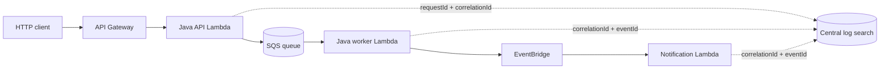

# Kết nối log bằng request ID và correlation ID

Một request trong hệ thống serverless có thể đi qua API Gateway, Java Lambda, queue, một hoặc nhiều worker, EventBridge và dịch vụ bên ngoài. Mỗi function invocation có log riêng; một message có thể được retry; một event có thể được fan-out đến nhiều consumer. Khi chỉ tìm log theo tên function hoặc thời điểm, việc nối các dòng log thuộc cùng một nghiệp vụ trở nên khó khăn.

**Request ID** giúp nhận diện một request hoặc một lần invocation tại một thành phần. **Correlation ID** giúp liên kết nhiều request, message và function invocation thuộc cùng một luồng nghiệp vụ. **Trace ID** liên kết các span trong một distributed trace. Chúng liên quan nhưng có phạm vi và mục đích khác nhau. Thiết kế rõ các định danh này giúp nhóm vận hành tìm được nguyên nhân lỗi, theo dõi retry và đo thời gian xử lý xuyên nhiều dịch vụ.

Trong Cloud Serverless, log cần mang đủ ngữ cảnh từ HTTP trigger đến event consumer mà không làm lộ token, secret hoặc dữ liệu cá nhân. Java function phải truyền định danh qua message/event, đưa chúng vào structured log và dọn context sau mỗi lần xử lý để tránh rò ngữ cảnh giữa các invocation hoặc record trong cùng batch.

## 1. Vì sao cần kết nối log?

Giả sử khách hàng gửi `POST /orders`. API Gateway gọi Java function; function ghi đơn hàng và gửi message vào SQS; worker xử lý tồn kho; EventBridge phát `OrderCreated`; notification function gửi email. Nếu notification bị lỗi, một message có thể được retry vài lần.

Không có định danh xuyên suốt, người vận hành phải tìm theo timestamp, order ID hoặc nội dung log. Những cách đó dễ bỏ sót log, đặc biệt khi nhiều request chạy đồng thời và các function chạy ở nhiều instance.

Kết nối log giúp:

- Tìm tất cả log liên quan đến một thao tác hoặc một quy trình nghiệp vụ.
- Phân biệt lỗi ở API, producer, broker, consumer hay hệ thống downstream.
- Nhận biết retry, duplicate delivery và các nhánh fan-out.
- Đo thời gian từ lúc nhận request đến khi hoàn tất xử lý bất đồng bộ.
- Liên kết log với distributed trace và metric khi cần điều tra sâu.
- Hỗ trợ audit kỹ thuật mà không cần ghi toàn bộ payload nghiệp vụ.



Mỗi thành phần ghi log cục bộ nhưng dùng cùng tên field và định dạng. Hệ thống log tập trung có thể lọc tất cả record theo `correlationId`, sau đó dùng `requestId`, `eventId` hoặc `traceId` để đi sâu vào từng bước.

## 2. Phân biệt các loại định danh

Không nên dùng một ID duy nhất cho mọi mục đích. Mỗi ID có vòng đời khác nhau:

| Định danh | Phạm vi | Ai tạo? | Khi retry? | Mục đích |
|---|---|---|---|---|
| Request ID | Một request tại một hop hoặc một invocation | API gateway, runtime hoặc service nhận request | Thường có ID mới cho lần invocation/request mới | Tìm log của một lần xử lý |
| Correlation ID | Một thao tác hoặc workflow xuyên nhiều service | Edge service hoặc service khởi tạo workflow | Giữ nguyên trong các bước/retry của cùng workflow | Liên kết log của toàn luồng |
| Trace ID | Một distributed trace | Tracing SDK/instrumentation hoặc upstream trace context | Có thể giữ nguyên trong cùng trace; retry độc lập có thể tạo span mới theo mô hình tracing | Liên kết spans và phân tích latency |
| Span ID | Một operation/span trong trace | Tracing SDK | Mỗi span mới có ID mới | Mô tả một bước và quan hệ cha/con |
| Event ID | Một event nghiệp vụ cụ thể | Producer nghiệp vụ | Giữ nguyên khi redelivery cùng event | Deduplication, idempotency và audit event |
| Message ID | Một message tại broker | Broker hoặc producer tùy dịch vụ | Có thể giữ nguyên khi broker redeliver; message mới có ID khác | Tìm message trong queue/broker |
| Causation ID | Event/request đã gây ra event hiện tại | Producer tạo event tiếp theo | Giữ nguyên quan hệ nguyên nhân | Dựng chuỗi nguyên nhân nghiệp vụ |

### Request ID

Request ID thường có phạm vi hẹp. API Gateway có request ID của gateway; AWS Lambda có `awsRequestId` cho invocation; một HTTP client hoặc downstream API cũng có thể tạo request ID riêng. Các ID này không nhất thiết giống nhau.

Khi một message được giao lại cho Lambda, invocation mới có `awsRequestId` mới. Vì vậy request ID không đủ để liên kết toàn bộ workflow hoặc nhận biết cùng một event được retry.

### Correlation ID

Correlation ID đại diện cho một thao tác hoặc một chuỗi công việc. Ví dụ một lần tạo đơn hàng có thể đi qua API, SQS worker, EventBridge và notification function. Tất cả các bước đó dùng cùng `correlationId`.

Correlation ID có thể được tạo tại edge nếu client không cung cấp ID hợp lệ. Nếu chấp nhận ID do client gửi, cần giới hạn định dạng/độ dài và lưu ID đó như dữ liệu không tin cậy. Một lựa chọn an toàn là tạo `correlationId` nội bộ và giữ `clientCorrelationId` riêng để đối chiếu khi cần.

### Trace ID và Span ID

Trace ID thuộc distributed tracing. Một trace chứa nhiều span; mỗi span đại diện cho một operation như API call, database query hoặc message processing. W3C Trace Context dùng header `traceparent` để truyền trace ID, parent span ID và flags giữa các service có hỗ trợ.

Correlation ID không thay thế trace ID. Correlation ID hữu ích để tìm log theo nghiệp vụ, kể cả khi tracing bị tắt hoặc sampling bỏ qua trace. Trace ID cung cấp cấu trúc parent/child và timing chi tiết. Một log record nên chứa cả hai nếu tracing được bật.

### Event ID và Causation ID

Event ID phải ổn định cho cùng một event nghiệp vụ qua các lần delivery/retry. Correlation ID có thể được chia sẻ bởi nhiều event trong một workflow; do đó không dùng correlation ID làm khóa idempotency.

Ví dụ:

```text
correlationId = flow-9f3a       # toàn bộ quy trình tạo đơn
eventId       = evt-order-001   # event OrderCreated
eventId       = evt-stock-002   # event InventoryReserved
causationId   = evt-order-001   # InventoryReserved do OrderCreated gây ra
```

## 3. Quy tắc tạo và tiếp nhận correlation ID

Định nghĩa một quy tắc thống nhất cho toàn hệ thống:

1. Tại ingress, lấy correlation ID từ nguồn đáng tin cậy hoặc tạo ID mới.
2. Kiểm tra định dạng, độ dài và ký tự được phép.
3. Không dùng ID này làm authentication, authorization hoặc idempotency key.
4. Trả correlation ID trong response header hoặc response body nếu API contract cho phép.
5. Ghi ID vào structured log và truyền qua message/event metadata.
6. Giữ nguyên ID trong các bước của cùng workflow; tạo ID mới cho một workflow mới.
7. Nếu một service khởi tạo workflow con độc lập, quyết định rõ giữ correlation ID cha hay tạo correlation ID con và ghi `parentCorrelationId`.

### Có nên tin `X-Correlation-ID` từ client?

Header do client gửi có thể bị giả mạo hoặc cố tình đặt một giá trị giống ID của request khác. Vì vậy:

- Xác thực định dạng và giới hạn độ dài, ví dụ tối đa 128 ký tự.
- Chỉ chấp nhận bộ ký tự đơn giản như chữ, số, dấu gạch ngang và gạch dưới.
- Không dùng giá trị này để tra cứu quyền, chọn tenant, bỏ qua validation hoặc truy cập dữ liệu.
- Cân nhắc tạo ID nội bộ ở API gateway/service và lưu giá trị client gửi trong field riêng.
- Tránh ghi raw header không giới hạn vào log để ngăn log injection và cardinality không kiểm soát.

Một correlation ID không phải secret. Không đưa access token, email, phone, account number hoặc thông tin cá nhân vào ID.

### Ví dụ định dạng

```text
X-Correlation-ID: 6e7d0f54-8b25-4a7f-a63a-4f7b9c9d8c31
```

UUID ngẫu nhiên là lựa chọn đơn giản. ULID hoặc ID có timestamp cũng có thể hữu ích cho sắp xếp, nhưng không nên phụ thuộc vào thứ tự tuyệt đối giữa các hệ thống. Nếu cần chống va chạm hoặc định danh bảo mật, chọn bộ sinh ID phù hợp và không tự tạo ID từ dữ liệu cá nhân.

## 4. Truyền ID qua HTTP

HTTP ingress thường có nhiều lớp: client → CDN/WAF → API Gateway → authorizer → Lambda. Mỗi lớp có thể tạo request ID riêng. Hãy giữ chúng thành các field khác nhau thay vì ghi đè một giá trị chung.

Ví dụ header:

```http
POST /orders HTTP/1.1
Content-Type: application/json
X-Correlation-ID: 6e7d0f54-8b25-4a7f-a63a-4f7b9c9d8c31
traceparent: 00-4bf92f3577b34da6a3ce929d0e0e4736-00f067aa0ba902b7-01
```

Service nhận request nên:

- Đọc request ID từ context của gateway/runtime.
- Đọc correlation ID theo quy tắc tin cậy của hệ thống.
- Đọc trace context thông qua tracing instrumentation/propagator.
- Tạo log context cho request hiện tại.
- Trả correlation ID cho caller khi phù hợp.

Không ghi đè `traceparent` bằng một correlation ID. Đây là hai giao thức khác nhau.

### API Gateway và Lambda request ID

Với API Gateway HTTP API, event có request context chứa request ID của gateway. Lambda `Context` cung cấp `getAwsRequestId()` cho invocation. Ghi cả hai để có thể tìm log ở API Gateway và Lambda:

```json
{
  "apiGatewayRequestId": "gateway-request-123",
  "lambdaRequestId": "lambda-invocation-456",
  "correlationId": "6e7d0f54-8b25-4a7f-a63a-4f7b9c9d8c31"
}
```

Tên và vị trí field trong event phụ thuộc loại API Gateway event (REST API v1, HTTP API v2 hoặc ALB). Viết adapter theo event type thực tế và tránh cast chung một schema cho mọi trigger.

## 5. Truyền ID qua queue và event

Khi HTTP function enqueue message, correlation ID phải được chuyển sang message attributes hoặc event envelope. Consumer không thể đọc header HTTP ban đầu từ context của Lambda mới.

### SQS message attributes

SQS hỗ trợ message attributes để mang metadata như correlation ID, event type và schema version. Ví dụ producer gửi:

```java
SendMessageRequest request = SendMessageRequest.builder()
        .queueUrl(queueUrl)
        .messageBody(jsonPayload)
        .messageAttributes(Map.of(
                "correlationId", MessageAttributeValue.builder()
                        .dataType("String")
                        .stringValue(correlationId)
                        .build(),
                "eventId", MessageAttributeValue.builder()
                        .dataType("String")
                        .stringValue(eventId)
                        .build()))
        .build();

sqsClient.sendMessage(request);
```

Consumer đọc attributes từ từng record của SQS event. Không giả định `awsRequestId` của producer sẽ xuất hiện trong Lambda consumer; nếu cần liên kết invocation, lưu nó thành metadata riêng như `producerRequestId`.

### Event envelope

Với nhiều broker hoặc khi cần schema versioning, có thể đặt metadata trong event envelope:

```json
{
  "eventId": "evt-order-001",
  "eventType": "OrderCreated",
  "schemaVersion": 1,
  "correlationId": "flow-9f3a",
  "causationId": "cmd-create-order-77",
  "occurredAt": "2026-11-17T12:00:00Z",
  "traceparent": "00-4bf92f3577b34da6a3ce929d0e0e4736-00f067aa0ba902b7-01",
  "data": {
    "orderId": "order-1052",
    "status": "CREATED"
  }
}
```

Metadata nên được thống nhất giữa producer và consumer. Nếu broker có message attributes riêng, có thể lưu correlation ID ở attributes và event ID/schema trong body. Tránh lưu cùng một field ở nhiều vị trí mà không có quy tắc ưu tiên; khi có sự khác biệt, consumer cần phát hiện và log lỗi contract thay vì âm thầm chọn giá trị bất kỳ.

### SNS, EventBridge và các hệ thống khác

- SNS: có thể gửi correlation ID/event ID qua message attributes hoặc payload.
- EventBridge: đặt correlation ID, causation ID và event ID nghiệp vụ trong `detail`; envelope `id` của EventBridge nhận diện event trên bus.
- Kafka: dùng header hoặc key theo contract; correlation ID không nhất thiết là partition key.
- Azure Service Bus: có các thuộc tính `CorrelationId`, `MessageId`, `SessionId` và `Subject`.
- Google Pub/Sub: dùng message attributes; với trace context, truyền metadata theo convention của tracing library.

Không nhầm `MessageId` do broker cấp với event ID nghiệp vụ. Broker ID hữu ích để điều tra delivery; event ID ổn định mới là khóa phù hợp cho deduplication nghiệp vụ.

## 6. Quy tắc khi retry, duplicate và fan-out

Giữ correlation ID qua các lần retry của cùng một workflow để truy vấn được toàn bộ lịch sử. Request ID của invocation thường thay đổi giữa các lần chạy. Event ID giữ nguyên khi broker redeliver cùng event; nếu producer tạo một event mới cho thay đổi nghiệp vụ mới, event ID phải mới.

Ví dụ một event bị giao ba lần:

| Lần xử lý | Correlation ID | Event ID | Lambda request ID | Attempt |
|---|---|---|---|---:|
| 1 | `flow-9f3a` | `evt-order-001` | `lambda-a1` | 1 |
| 2 | `flow-9f3a` | `evt-order-001` | `lambda-b2` | 2 |
| 3 | `flow-9f3a` | `evt-order-001` | `lambda-c3` | 3 |

Mỗi lần xử lý ghi `attempt`/receive count nếu trigger cung cấp. Với SQS, có thể dùng `ApproximateReceiveCount`; với Lambda async invocation hoặc broker khác, field attempt có thể đến từ context/service metric hoặc phải được lưu trong envelope. Không giả định mọi trigger có cùng metadata retry.

### Fan-out

Một event có thể kích hoạt nhiều consumer. Các consumer nên giữ correlation ID chung để liên kết cùng workflow, nhưng mỗi event/nhánh có thể có event ID, request ID và span ID riêng. Có thể ghi thêm `consumerName`, `branch` hoặc `operation` để phân biệt nhánh.

### Batch processing

Một Lambda invocation có thể nhận nhiều SQS records. Không đặt một `correlationId` duy nhất ở MDC cấp invocation rồi dùng cho toàn bộ batch. Mỗi record có thể thuộc workflow khác nhau. Hãy đặt và xóa MDC theo từng record, hoặc log từng record với context riêng. Invocation-level log chỉ chứa `awsRequestId`, batch size và tổng kết; record-level log chứa `correlationId`, `eventId` và message ID tương ứng.

## 7. Structured logging

Structured logging lưu log dưới dạng JSON hoặc field có cấu trúc thay vì chỉ một câu text tự do. Điều này giúp CloudWatch Logs Insights, Azure Application Insights, Google Cloud Logging hoặc hệ thống ELK/OpenSearch lọc theo field chính xác.

Một log record có thể trông như sau:

```json
{
  "timestamp": "2026-11-17T12:00:01.245Z",
  "level": "INFO",
  "service": "orders-worker",
  "environment": "production",
  "functionName": "ProcessOrderFunction",
  "awsRequestId": "lambda-b2",
  "apiGatewayRequestId": "gateway-request-123",
  "correlationId": "flow-9f3a",
  "eventId": "evt-order-001",
  "messageId": "sqs-message-789",
  "traceId": "4bf92f3577b34da6a3ce929d0e0e4736",
  "spanId": "00f067aa0ba902b7",
  "operation": "reserve-inventory",
  "attempt": 2,
  "outcome": "RETRYABLE_FAILURE",
  "durationMs": 184,
  "errorType": "DependencyTimeout"
}
```

Field nên có kiểu dữ liệu nhất quán: timestamp là timestamp chuẩn UTC, duration là số, attempt là integer, outcome là enum/giá trị hữu hạn. Đặt tên thống nhất giữa function để truy vấn một lần có thể dùng cho toàn bộ hệ thống.

### Bộ field đề xuất

| Field | Ý nghĩa | Quy tắc |
|---|---|---|
| `timestamp` | Thời điểm log | UTC, ISO-8601 hoặc epoch theo chuẩn log platform |
| `level` | Mức độ | DEBUG/INFO/WARN/ERROR hoặc chuẩn đã chọn |
| `service` | Tên service | Ổn định, không chứa request-specific value |
| `environment` | Môi trường | dev/staging/prod |
| `functionName` | Function xử lý | Tên logic hoặc resource name đã chuẩn hóa |
| `awsRequestId` | Lambda invocation ID | Lấy từ Lambda Context |
| `apiGatewayRequestId` | Gateway request ID | Có nếu request đi qua API Gateway |
| `correlationId` | Workflow ID | Giữ qua các hop |
| `eventId` | Domain event ID | Giữ nguyên qua redelivery |
| `messageId` | Broker message ID | Có theo trigger/broker |
| `traceId` / `spanId` | Distributed trace context | Theo tracing SDK/propagator |
| `operation` | Bước nghiệp vụ | Tên có miền giá trị hữu hạn |
| `attempt` | Lần thử | Có khi trigger cung cấp |
| `durationMs` | Thời gian bước xử lý | Number |
| `outcome` | Kết quả | Enum hữu hạn như SUCCESS/FAILURE/RETRY |

Không đưa ID có cardinality cao vào metric dimension nếu không cần. Correlation ID, event ID và request ID phù hợp để tìm log/trace; metric dimension nên dùng `service`, `operation`, `environment`, `outcome` hoặc `errorType` có miền giá trị kiểm soát.

## 8. Java: tạo log context với SLF4J MDC

SLF4J MDC (Mapped Diagnostic Context) cho phép gắn key/value vào log trong một thread. Logging backend có thể đưa các giá trị đó vào JSON hoặc pattern output.

Ví dụ helper quản lý MDC:

```java
import org.slf4j.MDC;
import java.util.Map;

public final class LogContext implements AutoCloseable {
    private final Map<String, String> previous;

    private LogContext(Map<String, String> previous) {
        this.previous = previous;
    }

    public static LogContext open(Map<String, String> values) {
        Map<String, String> previous = MDC.getCopyOfContextMap();
        MDC.clear();
        values.forEach((key, value) -> {
            if (value != null && !value.isBlank()) {
                MDC.put(key, value);
            }
        });
        return new LogContext(previous);
    }

    @Override
    public void close() {
        MDC.clear();
        if (previous != null) {
            MDC.setContextMap(previous);
        }
    }
}
```

`try-with-resources` bảo đảm context được khôi phục ngay cả khi xử lý ném exception:

```java
try (LogContext ignored = LogContext.open(Map.of(
        "correlationId", correlationId,
        "eventId", eventId,
        "awsRequestId", context.getAwsRequestId()))) {
    log.info("Processing order event");
    orderService.process(event);
    log.info("Order event processed");
}
```

Ví dụ `Map.of` không chấp nhận null; nếu một ID có thể null, hãy xây dựng map mutable và chỉ thêm giá trị khác null trước khi gọi `LogContext.open`. Helper trên lưu context trước đó để hoạt động an toàn khi lồng scope. Trong Lambda, vẫn phải dọn context sau invocation/record; execution environment có thể được tái sử dụng.

### Không để MDC rò sang invocation tiếp theo

Lambda execution environment có thể được tái sử dụng. Nếu MDC được đặt mà không clear, log của invocation sau có thể mang correlation ID của request trước. Luôn dùng `try/finally` hoặc `AutoCloseable` và kiểm tra cả đường thành công lẫn exception.

MDC thường gắn với thread. Nếu code chuyển sang `CompletableFuture`, executor hoặc thread pool, context có thể không tự truyền sang thread khác. Cần capture context khi submit task, cài đặt context trong thread thực thi và restore/clear trong `finally`. Không dựa vào `InheritableThreadLocal` như giải pháp tổng quát cho thread pool.

## 9. Java Lambda HTTP handler

Ví dụ sau minh họa việc lấy gateway request ID, Lambda request ID và correlation ID đã được kiểm tra. DTO và service là phần ứng dụng tự định nghĩa.

```java
import com.amazonaws.services.lambda.runtime.Context;
import com.amazonaws.services.lambda.runtime.RequestHandler;
import com.amazonaws.services.lambda.runtime.events.APIGatewayV2HTTPEvent;
import com.amazonaws.services.lambda.runtime.events.APIGatewayV2HTTPResponse;
import org.slf4j.Logger;
import org.slf4j.LoggerFactory;
import java.util.HashMap;
import java.util.Map;
import java.util.UUID;

public final class CreateOrderHandler implements
        RequestHandler<APIGatewayV2HTTPEvent, APIGatewayV2HTTPResponse> {

    private static final Logger log =
            LoggerFactory.getLogger(CreateOrderHandler.class);

    @Override
    public APIGatewayV2HTTPResponse handleRequest(
            APIGatewayV2HTTPEvent request, Context context) {

        String gatewayRequestId = request.getRequestContext() == null
                ? null : request.getRequestContext().getRequestId();
        String clientId = header(request.getHeaders(), "X-Correlation-ID");
        String correlationId = UUID.randomUUID().toString();

        Map<String, String> fields = new HashMap<>();
        fields.put("correlationId", correlationId);
        fields.put("awsRequestId", context.getAwsRequestId());
        fields.put("apiGatewayRequestId", gatewayRequestId);
        if (isValidId(clientId)) {
            fields.put("clientCorrelationId", clientId);
        }

        try (LogContext ignored = LogContext.open(fields)) {
            log.info("Create order request received");
            // Validate request and call the application service here.
            return APIGatewayV2HTTPResponse.builder()
                    .withStatusCode(202)
                    .withHeaders(Map.of("X-Correlation-ID", correlationId))
                    .withBody("{\"status\":\"accepted\"}")
                    .build();
        }
    }

    private static String header(Map<String, String> headers, String name) {
        if (headers == null) return null;
        return headers.entrySet().stream()
                .filter(e -> name.equalsIgnoreCase(e.getKey()))
                .map(Map.Entry::getValue)
                .findFirst().orElse(null);
    }

    private static boolean isValidId(String value) {
        return value != null && value.length() <= 128
                && value.matches("[A-Za-z0-9_-]+");
    }
}
```

Ví dụ tạo correlation ID nội bộ mới cho mỗi request và chỉ giữ header từ client trong field `clientCorrelationId` sau khi kiểm tra định dạng. Nếu một gateway nội bộ đã xác thực và chuẩn hóa correlation ID theo contract, service có thể tiếp tục ID đó theo quy tắc tin cậy đã thống nhất. Validation định dạng không biến một ID thành danh tính đáng tin cậy. Không dùng correlation ID để chọn tenant hoặc cấp quyền.

Với REST API v1 hoặc ALB event, cấu trúc request context khác; tạo adapter tương ứng. Không giả định mọi HTTP trigger dùng `APIGatewayV2HTTPEvent`.

## 10. Java SQS batch handler: context theo từng record

Một batch có thể chứa message từ nhiều workflow. Mỗi record cần MDC riêng:

```java
import com.amazonaws.services.lambda.runtime.Context;
import com.amazonaws.services.lambda.runtime.RequestHandler;
import com.amazonaws.services.lambda.runtime.events.SQSEvent;
import com.amazonaws.services.lambda.runtime.events.SQSBatchResponse;
import org.slf4j.Logger;
import org.slf4j.LoggerFactory;
import java.util.ArrayList;
import java.util.HashMap;
import java.util.List;
import java.util.Map;

public final class OrderQueueHandler implements
        RequestHandler<SQSEvent, SQSBatchResponse> {

    private static final Logger log = LoggerFactory.getLogger(OrderQueueHandler.class);

    @Override
    public SQSBatchResponse handleRequest(SQSEvent event, Context context) {
        List<SQSBatchResponse.BatchItemFailure> failures = new ArrayList<>();

        for (SQSEvent.SQSMessage message : event.getRecords()) {
            String correlationId = message.getMessageAttributes() != null
                    && message.getMessageAttributes().containsKey("correlationId")
                    ? message.getMessageAttributes().get("correlationId").getStringValue()
                    : "unknown";

            Map<String, String> fields = new HashMap<>();
            fields.put("correlationId", correlationId);
            fields.put("awsRequestId", context.getAwsRequestId());
            fields.put("messageId", message.getMessageId());

            try (LogContext ignored = LogContext.open(fields)) {
                try {
                    log.info("Processing SQS message");
                    OrderService.process(message.getBody());
                } catch (Exception ex) {
                    log.error("SQS message processing failed", ex);
                    failures.add(new SQSBatchResponse.BatchItemFailure(
                            message.getMessageId()));
                }
            }
        }
        return new SQSBatchResponse(failures);
    }
}
```

Đây là ví dụ minh họa; kiểu `MessageAttribute` và event class phụ thuộc phiên bản AWS Lambda Java Events. Consumer nên validate correlation ID và parse event envelope để lấy event ID/schema version. Nếu một record lỗi, partial batch response cần được bật trong event source mapping để chỉ record lỗi được retry. Correlation ID không thay thế event ID hoặc idempotency key.

## 11. Truyền context qua thread và asynchronous Java code

MDC của SLF4J thường dựa trên ThreadLocal. Khi dùng executor, thread pool hoặc `CompletableFuture`, log trong callback có thể thiếu correlation ID hoặc dùng nhầm context cũ nếu không truyền đúng.

Một cách đơn giản là capture context trước khi submit và restore trong task:

```java
import org.slf4j.MDC;
import java.util.Map;
import java.util.concurrent.Executor;

public final class MdcTask {
    public static Runnable wrap(Runnable task) {
        Map<String, String> captured = MDC.getCopyOfContextMap();
        return () -> {
            Map<String, String> previous = MDC.getCopyOfContextMap();
            try {
                MDC.clear();
                if (captured != null) MDC.setContextMap(captured);
                task.run();
            } finally {
                MDC.clear();
                if (previous != null) MDC.setContextMap(previous);
            }
        };
    }

    public static void execute(Executor executor, Runnable task) {
        executor.execute(wrap(task));
    }

    private MdcTask() {}
}
```

Trong môi trường Spring, có thể dùng `TaskDecorator` cho executor để truyền MDC. Với OpenTelemetry, ưu tiên context propagation API/agent/instrumentation của OpenTelemetry thay vì tự truyền trace ID bằng MDC. MDC chỉ phục vụ log context; nó không thay thế tracing context.

Không lưu request-specific context vào biến `static` mutable. Lambda có thể tái sử dụng execution environment, còn executor có thể dùng lại thread cho request khác. Dùng scope có thời hạn rõ và luôn restore.

## 12. W3C Trace Context và OpenTelemetry

W3C Trace Context định nghĩa cách truyền trace context giữa service qua `traceparent` và tùy chọn `tracestate`. OpenTelemetry cung cấp API/SDK và instrumentation để tạo span, inject/extract context và xuất trace đến backend.

Một traceparent có dạng:

```text
00-4bf92f3577b34da6a3ce929d0e0e4736-00f067aa0ba902b7-01
│  │                                │                └─ trace flags
│  │                                └─ parent span ID
│  └─ trace ID
└─ version
```

Ứng dụng không nên tự parse và nối chuỗi `traceparent` trong mọi handler nếu đã có tracing instrumentation. Dùng propagator của OpenTelemetry để extract từ HTTP header hoặc inject vào outbound request/message. Điều này giúp tuân thủ format, xử lý invalid context và tích hợp sampling.

### Correlation ID và trace context phối hợp

Một log record nên mang cả `correlationId`, `traceId` và `spanId`:

- `correlationId` trả lời: “Các bước nào thuộc cùng nghiệp vụ?”
- `traceId` trả lời: “Các spans nào thuộc cùng distributed trace?”
- `spanId` trả lời: “Log này phát sinh trong operation cụ thể nào?”

Một workflow dài có thể kéo dài lâu hơn thời gian sống của một trace hoặc đi qua nhiều trace. Trong trường hợp đó, correlation ID vẫn liên kết workflow, còn trace ID có thể thay đổi theo từng execution segment. Ghi `parentCorrelationId`, `causationId` hoặc link giữa spans nếu cần mô tả quan hệ đó.

### Sampling và log

Distributed tracing thường dùng sampling để kiểm soát chi phí. Khi một trace không được sample, log vẫn cần correlation ID để điều tra. Không giả định mọi log record đều có trace ID; field có thể vắng mặt nếu instrumentation chưa khởi tạo hoặc trace bị loại theo sampling policy.

Không dùng trace ID làm metric label hoặc khóa nghiệp vụ. Trace ID có thể được tạo mới, đổi theo boundary hoặc bị loại bỏ bởi hệ thống trung gian.

## 13. Tích hợp với logging và observability platform

Các nền tảng log thường hỗ trợ field JSON và liên kết trace theo convention riêng:

| Nền tảng | Cách kết nối thường dùng |
|---|---|
| Amazon CloudWatch Logs | JSON log từ Lambda, Logs Insights query theo `correlationId`, `awsRequestId`, `eventId` |
| AWS X-Ray | Trace ID/segment/subsegment và liên kết log theo trace context khi tích hợp phù hợp |
| Azure Application Insights | Operation ID/parent operation ID, request/dependency telemetry và custom properties |
| Google Cloud Logging/Trace | `trace`, `spanId`, `traceSampled` cùng structured log fields |
| OpenSearch/ELK | Index JSON fields và truy vấn theo correlation/event/request ID |
| OpenTelemetry Collector | Nhận log/trace/metric và export đến backend được cấu hình |

Tên field tự động của platform có thể khác nhau. Nên giữ một schema ứng dụng ổn định và ánh xạ sang field chuẩn của backend. Ví dụ Azure Application Insights có operation context riêng; Google Cloud Logging có field `trace`; AWS Lambda có request ID trong context. Tránh tạo nhiều tên gần giống như `correlation_id`, `correlationId` và `CorrelationID` nếu không có mapping rõ.

### Query CloudWatch Logs Insights

Ví dụ tìm log theo correlation ID:

```sql
fields @timestamp, level, service, operation, awsRequestId,
       correlationId, eventId, message
| filter correlationId = "flow-9f3a"
| sort @timestamp asc
```

Tìm tất cả log của một invocation:

```sql
fields @timestamp, level, correlationId, message
| filter awsRequestId = "lambda-b2"
| sort @timestamp asc
```

Tìm lỗi theo workflow:

```sql
fields @timestamp, service, operation, eventId, errorType, message
| filter correlationId = "flow-9f3a" and level = "ERROR"
| sort @timestamp asc
```

Tên field và kiểu level phụ thuộc JSON formatter. Nếu log backend parse nested JSON vào `@message` thay vì field top-level, cần dùng cú pháp parse phù hợp với cấu hình ingest.

## 14. Log an toàn và chống log injection

Correlation ID có thể đến từ client hoặc partner, do đó phải coi là input không tin cậy. Một giá trị chứa newline hoặc ký tự điều khiển có thể làm giả thêm dòng log nếu logger ghi raw text. Dùng structured logging, giới hạn độ dài và loại ký tự điều khiển.

Không log:

- `Authorization`, cookie, access token, refresh token hoặc API key.
- Password, secret value, private key hoặc connection string nhạy cảm.
- Raw request body có PII/payment data nếu không cần.
- Nội dung message/DLQ đầy đủ khi payload có dữ liệu nhạy cảm.
- Correlation ID có chứa email, số điện thoại hoặc thông tin cá nhân.

Thay vào đó log tên field, resource ID đã pseudonymize, event type, schema version, outcome và lỗi đã làm sạch. Có thể log một phần ID hoặc hash có salt khi cần liên kết mà không lộ định danh trực tiếp; lựa chọn này phải phù hợp nhu cầu điều tra và chính sách dữ liệu.

### Không dùng correlation ID cho authorization

Kẻ tấn công có thể gửi correlation ID giống request khác. Nếu hệ thống dùng ID đó để tra cứu session, lấy dữ liệu hoặc bỏ qua quyền, nó tạo ra lỗi bảo mật. Correlation ID chỉ là metadata quan sát; authorization phải dựa trên principal đã xác minh và policy trên resource.

### Giới hạn cardinality

Request ID và correlation ID thường có giá trị gần như duy nhất cho mỗi request. Đưa chúng vào metric dimensions có thể tạo cardinality rất cao, làm tăng chi phí và giảm hiệu quả metric backend. Giữ chúng trong log/trace; metric dùng dimension có miền giá trị nhỏ như service, function, environment, operation và outcome.

## 15. Request ID và correlation ID trong các tình huống đặc biệt

### Một HTTP request gọi nhiều downstream service

Giữ correlation ID xuyên suốt. Mỗi outbound HTTP call có thể có request ID riêng do service đích cấp; log lại ID đó dưới field như `downstreamRequestId` để điều tra với đối tác. Nếu có trace instrumentation, mỗi outbound call tạo client span riêng.

### Một event tạo workflow mới

Nếu event kích hoạt một workflow độc lập, có thể tạo correlation ID mới và ghi `parentCorrelationId` trỏ về workflow trước. Nếu event chỉ là bước tiếp theo của cùng nghiệp vụ, giữ correlation ID hiện tại.

### Scheduled function không có HTTP request

Tạo correlation ID cho mỗi scheduled execution hoặc mỗi business batch. Ghi schedule name, scheduled time, execution ID và batch ID. Nếu một scheduled run xử lý nhiều tenant, tạo context riêng theo từng tenant/batch record khi log nghiệp vụ.

### Một batch chứa nhiều event

Invocation request ID dùng chung cho cả batch; mỗi event có event ID và correlation ID riêng. Không gắn một correlation ID batch lên mọi record nếu chúng không thuộc cùng workflow. Có thể có `batchId` để liên kết batch ở cấp invocation.

### Retry từ broker và retry trong application

Nếu broker redeliver cùng message, giữ event ID và correlation ID. Nếu application tạo một command retry mới sau khi workflow trước kết thúc, xác định đó là operation mới hay cùng operation. Ghi `attempt`, `retryReason` và `previousRequestId` nếu có giá trị điều tra; không sửa event ID chỉ để tránh duplicate detection.

## 16. Kiểm thử correlation và request context

Viết test cho cả propagation và cleanup context:

- HTTP request không có correlation ID sẽ được gán ID mới.
- HTTP request có ID hợp lệ giữ hoặc ánh xạ ID theo policy.
- ID quá dài hoặc chứa newline/ký tự điều khiển bị từ chối hoặc thay bằng ID nội bộ.
- Response trả đúng correlation ID theo contract.
- Producer đưa correlation ID và event ID vào message/event metadata.
- Consumer khôi phục đúng context từ từng record.
- Retry giữ correlation/event ID nhưng có invocation request ID mới.
- Batch nhiều workflow không làm lẫn MDC giữa các record.
- Exception vẫn dọn MDC.
- Async executor truyền context đúng và restore thread context sau task.
- Log không chứa token, secret hoặc raw PII.

Ví dụ unit test kiểm tra MDC được dọn:

```java
import org.junit.jupiter.api.Test;
import org.slf4j.MDC;
import java.util.Map;
import static org.junit.jupiter.api.Assertions.*;

class LogContextTest {
    @Test
    void restoresPreviousContextAfterScope() {
        MDC.put("existing", "outer");
        try (LogContext ignored = LogContext.open(
                Map.of("correlationId", "flow-1"))) {
            assertEquals("flow-1", MDC.get("correlationId"));
            assertNull(MDC.get("existing"));
        }
        assertEquals("outer", MDC.get("existing"));
        assertNull(MDC.get("correlationId"));
        MDC.clear();
    }
}
```

Thêm test cho trường hợp exception bên trong scope và test batch xử lý hai record có correlation ID khác nhau. Với integration test, tìm log trong backend bằng correlation ID và xác minh đủ các service đã phát log.

## 17. Quy trình điều tra một request lỗi

Khi có một correlation ID từ ticket hoặc alert:

1. Tìm toàn bộ log theo `correlationId` trong khoảng thời gian phù hợp.
2. Sắp xếp theo timestamp và xem `service`, `operation`, `eventId`, `messageId`.
3. Xác định request ID của từng invocation để mở log chi tiết của function.
4. Nếu có trace ID, mở distributed trace để xem span nào chậm hoặc lỗi.
5. Với SQS/event, kiểm tra receive count, retry attempt, DLQ và event source mapping.
6. Với fan-out, tách các nhánh bằng `consumerName` hoặc `operation`.
7. So sánh event ID để phân biệt duplicate delivery với event nghiệp vụ mới.
8. Kiểm tra log downstream bằng `downstreamRequestId` nếu lỗi nằm ngoài hệ thống.
9. Ghi lại correlation ID, request ID, trace ID và event ID liên quan trong incident note; không sao chép secret/payload nhạy cảm.

Không dựa hoàn toàn vào timestamp vì log có thể được ingest trễ hoặc đồng hồ giữa hệ thống không đồng bộ hoàn toàn. Correlation ID và trace context giúp liên kết tốt hơn; timestamp vẫn cần để hiểu thứ tự gần đúng và latency.

## 18. Lỗi thiết kế thường gặp

| Lỗi | Hậu quả | Cách khắc phục |
|---|---|---|
| Dùng Lambda request ID làm correlation ID | Không nối được các invocation sau queue/retry | Dùng correlation ID xuyên workflow, giữ request ID riêng |
| Dùng correlation ID làm event ID | Nhiều event hợp lệ bị coi là duplicate | Tạo event ID riêng cho mỗi domain event |
| Tin correlation ID từ client như identity | Có thể giả mạo, truy cập sai hoặc làm nhiễu log | Validate và không dùng cho authorization |
| Không truyền ID qua message | Consumer log không nối được với HTTP ingress | Gửi metadata qua attributes/envelope |
| Dùng một MDC cho cả SQS batch | Log record bị gán nhầm workflow | Mở/đóng MDC riêng cho từng record |
| Không clear MDC | Invocation tiếp theo có thể mang context cũ | try/finally hoặc AutoCloseable |
| Trông chờ MDC tự truyền qua executor | Log async thiếu hoặc sai correlation | Capture/restore context hoặc dùng OTel context propagation |
| Ghi ID vào metric dimension | Cardinality và chi phí tăng mạnh | Giữ ID trong log/trace |
| Chỉ dùng trace ID | Mất khả năng tìm workflow dài hoặc trace bị sample | Giữ correlation ID độc lập |
| Log raw header/body | Log injection hoặc lộ dữ liệu nhạy cảm | Structured logging, validation và redaction |

## 19. Checklist triển khai

### Định danh

- [ ] Request ID, correlation ID, trace ID, span ID và event ID có mục đích riêng.
- [ ] Có quy tắc tạo correlation ID tại ingress và xử lý ID do client gửi.
- [ ] Correlation ID không chứa secret/PII và không được dùng làm quyền truy cập.
- [ ] Event ID ổn định qua redelivery; correlation ID được giữ qua workflow.
- [ ] Có causation ID/parent context khi cần dựng quan hệ nguyên nhân.

### Propagation

- [ ] HTTP gateway request ID và Lambda invocation ID được log riêng.
- [ ] Correlation ID được trả trong response theo API contract.
- [ ] Producer truyền ID qua SQS/SNS/EventBridge/Pub/Sub/Service Bus metadata.
- [ ] Consumer khôi phục context từ từng message/event.
- [ ] Retry, fan-out, scheduled run và batch có quy tắc ID rõ ràng.
- [ ] Trace context được truyền bằng OpenTelemetry/W3C propagator khi dùng tracing.

### Logging

- [ ] Log là structured JSON hoặc format có field thống nhất.
- [ ] Có timestamp, service, environment, operation, outcome và duration.
- [ ] Có request/correlation/event/trace ID phù hợp với trigger.
- [ ] MDC được clear/restore sau invocation và từng record.
- [ ] Async executor truyền context đúng.
- [ ] Không log token, secret, raw PII hoặc input không được làm sạch.
- [ ] ID cardinality cao chỉ dùng trong log/trace, không dùng làm metric dimension.

### Vận hành và kiểm thử

- [ ] Có query/dashboard tìm log theo correlation ID.
- [ ] Có liên kết từ log sang trace và invocation khi nền tảng hỗ trợ.
- [ ] Test propagation, retry, duplicate, batch isolation và exception cleanup.
- [ ] Log ingestion delay, retention và sampling được hiểu rõ.
- [ ] Runbook điều tra ghi rõ cách lần từ correlation ID đến request/event/trace ID.

Request ID nhận diện một lần xử lý tại một hop; correlation ID liên kết nhiều bước của cùng workflow; trace ID và span ID mô tả đường đi kỹ thuật; event ID nhận diện sự kiện nghiệp vụ. Khi giữ riêng các vai trò này, truyền metadata qua HTTP và broker, ghi structured log và dọn MDC đúng vòng đời, Java serverless application có thể nối log đáng tin cậy từ request đầu tiên đến consumer cuối cùng mà vẫn kiểm soát được bảo mật và chi phí quan sát.
