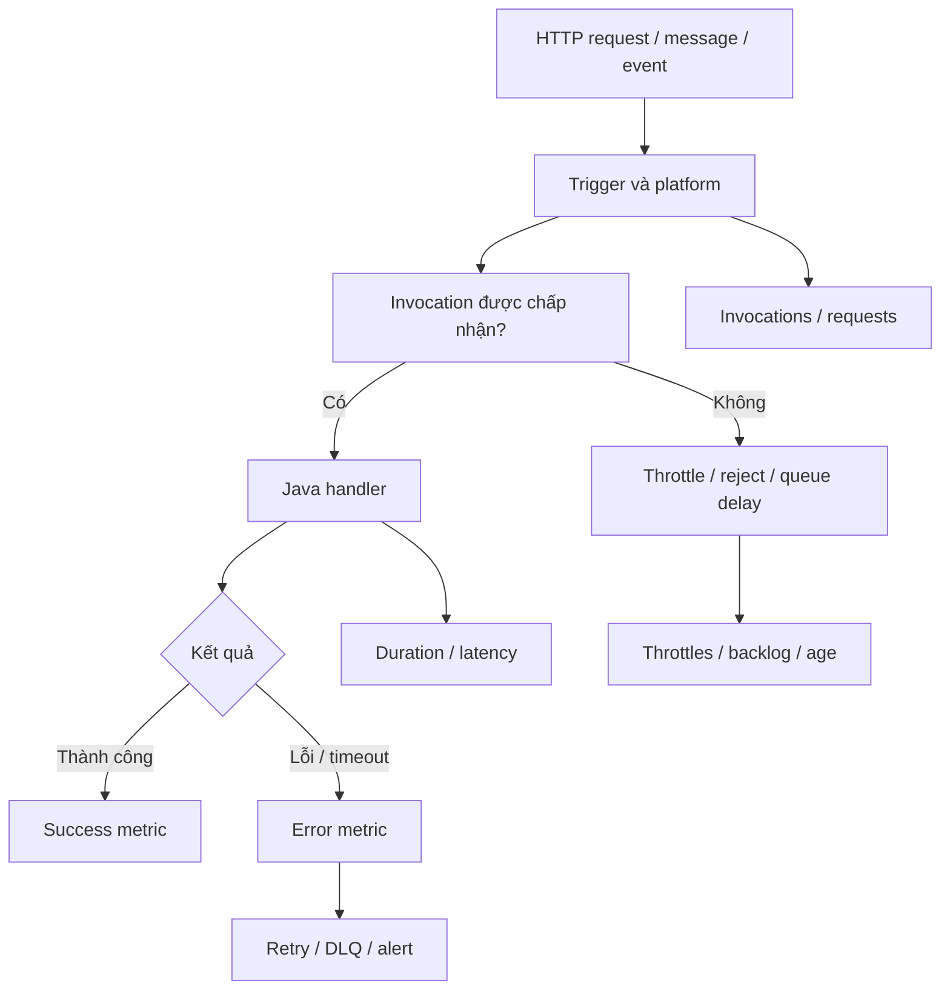

# Các metric về lượt gọi, lỗi, thời gian xử lý và throttling

Một Java serverless function có thể chạy hàng nghìn invocation trong vài phút rồi gần như không có request trong nhiều giờ. Vì runtime tự scale, việc nhìn CPU của một máy chủ cố định không đủ để biết function đang hoạt động tốt hay gặp vấn đề. Cần theo dõi các metric phản ánh trực tiếp cách function được gọi, tỷ lệ xử lý thành công, thời gian hoàn tất, khả năng tiếp nhận tải và việc nền tảng từ chối hoặc trì hoãn invocation.

Bốn nhóm metric nền tảng là **lượt gọi (invocations/requests)**, **lỗi (errors)**, **thời gian xử lý (duration/latency)** và **throttling**. Với function nhận message/event, cần thêm số message, tuổi message, retry, backlog và dead-letter. Với function HTTP, cần phân biệt thời gian toàn request mà client cảm nhận với thời gian handler thực thi. Các metric này giúp phát hiện sự cố sớm, xác định nút thắt và đặt ngưỡng scale/alert dựa trên SLO.

## 1. Bốn câu hỏi vận hành cần trả lời

Một dashboard cơ bản cần trả lời:

1. **Có bao nhiêu lượt gọi?** Lưu lượng tăng/giảm ra sao, có đột biến hoặc mất trigger không?
2. **Bao nhiêu lượt gọi thất bại?** Tỷ lệ lỗi, timeout, retry, throttling và lỗi phụ thuộc thay đổi thế nào?
3. **Function xử lý mất bao lâu?** Thời gian trung bình, p50, p95, p99 và thời gian toàn request có vượt SLO không?
4. **Function có tiếp nhận nổi tải không?** Concurrency, giới hạn instance, quota, throttling và backlog có tăng không?



Đừng chỉ theo dõi invocation count. Một function có thể nhận đúng số lượt gọi nhưng trả lỗi 500, chạy chậm hoặc bị throttle. Ngược lại, invocation giảm có thể là dấu hiệu bình thường do traffic theo mùa, hoặc dấu hiệu trigger bị ngắt. Cần đọc các metric cùng nhau và so với baseline.

## 2. Phân biệt request, invocation, event và message

Các nền tảng dùng thuật ngữ khác nhau; một invocation không phải lúc nào cũng tương đương một request hoặc một message.

| Khái niệm | Ý nghĩa | Ví dụ |
| --- | --- | --- |
| HTTP request | Một request được gửi đến endpoint | Client gọi `POST /orders` một lần |
| Invocation/execution | Một lần runtime gọi handler hoặc thực thi function | Một lần Lambda handler được gọi |
| Event | Một sự kiện nghiệp vụ hoặc hệ thống | `OrderCreated` được phát ra |
| Message | Một đơn vị dữ liệu trong queue/topic | Một message trong SQS hoặc Service Bus |
| Batch | Nhiều record được chuyển vào một invocation | Một Lambda invocation nhận 10 SQS records |
| Retry/redelivery | Một lần xử lý lại cùng event/message/request | Message được giao lại sau khi handler lỗi |

Ví dụ một SQS event source mapping có thể lấy 10 message rồi gọi Lambda một lần. Khi đó invocation count là 1, số record được xử lý là 10. Nếu batch bị retry, cùng record có thể xuất hiện lại. Vì vậy, muốn biết tải nghiệp vụ cần đo cả invocation và record/message count.

Với HTTP, một request có thể không tạo được invocation nếu bị chặn ở API gateway, load balancer hoặc lớp xác thực. Với async event, nguồn có thể nhận event trước rồi giao cho function sau; thời điểm publish và thời điểm handler bắt đầu là hai mốc khác nhau.

## 3. Metric invocation và request volume

Invocation count cho biết function được runtime gọi bao nhiêu lần trong một khoảng thời gian. Request count thường đếm request tại gateway/server. Event/message count cho biết lượng công việc được phát sinh hoặc tiêu thụ.

Nên theo dõi:

- Tổng invocation/request trong mỗi phút hoặc 5 phút.
- Tốc độ tăng/giảm so với baseline cùng khung giờ/ngày.
- Request theo endpoint, method hoặc function name.
- Event/message được nhận, xử lý, hoàn tất và bị bỏ.
- Batch size trung bình, p95 và số record trong mỗi invocation.
- Tỷ lệ invocation không có record hữu ích hoặc bị gọi sai trigger.

### Tốc độ gọi

Nếu có (N) invocation trong cửa sổ (T) giây, invocation rate trung bình là:

\[
\text{Invocation rate} = \frac{N}{T}
\]

Ví dụ 6.000 invocation trong 5 phút tương đương trung bình 20 invocation/giây. Con số trung bình có thể che giấu burst ngắn; hãy xem metric ở granularity đủ nhỏ và kết hợp concurrency/throttling.

### Theo dõi volume đầu vào và đầu ra

Đối với queue/event, nên so sánh:

- Message published/received.
- Record được xử lý thành công.
- Record retry hoặc gửi DLQ.
- Backlog còn lại.

Nếu producer phát 1.000 message/phút nhưng consumer chỉ hoàn tất 700 message/phút, backlog có xu hướng tăng khoảng 300 message/phút (chưa tính message bị xóa, duplicate hoặc batch semantics). Chỉ nhìn invocation count có thể không phát hiện chênh lệch này.

## 4. Error count và error rate

Error count là số lượt gọi thất bại trong một khoảng thời gian. Error rate là tỷ lệ lỗi trên tổng số lượt gọi được đánh giá.

\[
\text{Error rate} = \frac{\text{Failed requests}}{\text{Eligible requests}} \times 100\%
\]

Ví dụ 40 request thất bại trên 10.000 request:

\[
\frac{40}{10.000} \times 100\% = 0,4\%
\]

Khi tính error rate, phải định nghĩa rõ mẫu số. Có thể tách:

- **Application error rate:** handler đã chạy nhưng trả lỗi/throw exception.
- **HTTP 5xx rate:** request kết thúc bằng server error.
- **HTTP 4xx rate:** request bị từ chối do input, auth hoặc resource; thường không phải lỗi hệ thống nhưng vẫn cần theo dõi.
- **Platform failure rate:** invocation bị timeout, crash, out-of-memory hoặc lỗi runtime.
- **Throttle/rejection rate:** request không được nhận vì giới hạn concurrency/quota; cần theo dõi riêng.
- **Message processing failure rate:** record/message không hoàn tất thành công sau một hoặc nhiều attempt.

Không gộp tất cả 4xx, 5xx, timeout và throttle thành một con số duy nhất. Một đợt tăng 401 do token hết hạn cần xử lý khác với 500 do database outage. Một số nền tảng không tính throttled request vào invocation/error metric; hãy kiểm tra định nghĩa metric cụ thể.

### Phân loại lỗi

| Loại lỗi | Ví dụ | Metric/log cần xem |
| --- | --- | --- |
| Input/business | JSON sai, thiếu field, order không hợp lệ | 4xx/business rejection, validation reason |
| Authentication/authorization | Token hết hạn, IAM AccessDenied | 401/403, denied count, audit log |
| Dependency | Database, API hoặc secret manager lỗi | Dependency error, timeout, retry count |
| Runtime | Exception không xử lý, crash, out-of-memory | Function error, runtime log, memory |
| Timeout | Handler vượt thời hạn | Timeout count, duration, downstream span |
| Throttling/quota | Vượt concurrency hoặc quota | Throttle count, concurrency, backlog |
| Delivery | Message hết lock, event retry, DLQ | Delivery count, age, retry, DLQ depth |

Một handler có thể trả HTTP 200 nhưng ghi dữ liệu thất bại nếu exception bị bắt rồi bỏ qua. Vì vậy, platform success metric cần được đối chiếu với business outcome, ví dụ order created hoặc payment confirmed.

## 5. Duration và latency không phải cùng một mốc đo

**Function duration** thường đo thời gian từ khi runtime bắt đầu thực thi handler đến khi handler hoàn tất. **Request latency** đo thời gian từ lúc request đi vào gateway/platform đến lúc response trả về client. Hai giá trị có thể khác nhau do gateway routing, authentication, cold start, queue wait hoặc serialization.

Với event-driven function, có thể đo:

- Event age: thời gian từ lúc event được tạo/publish đến khi function bắt đầu xử lý.
- Queue wait time: thời gian message nằm trong queue trước khi được consumer nhận.
- Handler duration: thời gian function xử lý record/batch.
- End-to-end processing time: từ lúc producer tạo event đến khi side effect cuối cùng hoàn tất.

Ví dụ HTTP request có 900 ms latency, trong đó gateway/network chiếm 100 ms, cold start 450 ms và handler 350 ms. Nếu chỉ nhìn handler duration, nhóm vận hành có thể bỏ qua nguyên nhân chính là cold start.

### Average và percentile

Average hữu ích để xem xu hướng tổng quát nhưng có thể che giấu request chậm. Hãy theo dõi:

- **p50:** một nửa request nhanh hơn hoặc bằng giá trị này; mô tả trải nghiệm điển hình.
- **p95:** 95% request nhanh hơn hoặc bằng; phản ánh tail latency.
- **p99:** 99% request nhanh hơn hoặc bằng; hữu ích với API quan trọng và tải lớn.
- **Max:** giá trị lớn nhất trong cửa sổ; dễ bị nhiễu bởi một outlier.

Ví dụ:

| Metric | Giá trị |
| --- | ---: |
| Average duration | 180 ms |
| p50 | 120 ms |
| p95 | 650 ms |
| p99 | 1.800 ms |

Average 180 ms có vẻ tốt, nhưng 1% request mất từ khoảng 1,8 giây trở lên. Nếu SLO yêu cầu p99 dưới 1 giây, hệ thống vẫn vi phạm.

Không tính percentile bằng cách lấy trung bình các p95 của nhiều instance hoặc nhiều cửa sổ thời gian. Hãy dùng histogram/distribution hoặc hệ thống metrics có hỗ trợ percentile aggregation chính xác/ước lượng phù hợp.

## 6. Throttling là gì?

Throttling xảy ra khi nền tảng từ chối hoặc trì hoãn request/invocation vì function đã chạm giới hạn concurrency, quota hoặc tốc độ gọi. Một số nền tảng trả lỗi tương ứng như HTTP 429; một số trigger queue giữ message lại để giao sau; một số nguồn async retry theo policy.

Nguyên nhân thường gặp:

- Function đạt maximum concurrency hoặc maximum instance.
- Account/project/subscription chạm quota tổng.
- Function có reserved concurrency thấp hơn tải đến.
- Database/API downstream không chịu được mức scale hiện tại và hệ thống chủ động giới hạn.
- Trigger có giới hạn batch, partition hoặc consumer throughput.
- Regional capacity hoặc platform quota không đủ trong thời điểm burst.

Throttling không nhất thiết là lỗi code. Nó có thể là cơ chế bảo vệ tài nguyên. Nhưng nếu không được thiết kế, nó gây tăng latency, retry storm, queue age và cuối cùng làm client hết timeout.

### Throttling khác error rate

Một số metric `Errors` chỉ đếm invocation đã bắt đầu chạy và kết thúc lỗi. Throttled request có thể không được tính vào `Invocations` hoặc `Errors`. Vì vậy, cần theo dõi `Throttles`/rejected request riêng, rồi tính tỷ lệ dựa trên tổng request được gửi đến platform nếu có số liệu tại gateway/producer.

\[
\text{Throttle rate} = \frac{\text{Throttled requests}}{\text{Incoming requests}} \times 100\%
\]

Nếu gateway không cung cấp incoming request count, mẫu số phải được lấy từ client/producer hoặc một metric khác có định nghĩa phù hợp.

## 7. Concurrency, capacity và utilization

Concurrency là số invocation đang chạy đồng thời. Đây là metric quan trọng để hiểu scale và áp lực lên downstream.

Nếu mỗi invocation chạy trung bình 200 ms và có 100 invocation/giây, concurrency trung bình theo Little's Law xấp xỉ:

\[
L = \lambda W = 100 \times 0,2 = 20
\]

Trong đó (L) là số invocation đang xử lý trung bình, (lambda) là arrival rate và (W) là thời gian xử lý trung bình tính bằng giây. Burst, tail latency và batching có thể khiến concurrency thực tế cao hơn đáng kể.

Theo dõi:

- Concurrent executions/active instances.
- Maximum configured concurrency/instance count.
- CPU utilization và memory working set.
- Connection pool active/idle/waiting.
- Database connection count và API downstream rate limit.
- Queue backlog và oldest message age.

Concurrency cao không tự động là xấu. Nếu duration ổn định, error thấp và downstream còn capacity, đó có thể là scale bình thường. Ngược lại, concurrency tăng cùng duration, timeout và throttle có thể báo hiệu hệ thống đang quá tải.

### Concurrency theo instance

Một số nền tảng cho phép một instance xử lý nhiều request đồng thời. Khi tăng concurrency, cần kiểm tra Java code có thread-safe không, HTTP client/database pool có đủ không và memory có tăng theo số request đồng thời không. Đặt concurrency quá cao có thể làm một instance cạn memory; quá thấp có thể tạo nhiều instance và tăng cold start/chi phí.

## 8. Cold start và initialization duration

Cold start là thời gian nền tảng chuẩn bị một execution environment mới trước khi function sẵn sàng xử lý. Java có thể cần nạp JVM, class, dependency, DI container, SDK client và connection pool. Cold start thường ảnh hưởng tail latency hơn average.

Metric/log hữu ích:

- Initialization duration hoặc startup duration.
- Cold start count/rate.
- Instance creation/startup count.
- p95/p99 latency theo revision/runtime version.
- Thời gian từ instance start đến request đầu tiên.

Không phải mọi cloud đều expose cold start thành metric độc lập. Có thể suy ra từ platform log, trace hoặc custom startup metric. Phân biệt initialization time với handler duration; không cộng trùng hai giá trị nếu platform duration đã bao gồm một phần startup theo định nghĩa riêng.

## 9. Retry, event age và dead-letter metric

Với async function, một lỗi có thể dẫn đến retry. Retry làm tăng số lần handler chạy so với số event duy nhất. Cần đo:

- Retry attempt count hoặc delivery count.
- Event age/queue age trước khi xử lý.
- Oldest message age.
- Failed invocation/record count.
- Dead-letter queue depth và tốc độ đưa message vào DLQ.
- Redrive/replay count.
- Batch size và partial batch failure.

Nếu retry tăng nhưng success cuối cùng vẫn ổn, có thể là lỗi transient đang được phục hồi. Nếu retry tăng cùng event age và DLQ depth, backlog có thể đang mất khả năng tự phục hồi.

### Event age

Event age là khoảng thời gian từ khi event được tạo hoặc nhận vào hệ thống đến khi function xử lý nó, tùy định nghĩa metric của provider. Event age tăng liên tục thường cho thấy consumer xử lý chậm hơn producer, concurrency thấp, downstream bị throttle hoặc trigger không hoạt động.

Đối với queue, metric oldest message age thường hữu ích hơn chỉ nhìn queue length: một queue có 10 message nhưng message cũ nhất đã chờ 30 phút có thể vi phạm SLO nghiêm trọng. Ngược lại, queue có 10.000 message nhưng consumer xử lý nhanh và age thấp có thể vẫn khỏe.

## 10. Metric theo từng loại trigger

Không phải function nào cũng dùng cùng bộ metric. Chọn metric theo nguồn kích hoạt:

| Trigger | Metric bổ sung |
| --- | --- |
| HTTP | Request count, 4xx/5xx, latency, integration latency, 429, active request |
| Queue | Visible/in-flight message, oldest age, receive/delete, dequeue/delivery count, DLQ depth |
| Stream/Event Hub | Records received/processed, iterator/partition lag, checkpoint age, batch failure |
| Object storage | Object event count, trigger delay, object size, processing duration, retry |
| Timer/Scheduler | Schedule fired, missed/late run, execution duration, last successful run |
| Workflow | Step success/failure, execution age, retry, timeout, stuck state |

Một function HTTP có thể có request count tốt nhưng queue worker phía sau đang backlog. Dashboard nên có cả metric API tiếp nhận lẫn metric worker hoàn tất công việc.

## 11. AWS Lambda và CloudWatch Metrics

AWS Lambda cung cấp metric mặc định trong namespace `AWS/Lambda`. Các metric thường dùng:

| Metric | Ý nghĩa | Cách đọc |
| --- | --- | --- |
| `Invocations` | Số lần function được gọi | Dùng `Sum` để đếm trong cửa sổ |
| `Errors` | Số invocation kết thúc bằng lỗi function/runtime | Dùng `Sum`; so với `Invocations` để tính error rate |
| `Duration` | Thời gian thực thi function | Xem p50/p95/p99 và max; đơn vị millisecond |
| `Throttles` | Số request bị throttle | Theo dõi riêng với invocation/error |
| `ConcurrentExecutions` | Số execution đồng thời | Xem peak và xu hướng gần quota |
| `UnreservedConcurrentExecutions` | Concurrency dùng từ pool unreserved | Giúp xem áp lực concurrency cấp account |
| `ProvisionedConcurrencySpilloverInvocations` | Invocation vượt provisioned concurrency và chạy theo cơ chế on-demand | Có thể làm tăng cold start/latency |
| `AsyncEventAge` | Tuổi event async trước khi function xử lý | Theo dõi độ trễ delivery |
| `AsyncEventsDropped` | Event async bị loại bỏ sau khi hết khả năng retry/retention theo cơ chế | Cảnh báo mất event |
| `IteratorAge` | Độ trễ đọc record từ stream | Hữu ích với Kinesis/DynamoDB Streams |

Metric và dimension có thể khác theo loại trigger/runtime. `Init Duration` thường xuất hiện trong REPORT log line cho cold start, không nên mặc định coi là metric CloudWatch chuẩn giống `Duration`. Có thể tạo metric filter hoặc dùng telemetry phù hợp để phân tích initialization.

### Công thức trên CloudWatch

Error rate theo cửa sổ:

\[
\text{Error rate} = \frac{\operatorname{Sum}(Errors)}{\operatorname{Sum}(Invocations)} \times 100\%
\]

Throttle rate cần mẫu số incoming request từ gateway/producer vì `Throttles` có thể không nằm trong `Invocations`:

\[
\text{Throttle rate} = \frac{\operatorname{Sum}(Throttles)}{\text{Incoming requests}} \times 100\%
\]

Nếu dùng CloudWatch Metric Math, hãy chọn đúng dimension `FunctionName`, `Resource` hoặc alias/version để không trộn nhiều function. Khi xem `Duration`, chọn percentile statistic thay vì chỉ `Average`.

### API Gateway và queue metrics

Nếu Lambda được gọi qua API Gateway, xem thêm namespace `AWS/ApiGateway` hoặc metric của HTTP API tương ứng như request count, 4xx/5xx và latency. `IntegrationLatency` giúp phân biệt thời gian API Gateway chờ backend với latency toàn request.

Với SQS, theo dõi `ApproximateAgeOfOldestMessage`, `ApproximateNumberOfMessagesVisible`, `ApproximateNumberOfMessagesNotVisible` và số message gửi/nhận/xóa theo loại queue. Kết hợp với Lambda `Errors`, `Throttles`, `ConcurrentExecutions` và event source mapping metrics nếu được bật. Queue depth tăng cùng oldest age là tín hiệu consumer không theo kịp.

## 12. Azure Functions và Application Insights/Azure Monitor

Azure Functions có thể phát metric về số lần thực thi, execution units, request/response và tài nguyên tùy hosting plan/runtime. Application Insights cung cấp telemetry request, dependency, exception và trace để xem hành vi của function ở mức ứng dụng.

Những metric/tín hiệu nên theo dõi:

| Nhóm | Metric/telemetry |
| --- | --- |
| Execution | Function execution count, execution units, invocation success/failure |
| HTTP | Request count, HTTP 4xx/5xx, response time/latency |
| Runtime | CPU, memory working set, instance count, worker restart |
| Dependency | Dependency duration, failed dependency call, timeout |
| Queue/Service Bus | Active message, dead-letter count, delivery count, oldest message age hoặc backlog theo dịch vụ nguồn |
| Event Hubs | Incoming/outgoing event, partition lag/checkpoint age theo nguồn |
| Host | Throttle/scale signal, host startup, function timeout và exception |

Tên metric và khả năng hiển thị phụ thuộc plan, Functions runtime version, extension và resource type. Đối với HTTP-triggered Function App, một số chỉ số request được cung cấp qua App Service/Azure Monitor; đối với non-HTTP trigger, Application Insights invocation telemetry và metric của nguồn event thường quan trọng hơn.

### Application Insights tables

Trong workspace-based Application Insights, các bảng thường dùng gồm:

- `requests`: request/invocation telemetry, duration, result code và success.
- `dependencies`: cuộc gọi tới database, HTTP API hoặc dịch vụ phụ thuộc.
- `exceptions`: exception đã được ghi nhận.
- `traces`: application log.
- `customMetrics`: metric do ứng dụng phát.
- `customEvents`: event nghiệp vụ do ứng dụng ghi.

Ví dụ KQL đếm request và tỷ lệ thành công trong 30 phút gần nhất:

```kusto
requests
| where timestamp > ago(30m)
| summarize
    total = count(),
    failed = countif(success == false),
    p50 = percentile(duration, 50),
    p95 = percentile(duration, 95),
    p99 = percentile(duration, 99)
  by bin(timestamp, 5m), cloud_RoleName
| extend errorRate = 100.0 * failed / total
| order by timestamp desc
```

Đây là truy vấn minh họa cho `requests` table. Kiểm tra schema workspace thực tế và đơn vị `duration` trong bảng/SDK đang dùng. Với queue trigger, không phải mọi invocation đều xuất hiện dưới dạng HTTP request; hãy đối chiếu trace/exception và metric của trigger extension.

## 13. Google Cloud Functions/Cloud Run và Cloud Monitoring

Google Cloud Functions thế hệ mới sử dụng hạ tầng Cloud Run. Metric cụ thể phụ thuộc loại function, thế hệ, trigger và cách triển khai. Với function chạy trên Cloud Run, các metric Cloud Run thường giúp quan sát request, instance, CPU, memory và concurrency.

Các metric thường cần xem:

| Nhóm | Metric/tín hiệu Cloud Monitoring |
| --- | --- |
| HTTP requests | Request count, response code class, request latency |
| Function execution | Execution count, execution duration, execution status theo metric của function/runtime nếu có |
| Instance | Instance count, startup/instance creation, max request concurrency |
| Resources | Container CPU utilization, memory utilization, network bytes |
| Capacity | Max instances, concurrency, request queueing/latency và quota error |
| Event delivery | Eventarc delivery/retry/error, Pub/Sub backlog/oldest unacked message age hoặc metric của nguồn |

Tên metric chính xác và prefix có thể khác giữa Cloud Functions thế hệ 1, Cloud Functions thế hệ 2/Cloud Run functions và Cloud Run services. Ví dụ, Cloud Run metrics thường nằm dưới prefix `run.googleapis.com/`; Cloud Functions cũ có metric riêng dưới `cloudfunctions.googleapis.com/`. Không sao chép metric name từ một thế hệ sang thế hệ khác mà chưa xác minh trong Metrics Explorer của resource đang chạy.

### Cloud Logging và trace

Cloud Logging lưu application log và request log; Cloud Trace giúp phân tích latency theo span; Cloud Monitoring cung cấp metric và alert. Với function nhận Pub/Sub/Eventarc, theo dõi cả metric của nguồn event: backlog, oldest unacked message age, delivery attempt và dead-letter. Handler có duration thấp nhưng event age cao thường cho thấy vấn đề ở delivery/consumer capacity chứ không phải business code.

## 14. Instrumentation trong Java: Micrometer

Platform metrics giúp biết function có được gọi, bị lỗi hoặc bị throttle. Custom metrics bổ sung góc nhìn nghiệp vụ và thời gian từng phần trong code. Micrometer là facade metrics phổ biến trong Java/Spring; có thể export sang backend tương thích như Prometheus hoặc qua registry phù hợp.

Ví dụ đo số lần xử lý và thời gian một use case:

```java
import io.micrometer.core.instrument.Counter;
import io.micrometer.core.instrument.MeterRegistry;
import io.micrometer.core.instrument.Timer;

public final class OrderProcessor {
    private final Counter succeeded;
    private final Counter failed;
    private final Timer duration;

    public OrderProcessor(MeterRegistry registry) {
        this.succeeded = Counter.builder("orders.processed")
                .tag("result", "success")
                .register(registry);
        this.failed = Counter.builder("orders.processed")
                .tag("result", "failure")
                .register(registry);
        this.duration = Timer.builder("orders.processing.duration")
                .publishPercentileHistogram()
                .register(registry);
    }

    public void process(Runnable operation) {
        Timer.Sample sample = Timer.start();
        try {
            operation.run();
            succeeded.increment();
        } catch (RuntimeException ex) {
            failed.increment();
            throw ex;
        } finally {
            sample.stop(duration);
        }
    }
}
```

Ví dụ đo một use case trong process, không thay thế metric invocation của nền tảng. Trong function nhận batch, metric `orders.processed` đếm record nghiệp vụ, có thể lớn hơn invocation count. Nếu operation ném checked exception, cần điều chỉnh signature/catch theo service thực tế.

### Cardinality và label

Metric label nên có tập giá trị nhỏ và ổn định, ví dụ `function`, `trigger`, `result`, `region` hoặc `operation`. Không dùng `requestId`, `userId`, `orderId`, email hoặc raw URL làm label vì mỗi giá trị tạo một time series mới, làm tăng cardinality, chi phí và có thể rò rỉ dữ liệu. Dùng log/trace cho identifier có cardinality cao.

## 15. Instrumentation trong Java: OpenTelemetry tracing

Metric cho biết có bao nhiêu request chậm; trace giúp tìm request đó chậm ở bước nào. OpenTelemetry cho phép tạo span cho handler, database query, HTTP client và các bước xử lý message.

Ví dụ tạo span thủ công:

```java
import io.opentelemetry.api.GlobalOpenTelemetry;
import io.opentelemetry.api.trace.Span;
import io.opentelemetry.api.trace.Tracer;

public final class PaymentService {
    private static final Tracer tracer =
            GlobalOpenTelemetry.getTracer("payment-service");

    public void authorize(String paymentId) {
        Span span = tracer.spanBuilder("payment.authorize").startSpan();
        try (var scope = span.makeCurrent()) {
            span.setAttribute("payment.operation", "authorize");
            // Gọi payment provider và xử lý kết quả.
        } catch (RuntimeException ex) {
            span.recordException(ex);
            span.setStatus(io.opentelemetry.api.trace.StatusCode.ERROR);
            throw ex;
        } finally {
            span.end();
        }
    }
}
```

Đoạn code minh họa API tracing; production cần cấu hình OpenTelemetry SDK/exporter hoặc OpenTelemetry Java agent, resource attributes, sampling và context propagation. Không đặt payment ID, token hoặc dữ liệu nhạy cảm vào span attribute nếu chúng có thể nhận diện người dùng hoặc giao dịch.

Với serverless, cần bảo đảm exporter flush telemetry trước khi runtime freeze/shutdown theo khả năng platform. Dùng exporter/collector phù hợp và batch processor được cấu hình cho execution ngắn; tránh tạo thread exporter không được runtime giữ sống. Một số cloud cung cấp integration/agent riêng, nên chọn một đường export để tránh gửi trùng telemetry.

## 16. Tính các tỷ lệ quan trọng

### Error rate

\[
\text{Error rate} = \frac{E}{I} \times 100\%
\]

Trong đó (E) là số invocation/request lỗi và (I) là tổng số invocation/request thuộc cùng định nghĩa. Không trộn request gateway với invocation handler nếu chúng có phạm vi khác nhau.

### Success rate

\[
\text{Success rate} = 100\% - \text{Error rate}
\]

Chỉ có ý nghĩa khi success/error là hai nhóm loại trừ nhau và cùng mẫu số. Với queue, record retry nhiều lần cần phân biệt attempt failure với message cuối cùng thất bại.

### Throttle rate

\[
\text{Throttle rate} = \frac{T}{R} \times 100\%
\]

Trong đó (T) là số request bị throttle và (R) là số request đến lớp nhận request. Không dùng invocation count làm mẫu số nếu throttled request không được tính là invocation.

### Average duration

\[
\text{Average duration} = \frac{\sum_{i=1}^{n} d_i}{n}
\]

Average giúp theo dõi xu hướng, nhưng không thay thế percentile. Nếu có batch, đo cả duration per invocation và duration/throughput per record để tránh hiểu sai hiệu suất.

### Batch throughput

\[
\text{Record throughput} = \frac{\text{Records successfully processed}}{\text{Time window}}
\]

Đo record throughput giúp so sánh function xử lý 1 record/invocation với function xử lý batch. Tuy nhiên, throughput cao không đảm bảo latency thấp cho từng message; cần theo dõi oldest age.

## 17. Dashboard tối thiểu cho Java serverless

Một dashboard tổng quan có thể chia thành các hàng:

| Hàng dashboard | Biểu đồ |
| --- | --- |
| Traffic | Incoming request/event, invocation count, records per invocation |
| Reliability | Error count/rate, timeout, exception, success rate, DLQ |
| Latency | Duration average/p50/p95/p99, end-to-end latency, event age |
| Capacity | Concurrency, active instances, max instances, CPU/memory, throttle |
| Dependencies | Database/API duration, error, connection pool, rate limit |
| Cost/cold start | Billed duration, memory/CPU, cold start/initialization, provisioned/min instances |
| Business | Order/payment success, event completion, job age, duplicate/invalid record |

Dashboard nên có filter theo function/service, environment, region và revision/version. Dùng cùng khoảng thời gian và cùng đơn vị khi so sánh. Không đưa tenant ID hoặc request ID thành dimension mặc định.

### Drill-down

Khi error rate tăng:

1. Xem function nào và revision nào bị ảnh hưởng.
2. Xem error code/exception class và trigger type.
3. So sánh duration, concurrency, throttle và dependency error.
4. Mở trace/request log theo invocation ID hoặc correlation ID.
5. Kiểm tra deployment marker, config change và secret rotation gần thời điểm đó.
6. Với queue, xem message age, retry, DLQ và batch size.

Không bắt đầu bằng cách đọc hàng nghìn log ngẫu nhiên; dùng metric để khoanh vùng, trace để tìm đường chậm và log để hiểu chi tiết.

## 18. Alerting theo SLO thay vì một ngưỡng cố định

Alert cần phản ánh tác động tới người dùng hoặc công việc. Ví dụ:

| Tín hiệu | Điều kiện cảnh báo tham khảo | Hành động đầu tiên |
| --- | --- | --- |
| HTTP 5xx | Error rate vượt error budget trong cửa sổ ngắn và dài | Xem revision, dependency và trace lỗi |
| p95/p99 latency | Vượt SLO trong nhiều cửa sổ liên tiếp | Phân tích cold start, DB/API và concurrency |
| Throttling | Có throttle liên tục hoặc throttle rate vượt ngưỡng | Kiểm tra concurrency/quota và capacity downstream |
| Queue oldest age | Vượt thời gian xử lý tối đa theo SLO | Kiểm tra consumer health, backlog và downstream |
| DLQ depth | Có message vào DLQ hoặc tăng liên tục | Kiểm tra payload, retry limit và poison message |
| Timeout | Tăng đột biến so với baseline | Kiểm tra duration, deadline và downstream timeout |
| Invocation volume | Bất thường so với lịch sử/traffic dự kiến | Kiểm tra trigger, producer, bot hoặc routing |
| Dependency failures | Error/latency của DB/API tăng | Kiểm tra service phụ thuộc, connection pool và rate limit |

Không đặt cảnh báo “một invocation lỗi là page on-call” cho workload có hàng triệu invocation và lỗi đầu vào dự kiến. Ngược lại, một function xử lý thanh toán có lưu lượng thấp có thể cần cảnh báo ngay khi một giao dịch quan trọng thất bại. Dùng severity theo business criticality.

### Multi-window alert

Để tránh alert do spike ngắn, có thể kết hợp cửa sổ ngắn và dài. Ví dụ error rate cao trong 5 phút và đồng thời cao trong 1 giờ; hoặc p99 vượt SLO trong nhiều chu kỳ. Cửa sổ và ngưỡng phải dựa trên traffic, SLO và error budget thực tế, không sao chép số liệu của hệ thống khác.

## 19. Throttling và capacity: cách điều tra

Khi throttle tăng, kiểm tra theo thứ tự:

1. Incoming request/event rate có tăng đột biến không?
2. Concurrency hiện tại có chạm reserved/max concurrency hoặc max instances không?
3. Account/project/region quota có bị dùng bởi function khác không?
4. Duration có tăng khiến mỗi invocation giữ slot lâu hơn không?
5. Database/API downstream có chậm hoặc rate-limit khiến concurrency tích tụ không?
6. Queue/event source có backlog, partition hot spot hoặc batch configuration không?
7. Function có bị deploy revision mới với memory/CPU/concurrency khác không?

Không giải quyết mọi throttle bằng cách tăng quota. Nếu database đã hết connection, tăng concurrency chỉ làm sự cố nặng hơn. Có thể cần giảm batch/concurrency, tăng capacity downstream, dùng queue buffer, tối ưu duration hoặc đặt backpressure.

### Ví dụ Little's Law

Giả sử function nhận 150 request/giây. Duration trung bình tăng từ 100 ms lên 600 ms do database chậm:

| Trạng thái | Arrival rate | Average duration | Concurrency trung bình ước tính |
| --- | ---: | ---: | ---: |
| Trước sự cố | 150 req/s | 0,1 s | 15 |
| Khi database chậm | 150 req/s | 0,6 s | 90 |

Chỉ riêng việc duration tăng đã làm concurrency trung bình tăng gấp sáu lần, dù request rate không đổi. Điều này có thể đẩy function tới concurrency limit và gây throttle. Root cause có thể nằm ở database chứ không phải function quota.

## 20. Phân biệt metric platform và metric nghiệp vụ

Platform metric trả lời function có chạy và mất bao lâu. Business metric trả lời công việc có đạt mục tiêu không.

Ví dụ một order worker có thể có:

- Platform: 100 invocations, 0 error, p95 duration 250 ms.
- Business: chỉ 60 order được đánh dấu `PROCESSED`; 40 message là duplicate hoặc bị bỏ qua theo rule.

Đây không nhất thiết là lỗi. Nhưng nếu mục tiêu là xử lý 100 order mới, cần phân loại duplicate, invalid và successful business operation. Hãy đo:

- `orders.received`.
- `orders.validated`.
- `orders.processed`.
- `orders.rejected` theo reason code có cardinality thấp.
- `orders.duplicate`.
- `orders.processing.duration`.

Metric nghiệp vụ giúp phát hiện trường hợp handler trả success nhưng kết quả không đúng. Đảm bảo metric không tạo side effect hoặc làm invocation thất bại nếu telemetry backend tạm thời lỗi.

## 21. Những sai lầm khi đọc metric

1. **Đồng nhất invocation với message.** Một invocation có thể xử lý batch nhiều record.
2. **Dùng Errors/Invocations mà bỏ qua Throttles.** Request bị throttle có thể không được tính là invocation.
3. **Chỉ xem average duration.** Tail latency p95/p99 có thể vi phạm SLO dù average tốt.
4. **Nhầm handler duration với end-to-end latency.** Gateway, queue wait và cold start có thể chiếm phần lớn thời gian.
5. **Chỉ xem queue length.** Oldest message age cho biết mức trễ thực tế.
6. **Coi concurrency cao là sự cố.** Phải so với capacity và downstream health.
7. **Tăng concurrency để chữa throttle mà không xem DB.** Có thể gây connection exhaustion.
8. **Không phân biệt application error và platform error.** Cần log/trace để tìm nguồn.
9. **Dùng request ID làm metric label.** Tạo cardinality lớn và tăng chi phí.
10. **Không đo business outcome.** Handler thành công chưa chắc nghiệp vụ hoàn tất.
11. **Không xác minh metric name theo runtime/plan.** Metric khác giữa thế hệ function và dịch vụ.
12. **Không tính retry vào tải.** Một event lỗi có thể tạo nhiều invocation/attempt.

## 22. Quy trình thiết lập observability cho một Java function

1. Xác định trigger và phân biệt request, invocation, event, message và batch record.
2. Chọn platform metric cho invocation count, errors, duration, throttling và concurrency.
3. Chọn metric của nguồn event như queue age, partition lag, retry và DLQ.
4. Instrument Java code bằng Micrometer/OpenTelemetry cho bước nghiệp vụ và dependency.
5. Chuẩn hóa request ID, invocation ID, event ID và correlation ID trong log/trace.
6. Tạo dashboard theo function/environment/region/revision.
7. Định nghĩa SLI/SLO cho availability, latency và event processing age.
8. Thiết lập alert theo error budget, p95/p99, throttle, timeout và backlog.
9. Thử nghiệm tải, downstream slowdown, retry và quota để kiểm tra alert.
10. Rà soát metric cardinality, sampling, retention và chi phí telemetry.
11. Gắn release marker để so sánh trước/sau deployment.
12. Điều chỉnh threshold theo baseline và business criticality.

## 23. Checklist metric trước production

- [ ] Đã biết một invocation có thể chứa bao nhiêu request/message/record chưa?
- [ ] Có incoming request/event count và invocation count riêng khi cần không?
- [ ] Có success/error count và error rate với mẫu số được định nghĩa rõ không?
- [ ] Có tách 4xx, 5xx, timeout, dependency failure và throttle không?
- [ ] Có duration average cùng p50/p95/p99 không?
- [ ] Có đo end-to-end latency hoặc event age cho async workload không?
- [ ] Có concurrency, instance count, CPU/memory và downstream connection metric không?
- [ ] Có retry count, batch failure, oldest message age và DLQ depth không?
- [ ] Có metric/trace cho cold start và dependency duration khi cần không?
- [ ] Có business metric để xác minh công việc thực sự hoàn tất không?
- [ ] Metric labels có cardinality thấp và không chứa dữ liệu nhạy cảm không?
- [ ] Dashboard có filter environment, region, function và revision không?
- [ ] Alert được gắn với SLO/error budget và có playbook xử lý không?
- [ ] Đã xác minh metric name/namespace theo đúng cloud runtime/plan chưa?
- [ ] Có kiểm soát telemetry cost, retention và sampling không?

Metric về invocation, error, duration và throttling là nền tảng để vận hành Java serverless. Invocation cho biết lượng công việc được nhận; error rate cho biết độ tin cậy; percentile latency cho biết trải nghiệm ở phần đuôi; throttling/concurrency cho biết giới hạn capacity. Với HTTP, cần thêm request latency; với message/event, cần thêm event age, backlog, retry và DLQ. Khi kết hợp metric nền tảng với log, trace và business metric trong Java, nhóm vận hành có thể phân biệt lỗi code, lỗi dependency, cold start, quá tải và sự cố trigger thay vì chỉ nhìn một con số tổng hợp.

## Tài liệu tham khảo chính thức

- [AWS Lambda metrics](https://docs.aws.amazon.com/lambda/latest/dg/monitoring-metrics.html)
- [AWS Lambda monitoring and observability](https://docs.aws.amazon.com/lambda/latest/dg/lambda-monitoring.html)
- [Amazon SQS CloudWatch metrics](https://docs.aws.amazon.com/AWSSimpleQueueService/latest/SQSDeveloperGuide/sqs-available-cloudwatch-metrics.html)
- [Amazon API Gateway metrics](https://docs.aws.amazon.com/apigateway/latest/developerguide/api-gateway-metrics-and-dimensions.html)
- [Azure Functions monitoring](https://learn.microsoft.com/azure/azure-functions/functions-monitoring)
- [Azure Monitor supported metrics for Microsoft.Web/sites](https://learn.microsoft.com/azure/azure-monitor/reference/supported-metrics/microsoft-web-sites-metrics)
- [Application Insights data model](https://learn.microsoft.com/azure/azure-monitor/app/data-model)
- [Google Cloud Run metrics](https://cloud.google.com/monitoring/api/metrics_gcp#gcp-run)
- [Google Cloud Functions metrics](https://cloud.google.com/monitoring/api/metrics_gcp#gcp-cloudfunctions)
- [Google Cloud Monitoring alerting](https://cloud.google.com/monitoring/alerts)
- [Micrometer documentation](https://micrometer.io/docs)
- [OpenTelemetry Java](https://opentelemetry.io/docs/languages/java/)
