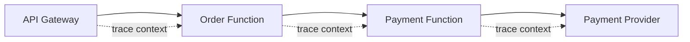

# Truyền trace context qua HTTP và sự kiện bất đồng bộ

Trong một hệ thống serverless, một yêu cầu có thể đi qua API Gateway, Java function, queue, event bus, một hoặc nhiều function khác rồi mới đến database hay dịch vụ bên ngoài. Mỗi function có invocation và log riêng; nếu không truyền ngữ cảnh trace giữa các ranh giới, đội vận hành khó biết các log và span nào thuộc cùng một luồng nghiệp vụ.

Trace context là metadata giúp các thành phần tiếp tục cùng một distributed trace. Với HTTP, ngữ cảnh thường được truyền qua các header chuẩn W3C như `traceparent` và `tracestate`. Với queue/event, cùng metadata đó cần được đặt trong message attributes hoặc event extensions để consumer có thể trích xuất và tạo span liên quan.

Java serverless thường dùng OpenTelemetry để tạo span, inject/extract context và xuất telemetry đến backend quan sát. Bài này tập trung vào cách truyền context đúng qua HTTP đồng bộ và event bất đồng bộ, xử lý batch/retry, giữ an toàn dữ liệu context và kiểm thử toàn luồng.

## 1. Trace context và distributed trace

### 1.1. Trace, span và context

Một **trace** mô tả toàn bộ hành trình của một request hoặc một luồng công việc phân tán. Trace gồm nhiều **span**; mỗi span đại diện cho một thao tác có thời gian bắt đầu/kết thúc, tên, kind, attributes, events và trạng thái.

Trace context là phần metadata tối thiểu để nối span ở các process khác nhau. Theo W3C Trace Context, các thành phần quan trọng gồm:

- `trace-id`: định danh trace, dài 16 byte (32 ký tự hex), dùng chung giữa các span trong trace.
- `parent-id`: định danh span cha, dài 8 byte (16 ký tự hex); span mới sẽ trở thành parent của thao tác tiếp theo.
- `trace-flags`: các cờ điều khiển, trong đó bit sampled cho biết trace có được lấy mẫu theo context hay không.
- `tracestate`: dữ liệu trạng thái riêng của vendor, được truyền tiếp theo quy tắc W3C.

Ví dụ một HTTP header `traceparent` version `00`:

```text
traceparent: 00-4bf92f3577b34da6a3ce929d0e0e4736-00f067aa0ba902b7-01
```

Giá trị minh họa trên có cấu trúc `version-trace-id-parent-id-trace-flags`. Không tự tách chuỗi bằng substring để tạo trace; hãy dùng propagator của OpenTelemetry để xác thực và xử lý version/format đúng chuẩn.

### 1.2. Context được truyền để tạo quan hệ cha-con

Ví dụ một request HTTP đi qua ba service:



Mỗi service tạo span riêng nhưng giữ cùng trace ID. Khi Order Function gọi Payment Function qua HTTP, nó inject context của span hiện tại vào request. Payment Function extract context từ request, tạo server/consumer span với parent tương ứng rồi tiếp tục inject khi gọi provider.

Nếu thiếu propagation, mỗi function có thể tạo trace root riêng. Backend vẫn hiển thị các span nhưng không thể tự biết chúng thuộc cùng một luồng nghiệp vụ.

### 1.3. Trace context khác correlation ID

`trace-id` phục vụ distributed tracing. `correlationId`, `requestId`, `orderId` hoặc `workflowId` phục vụ nghiệp vụ và điều tra ở cấp ứng dụng. Hai loại ID có thể cùng xuất hiện trong log nhưng không nên thay thế nhau.

| Giá trị | Mục đích | Có nên dùng làm authorization? |
| --- | --- | --- |
| Trace ID | Nối span giữa các service | Không |
| Span ID | Định danh một thao tác trong trace | Không |
| Correlation ID | Tìm các log liên quan đến một request/workflow | Không, trừ khi được xác thực như dữ liệu nghiệp vụ riêng |
| User/Tenant ID | Xác định chủ thể nghiệp vụ | Chỉ dùng sau khi xác thực và kiểm tra quyền |
| Idempotency/Event ID | Chống xử lý lặp và đối soát event | Không thay thế authorization |

Trace context có thể do caller bên ngoài tự đặt. Không dùng trace ID để xác thực người dùng, xác định tenant, kiểm soát quyền hoặc chống replay.

## 2. Chuẩn W3C Trace Context và OpenTelemetry

### 2.1. `traceparent`

`traceparent` mang thông tin để tạo quan hệ parent giữa các span. Header có định dạng chuẩn, version hiện tại thường gặp là `00`. Trace ID và parent ID không được là giá trị toàn số 0. Parser cần kiểm tra version, độ dài và ký tự hợp lệ.

Khi service nhận request:

1. đọc `traceparent` và `tracestate` từ carrier;
2. propagator xác thực và extract thành OpenTelemetry `Context`;
3. tạo span server/consumer với context được extract;
4. đặt span vào current context trong phạm vi xử lý;
5. đóng scope và kết thúc span khi thao tác hoàn tất.

Khi service gọi downstream:

1. tạo client/producer span;
2. đặt span làm current;
3. inject context hiện tại vào header/message attributes;
4. gửi request/message;
5. kết thúc span khi lời gọi hoặc publish hoàn tất.

### 2.2. `tracestate`

`tracestate` mang trạng thái bổ sung của tracing vendor. Service nên giữ và truyền tiếp theo quy tắc chuẩn, không tự ý viết lại trường của vendor khác. Header này không phải nơi lưu business metadata tùy ý.

Nếu hệ thống không cần vendor-specific state, có thể chỉ truyền `traceparent`. Khi dùng nhiều tracing backend hoặc vendor, kiểm tra propagator và chính sách giữ `tracestate` qua gateway, proxy và message broker.

### 2.3. Baggage

W3C Baggage là cơ chế truyền các key/value tùy chọn qua ranh giới service. Ví dụ có thể mang `tenant.tier=gold` hoặc `workflow.type=refund` nếu những giá trị này không nhạy cảm và có ích cho telemetry.

Baggage khác span attributes:

- span attribute gắn với một span cụ thể;
- baggage được truyền tiếp qua các service khi propagator hỗ trợ;
- baggage có thể nhân bản qua nhiều request/message và làm tăng kích thước header/event.

Không đưa password, access token, email, số điện thoại, dữ liệu thanh toán, session ID hoặc thông tin cá nhân nhạy cảm vào baggage. Giới hạn số key, độ dài và tập key được phép. Chỉ giữ các giá trị cần thiết cho telemetry.

### 2.4. OpenTelemetry propagator

OpenTelemetry dùng `TextMapPropagator` để inject/extract context vào một carrier dạng key/value. Carrier có thể là HTTP headers, message attributes hoặc event extension attributes.

Propagator nên được cấu hình nhất quán giữa producer và consumer. Với W3C Trace Context, dùng W3C propagator; nếu muốn truyền baggage, cấu hình thêm W3C Baggage propagator. Không tự viết parser `traceparent` nếu thư viện chuẩn đã đáp ứng.

## 3. Truyền context qua HTTP

### 3.1. Ingress: extract context từ request

Ở HTTP ingress, context thường được extract từ header trước khi xử lý business logic. Nếu dùng OpenTelemetry Java agent hoặc framework instrumentation, server span và extraction có thể đã được thực hiện tự động. Không tạo thêm server span trùng lặp nếu instrumentation đã tạo span cho cùng request.

Nếu tự viết adapter, cần:

- đọc `traceparent`, `tracestate` và baggage theo đúng chuẩn;
- xử lý header không có, sai định dạng hoặc quá dài;
- tạo root trace mới khi không có context hợp lệ;
- không làm request thất bại chỉ vì trace header sai;
- không dùng trace context thay cho authentication/authorization.

### 3.2. Egress: inject context vào HTTP client

Khi Java function gọi HTTP downstream, context hiện tại cần được inject vào request headers. Nếu dùng HTTP client đã được OpenTelemetry instrument, propagation thường được tự động thực hiện. Nếu tự quản lý carrier hoặc dùng client chưa instrument, có thể inject thủ công.

Ví dụ helper cho carrier dạng `Map<String, String>`:

```java
import io.opentelemetry.api.GlobalOpenTelemetry;
import io.opentelemetry.context.propagation.TextMapPropagator;
import io.opentelemetry.context.propagation.TextMapSetter;

import java.util.HashMap;
import java.util.Map;

public final class TraceHeaders {
    private static final TextMapPropagator PROPAGATOR =
            GlobalOpenTelemetry.getPropagators().getTextMapPropagator();

    private static final TextMapSetter<Map<String, String>> SETTER =
            (carrier, key, value) -> carrier.put(key, value);

    private TraceHeaders() {}

    public static Map<String, String> injectCurrentContext() {
        Map<String, String> headers = new HashMap<>();
        PROPAGATOR.inject(io.opentelemetry.context.Context.current(), headers, SETTER);
        return headers;
    }
}
```

`GlobalOpenTelemetry` phải được cấu hình với SDK/propagator phù hợp trước khi sử dụng. Nếu global propagator là no-op, map có thể rỗng; cần kiểm tra cấu hình startup và exporter trong môi trường triển khai.

### 3.3. Extract context trong Java adapter

Ví dụ getter cho carrier map. HTTP header không phân biệt hoa/thường; nếu carrier lưu nguyên trạng key, getter nên tìm key không phân biệt chữ hoa/thường hoặc chuẩn hóa key trước khi gọi propagator.

```java
import io.opentelemetry.api.GlobalOpenTelemetry;
import io.opentelemetry.context.Context;
import io.opentelemetry.context.propagation.TextMapGetter;
import io.opentelemetry.context.propagation.TextMapPropagator;

import java.util.Map;

public final class TraceContextExtractor {
    private static final TextMapPropagator PROPAGATOR =
            GlobalOpenTelemetry.getPropagators().getTextMapPropagator();

    private static final TextMapGetter<Map<String, String>> GETTER =
            new TextMapGetter<>() {
                @Override
                public Iterable<String> keys(Map<String, String> carrier) {
                    return carrier == null ? java.util.List.of() : carrier.keySet();
                }

                @Override
                public String get(Map<String, String> carrier, String key) {
                    if (carrier == null) {
                        return null;
                    }
                    return carrier.entrySet().stream()
                            .filter(entry -> entry.getKey().equalsIgnoreCase(key))
                            .map(Map.Entry::getValue)
                            .findFirst()
                            .orElse(null);
                }
            };

    private TraceContextExtractor() {}

    public static Context extract(Map<String, String> headers) {
        return PROPAGATOR.extract(Context.root(), headers, GETTER);
    }

    public static TextMapGetter<Map<String, String>> getter() {
        return GETTER;
    }
}
```

Trong ứng dụng thật, dùng adapter HTTP/framework phù hợp để lấy tất cả header có thể lặp theo contract của server. Ví dụ trên chỉ minh họa carrier map đơn giản; không gộp hoặc nối nhiều giá trị header tùy tiện.

### 3.4. Server span và client span

Khi tự tạo span, dùng đúng `SpanKind`:

| Thao tác | Span kind thường dùng |
| --- | --- |
| Nhận HTTP request | `SERVER` |
| Gọi HTTP downstream | `CLIENT` |
| Publish message/event | `PRODUCER` |
| Consume/process message | `CONSUMER` |
| Logic nội bộ | `INTERNAL` |

Nếu framework hoặc agent đã tạo server/client span, chỉ bổ sung attributes/events cần thiết thay vì tạo span thứ hai cùng đại diện một thao tác.

### 3.5. Gateway và proxy ở giữa

API Gateway, ingress controller, service mesh, CDN hoặc reverse proxy có thể giữ, xóa, tạo mới hoặc chuẩn hóa header. Cần xác minh:

- `traceparent` có đi đến function không;
- header có bị rewrite khi retry hoặc route sang revision khác không;
- `tracestate` và baggage có bị giới hạn/khuếch đại không;
- gateway có tạo span riêng và nối đúng parent không;
- request ID của gateway có được log riêng không.

Không giả định header mà client gửi luôn tới được handler. Hãy kiểm tra trace thực tế qua cả đường ingress và egress.

## 4. Truyền context qua sự kiện bất đồng bộ

### 4.1. Vì sao event cần carrier riêng?

HTTP có headers, nhưng queue message/event có thể không giữ HTTP headers. Khi producer publish message, nó cần inject trace context vào metadata được transport hỗ trợ. Consumer lấy metadata đó và extract trước khi xử lý.

Các vị trí thường dùng:

| Transport | Vị trí truyền context |
| --- | --- |
| SQS-like queue | Message attributes |
| Pub/Sub | Message attributes |
| Kafka | Record headers |
| RabbitMQ/AMQP | Message headers/properties |
| CloudEvents | Extension attributes như `traceparent`, `tracestate` nếu contract cho phép |
| Webhook | HTTP headers W3C |

Không nhất thiết nhét trace context vào business payload. Metadata/header thường tách biệt hơn và tránh làm thay đổi schema nghiệp vụ. Tuy nhiên, một số event platform chỉ cho phép một tập attribute nhất định; phải kiểm tra giới hạn kích thước, ký tự và reserved names.

### 4.2. Producer: inject context vào message attributes

Ví dụ Java tạo metadata cho message:

```java
import io.opentelemetry.api.GlobalOpenTelemetry;
import io.opentelemetry.api.trace.Span;
import io.opentelemetry.api.trace.SpanKind;
import io.opentelemetry.api.trace.Tracer;
import io.opentelemetry.context.Scope;
import io.opentelemetry.context.propagation.TextMapPropagator;
import io.opentelemetry.context.propagation.TextMapSetter;

import java.util.HashMap;
import java.util.Map;

public final class OrderEventPublisher {
    private static final Tracer TRACER =
            GlobalOpenTelemetry.getTracer("orders-publisher");
    private static final TextMapPropagator PROPAGATOR =
            GlobalOpenTelemetry.getPropagators().getTextMapPropagator();
    private static final TextMapSetter<Map<String, String>> SETTER =
            (carrier, key, value) -> carrier.put(key, value);

    private final MessageTransport transport;

    public OrderEventPublisher(MessageTransport transport) {
        this.transport = transport;
    }

    public void publish(OrderPaid event) {
        var span = TRACER.spanBuilder("publish order paid")
                .setSpanKind(SpanKind.PRODUCER)
                .startSpan();
        try (Scope ignored = span.makeCurrent()) {
            Map<String, String> attributes = new HashMap<>();
            PROPAGATOR.inject(io.opentelemetry.context.Context.current(),
                    attributes, SETTER);
            transport.send(event, attributes);
        } catch (RuntimeException error) {
            span.recordException(error);
            span.setStatus(io.opentelemetry.api.trace.StatusCode.ERROR);
            throw error;
        } finally {
            span.end();
        }
    }
}
```

`MessageTransport` là abstraction của ứng dụng; adapter cụ thể phải map các key/value này vào message attributes hoặc record headers của broker. Nếu SDK đã tự instrument producer và inject context, không inject thêm một bộ header khác.

Nếu `transport.send()` trả về future/publisher bất đồng bộ, span publish trong ví dụ chỉ đo đến lúc thao tác gửi được khởi tạo hoặc được chấp nhận theo contract của adapter. Muốn đo đến khi broker xác nhận, cần kết thúc span trong callback khi acknowledgement hoàn tất và truyền context vào callback đó.

### 4.3. Consumer: extract trước khi xử lý

Với một message, consumer có thể extract context và tạo consumer span:

```java
import io.opentelemetry.api.GlobalOpenTelemetry;
import io.opentelemetry.api.trace.Span;
import io.opentelemetry.api.trace.SpanKind;
import io.opentelemetry.api.trace.StatusCode;
import io.opentelemetry.api.trace.Tracer;
import io.opentelemetry.context.Context;
import io.opentelemetry.context.Scope;
import io.opentelemetry.context.propagation.TextMapGetter;
import io.opentelemetry.context.propagation.TextMapPropagator;

import java.util.Map;

public final class OrderEventConsumer {
    private static final Tracer TRACER =
            GlobalOpenTelemetry.getTracer("orders-consumer");
    private static final TextMapPropagator PROPAGATOR =
            GlobalOpenTelemetry.getPropagators().getTextMapPropagator();

    private static final TextMapGetter<Map<String, String>> GETTER =
            new TextMapGetter<>() {
                @Override
                public Iterable<String> keys(Map<String, String> carrier) {
                    return carrier == null ? java.util.List.of() : carrier.keySet();
                }

                @Override
                public String get(Map<String, String> carrier, String key) {
                    if (carrier == null) return null;
                    return carrier.entrySet().stream()
                            .filter(entry -> entry.getKey().equalsIgnoreCase(key))
                            .map(Map.Entry::getValue)
                            .findFirst()
                            .orElse(null);
                }
            };

    private final OrderApplicationService service;

    public OrderEventConsumer(OrderApplicationService service) {
        this.service = service;
    }

    public void handle(OrderPaid event, Map<String, String> attributes) {
        Context parent = PROPAGATOR.extract(Context.root(), attributes, GETTER);
        var span = TRACER.spanBuilder("process order paid")
                .setSpanKind(SpanKind.CONSUMER)
                .setParent(parent)
                .startSpan();

        try (Scope ignored = span.makeCurrent()) {
            service.process(event);
        } catch (RuntimeException error) {
            span.recordException(error);
            span.setStatus(StatusCode.ERROR);
            throw error;
        } finally {
            span.end();
        }
    }
}
```

Nếu message không có context hợp lệ, `extract` trả context không có remote parent; consumer vẫn tạo span độc lập. Không từ chối message chỉ vì thiếu trace metadata trừ khi contract nội bộ yêu cầu bắt buộc và có lý do vận hành rõ ràng.

### 4.4. CloudEvents extension attributes

Với CloudEvents, trace context có thể được đặt trong extension attributes nếu producer/consumer cùng thống nhất contract. Ví dụ envelope:

```json
{
  "specversion": "1.0",
  "id": "evt-9821",
  "source": "/orders",
  "type": "com.example.order.paid.v1",
  "traceparent": "00-4bf92f3577b34da6a3ce929d0e0e4736-00f067aa0ba902b7-01",
  "data": {
    "orderId": "order-42",
    "status": "PAID"
  }
}
```

Đây là ví dụ minh họa. CloudEvents extension name phải tuân thủ quy tắc đặt tên của CloudEvents; `traceparent` và `tracestate` có thể dùng làm extension nếu nền tảng và binding cho phép. Nếu transport đã có message attributes riêng, ưu tiên giữ context trong metadata để không làm nhiễu business payload.

## 5. Quan hệ parent, child và span links trong async workflow

### 5.1. Khi nào dùng parent-child?

Parent-child thể hiện một thao tác được gọi như phần tiếp nối của thao tác trước. Với HTTP request/response hoặc một message đơn lẻ được xử lý trực tiếp, consumer span có thể dùng context producer làm parent nếu semantics của hệ thống phù hợp.

Tuy nhiên, queue có thể giữ message nhiều phút hoặc nhiều giờ. Producer span đã kết thúc từ lâu trước khi consumer bắt đầu. Trace vẫn có thể nối parent-child, nhưng quan hệ thời gian không còn giống call stack đồng bộ. Hãy chọn mô hình thể hiện đúng semantics và khả năng backend hiển thị.

### 5.2. Span links cho công việc bất đồng bộ

Span link biểu diễn quan hệ nhân quả giữa span mà không bắt span mới phải có duy nhất một parent. Link hữu ích khi:

- consumer nhận batch chứa nhiều message từ nhiều trace;
- một workflow tổng hợp nhiều event độc lập;
- một job được kích hoạt bởi nhiều nguồn;
- xử lý bất đồng bộ kéo dài và không nên xem producer span là call stack cha trực tiếp;
- fan-in/fan-out tạo quan hệ một-nhiều hoặc nhiều-một.

Với batch gồm nhiều message, không nên chọn context của record đầu tiên làm parent cho toàn bộ batch. Tạo một consumer span cho batch và thêm link đến từng valid `SpanContext` của message.

### 5.3. Ví dụ consumer batch dùng links

```java
import io.opentelemetry.api.GlobalOpenTelemetry;
import io.opentelemetry.api.trace.Span;
import io.opentelemetry.api.trace.SpanContext;
import io.opentelemetry.api.trace.SpanKind;
import io.opentelemetry.api.trace.Tracer;
import io.opentelemetry.context.Context;
import io.opentelemetry.context.Scope;
import io.opentelemetry.context.propagation.TextMapPropagator;

import java.util.List;
import java.util.Map;

public final class BatchOrderConsumer {
    private static final Tracer TRACER =
            GlobalOpenTelemetry.getTracer("orders-batch-consumer");
    private static final TextMapPropagator PROPAGATOR =
            GlobalOpenTelemetry.getPropagators().getTextMapPropagator();

    public void handle(List<Message<OrderPaid>> messages) {
        var builder = TRACER.spanBuilder("process order batch")
                .setSpanKind(SpanKind.CONSUMER)
                .setNoParent();

        for (Message<OrderPaid> message : messages) {
            Context extracted = PROPAGATOR.extract(
                    Context.root(), message.attributes(), TraceContextExtractor.getter());
            SpanContext linkedContext = Span.fromContext(extracted).getSpanContext();
            if (linkedContext.isValid()) {
                builder.addLink(linkedContext);
            }
        }

        var span = builder.startSpan();
        try (Scope ignored = span.makeCurrent()) {
            for (Message<OrderPaid> message : messages) {
                processOne(message);
            }
        } finally {
            span.end();
        }
    }

    private void processOne(Message<OrderPaid> message) {
        // Idempotent business processing for one message.
    }
}
```

`Message`, `OrderPaid` và `TraceContextExtractor.getter()` là kiểu/adapter minh họa cần nối với code ứng dụng. `setNoParent()` giúp batch span trở thành root của phần xử lý batch; các producer contexts được thể hiện qua links. Nếu framework instrumentation đã tạo consumer span và links cho batch, không tạo thêm span trùng.

### 5.4. Fan-out và fan-in

Trong fan-out, một request có thể publish nhiều message. Mỗi message nên mang context của thao tác publish tương ứng. Consumer của từng message tạo span riêng và có thể link hoặc dùng parent phù hợp.

Trong fan-in, một function gom nhiều kết quả từ nhiều upstream trace. Span tổng hợp nên có links đến các context nguồn, vì không có một parent duy nhất đại diện đúng cho tất cả.

## 6. Retry và redelivery trong trace

### 6.1. Mỗi lần delivery là một lần thực thi riêng

Queue có thể giao cùng message nhiều lần. Trace context gốc thường vẫn đi cùng message, nhưng mỗi delivery attempt là một lần xử lý mới. Có thể tạo một consumer span riêng cho từng attempt và thêm attributes như:

- `messaging.message.id` hoặc message identifier theo semantic convention đang dùng;
- delivery attempt number nếu broker cung cấp;
- queue/topic/subscription;
- `error.type` khi thất bại;
- retry/backoff metadata không nhạy cảm.

Không tái sử dụng cùng span object qua nhiều invocation. Span phải được kết thúc trong invocation tương ứng. Khi redelivery, consumer tạo span mới; các span có thể cùng nối đến producer context hoặc liên kết qua một workflow/retry context.

### 6.2. Retry nội bộ và retry của nền tảng

Phân biệt:

- **Retry nội bộ:** code gọi lại dependency trong cùng invocation. Có thể tạo child span cho từng attempt dưới span xử lý hiện tại.
- **Retry của platform/queue:** function invocation kết thúc thất bại và nền tảng giao lại message. Mỗi invocation mới tạo span mới, thường liên kết về context được truyền trong message.
- **Redrive từ DLQ:** message được phát lại sau một khoảng thời gian; giữ event identity và trace context gốc nếu policy cho phép, đồng thời ghi nhận replay metadata riêng.

Không ghi đè `traceparent` của message bằng context của lần retry mới nếu muốn giữ quan hệ với producer ban đầu. Nếu cần biểu diễn retry workflow, thêm span/link hoặc attributes cho attempt thay vì làm mất nguồn gốc.

### 6.3. Correlation và idempotency không phụ thuộc trace

Trace sampling có thể loại bỏ một số trace khỏi backend. Trace context có thể bị thiếu hoặc bị caller giả mạo. Vì vậy, retry, deduplication và idempotency phải dựa vào event ID/idempotency key được xác thực và lưu bền vững, không dựa vào trace ID.

Trace context chỉ giúp quan sát. Không dùng `trace-id` làm khóa database, event identity hoặc điều kiện chống xử lý trùng.

## 7. Context trong Java thread và asynchronous execution

### 7.1. Context thường được gắn với thread-local scope

OpenTelemetry Java `Context.current()` thường lấy context hiện tại từ storage gắn với thread. Khi mở scope, context trở thành current trong phạm vi đó; khi đóng scope, context trước đó được khôi phục.

Luôn đóng `Scope` bằng try-with-resources:

```java
try (Scope scope = extractedContext.makeCurrent()) {
    service.process(event);
}
```

Không để scope mở qua nhiều invocation hoặc lưu request-specific context trong static field. Serverless runtime có thể tái sử dụng execution environment; nếu không đóng scope, context của request trước có thể rò sang request sau.

### 7.2. CompletableFuture và Executor

Khi chuyển công việc sang thread pool, thread mới có thể không mang current context của thread gọi. Cần capture context trước khi submit và make current trong task, hoặc dùng instrumentation tự động hỗ trợ propagation.

Ví dụ:

```java
import io.opentelemetry.context.Context;
import io.opentelemetry.context.Scope;

import java.util.concurrent.CompletableFuture;
import java.util.concurrent.Executor;

public CompletableFuture<Result> processAsync(
        Command command,
        Executor executor) {

    Context captured = Context.current();
    return CompletableFuture.supplyAsync(() -> {
        try (Scope ignored = captured.makeCurrent()) {
            return service.process(command);
        }
    }, executor);
}
```

Không truyền context bằng static mutable variable. Nếu dùng Reactor, virtual threads, framework reactive hoặc async SDK, kiểm tra instrumentation/context propagation tương thích với phiên bản đang dùng.

### 7.3. Tránh giữ scope qua callback chưa hoàn tất

Không mở scope trên thread A rồi đóng nó từ thread B. Mỗi callback/thread cần khôi phục context riêng trong phạm vi thực thi của nó. Với nhiều callback, capture cùng context và tạo scope cho từng callback.

### 7.4. Serverless warm environment

Có thể tái sử dụng tracer, exporter, propagator và client thread-safe ở cấp process. Không tái sử dụng span hoặc current context giữa invocation. Kết thúc span trong `finally`, đóng scope và tránh giữ reference đến request/event trong cache toàn cục.

## 8. Baggage, privacy và trust boundary

### 8.1. Chỉ truyền dữ liệu cần cho telemetry

Baggage được nhân bản qua nhiều service và có thể đi đến hệ thống bên ngoài. Mỗi key/value nên được xem như metadata có thể bị nhiều thành phần quan sát. Không truyền:

- access token, API key, cookie hoặc credential;
- password hoặc secret;
- email, số điện thoại, địa chỉ hoặc dữ liệu cá nhân;
- thông tin thanh toán;
- raw user input hoặc payload lớn;
- giá trị dùng làm quyền truy cập mà không xác thực lại.

Nếu cần tenant segmentation trong telemetry, dùng mã phân loại không nhạy cảm và có policy rõ; tránh đưa ID cá nhân trực tiếp vào baggage hoặc metric labels.

### 8.2. Giới hạn kích thước và số lượng key

Header HTTP và message attributes có giới hạn kích thước. Baggage quá lớn có thể làm request bị từ chối, message vượt giới hạn hoặc tăng chi phí network. Đặt allowlist key, max length và số lượng item. Xóa key không còn cần trước khi gọi external provider.

### 8.3. Context đến từ Internet là không đáng tin

Caller công khai có thể gửi `traceparent`, `tracestate` hoặc baggage tùy ý. Điều này có thể làm trace bị phân mảnh, giả mạo metadata hoặc ảnh hưởng sampling nếu hệ thống tin cờ sampled từ xa.

Ở trust boundary:

- quyết định có tiếp tục remote parent hay bắt đầu trace mới theo policy;
- không tin remote sampled flag để quyết định toàn bộ chi phí telemetry;
- giới hạn `tracestate` và baggage;
- loại bỏ baggage không được cho phép;
- không dùng context để authorization, tenant routing hoặc rate limiting;
- dùng gateway/collector policy để kiểm soát propagation từ bên ngoài.

Nếu bắt đầu trace mới ở biên, có thể giữ quan hệ đến context bên ngoài bằng span link khi phù hợp và được backend hỗ trợ. Cách này giúp hệ thống giữ trace nội bộ có kiểm soát mà vẫn có thể tham chiếu trace caller.

## 9. Tích hợp OpenTelemetry trong Java FaaS

### 9.1. API, SDK và instrumentation

OpenTelemetry Java có ba phần cần phân biệt:

- **API:** interface để tạo span, lấy current context và ghi attributes.
- **SDK:** triển khai tracer provider, sampler, processor và exporter.
- **Instrumentation:** tự động instrument framework, HTTP client, JDBC, messaging SDK hoặc runtime khi thư viện hỗ trợ.

Có thể dùng Java agent, framework instrumentation hoặc instrumentation thủ công. Tránh instrument cùng một boundary hai lần, ví dụ agent tạo HTTP server span rồi code lại tạo một server span khác cho cùng request.

### 9.2. Propagator phải được cấu hình nhất quán

Ví dụ cấu hình propagator W3C trong SDK:

```java
import io.opentelemetry.api.OpenTelemetry;
import io.opentelemetry.api.GlobalOpenTelemetry;
import io.opentelemetry.context.propagation.ContextPropagators;
import io.opentelemetry.api.trace.propagation.W3CTraceContextPropagator;
import io.opentelemetry.api.baggage.propagation.W3CBaggagePropagator;
import io.opentelemetry.context.propagation.TextMapPropagator;
import io.opentelemetry.sdk.OpenTelemetrySdk;

TextMapPropagator propagator = TextMapPropagator.composite(
        W3CTraceContextPropagator.getInstance(),
        W3CBaggagePropagator.getInstance());

OpenTelemetry openTelemetry = OpenTelemetrySdk.builder()
        .setPropagators(ContextPropagators.create(propagator))
        // Cấu hình TracerProvider, sampler, span processor và exporter tại đây.
        .build();

GlobalOpenTelemetry.set(openTelemetry);
```

Đoạn mã là phần minh họa cấu hình propagator; một ứng dụng hoàn chỉnh phải cấu hình `SdkTracerProvider`, resource attributes, span processor và exporter trước khi dùng tracer. Chỉ khởi tạo global SDK một lần trong vòng đời process. Nếu nền tảng/framework đã cấu hình SDK, dùng cấu hình hiện có và không gọi `GlobalOpenTelemetry.set()` lần thứ hai.

### 9.3. Semantic conventions

Dùng semantic conventions tương ứng với phiên bản OpenTelemetry đang triển khai cho HTTP, messaging, database và serverless. Attributes phổ biến có thể gồm:

- `http.request.method`, `http.response.status_code`;
- `url.scheme`, `server.address`, `network.protocol.name`;
- messaging system, destination, operation và message ID;
- `faas.name`, `faas.trigger`, `cloud.region` nếu semantic convention/runtime hỗ trợ;
- `error.type` và exception event theo API version.

Tên attribute có thể thay đổi giữa các phiên bản semantic conventions. Hãy pin version instrumentation và kiểm tra schema mà backend observability đang hỗ trợ; không trộn tùy tiện tên cũ và mới.

### 9.4. Export span trong môi trường serverless

Function có thể bị freeze hoặc kết thúc execution environment ngay sau invocation. Batch span processor có thể chưa kịp gửi dữ liệu nếu exporter chờ batch interval dài hơn vòng đời invocation.

Các lựa chọn:

- dùng extension/agent/collector được nền tảng hỗ trợ để gửi telemetry ngoài handler;
- dùng exporter phù hợp với runtime serverless và flush theo lifecycle hook được hỗ trợ;
- cấu hình batch/queue size và timeout phù hợp với thời gian invocation;
- kiểm tra span có được export trước khi environment bị freeze hay không.

Không gọi `forceFlush()` một cách mù quáng sau mọi thao tác nếu nó làm tăng latency đáng kể. Đo độ trễ export, mất span và chi phí. Một số nền tảng có telemetry integration riêng; xác minh semantics cụ thể của runtime.

## 10. Sampling và trace continuity

### 10.1. Sampling ảnh hưởng điều gì?

Sampling quyết định trace/span nào được ghi và export. Nếu producer và consumer dùng sampler khác nhau, một phần trace có thể xuất hiện thiếu span. W3C sampled flag được truyền trong `traceparent`, nhưng policy ở trust boundary có thể quyết định không tin cờ remote.

### 10.2. Head sampling

Head sampler quyết định khi span bắt đầu. Nó nhanh và giảm overhead nhưng chưa biết kết quả cuối cùng của trace. Nếu request lỗi ở bước cuối, trace có thể đã bị loại khỏi sampling từ đầu.

### 10.3. Tail sampling

Tail sampling quyết định sau khi collector đã nhận đủ span của trace, có thể ưu tiên giữ trace lỗi, latency cao hoặc có thuộc tính cụ thể. Cần đảm bảo các span của trace được định tuyến đến cùng tail-sampling collector/decision point; nếu phân tán không đúng, collector không có đủ dữ liệu.

### 10.4. Sampling và async delay

Producer và consumer có thể cách nhau nhiều phút. Nếu collector xóa state hoặc tail-sampling window ngắn hơn queue delay, trace có thể không được quyết định như mong muốn. Kiểm tra retention/window, routing theo trace ID và sampling policy cho messaging workload.

Không dùng trace sampling để bỏ qua audit log hoặc business event. Telemetry có thể được sample; dữ liệu nghiệp vụ và audit cần cơ chế lưu riêng theo yêu cầu.

## 11. Kiểm thử trace propagation

### 11.1. Unit test inject/extract round-trip

Test cơ bản:

1. tạo span trong context;
2. inject vào carrier;
3. extract từ carrier mới;
4. xác nhận trace ID và span ID được giữ đúng theo quan hệ mong muốn;
5. xác nhận invalid/missing header không làm handler lỗi.

Ví dụ test khái niệm:

```java
import static org.junit.jupiter.api.Assertions.*;

import io.opentelemetry.api.OpenTelemetry;
import io.opentelemetry.api.trace.Span;
import io.opentelemetry.api.trace.SpanKind;
import io.opentelemetry.api.trace.Tracer;
import io.opentelemetry.context.Context;
import io.opentelemetry.context.Scope;
import io.opentelemetry.context.propagation.ContextPropagators;
import io.opentelemetry.api.trace.propagation.W3CTraceContextPropagator;
import io.opentelemetry.context.propagation.TextMapPropagator;
import io.opentelemetry.context.propagation.TextMapGetter;
import io.opentelemetry.context.propagation.TextMapSetter;
import io.opentelemetry.sdk.OpenTelemetrySdk;
import io.opentelemetry.sdk.trace.SdkTracerProvider;
import org.junit.jupiter.api.Test;

import java.util.HashMap;
import java.util.Map;

class TracePropagationTest {
    @Test
    void injectThenExtractPreservesTraceIdentity() {
        TextMapPropagator propagator = W3CTraceContextPropagator.getInstance();
        TextMapSetter<Map<String, String>> setter = (carrier, key, value) ->
                carrier.put(key, value);
        TextMapGetter<Map<String, String>> getter = new TextMapGetter<>() {
            @Override
            public Iterable<String> keys(Map<String, String> carrier) {
                return carrier == null ? java.util.List.of() : carrier.keySet();
            }

            @Override
            public String get(Map<String, String> carrier, String key) {
                return carrier.entrySet().stream()
                        .filter(entry -> entry.getKey().equalsIgnoreCase(key))
                        .map(Map.Entry::getValue)
                        .findFirst()
                        .orElse(null);
            }
        };
        SdkTracerProvider tracerProvider = SdkTracerProvider.builder().build();
        OpenTelemetry openTelemetry = OpenTelemetrySdk.builder()
                .setTracerProvider(tracerProvider)
                .setPropagators(ContextPropagators.create(propagator))
                .build();
        Tracer tracer = openTelemetry.getTracer("trace-propagation-test");

        var producer = tracer.spanBuilder("publish")
                .setSpanKind(SpanKind.PRODUCER)
                .startSpan();
        try {
            Map<String, String> carrier = new HashMap<>();
            try (Scope ignored = producer.makeCurrent()) {
                propagator.inject(Context.current(), carrier, setter);
            }

            Context extracted = propagator.extract(Context.root(), carrier, getter);
            Span extractedSpan = Span.fromContext(extracted);

            assertTrue(extractedSpan.getSpanContext().isValid());
            assertEquals(producer.getSpanContext().getTraceId(),
                    extractedSpan.getSpanContext().getTraceId());
            assertEquals(producer.getSpanContext().getSpanId(),
                    extractedSpan.getSpanContext().getSpanId());
        } finally {
            producer.end();
            tracerProvider.close();
        }
    }
}
```

Test thực tế nên đóng `SdkTracerProvider` trong `finally`/lifecycle test fixture nếu assertion có thể thất bại trước cleanup, và có thể dùng `InMemorySpanExporter` để xác minh parent/link cùng span được export. Ví dụ trên minh họa round-trip của W3C Trace Context.

### 11.2. Test trường hợp lỗi

Bao gồm:

- không có `traceparent`;
- `traceparent` sai format, sai version hoặc trace ID toàn zero;
- `tracestate` quá dài hoặc sai format;
- baggage chứa key không được phép;
- header bị proxy loại bỏ;
- message không có attributes;
- message bị redrive từ DLQ;
- retry tạo span mới nhưng giữ nguồn trace mong muốn;
- batch có nhiều trace context;
- context không rò từ invocation trước sang invocation sau.

Không nên làm request thất bại chỉ vì trace metadata không hợp lệ; trừ khi propagation là một contract nội bộ bắt buộc, lỗi tracing nên được xử lý fail-open để không làm gián đoạn business request.

### 11.3. Integration/E2E test

Một test end-to-end có thể:

1. gửi HTTP request có `traceparent` cố định;
2. gọi Java function qua gateway;
3. function publish message với context được inject;
4. queue trigger consumer function;
5. consumer ghi database và log trace ID;
6. truy vấn backend/collector để xác nhận spans có cùng trace ID và parent/link đúng.

Test thêm trường hợp duplicate delivery và retry để bảo đảm mỗi attempt có span riêng, nhưng business operation vẫn idempotent. Dùng test environment cô lập và không phụ thuộc vào thời gian export cố định; polling backend theo deadline để chờ trace xuất hiện.

### 11.4. Test context không bị rò

Trong cùng execution environment, xử lý request A có trace ID A, kết thúc scope, rồi xử lý request B không có header. Request B phải tạo trace mới, không được dùng lại trace ID A. Đây là test quan trọng vì serverless runtime có thể tái sử dụng JVM giữa các invocation.

## 12. Troubleshooting trace bị đứt

| Triệu chứng | Nguyên nhân có thể | Cách kiểm tra |
| --- | --- | --- |
| Mỗi function tạo trace ID khác nhau | Không inject/extract hoặc propagator no-op | Kiểm tra headers/message attributes và SDK config |
| HTTP trace bị đứt tại gateway | Gateway xóa/rewrite `traceparent` hoặc instrumentation không nối context | Kiểm tra header trước/sau gateway và server spans |
| Producer có span nhưng consumer không có parent/link | Message attributes không được map hoặc bị broker adapter bỏ | Kiểm tra publish metadata và consumer extraction |
| Baggage mất sau một service | Baggage propagator chưa bật hoặc policy lọc key | Kiểm tra composite propagator và allowlist |
| Trace có span trùng | Auto instrumentation và manual instrumentation cùng tạo span | Xác định boundary đã được agent/framework instrument chưa |
| Span async không có context | Thread pool/callback không capture context | Dùng context wrapping hoặc instrumentation hỗ trợ |
| Batch trace chỉ nối một message | Lấy parent từ record đầu tiên | Dùng span links cho tất cả valid source contexts |
| Trace biến mất sau function kết thúc | Exporter batch chưa flush hoặc environment bị freeze | Kiểm tra extension/exporter lifecycle và export timeout |
| Retry span nối sai attempt | Tái sử dụng span hoặc ghi đè message trace context | Tạo span mới mỗi attempt và giữ event identity riêng |
| Trace sampling thiếu một phần | Sampler khác nhau hoặc tail sampler không nhận đủ spans | Kiểm tra sampled flag, routing và tail-sampling window |
| Trace ID lạ từ request public | Caller tự gửi context tùy ý | Xem trust-boundary policy, không dùng context cho authorization |

## 13. Quy trình triển khai propagation cho Java serverless

1. Chọn chuẩn propagation, thường là W3C Trace Context và baggage nếu thực sự cần.
2. Chọn OpenTelemetry Java agent, framework instrumentation hoặc manual instrumentation cho từng boundary.
3. Cấu hình SDK, propagator, sampler, exporter và resource attributes một lần khi runtime khởi tạo.
4. Xác minh HTTP gateway giữ `traceparent`/`tracestate` và downstream client inject đúng header.
5. Với producer, inject context vào message attributes/record headers/event extensions.
6. Với consumer, extract context trước khi xử lý và tạo span đúng kind.
7. Dùng span links khi batch/fan-in có nhiều upstream context hoặc async semantics cần thể hiện quan hệ nhân quả.
8. Tạo span mới cho mỗi delivery attempt; giữ event ID/idempotency key độc lập với trace ID.
9. Propagate context qua executor/callback; luôn đóng scope và kết thúc span.
10. Lọc baggage, giới hạn kích thước và áp dụng trust-boundary policy.
11. Kiểm thử round-trip, missing/invalid context, batch, retry, DLQ và warm environment reuse.
12. Kiểm tra exporter có gửi span trước khi function bị freeze/kết thúc.
13. Theo dõi tỷ lệ trace bị đứt, span drop, export error và chi phí telemetry.

## 14. Checklist production

- [ ] Có một chuẩn propagation thống nhất giữa HTTP và messaging, ưu tiên W3C Trace Context.
- [ ] Producer inject `traceparent`/`tracestate` qua carrier đúng của transport.
- [ ] Consumer extract trước khi xử lý và tạo span theo đúng parent/link semantics.
- [ ] HTTP header được giữ qua gateway, proxy và service mesh theo policy.
- [ ] Không tạo span trùng với auto instrumentation.
- [ ] Batch consumer dùng links cho nhiều upstream contexts khi phù hợp.
- [ ] Retry/redelivery tạo span riêng cho mỗi attempt.
- [ ] Trace ID không được dùng làm event ID, idempotency key hoặc authorization.
- [ ] Baggage có allowlist, giới hạn kích thước và không chứa secret/PII.
- [ ] Remote trace context được xem là input không đáng tin tại public boundary.
- [ ] Context được truyền qua executor/async callback.
- [ ] Mọi `Scope` được đóng và mọi span được kết thúc trong `finally`.
- [ ] Không lưu invocation context trong static mutable state.
- [ ] Exporter/lifecycle được kiểm thử với freeze/termination của FaaS runtime.
- [ ] Sampling policy không làm mất audit/business records.
- [ ] Có unit, contract và E2E test cho propagation qua HTTP và event.
- [ ] Có metric/log để điều tra missing parent, dropped span và export failure.

## Kết luận

Trace context giúp nối span qua nhiều Java function và dịch vụ trong cùng một distributed trace. Với HTTP, dùng W3C `traceparent`/`tracestate` qua request headers; với queue và event, inject cùng metadata vào message attributes, record headers hoặc CloudEvents extensions theo contract của transport. OpenTelemetry propagator nên thực hiện inject/extract để tránh tự xử lý chuỗi trace thủ công.

Luồng bất đồng bộ cần được mô hình hóa cẩn thận. Một message đơn lẻ có thể dùng parent context phù hợp; batch/fan-in nhiều nguồn nên dùng span links thay vì ép mọi message vào một parent. Mỗi retry/redelivery tạo span mới, còn event ID và idempotency key vẫn là định danh nghiệp vụ riêng.

Trong Java FaaS, luôn đóng scope, kết thúc span, truyền context qua thread/async boundary và kiểm tra exporter trước khi execution environment bị freeze. Giới hạn baggage và xem trace context từ caller bên ngoài là dữ liệu không đáng tin. Khi kết hợp propagation, sampling, security và test end-to-end, nhóm có thể lần theo một nghiệp vụ xuyên qua HTTP và event mà không làm tracing trở thành điểm lỗi của ứng dụng.
