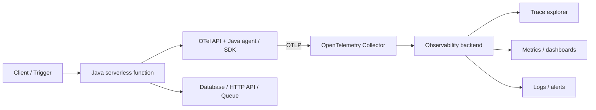
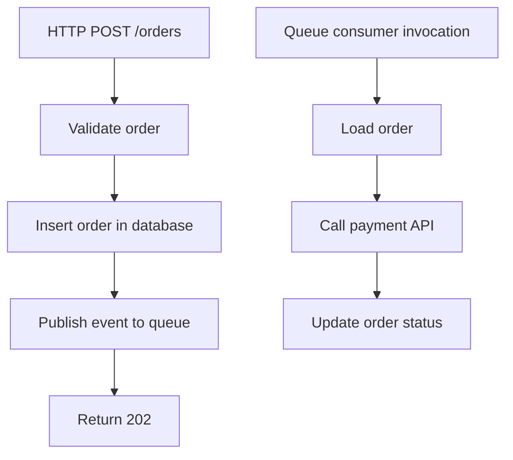

# Instrument ứng dụng Java bằng OpenTelemetry

Một ứng dụng Java serverless có thể chạy tốt trong lúc thử nghiệm nhưng vẫn khó vận hành khi có nhiều function, queue và dịch vụ phụ thuộc. Khi một request chậm hoặc một message bị retry, nhóm cần biết request đi qua những thành phần nào, bước nào mất thời gian, lỗi bắt đầu ở đâu và function đang sử dụng tài nguyên ra sao. Log riêng lẻ thường không đủ để nối các sự kiện này thành một luồng có thể điều tra.

OpenTelemetry (OTel) là bộ tiêu chuẩn và công cụ mã nguồn mở để thu thập **traces, metrics và logs**. Ứng dụng Java có thể được instrument tự động bằng Java agent, instrument thủ công qua API/SDK hoặc kết hợp hai cách. Dữ liệu telemetry thường được gửi qua OTLP tới OpenTelemetry Collector hoặc backend quan sát hệ thống.

Trong serverless, instrumentation cần hiểu vòng đời invocation: execution environment có thể được tái sử dụng, bị đóng băng hoặc bị thu hồi; một invocation có thể xử lý nhiều message; function có thể gọi downstream qua HTTP, database hoặc queue; và exporter cần gửi telemetry trước khi môi trường bị dừng. Bài học này trình bày cách instrument Java function, truyền trace context qua các trigger, tạo metric/log có ích và kiểm soát overhead, cardinality cùng dữ liệu nhạy cảm.

## 1. OpenTelemetry gồm những thành phần nào?

OpenTelemetry cung cấp API, SDK, instrumentation libraries, semantic conventions và giao thức OTLP. Các thành phần này phối hợp để ứng dụng tạo telemetry mà không phải gắn chặt vào một nhà cung cấp backend cụ thể.

| Thành phần | Vai trò |
|---|---|
| OpenTelemetry API | Interface để ứng dụng tạo span, counter, histogram và truy cập context |
| OpenTelemetry SDK | Cấu hình provider, sampler, processor, reader và exporter |
| Instrumentation | Tự động hoặc thủ công tạo telemetry cho framework, HTTP client, database và nghiệp vụ |
| Java agent | Gắn instrumentation lúc khởi chạy JVM, thường không cần sửa code ứng dụng |
| OTLP | Giao thức truyền traces, metrics và logs tới collector/backend |
| OpenTelemetry Collector | Nhận, xử lý, lọc, batch và chuyển tiếp telemetry |
| Backend | Lưu trữ, truy vấn, dashboard, alert và phân tích dữ liệu |
| Semantic conventions | Quy ước tên attribute, span, resource và metric để dữ liệu nhất quán |



OpenTelemetry không phải một backend lưu trữ và cũng không tự tạo dashboard cho mọi nền tảng. Nó chuẩn hóa cách ứng dụng phát telemetry và cách dữ liệu được chuyển đi. Backend có thể là dịch vụ quản lý hoặc hệ thống tự vận hành.

### Ba tín hiệu chính

- **Traces:** mô tả một request hoặc operation qua nhiều service dưới dạng trace gồm các span có quan hệ cha-con.
- **Metrics:** số liệu tổng hợp theo thời gian như request count, error rate, latency histogram và queue processing count.
- **Logs:** sự kiện có ngữ cảnh, ví dụ validation failure, retry attempt hoặc lỗi kết nối database.

Ba tín hiệu bổ sung cho nhau. Trace giúp tìm bước chậm; metric cho biết vấn đề xảy ra rộng đến đâu và bắt đầu khi nào; log cung cấp chi tiết sự kiện để hiểu nguyên nhân.

## 2. Trace, span và context propagation

Một trace biểu diễn đường đi của một operation. Mỗi span đại diện cho một công việc có thời gian bắt đầu/kết thúc, tên, trạng thái, attribute và có thể có event. Các span trong cùng trace được liên kết bằng trace ID và quan hệ parent/child hoặc link.

Ví dụ request tạo đơn hàng:



HTTP request có thể là trace đầu tiên. Khi producer gửi message, trace context được truyền trong message attributes. Consumer có thể tiếp tục trace qua parent context hoặc tạo trace mới với span link tùy semantics của event và cách xử lý batch. Nếu message được xử lý sau nhiều phút, link thường hữu ích để biểu diễn quan hệ với producer mà không kéo dài một trace qua thời gian quá lâu.

### Span cần ghi gì?

Một span thường có:

- Tên operation có ý nghĩa, ví dụ `orders.validate` hoặc `payment.authorize`.
- Start/end timestamp.
- Status `OK` hoặc `ERROR` khi phù hợp.
- Attribute mô tả loại operation, dependency, outcome hoặc kích thước công việc.
- Event cho mốc quan trọng bên trong span.
- Exception event khi lỗi cần được ghi nhận.

Không đặt dữ liệu nhạy cảm hoặc giá trị có cardinality cao vào span name. Tên span nên ổn định như `GET /orders/{orderId}`, không ghép ID thực tế vào tên.

### Context propagation

Context chứa thông tin cần đi theo execution, đặc biệt là span hiện tại và baggage. Khi một service gọi HTTP service khác, instrumentation có thể inject trace context vào header `traceparent` và `tracestate` theo W3C Trace Context. Service nhận extract context để tạo span con hoặc span liên kết.

Nếu context không được truyền qua ranh giới dịch vụ, trace sẽ bị đứt thành nhiều trace riêng. Vì vậy, kiểm tra propagation là một phần bắt buộc của integration test.

Không dùng baggage để chuyển secret, access token, dữ liệu cá nhân hoặc payload nghiệp vụ. Baggage có thể được truyền qua nhiều service và xuất hiện trong telemetry. Chỉ truyền metadata kỹ thuật nhỏ, được cho phép rõ ràng.

## 3. Chọn Java agent, SDK hay manual instrumentation

Có ba cách chính để instrument Java:

| Cách | Ưu điểm | Đánh đổi |
|---|---|---|
| Java agent | Tự động instrument nhiều thư viện phổ biến như HTTP client, JDBC, servlet và framework | Cần cấu hình lúc khởi chạy; instrumentation phụ thuộc thư viện/version; có thể tạo nhiều span nếu không tinh chỉnh |
| SDK/API thủ công | Kiểm soát span nghiệp vụ và metric theo domain | Cần thêm code, giữ naming convention và quản lý lifecycle |
| Kết hợp | Agent thu telemetry kỹ thuật; API thủ công thêm span nghiệp vụ | Phải tránh instrument trùng và giới hạn attribute |

Với Java serverless, thường nên bắt đầu bằng agent hoặc instrumentation được nền tảng hỗ trợ để có HTTP/database spans, sau đó thêm manual span ở các ranh giới nghiệp vụ quan trọng. Nếu nền tảng không cho phép gắn agent hoặc runtime có extension riêng, dùng SDK/layer tương ứng.

### Khi nào dùng Java agent?

Java agent phù hợp khi:

- Chạy JVM có thể truyền `-javaagent`.
- Cần instrument framework và thư viện mà không sửa code.
- Muốn rollout instrumentation qua cấu hình deploy.
- Cần thử nghiệm hoặc bật/tắt instrumentation độc lập với business release.

Ví dụ khởi chạy JVM:

```bash
java \
  -javaagent:/opt/opentelemetry-javaagent.jar \
  -Dotel.service.name=orders-api \
  -Dotel.exporter.otlp.endpoint=http://otel-collector:4318 \
  -Dotel.exporter.otlp.protocol=http/protobuf \
  -jar app.jar
```

Đường dẫn agent và endpoint là ví dụ. Trong container, cần đưa agent vào image hoặc mount qua cơ chế triển khai. Với serverless managed runtime, không phải lúc nào cũng tự thêm được JVM argument; hãy dùng layer, extension, wrapper hoặc cơ chế instrumentation được nền tảng hỗ trợ.

### Khi nào dùng manual SDK?

Manual instrumentation phù hợp để tạo span cho nghiệp vụ không được agent hiểu, ví dụ tính giá, xác nhận hạn mức, chọn tenant hoặc quyết định retry. Cũng có thể tạo metric cho số đơn được chấp nhận, số event bị từ chối hoặc thời gian xử lý từng loại job.

Nếu agent đã cấu hình global OpenTelemetry provider, ứng dụng có thể lấy API global và tạo span mà không tự khởi tạo thêm SDK. Không tạo hai `OpenTelemetrySdk` global cạnh tranh trong cùng JVM.

## 4. Thêm dependency OpenTelemetry vào Java

Nếu dùng Java agent để cung cấp SDK/exporter, ứng dụng thường chỉ cần OpenTelemetry API cho manual instrumentation. Ví dụ Maven dependency:

```xml
<dependencyManagement>
    <dependencies>
        <dependency>
            <groupId>io.opentelemetry</groupId>
            <artifactId>opentelemetry-bom</artifactId>
            <version>${opentelemetry.version}</version>
            <type>pom</type>
            <scope>import</scope>
        </dependency>
    </dependencies>
</dependencyManagement>

<dependencies>
    <dependency>
        <groupId>io.opentelemetry</groupId>
        <artifactId>opentelemetry-api</artifactId>
    </dependency>
</dependencies>
```

Đặt `opentelemetry.version` theo release đã được dự án kiểm thử. Dùng BOM để các thư viện OpenTelemetry có version tương thích. Nếu ứng dụng tự cấu hình SDK thay vì agent, cần thêm SDK và exporter phù hợp; không trộn dependency version tùy tiện.

### Cấu hình SDK trực tiếp

Trong môi trường không dùng Java agent, ứng dụng có thể tạo SDK provider và exporter bằng code hoặc autoconfigure module. Với serverless, phải xác định rõ ai sở hữu lifecycle provider, processor và exporter. Không khởi tạo exporter mới trong mỗi invocation.

Một nguyên tắc quan trọng: chỉ có một nơi chịu trách nhiệm cấu hình global provider. Nếu nền tảng/layer đã cài OpenTelemetry SDK, hãy dùng API global; nếu ứng dụng tự quản lý, hãy khởi tạo một lần trong execution environment và đóng/flush theo lifecycle mà runtime hỗ trợ.

## 5. Tạo custom span trong Java

Ví dụ sau tạo span cho bước xác thực đơn hàng. Span ghi attribute kỹ thuật, đánh dấu lỗi nếu validation thất bại và luôn kết thúc trong `finally`.

```java
import io.opentelemetry.api.GlobalOpenTelemetry;
import io.opentelemetry.api.trace.Span;
import io.opentelemetry.api.trace.StatusCode;
import io.opentelemetry.api.trace.Tracer;
import io.opentelemetry.context.Scope;

public final class OrderService {
    private static final Tracer TRACER =
            GlobalOpenTelemetry.getTracer("com.example.orders");

    private final OrderRepository repository;

    public OrderService(OrderRepository repository) {
        this.repository = repository;
    }

    public Order create(CreateOrderCommand command) {
        Span span = TRACER.spanBuilder("orders.create")
                .startSpan();

        try (Scope scope = span.makeCurrent()) {
            span.setAttribute("order.channel", command.channel());
            span.setAttribute("order.item_count", command.items().size());

            validate(command);
            Order order = repository.insert(command);

            span.setAttribute("order.result", "created");
            return order;
        } catch (RuntimeException exception) {
            span.recordException(exception);
            span.setStatus(StatusCode.ERROR);
            throw exception;
        } finally {
            span.end();
        }
    }

    private void validate(CreateOrderCommand command) {
        if (command.items().isEmpty()) {
            throw new IllegalArgumentException("Order must contain at least one item");
        }
    }
}
```

`OrderRepository` và `CreateOrderCommand` đại diện cho domain code của ứng dụng. Nếu Java agent đã instrument JDBC, thao tác `repository.insert` có thể tạo database span tự động; span `orders.create` bổ sung ngữ cảnh nghiệp vụ bao quanh nó.

### Đặt tên và attribute có kiểm soát

Nên dùng:

- Span name: `orders.create`, `inventory.reserve`, `payment.authorize`.
- Attribute: `order.channel`, `order.item_count`, `payment.provider`, `app.retry_attempt`.
- Status: `ERROR` cho lỗi làm operation thất bại.
- Event: `inventory.reservation_started` hoặc một mốc hữu ích khi điều tra.

Tránh:

- Span name chứa `order-12345` hoặc email người dùng.
- Attribute có giá trị tự do từ input chưa kiểm soát.
- Ghi toàn bộ request/response body.
- Ghi access token, API key, password hoặc secret.

Đối với exception, chỉ ghi thông tin cần thiết để điều tra. Một số instrumentation tự động có thể đã ghi exception; tránh ghi cùng một lỗi nhiều lần ở nhiều tầng nếu không tăng thêm ngữ cảnh.

## 6. Tạo metrics cho nghiệp vụ

Trace giải thích một request cụ thể; metric cho biết xu hướng tổng thể. Nên dùng counter cho số lần xảy ra, histogram cho phân phối thời gian/kích thước và observable gauge cho giá trị đo tại thời điểm thu thập khi phù hợp.

Ví dụ counter và histogram:

```java
import io.opentelemetry.api.GlobalOpenTelemetry;
import io.opentelemetry.api.common.Attributes;
import io.opentelemetry.api.metrics.LongCounter;
import io.opentelemetry.api.metrics.LongHistogram;
import io.opentelemetry.api.metrics.Meter;

public final class OrderMetrics {
    private static final Meter METER =
            GlobalOpenTelemetry.getMeter("com.example.orders");

    private static final LongCounter ACCEPTED = METER.counterBuilder("orders.accepted")
            .setDescription("Số đơn hàng được chấp nhận")
            .setUnit("{order}")
            .build();

    private static final LongCounter REJECTED = METER.counterBuilder("orders.rejected")
            .setDescription("Số đơn hàng bị từ chối")
            .setUnit("{order}")
            .build();

    private static final LongHistogram PROCESSING_TIME = METER.histogramBuilder(
                    "orders.processing.duration")
            .ofLongs()
            .setDescription("Thời gian xử lý đơn hàng")
            .setUnit("ms")
            .build();

    private OrderMetrics() {}

    public static void accepted(String channel) {
        ACCEPTED.add(1, Attributes.of(
                io.opentelemetry.api.common.AttributeKey.stringKey("order.channel"), channel));
    }

    public static void rejected(String reasonCode) {
        REJECTED.add(1, Attributes.of(
                io.opentelemetry.api.common.AttributeKey.stringKey("error.type"), reasonCode));
    }

    public static void recordDuration(long elapsedMillis) {
        PROCESSING_TIME.record(elapsedMillis);
    }
}
```

Metric name và unit cần tuân theo semantic conventions/naming policy của tổ chức. `reasonCode` nên là tập giá trị hữu hạn như `validation`, `inventory_unavailable` hoặc `dependency_timeout`; không dùng exception message tự do làm dimension.

### Cardinality là chi phí vận hành

Mỗi tổ hợp attribute tạo ra một time series riêng. Nếu thêm `user.id`, `order.id`, email hoặc request ID làm metric label, số series có thể tăng theo từng request và làm backend tốn bộ nhớ/chi phí.

Metric label nên có cardinality thấp và ổn định:

- Tốt: `http.method`, `http.route`, `status_class`, `error.type`, `cloud.region`.
- Cần cân nhắc: `tenant.tier`, `payment.provider`, `queue.name` nếu tập giá trị giới hạn.
- Tránh: `user.id`, `order.id`, `request.id`, email, URL đầy đủ có path parameter.

ID duy nhất phù hợp hơn trong trace/log có quyền truy cập và retention được kiểm soát, không phải metric dimension.

## 7. Correlate logs với traces

Logs thường được dùng để đọc thông điệp chi tiết, còn trace cho biết log xảy ra ở bước nào của request. Khi có trace context, log nên chứa `trace_id` và `span_id` để backend có thể liên kết log với trace.

Ví dụ log có cấu trúc:

```json
{
  "timestamp": "2026-11-17T10:15:30.123Z",
  "level": "ERROR",
  "service.name": "orders-worker",
  "message": "Payment authorization failed",
  "trace_id": "4bf92f3577b34da6a3ce929d0e0e4736",
  "span_id": "00f067aa0ba902b7",
  "error.type": "payment_timeout",
  "retry.attempt": 2
}
```

Đây là log minh họa. Không ghi token, thông tin thẻ, nội dung đơn hàng hoặc exception message chứa dữ liệu nhạy cảm. `trace_id`/`span_id` không phải secret, nhưng vẫn nên tuân thủ access control và retention của hệ thống log.

### Dùng MDC trong Java

Nếu ứng dụng dùng SLF4J/Logback, có thể thêm trace ID và span ID vào MDC khi có span hiện tại. Java agent hoặc logging instrumentation có thể tự động bổ sung các trường này tùy cấu hình. Trước khi tự viết filter/interceptor, kiểm tra khả năng của agent để tránh trùng lặp.

Ví dụ pattern logback có thể hiển thị MDC:

```xml
<configuration>
    <appender name="CONSOLE" class="ch.qos.logback.core.ConsoleAppender">
        <encoder>
            <pattern>%d{ISO8601} %-5level trace_id=%X{trace_id} span_id=%X{span_id} %logger - %msg%n</pattern>
        </encoder>
    </appender>
    <root level="INFO">
        <appender-ref ref="CONSOLE"/>
    </root>
</configuration>
```

Tên MDC key phụ thuộc agent/bridge/configuration. Hãy kiểm tra log thực tế và cấu hình mapping tương ứng. Với asynchronous execution, MDC và thread-local context cần được truyền đúng; không giả định một thread khác tự nhận context từ thread cha.

## 8. Truyền trace context qua HTTP và message queue

### HTTP client

Khi dùng thư viện được OpenTelemetry instrument, agent thường tự inject/extract W3C trace context cho HTTP client/server được hỗ trợ. Ví dụ service A gọi service B, request header có thể chứa:

```http
traceparent: 00-4bf92f3577b34da6a3ce929d0e0e4736-00f067aa0ba902b7-01
tracestate: vendor=value
```

Không tự tạo traceparent bằng cách nối chuỗi hoặc sinh trace ID thủ công. Dùng propagator của OpenTelemetry để giữ đúng định dạng và sampling flags.

Nếu dùng HTTP client không được agent instrument, có thể inject context thủ công:

```java
import io.opentelemetry.api.GlobalOpenTelemetry;
import io.opentelemetry.context.Context;
import io.opentelemetry.context.propagation.TextMapPropagator;
import io.opentelemetry.context.propagation.TextMapSetter;
import java.util.HashMap;
import java.util.Map;

public final class TraceHeaders {
    private static final TextMapPropagator PROPAGATOR =
            GlobalOpenTelemetry.getPropagators().getTextMapPropagator();

    private static final TextMapSetter<Map<String, String>> SETTER =
            (carrier, key, value) -> carrier.put(key, value);

    private TraceHeaders() {}

    public static Map<String, String> currentHeaders() {
        Map<String, String> headers = new HashMap<>();
        PROPAGATOR.inject(Context.current(), headers, SETTER);
        return headers;
    }
}
```

Truyền các header được tạo vào HTTP request. Không copy toàn bộ header đầu vào từ client sang downstream một cách mù quáng; chỉ propagate context theo policy và không forward thông tin xác thực ngoài chủ đích.

### Queue và event message

Với queue trigger, producer cần đưa trace context vào message attributes/headers. Consumer extract context trước khi tạo span xử lý. Với batch, mỗi record có thể có trace context riêng; không gắn tất cả record vào một parent context duy nhất nếu chúng đến từ những trace khác nhau.

Ví dụ extract từ map message attributes:

```java
import io.opentelemetry.api.GlobalOpenTelemetry;
import io.opentelemetry.context.Context;
import io.opentelemetry.context.propagation.TextMapGetter;
import java.util.Map;

public final class MessageTraceContext {
    private static final TextMapGetter<Map<String, String>> GETTER =
            new TextMapGetter<>() {
                @Override
                public Iterable<String> keys(Map<String, String> carrier) {
                    return carrier.keySet();
                }

                @Override
                public String get(Map<String, String> carrier, String key) {
                    return carrier == null ? null : carrier.get(key);
                }
            };

    private MessageTraceContext() {}

    public static Context extract(Map<String, String> messageAttributes) {
        return GlobalOpenTelemetry.getPropagators()
                .getTextMapPropagator()
                .extract(Context.root(), messageAttributes, GETTER);
    }
}
```

Map trong ví dụ là tập header đã được producer tạo bằng propagator. Khi xử lý record, dùng context trả về để tạo span; nếu batch có nhiều record, tạo một span cho từng record hoặc dùng span links theo mô hình phù hợp. Đối với message bị retry, giữ event ID nghiệp vụ để idempotency; trace ID không phải idempotency key.

### Async thread và executor

Context OpenTelemetry thường được lưu theo execution context hiện tại. Nếu code tự tạo thread hoặc gửi task sang executor, context có thể không được truyền nếu không dùng wrapper/context propagation phù hợp. Java agent instrument một số executor phổ biến, nhưng custom executor cần được kiểm tra.

Không lưu `Span` trong static field rồi dùng cho mọi invocation. Span thuộc một operation cụ thể; giữ context cũ có thể làm trace sai hoặc gắn nhầm request. Với `CompletableFuture`, truyền context hoặc dùng API/context wrapper mà phiên bản OpenTelemetry đang dùng cung cấp.

## 9. Instrument lifecycle của serverless function

Trong serverless, process có thể được tái sử dụng cho nhiều invocation. Khởi tạo tracer, meter, SDK client và exporter ở cấp execution environment thường giúp giảm overhead. Dữ liệu request, span và trạng thái nghiệp vụ vẫn phải được tạo theo từng invocation.

### Khởi tạo một lần, kết thúc mỗi operation

- Tạo `Tracer`, `Meter` và HTTP/KMS/database client dùng chung khi an toàn.
- Tạo span cho từng invocation hoặc từng message.
- Kết thúc span trong `finally` để không rò span khi có exception.
- Không giữ request context, user identity hoặc payload trong static field.
- Không tạo exporter/provider mới cho mỗi invocation.
- Đảm bảo flush/export theo cơ chế phù hợp trước khi runtime freeze hoặc kết thúc process.

### Cold start và init span

Cold start có thể xảy ra trước handler. Nếu instrumentation được khởi tạo trong static initializer, một phần startup cost có thể không nằm trong span nghiệp vụ. Có thể ghi startup telemetry bằng resource/runtime logs hoặc hook phù hợp của nền tảng. Khi thêm custom initialization span, tránh tạo một span dài tồn tại xuyên nhiều invocation.

Nên phân biệt:

- Thời gian init JVM/framework/agent.
- Thời gian invocation/handler.
- Thời gian dependency call.
- Thời gian queue chờ trước khi handler bắt đầu.

Không cộng các giá trị có phạm vi đo khác nhau rồi gọi chung là function latency. Ghi rõ nguồn metric và ranh giới đo.

### Exporter và freeze/thaw

Một số serverless runtime có thể freeze execution environment ngay sau khi handler trả response. Batch span processor hoặc metric reader có thể chưa kịp export dữ liệu. Các cách xử lý gồm:

- Dùng collector/extension/layer được nền tảng hỗ trợ để nhận telemetry ngoài process ứng dụng.
- Dùng exporter và flush strategy được tài liệu runtime khuyến nghị.
- Đảm bảo timeout của exporter không làm vượt invocation deadline.
- Kiểm tra telemetry không bị mất khi function timeout, bị kill hoặc environment bị thu hồi.
- Chấp nhận và đo tỷ lệ telemetry drop nếu runtime không đảm bảo graceful shutdown.

Không gọi `forceFlush()` vô điều kiện sau mọi invocation nếu nó làm tăng latency hoặc tạo một request mạng đồng bộ cho mỗi lần chạy. Chọn batch/flush theo yêu cầu độ tin cậy, thời gian invocation và cách collector nhận dữ liệu.

## 10. Cấu hình OTLP và OpenTelemetry Collector

OTLP có thể truyền qua gRPC hoặc HTTP/protobuf. Ứng dụng cần biết endpoint, protocol, resource attributes, propagators và sampling policy. Endpoint thường là collector nội bộ hoặc extension local, không nên mặc định gửi trực tiếp từ function tới backend public nếu có thể dùng collector trung gian.

Các biến môi trường thường gặp:

| Biến | Mục đích |
|---|---|
| `OTEL_SERVICE_NAME` | Tên service hiển thị trong backend |
| `OTEL_RESOURCE_ATTRIBUTES` | Thuộc tính resource như deployment environment, service version hoặc cloud region |
| `OTEL_EXPORTER_OTLP_ENDPOINT` | Endpoint OTLP chung |
| `OTEL_EXPORTER_OTLP_TRACES_ENDPOINT` | Endpoint riêng cho traces nếu cần |
| `OTEL_EXPORTER_OTLP_METRICS_ENDPOINT` | Endpoint riêng cho metrics nếu cần |
| `OTEL_EXPORTER_OTLP_LOGS_ENDPOINT` | Endpoint riêng cho logs nếu cần |
| `OTEL_EXPORTER_OTLP_PROTOCOL` | Protocol, ví dụ `grpc` hoặc `http/protobuf` |
| `OTEL_PROPAGATORS` | Propagators, thường dùng `tracecontext,baggage` |
| `OTEL_TRACES_SAMPLER` | Sampling strategy |
| `OTEL_TRACES_SAMPLER_ARG` | Tham số cho sampler, ví dụ sampling ratio |

Ví dụ cấu hình cho container Java:

```text
OTEL_SERVICE_NAME=orders-worker
OTEL_RESOURCE_ATTRIBUTES=deployment.environment=staging,service.version=2.4.0
OTEL_EXPORTER_OTLP_ENDPOINT=http://otel-collector:4318
OTEL_EXPORTER_OTLP_PROTOCOL=http/protobuf
OTEL_PROPAGATORS=tracecontext,baggage
OTEL_TRACES_SAMPLER=parentbased_traceidratio
OTEL_TRACES_SAMPLER_ARG=0.10
```

Đây là cấu hình minh họa. Endpoint và protocol phải khớp listener của collector. Không hard-code bearer token hoặc API key vào Dockerfile, source code hay file cấu hình được commit; inject secret qua secret manager/runtime identity và cấu hình exporter theo cơ chế được hỗ trợ.

### Ví dụ Collector pipeline

```yaml
receivers:
  otlp:
    protocols:
      grpc:
        endpoint: 0.0.0.0:4317
      http:
        endpoint: 0.0.0.0:4318

processors:
  memory_limiter:
    check_interval: 1s
    limit_mib: 256
  batch:
    timeout: 5s

exporters:
  otlphttp:
    endpoint: ${env:BACKEND_OTLP_ENDPOINT}

service:
  pipelines:
    traces:
      receivers: [otlp]
      processors: [memory_limiter, batch]
      exporters: [otlphttp]
    metrics:
      receivers: [otlp]
      processors: [memory_limiter, batch]
      exporters: [otlphttp]
    logs:
      receivers: [otlp]
      processors: [memory_limiter, batch]
      exporters: [otlphttp]
```

Collector config trên là ví dụ tối giản. Cần chọn đúng exporter và auth extension cho backend, bảo vệ listener OTLP, giới hạn network access và kiểm tra version Collector hỗ trợ cú pháp `${env:...}`. Nếu backend yêu cầu token, inject qua secret và dùng cấu hình header/auth phù hợp; không lưu token trực tiếp trong file này.

### Collector có thể làm gì?

- Batch telemetry để giảm overhead network.
- Giới hạn memory và queue để tránh collector tự gây sự cố.
- Thêm hoặc chuẩn hóa resource attributes.
- Filter telemetry không cần thiết.
- Tail sampling theo lỗi hoặc latency nếu kiến trúc collector hỗ trợ.
- Export tới một hoặc nhiều backend.
- Giữ ranh giới mạng giữa function và hệ thống quan sát.

Collector cũng là một dependency. Cần theo dõi queue/export failures, memory, CPU và khả năng chịu tải của collector. Nếu collector không sẵn sàng, ứng dụng không nên treo vô hạn chỉ để gửi telemetry.

## 11. Sampling và kiểm soát chi phí telemetry

Gửi 100% trace có thể hữu ích trong môi trường test hoặc hệ thống lưu lượng thấp. Với production traffic lớn, sampling giúp kiểm soát lượng dữ liệu, chi phí và overhead.

### Head sampling

Head sampler quyết định lấy trace khi span đầu tiên được tạo. Ví dụ parent-based trace ID ratio 10% có thể giữ khoảng 10% trace mới, đồng thời tôn trọng sampling decision từ upstream theo cấu hình parent-based.

Ưu điểm là giảm dữ liệu ngay từ ứng dụng. Nhược điểm là quyết định được đưa ra trước khi biết trace có lỗi hoặc latency cao hay không; một trace không được sample thường không thể được giữ lại sau đó.

### Tail sampling

Tail sampling quyết định sau khi collector đã nhận các span cần thiết của trace. Có thể ưu tiên giữ trace lỗi, trace chậm hoặc một số service/tenant quan trọng. Đổi lại, collector phải giữ trạng thái trace trong bộ nhớ/queue đủ lâu và cần cấu hình capacity phù hợp.

### Sampling không thay thế metrics

Khi chỉ sample một phần trace, metrics vẫn cần ghi nhận tổng request/error/latency. Nếu dùng trace sample để suy ra error rate, kết quả có thể lệch. Dùng metrics cho SLI/SLO và traces để điều tra một số request đại diện hoặc bất thường.

## 12. Semantic conventions và resource attributes

Resource attributes mô tả service hoặc runtime phát telemetry; span attributes mô tả operation cụ thể. Nên dùng semantic conventions để tên trường nhất quán giữa các service và backend.

Các resource attributes thường hữu ích:

- `service.name`: tên service/function theo quy ước tổ chức.
- `service.version`: version artifact đã phát hành.
- `deployment.environment`: dev, staging hoặc production.
- `cloud.provider`, `cloud.region`: nhà cung cấp và region.
- `service.namespace`: nhóm domain hoặc bounded context nếu cần.

Không đưa function invocation ID, request ID hoặc user ID vào resource vì resource tồn tại xuyên nhiều invocation và các giá trị đó thay đổi theo request. Các giá trị theo request nên đặt ở span/log context có kiểm soát.

Tên semantic convention có thể thay đổi theo phiên bản OTel specification. Pin phiên bản SDK/agent và chuẩn hóa naming trong tổ chức để dashboard không phải hỗ trợ nhiều cách đặt tên cho cùng một ý nghĩa.

## 13. Instrumentation cho trigger và queue worker

HTTP function thường có server span cho request. Queue worker cần ghi nhận event source, message processing và kết quả xử lý. Với batch, một invocation có thể chứa nhiều record; một span duy nhất cho cả batch có thể che giấu message lỗi hoặc thời gian xử lý khác nhau.

Một cách tổ chức:

1. Tạo invocation span mô tả batch nhận được.
2. Với mỗi record, extract trace context riêng.
3. Tạo processing span cho từng record hoặc span link tới producer context.
4. Ghi event ID kỹ thuật đã được phép, attempt number và kết quả phân loại.
5. Kết thúc từng span ngay sau khi xử lý record.
6. Ghi metric tổng batch size, success count, retryable failure và permanent failure.

Không dùng message body làm span attribute. Với batch lớn, giới hạn số span và event để tránh telemetry overhead tăng tỷ lệ thuận với payload không kiểm soát.

### Retry và duplicate delivery

Khi message được giao lại, trace mới có thể được tạo cho lần xử lý mới; giữ event ID để liên kết các attempt trong log/metric. Có thể thêm `retry.attempt` hoặc `messaging.message.id` theo convention phù hợp, nhưng không dùng ID duy nhất làm metric label.

Một message được xử lý thành công nhưng response/ack bị mất có thể được giao lại. Trace giúp thấy nhiều attempt; idempotency vẫn phải được thực hiện ở tầng nghiệp vụ. Telemetry không phải cơ chế đảm bảo exactly-once.

## 14. Bảo mật và quyền riêng tư của telemetry

Trace, log và metric có thể chứa dữ liệu nhạy cảm. Trước khi bật instrumentation tự động, cần kiểm tra agent có capture HTTP header, query string, SQL statement hoặc exception detail nào không.

Nguyên tắc:

- Không ghi `Authorization`, cookie, API key, password hoặc secret.
- Không capture request/response body mặc định nếu có PII hoặc dữ liệu tài chính.
- Không đưa email, số điện thoại, access token hoặc dữ liệu định danh vào baggage.
- Dùng allowlist cho header cần capture; không bật wildcard header capture.
- Mask hoặc loại bỏ SQL parameter nhạy cảm.
- Giới hạn quyền truy cập trace/log backend và thời gian retention.
- Phân tách dữ liệu theo môi trường/tenant nếu yêu cầu pháp lý hoặc hợp đồng đòi hỏi.
- Xác định ai được xem telemetry và ai được export ra ngoài tổ chức.

Telemetry có thể bị truy vấn rộng hơn database nghiệp vụ. Vì vậy, chỉ đưa dữ liệu tối thiểu cần thiết để điều tra và kiểm toán. Một ID nội bộ vẫn có thể là dữ liệu nhạy cảm nếu có thể liên kết tới một người dùng.

## 15. Tích hợp OpenTelemetry trong các môi trường serverless

### AWS Lambda

Java Lambda có thể được instrument bằng OpenTelemetry Java agent, AWS Distro for OpenTelemetry (ADOT) Lambda layer/extension hoặc cơ chế runtime tương ứng. Cần kiểm tra hỗ trợ Java runtime, architecture và version layer đang triển khai.

Các điểm cần lưu ý:

- Layer/extension có thể cung cấp collector hoặc cơ chế export riêng; cấu hình endpoint và protocol theo hướng dẫn của phiên bản đó.
- Execution role cần quyền gửi telemetry tới đích nếu exporter gọi dịch vụ được bảo vệ bằng IAM.
- Nếu dùng VPC, phải có đường mạng tới collector/backend.
- Execution environment được tái sử dụng; tránh khởi tạo exporter mỗi invocation.
- Kiểm tra span/metric có được export khi handler hoàn tất và khi function bị timeout.
- Với SQS trigger, kiểm tra trace context propagation qua message attributes và semantics batch.

Không mặc định Java agent trong container có thể chạy nguyên trạng trong mọi Lambda packaging. Chọn một cơ chế instrumentation được AWS/runtime hỗ trợ và kiểm thử với đúng Java runtime.

### Azure Functions

Java Azure Functions có thể dùng OpenTelemetry Java agent hoặc SDK cùng Azure Monitor/Application Insights exporter/distribution theo kiến trúc. Kiểm tra worker model, hosting plan và cơ chế cấu hình JVM options. Nếu platform đã thu telemetry request/dependency tự động, tránh bật instrumentation trùng gây duplicate spans.

Managed identity có thể được dùng cho truy cập dịch vụ Azure và exporter/backend khi dịch vụ đích hỗ trợ Entra authentication. Không đặt connection string hoặc instrumentation key vào source code; dùng application settings/secret store theo chính sách môi trường.

### Google Cloud Functions và Cloud Run

Java service có thể dùng Java agent hoặc SDK và export OTLP tới collector hoặc backend tương thích. Cloud Run hỗ trợ container lifecycle và có thể chạy sidecar/collector trong kiến trúc phù hợp; function managed có giới hạn riêng về sidecar và runtime. Kiểm tra model triển khai thực tế trước khi chọn collector local hay remote.

Resource attributes nên phản ánh service name, revision/version, project và region theo convention. Dùng service account và IAM để bảo vệ đường export nếu endpoint hỗ trợ identity. Tránh để telemetry export làm request handler chờ vô hạn.

## 16. Kiểm thử instrumentation

Instrumentation cũng cần được kiểm thử như một phần của ứng dụng. Một function trả HTTP 200 chưa chứng minh trace context được truyền hoặc metric được export đúng.

### Unit test cho custom instrumentation

Có thể dùng in-memory exporter hoặc test SDK để kiểm tra span name, status và attribute mà không gọi backend thật. Ví dụ kiểm tra:

- Khi tạo order thành công, span `orders.create` có status phù hợp.
- Khi validation thất bại, span có error status và exception event.
- Attribute không chứa PII hoặc request body.
- Histogram ghi nhận duration và counter tăng đúng một lần.
- Scope được đóng và span được kết thúc kể cả khi exception.

### Integration test với Collector

Chạy collector trong môi trường test và gửi OTLP tới receiver. Xác minh:

- Trace tới collector và backend có service/resource attributes đúng.
- HTTP client/server spans có parent-child relationship.
- `traceparent` được propagate qua HTTP.
- Message producer/consumer có context liên kết.
- Metrics có tên/unit/attribute ổn định và cardinality được kiểm soát.
- Logs có trace ID/span ID khi đang ở trong context.
- Exporter lỗi không làm function treo vô hạn.

### Test serverless lifecycle

Chạy ít nhất các tình huống:

| Tình huống | Kết quả mong đợi |
|---|---|
| Warm invocation liên tiếp | Không tạo provider/exporter mới mỗi invocation; trace vẫn tách đúng request |
| Cold start | Startup telemetry hoặc platform init signal có thể đối chiếu với request timing |
| Concurrent invocation | Trace context không bị trộn giữa request; custom state không dùng chung sai cách |
| Handler exception | Span được kết thúc và đánh dấu lỗi; log có correlation |
| Function timeout | Ghi nhận giới hạn mất telemetry; không giả định flush luôn hoàn tất |
| Queue batch có một record lỗi | Span/metric phân biệt record thành công và record cần retry |
| Collector unavailable | Handler vẫn tuân theo timeout/availability policy; telemetry drop được đo |
| Sampling thấp | Metrics vẫn phản ánh tổng traffic dù chỉ một phần trace được giữ |

## 17. Các lỗi thường gặp

| Lỗi | Hệ quả | Cách khắc phục |
|---|---|---|
| Chỉ instrument handler mà bỏ downstream | Không biết thời gian mất ở HTTP/DB/API | Bật instrumentation thư viện và thêm span nghiệp vụ |
| Java agent và SDK tạo hai global provider | Dữ liệu chia đôi hoặc export trùng | Chỉ có một chủ sở hữu SDK/provider |
| Tạo exporter mỗi invocation | Tăng cold start, connection và rò tài nguyên | Khởi tạo một lần trong execution environment |
| Không propagate trace context | Trace bị đứt giữa service/queue | Dùng W3C propagator và kiểm thử HTTP/message carrier |
| Dùng ID duy nhất làm metric label | Cardinality và chi phí tăng mạnh | Đưa ID vào trace/log có kiểm soát |
| Ghi request body/header nhạy cảm | Rò PII, token hoặc secret | Header allowlist, redaction và không capture body mặc định |
| Không kết thúc span khi exception | Trace thiếu hoặc span kéo dài sai | Dùng `finally` và scope rõ ràng |
| Giữ request context trong static field | Context bị trộn giữa invocation | Context theo operation; static chỉ giữ client/provider thread-safe |
| Export batch chưa flush khi runtime freeze | Mất một phần telemetry | Dùng extension/collector và flush strategy theo runtime |
| Collector nhận dữ liệu nhưng không export | Không thấy trace ở backend | Theo dõi collector queue, exporter error và endpoint/auth |
| Sample trace rồi dùng nó tính error rate | SLI bị sai lệch | Dùng metrics cho tổng số request/error |
| Instrument cùng dependency hai lần | Duplicate spans và latency sai | Kiểm tra agent/module và tắt instrumentation trùng |

## 18. Quy trình triển khai OpenTelemetry cho Java serverless

Một lộ trình triển khai có thể thực hiện theo từng bước:

1. **Xác định mục tiêu.** Chọn operation cần quan sát, SLI/SLO và các dependency quan trọng.
2. **Chuẩn hóa resource.** Đặt `service.name`, `service.version`, environment, cloud provider và region.
3. **Chọn instrumentation.** Bắt đầu với Java agent/layer nếu runtime hỗ trợ; dùng manual API cho domain operation.
4. **Cấu hình propagation.** Dùng W3C Trace Context cho HTTP và message attributes cho queue/event.
5. **Cấu hình exporter.** Chọn OTLP protocol, endpoint, auth và collector phù hợp.
6. **Tạo metrics.** Counter cho request/result, histogram cho latency và metric queue/backlog cần thiết.
7. **Liên kết logs.** Bổ sung trace/span ID, log có cấu trúc và redaction.
8. **Thiết lập sampling.** Chọn tỷ lệ theo traffic/cost; giữ error/slow trace nếu dùng tail sampling.
9. **Kiểm thử lifecycle.** Cold, warm, concurrency, timeout, batch retry và collector unavailable.
10. **Triển khai theo môi trường.** Bật trước ở dev/staging, quan sát overhead rồi mới mở rộng production.
11. **Theo dõi chất lượng telemetry.** Kiểm tra dropped spans, exporter failures, cardinality và chi phí backend.

## 19. Checklist trước production

- [ ] Mỗi service/function có `service.name`, version và environment rõ ràng.
- [ ] Chỉ có một cơ chế sở hữu global OpenTelemetry SDK/provider.
- [ ] Agent/SDK version được pin và tương thích Java runtime.
- [ ] HTTP, JDBC và các dependency quan trọng được instrument đúng, không trùng.
- [ ] Có custom span cho bước nghiệp vụ quan trọng.
- [ ] Trace context được propagate qua HTTP và queue/event.
- [ ] Batch consumer xử lý context riêng cho từng record hoặc dùng span links phù hợp.
- [ ] Metrics dùng tên/unit nhất quán và không có high-cardinality identifiers.
- [ ] Logs có trace/span correlation và không chứa secret/PII không cần thiết.
- [ ] OTLP endpoint, protocol, authentication và network được cấu hình an toàn.
- [ ] Collector có memory limit, batching, queue và exporter monitoring.
- [ ] Sampling phù hợp với traffic và SLO; metrics vẫn đo tổng traffic.
- [ ] Export/flush behavior được kiểm tra với freeze, timeout và shutdown của runtime.
- [ ] Có test cho cold/warm, concurrency, retry, duplicate và collector outage.
- [ ] Overhead CPU/memory/latency và chi phí telemetry nằm trong ngân sách.

## Kết luận

OpenTelemetry giúp ứng dụng Java serverless tạo traces, metrics và logs theo một chuẩn chung. Java agent cung cấp instrumentation tự động cho framework và dependency; API/SDK thủ công bổ sung ngữ cảnh nghiệp vụ. Để trace xuyên suốt, cần propagate W3C context qua HTTP và message queue; để vận hành đúng, cần cấu hình resource attributes, sampling, OTLP Collector, export lifecycle và quyền truy cập. Hạn chế cardinality, loại bỏ secret/PII khỏi telemetry và dùng metrics cho SLO tổng thể. Trong serverless, phải kiểm thử cả cold start, warm reuse, concurrency, retry, timeout và collector outage để bảo đảm instrumentation cung cấp dữ liệu hữu ích mà không làm ảnh hưởng đường xử lý chính.
