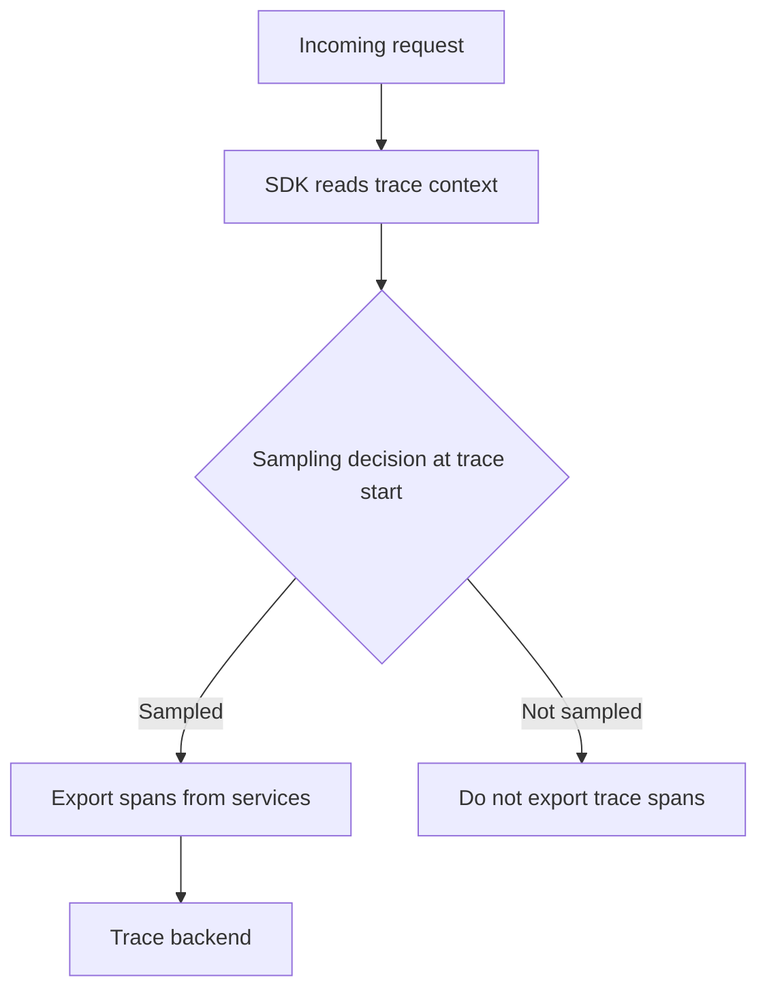
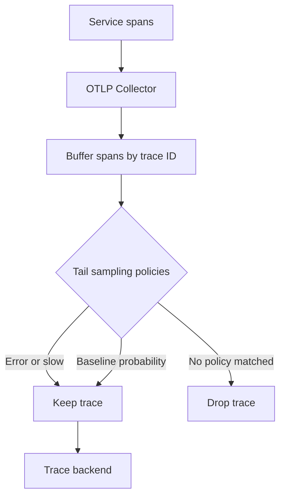

# Lựa chọn sampling và kiểm soát cardinality telemetry

## 1. Vì sao sampling và cardinality quan trọng với serverless?

Một hệ thống serverless có thể tạo ra lượng telemetry lớn dù mỗi function rất nhỏ. Một request HTTP đi qua API Gateway, Java Lambda, queue, worker Lambda và database có thể tạo nhiều span, log record và metric datapoint. Khi lưu lượng tăng đột biến, số invocation và event tăng theo; telemetry cũng tăng, đôi khi nhanh hơn tải nghiệp vụ vì mỗi invocation sinh nhiều bản ghi quan sát.

Hai quyết định ảnh hưởng trực tiếp đến khả năng quan sát và chi phí là:

- **Sampling:** chọn phần trace hoặc log cần giữ để điều tra, thay vì lưu mọi bản ghi ở mọi thời điểm.
- **Cardinality control:** giới hạn số tổ hợp giá trị thuộc tính tạo thành time series hoặc nhóm dữ liệu riêng. Cardinality quá cao khiến số series, index, memory và chi phí tăng mạnh.

Sampling quá thấp có thể làm mất bằng chứng về lỗi hiếm, request chậm hoặc hành vi bất thường. Sampling quá cao làm tăng chi phí ingest, lưu trữ và truy vấn. Metric cardinality cao có thể khiến backend vượt giới hạn series, dashboard chậm hoặc metric bị drop. Thiết kế tốt cần giữ được tín hiệu có ích cho vận hành mà vẫn kiểm soát ngân sách.

Trong module CLOUD_SERVERLESS, telemetry cần giúp trả lời function nào lỗi, trigger nào tạo backlog, request nào chậm, retry có tăng không, cold start có ảnh hưởng không và chi phí tăng ở đâu. Sampling và cardinality phải được thiết kế theo những câu hỏi này, không chỉ theo một tỷ lệ phần trăm cố định.

## 2. Phân biệt trace, metric và log

Ba loại telemetry có đặc tính khác nhau, vì vậy không nên áp dụng cùng một chính sách sampling.

| Loại | Mô tả | Dùng để trả lời | Đặc điểm dữ liệu |
|---|---|---|---|
| Trace | Một hành trình request/event gồm nhiều span | Request đi qua dịch vụ nào, chậm ở đâu, lỗi bắt đầu tại đâu? | Có quan hệ cha-con, thường có trace ID và span ID |
| Metric | Giá trị số được tổng hợp theo thời gian và tập thuộc tính | Error rate, latency, throughput, queue age đang thay đổi thế nào? | Tốt cho dashboard, alert và xu hướng; series được xác định bởi tên metric và attributes |
| Log | Bản ghi sự kiện hoặc thông điệp chi tiết | Function đã làm gì, lỗi cụ thể là gì? | Nội dung linh hoạt, thường có timestamp, severity và correlation fields |

Một trace có thể gồm nhiều span; mỗi span có thể liên kết log và metric exemplar. Metric thường cần giữ liên tục để tính tỷ lệ và xu hướng. Trace có thể được sampling để giảm khối lượng. Log có thể lọc theo severity hoặc rate-limit một số thông điệp lặp, nhưng log audit/security không được bỏ tùy tiện.

Không dùng sampling trace để suy ra chính xác tổng số request. Nếu chỉ lưu 5% trace, số trace lưu không phải số request thật. Dùng metric counter được ghi cho mọi request để đo throughput/error rate; trace sampling chỉ phục vụ chẩn đoán chi tiết.

## 3. Cardinality là gì?

Cardinality là số giá trị hoặc số tổ hợp giá trị khác nhau của một tập thuộc tính. Với metric, một time series thường được nhận diện bởi tên metric và toàn bộ tập label/attributes. Mỗi tổ hợp thuộc tính mới có thể tạo một series mới.

Ví dụ metric `http.server.request.duration` có các dimensions:

```text
service = orders-api
environment = production
http.route = /orders/{orderId}
http.request.method = POST
http.response.status_code = 200
```

Các giá trị này có miền tương đối nhỏ và ổn định. Nếu thêm `order.id`, `customer.id`, `request.id` hoặc URL đầy đủ như `/orders/8a2...`, mỗi request có thể tạo một tổ hợp mới. Số series tăng theo số ID khác nhau.

Với các label độc lập, số tổ hợp tiềm năng có thể xấp xỉ tích số giá trị của từng label. Ví dụ:

```text
environment: 3 giá trị
region:      4 giá trị
route:      20 giá trị
status:      5 giá trị
method:      4 giá trị

Tổ hợp tối đa = 3 × 4 × 20 × 5 × 4 = 4.800 series
```

Đây là ước lượng giới hạn trên; một số tổ hợp có thể không xuất hiện. Khi thêm label có 100.000 user ID, cardinality tiềm năng tăng rất lớn. Với histogram dạng bucket cổ điển, mỗi tổ hợp attributes còn tạo nhiều bucket series cùng `_sum` và `_count`.

Cardinality cao không đồng nghĩa dữ liệu sai. `trace_id` và `user_id` hữu ích trong trace/log để điều tra một giao dịch cụ thể, nhưng thường không phù hợp làm metric label/dimension.

## 4. Thuộc tính có cardinality thấp và cao

| Thuộc tính | Cardinality thường gặp | Nên đặt ở đâu? | Lý do |
|---|---|---|---|
| `service.name` | Thấp | Metric, trace, log | Tập dịch vụ được quản lý |
| `deployment.environment` | Thấp | Metric, trace, log | dev/staging/prod có miền hữu hạn |
| `cloud.region` | Thấp | Metric, trace, log | Danh sách region hữu hạn |
| `http.request.method` | Thấp | Metric, trace | GET/POST/PUT/... |
| `http.route` dạng template | Thấp đến vừa | Metric, trace | `/orders/{orderId}` thay cho URL cụ thể |
| `http.response.status_code` | Vừa | Metric, trace | Mã HTTP có miền giới hạn; có thể nhóm theo class |
| `error.type` | Vừa nếu chuẩn hóa | Metric, trace, log | Dùng loại exception ổn định, không dùng message |
| `function.name` | Thấp | Metric, trace, log | Tên function được triển khai |
| `queue.name` | Thấp | Metric, trace | Tên queue được quản lý |
| `tenant.id` | Có thể rất cao | Trace/log có kiểm soát | Có ích cho điều tra nhưng không nên mặc định là metric dimension |
| `user.id`, `order.id`, `request.id` | Rất cao | Trace/log có kiểm soát | Mỗi request có thể tạo giá trị mới |
| URL đầy đủ/query string | Rất cao | Tránh; chuẩn hóa thành route template | Path/query có thể chứa ID và dữ liệu nhạy cảm |
| Exception message | Rất cao | Log, có redaction | Message thường chứa giá trị động hoặc dữ liệu đầu vào |

Quy tắc thực tế: metric label nên mô tả nhóm ổn định, trace/log có thể chứa định danh cụ thể khi thật sự cần điều tra, nhưng phải giới hạn retention, quyền truy cập và dữ liệu nhạy cảm.

## 5. Sampling là gì và sampling ở đâu?

Sampling chọn một phần telemetry theo một quy tắc. Có thể thực hiện ở nhiều tầng:

1. **SDK/instrumentation:** quyết định tạo hoặc ghi span ngay trong process.
2. **Collector/agent:** nhận telemetry rồi chọn dữ liệu cần chuyển tiếp.
3. **Backend:** lưu toàn bộ hoặc áp dụng retention/query policy sau ingest.

Sampling ở SDK giúp giảm lượng span được tạo/export và tiết kiệm băng thông. Sampling tại collector có thể xét thông tin xuất hiện ở cuối trace, nhưng collector phải nhận và giữ dữ liệu trước khi ra quyết định. Sampling tại backend có thể giảm chi phí lưu trữ tùy dịch vụ, nhưng thường không giảm chi phí ingest đã phát sinh.

Với serverless, lựa chọn tầng sampling còn phụ thuộc function có thể giữ state bao lâu, collector có endpoint ổn định không và các span của cùng trace có được gửi đến cùng nơi ra quyết định hay không.

## 6. Head-based sampling

Head-based sampling quyết định ngay khi trace bắt đầu, trước khi biết toàn bộ hành trình. SDK thường dùng trace ID hoặc một xác suất để quyết định giữ/bỏ trace. Quyết định được truyền cho các service downstream qua trace context.

Ví dụ tỷ lệ 5%:



Ưu điểm:

- Chi phí và tải export giảm ngay trong function.
- Quyết định nhanh, không cần buffer toàn trace.
- Phù hợp với serverless có thời gian sống ngắn và nhiều invocation.
- Parent-based sampling giúp các service trong cùng trace nhất quán.

Hạn chế:

- Không biết trước trace có lỗi hoặc chậm hay không.
- Một trace bị bỏ ở đầu sẽ không thể được phục hồi bởi tail sampler phía sau.
- Tỷ lệ cố định có thể bỏ qua một số luồng hiếm quan trọng.

Head sampling phù hợp cho baseline tracing với traffic lớn. Có thể dùng tỷ lệ cao hơn cho service/route quan trọng hoặc môi trường staging, nhưng cần giới hạn số policy để dễ dự đoán chi phí.

## 7. Parent-based và trace ID ratio sampling

Trong kiến trúc nhiều service, không nên để mỗi function tự chọn ngẫu nhiên độc lập. Parent-based sampler tuân theo sampling decision của span cha: nếu trace cha đã được chọn, span con tiếp tục được chọn; nếu trace cha bị bỏ, span con thường cũng bị bỏ. Với trace chưa có parent, sampler root dùng xác suất dựa trên trace ID.

Trace ID ratio sampling chọn trace dựa trên một phần trace ID để tạo quyết định ổn định cho toàn trace. Nếu các service cùng dùng cùng quy tắc và nhận cùng trace context, chúng có thể đưa ra quyết định tương thích.

Ví dụ cấu hình bằng OpenTelemetry Java SDK:

```java
import io.opentelemetry.sdk.trace.SdkTracerProvider;
import io.opentelemetry.sdk.trace.export.BatchSpanProcessor;
import io.opentelemetry.sdk.trace.samplers.Sampler;

SdkTracerProvider tracerProvider = SdkTracerProvider.builder()
        .setSampler(Sampler.parentBased(
                Sampler.traceIdRatioBased(0.05)))
        .addSpanProcessor(BatchSpanProcessor.builder(spanExporter).build())
        .build();
```

Ví dụ giữ khoảng 5% trace mới ở root và tuân theo quyết định parent cho trace đã có context. `spanExporter` là exporter được cấu hình cho backend; cần đóng provider đúng vòng đời ứng dụng/runtime.

Với OpenTelemetry Java agent/autoconfigure, có thể cấu hình sampler bằng environment variables tương ứng, ví dụ `OTEL_TRACES_SAMPLER=parentbased_traceidratio` và `OTEL_TRACES_SAMPLER_ARG=0.05`. Xác nhận phiên bản SDK/agent đang dùng hỗ trợ cấu hình đó trước khi rollout.

Không đặt sampler 5% độc lập ở mỗi service mà bỏ qua parent context. Làm vậy có thể khiến một trace chỉ còn một số span rời rạc, khó nối đầu-cuối.

## 8. Tail-based sampling

Tail-based sampling chờ nhận đủ hoặc gần đủ các span của trace rồi mới quyết định giữ hay bỏ. Vì biết kết quả cuối, collector có thể ưu tiên:

- Trace có span status `ERROR`.
- Trace có latency vượt ngưỡng.
- Trace có exception hoặc retry bất thường.
- Một tỷ lệ baseline của trace bình thường.
- Một số operation quan trọng được chọn theo policy.



Ưu điểm là có thể giữ gần như toàn bộ lỗi và trace chậm trong khi chỉ giữ một phần trace bình thường. Nhược điểm là collector cần buffer, memory và thời gian chờ; telemetry có thể bị mất nếu collector restart hoặc trace không đến đủ.

Tail sampling đặc biệt cần định tuyến đúng: tất cả span của cùng trace phải đến cùng tail-sampling collector instance. Khi chạy nhiều collector, thường cần một tầng load balancing định tuyến theo trace ID trước tail sampler. Nếu span của cùng trace rơi vào nhiều collector khác nhau, mỗi collector có thể chỉ nhìn thấy một phần trace và đưa ra quyết định sai.

### Ví dụ policy cho OpenTelemetry Collector

```yaml
processors:
  memory_limiter:
    check_interval: 1s
    limit_percentage: 75
    spike_limit_percentage: 15

  tail_sampling:
    decision_wait: 10s
    num_traces: 50000
    expected_new_traces_per_sec: 1000
    policies:
      - name: keep-errors
        type: status_code
        status_code:
          status_codes: [ERROR]
      - name: keep-slow
        type: latency
        latency:
          threshold_ms: 2000
      - name: baseline-five-percent
        type: probabilistic
        probabilistic:
          sampling_percentage: 5

  batch: {}

service:
  pipelines:
    traces:
      receivers: [otlp]
      processors: [memory_limiter, tail_sampling, batch]
      exporters: [otlp]
```

Đây là cấu hình minh họa cho Collector có tail-sampling processor. Cần khai báo receiver/exporter thực tế và kiểm tra phiên bản Collector. `decision_wait`, `num_traces` và `expected_new_traces_per_sec` phải được sizing theo throughput, số span/trace, thời gian hoàn tất trace và bộ nhớ. Policy kết hợp giữ trace lỗi, trace chậm hoặc một phần trace baseline; trace không khớp policy sẽ bị bỏ.

Không đặt `decision_wait` quá ngắn nếu trace có queue delay hoặc nhiều service bất đồng bộ. Nếu span đến sau khi collector đã quyết định, chúng có thể bị loại hoặc tạo trace không đầy đủ. Với workflow dài, cân nhắc chia thành các trace theo từng giai đoạn và nối quan hệ bằng span links.

## 9. Kết hợp head sampling và tail sampling

Hai cơ chế có thể kết hợp, nhưng cần hiểu giới hạn: tail sampler chỉ có thể lựa chọn trong số telemetry đã đến collector. Nếu SDK head-sample bỏ 95% trace, collector không thể giữ lại những trace đó dù sau này chúng có lỗi.

Một số mô hình:

| Mô hình | Cách hoạt động | Khi phù hợp |
|---|---|---|
| Head sampling tại SDK | Chọn tỷ lệ nhỏ ngay trong function | Traffic lớn, cần kiểm soát CPU/network và chi phí |
| Tail sampling tại collector | SDK gửi trace đầy đủ đến collector; collector chọn theo kết quả | Cần giữ lỗi/chậm và có năng lực collector phù hợp |
| Head baseline + tail refinement | Head chọn một phần; collector áp policy trên phần nhận được | Chấp nhận không thể khôi phục trace đã bị head drop |
| Separate critical path | Luồng quan trọng dùng tỷ lệ riêng hoặc always-on trong phạm vi giới hạn | Payment, security-sensitive workflow hoặc luồng cần audit trace |

Không bật `always_on` cho toàn bộ traffic chỉ để tail sample tất cả lỗi nếu hạ tầng collector chưa được sizing. Tải export, network và collector memory vẫn phải chịu toàn bộ span trước khi sampling.

## 10. Sampling cho serverless và xử lý bất đồng bộ

Serverless có nhiều đặc điểm ảnh hưởng đến trace sampling:

- Function có thể chạy ngắn và bị freeze/terminate sau invocation.
- Một invocation có thể xử lý một event hoặc cả batch message.
- Retry có thể tạo invocation mới cho cùng event.
- Queue delay có thể kéo dài hơn thời gian chờ của tail sampler.
- Fan-out tạo nhiều nhánh trace hoặc nhiều consumer xử lý cùng event.
- Context không tự động đi qua mọi loại trigger nếu producer không truyền metadata.

Với HTTP request, propagator thường truyền trace context qua header `traceparent` và `tracestate` theo W3C Trace Context. Với SQS/EventBridge/Service Bus/Pub/Sub, cần xác minh extension hoặc producer/consumer có inject/extract trace context trong message attributes/envelope hay không. Không giả định queue tự động truyền W3C context trong mọi cấu hình.

Khi xử lý batch, cân nhắc tạo span cho invocation và span con cho từng message. Nếu batch có hàng trăm record, tạo quá nhiều span có thể làm telemetry phình to. Có thể tạo span tổng hợp cho batch, span cho record lỗi hoặc span cho một mẫu record; metric vẫn đếm đủ số record đã nhận/hoàn tất.

Với retry, cùng event có thể xuất hiện ở nhiều invocation. Ghi `event.id`, `messaging.message.id`, attempt count hoặc receive count trong trace/log khi có thể; không đưa các ID này thành metric label. Idempotency key cần phản ánh event nghiệp vụ và không thay đổi giữa các lần retry.

### Trace dài qua queue

Một trace bắt đầu ở HTTP producer có thể kết thúc sau nhiều phút khi worker xử lý queue. Tail sampler cần giữ buffer đủ lâu để nhận span của producer và consumer. Nếu queue delay vượt `decision_wait`, trace có thể bị chốt trước khi consumer chạy.

Với workflow kéo dài hoặc fan-out lớn, có thể tạo trace mới tại consumer và thêm span link về context của producer. Span link biểu diễn quan hệ giữa các trace mà không buộc một trace duy nhất sống quá lâu. Dù dùng parent context hay span link, phải giữ correlation/event ID để nối các giai đoạn khi điều tra.

## 11. Sampling cho logs

Log thường được dùng để đọc lỗi cụ thể, nhưng log debug/info lặp lại trên mỗi invocation có thể chiếm phần lớn dung lượng.

Chính sách gợi ý:

- Giữ log audit, security, access decision và sự kiện nghiệp vụ bắt buộc theo retention policy; không sample tùy tiện.
- Giữ log lỗi có cấu trúc và stack trace cần thiết, nhưng tránh log cùng một lỗi hàng nghìn lần không giới hạn.
- Giảm hoặc sample debug/info lặp lại ở đường hot path.
- Dùng rate limit hoặc suppression theo fingerprint lỗi, đồng thời phát metric đếm số lần bị suppress.
- Tách log vận hành khỏi audit log nếu yêu cầu retention/quyền truy cập khác nhau.
- Redact token, secret, email, số điện thoại và payload nhạy cảm trước khi export.

Không sample log độc lập mà bỏ mất liên kết với trace. Log record nên có `trace_id` và `span_id` khi context hiện hữu. Nếu trace không được sample, log quan trọng vẫn có thể được giữ và truy vấn theo request/correlation ID.

## 12. Không áp dụng trace sampling cho metrics

Metrics được tổng hợp theo thời gian và thường dùng cho alert/SLO. Nếu chỉ ghi metric cho 5% request vì trace sampling là 5%, counter và histogram sẽ không còn phản ánh tổng lưu lượng trừ khi có cơ chế hiệu chỉnh rõ ràng.

Ví dụ:

- `http.server.request.count` cần tăng cho mọi request được xử lý.
- `http.server.request.duration` nên ghi mọi request hoặc dùng cơ chế aggregation có kiểm soát.
- `function.errors` cần đếm mọi lỗi, kể cả trace bị sampling out.
- `sqs.messages.received` và `sqs.messages.failed` cần phản ánh toàn bộ batch/record theo định nghĩa metric.

Giảm chi phí metrics bằng cách thiết kế số instrument và dimensions hợp lý, dùng histogram buckets phù hợp, aggregate tại SDK/collector/backend và chọn chu kỳ export đúng. Không dùng tỷ lệ trace sampling làm tỷ lệ thu thập metric một cách máy móc.

Nếu buộc phải sample event trước khi tính metric, cần hiểu sai lệch thống kê và dùng sampling weight/estimator phù hợp. Với alert nghiệp vụ, metric chính xác thường quan trọng hơn việc giảm vài datapoint.

## 13. Exemplars: nối metric với trace mà không tăng cardinality

Exemplar là một mẫu quan sát gắn với metric datapoint, thường chứa trace ID/span ID và giá trị đo. Nó giúp người vận hành từ một điểm latency hoặc histogram bucket chuyển sang trace minh họa mà không thêm `trace_id` thành label của metric.

Ví dụ, histogram `http.server.request.duration` có dimensions `service`, `route` và `status_class`. Một exemplar có thể trỏ đến trace của request mất 4,2 giây. Dashboard hiển thị p95 tăng và người vận hành mở exemplar để xem trace tương ứng.

Exemplar giúp liên kết hai loại telemetry:

- Metric giữ số liệu tổng hợp và cardinality thấp.
- Trace giữ chi tiết từng hành trình đã được sampling.

Exemplar không thay thế trace retention hoặc sampling policy. Nếu trace được exemplar trỏ tới đã bị loại hoặc hết retention, liên kết có thể không mở được. Hãy cấu hình exporter/backend hỗ trợ exemplar và đảm bảo trace ID được giữ trong dữ liệu exemplar.

## 14. Thiết kế metric dimensions có giới hạn

Trước khi thêm một attribute vào metric, hãy hỏi:

1. Có cần lọc/nhóm alert theo thuộc tính này không?
2. Tập giá trị có giới hạn và được quản lý không?
3. Giá trị có thể chứa ID, URL, nội dung người dùng hoặc thông báo lỗi động không?
4. Có thể chuẩn hóa thành nhóm ổn định không?
5. Nếu thêm dimension này, số series tăng bao nhiêu?

Ví dụ chuẩn hóa:

| Giá trị đầu vào | Metric attribute nên dùng |
|---|---|
| `/orders/12345` | `/orders/{orderId}` |
| `GET /customers/abc/profile` | `GET /customers/{customerId}/profile` |
| HTTP status `200`, `201`, `204` | `2xx` nếu dashboard chỉ cần nhóm thành công |
| `java.lang.IllegalArgumentException: invalid sku 88291` | `error.type=IllegalArgumentException` |
| `tenant-9a2c...` | Không thêm vào metric trừ khi có yêu cầu vận hành và giới hạn tenant rõ |
| `request-uuid` | Giữ trong trace/log, không dùng làm label |

Route template cần được tạo ở instrumentation/framework router, không chỉ cắt chuỗi URL tùy tiện. Query string thường không cần cho metric và có thể chứa token hoặc dữ liệu nhạy cảm.

## 15. Ví dụ OpenTelemetry Java metrics với attributes có giới hạn

Ví dụ sau tạo counter và histogram với dimensions ổn định:

```java
import io.opentelemetry.api.common.AttributeKey;
import io.opentelemetry.api.common.Attributes;
import io.opentelemetry.api.metrics.LongCounter;
import io.opentelemetry.api.metrics.DoubleHistogram;
import io.opentelemetry.api.metrics.Meter;

public final class OrderTelemetry {
    private static final AttributeKey<String> ENVIRONMENT =
            AttributeKey.stringKey("deployment.environment");
    private static final AttributeKey<String> OPERATION =
            AttributeKey.stringKey("app.operation");
    private static final AttributeKey<String> OUTCOME =
            AttributeKey.stringKey("app.outcome");

    private final LongCounter ordersProcessed;
    private final DoubleHistogram processingDuration;

    public OrderTelemetry(Meter meter) {
        this.ordersProcessed = meter.counterBuilder("orders.processed")
                .setDescription("Number of orders processed")
                .setUnit("{order}")
                .build();

        this.processingDuration = meter.histogramBuilder("orders.processing.duration")
                .setDescription("Order processing duration")
                .setUnit("s")
                .build();
    }

    public void record(String environment, String outcome, double seconds) {
        Attributes attributes = Attributes.builder()
                .put(ENVIRONMENT, environment)
                .put(OPERATION, "process-order")
                .put(OUTCOME, normalizeOutcome(outcome))
                .build();

        ordersProcessed.add(1, attributes);
        processingDuration.record(seconds, attributes);
    }

    private static String normalizeOutcome(String outcome) {
        return switch (outcome) {
            case "success", "retryable_error", "permanent_error" -> outcome;
            default -> "other";
        };
    }
}
```

Không truyền `orderId`, `customerId`, `requestId` hoặc exception message vào `Attributes`. Hàm `normalizeOutcome` giới hạn giá trị outcome về một tập hữu hạn. Trong code thực tế, `environment` cũng nên đến từ cấu hình đã kiểm soát, không lấy từ payload request.

## 16. Giới hạn cardinality ở SDK và Collector

Nên ngăn cardinality tăng ngay tại nơi tạo metric:

- Chỉ instrument các dimension cần cho alert/dashboard.
- Dùng route template và enum chuẩn hóa.
- Không tạo metric name động từ tenant, function invocation hoặc event type không kiểm soát.
- Dùng OpenTelemetry Views để chọn instrument, đổi aggregation, lọc attribute hoặc đặt cardinality limit khi SDK hỗ trợ.
- Kiểm tra cardinality limit của SDK và backend; không coi default là ngân sách thiết kế.

Collector có thể lọc/drop attribute không cần thiết, loại metric không dùng hoặc chuyển đổi dữ liệu. Tuy nhiên, xóa attribute ở Collector không luôn tương đương với việc hợp nhất các time series đã được tạo ở SDK; xử lý sau aggregation có thể để lại datapoint trùng hoặc không đúng ý nghĩa. Ưu tiên kiểm soát attributes trước khi tạo series.

Một số metric backend có giới hạn số series/metric, số dimensions hoặc số giá trị dimension. Hãy kiểm tra giới hạn của backend đang dùng và đặt cảnh báo trước khi chạm ngưỡng. Khi cardinality tăng bất thường, điều tra label mới được thêm thay vì chỉ tăng quota.

## 17. Cardinality trong Prometheus và CloudWatch

### Prometheus

Prometheus tạo time series theo metric name và tổ hợp label values. Label như `path="/orders/123"` hoặc `user_id="..."` có thể tạo series liên tục. Cardinality cao làm tăng memory, storage, compaction và query cost.

Không dùng label cho dữ liệu có miền vô hạn hoặc tăng theo traffic. Dùng route template, status class, bounded enum và aggregation. Với histogram cổ điển, mỗi bucket là một series cho mỗi tổ hợp label; giảm số bucket hoặc dimensions khi cần.

### Amazon CloudWatch

CloudWatch custom metrics phân biệt metric theo namespace, metric name và dimensions. Mỗi tổ hợp dimension khác nhau có thể tạo metric riêng. Với Embedded Metric Format (EMF), các dimension set được chỉ định trong log event có thể tạo nhiều metric time series; không đưa request ID hoặc user ID vào dimension set.

CloudWatch Logs và metrics có mô hình tính phí riêng. Giảm sampling trace không tự động giảm số custom metric đã publish; giảm cardinality cần thiết kế dimension và metric aggregation.

### Azure Monitor và Google Cloud Monitoring

Azure Monitor/Application Insights và Google Cloud Monitoring cũng có giới hạn về dimension/cardinality, ingestion và retention. Dù cách tính chi phí khác nhau, nguyên tắc vẫn là tránh label/dimension không giới hạn, dùng metric tổng hợp và đặt sampling ở đúng tầng.

## 18. Cardinality của trace và log cũng cần kiểm soát

Trace và log không tạo time series theo cách metric, nhưng thuộc tính có cardinality cao vẫn làm tăng chi phí index, lưu trữ và truy vấn.

- Giữ `trace_id`, `span_id`, `request_id` khi cần correlation, nhưng không index mọi field tùy ý nếu backend tính phí theo indexed fields.
- Không thêm toàn bộ request/response body vào span attributes.
- Chuẩn hóa `http.route`; không lưu raw URL có query string chứa dữ liệu cá nhân.
- Không đặt exception message động làm `error.type`; dùng exception class hoặc mã lỗi ổn định.
- Hạn chế span event lặp cho mỗi record trong batch rất lớn.
- Dùng log structured fields và redaction; tránh tạo hàng triệu field name động.
- Đặt retention khác nhau cho trace, application log và audit log theo mục đích.

Cardinality control không phải xóa mọi ID. ID có thể cần để tìm đúng request. Hãy giữ ở trace/log với chính sách truy cập và retention phù hợp, đồng thời tránh biến ID thành metric dimension.

## 19. Sampling theo loại workload

Không có một tỷ lệ đúng cho mọi function. Chọn theo throughput, độ quan trọng và khả năng điều tra.

| Workload | Trace sampling gợi ý | Metric/log |
|---|---|---|
| HTTP API có traffic lớn | Head sampling baseline thấp đến vừa; ưu tiên error/slow nếu có tail sampling | Metric request/error/latency giữ đầy đủ; log lỗi giữ có kiểm soát |
| Queue worker xử lý batch | Parent-based sampling và context propagation; có thể giảm span theo record | Đếm đầy đủ message, batch size, age, retry và failure |
| Event fan-out | Sampling theo trace ID; cân nhắc span link giữa producer/consumer | Metric đếm event theo event type có giới hạn |
| Cron/scheduled function ít chạy | Sampling 100% thường hợp lý | Log/metric đầy đủ do volume thấp |
| Payment/security workflow | Tỷ lệ cao hoặc policy ưu tiên theo risk; audit log riêng | Không sample audit trail bắt buộc |
| Background task khối lượng lớn | Baseline thấp, giữ lỗi và latency outlier | Metric aggregate đầy đủ, log lỗi theo fingerprint |

Các tỷ lệ trong bảng là hướng lựa chọn, không phải cấu hình cố định. Hãy đo volume và chi phí thật rồi điều chỉnh.

## 20. Đặt ngân sách telemetry

Một telemetry budget định lượng giúp nhóm hiểu mỗi service được phép tạo bao nhiêu dữ liệu và cardinality.

Các mục nên theo dõi:

| Chỉ số | Ngân sách/giới hạn cần đặt |
|---|---|
| Trace sampling ratio | Tỷ lệ baseline theo service/operation |
| Error trace retention | Chính sách giữ lỗi và trace chậm |
| Spans per trace | Mức span hợp lý cho request/batch |
| Trace bytes per invocation | Dung lượng telemetry trung bình mỗi invocation |
| Metric series per service | Số series tối đa theo service/environment |
| Attributes per instrument | Tập dimensions được cho phép |
| Histogram buckets | Số bucket và boundary theo SLA |
| Log bytes per invocation | Giới hạn log trên mỗi invocation |
| Retention days | Thời gian lưu theo loại telemetry |
| Export failure/drop rate | Tỷ lệ telemetry bị drop do exporter/collector quá tải |

Ước lượng sơ bộ:

```text
Traces kept per minute
  = requests per minute × head sampling ratio

Spans exported per minute
  = traces kept × average spans per trace

Metric series estimate
  ≈ product of distinct values for each bounded dimension

Telemetry ingestion
  ≈ exported span bytes + log bytes + metric datapoint bytes
```

Với tail sampling, phải sizing collector theo trace đến mỗi giây, số span/trace, kích thước span và `decision_wait`. Với head sampling, cần kiểm tra tỷ lệ lỗi hiếm có đủ mẫu để điều tra không.

## 21. Quan sát việc telemetry bị drop

Sampling chủ động và drop ngoài ý muốn là hai vấn đề khác nhau. Nếu collector hết memory hoặc exporter bị timeout, telemetry có thể mất mà không theo policy.

Theo dõi:

- Span/metric/log được nhận, export và dropped ở SDK/Collector.
- Export queue size, retry và send failure.
- Collector memory, CPU, restart và tail sampling buffer utilization.
- Số trace không đủ span hoặc đến sau decision window.
- Metric series count và cardinality limit hit.
- Backend ingestion throttling và rejected datapoints.
- Log suppression/rate-limit count.

Nếu sampling ratio là 5% nhưng backend chỉ nhận được 2% trace, cần xác định 3% còn lại bị loại theo policy hay mất do pipeline. Hãy xuất metric nội bộ cho telemetry pipeline và đặt alert khi drop rate bất thường.

## 22. Cách rollout sampling policy an toàn

Không đổi sampling ratio đồng loạt mà không có baseline. Có thể rollout theo các bước:

1. Đo trace volume, spans/trace, metric series và log bytes hiện tại.
2. Phân loại service/route theo mức độ quan trọng.
3. Chọn baseline head sampling cho traffic bình thường.
4. Bổ sung policy ưu tiên lỗi/slow nếu có tail sampler đủ năng lực.
5. Chuẩn hóa metric dimensions và loại bỏ ID/URL động.
6. Kiểm tra trace context propagation qua HTTP, queue và event bus.
7. Chạy staging/canary và so sánh tỷ lệ lỗi được phát hiện, latency, chi phí và drop rate.
8. Tăng/giảm sampling từng bước, ghi lại policy version.
9. Đặt cảnh báo cardinality và telemetry drop.
10. Có thể rollback sampling policy mà không cần deploy lại business logic nếu cấu hình hỗ trợ.

Sampling decision có thể làm thay đổi khả năng điều tra của sự cố. Ghi rõ policy version, tỷ lệ và thời điểm thay đổi trong config management.

## 23. Các lỗi thiết kế thường gặp

| Lỗi | Hậu quả | Cách khắc phục |
|---|---|---|
| Thêm `request_id` làm metric label | Mỗi request tạo series mới | Giữ ID trong trace/log, bỏ khỏi metric attributes |
| Dùng raw URL thay route template | Path chứa ID tạo cardinality lớn | Dùng route template đã chuẩn hóa |
| Sample metrics cùng tỷ lệ trace | Counter/histogram bị thiếu dữ liệu | Giữ metric aggregate đầy đủ hoặc dùng estimator rõ ràng |
| Head sample thấp rồi mong tail sampler giữ mọi lỗi | Trace lỗi đã bị bỏ trước khi đến collector | Gửi trace cần thiết đến tail sampler hoặc dùng policy riêng |
| Mỗi service tự sample độc lập | Trace bị đứt đoạn | Dùng parent-based sampler và propagate context |
| Tail sampler nhận trace phân tán nhiều collector | Mỗi collector chỉ có một phần trace | Route theo trace ID đến cùng collector instance |
| `decision_wait` quá ngắn | Span của worker đến muộn không được giữ | Điều chỉnh wait hoặc chia trace dài bằng span link |
| Log mọi payload và exception message | Tăng chi phí, rò dữ liệu và cardinality | Redact, chuẩn hóa lỗi, giới hạn payload |
| Tăng cardinality limit để chữa cháy | Chỉ trì hoãn vấn đề và tăng memory/cost | Tìm attribute gây nổ series và sửa tại nguồn |
| Không theo dõi telemetry drop | Mất dữ liệu quan sát mà không biết | Theo dõi SDK/Collector/exporter health |

## 24. Checklist production

- [ ] Có mục tiêu quan sát rõ cho từng service và trigger.
- [ ] Trace sampling dùng parent-based hoặc cơ chế nhất quán giữa các service.
- [ ] Tỷ lệ baseline được chọn theo throughput và ngân sách.
- [ ] Có policy giữ trace lỗi/slow nếu tail sampling được triển khai và sizing đúng.
- [ ] Không kỳ vọng tail sampler khôi phục trace đã bị head sampler drop.
- [ ] Tail sampling định tuyến mọi span cùng trace đến cùng collector.
- [ ] `decision_wait` phù hợp với thời gian queue/event processing.
- [ ] W3C trace context hoặc context tương ứng được truyền qua HTTP/message/event.
- [ ] Metric counter/histogram không bị sample theo trace ratio.
- [ ] Metric dimensions là tập hữu hạn, đã review và có budget.
- [ ] Không dùng user/order/request ID, raw URL hoặc exception message làm metric label.
- [ ] Route được chuẩn hóa thành template; status/error được nhóm ổn định.
- [ ] Exemplar được dùng khi backend hỗ trợ để nối metric với trace.
- [ ] Audit/security log không bị sample tùy tiện; dữ liệu nhạy cảm được redacted.
- [ ] SDK, Collector và backend có metric theo dõi telemetry dropped/rejected.
- [ ] Có cảnh báo khi cardinality, ingestion hoặc collector memory tăng bất thường.
- [ ] Sampling policy có version, canary và phương án rollback.
- [ ] Retention và quyền truy cập phù hợp với trace/log chứa định danh.
- [ ] Chi phí telemetry được phân bổ theo service/environment.

## Tài liệu tham khảo

- [OpenTelemetry sampling](https://opentelemetry.io/docs/concepts/sampling/)
- [OpenTelemetry Collector tail sampling processor](https://github.com/open-telemetry/opentelemetry-collector-contrib/tree/main/processor/tailsamplingprocessor)
- [OpenTelemetry metrics data model](https://opentelemetry.io/docs/specs/otel/metrics/data-model/)
- [OpenTelemetry Java SDK](https://opentelemetry.io/docs/languages/java/sdk/)
- [W3C Trace Context](https://www.w3.org/TR/trace-context/)
- [Prometheus instrumentation practices](https://prometheus.io/docs/practices/instrumentation/)
- [Prometheus metric and label naming](https://prometheus.io/docs/practices/naming/)
- [Amazon CloudWatch Embedded Metric Format](https://docs.aws.amazon.com/AmazonCloudWatch/latest/monitoring/CloudWatch_Embedded_Metric_Format.html)
- [AWS Distro for OpenTelemetry](https://aws-otel.github.io/docs/introduction)

## Kết luận

Sampling giúp giảm khối lượng trace/log cần lưu, còn cardinality control giữ metric series ở mức có thể vận hành và chi trả. Dùng parent-based head sampling cho baseline khi cần giảm tải sớm; dùng tail sampling khi cần ưu tiên lỗi và trace chậm, đồng thời bảo đảm collector nhận đủ span và định tuyến theo trace ID. Giữ metric aggregate đầy đủ cho alert/SLO, thiết kế dimensions hữu hạn và dùng exemplar để nối metric với trace. Trong serverless, phải đặc biệt chú ý context propagation qua queue, retry, batch và thời gian xử lý bất đồng bộ. Khi policy có ngân sách, được đo drop rate và rollout có kiểm soát, telemetry vẫn hữu ích khi tải tăng mà không tạo ra chi phí hoặc cardinality ngoài dự kiến.
