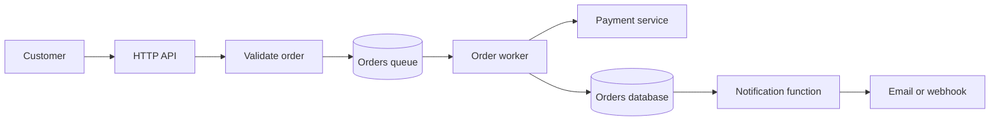
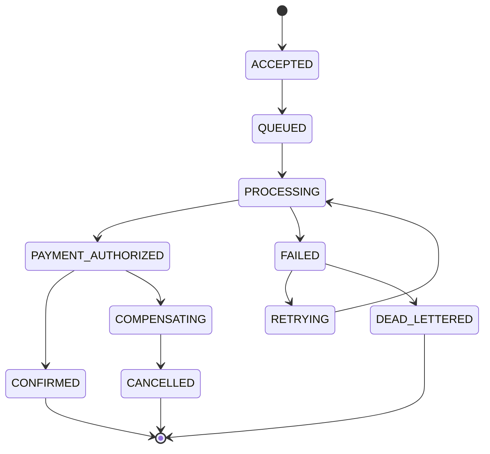
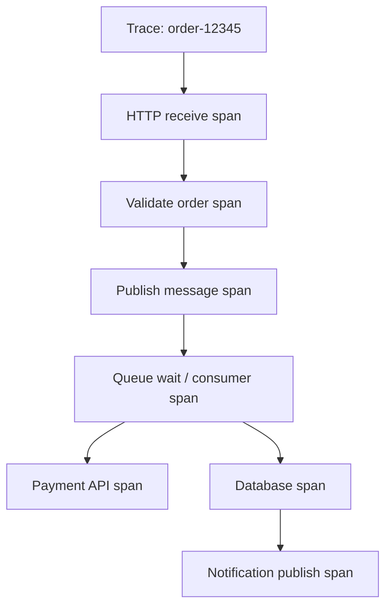

# Thiết kế dashboard theo luồng nghiệp vụ

Dashboard vận hành serverless cần trả lời được câu hỏi nghiệp vụ đang diễn ra thế nào, request hoặc event bị chậm ở đâu và khách hàng có đang nhận kết quả đúng hay không. Một dashboard chỉ hiển thị CPU, memory, invocation count và error count có thể cho biết function đang chạy, nhưng chưa chắc cho biết đơn hàng có được xác nhận, thanh toán có hoàn tất hoặc file upload có được xử lý xong.

Với Java function được kích hoạt bởi HTTP, message hoặc event, một luồng nghiệp vụ thường đi qua nhiều function và dịch vụ: API nhận yêu cầu, queue lưu công việc, worker xử lý, database cập nhật trạng thái rồi một function khác phát thông báo. Mỗi thành phần có metric riêng; dashboard cần kết nối chúng bằng business identifier, correlation ID, trace và các chỉ số kết quả.

Trong phạm vi **CLOUD_SERVERLESS**, bài học tập trung vào phát triển và triển khai ứng dụng theo mô hình serverless, đặc biệt là Java function kích hoạt bởi HTTP, thông điệp hoặc sự kiện. Người học xử lý trigger, trạng thái, quyền truy cập, retry, idempotency, cold start, mở rộng và chi phí. Bài này hướng dẫn thiết kế dashboard xoay quanh hành trình nghiệp vụ, từ chỉ số kết quả cấp cao đến độ trễ và lỗi ở từng bước kỹ thuật.

## 1. Bắt đầu từ câu hỏi nghiệp vụ

Trước khi chọn biểu đồ, hãy xác định người xem cần quyết định điều gì. Product owner, on-call engineer và developer có câu hỏi khác nhau:

| Người xem | Câu hỏi chính | Thông tin cần thấy |
|---|---|---|
| Product/operations | Có bao nhiêu yêu cầu hoàn tất? Có bước nào bị tồn? | Throughput nghiệp vụ, tỷ lệ hoàn tất, thời gian end-to-end, backlog |
| On-call engineer | Luồng nào đang lỗi và phạm vi ảnh hưởng ra sao? | Error rate, latency, retry, DLQ, dependency health và trace |
| Developer | Lỗi xuất phát từ function hoặc dependency nào? | Function duration, cold start, exception, downstream latency và logs |
| FinOps/platform | Chi phí tăng ở đâu và có tương xứng với khối lượng không? | Cost per operation, invocation, duration, memory, egress và log ingestion |

Dashboard tốt bắt đầu từ một luồng nghiệp vụ cụ thể, ví dụ `OrderSubmitted → PaymentAuthorized → InventoryReserved → OrderConfirmed`. Mỗi bước cần có trạng thái, thời điểm, kết quả và định danh để có thể liên kết với log/trace.

## 2. Vẽ business flow trước khi tạo dashboard

Ví dụ một luồng đặt hàng dùng API Gateway, Java HTTP function, queue và worker:



Từ sơ đồ này, dashboard có thể chia thành các bước nghiệp vụ:

1. Yêu cầu được tiếp nhận.
2. Yêu cầu được xác thực và chấp nhận.
3. Message được đưa vào queue.
4. Worker xử lý và gọi payment service.
5. Database lưu trạng thái đơn hàng.
6. Notification được gửi.
7. Đơn hàng đạt trạng thái cuối cùng.

Mỗi bước nên có một metric thể hiện số lượng đến, số lượng thành công, số lượng thất bại và thời gian xử lý. Không nhất thiết mọi bước phải là một function riêng; dashboard phản ánh ranh giới nghiệp vụ và dependency thực tế.

## 3. Thiết kế dashboard theo nhiều tầng

Không nên đưa mọi metric lên một màn hình duy nhất. Một cấu trúc hiệu quả thường có ba tầng:

**Tầng 1 — Business overview:** kết quả nghiệp vụ như yêu cầu hoàn tất, tỷ lệ thành công, thời gian end-to-end, backlog và chi phí trên mỗi giao dịch.

**Tầng 2 — Workflow health:** từng bước như received, accepted, queued, processing, persisted, notified; lỗi, retry và thời gian chờ ở từng bước.

**Tầng 3 — Technical diagnostics:** function duration, cold start, concurrency, memory, downstream latency, logs, traces và deployment version.

Người xem nên có thể đi từ một chỉ số bất thường ở tầng 1 đến bước nghiệp vụ ở tầng 2, rồi đến function/log/trace ở tầng 3. Điều này giảm thời gian chuyển đổi giữa nhiều dashboard rời rạc.

## 4. Chọn KPI nghiệp vụ có ý nghĩa

KPI cần được định nghĩa chính xác, có đơn vị, phạm vi thời gian và điều kiện tính. Ví dụ:

| KPI | Định nghĩa ví dụ | Vì sao hữu ích |
|---|---|---|
| Orders accepted | Số đơn được API chấp nhận trong khoảng thời gian | Đo nhu cầu đầu vào |
| Orders completed | Số đơn đạt trạng thái `CONFIRMED` | Đo kết quả cuối cùng |
| Completion rate | Completed / accepted theo cohort phù hợp | Phát hiện yêu cầu bị rơi hoặc không hoàn tất |
| End-to-end latency | Thời gian từ accepted đến confirmed | Đo trải nghiệm toàn luồng |
| Pending age | Tuổi của yêu cầu chưa đạt trạng thái cuối | Phát hiện công việc bị mắc kẹt |
| Payment success rate | Payment authorized / payment attempts | Phân biệt lỗi nghiệp vụ và lỗi hạ tầng |
| Cost per completed order | Tổng chi phí phân bổ / số đơn hoàn tất | Theo dõi hiệu quả kinh tế |

Completion rate cần xác định cohort. Nếu lấy số đơn hoàn tất trong 5 phút chia cho số đơn được nhận trong đúng 5 phút, những đơn vẫn đang xử lý sẽ bị tính như thất bại. Có thể dùng cohort theo thời điểm accepted và chỉ tính khi đã qua thời hạn hoàn tất, hoặc hiển thị riêng `pending` để tránh kết luận sai.

## 5. Đo trạng thái và chuyển tiếp của workflow

Một business flow nên có state model rõ ràng. Ví dụ:



Không phải workflow nào cũng có đúng các trạng thái này. Hãy dùng state transition thực tế của domain. Dashboard nên hiển thị số lượng ở mỗi trạng thái, thời gian ở trạng thái và số lần chuyển trạng thái bất thường.

Nếu trạng thái chỉ được suy ra từ log text, việc tính toán dễ sai khi log format thay đổi. Với workflow quan trọng, nên ghi trạng thái vào database/event store hoặc phát business event có schema rõ ràng; log và trace phục vụ chẩn đoán, không nên là nguồn dữ liệu duy nhất cho trạng thái nghiệp vụ.

## 6. Golden signals cho từng function

Bên cạnh KPI nghiệp vụ, mỗi function cần có các tín hiệu kỹ thuật cốt lõi:

| Signal | Câu hỏi | Metric ví dụ |
|---|---|---|
| Traffic | Có bao nhiêu invocation/request/event? | Request count, invocation count, messages received |
| Errors | Bao nhiêu invocation hoặc record thất bại? | Error count, exception count, failed batch |
| Latency | Mất bao lâu để xử lý? | Duration histogram, p50/p95/p99 |
| Saturation | Tài nguyên có gần chạm giới hạn? | Concurrency, throttles, memory, CPU, connection pool wait |

Với message-driven function, bổ sung queue depth, oldest message age, delivery count, retry và DLQ. Với stream processor, bổ sung consumer lag, partition ownership, checkpoint age và event processing rate.

Không chỉ hiển thị số invocation thành công. Function có thể trả thành công sau khi chỉ enqueue công việc, trong khi workflow phía sau vẫn bị kẹt. KPI cuối cùng cần được đo tại điểm nghiệp vụ hoàn tất.

## 7. Đo thời gian end-to-end và thời gian từng bước

Thời gian end-to-end là khoảng từ khi workflow bắt đầu đến khi đạt trạng thái cuối. Có thể tách thành:

\[
T_{end-to-end} = T_{ingress} + T_{queue} + T_{processing} + T_{dependency} + T_{finalize}
\]

Trong đó:

- `T_ingress`: nhận request, validation và enqueue.
- `T_queue`: thời gian chờ trước khi worker bắt đầu.
- `T_processing`: thời gian thực thi business logic.
- `T_dependency`: thời gian chờ database, payment hoặc API ngoài.
- `T_finalize`: cập nhật trạng thái và phát thông báo cuối.

Dashboard nên hiển thị cả end-to-end latency và latency từng bước. Nếu function duration bình thường nhưng end-to-end latency tăng, nguyên nhân có thể nằm ở queue backlog hoặc lịch retry chứ không phải CPU của function.

Với dữ liệu phân phối, dùng histogram và percentile thay vì chỉ average. p95/p99 giúp phát hiện nhóm request chậm mà giá trị trung bình có thể che khuất.

## 8. Correlation ID và trace context xuyên suốt workflow

Để liên kết nhiều invocation, mỗi workflow cần một correlation ID ổn định. Mỗi request/event có thể có request ID riêng, còn correlation ID đại diện cho toàn hành trình nghiệp vụ.

Ví dụ:

```text
correlation_id = order-12345
request_id     = api-req-8f21
message_id     = msg-7712
trace_id       = 4bf92f3577b34da6a3ce929d0e0e4736
```

Khi API nhận request, tạo hoặc xác thực correlation ID rồi truyền qua message attributes/application properties. Consumer tiếp tục ghi ID đó vào log và span. Không tạo correlation ID mới ở mỗi function nếu muốn tìm toàn bộ hành trình.

OpenTelemetry context propagation dùng trace context như `traceparent` và `tracestate`. Với message broker, cần inject context vào message attributes khi publish và extract khi consume. Tùy SDK và messaging convention, span producer, consumer và processing có thể được nối theo parent/links; với batch chứa nhiều message, span links thường phù hợp hơn việc gán một parent duy nhất cho nhiều trace độc lập.

Correlation ID là dữ liệu truy vết nghiệp vụ, không phải credential. Không dùng nó để cấp quyền truy cập hoặc tin cậy danh tính người gọi.

## 9. Thiết kế log có cấu trúc cho Java function

Log nên là JSON hoặc structured fields để có thể lọc và nhóm theo workflow. Ví dụ:

```json
{
  "timestamp": "2026-11-17T09:30:00Z",
  "severity": "INFO",
  "service": "orders-worker",
  "function": "processOrder",
  "release": "orders-2026.11.17.3",
  "correlation_id": "order-12345",
  "message_id": "msg-7712",
  "order_state": "PAYMENT_AUTHORIZED",
  "duration_ms": 182,
  "outcome": "success"
}
```

Log event nên có field ổn định như `service`, `function`, `release`, `correlation_id`, `event_id`, `outcome` và `duration_ms`. Tránh chỉ ghi một câu tự do như `Order processed` vì khó phân tích và dễ thay đổi.

Không ghi access token, password, payment card data, secret, payload nhạy cảm hoặc thông tin cá nhân không cần thiết. Nếu cần tìm theo customer/order, dùng ID giả danh hoặc business key đã được phê duyệt.

## 10. Instrumentation Java với Micrometer

Micrometer cung cấp abstraction cho metrics trong Java. Ví dụ một use case có thể đếm kết quả xử lý và đo thời gian:

```java
import io.micrometer.core.instrument.Counter;
import io.micrometer.core.instrument.MeterRegistry;
import io.micrometer.core.instrument.Timer;

public final class ProcessOrderUseCase {
    private final MeterRegistry registry;
    private final OrderService orderService;

    public ProcessOrderUseCase(
            MeterRegistry registry,
            OrderService orderService) {
        this.registry = registry;
        this.orderService = orderService;
    }

    public void execute(OrderCommand command) {
        Timer.Sample sample = Timer.start(registry);
        String outcome = "success";
        try {
            orderService.process(command);
            Counter.builder("business.orders.processed")
                    .tag("outcome", outcome)
                    .register(registry)
                    .increment();
        } catch (RuntimeException exception) {
            outcome = "failure";
            Counter.builder("business.orders.processed")
                    .tag("outcome", outcome)
                    .register(registry)
                    .increment();
            throw exception;
        } finally {
            sample.stop(Timer.builder("business.orders.processing")
                    .tag("outcome", outcome)
                    .register(registry));
        }
    }
}
```

Đây là ví dụ minh họa. Trong ứng dụng có nhiều metric, nên đăng ký meter một lần hoặc dùng builder/helper để tránh tạo lại meter ở mỗi invocation. Chỉ dùng tag có tập giá trị hữu hạn như `outcome`, `operation` hoặc `region`; không gắn `orderId`, `customerId` hoặc `correlationId` làm metric label vì cardinality sẽ tăng không giới hạn.

Với function framework không giữ process lâu hoặc không có registry push/pull trực tiếp, có thể export metric qua OpenTelemetry hoặc adapter phù hợp với nền tảng. Cần kiểm tra cách runtime thu thập metric và chi phí telemetry trước khi tăng tần suất hoặc số lượng metric.

## 11. Instrumentation distributed tracing với OpenTelemetry

Trace mô tả đường đi của một request/event qua nhiều service. Mỗi span đại diện cho một operation như validate order, publish message, query database hoặc gọi payment provider.



Với Java, OpenTelemetry SDK hoặc Java agent có thể tự động instrument một số framework, HTTP client, database driver và messaging client. Instrumentation thủ công hữu ích cho business operation không được thư viện nhận diện.

Ví dụ tạo span thủ công:

```java
Span span = tracer.spanBuilder("orders.process")
        .setSpanKind(SpanKind.INTERNAL)
        .startSpan();

try (Scope scope = span.makeCurrent()) {
    span.setAttribute("business.operation", "process-order");
    span.setAttribute("business.outcome", "success");
    orderService.process(command);
} catch (RuntimeException exception) {
    span.recordException(exception);
    span.setStatus(StatusCode.ERROR);
    throw exception;
} finally {
    span.end();
}
```

Không đưa dữ liệu nhạy cảm hoặc định danh cá nhân trực tiếp vào span attribute. Dùng tên operation ổn định, tránh tạo một span name khác nhau cho từng order ID.

## 12. Dashboard cho HTTP-triggered function

HTTP dashboard nên cho thấy trải nghiệm client và sức khỏe backend:

- Request rate theo route/method.
- 2xx, 4xx và 5xx rate; phân biệt lỗi client với lỗi server.
- p50/p95/p99 latency.
- Request bị throttling, timeout và authentication/authorization failure.
- Cold start/startup latency nếu nền tảng cung cấp.
- Concurrent requests, active instances và max-instance saturation.
- Dependency latency và error rate.
- Business completion rate sau khi request được chấp nhận.

Một API trả `202 Accepted` chỉ chứng minh đã chấp nhận công việc, không chứng minh workflow đã hoàn tất. Dashboard cần liên kết `accepted` với trạng thái cuối cùng bằng correlation ID hoặc business record.

## 13. Dashboard cho queue/message-triggered function

Với queue worker, hiển thị:

- Messages published, received, completed/acked và failed.
- Queue depth/visible messages và in-flight/locked messages.
- Age of oldest message hoặc enqueue-to-start delay.
- Delivery count, retry count, poison message và DLQ count.
- Processing duration và batch size.
- Consumer concurrency, throttling và downstream connection usage.
- Business records hoàn tất sau khi message được xử lý.

Queue depth thấp nhưng oldest message age cao vẫn có thể là dấu hiệu worker bị treo hoặc một message độc hại chặn luồng. Với FIFO/session-based queue, một nhóm message có thể chờ sau một message bị lock lâu; cần quan sát theo group/session nếu dịch vụ hỗ trợ.

## 14. Dashboard cho event stream

Với Event Hubs, Kafka hoặc Pub/Sub stream, dashboard nên hiển thị:

- Event ingress/egress rate.
- Consumer lag hoặc khoảng cách giữa latest offset và committed checkpoint.
- Processing rate theo partition/subscription.
- Partition ownership/rebalance và số consumer đang hoạt động.
- Checkpoint age/frequency và số event replay.
- Event parse/schema failure, quarantine và dead-letter count.
- End-to-end event age từ publish đến xử lý xong.

Average consumer lag có thể che một partition bị tụt xa. Hiển thị max lag và phân phối lag theo partition khi có thể. Nếu event đến nhanh hơn tốc độ xử lý trong thời gian dài, backlog có thể vượt retention window và làm mất khả năng replay.

## 15. Theo dõi retry, idempotency và DLQ

Retry có thể làm invocation success rate trông tốt hơn nhưng che giấu lỗi ban đầu. Dashboard nên phân biệt:

- First-attempt success rate.
- Eventual success rate sau retry.
- Số lần retry trên mỗi business operation.
- DLQ/quarantine arrival rate.
- Duplicate detection count.
- Số operation ở trạng thái `PROCESSING` quá lâu.
- Idempotency conflict hoặc duplicate suppression count.

Nếu chỉ nhìn final success, một function có thể đang retry nhiều lần, tăng chi phí và kéo dài latency. Nếu chỉ nhìn invocation errors, một số retry thành công có thể bị hiểu nhầm là workflow thất bại. Cần hiển thị cả first attempt và eventual outcome.

## 16. SLO, error budget và alerting

Dashboard mô tả tình hình; alert cần đánh thức người vận hành khi có nguy cơ vi phạm mục tiêu. SLO nên gắn với trải nghiệm nghiệp vụ.

Ví dụ:

| SLO | Định nghĩa ví dụ |
|---|---|
| API availability | 99,9% request hợp lệ nhận response không phải 5xx trong rolling 30 ngày |
| Order completion latency | 95% đơn được xác nhận trong 60 giây kể từ accepted |
| Message freshness | 99% message bắt đầu xử lý trong 2 phút từ enqueue |
| Event processing lag | 99% event được xử lý trong 30 giây sau khi publish |
| Data correctness | Tỷ lệ duplicate business effect bằng 0 trong tập giao dịch được đối soát |

Định nghĩa SLO phải làm rõ denominator, loại request được tính, thời gian đo, trạng thái cuối và cách xử lý maintenance. Alert nên ưu tiên burn rate hoặc vi phạm SLO bền vững thay vì cảnh báo một spike ngắn không ảnh hưởng người dùng.

Các alert thường hữu ích:

- Business completion rate giảm vượt ngưỡng.
- p95/p99 end-to-end latency vượt SLO.
- Oldest message age hoặc consumer lag tăng liên tục.
- DLQ tăng nhanh hoặc xuất hiện poison message mới.
- Function throttling/timeout tăng.
- Database pool gần cạn hoặc dependency error rate tăng.
- Chi phí trên mỗi completed operation tăng bất thường.

## 17. Dashboard chi phí theo luồng nghiệp vụ

Chi phí serverless cần được liên kết với số lượng công việc hoàn tất. Một function có thể có chi phí invocation thấp nhưng retry nhiều, log quá nhiều hoặc gọi dependency đắt tiền.

Metric gợi ý:

- Function invocation, duration, memory/CPU allocation và provisioned/min instance time.
- Queue/API/storage request count.
- Data transfer/egress và NAT/connector cost nếu có.
- Log ingestion, trace sampling và metric series count.
- Database query/connection và cache usage.
- `cost_per_accepted_request` và `cost_per_completed_order`.

Ví dụ:

\[
Cost\ per\ completed\ order = \frac{Allocated\ platform\ cost}{Orders\ confirmed}
\]

Phân bổ chi phí cho một luồng có thể cần tag theo service, environment, team hoặc workload. Không nên gắn business ID làm metric label để tính cost; hãy tổng hợp bằng billing export, log analytics hoặc warehouse phù hợp.

Nếu completed order giảm trong khi invocation cost không đổi, cost per completed order sẽ tăng. Đây có thể là tín hiệu workflow lỗi hoặc retry nhiều, ngay cả khi chi phí hạ tầng tổng thể chưa vượt budget.

## 18. Tránh metric cardinality quá cao

Metric labels cần có tập giá trị hữu hạn. Các trường như `orderId`, `userId`, `email`, `requestId` hoặc `traceId` có thể tạo hàng triệu time series và làm tăng chi phí, giảm hiệu năng truy vấn.

Nên dùng:

- `service`, `function`, `environment`, `region`.
- `operation` với tập giá trị đã định nghĩa.
- `outcome`: `success`, `failure`, `retry`, `rejected`.
- `error_type` theo nhóm ổn định, không dùng message exception đầy đủ.
- `queue` hoặc `topic` nếu số lượng nhỏ và được quản lý.

Để tìm một order cụ thể, dùng log/trace search theo correlation ID hoặc business ID đã được bảo vệ. Metrics cho xu hướng tổng hợp; logs và traces cho điều tra từng giao dịch.

## 19. Dashboard và alert theo deployment version

Mỗi log, trace và metric nên có thông tin release/service version để so sánh trước và sau deploy.

Các trường nên có:

- `service.name`, `service.version`, `deployment.environment`.
- Git commit hoặc release ID.
- Function version/alias hoặc Cloud Run revision.
- Runtime version và region.
- Config revision hoặc feature flag cohort khi phù hợp.

Khi deploy canary, dashboard nên so sánh error rate, latency và business completion giữa version cũ và mới. Không gộp toàn bộ revision vào một đường metric nếu cần phát hiện release mới gây lỗi.

Tuy nhiên, không tạo metric label từ commit SHA đầy đủ nếu mỗi build sinh một time series mới và retention dài. Có thể dùng version label ở dashboard có kiểm soát hoặc log/trace metadata, tùy backend và cardinality budget.

## 20. Ví dụ truy vấn và biểu đồ

Nếu dùng Prometheus-compatible metrics, một số truy vấn minh họa:

Tỷ lệ xử lý thành công:

```promql
sum(rate(business_orders_processed_total{outcome="success"}[5m]))
/ sum(rate(business_orders_processed_total[5m]))
```

p95 thời gian xử lý từ histogram:

```promql
histogram_quantile(
  0.95,
  sum by (le) (rate(business_orders_processing_seconds_bucket[5m]))
)
```

Queue age hoặc consumer lag phụ thuộc metric exporter của dịch vụ. Ví dụ tên metric có thể là `queue_oldest_message_age_seconds` hoặc `event_consumer_lag`; hãy dùng tên thật do exporter/nền tảng cung cấp.

Với CloudWatch, Cloud Monitoring hoặc Azure Monitor, metric namespace, dimension và query language khác nhau. Hãy tạo dashboard từ metric gốc của dịch vụ và custom metric nghiệp vụ, không sao chép nguyên truy vấn PromQL sang nền tảng khác.

## 21. Ví dụ layout dashboard cho Order Flow

Một dashboard overview có thể sắp xếp như sau:

| Vị trí | Widget | Mục tiêu |
|---|---|---|
| Hàng 1 | Orders accepted, completed, completion rate, pending | Kết quả hiện tại |
| Hàng 2 | End-to-end p50/p95/p99 và completion trend | Trải nghiệm và xu hướng |
| Hàng 3 | State distribution: queued, processing, payment, confirmed, failed | Xác định bước bị tắc |
| Hàng 4 | Queue depth, oldest age, retry, DLQ | Sức khỏe async pipeline |
| Hàng 5 | Function error/duration/concurrency/cold start | Chẩn đoán runtime |
| Hàng 6 | Payment/database latency và error rate | Chẩn đoán dependency |
| Hàng 7 | Cost per completed order và total cost trend | Hiệu quả chi phí |

Mỗi widget cần có khoảng thời gian mặc định phù hợp, đơn vị rõ ràng và link/drilldown đến dashboard chi tiết hoặc trace search. Dùng màu cảnh báo có ý nghĩa nhất quán; không tô đỏ mọi metric chỉ vì giá trị tăng.

## 22. Phân quyền và bảo vệ dashboard

Dashboard có thể chứa dữ liệu nghiệp vụ nhạy cảm hoặc cho phép người dùng suy ra hoạt động khách hàng. Cần áp dụng:

- RBAC theo vai trò: product/operations xem KPI tổng hợp; on-call xem chi tiết kỹ thuật; developer xem log/trace trong phạm vi được phép.
- Mask hoặc loại bỏ PII, token, secret và payload nhạy cảm khỏi log.
- Hạn chế drilldown có thể truy vấn raw event hoặc dữ liệu khách hàng.
- Kiểm soát quyền chỉnh sửa alert, dashboard và notification channel.
- Audit thay đổi dashboard và alert quan trọng.
- Dùng SSO và quyền tối thiểu cho công cụ observability.

Dashboard chia sẻ rộng nên ưu tiên dữ liệu tổng hợp. Truy cập raw payload cần có lý do nghiệp vụ, audit và thời hạn phù hợp.

## 23. Những lỗi thường gặp khi thiết kế dashboard

| Vấn đề | Hệ quả | Cách khắc phục |
|---|---|---|
| Chỉ hiển thị invocation count | Không biết nghiệp vụ có hoàn tất | Thêm business state và completion KPI |
| Chỉ hiển thị average latency | Che giấu tail latency | Dùng histogram và p50/p95/p99 |
| Gộp mọi function vào một error rate | Khó tìm bước gây lỗi | Tách theo service/function/operation |
| Không đo queue age | Backlog tăng nhưng dashboard vẫn xanh | Thêm oldest message age và consumer lag |
| Chỉ nhìn eventual success | Retry nhiều bị che khuất | Hiển thị first-attempt và eventual success |
| Dùng ID duy nhất làm metric label | Cardinality và chi phí tăng mạnh | Đưa ID vào log/trace, giữ metric label có giới hạn |
| Log không có correlation ID | Khó nối request qua nhiều invocation | Propagate context qua HTTP và message metadata |
| Dashboard không có release version | Khó liên hệ lỗi với deployment | Thêm service version/revision và release annotation |
| Alert cho mọi spike | Alert fatigue | Alert theo SLO, burn rate và tác động nghiệp vụ |
| Dùng dashboard làm nguồn trạng thái duy nhất | Trạng thái sai khi log bị thiếu | Lưu business state bền vững, dashboard chỉ đọc/tổng hợp |

## 24. Quy trình xây dựng dashboard từ đầu

1. **Chọn một luồng nghiệp vụ:** mô tả actor, trigger, bước xử lý, dependency và trạng thái cuối.
2. **Định nghĩa KPI:** ghi công thức, đơn vị, cohort, time window và owner.
3. **Gắn instrumentation:** business metric, technical metric, structured log và trace.
4. **Thiết kế correlation:** tạo business ID, request/event ID và propagate trace context.
5. **Xây dashboard overview:** hiển thị volume, completion, latency, pending và cost.
6. **Thêm drilldown:** theo bước, function, queue, dependency và release version.
7. **Đặt SLO và alert:** chọn ngưỡng có tác động, route đến người chịu trách nhiệm.
8. **Kiểm tra dữ liệu:** so sánh KPI với database/report nguồn để xác minh công thức.
9. **Phân quyền:** loại bỏ dữ liệu nhạy cảm và cấp quyền theo vai trò.
10. **Diễn tập sự cố:** mô phỏng queue backlog, dependency outage, retry storm và release lỗi để xác nhận dashboard giúp tìm nguyên nhân.

## 25. Checklist production

| Câu hỏi | Bằng chứng cần có |
|---|---|
| Dashboard có bắt đầu từ business flow? | Sơ đồ workflow và trạng thái cuối được định nghĩa |
| KPI có công thức rõ? | Denominator, cohort, time window và owner |
| Có đo end-to-end latency? | Timestamp hoặc trace xuyên suốt workflow |
| Có metric từng bước? | Accepted, queued, processing, completed, failed |
| Có correlation ID xuyên function? | HTTP header/message attribute/event metadata được propagate |
| Log có cấu trúc? | Service, function, release, event ID và outcome |
| Có distributed trace? | Span cho function, messaging và dependency |
| Queue/stream có backlog metric? | Oldest age, DLQ, consumer lag và checkpoint age |
| Có phân biệt first-attempt với eventual success? | Retry và duplicate metrics |
| Có SLO và alert có hành động? | Threshold/burn rate và owner/on-call route |
| Có theo dõi cost per business outcome? | Billing allocation và completed operation count |
| Cardinality có được kiểm soát? | Không dùng user/order/trace ID làm metric label |
| Dashboard được bảo vệ? | RBAC, PII masking và audit |
| Có gắn deployment version? | Release ID, function version hoặc revision |
| Dashboard đã được diễn tập? | Incident drill chứng minh có thể drilldown từ KPI đến trace |

## 26. Kết luận thiết kế

Dashboard serverless hiệu quả phải kết nối kết quả nghiệp vụ với sức khỏe kỹ thuật. Hãy bắt đầu bằng hành trình mà khách hàng hoặc hệ thống cần hoàn tất, định nghĩa các trạng thái và KPI, sau đó instrument từng function, queue, event stream và dependency bằng metric, log có cấu trúc và distributed trace.

Khi một chỉ số tổng quan chuyển xấu, người vận hành cần tìm được bước nghiệp vụ bị chậm hoặc thất bại, function/revision liên quan, message/event tương ứng và dependency gây lỗi. Đồng thời, dashboard phải cho thấy retry, backlog, cold start, concurrency và chi phí trên mỗi kết quả hoàn tất. Cách tổ chức này giúp đội vận hành ra quyết định dựa trên tác động thực tế, thay vì chỉ nhìn thấy các con số hạ tầng rời rạc.
