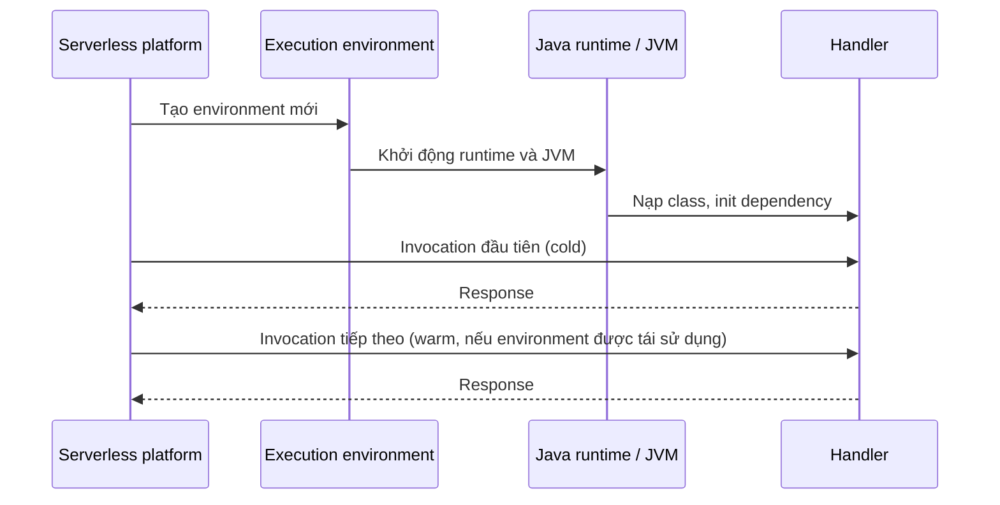

# Lập benchmark riêng cho cold start và warm invocation

Java function có thể phản hồi rất nhanh khi execution environment đã sẵn sàng, nhưng invocation đầu tiên trên một environment mới thường mất thêm thời gian khởi tạo runtime, JVM, class và dependency. Nếu gộp mọi request vào một con số latency trung bình, phần chậm do **cold start** có thể bị che khuất bởi nhiều lần chạy **warm**.

Benchmark serverless cần tách ít nhất hai nhóm: cold start và warm invocation. Mỗi nhóm phải có cách tạo tải, cách nhận diện execution environment và cách đo riêng. Sau đó mới so sánh các lựa chọn như memory/CPU, Java runtime, package size, provisioned/always-ready capacity hoặc cơ chế snapshot. Mục tiêu là hiểu phân phối độ trễ và tỷ lệ cold start trong điều kiện gần với tải thật, không chỉ tìm ra một con số đẹp trong một lần chạy.

## 1. Cold start và warm invocation là gì?

**Cold start** xảy ra khi nền tảng cần chuẩn bị một execution environment mới để chạy function. Với Java, thời gian này có thể bao gồm:

- Cấp phát hoặc chọn compute instance/container cho invocation.
- Khởi động Functions host hoặc Lambda runtime và Java worker.
- Khởi động JVM, nạp class và thực hiện static initialization.
- Nạp framework, dependency và cấu hình ứng dụng.
- Khởi tạo extension, instrumentation hoặc client nếu ứng dụng tạo chúng lúc startup.
- Kết nối mạng hoặc truy cập dịch vụ bên ngoài nếu code thực hiện các thao tác này trong giai đoạn khởi tạo.

**Warm invocation** chạy trên một execution environment đã được khởi tạo và còn có thể tái sử dụng. JVM và class đã được nạp; các static client hoặc connection pool có thể đã tồn tại. Handler vẫn có thể thực hiện nghiệp vụ và gọi dependency, nhưng không phải trả lại toàn bộ chi phí khởi tạo environment.



Không nên định nghĩa cold start đơn giản là “request đầu tiên sau vài phút không có traffic”. Nền tảng có thể giữ environment lâu hơn hoặc thu hồi sớm hơn khoảng thời gian dự đoán. Một invocation sau thời gian nhàn rỗi có thể vẫn warm; một burst đồng thời có thể tạo nhiều environment cold ngay cả khi function vừa xử lý request trước đó.

## 2. Đo đúng các thành phần của latency

Một con số end-to-end từ client đến response có thể chứa nhiều thành phần:

\[
T_{end-to-end} = T_{network} + T_{gateway} + T_{platform-init} + T_{handler} + T_{downstream}
\]

Đây là mô hình khái niệm; các thành phần có thể chồng lấp hoặc được đo ở những ranh giới khác nhau tùy nền tảng. Cần ghi rõ điểm bắt đầu và kết thúc của mỗi phép đo.

| Phép đo | Điểm bắt đầu/kết thúc | Dùng để trả lời |
|---|---|---|
| Client end-to-end latency | Client bắt đầu request đến khi nhận response | Người dùng thực sự chờ bao lâu? |
| Platform initialization | Nền tảng bắt đầu chuẩn bị environment đến lúc runtime sẵn sàng theo metric của provider | Cold start tốn bao nhiêu thời gian? |
| Handler duration | Bắt đầu vào handler đến khi handler trả kết quả | Logic Java và dependency trong handler mất bao lâu? |
| Dependency duration | Trước/sau một lời gọi database, queue hoặc HTTP API | Dịch vụ phụ thuộc có phải nút thắt không? |
| First invocation in environment | Invocation đầu tiên của một process/environment theo marker ứng dụng | Environment mới xuất hiện với tần suất nào? |

**Không cộng các metric khác ranh giới một cách máy móc.** Ví dụ, Lambda `Duration` đo thời gian xử lý handler, còn `Init Duration` được ghi riêng trong REPORT log khi có initialization. Độ trễ client còn chứa mạng và gateway. Đọc tài liệu metric của nền tảng để biết thời gian nào đã bao gồm thời gian nào.

## 3. Thiết kế hai benchmark độc lập

Cold start và warm invocation cần hai thí nghiệm khác nhau. Nếu dùng một bài load test liên tục rồi lấy trung bình, số liệu sẽ trộn lẫn các environment mới và cũ.

### 3.1. Cold-start benchmark

Mục tiêu là đo chi phí khi một execution environment mới được tạo. Quy trình gợi ý:

1. Tạo một deployment candidate có version/build ID cố định.
2. Tắt hoặc không dùng cơ chế giữ instance sẵn sàng nếu muốn đo cold start on-demand thuần túy.
3. Tạo điều kiện để nền tảng cần nhiều environment mới, ví dụ burst concurrency được kiểm soát hoặc một function/version test riêng.
4. Gắn environment ID và marker invocation đầu tiên trong ứng dụng.
5. Thu thập platform initialization metric/log cùng client latency.
6. Chỉ phân loại mẫu cold khi có bằng chứng từ metric nền tảng hoặc marker environment mới; không dựa vào số thứ tự request.
7. Lặp lại nhiều đợt độc lập và báo số mẫu hợp lệ, số environment mới và tỷ lệ cold.

Không có API chung cho mọi FaaS để “xóa toàn bộ warm environment”. Việc chờ một khoảng thời gian rồi gửi request không bảo đảm request đó cold. Với Lambda, có thể dùng execution environment mới trong các đợt scale-out; với Azure Functions, cần quan sát instance/process mới và startup telemetry. Cách tạo cohort cold phải được mô tả trong báo cáo benchmark.

### 3.2. Warm-invocation benchmark

Mục tiêu là đo handler khi environment đã sẵn sàng:

1. Gửi một hoặc nhiều request khởi động để environment nạp class và dependency.
2. Xác nhận các invocation sau thuộc cùng environment/process bằng marker.
3. Chạy tuần tự với concurrency bằng 1 để giảm khả năng platform tạo thêm environment.
4. Loại các invocation đầu tiên khỏi warm cohort.
5. Thu thập handler duration và end-to-end latency cho số mẫu đủ lớn.
6. Lặp lại nhiều đợt; ghi rõ thời gian nghỉ và điều kiện tải giữa các lần gọi.

Warm environment vẫn có thể bị thu hồi bất cứ lúc nào. Nếu marker cho thấy process/environment thay đổi, đánh dấu mẫu mới là cold hoặc không phân loại được thay vì đưa vào warm cohort.

### 3.3. Đo riêng burst scale-out

Một benchmark khác cần đo khi concurrency tăng nhanh. Đây không chỉ là cold start đơn lẻ: nền tảng phải tạo nhiều environment, scale controller phải phản ứng và downstream phải chịu tải tăng đồng thời.

Chạy các mức concurrency hoặc request rate tăng dần, rồi quan sát:

- Số environment mới được tạo.
- Tỷ lệ invocation cold ở mỗi mức tải.
- p50/p95/p99 end-to-end latency.
- Throttles, queue age, consumer lag và downstream saturation.
- Thời gian từ lúc bắt đầu burst đến khi throughput ổn định.

Không dùng kết quả burst để thay thế warm microbenchmark. Báo riêng latency của cold cohort, warm cohort và toàn bộ traffic trong burst.

## 4. Kiểm soát biến số để benchmark có ý nghĩa

Khi so sánh hai cấu hình, chỉ thay đổi một nhóm biến mỗi lần. Giữ cố định các yếu tố khác để biết nguyên nhân cải thiện.

| Biến cần cố định hoặc ghi lại | Vì sao quan trọng |
|---|---|
| Java version và runtime version | JVM startup, JIT và class library có thể khác nhau |
| Function code, dependency và framework | Số class, static initialization và bootstrap ảnh hưởng cold start |
| Artifact type và kích thước | JAR/ZIP/image có thể có thời gian tải và nạp khác nhau |
| Memory/CPU allocation | CPU ảnh hưởng JVM startup và tốc độ xử lý |
| Region, architecture và network | Khoảng cách, compute và native library ảnh hưởng latency |
| VPC/VNet, NAT, private endpoint | Thiết lập mạng có thể thêm thời gian khởi tạo/kết nối |
| Payload và business path | Input khác nhau có thể kích hoạt nhánh xử lý khác |
| Downstream service và dataset | Database/API chậm làm nhiễu handler duration |
| Logging/tracing/sampling | Instrumentation tạo overhead và thay đổi lượng dữ liệu |
| Concurrency và request rate | Có thể tạo thêm environment hoặc throttling |
| Provisioned/always-ready/SnapStart | Thay đổi bản chất của cold-start scenario |

Nếu so sánh hai cấu hình memory, giữ nguyên code, runtime, region, payload, downstream và concurrency profile. Nếu thay đồng thời memory, Java version, dependency và VPC, không thể kết luận yếu tố nào tạo ra khác biệt.

## 5. Gắn marker vào Java handler

Có thể dùng một marker static để nhận biết lần invocation đầu tiên của một Java process/classloader. Marker này hữu ích cho phân loại warm/cold ở tầng ứng dụng, nhưng không thay thế metric cold-start của nền tảng: JVM hoặc host có thể đã khởi động trước khi class handler được nạp.

Ví dụ AWS Lambda Java:

```java
package com.example.benchmark;

import com.amazonaws.services.lambda.runtime.Context;
import com.amazonaws.services.lambda.runtime.LambdaLogger;
import com.amazonaws.services.lambda.runtime.RequestHandler;
import java.util.Map;
import java.util.UUID;
import java.util.concurrent.atomic.AtomicBoolean;

public final class BenchmarkHandler
        implements RequestHandler<Map<String, Object>, Map<String, Object>> {

    private static final String ENVIRONMENT_ID = UUID.randomUUID().toString();
    private static final AtomicBoolean FIRST_INVOCATION = new AtomicBoolean(true);

    @Override
    public Map<String, Object> handleRequest(
            Map<String, Object> event,
            Context context) {

        boolean firstInProcess = FIRST_INVOCATION.compareAndSet(true, false);
        long startedAt = System.nanoTime();
        LambdaLogger logger = context.getLogger();

        try {
            // Thực hiện cùng một workload trong mọi lượt benchmark.
            String result = process(event);
            return Map.of("status", "ok", "result", result);
        } finally {
            double handlerMs = (System.nanoTime() - startedAt) / 1_000_000.0;
            logger.log(String.format(
                    "benchmark envId=%s firstInProcess=%s requestId=%s "
                            + "handlerMs=%.3f remainingMs=%d",
                    ENVIRONMENT_ID,
                    firstInProcess,
                    context.getAwsRequestId(),
                    handlerMs,
                    context.getRemainingTimeInMillis()));
        }
    }

    private String process(Map<String, Object> event) {
        return "processed";
    }
}
```

`System.nanoTime()` phù hợp để đo elapsed time trong cùng process; không dùng `System.currentTimeMillis()` để tính duration vì đồng hồ hệ thống có thể được điều chỉnh. `ENVIRONMENT_ID` đại diện cho process/classloader của ví dụ. Nếu runtime tạo nhiều worker process trong cùng một host instance, marker này nhận diện process chứ không nhất thiết là toàn bộ máy ảo/instance cloud.

`firstInProcess=true` cho biết class/process này đang xử lý invocation đầu tiên kể từ khi được nạp. Nó không đo toàn bộ thời gian khởi động nền tảng, JVM hoặc host. Với AWS Lambda, ghép marker này với `Init Duration` trong REPORT log và client latency. Không bật log chi tiết cho mọi request trong benchmark production nếu logging overhead làm sai số đo; có thể ghi sampling hoặc chỉ bật trên function test.

### 5.1. Không làm benchmark bị chi phối bởi chính instrumentation

- Tránh log toàn bộ payload hoặc ghi log ở mỗi vòng lặp.
- Dùng cùng cấu hình logging/tracing cho tất cả candidate.
- Đo cả handler không instrumentation và handler có instrumentation nếu cần ước lượng overhead.
- Không tạo AWS/Azure SDK client trong mỗi invocation nếu ứng dụng production sẽ tái sử dụng client.
- Không chạy benchmark với mock dependency nếu mục tiêu là đo end-to-end; ngược lại, dùng workload đơn giản nếu mục tiêu là đo JVM/handler thuần.

## 6. Đo cold start trên AWS Lambda

AWS Lambda ghi thông tin initialization trong CloudWatch Logs. Với runtime managed, dòng `REPORT` của invocation cold có thể chứa `Init Duration`; phần xử lý handler được thể hiện bằng `Duration`. Khi dùng SnapStart, có thể có thông tin restore riêng trong log. Cần giữ nguyên định nghĩa metric khi so sánh giữa cấu hình thường, SnapStart và Provisioned Concurrency.

Một quy trình thực hành:

1. Gọi function qua cùng một đường invoke (SDK trực tiếp hoặc API Gateway) cho mọi candidate.
2. Ghi request ID, environment marker và timestamp ở client.
3. Lấy CloudWatch REPORT log theo request ID để thu thập `Init Duration` và `Duration`.
4. Ghép với client end-to-end latency để thấy phần thời gian mạng/gateway.
5. Phân nhóm mẫu có `Init Duration` với các invocation warm không có initialization trong cùng execution environment.

Các CloudWatch metrics như `Duration`, `Errors`, `Throttles` và `ConcurrentExecutions` giúp theo dõi workload tổng thể. `Init Duration` thường được đọc từ REPORT log chứ không nên giả định nó là một CloudWatch metric tiêu chuẩn riêng trong mọi cấu hình. Với Provisioned Concurrency, cần theo dõi utilization và spillover để biết request có phải chạy trên capacity on-demand hay không.

### 6.1. So sánh các chế độ Lambda

| Chế độ | Cách đo phù hợp | Câu hỏi chính |
|---|---|---|
| On-demand mặc định | Thu thập Init Duration, handler Duration và client latency | Cold start cơ bản và warm latency là bao nhiêu? |
| Provisioned Concurrency | Chờ capacity được provisioned, sau đó đo request trong mức capacity và phần spillover riêng | Latency thấp hơn đổi lại chi phí capacity luôn sẵn sàng ra sao? |
| SnapStart (runtime hỗ trợ) | Đo restore/initialization riêng và warm invocation sau restore | Snapshot rút ngắn startup bao nhiêu và có ảnh hưởng restore không? |
| Tăng memory | Giữ workload cố định, đo Init Duration và handler Duration ở từng mức | CPU bổ sung có giảm startup/processing đủ để bù chi phí không? |

SnapStart và Provisioned Concurrency có điều kiện hỗ trợ, cấu hình và trade-off riêng. Không giả định chúng có thể bật đồng thời cho mọi runtime hoặc mọi function. Kiểm tra runtime Java, architecture, deployment package và giới hạn dịch vụ trước khi thiết kế thí nghiệm.

## 7. Đo cold start và warm invocation trên Azure Functions

Trên Azure Functions, thời gian phản hồi có thể chịu ảnh hưởng bởi Functions host, Java worker, JVM, plan, scale controller và dependency. Không nên chỉ lấy duration của method Java rồi coi đó là toàn bộ cold start.

Một cách đo có thể lặp lại:

1. Gắn build ID và process/environment marker vào log của Java function.
2. Ghi timestamp ở client trước request và sau response.
3. Ghi timestamp ngay khi method bắt đầu và kết thúc bằng `System.nanoTime()`.
4. Thu thập host/worker startup log và Application Insights request/trace telemetry.
5. Nhận diện invocation đầu tiên trên worker/process mới bằng marker và instance metadata khi có.
6. Tách request đầu tiên của worker mới khỏi các invocation warm trong cùng process.

Với Azure Functions, hành vi cold start và cách scale phụ thuộc hosting plan. Consumption/Flex Consumption có thể scale về zero; Premium có pre-warmed/always-ready capacity; Dedicated có thể giữ app chạy với Always On. Flex Consumption hỗ trợ cấu hình always-ready instances. Khi benchmark, ghi lại plan, minimum/always-ready instances, Java version, OS và vùng triển khai.

### 7.1. Ví dụ ghi timing trong Azure Java function

```java
import com.microsoft.azure.functions.ExecutionContext;
import com.microsoft.azure.functions.HttpRequestMessage;
import com.microsoft.azure.functions.HttpResponseMessage;
import com.microsoft.azure.functions.HttpStatus;
import com.microsoft.azure.functions.annotation.AuthorizationLevel;
import com.microsoft.azure.functions.annotation.FunctionName;
import com.microsoft.azure.functions.annotation.HttpTrigger;
import java.util.Optional;
import java.util.UUID;
import java.util.concurrent.atomic.AtomicBoolean;

public final class AzureBenchmarkFunction {
    private static final String PROCESS_ID = UUID.randomUUID().toString();
    private static final AtomicBoolean FIRST = new AtomicBoolean(true);

    @FunctionName("benchmark")
    public HttpResponseMessage run(
            @HttpTrigger(
                    name = "request",
                    methods = {com.microsoft.azure.functions.HttpMethod.GET},
                    authLevel = AuthorizationLevel.FUNCTION)
            HttpRequestMessage<Optional<String>> request,
            ExecutionContext context) {

        boolean firstInProcess = FIRST.compareAndSet(true, false);
        long started = System.nanoTime();
        try {
            return request.createResponseBuilder(HttpStatus.OK)
                    .body("ok")
                    .build();
        } finally {
            double durationMs = (System.nanoTime() - started) / 1_000_000.0;
            context.getLogger().info(String.format(
                    "benchmark processId=%s firstInProcess=%s invocationId=%s durationMs=%.3f",
                    PROCESS_ID,
                    firstInProcess,
                    context.getInvocationId(),
                    durationMs));
        }
    }
}
```

Marker chỉ nhận diện process Java nơi class được nạp. Để hiểu cold start của toàn Function App, phải đối chiếu log host/worker, instance metadata và thời gian client. Một host instance có thể có hành vi worker riêng; không suy ra toàn bộ instance count chỉ từ một static UUID.

## 8. Đo phân phối latency và tỷ lệ cold start

Không chỉ báo average. Latency serverless thường có phân phối lệch: đa số warm request nhanh, một phần cold request chậm hơn đáng kể. Cần báo ít nhất:

- **p50:** mức trung vị, đại diện request điển hình.
- **p90/p95:** phần đuôi có ảnh hưởng đến phần lớn trải nghiệm chậm.
- **p99:** phần đuôi xa, hữu ích với API yêu cầu latency chặt nhưng cần đủ mẫu.
- **Min/max:** hữu ích để thấy outlier, nhưng không dùng làm kết luận duy nhất.
- **Cold-start rate:** số invocation cold chia cho tổng invocation trong điều kiện benchmark.
- **Sample count:** số mẫu cold và warm riêng biệt.

Ví dụ bảng kết quả:

| Scenario | Cold samples | Warm samples | Cold p50/p95 | Warm p50/p95 | Cold rate |
|---|---:|---:|---:|---:|---:|
| On-demand, 512 MB | 40 | 2.000 | 1.450 / 2.100 ms | 85 / 160 ms | 2,0% |
| On-demand, 1.024 MB | 38 | 2.000 | 980 / 1.500 ms | 62 / 120 ms | 1,9% |
| Always-ready, 1 instance | 0 observed | 2.000 | Không đủ mẫu cold | 58 / 105 ms | 0% trong cohort đo |

Số liệu trên chỉ minh họa cách trình bày, không phải kết quả hay cam kết của nhà cung cấp. “0 observed” không chứng minh cold start không thể xảy ra; nó chỉ nói không quan sát được cold sample trong cohort đó. Với capacity luôn sẵn sàng, vẫn có thể có spillover hoặc worker thay thế.

### 8.1. Số mẫu và độ tin cậy

Một vài request không đủ để kết luận p95 hoặc p99. Hãy thu thập đủ mẫu cho từng nhóm, lặp lại nhiều đợt và báo sample count. Nếu cần so sánh chặt, dùng bootstrap confidence interval hoặc phương pháp thống kê phù hợp thay vì chỉ nhìn một percentile duy nhất.

Đối với cold start, mẫu thường khó thu thập hơn warm invocation vì cần tạo environment mới. Có thể chạy nhiều burst độc lập, nhưng phải ghi số environment thực sự mới được xác nhận. Không tạo hàng nghìn request đồng thời rồi coi tất cả đều là cold: một phần có thể được xử lý trên environment đã có, một phần có thể bị throttling.

### 8.2. Báo cáo cả latency và tỷ lệ cold

Hai cấu hình có thể có cold p95 tương tự nhưng tỷ lệ cold khác nhau do traffic pattern hoặc capacity policy. Một cấu hình có cold start 1,5 giây nhưng chỉ 0,1% request gặp cold có thể phù hợp với API không quá nhạy latency; cấu hình khác có cold start 800 ms nhưng 20% request cold có thể gây trải nghiệm kém hơn.

Do đó, báo cáo nên tách:

1. Cold-start latency distribution.
2. Warm invocation latency distribution.
3. Cold-start rate theo concurrency và request rate.
4. End-to-end latency của toàn workload.
5. Chi phí và tài nguyên của chế độ giữ capacity sẵn sàng.

## 9. Tách microbenchmark và benchmark end-to-end

Hai bài đo trả lời hai câu hỏi khác nhau:

| Bài đo | Workload | Điều cần giữ cố định | Mục đích |
|---|---|---|---|
| JVM/handler microbenchmark | Parse payload, mapping, logic tính toán trong handler | Không gọi network/database; payload và code cố định | Đo runtime và logic Java |
| Dependency benchmark | Gọi database, queue hoặc HTTP API | Cùng endpoint/dataset, connection strategy và network | Đo latency của dependency và pool |
| Platform cold-start benchmark | Tạo environment mới và gọi handler | Runtime, package, plan, region, memory | Đo initialization overhead |
| End-to-end benchmark | Gọi qua API/trigger giống production | Client location, auth, gateway, payload và traffic profile | Đo trải nghiệm thực tế |

Nếu handler gọi database trong static initializer, cold-start latency sẽ chứa chi phí kết nối đó; nếu kết nối được tạo trong handler mỗi lần, warm latency cũng bị ảnh hưởng. Hãy đo từng thành phần hoặc chuyển initialization sang một vị trí có thể quan sát để hiểu rõ trade-off.

## 10. Quy trình benchmark có thể tái lập

Một quy trình thực tế có thể thực hiện theo thứ tự sau:

1. **Chọn mục tiêu:** xác định SLO cold latency, warm latency, p95/p99, throughput và chi phí.
2. **Đóng băng candidate:** ghi commit SHA, artifact checksum, Java version, dependency và cấu hình function.
3. **Chuẩn bị môi trường:** chọn region, architecture, memory/CPU, plan, network và downstream dataset.
4. **Chạy warm-up:** khởi tạo client/load generator; với warm cohort, gửi invocation cho đến khi marker xác nhận environment đã sẵn sàng.
5. **Chạy cold cohort:** tạo burst hoặc environment mới theo phương pháp đã mô tả; thu thập platform init metric.
6. **Chạy warm cohort:** gọi tuần tự hoặc ở concurrency đã định trước; loại các mẫu đầu tiên của process mới.
7. **Chạy scale-out cohort:** tăng tải theo từng bước để đo cold rate và throughput.
8. **Lặp lại:** chạy nhiều đợt ở cùng điều kiện và ghi mọi thay đổi môi trường.
9. **Phân tích:** tách cold/warm, tính percentile, sample count, error/throttle và confidence interval nếu cần.
10. **Đối chiếu chi phí:** so sánh memory, provisioned/always-ready capacity, SnapStart, compute duration và downstream cost.
11. **Lưu báo cáo:** giữ script, fixture, config, log query, raw sample và build ID để có thể chạy lại.

Không chạy các benchmark candidate cạnh tranh trên cùng account/queue/database nếu chúng làm nhiễu capacity của nhau. Nếu phải dùng chung hạ tầng, chạy tuần tự hoặc cô lập quota và ghi rõ điều kiện.

## 11. Các yếu tố Java ảnh hưởng đến cold start

### 11.1. Kích thước dependency và số class

Framework lớn, nhiều dependency và classpath phức tạp có thể tăng thời gian load và initialization. Chỉ đưa dependency runtime cần thiết vào package; loại bỏ thư viện test và tool build. Kiểm tra dependency tree và tránh nhiều phiên bản cùng một thư viện.

### 11.2. Static initializer và dependency injection

Static initializer chạy khi class được khởi tạo. Nếu thực hiện đọc secret, gọi HTTP, kết nối database hoặc scan classpath trong static block, chi phí đó có thể đẩy vào cold start. Tạo SDK client thread-safe một lần có thể giúp warm invocation nhanh hơn, nhưng khởi tạo client cũng có chi phí ở lần đầu. Đo cả hai nhóm trước khi quyết định.

### 11.3. JIT và workload warm

JVM có thể tối ưu code theo thời gian khi method được gọi nhiều lần. Vì vậy, warm invocation đầu tiên sau startup có thể khác warm invocation sau một thời gian chạy. Nên phân biệt:

- First invocation trong process.
- Warm-up invocations sau startup.
- Steady-state warm invocations sau khi JIT/connection pool ổn định.

Không gộp toàn bộ warm samples nếu mục tiêu là đo steady state. Ghi rõ warm-up policy và loại bỏ warm-up samples theo quy tắc được xác định trước.

### 11.4. Logging, tracing và profiler

Instrumentation giúp quan sát nhưng có overhead. Profiler hoặc debug logging có thể làm sai latency. Giữ cấu hình giống production, hoặc chạy một lượt có profiler riêng để phân tích nguyên nhân rồi benchmark lại không profiler để đo hiệu năng thực tế.

## 12. Diễn giải kết quả và chọn tối ưu

| Quan sát | Khả năng nguyên nhân | Hướng thử tiếp theo |
|---|---|---|
| Cold p95 cao, warm p95 thấp | JVM/class/framework initialization hoặc platform provisioning | Giảm dependency/static init; thử memory/CPU cao hơn hoặc warm capacity |
| Cold và warm đều cao | Handler logic hoặc downstream chậm | Đo từng dependency, query, serialization và connection pool |
| Handler duration thấp nhưng client latency cao | Network, gateway, auth, TLS hoặc platform initialization | So sánh client timing với platform log và gateway metrics |
| Warm invocation đầu chậm, sau đó nhanh | JIT, cache, lazy initialization hoặc pool creation | Tách warm-up khỏi steady state; quyết định preload có đáng chi phí không |
| Cold rate tăng khi concurrency tăng | Scale-out tạo environment mới hoặc capacity warm không đủ | Thử concurrency controls, provisioned/always-ready capacity và queue buffering |
| Throttles tăng trong burst | Concurrency quota hoặc downstream giới hạn | Điều chỉnh quota/concurrency, backpressure và retry |
| Memory cao hơn giảm cold và warm latency | CPU cấp thêm giúp JVM khởi động/xử lý nhanh | So sánh cost per successful invocation, không chỉ duration |
| Always-ready giảm cold nhưng tăng chi phí | Capacity luôn sẵn sàng | Chọn số instance theo SLO và traffic profile |

Đừng chọn cấu hình chỉ vì p50 tốt hơn. Với API người dùng, p95/p99 và cold rate có thể quan trọng hơn median. Với queue worker, throughput, queue age và cost per message có thể quan trọng hơn cold latency của một invocation đơn lẻ.

## 13. Các sai lầm thường gặp khi benchmark

| Sai lầm | Vì sao gây sai lệch | Cách tránh |
|---|---|---|
| Gọi request đầu tiên rồi kết luận cold start | Không biết environment có thật sự mới không | Dùng platform init log và environment marker |
| Chờ một khoảng thời gian rồi mặc định cold | Thời gian thu hồi environment không cố định | Xác nhận cold bằng telemetry, không dùng idle time làm bằng chứng |
| Trộn cold và warm vào một average | Cold tail bị che hoặc warm bị đánh giá quá chậm | Tách cohort và báo phân phối riêng |
| Dùng concurrency cao để đo warm | Platform có thể tạo environment mới | Warm benchmark concurrency được kiểm soát và xác nhận marker |
| Dùng quá ít mẫu | Percentile không ổn định | Thu thập đủ sample và lặp lại nhiều đợt |
| Chỉ đo handler duration | Bỏ qua platform init, gateway và network | Đo cả client end-to-end và platform telemetry |
| Thay nhiều biến cùng lúc | Không biết yếu tố nào tạo cải thiện | Thay từng biến hoặc thiết kế factorial có kiểm soát |
| Dùng mock dependency trong end-to-end benchmark | Bỏ qua latency và connection behavior thực tế | Tách microbenchmark và dependency benchmark |
| Bật debug/profiler trong mọi lượt | Instrumentation làm tăng latency | Giữ cấu hình production và chạy profiler riêng |
| Bỏ qua throttling và downstream saturation | Kết quả latency có thể không đại diện tải thật | Theo dõi concurrency, errors, queue age và dependency |

## 14. Checklist benchmark cold start và warm invocation

1. Cold start và warm invocation đã được định nghĩa rõ theo môi trường/runtime chưa?
2. Có phân biệt client end-to-end, platform initialization, handler và dependency duration không?
3. Cold cohort có bằng chứng environment mới từ platform telemetry hoặc marker không?
4. Warm cohort có xác nhận cùng process/environment và loại first invocation chưa?
5. Có benchmark riêng cho scale-out burst không?
6. Java version, dependency, artifact, memory, architecture, region và network đã được ghi lại chưa?
7. Payload, downstream dataset, auth, logging và tracing có giống nhau giữa candidate không?
8. Warm-up policy, concurrency và request rate có được mô tả không?
9. Có đủ cold/warm samples và nhiều lần chạy độc lập không?
10. Báo cáo có p50/p90/p95/p99, sample count, cold rate và errors/throttles không?
11. Với AWS, đã đối chiếu Init Duration/REPORT logs và Provisioned Concurrency/SnapStart behavior chưa?
12. Với Azure, đã ghi hosting plan, worker/instance marker và host/worker startup telemetry chưa?
13. Instrumentation có overhead đáng kể hoặc làm thay đổi kết quả không?
14. Kết quả đã được so sánh với SLO và cost per successful invocation chưa?

## Kết luận

Cold start phản ánh chi phí tạo execution environment và khởi tạo runtime/JVM; warm invocation phản ánh xử lý trên environment đã sẵn sàng. Hai nhóm phải được benchmark riêng, nhận diện bằng platform telemetry và environment marker, rồi báo phân phối latency cùng tỷ lệ cold. Với Java, cần quan sát riêng JVM/class initialization, framework, client và dependency; đồng thời đo cả end-to-end để không bỏ qua gateway và network. Chỉ khi kiểm soát runtime, artifact, memory, region, concurrency, payload và instrumentation, kết quả benchmark mới đủ tin cậy để so sánh cấu hình hoặc quyết định dùng SnapStart, Provisioned Concurrency, always-ready capacity hay tối ưu code.

## Tài liệu tham khảo chính thức

- [AWS Lambda execution environment lifecycle](https://docs.aws.amazon.com/lambda/latest/dg/lambda-runtime-environment.html)
- [AWS Lambda performance optimization](https://docs.aws.amazon.com/lambda/latest/dg/best-practices.html)
- [AWS Lambda SnapStart](https://docs.aws.amazon.com/lambda/latest/dg/snapstart.html)
- [AWS Lambda Provisioned Concurrency](https://docs.aws.amazon.com/lambda/latest/dg/provisioned-concurrency.html)
- [AWS Lambda logging and REPORT line](https://docs.aws.amazon.com/lambda/latest/dg/monitoring-cloudwatchlogs-view.html)
- [Azure Functions scale and hosting](https://learn.microsoft.com/en-us/azure/azure-functions/functions-scale)
- [Monitor executions in Azure Functions](https://learn.microsoft.com/en-us/azure/azure-functions/functions-monitoring)
- [Java developer reference for Azure Functions](https://learn.microsoft.com/en-us/azure/azure-functions/functions-reference-java)
