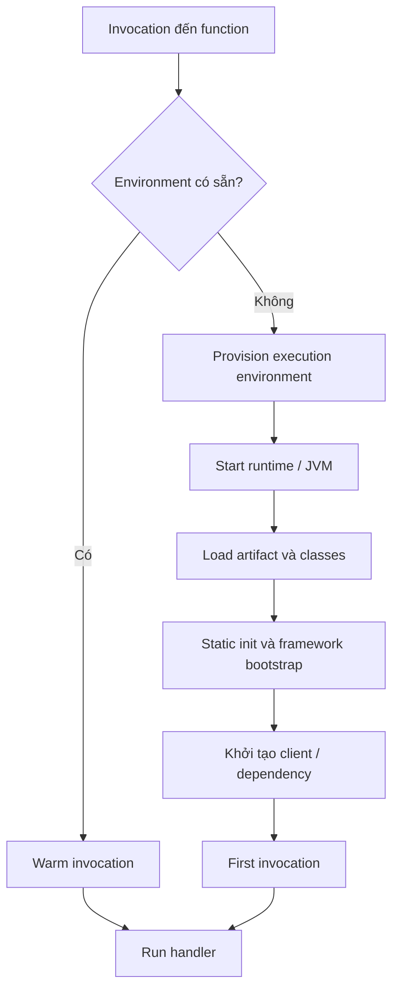

# Giảm dependency, kích thước artifact và chi phí khởi tạo

Java function có thể chạy rất nhanh sau khi JVM và ứng dụng đã khởi tạo, nhưng lần gọi đầu tiên trên một execution environment mới thường chậm hơn. Thời gian này chịu ảnh hưởng bởi runtime startup, class loading, dependency initialization, dependency injection, cấu hình, kết nối mạng và các thao tác trong static initializer. Một artifact lớn với nhiều thư viện không dùng đến làm tăng thời gian tải, giải nén, quét classpath và khởi tạo framework; nó cũng làm quy trình build, upload và triển khai nặng hơn.

Tối ưu serverless Java cần nhìn đồng thời ba vấn đề: **dependency graph**, **deployment artifact** và **initialization path**. Mục tiêu là giữ đúng chức năng, bảo mật và khả năng bảo trì trong khi giảm phần code phải tải, số class phải khởi tạo, công việc đồng bộ trong startup và tài nguyên phải duy trì. Không phải lúc nào JAR nhỏ nhất cũng tạo cold start tốt nhất; cần đo latency và chi phí thực tế của workload.

## 1. Các thành phần tạo nên cold start

Cold start xảy ra khi nền tảng cần chuẩn bị một execution environment mới cho function. Tùy provider và runtime, các bước có thể gồm:

1. Cấp phát hoặc khởi tạo môi trường thực thi.
2. Chuẩn bị runtime/JVM và nạp entry point.
3. Tải artifact, mount hoặc giải nén package/container layers.
4. Nạp class và resolve dependency.
5. Chạy static initializer, tạo dependency injection container và đọc cấu hình.
6. Khởi tạo SDK client, connection pool, serializer, cache hoặc framework context.
7. Bắt đầu xử lý request/event đầu tiên.



Cold start không chỉ là thời gian JVM khởi động. Một ứng dụng có JVM startup nhanh nhưng thực hiện nhiều network call đồng bộ trong static initializer vẫn có thể có thời gian khởi tạo dài. Ngược lại, package lớn chưa chắc là nguyên nhân chính nếu phần lớn class không được load trên đường xử lý đầu tiên.

### Phân biệt các loại latency

| Thành phần | Ý nghĩa | Ví dụ nguồn chậm |
|---|---|---|
| Platform/environment initialization | Chuẩn bị sandbox, container hoặc execution environment | Scale-out, capacity allocation, image/layer setup |
| Runtime startup | Khởi động JVM và runtime adapter | JVM startup, runtime bootstrap |
| Application initialization | Chuẩn bị ứng dụng trước handler | Class loading, static block, DI, config parsing |
| First-use initialization | Công việc chỉ xảy ra khi chức năng cụ thể được gọi lần đầu | Lazy bean, serializer, DNS/TLS, SDK credential lookup |
| Handler duration | Thời gian xử lý invocation sau khi handler bắt đầu | Database query, business logic, downstream API |
| End-to-end latency | Tổng thời gian caller quan sát | Gateway, queue wait, retries, network và handler |

Provider có thể phân loại và tính phí các pha này khác nhau. Khi so sánh, hãy dùng metric và billing model của nền tảng thực tế, không suy luận chi phí chỉ từ một trường `Duration`.

## 2. Đặt mục tiêu và đo trước khi tối ưu

Đặt mục tiêu theo workload, không chỉ theo một con số cold start chung. API đồng bộ nhạy với p95/p99 latency; worker xử lý queue có thể ưu tiên throughput, backlog age và cost per message. Scheduled function chạy vài lần mỗi ngày có thể chấp nhận startup dài hơn function HTTP nhận traffic liên tục.

Các chỉ số nên thu thập:

- Cold-start rate: tỷ lệ invocation phải khởi tạo environment mới.
- Initialization duration: thời gian từ lúc runtime bắt đầu đến khi function sẵn sàng, nếu platform cung cấp.
- Handler duration: thời gian thực thi handler.
- End-to-end latency: thời gian từ request đến response hoặc hoàn tất workflow.
- p50, p95 và p99: phân vị latency để nhìn tail latency.
- Artifact size: kích thước JAR, ZIP hoặc container image sau build.
- Class count/dependency count: dấu hiệu về độ phức tạp package.
- Memory, CPU, concurrency, throttles và downstream connection count.
- Build time, upload time và deployment time.
- Cost per request/message và chi phí capacity được giữ sẵn.

Với AWS Lambda, log/report có thể hiển thị `Init Duration` cho cold start và `Duration` cho handler. Azure Functions, Google Cloud Functions/Cloud Run và các runtime khác có metric/log tương ứng nhưng tên gọi và cách phân loại có thể khác. Hãy xác định đúng metric của runtime/provider trước khi lập baseline.

### Thiết kế phép đo công bằng

1. Dùng cùng workload, payload, region, runtime version, memory/CPU và dependency.
2. Tách cold invocation khỏi warm invocation; không trộn chúng rồi chỉ nhìn average.
3. Chạy đủ số lần để p95/p99 có ý nghĩa; ghi nhận concurrency và traffic pattern.
4. Đo từ client/gateway và đo riêng initialization/handler nếu platform hỗ trợ.
5. So sánh artifact và cấu hình trước/sau trong cùng điều kiện.
6. Lặp lại sau khi thay đổi framework, native image, SnapStart hoặc provisioned capacity.

Đừng dùng benchmark gọi method Java trong cùng JVM để kết luận cold start serverless. JMH hữu ích cho microbenchmark code sau startup, nhưng cold start cần integration benchmark tạo execution environment mới hoặc dùng cơ chế đo của platform.

## 3. Kiểm kê dependency graph

Mỗi dependency có thể kéo theo nhiều transitive dependencies. Một thư viện tiện ích nhỏ có thể mang theo logging backend, JSON mapper, HTTP stack hoặc module không cần thiết. Trước khi xóa dependency, hãy hiểu nó được dùng trực tiếp, gián tiếp, qua reflection, `ServiceLoader`, annotation processing hay framework auto-configuration.

### Maven: xem dependency tree

```bash
# Hiển thị toàn bộ dependency tree
mvn dependency:tree

# Chỉ xem runtime dependencies
mvn dependency:tree -Dscope=runtime

# Tìm thư viện có thể bị trùng version hoặc kéo theo nhiều nhánh
mvn dependency:tree -Dverbose

# Phân tích dependency khai báo nhưng có vẻ không được sử dụng
mvn dependency:analyze
```

`dependency:analyze` là tín hiệu để review, không phải lệnh tự động xóa an toàn. Framework có thể sử dụng class qua reflection, service loader, generated metadata hoặc cấu hình runtime nên công cụ không nhìn thấy tham chiếu trực tiếp.

### Gradle: kiểm tra runtime classpath

```bash
# Xem dependency tree của runtime classpath
./gradlew dependencies --configuration runtimeClasspath

# Tìm dependency gây ra một module cụ thể
./gradlew dependencyInsight --dependency jackson-databind \
  --configuration runtimeClasspath
```

Giữ dependency khai báo trực tiếp khi code thực sự dùng API của nó, kể cả khi thư viện khác hiện đang kéo nó vào transitively. Điều này giúp build ổn định khi dependency cha thay đổi.

### Nhóm dependency cần rà soát

| Nhóm | Câu hỏi |
|---|---|
| Logging | Có nhiều logging backend/binding cùng lúc không? Có đang đóng gói backend không tương thích không? |
| JSON | Có nhiều JSON mapper làm cùng việc không? Chỉ cần databind hay cần thêm module datatype? |
| HTTP client | Có bao nhiêu HTTP client? Function có dùng một client xuyên suốt không? |
| Cloud SDK | Có kéo cả SDK aggregate trong khi chỉ cần một service module không? |
| Framework | Có auto-configuration hoặc starter không dùng đến không? |
| Database | Có driver, ORM và migration tool nào không cần trong runtime function không? |
| Testing | Dependency test có bị đóng gói nhầm vào runtime artifact không? |
| Annotation processor | Công cụ compile-time có bị đưa vào runtime package không? |
| Native/transitive library | Có thư viện native lớn hoặc chỉ hỗ trợ platform khác không? |

## 4. Giảm dependency mà không làm hỏng runtime

### Chỉ thêm module SDK cần thiết

Cloud SDK thường chia theo service module. Nếu function chỉ gửi message đến SQS, hãy kiểm tra có thể chỉ dùng module SQS và module credential cần thiết thay vì thêm một aggregate chứa nhiều service client. Với Azure và Google Cloud, chọn artifact client library theo dịch vụ thực sự sử dụng.

### Tránh dependency trùng chức năng

Một project có thể vô tình dùng hai HTTP client, hai JSON mapper hoặc nhiều logging binding. Chuẩn hóa một lựa chọn cho mỗi nhiệm vụ giúp giảm package size, xung đột version và số class phải load.

### Exclude transitive dependency có chủ đích

Maven cho phép loại một dependency được kéo theo:

```xml
<dependency>
  <groupId>com.example</groupId>
  <artifactId>legacy-client</artifactId>
  <version>${legacy-client.version}</version>
  <exclusions>
    <exclusion>
      <groupId>commons-logging</groupId>
      <artifactId>commons-logging</artifactId>
    </exclusion>
  </exclusions>
</dependency>
```

Chỉ exclude khi đã xác định dependency thay thế và test được đường runtime. Một thư viện có thể cần class bị exclude dù code của bạn không tham chiếu trực tiếp.

### Dùng BOM và pin version

Dùng Maven BOM hoặc Gradle platform để giữ các module cùng hệ sinh thái tương thích version. Pin version giúp build tái lập và kiểm soát security update. Không nâng từng transitive module độc lập nếu framework hoặc SDK yêu cầu một tập version tương thích.

### Tách compile/test/runtime scope

Annotation processor, test framework, mock library và code generation tool không nên nằm trong runtime artifact trừ khi ứng dụng thực sự cần chúng lúc chạy. Kiểm tra Maven scopes (`provided`, `test`, `runtime`, `compile`) và Gradle configurations (`testImplementation`, `runtimeOnly`, `implementation`, `annotationProcessor`). Đừng chuyển scope chỉ để giảm size mà chưa xác nhận runtime có sẵn thư viện đó.

## 5. Đóng gói Java function

Artifact cần chứa handler, class ứng dụng và runtime dependencies mà platform không cung cấp. Cách đóng gói phụ thuộc provider và build tool:

- **Thin JAR + dependency directory:** JAR ứng dụng riêng và các JAR dependency ở thư mục được runtime hỗ trợ.
- **Uber/fat JAR:** một JAR chứa class ứng dụng và dependency đã được merge.
- **ZIP package:** JAR hoặc class files cùng dependency trong cấu trúc ZIP mà platform yêu cầu.
- **Container image:** runtime base image, application artifact và dependency trong image.
- **Native executable:** binary được biên dịch trước cho kiến trúc/runtime mục tiêu khi platform hỗ trợ custom runtime/container tương ứng.

Không phải provider nào cũng nhận cùng một định dạng. Kiểm tra contract handler, entry point, thư mục package và giới hạn artifact của runtime đang triển khai.

### Maven Shade Plugin cho fat JAR

Ví dụ tối giản cho Java Lambda handler:

```xml
<build>
  <plugins>
    <plugin>
      <groupId>org.apache.maven.plugins</groupId>
      <artifactId>maven-shade-plugin</artifactId>
      <version>${maven-shade-plugin.version}</version>
      <executions>
        <execution>
          <phase>package</phase>
          <goals>
            <goal>shade</goal>
          </goals>
          <configuration>
            <createDependencyReducedPom>false</createDependencyReducedPom>
            <transformers>
              <transformer implementation="org.apache.maven.plugins.shade.resource.ServicesResourceTransformer"/>
            </transformers>
          </configuration>
        </execution>
      </executions>
    </plugin>
  </plugins>
</build>
```

Transformer cho `META-INF/services` giúp hợp nhất service provider declarations khi nhiều JAR cung cấp `ServiceLoader` implementation. Framework có thể còn cần resource transformer cho manifest, Spring metadata hoặc file cấu hình khác. Hãy dùng cấu hình được khuyến nghị bởi framework và test artifact đã build, không chỉ test từ IDE.

`minimizeJar` của Shade Plugin có thể loại class mà nó cho rằng không được tham chiếu, nhưng reflection, dependency injection, annotation scanning và `ServiceLoader` có thể làm class bị loại nhầm. Chỉ bật sau khi có cấu hình keep/exclusion phù hợp và integration test đầy đủ.

### Kiểm tra artifact sau build

```bash
mvn clean package

# Kích thước artifact
ls -lh target/*.jar

# Liệt kê nội dung JAR
jar tf target/orders-function.jar

# Xem dependency graph đã resolve
mvn dependency:tree -Dscope=runtime
```

Trên Windows PowerShell có thể dùng `Get-Item`, `jar tf` và `Expand-Archive` để kiểm tra ZIP. Ghi lại kích thước artifact sau nén và kích thước nội dung đã giải nén; provider có thể áp dụng giới hạn khác nhau cho từng loại package.

## 6. Artifact size ảnh hưởng đến điều gì?

Artifact lớn có thể làm tăng:

- Thời gian upload và publish artifact.
- Thời gian download/mount hoặc giải nén khi tạo environment mới.
- Số lượng class/resource cần tìm và load.
- Bộ nhớ cần thiết cho class metadata và framework initialization.
- Thời gian scan vulnerability và license trong CI/CD.
- Storage, transfer và chi phí registry/container image.

Tuy nhiên, kích thước nén không phải proxy hoàn hảo cho startup. Một JAR nhỏ nhưng static initializer gọi database hoặc load hàng nghìn class có thể khởi động chậm hơn JAR lớn nhưng đường init nhẹ. Đo cả artifact size, class loading, initialization duration và first-use latency.

### Loại bỏ nội dung không cần

- Không đóng gói source, Javadoc, test reports, fixture lớn hoặc file build tạm.
- Không đóng gói dependency test và công cụ chỉ dùng ở compile time.
- Không đưa nhiều version của cùng thư viện vào artifact.
- Chỉ giữ resource/configuration cần lúc runtime.
- Kiểm tra duplicate class và resource khi merge JAR.
- Không bundle runtime/JRE nếu provider đã cung cấp managed runtime, trừ khi mô hình custom runtime/container yêu cầu.

### JAR compression và ZIP layout

Nén giúp giảm kích thước lưu trữ và truyền tải nhưng runtime có thể phải giải nén hoặc đọc nhiều entry khi khởi động. Mức ảnh hưởng phụ thuộc platform cache, storage và class loader. Không tối ưu compression level dựa trên suy đoán; đo cold-start trên package thực tế.

## 7. Layer, shared dependency và container image

### Lambda layers hoặc cơ chế shared package

Layer cho phép chia sẻ dependency giữa nhiều function và tách phần thay đổi ít khỏi application code. Điều này giúp quản lý version hoặc tránh lặp artifact trong quy trình triển khai. Tuy nhiên layer không tự động làm cold start nhanh hơn: runtime vẫn phải mount/resolve và load class khi ứng dụng cần. Quá nhiều layer cũng làm dependency order và tương thích khó quản lý.

Chỉ dùng layer khi có lợi ích rõ như chia sẻ thư viện được quản trị tập trung, tách agent/extension hoặc giảm duplication trong release. Pin version layer và kiểm thử tổ hợp function-layer như một artifact hoàn chỉnh.

### Container image

Container image phù hợp khi cần kiểm soát OS packages, native libraries hoặc runtime. Tối ưu bằng multi-stage build, base image nhỏ được hỗ trợ, loại build tools khỏi final stage, pin image digest và sắp xếp layer theo độ ổn định.

Image lớn có thể làm tăng pull/start time và registry storage. Một số platform cache image layers, nhưng không nên giả định image sẽ luôn nằm sẵn trên host. So sánh image startup với ZIP/JAR package bằng cùng workload và runtime.

### Shared dependency không có nghĩa shared mutable state

Một thư viện có thể được chia sẻ giữa nhiều function, nhưng không chia sẻ mutable request data trong static field. Mỗi function vẫn cần context, credential scope và resource policy riêng. Tách dependency packaging khỏi ranh giới quyền truy cập.

## 8. Framework Java và chi phí bootstrap

Framework giúp tăng năng suất nhưng thường có chi phí khởi tạo. Chọn framework theo nhu cầu ứng dụng và latency budget:

| Cách triển khai | Ưu điểm | Chi phí/trade-off cần đo |
|---|---|---|
| Java thuần + Lambda handler | Ít abstraction, dễ kiểm soát init path | Tự tổ chức DI, validation, HTTP client và cấu hình |
| Spring Boot | Hệ sinh thái lớn, DI/auto-configuration phong phú | Context startup, classpath scan, auto-configuration và reflection |
| Quarkus | Hướng đến startup nhanh, build-time augmentation và native support | Build phức tạp hơn, extension/reflective access cần kiểm tra |
| Micronaut | DI/AOP xử lý nhiều metadata ở compile time | Cần hiểu annotation processing và runtime metadata |
| Helidon hoặc framework nhẹ khác | Có thể giảm bootstrap cho service nhỏ | Đánh giá hệ sinh thái, extension và vận hành |

Không có framework nào luôn nhanh nhất cho mọi workload. So sánh ứng dụng tương đương, cùng chức năng và cùng cấu hình. Một framework có startup nhanh nhưng tốn nhiều memory hoặc làm tăng thời gian build có thể không tối ưu tổng thể.

### Giảm auto-configuration và classpath scanning

- Chỉ bật module/starter thực sự dùng.
- Exclude auto-configuration không cần nếu framework hỗ trợ rõ ràng.
- Ưu tiên bean wiring rõ ràng cho function nhỏ, thay vì scan toàn bộ package.
- Tránh scan toàn bộ classpath để tìm plugin nếu chỉ có một implementation cố định.
- Dùng generated metadata hoặc compile-time DI khi phù hợp.
- Tránh đọc schema/config từ network trong lúc khởi tạo nếu có thể validate/build trước.

Tối ưu bootstrap không nên biến cấu hình thành hardcode hoặc bỏ qua validation. Cần giữ fail-fast cho cấu hình bắt buộc, nhưng chỉ thực hiện các thao tác cần thiết trên đường init.

## 9. Tối ưu static initialization và application initialization

Static initializer và constructor của singleton thường chạy trước hoặc trong lần sử dụng đầu tiên. Nếu đặt quá nhiều công việc vào đây, cold start tăng và lỗi khởi tạo có thể làm toàn bộ invocation thất bại.

### Việc thường phù hợp ở init phase

- Parse cấu hình nhỏ, bất biến.
- Tạo client SDK thread-safe có thể tái sử dụng.
- Compile regex hoặc load bảng lookup nhỏ, cố định.
- Khởi tạo serializer/mapper dùng chung.
- Tạo dependency graph không phụ thuộc request.

### Việc nên cân nhắc chuyển khỏi init phase

- Gọi API bên ngoài để lấy dữ liệu thay đổi liên tục.
- Query database để lấy trạng thái nghiệp vụ.
- Load file lớn hoặc toàn bộ dataset vào memory.
- Tạo connection pool lớn hơn concurrency thực tế cần.
- Chạy migration hoặc thao tác ghi side effect.
- Đợi một service không thiết yếu chỉ để function khởi động.

### Ví dụ client reuse

```java
import software.amazon.awssdk.services.sqs.SqsClient;

public final class AwsClients {
    // AWS SDK v2 clients are thread-safe and can be reused by warm invocations.
    private static final SqsClient SQS = SqsClient.create();

    public static SqsClient sqs() {
        return SQS;
    }

    private AwsClients() {}
}
```

Tái sử dụng client tránh tạo HTTP connection manager và credential provider mới cho mỗi request. Không lưu user, tenant, request body hoặc transaction state vào static field. Execution environment có thể được tái sử dụng; static mutable request data sẽ tạo lỗi rò dữ liệu giữa invocation.

### Lazy initialization có trade-off

Lazy initialization chuyển công việc từ cold start sang lần gọi đầu tiên của chức năng tương ứng. Nó hữu ích nếu phần lớn invocation không dùng dependency đó. Nhưng nếu dependency luôn được dùng, lazy chỉ chuyển latency sang request đầu tiên và có thể làm p99 xấu hơn.

Đánh giá theo tỷ lệ sử dụng và latency budget. Có thể khởi tạo trước một số dependency cốt lõi, còn dependency hiếm mới lazy. Cần bảo đảm initialization thread-safe khi nhiều request đồng thời vào cùng environment.

## 10. Tránh network I/O không cần thiết trong startup

Một số thao tác có vẻ nhỏ nhưng có thể chậm và không ổn định:

- DNS resolution.
- TLS handshake và certificate validation.
- Lấy token từ identity provider.
- Đọc secret/config từ secret manager.
- Mở database connection hoặc warm connection pool.
- Gọi health endpoint của downstream.
- Load remote schema hoặc plugin.

Nếu tất cả chạy đồng bộ trước handler, một dependency chậm có thể làm function không phục vụ request dù business path chưa cần dependency đó.

Các hướng xử lý:

- Dùng SDK credential provider và client reuse theo hướng dẫn provider.
- Cache secret/config với TTL và chiến lược refresh phù hợp; không cache vô hạn nếu secret có rotation.
- Tạo connection khi cần hoặc warm một connection có giới hạn nếu latency budget yêu cầu.
- Đặt timeout ngắn, retry có backoff/jitter và circuit breaker cho downstream.
- Phân biệt dependency bắt buộc với dependency tùy chọn; fail-fast khi cấu hình cốt lõi sai, nhưng không chờ service không liên quan.
- Không gọi database hoặc API chỉ để kiểm tra readiness trong mỗi cold start nếu platform health check có thể làm việc khác.

Đừng chuyển mọi network call thành lazy một cách máy móc. Nếu request nào cũng cần database, việc trì hoãn connection chỉ chuyển chi phí sang handler. Đo cả init duration và first-use latency.

## 11. Class loading, reflection và resource discovery

JVM nạp class khi cần, nhưng framework có thể quét package, đọc annotation, tìm resource hoặc khởi tạo proxy. Những thao tác này tăng thời gian startup và tạo rủi ro khi chuyển sang native image.

Các cách giảm công việc:

- Giới hạn package scan vào vùng code ứng dụng.
- Tránh scan dependency không cần thiết.
- Dùng explicit registration cho plugin/serializer nếu hợp lý.
- Giảm số implementation được phát hiện qua `ServiceLoader` nếu chỉ cần một provider.
- Loại resource duplicate và metadata không dùng.
- Tránh khởi tạo object lớn chỉ để tạo một cấu hình nhỏ.
- Dùng class initialization profiling hoặc Java Flight Recorder khi runtime cho phép.

Không xóa class/resource chỉ dựa trên `jdeps` hoặc static analysis nếu framework dùng reflection. Sau khi thay đổi package, chạy test trên artifact đã đóng gói và môi trường runtime thực tế.

## 12. Native image, SnapStart và checkpoint/restore

Có nhiều kỹ thuật giảm startup nhưng mỗi kỹ thuật thay đổi cách ứng dụng được khởi tạo và vận hành.

### GraalVM Native Image

Native Image biên dịch Java application thành executable native trước khi triển khai. Nó có thể giảm JVM startup và memory footprint cho một số ứng dụng. Trade-off gồm:

- Build time và pipeline phức tạp hơn.
- Reflection, dynamic proxy, resource loading và `ServiceLoader` có thể cần metadata cấu hình.
- Một số thư viện hoặc JNI/native dependency không tương thích.
- Binary phụ thuộc OS/CPU architecture và môi trường build.
- JIT optimization không còn hoạt động như JVM thông thường; hiệu năng steady-state có thể khác.

Native image phù hợp khi workload ưu tiên startup/memory, dependency tương thích và có thể duy trì quy trình build/test native. Không giả định native luôn rẻ hơn hoặc nhanh hơn sau khi warm; benchmark cold và steady-state riêng.

### JVM snapshot/restore như AWS Lambda SnapStart

Một số nền tảng hỗ trợ chụp snapshot trạng thái sau khởi tạo rồi phục hồi execution environment từ snapshot. Cách này có thể giảm thời gian startup vì JVM và một phần application context đã được chuẩn bị trước.

Snapshot tạo ra các yêu cầu về tính hợp lệ của trạng thái được lưu:

- Không giữ credential/token đã hết hạn hoặc không hợp lệ sau restore.
- Không giả định socket, TLS connection hoặc database connection vẫn còn sống sau restore.
- Không giữ random seed/UUID generator ở trạng thái có thể tạo giá trị trùng giữa các bản restore; dùng nguồn entropy và hook phù hợp theo hướng dẫn runtime.
- Không lưu timestamp “hiện tại” trong snapshot rồi dùng như thời điểm thực của invocation.
- Làm mới connection, credential và dữ liệu cần thiết trong restore hook hoặc lần sử dụng đầu tiên.
- Kiểm tra thư viện native, thread, file handle và background task theo giới hạn của snapshot runtime.

Hỗ trợ, giới hạn và lifecycle hook phụ thuộc provider, runtime Java và phiên bản. Kiểm tra tài liệu của phiên bản đang triển khai; không áp dụng giả định của một nền tảng cho nền tảng khác.

### CRaC và checkpoint/restore

Coordinated Restore at Checkpoint (CRaC) cho phép ứng dụng chuẩn bị trạng thái, checkpoint và restore JVM. Nó có thể giúp giảm startup khi môi trường triển khai hỗ trợ quy trình này. Ứng dụng phải xử lý resource cần đóng trước checkpoint và mở lại sau restore, đặc biệt là socket, connection pool, thread và time-sensitive state.

CRaC không phải tính năng mặc định có sẵn trên mọi managed serverless runtime. Cần xác nhận platform/runtime hỗ trợ, tích hợp build và hook đúng cách trước khi lựa chọn.

### So sánh kỹ thuật

| Cách | Tác động chính | Trade-off |
|---|---|---|
| Giảm dependency/framework | Ít class/resource và công việc bootstrap | Có thể phải tự viết wiring hoặc mất tính năng tiện ích |
| Lazy initialization | Giảm startup nếu dependency hiếm dùng | First-use latency tăng |
| Native image | Bỏ JVM startup thông thường | Build/compatibility/reflection phức tạp |
| Snapshot/restore | Phục hồi trạng thái đã khởi tạo | Phải xử lý credential, socket, entropy và state sau restore |
| Provisioned/warm capacity | Giữ sẵn environment đã chuẩn bị | Chi phí duy trì capacity và giới hạn scaling |

## 13. Provisioned concurrency và giữ sẵn capacity

Một số nền tảng cho phép chuẩn bị trước số execution environment để giảm xác suất cold start ở traffic đột biến. Trên AWS Lambda, Provisioned Concurrency là một lựa chọn cho function version/alias đủ điều kiện. Các nền tảng khác có cơ chế min instances hoặc always-ready instances với semantics riêng.

Lợi ích:

- Latency ổn định hơn cho request nhạy cảm.
- Có thể hấp thụ burst trong phạm vi capacity đã chuẩn bị.
- Giảm ảnh hưởng cold start ở traffic dự đoán được.

Chi phí/trade-off:

- Trả tiền cho capacity được giữ sẵn theo pricing model của provider.
- Cần dự báo traffic và cấu hình scale phù hợp.
- Nếu concurrency vượt capacity, request vẫn có thể gặp cold start hoặc throttling tùy nền tảng.
- Provisioned capacity không sửa được handler chậm, dependency nặng hoặc downstream bottleneck.

Không dùng scheduled ping như một bảo đảm giữ warm environment. Provider có thể recycle instance, scale theo chính sách riêng hoặc thay đổi capacity. Ping liên tục cũng tạo request, log và chi phí. Nếu latency SLO yêu cầu capacity sẵn sàng, dùng tính năng capacity chính thức và đo cost/benefit.

## 14. Memory, CPU và concurrency ảnh hưởng startup

Ở một số nền tảng, memory allocation đi kèm CPU/network throughput. Tăng memory có thể rút ngắn JVM startup, class loading, serialization và handler execution; đồng thời tăng cost per unit time. Giảm memory có thể làm GC và startup chậm hơn, kéo dài thời gian thực thi được tính phí theo mô hình của provider.

Đo nhiều mức memory/CPU thay vì mặc định chọn thấp nhất. So sánh:

- Initialization duration.
- Warm handler duration.
- p95/p99 end-to-end latency.
- Peak memory và GC activity.
- Cost per request/message.
- Downstream connection count và concurrency.

Concurrency quá cao có thể tạo quá nhiều database connection hoặc request tới downstream. Dùng reserved/max concurrency, connection pool giới hạn và queue buffering để giữ tải trong khả năng của hệ thống phụ thuộc.

## 15. Tính chi phí tổng thể

Chi phí serverless không chỉ là số GB của JAR. Một mô hình ước lượng cần tính:

```text
Total cost ≈ request/event charges
           + compute duration × allocated resources
           + provisioned/minimum capacity
           + artifact/image storage and transfer
           + logs, metrics and traces
           + network egress, NAT and private endpoints
           + downstream services and connection capacity
           + build, registry and deployment operations
```

Đây là mô hình khái niệm; cách tính chính xác khác nhau theo provider và loại trigger. Một optimization có thể giảm latency nhưng tăng cost nếu giữ capacity hoặc memory cao hơn. Ngược lại, giảm dependency và startup I/O thường có lợi cho cả latency và resource use, nhưng cần xác minh bằng benchmark.

Đo cost per successful business operation, không chỉ cost per invocation. Retry, duplicate processing và lỗi downstream có thể làm một nghiệp vụ tạo nhiều invocation hơn dự kiến. Với queue, theo dõi cost per message đã xử lý thành công và tuổi backlog.

## 16. Ví dụ Maven: giữ runtime dependencies gọn

Một project nhỏ có thể chỉ cần Lambda core, event model và một AWS SDK module:

```xml
<dependencies>
  <dependency>
    <groupId>com.amazonaws</groupId>
    <artifactId>aws-lambda-java-core</artifactId>
    <version>${lambda-java.version}</version>
  </dependency>
  <dependency>
    <groupId>com.amazonaws</groupId>
    <artifactId>aws-lambda-java-events</artifactId>
    <version>${lambda-events.version}</version>
  </dependency>
  <dependency>
    <groupId>software.amazon.awssdk</groupId>
    <artifactId>sqs</artifactId>
    <version>${aws-sdk.version}</version>
  </dependency>
</dependencies>
```

Các property version là placeholder; project cần quản lý version thật bằng property hoặc AWS SDK BOM. Không thêm toàn bộ SDK chỉ để dùng một service client. Với Azure/GCP, áp dụng cách chọn module theo dịch vụ tương ứng.

### Kiểm tra runtime scope

```bash
mvn dependency:tree -Dscope=runtime
mvn dependency:analyze
mvn clean package
jar tf target/orders-function.jar
```

Sau khi loại dependency, chạy unit test, integration test và test invoke artifact đã đóng gói. Test từ IDE có thể vô tình dùng classpath rộng hơn deployment package và che giấu dependency bị thiếu.

## 17. Quy trình tối ưu theo từng vòng

Một quy trình thực tế:

1. **Baseline:** đo artifact size, cold/warm latency, initialization duration, p95/p99, memory và cost.
2. **Dependency audit:** xuất dependency tree, tìm module trùng, test scope bị đóng gói và dependency lớn không cần.
3. **Packaging audit:** kiểm tra JAR/ZIP/container, duplicate classes/resources, compression và layer.
4. **Init profile:** tìm static initializer, classpath scan, DI bootstrap, secret/network call và client creation.
5. **Thay đổi nhỏ:** mỗi vòng chỉ đổi một nhóm nguyên nhân để biết tác động.
6. **Compatibility test:** kiểm tra reflection, ServiceLoader, resource metadata, TLS, native library và serialization.
7. **Cold/warm benchmark:** chạy trên execution environment mới và environment tái sử dụng; ghi p50/p95/p99.
8. **Cost review:** so sánh cost per successful request/message, không chỉ latency.
9. **Rollout:** triển khai canary/alias hoặc môi trường thử nghiệm, theo dõi lỗi và rollback khi cần.
10. **Ghi nhận:** lưu baseline, dependency diff, artifact digest và kết quả đo để lần tối ưu sau có thể so sánh.

Không tối ưu tất cả cùng lúc bằng cách xóa dependency, chuyển native image, tăng memory và bật provisioned capacity trong một lần. Khi kết quả thay đổi, sẽ khó xác định nguyên nhân và khó rollback an toàn.

## 18. Những lỗi tối ưu thường gặp

| Lỗi | Hậu quả | Cách xử lý |
|---|---|---|
| Xóa dependency dựa trên static analysis duy nhất | Reflection/ServiceLoader lỗi lúc runtime | Kiểm tra dependency tree và test packaged artifact |
| Bật `minimizeJar` không có keep rules | Framework thiếu class hoặc resource | Kiểm thử reflection/DI và cấu hình exclusion |
| Đưa mọi thứ vào static initializer | Cold start dài và lỗi init làm function unavailable | Giữ init nhẹ, phân loại eager/lazy |
| Lazy mọi dependency | Request đầu tiên của từng tính năng bị chậm | Chọn theo tần suất sử dụng và latency budget |
| Tạo SDK client mỗi invocation | Tốn thời gian, socket và memory | Reuse thread-safe client, xử lý refresh/connection stale |
| Cache secret vô thời hạn | Dùng credential cũ sau rotation | TTL, refresh và invalidation rõ ràng |
| Chia JAR thành quá nhiều layer | Quản lý version khó, init không giảm | Dùng layer khi có lợi ích chia sẻ thực tế |
| Chọn native image chỉ theo cold start | Build phức tạp, lỗi reflection hoặc warm throughput kém | Benchmark end-to-end và compatibility |
| Dùng scheduled ping để giữ warm | Không bảo đảm instance tồn tại, phát sinh cost | Dùng provisioned/min capacity nếu SLO cần |
| Chỉ nhìn average duration | Bỏ sót cold-start tail và p99 | Tách cold/warm, xem phân vị |
| Tăng memory không đo | Cost tăng mà latency không cải thiện | Benchmark nhiều mức resource |

## 19. Checklist triển khai

### Dependency và build

- [ ] Đã xuất dependency tree runtime và tìm dependency trùng/chức năng tương tự.
- [ ] Test libraries, annotation processors và build tools không bị đóng gói nhầm.
- [ ] SDK được chọn theo module/service cần thiết.
- [ ] Version được pin hoặc quản lý qua BOM/platform tương thích.
- [ ] Exclusion có lý do và được kiểm tra bằng integration test.
- [ ] Reflection, ServiceLoader và framework metadata không bị loại nhầm.
- [ ] Artifact được kiểm tra nội dung, kích thước nén và kích thước sau giải nén.

### Startup và runtime

- [ ] Có baseline cold-start, warm duration, p95/p99 và cost.
- [ ] Static initializer không gọi network hoặc thực hiện side effect không cần thiết.
- [ ] Framework scan/auto-configuration chỉ bao gồm module cần dùng.
- [ ] SDK client thread-safe được reuse; request state không lưu trong static mutable field.
- [ ] Secret/config cache có TTL và refresh phù hợp.
- [ ] Lazy initialization được chọn theo tần suất sử dụng và latency budget.
- [ ] Connection, DNS, TLS, token và downstream latency được đo riêng khi cần.

### Advanced startup options

- [ ] Native image đã được kiểm tra reflection/resource/native compatibility.
- [ ] Snapshot/restore đã xử lý credential, socket, entropy, clock và lifecycle hooks.
- [ ] Provisioned/min capacity có cost model và scaling plan.
- [ ] Memory/CPU/concurrency được benchmark cùng downstream capacity.
- [ ] Container image/layers được pin, tối ưu và kiểm tra startup thực tế.

### Release và vận hành

- [ ] Build artifact có thể tái lập và có digest/version.
- [ ] Test chạy trên artifact cuối, không chỉ IDE classpath.
- [ ] Cold/warm benchmark dùng workload và cấu hình so sánh được.
- [ ] Canary theo dõi error, latency, throttling và cost trước khi rollout rộng.
- [ ] Có rollback nếu native/snapshot/framework optimization gây lỗi.
- [ ] Theo dõi cost per successful request/message và retry overhead.

Giảm dependency và kích thước artifact giúp giảm phần công việc cần tải, phân tích và duy trì; tối ưu initialization path giúp JVM, framework và client sẵn sàng nhanh hơn. Kết quả tốt đến từ việc đo riêng cold start, warm execution và end-to-end latency, sau đó thay đổi có kiểm soát. Với Java serverless, hãy giữ dependency graph gọn, đóng gói đúng runtime, tái sử dụng client an toàn, tránh network I/O không cần thiết trong startup và chỉ chọn native image, snapshot/restore hoặc provisioned capacity khi benchmark chứng minh lợi ích về latency và chi phí.
