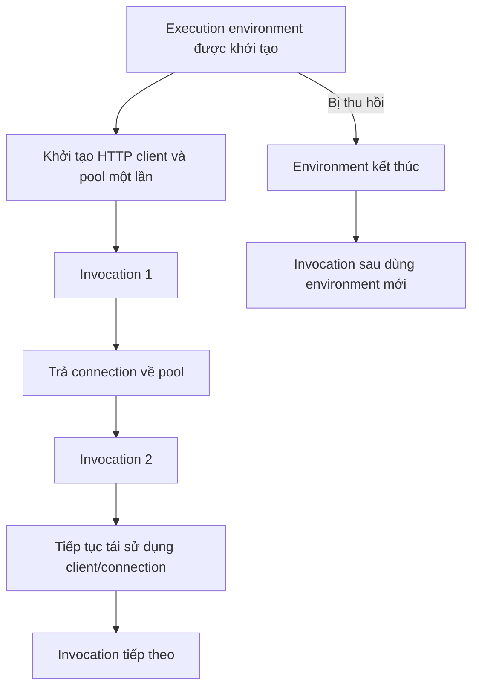

# Tái sử dụng kết nối HTTP và giảm số lượt gọi mạng

Một Java serverless function có thể thực hiện rất ít công việc CPU nhưng vẫn phản hồi chậm vì phải gọi nhiều dịch vụ qua mạng. Mỗi lượt gọi mới có thể phát sinh DNS lookup, TCP handshake, TLS handshake, chờ connection pool, truyền payload và chờ xử lý ở phía đích. Khi function scale lên nhiều execution environment, chi phí thiết lập kết nối lặp lại còn làm tăng tải lên API, database và hệ thống mạng.

Hai hướng tối ưu có tác động trực tiếp là **tái sử dụng HTTP client/kết nối** trong vòng đời execution environment và **giảm số lượt gọi mạng** bằng batching, caching, tránh N+1, gộp thao tác và song song hóa có giới hạn. Những kỹ thuật này phải đi cùng timeout, retry, idempotency và giới hạn concurrency để không biến một cải thiện latency thành sự cố quá tải downstream.

Bài học này trình bày cách quản lý HTTP client trong Java function, connection pooling và keep-alive, HTTP/2, giảm round trip, thiết kế cache/batch, kiểm soát retry và đo hiệu quả trên các nền tảng serverless.

## 1. Vì sao mỗi lượt gọi mạng đều có chi phí?

Một HTTP request không chỉ là thời gian xử lý của endpoint. Trước khi nhận response, client có thể phải thực hiện các bước:

1. Phân giải hostname qua DNS nếu chưa có kết quả phù hợp trong cache.
2. Thiết lập TCP connection nếu chưa có kết nối có thể tái sử dụng.
3. Thực hiện TLS handshake với HTTPS nếu kết nối mới.
4. Chờ connection pool cấp một connection nếu pool đã bận.
5. Gửi request headers/body và chờ server xử lý.
6. Nhận response headers/body, giải mã hoặc deserialize payload.
7. Giữ hoặc trả connection về pool để request tiếp theo có thể dùng lại.

Nếu một function gọi tuần tự bốn API, latency tổng có thể gần bằng tổng thời gian của bốn lần gọi. Nếu mỗi API call mở một connection mới, phần DNS/TCP/TLS lặp lại làm tăng latency và CPU. Nếu các API độc lập, một số call có thể chạy song song; nếu chúng phụ thuộc kết quả của nhau, cần giảm số round trip bằng cách thiết kế API hoặc batch.

### Latency cộng dồn

Giả sử một invocation gọi ba dịch vụ tuần tự:

| Công đoạn | Thời gian ví dụ |
|---|---:|
| DNS + TCP + TLS cho API A | 70 ms |
| API A xử lý và response | 80 ms |
| DNS + TCP + TLS cho API B | 70 ms |
| API B xử lý và response | 100 ms |
| DNS + TCP + TLS cho API C | 70 ms |
| API C xử lý và response | 90 ms |
| **Tổng** | **480 ms** |

Nếu client tái sử dụng kết nối và ba API có thể được gọi song song, tổng thời gian có thể giảm đáng kể. Tuy nhiên, đây chỉ là ví dụ minh họa; latency thực tế còn phụ thuộc network, server, pool, payload và giới hạn downstream.

## 2. Tái sử dụng client trong vòng đời serverless

Nhiều runtime serverless tái sử dụng execution environment cho nhiều invocation. Khi environment còn sống, static field hoặc singleton có thể giữ các client thread-safe để tái sử dụng connection pool, DNS cache, TLS session và cấu hình.

Nguyên tắc:

- Khởi tạo HTTP client và SDK client một lần cho mỗi execution environment, không tạo mới ở mỗi handler invocation.
- Tái sử dụng client, connection manager và cấu hình TLS; tạo request object riêng cho từng thao tác.
- Không lưu user identity, access token theo request, payload hoặc trạng thái nghiệp vụ trong static field.
- Đặt timeout hữu hạn cho việc thiết lập kết nối và chờ response.
- Thiết kế để client vẫn hoạt động khi server đóng idle connection hoặc environment được khởi động lại.
- Không phụ thuộc vào việc shutdown hook chắc chắn được gọi khi nền tảng thu hồi environment.



### Vòng đời ở các nền tảng

| Nền tảng | Cách áp dụng |
|---|---|
| AWS Lambda Java | Đặt client thread-safe ở static field hoặc object được khởi tạo ngoài handler; environment có thể được tái sử dụng nhưng không được bảo đảm tồn tại lâu dài |
| Azure Functions Java | Dùng singleton/client dùng chung trong worker process; kiểm tra concurrency của host và vòng đời worker theo hosting plan |
| Google Cloud Functions / Cloud Run | Tạo client ở cấp instance/process; Cloud Run có thể xử lý nhiều request đồng thời trên một instance tùy concurrency configuration |
| Container serverless khác | Khởi tạo pool theo process/container và tính tổng pool theo max instance/concurrency |

Không coi static field là kho lưu trạng thái bền vững. Runtime có thể tạo nhiều instance, scale in hoặc restart bất kỳ lúc nào. Static client dùng chung là hợp lý; static map lưu dữ liệu người dùng hoặc kết quả nghiệp vụ cần nhất quán là không phù hợp.

## 3. Dùng Java `HttpClient` và tái sử dụng connection

`java.net.http.HttpClient` có từ Java 11. Client được thiết kế để tái sử dụng và có thể được dùng bởi nhiều request; nó quản lý connection và hỗ trợ HTTP/1.1, HTTP/2, đồng bộ và bất đồng bộ. Hãy tạo client một lần thay vì gọi `HttpClient.newHttpClient()` cho mỗi request.

Ví dụ client dùng chung:

```java
import java.net.URI;
import java.net.http.HttpClient;
import java.net.http.HttpRequest;
import java.net.http.HttpResponse;
import java.nio.charset.StandardCharsets;
import java.time.Duration;

public final class PartnerClient {
    private static final HttpClient HTTP = HttpClient.newBuilder()
            .connectTimeout(Duration.ofSeconds(2))
            .version(HttpClient.Version.HTTP_2)
            .followRedirects(HttpClient.Redirect.NEVER)
            .build();

    private final URI baseUri;

    public PartnerClient(URI baseUri) {
        this.baseUri = baseUri;
    }

    public String getOrder(String orderId) throws Exception {
        URI uri = baseUri.resolve("/v1/orders/" + encodePathSegment(orderId));
        HttpRequest request = HttpRequest.newBuilder(uri)
                .timeout(Duration.ofSeconds(3))
                .header("Accept", "application/json")
                .GET()
                .build();

        HttpResponse<String> response = HTTP.send(
                request,
                HttpResponse.BodyHandlers.ofString(StandardCharsets.UTF_8));

        if (response.statusCode() == 404) {
            return null;
        }
        if (response.statusCode() < 200 || response.statusCode() >= 300) {
            throw new PartnerApiException("Partner returned HTTP " + response.statusCode());
        }
        return response.body();
    }

    private static String encodePathSegment(String value) {
        // Dùng URI builder/encoder đã được kiểm thử trong ứng dụng thật.
        return java.net.URLEncoder.encode(value, StandardCharsets.UTF_8)
                .replace("+", "%20");
    }

    public static final class PartnerApiException extends RuntimeException {
        public PartnerApiException(String message) {
            super(message);
        }
    }
}
```

Ví dụ minh họa việc tái sử dụng client và đặt timeout. Trong ứng dụng thật, hãy dùng URI builder phù hợp để mã hóa path/query đúng quy tắc; không nối chuỗi URL từ input chưa kiểm tra. Cần xử lý response body, status code và lỗi theo contract của API. `HttpClient` giữ cấu hình và quản lý kết nối; `HttpRequest` vẫn được tạo riêng cho từng lần gọi.

### Những điều cần nhớ với JDK HttpClient

- Không có API public để đặt `maxConnectionsPerRoute` như một số thư viện pooling khác; nếu cần giới hạn pool cụ thể, cân nhắc Apache HttpClient 5 hoặc client có pool configuration.
- `connectTimeout` giới hạn thời gian thiết lập kết nối; `HttpRequest.timeout` giới hạn thời gian request theo semantics của JDK client.
- `version(HTTP_2)` yêu cầu client ưu tiên HTTP/2; kết quả thương lượng còn phụ thuộc server, TLS/ALPN và proxy.
- Không tự đóng client sau mỗi request. Với Java 21, `HttpClient` có lifecycle shutdown; trong serverless, không dựa vào hook shutdown để bảo đảm tính đúng đắn.
- Connection có thể bị server/proxy đóng khi idle. Client phải xử lý lỗi connection và retry theo chính sách an toàn.

## 4. Connection pooling với Apache HttpClient 5

Khi cần cấu hình rõ số connection tổng, số connection trên mỗi route, thời gian sống connection và eviction, Apache HttpClient 5 cung cấp pooling connection manager.

Maven dependency:

```xml
<dependency>
    <groupId>org.apache.httpcomponents.client5</groupId>
    <artifactId>httpclient5</artifactId>
    <version>${httpclient5.version}</version>
</dependency>
```

Ví dụ cấu hình một pool dùng chung:

```java
import org.apache.hc.client5.http.config.ConnectionConfig;
import org.apache.hc.client5.http.config.RequestConfig;
import org.apache.hc.client5.http.impl.classic.CloseableHttpClient;
import org.apache.hc.client5.http.impl.classic.HttpClients;
import org.apache.hc.client5.http.impl.io.PoolingHttpClientConnectionManager;
import org.apache.hc.client5.http.impl.io.PoolingHttpClientConnectionManagerBuilder;
import org.apache.hc.core5.util.TimeValue;
import org.apache.hc.core5.util.Timeout;

public final class HttpClientsProvider {
    private static final ConnectionConfig CONNECTION_CONFIG = ConnectionConfig.custom()
            .setConnectTimeout(Timeout.ofSeconds(2))
            .setSocketTimeout(Timeout.ofSeconds(3))
            .setValidateAfterInactivity(TimeValue.ofSeconds(5))
            .build();

    private static final PoolingHttpClientConnectionManager CONNECTIONS =
            PoolingHttpClientConnectionManagerBuilder.create()
                    .setMaxConnTotal(40)
                    .setMaxConnPerRoute(10)
                    .setConnectionTimeToLive(TimeValue.ofMinutes(3))
                    .setDefaultConnectionConfig(CONNECTION_CONFIG)
                    .build();

    private static final RequestConfig REQUEST_CONFIG = RequestConfig.custom()
            .setConnectionRequestTimeout(Timeout.ofSeconds(1))
            .setResponseTimeout(Timeout.ofSeconds(3))
            .build();

    private static final CloseableHttpClient CLIENT = HttpClients.custom()
            .setConnectionManager(CONNECTIONS)
            .setDefaultRequestConfig(REQUEST_CONFIG)
            .evictExpiredConnections()
            .evictIdleConnections(TimeValue.ofSeconds(30))
            .build();

    private HttpClientsProvider() {}

    public static CloseableHttpClient get() {
        return CLIENT;
    }
}
```

Các con số chỉ là ví dụ. Chọn pool theo concurrency tối đa của instance, số route đích, giới hạn downstream và thời gian giữ connection. Trong serverless, tổng connection tiềm năng là số instance nhân pool size; một pool 40 connection trên 30 instance có thể tạo ra tới 1.200 connection nếu tất cả đều được sử dụng.

`setConnectionRequestTimeout` giới hạn thời gian chờ lấy connection từ pool; `setResponseTimeout` giới hạn chờ response theo semantics của HttpClient 5. Cần cấu hình thêm timeout phù hợp cho connect/socket và kiểm tra API theo đúng minor version thư viện đang pin. `evictIdleConnections` có thể quản lý việc dọn pool bằng một evictor thread; với serverless, phải kiểm tra lifecycle/đóng client theo khả năng runtime và bảo đảm client không bị tạo lại mỗi invocation. Nếu runtime freeze process giữa invocation, không giả định background evictor luôn chạy đúng lịch; có thể chọn TTL/validate-on-lease hoặc cơ chế cleanup phù hợp hơn.

### Khi nào chọn JDK HttpClient, khi nào chọn Apache?

| Nhu cầu | Lựa chọn gợi ý |
|---|---|
| HTTP call thông thường, muốn ít dependency | JDK HttpClient |
| Muốn HTTP/2 với API có sẵn trong JDK | JDK HttpClient |
| Cần max connection tổng/per route và pool stats rõ | Apache HttpClient 5 |
| Cần tích hợp với thư viện đã dùng Apache client | Tái sử dụng connection manager hiện có |
| Muốn client quản lý bởi framework | Dùng bean/client singleton của framework, kiểm tra pool và timeout thực tế |

Không dùng đồng thời nhiều HTTP client/pool cho cùng một dependency nếu không có lý do. Mỗi pool bổ sung connection, thread, timeout và cấu hình cần vận hành.

## 5. Keep-alive, HTTP/2 và TLS

### HTTP/1.1 keep-alive

HTTP/1.1 thường cho phép nhiều request tuần tự dùng chung một TCP connection khi cả hai phía hỗ trợ persistent connection. Connection được trả về pool sau khi response body được đọc hoặc đóng đúng cách. Nếu ứng dụng bỏ qua/không consume response body, connection có thể không được tái sử dụng và pool dần cạn.

Keep-alive không có nghĩa connection sống mãi. Server, load balancer, proxy hoặc NAT có thể đóng connection sau thời gian idle. Client cần phát hiện connection stale, loại bỏ connection lỗi và tạo connection mới khi cần.

### HTTP/2 multiplexing

HTTP/2 cho phép nhiều stream đồng thời trên cùng một TCP connection. Điều này giảm số connection và tránh một số giới hạn tuần tự của HTTP/1.1. Tuy nhiên:

- Server/proxy phải hỗ trợ HTTP/2 end-to-end hoặc có cơ chế chuyển đổi phù hợp.
- Một TCP connection vẫn có thể bị ảnh hưởng bởi packet loss ở tầng TCP.
- Server có thể giới hạn số stream đồng thời.
- Không phải mọi API gateway hoặc service mesh đều giữ HTTP/2 tới backend.
- Pool/concurrency vẫn cần giới hạn theo tải của server.

Hãy đo negotiated protocol, số connection và số request đồng thời thực tế; không giả định chỉ đặt client HTTP/2 là mọi hop đều dùng HTTP/2.

### TLS session reuse

Connection reuse tránh phải thực hiện handshake TLS mới cho mỗi request. Khi connection buộc phải tạo lại, TLS session resumption có thể giảm chi phí handshake nếu client/server hỗ trợ. Không tắt TLS verification hoặc dùng trust-all certificate để giảm latency. Dùng certificate chain hợp lệ, TLS version/cipher phù hợp và kiểm tra thời gian handshake trong trace.

## 6. Giảm số lượt gọi bằng batching

Nếu một invocation cần lấy 20 bản ghi và gọi API một lần cho mỗi bản ghi, nó tạo 20 round trip. Nếu API hỗ trợ batch, có thể gửi danh sách ID trong một request và nhận nhiều kết quả cùng lúc.

Trước:

```java
for (String orderId : orderIds) {
    Order order = partnerClient.getOrder(orderId);
    results.add(order);
}
```

Sau (khi API có batch endpoint):

```java
List<Order> orders = partnerClient.getOrders(orderIds);
results.addAll(orders);
```

Batch giảm round trip nhưng cần kiểm soát kích thước payload, timeout và lỗi từng phần. Nếu một record lỗi, API nên trả kết quả per-item hoặc có contract cho phép retry riêng. Không để một batch quá lớn vượt giới hạn request body, memory hoặc thời gian xử lý.

### Batch cho queue worker

Queue trigger thường giao nhiều message trong một invocation. Xử lý batch giúp giảm invocation overhead và có thể gom thao tác database/API. Tuy nhiên, batch size quá lớn có thể:

- Tăng memory và thời gian xử lý một invocation.
- Làm nhiều record bị retry khi một record lỗi nếu không hỗ trợ partial batch response.
- Tăng số side effect cần idempotency.
- Tạo burst lớn tới downstream khi nhiều batch chạy song song.

Chọn batch size theo thời gian xử lý, memory, concurrency và giới hạn downstream. Với AWS Lambda + SQS, cân nhắc `ReportBatchItemFailures` để chỉ retry record lỗi khi handler và event source mapping được cấu hình tương ứng.

### Bulk database operations

Thay vì chạy một `INSERT`/`UPDATE` cho từng record qua nhiều round trip, dùng JDBC batch hoặc bulk API nếu database hỗ trợ. Chú ý transaction size, lock duration, parameter limit và khả năng rollback. Batch không nên vượt quá mức làm tăng contention hoặc giữ transaction quá lâu.

## 7. Tránh N+1 và gọi tuần tự không cần thiết

N+1 xảy ra khi một query lấy danh sách N đối tượng rồi code gọi thêm một query/API cho từng đối tượng. Ví dụ tải 50 đơn hàng rồi gọi service khách hàng 50 lần để lấy tên. Giải pháp thường là:

- Dùng endpoint batch theo danh sách customer ID.
- Join hoặc projection trong một truy vấn database nếu phù hợp.
- Prefetch dữ liệu dùng chung.
- Cache dữ liệu tham chiếu có thể tái sử dụng.
- Thiết kế response tổng hợp từ backend thay vì bắt client gọi nhiều endpoint.

Không gom mọi thứ vào một endpoint quá lớn nếu làm tăng coupling hoặc trả nhiều dữ liệu không cần thiết. Thiết kế batch cần giữ authorization theo từng resource; caller không được phép đọc một record chỉ vì ID của nó xuất hiện trong batch hợp lệ khác.

### Song song hóa các call độc lập

Nếu nhiều API call độc lập, có thể chạy song song để giảm wall-clock latency. Nhưng cần giới hạn số call đồng thời, không dùng `parallelStream()` hoặc unbounded executor một cách tùy tiện trong serverless.

Ví dụ dùng `CompletableFuture` với executor giới hạn:

```java
import java.util.List;
import java.util.concurrent.ArrayBlockingQueue;
import java.util.concurrent.CompletableFuture;
import java.util.concurrent.ExecutorService;
import java.util.concurrent.ThreadPoolExecutor;
import java.util.concurrent.TimeUnit;

public final class AggregationService {
    private static final ExecutorService IO_EXECUTOR =
            new ThreadPoolExecutor(
                    8,
                    8,
                    0L,
                    TimeUnit.MILLISECONDS,
                    new ArrayBlockingQueue<>(32),
                    new ThreadPoolExecutor.AbortPolicy());

    private final CatalogClient catalog;
    private final InventoryClient inventory;
    private final PricingClient pricing;

    public AggregationService(
            CatalogClient catalog,
            InventoryClient inventory,
            PricingClient pricing) {
        this.catalog = catalog;
        this.inventory = inventory;
        this.pricing = pricing;
    }

    public ProductView getProduct(String productId) {
        CompletableFuture<Product> product = CompletableFuture.supplyAsync(
                () -> catalog.get(productId), IO_EXECUTOR);
        CompletableFuture<Stock> stock = CompletableFuture.supplyAsync(
                () -> inventory.get(productId), IO_EXECUTOR);
        CompletableFuture<Price> price = CompletableFuture.supplyAsync(
                () -> pricing.get(productId), IO_EXECUTOR);

        CompletableFuture.allOf(product, stock, price)
                .orTimeout(2500, TimeUnit.MILLISECONDS)
                .join();

        return new ProductView(product.join(), stock.join(), price.join());
    }
}
```

Các client trong ví dụ phải có timeout riêng và xử lý lỗi phù hợp. `orTimeout` giới hạn thời gian chờ tổng nhưng không bảo đảm hủy network call ở client; cần dùng cancellation/timeout của HTTP client và xử lý future bị hủy đúng cách. Executor có 8 thread và queue chờ tối đa 32 task trên mỗi execution environment; khi quá tải, `AbortPolicy` từ chối task thay vì giữ một queue vô hạn. Cần tính tổng thread/concurrency khi nền tảng scale nhiều instance. Trong Java 21 có thể cân nhắc virtual threads cho I/O blocking, nhưng vẫn phải giới hạn số call đồng thời tới downstream; virtual thread không làm tăng quota của API.

Không chạy song song các thao tác phụ thuộc dữ liệu hoặc có side effect không an toàn. Nếu một call thất bại sau khi hai call khác đã ghi dữ liệu, cần thiết kế compensation hoặc idempotency.

## 8. Caching để tránh gọi mạng lặp lại

Cache phù hợp với dữ liệu có thể tái sử dụng trong một khoảng thời gian và có chính sách stale/invalidation rõ ràng. Ví dụ danh mục sản phẩm, cấu hình công khai, metadata vùng hoặc tỷ giá được phép cache trong TTL ngắn.

Các tầng cache:

| Tầng | Phạm vi | Ví dụ |
|---|---|---|
| In-memory per environment | Một JVM/container; mất khi environment bị thu hồi | Cache nhỏ cho metadata, cấu hình không nhạy cảm |
| Shared cache | Nhiều instance cùng truy cập | Redis/Memorystore/ElastiCache |
| HTTP cache | Theo semantics HTTP | `Cache-Control`, `ETag`, `If-None-Match`, `Last-Modified` |
| Data/service cache | Cache được quản lý bởi database/API | Read replica, materialized view hoặc cache layer của service |

### In-memory cache không phải cache toàn hệ thống

Static cache trong Lambda hoặc function chỉ tồn tại trong một execution environment. Nếu có 20 environment, có thể có 20 bản cache khác nhau với thời điểm refresh khác nhau. Không dùng in-memory cache làm nguồn dữ liệu chuẩn hoặc cơ chế đồng bộ trạng thái giữa các instance.

### TTL, invalidation và stale data

Trước khi cache, hãy xác định:

- Dữ liệu có được phép stale không và tối đa bao lâu?
- TTL theo business requirement là bao nhiêu?
- Khi dữ liệu thay đổi, cache được invalidation bằng event, version hay chờ TTL?
- Cache key có chứa tenant/authorization scope để tránh rò dữ liệu chéo không?
- Cache có lưu PII/secret không; nếu có thì mã hóa, phân quyền và retention ra sao?

Không cache response đã được lọc theo quyền người dùng nếu cache key không bao gồm scope/quyền tương ứng. Một lỗi cache key có thể làm lộ dữ liệu tenant A cho tenant B.

### Tránh cache stampede

Khi một key hết hạn, nhiều invocation có thể cùng gọi downstream để refresh. Có thể dùng single-flight per instance, refresh-ahead, jitter TTL hoặc distributed lock phù hợp. Với serverless scale-out, lock cục bộ không ngăn instance khác cùng refresh; cần cơ chế chia sẻ nếu stampede có tác động lớn.

Không cache vô thời hạn chỉ để giảm request. Cache cần giới hạn memory, TTL, invalidation và telemetry hit/miss.

## 9. Giảm round trip bằng API và dữ liệu phù hợp

Một số tối ưu cần thay đổi API contract hoặc cách truy cập dữ liệu:

- **Batch endpoint:** nhận nhiều ID hoặc thao tác trong một request.
- **Projection:** chỉ trả field cần thiết, giảm payload và deserialize.
- **Pagination/cursor:** tránh tải toàn bộ collection lớn trong một request.
- **Conditional request:** dùng ETag/version để không tải lại dữ liệu chưa đổi.
- **Aggregation service:** backend tổng hợp nhiều nguồn dữ liệu khi có lợi về latency và authorization.
- **Event-driven update:** thay vì polling trạng thái liên tục, dùng callback/event khi nghiệp vụ cho phép.
- **Coalescing:** gộp các request giống nhau đang chờ để chỉ thực hiện một lần đọc downstream.
- **Data locality:** đặt function gần database/API theo region và network topology phù hợp.

### Polling hay callback/event?

Nếu client hỏi trạng thái công việc mỗi giây, 100 client có thể tạo hàng trăm request chỉ để nhận câu trả lời “chưa xong”. Có thể tăng polling interval, dùng exponential backoff, long polling hoặc callback/webhook/event khi phù hợp. Với serverless, event-driven completion thường giảm số lượt gọi và chi phí nhưng cần quản lý delivery, retry và idempotency.

### Nén payload

Gzip hoặc một định dạng nén phù hợp có thể giảm số byte truyền qua mạng. Đánh đổi là CPU để nén/giải nén, latency và memory buffer. Nén hữu ích với payload lớn, lặp nhiều text; ít hữu ích với payload nhỏ hoặc dữ liệu đã nén như JPEG/ZIP. Đo end-to-end thay vì giả định nén luôn nhanh hơn.

## 10. Timeout, retry và connection lifecycle

Tái sử dụng connection không loại bỏ lỗi mạng. Server có thể đóng connection idle, DNS có thể thay đổi, proxy có thể reset socket và dependency có thể chậm. Client cần timeout hữu hạn ở nhiều lớp.

Các timeout nên được phân biệt:

| Timeout | Giới hạn |
|---|---|
| Connection pool acquisition | Thời gian chờ lấy connection từ pool |
| DNS/connect | Thời gian phân giải tên và thiết lập kết nối |
| TLS handshake | Thời gian hoàn thành bắt tay bảo mật, nếu client cho phép cấu hình riêng |
| Response/read | Thời gian chờ response hoặc dữ liệu |
| Overall request/deadline | Tổng thời gian dành cho thao tác trong invocation |

Đặt deadline tổng nhỏ hơn timeout invocation còn lại, để function có thời gian ghi log, đóng tài nguyên và trả kết quả. Timeout không nên quá dài khiến thread/connection bị chiếm dụng khi dependency đã quá tải.

### Retry phải có điều kiện

Retry có thể hữu ích khi gặp lỗi tạm thời, nhưng mỗi retry là thêm một lượt gọi mạng. Trong lúc dependency đang suy giảm, retry đồng loạt có thể tạo retry storm.

- Chỉ retry lỗi tạm thời như connection reset, timeout hoặc 5xx theo policy.
- Tôn trọng `Retry-After` khi nhận 429/503 nếu API cung cấp.
- Dùng exponential backoff có jitter.
- Giới hạn số lần retry và tổng retry budget.
- Không retry validation error hoặc lỗi quyền 401/403 một cách mù quáng.
- Chỉ retry thao tác có semantics idempotent hoặc có idempotency key được server hỗ trợ.
- Không lồng nhiều tầng retry mà không tính tổng số attempt.

Ví dụ, một POST tạo thanh toán bị timeout sau khi server đã ghi nhận giao dịch. Gửi lại POST có thể tạo giao dịch thứ hai. Client cần gửi idempotency key ổn định cho cùng business operation và server phải lưu kết quả tương ứng.

### Connection idle timeout và stale connection

Load balancer, NAT, proxy hoặc server có thể đóng connection sau một khoảng idle. Pool có thể vẫn nghĩ connection còn khả dụng cho tới lần gửi tiếp theo. Cần cấu hình connection TTL/idle eviction phù hợp với hạ tầng, validate stale connection theo thư viện và xử lý lỗi connection bị đóng bằng retry an toàn.

Đừng đặt TTL dài hơn vô hạn hoặc tắt kiểm tra certificate để giữ connection. Khi đổi endpoint/DNS hoặc rotate certificate, cần cho phép connection cũ được thay thế.

## 11. Quản lý connection và concurrency trong serverless

Một connection pool tồn tại trong từng instance. Tổng số connection có thể tăng theo số instance được scale.

Ước lượng sơ bộ:

\[
Connections_{total} \approx Instances_{max} \times PoolSize_{per\ instance}
\]

Ví dụ 25 instance, mỗi instance có pool tối đa 8 connection:

\[
25 \times 8 = 200\ connections
\]

Nếu API đối tác chỉ chấp nhận 100 connection hoặc database chỉ dành 120 connection cho ứng dụng, cấu hình pool có thể vượt ngân sách. Hãy tính cả service khác, admin connection và headroom.

### Cấu hình theo năng lực downstream

Các hàng rào thường dùng:

- Giới hạn concurrency của function hoặc max instance.
- Giới hạn pool tổng và pool per route.
- Giới hạn số request song song trong một invocation.
- Dùng queue để điều tiết tốc độ consumer.
- Dùng rate limiter nếu dependency giới hạn request/giây.
- Dùng circuit breaker để tránh tiếp tục gọi dependency đang lỗi.
- Đặt timeout chờ pool và timeout HTTP hữu hạn.

Semaphore static trong JVM chỉ giới hạn một instance. Nó không phải global rate limiter khi serverless scale nhiều instance. Nếu cần giới hạn toàn hệ thống, dùng platform cap, queue dispatch rate hoặc distributed limiter phù hợp.

### Không tạo connection pool quá lớn cho function ngắn

Pool có 50 connection trong một function chỉ xử lý một request tại một thời điểm thường lãng phí. Pool lớn cũng có thể tạo burst connection ngay khi nhiều environment cold start. Chọn pool theo số request đồng thời thực sự trong một instance và thời gian giữ connection.

## 12. Giảm số lượt gọi tới dịch vụ cloud SDK

Không chỉ HTTP client tự viết mới cần tái sử dụng. AWS SDK, Azure SDK và Google Cloud client libraries thường có connection pool, credential provider, retry policy và metadata cache riêng.

Nguyên tắc:

- Tạo service client một lần cho mỗi execution environment nếu thư viện khuyến nghị client thread-safe.
- Không tạo client mới trong mỗi invocation hoặc mỗi message.
- Dùng connection pool/transport mặc định đã được cấu hình phù hợp, tránh tạo nhiều transport trùng.
- Tái sử dụng credential provider và cấu hình endpoint/region.
- Đặt API call timeout và retry policy phù hợp với invocation deadline.
- Dùng batch API như `BatchGetItem`, `SendMessageBatch` hoặc bulk operations khi semantics cho phép.
- Tránh gọi API metadata/secret lặp lại trong mỗi request nếu có cơ chế cache an toàn.

Không cache credential hoặc token lâu hơn vòng đời được phép. Credential provider của SDK thường tự refresh; ưu tiên provider chính thức thay vì tự lưu access key trong static field.

### Ví dụ khởi tạo AWS SDK client một lần

```java
import software.amazon.awssdk.regions.Region;
import software.amazon.awssdk.services.s3.S3Client;

public final class StorageClients {
    private static final S3Client S3 = S3Client.builder()
            .region(Region.of(System.getenv("AWS_REGION")))
            .build();

    private StorageClients() {}

    public static S3Client s3() {
        return S3;
    }
}
```

SDK client dùng credential provider chain của runtime và được tái sử dụng trong environment. Không gọi `close()` sau mỗi invocation. Nếu cần đổi region/endpoint, tạo client theo cấu hình cố định của environment hoặc quản lý rõ lifecycle; không tạo một client cho mỗi record.

## 13. Đặt function gần dependency và giảm network egress

Round trip không chỉ phụ thuộc số request mà còn phụ thuộc khoảng cách mạng. Một function ở region A gọi database ở region B có thể chịu latency, chi phí egress và rủi ro network khác với khi cả hai cùng region.

Kiểm tra:

- Function và dependency có ở cùng region hoặc vùng latency phù hợp không?
- Có NAT gateway, proxy, firewall hoặc service mesh thêm hop không?
- DNS lookup có đi qua resolver xa hoặc private zone không?
- Có private endpoint/service endpoint để tránh public internet không?
- TLS termination xảy ra ở gateway hay backend?
- Có cross-region data transfer hoặc egress charge không?

Không chuyển database sang cùng region chỉ để giảm latency nếu điều đó vi phạm data residency, disaster recovery hoặc yêu cầu sẵn sàng. Chọn topology dựa trên cả latency, độ tin cậy, chi phí và chính sách dữ liệu.

### Serverless VPC và NAT

Khi function gắn vào VPC/VNet, outbound traffic có thể đi qua NAT hoặc private endpoint. NAT connection/port exhaustion, DNS và route có thể trở thành bottleneck khi scale-out. Nếu service hỗ trợ private endpoint, cân nhắc dùng đường private để giảm phụ thuộc public egress; vẫn cần kiểm soát security group/network policy và DNS.

## 14. Đo hiệu quả tái sử dụng và giảm round trip

Không kết luận tối ưu chỉ dựa trên số connection giảm. Cần đo cả latency, throughput, lỗi và tải downstream.

Các chỉ số hữu ích:

| Chỉ số | Ý nghĩa |
|---|---|
| Requests per invocation | Số request mạng được tạo trong một lần chạy function |
| Connections opened/reused | Số connection mới và tỷ lệ tái sử dụng nếu client/backend cung cấp |
| Pool leased/available/pending | Số connection đang dùng, còn trống và số request chờ pool |
| DNS/connect/TLS duration | Thời gian thiết lập đường mạng |
| Time to first byte / response duration | Thời gian từ khi gửi tới byte response đầu tiên và hoàn tất |
| p50/p95/p99 latency | Phân phối latency, đặc biệt tail latency |
| Retry count | Số lần gọi lại do lỗi/timeout/throttling |
| Payload bytes | Dữ liệu truyền theo request/response |
| Downstream RPS/concurrency | Áp lực thực tế lên API/database |
| Error/timeout/429 | Chất lượng và giới hạn dịch vụ |

### So sánh trước và sau

Giữ cùng workload, payload, region, artifact và cấu hình downstream. So sánh:

1. Client mới cho mỗi invocation với client singleton.
2. HTTP/1.1 với HTTP/2 nếu server hỗ trợ.
3. N request riêng lẻ với batch endpoint.
4. Gọi tuần tự với parallelism có giới hạn.
5. Không cache với cache TTL hợp lệ.

Đo p50/p95/p99, số connection mới, RPS, error rate, CPU/memory và chi phí. Kiểm tra cả warm invocation lẫn cold start; static client có thể cải thiện warm path nhưng vẫn cần tính startup cost của environment mới.

### Trace để tìm round trip thừa

Một trace có nhiều span HTTP lặp cùng host hoặc nhiều span database tương tự có thể chỉ ra N+1 hoặc gọi API dư. Xem duration và parent-child relationship để biết call nào tuần tự, call nào song song. Dùng attribute ổn định như `http.route`, `server.address` và operation name; tránh đưa URL có ID người dùng vào metric label.

## 15. Kiểm thử và xác minh tối ưu

Một ma trận test có thể gồm:

| Thử nghiệm | Cách thực hiện | Kết quả cần quan sát |
|---|---|---|
| Client reuse | Gửi nhiều invocation trên cùng environment | Số connection mới giảm; latency warm ổn định |
| Cold environment | Tạo environment mới hoặc scale-from-zero | Đo init + kết nối đầu tiên riêng biệt |
| Idle connection | Chờ lâu hơn idle timeout của proxy/server rồi gọi lại | Client xử lý stale connection và phục hồi an toàn |
| Pool exhaustion | Giảm max pool hoặc tăng concurrency trong sandbox | Pool wait có timeout, không treo vô hạn |
| HTTP/2 | Xác minh negotiated protocol và concurrent streams | Giảm connection nếu server hỗ trợ; không tăng lỗi |
| Batch | Gọi N request riêng và một batch tương đương | Round trip giảm, partial errors được xử lý đúng |
| Cache | Lặp request trong TTL và sau invalidation | Hit rate tăng, stale data nằm trong giới hạn |
| Retry/429 | Mock downstream trả 429/503/timeout | Backoff/jitter, idempotency và retry budget đúng |
| Scale-out | Tăng số instance đồng thời | Tổng connection không vượt downstream budget |

Chạy test ở môi trường có quota và dependency được cấp riêng. Không dùng load test để gây áp lực lên API đối tác hoặc production database nếu chưa có phê duyệt.

## 16. Các lỗi thường gặp

| Lỗi | Hệ quả | Cách khắc phục |
|---|---|---|
| Tạo `HttpClient`/SDK client trong mỗi invocation | Lặp DNS/TCP/TLS và tạo nhiều pool | Tái sử dụng client thread-safe ở cấp environment |
| Tạo một client cho từng record trong batch | Tăng connection và overhead | Dùng một client chung, request riêng |
| Pool quá lớn trên mỗi instance | Scale-out tạo quá nhiều connection | Tính pool theo max instances và downstream budget |
| Không consume/close response body | Connection không được trả về pool | Đọc hoặc đóng response body đúng cách |
| Giữ connection vô hạn | Gặp stale connection sau idle timeout | TTL, idle eviction và retry an toàn |
| Đặt timeout vô hạn | Thread và connection bị giữ khi dependency treo | Timeout pool/connect/request/deadline hữu hạn |
| Retry mọi POST sau timeout | Tạo side effect trùng | Idempotency key và retry policy theo semantics |
| Parallelize không giới hạn | Gây burst và quá tải downstream | Bounded executor, semaphore, queue/rate limit |
| Cache theo user nhưng thiếu tenant/scope | Rò dữ liệu chéo người dùng | Cache key chứa security scope và invalidation rõ |
| Dùng static cache như nguồn dữ liệu chuẩn | Các instance có giá trị khác nhau | Shared cache/database cho trạng thái dùng chung |
| Batching quá lớn | Payload/memory/timeout tăng, retry phạm vi lớn | Chọn batch size và xử lý lỗi per-item |
| Dùng HTTP/2 nhưng không kiểm tra server | Không có multiplexing như kỳ vọng | Đo protocol thực tế và giới hạn stream |
| Chỉ đo average latency | Bỏ sót p95/p99 và cold start | Đo phân phối latency và tách cold/warm |

## 17. Quy trình tối ưu cho Java serverless

1. **Đo baseline.** Ghi p50/p95/p99, số request mỗi invocation, connect/TLS time, payload và dependency latency.
2. **Kiểm tra client lifecycle.** Xác nhận HTTP/SDK client có được tạo lại mỗi invocation hay không.
3. **Tái sử dụng client.** Chuyển client thread-safe sang singleton/environment scope; request và state nghiệp vụ vẫn riêng từng invocation.
4. **Đặt timeout.** Giới hạn pool acquisition, connect, response và overall deadline.
5. **Tính pool budget.** Nhân pool per instance với max instances/concurrency và trừ headroom dependency.
6. **Tìm round trip thừa.** Dùng trace phát hiện N+1, call tuần tự và polling dư.
7. **Gộp thao tác.** Dùng batch, bulk API, projection hoặc aggregation khi semantics cho phép.
8. **Song song hóa có giới hạn.** Chỉ chạy call độc lập, dùng executor/rate limit phù hợp.
9. **Cache dữ liệu hợp lệ.** Chọn TTL, invalidation, tenant scope và chống stampede.
10. **Kiểm soát retry.** Exponential backoff, jitter, idempotency và tổng retry budget.
11. **Đo lại.** Chạy cùng workload, so sánh latency, connection, errors, downstream load và chi phí.
12. **Triển khai theo giai đoạn.** Theo dõi sau deploy, có thể rollback nếu pool exhaustion, stale data hoặc error rate tăng.

## 18. Checklist trước production

- [ ] HTTP client và SDK client thread-safe được tái sử dụng trong execution environment.
- [ ] Không lưu request/user-specific state trong static field.
- [ ] Connection pool có max total/per route phù hợp hoặc giới hạn tương đương.
- [ ] Tổng connection khi scale-out nằm trong budget của downstream.
- [ ] Connect, pool wait, response và overall timeout đều hữu hạn.
- [ ] Keep-alive/idle timeout tương thích với server, proxy, load balancer và NAT.
- [ ] HTTP/2 được xác minh ở các hop thực tế nếu kỳ vọng multiplexing.
- [ ] Response body được consume/close để trả connection về pool.
- [ ] Có batching/bulk API để giảm N+1 và round trip không cần thiết.
- [ ] Parallelism có giới hạn và không vượt rate/concurrency quota.
- [ ] Cache có TTL, invalidation, tenant scope và giới hạn memory.
- [ ] Retry có backoff/jitter, budget và idempotency phù hợp.
- [ ] Telemetry đo connection, pool wait, latency, retry, payload và downstream load.
- [ ] Cold start và warm reuse được đo riêng.
- [ ] Load test chứng minh cải thiện mà không làm tăng lỗi hoặc quá tải dependency.

## Kết luận

Tái sử dụng HTTP/SDK client trong execution environment giúp tránh lặp việc tạo connection và giữ lại pool/TLS state khi runtime cho phép. Giảm round trip bằng batch, tránh N+1, cache có TTL, projection và song song hóa có giới hạn giúp giảm latency và số request downstream. Trong serverless, cần tính tổng connection theo số instance, đặt timeout hữu hạn, xử lý stale connection và retry an toàn. Hãy đo cả p95/p99, pool wait, connection reuse, request count và tải dependency trước/sau tối ưu; một cải thiện chỉ có giá trị khi latency giảm mà hệ thống vẫn giữ được giới hạn và tính đúng đắn nghiệp vụ.
