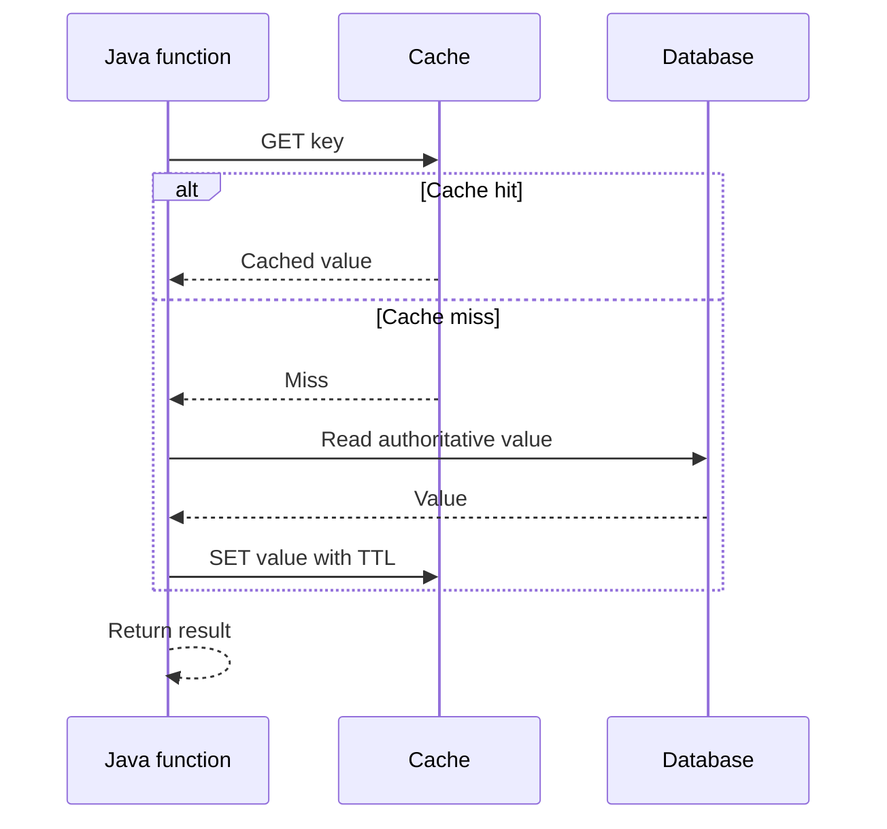
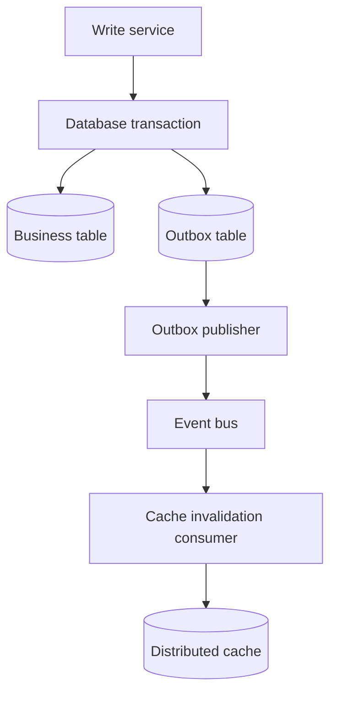
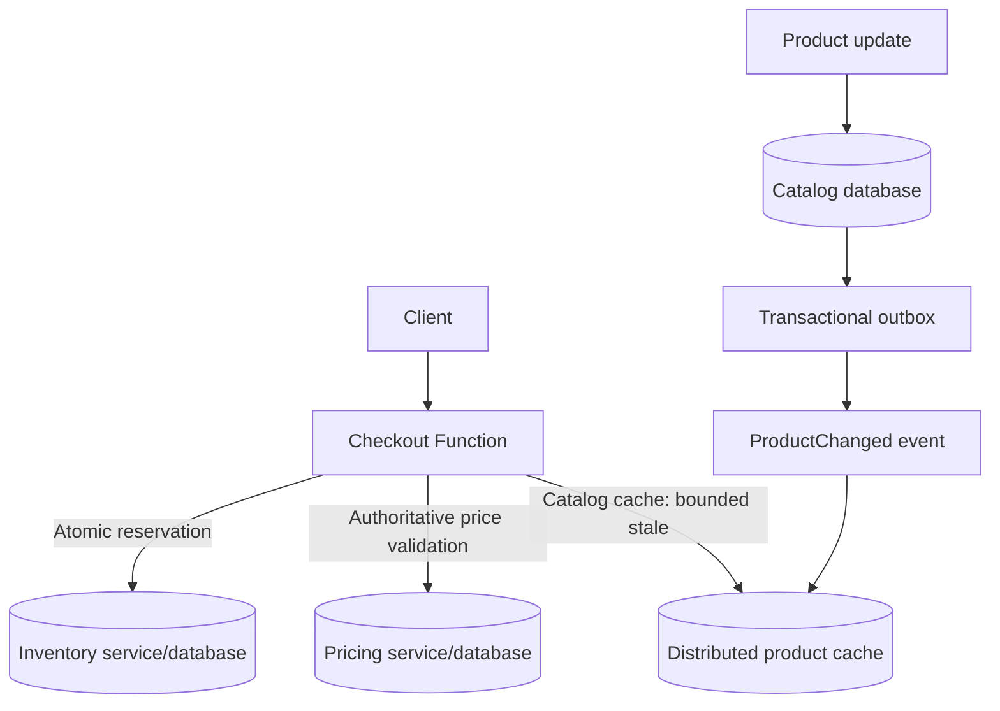

# Áp dụng cache theo nhu cầu nhất quán của nghiệp vụ

Cache có thể giảm độ trễ, số lần truy vấn database và chi phí gọi dịch vụ bên ngoài. Nhưng cache cũng có thể trả về dữ liệu cũ, giữ quyền truy cập đã bị thu hồi hoặc làm hai function nhìn thấy hai trạng thái khác nhau. Vì vậy, câu hỏi đầu tiên khi thiết kế cache không phải là “TTL nên đặt bao lâu?”, mà là **nghiệp vụ cho phép dữ liệu cũ đến mức nào và trong bao lâu?**

Một danh mục sản phẩm có thể chấp nhận chậm cập nhật vài chục giây. Số dư tài khoản, trạng thái thanh toán, quyền truy cập và tồn kho dùng để xác nhận đơn hàng thường cần đọc từ nguồn có thẩm quyền hoặc dùng cơ chế nhất quán mạnh hơn. Cache chỉ nên được áp dụng sau khi xác định được hợp đồng freshness/consistency của từng loại dữ liệu.

## 1. Bắt đầu từ yêu cầu nhất quán của nghiệp vụ

Cache lưu một bản sao hoặc kết quả tính toán để lần đọc sau nhanh hơn. Bản sao đó có thể không phản ánh ngay thay đổi mới nhất ở nguồn dữ liệu chính. Mức chấp nhận được phụ thuộc vào hậu quả nghiệp vụ nếu một request đọc phải dữ liệu cũ.

| Nhu cầu nghiệp vụ | Ví dụ | Chiến lược phù hợp |
|---|---|---|
| Phải thấy trạng thái mới nhất tại thời điểm quyết định | Số dư để cho phép chuyển tiền, quyền truy cập vừa bị thu hồi, trạng thái thanh toán | Đọc nguồn có thẩm quyền; chỉ cache phần không quyết định quyền hoặc dùng version/conditional validation chặt chẽ |
| Read-your-writes | Người dùng vừa cập nhật hồ sơ phải thấy giá trị mới ngay | Trả lại giá trị vừa ghi, cập nhật cache đồng bộ hoặc bypass cache trong luồng đọc sau ghi |
| Chấp nhận stale trong một giới hạn xác định | Tên/ảnh/mô tả sản phẩm, nội dung CMS | TTL theo giới hạn stale, invalidation khi có event và refresh nền |
| Dữ liệu gần như bất biến | Mã quốc gia, bảng thuế theo phiên bản, cấu hình công khai theo release | Cache lâu hoặc cache vô thời hạn theo version; thay version khi dữ liệu đổi |
| Kết quả tổng hợp tốn kém | Báo cáo, số liệu dashboard, kết quả tìm kiếm | Cache theo key và khoảng thời gian; hiển thị thời điểm dữ liệu được tổng hợp |
| Chấp nhận kết quả gần đúng | Gợi ý, xếp hạng, số liệu analytics không dùng để quyết định giao dịch | Cache với freshness rõ ràng và cơ chế cập nhật bất đồng bộ |

### 1.1. Phân biệt freshness và consistency

**Freshness** mô tả dữ liệu trong cache mới đến mức nào so với nguồn. **Consistency** mô tả những gì các lần đọc được phép quan sát sau một chuỗi cập nhật.

Một TTL 30 giây không tự tạo ra strong consistency. Nó chỉ giới hạn thời gian lưu một entry theo chính sách hết hạn; trong thực tế, dữ liệu có thể cũ thêm do event invalidation bị trễ, refresh thất bại, cache replica lag hoặc một race giữa đọc và ghi. Nếu yêu cầu là “sau khi cập nhật thành công, mọi lần đọc tiếp theo phải thấy giá trị mới”, cần thiết kế read-your-writes và invalidation đồng bộ hoặc bỏ cache khỏi đường đọc đó.

Hãy viết yêu cầu thành câu có thể kiểm chứng, ví dụ:

- “Tên hiển thị có thể cũ tối đa 60 giây.”
- “Sau khi cập nhật email thành công, người dùng phải thấy email mới ngay trong session hiện tại.”
- “Quyền bị thu hồi phải có hiệu lực ngay ở lần kiểm tra tiếp theo.”
- “Tồn kho hiển thị có thể gần đúng, nhưng thao tác giữ hàng phải xác nhận với nguồn dữ liệu có thẩm quyền.”

Khi chưa xác định được giới hạn stale và hậu quả nghiệp vụ, chưa nên đặt cache vào đường quyết định đó.

## 2. Chọn đúng lớp cache trong serverless

Các lớp cache có phạm vi chia sẻ và vòng đời khác nhau. Với FaaS, khác biệt này đặc biệt quan trọng vì function có thể scale-out thành nhiều execution environment, scale-in hoặc bị khởi động lại bất cứ lúc nào.

| Lớp cache | Phạm vi | Ưu điểm | Giới hạn |
|---|---|---|---|
| Request-local | Một invocation/request | Không chia sẻ trạng thái giữa request; dễ kiểm soát | Không tái sử dụng giữa invocation |
| In-memory theo process/environment | Một Java worker hoặc execution environment | Rất nhanh, không cần network | Không chia sẻ giữa instance; có thể mất bất kỳ lúc nào; dữ liệu có thể lệch giữa instance |
| Distributed cache | Nhiều function/instance cùng truy cập | Dùng chung, có TTL/atomic operation tùy dịch vụ | Có network latency, chi phí, quota và failure mode riêng |
| Database/materialized view | Nhiều service theo quyền database | Có thể là nguồn dữ liệu bền vững và có consistency semantics rõ | Không nên nhầm database với cache; cần quản lý tải và transaction |
| CDN/API edge cache | Client/region/edge theo HTTP cache policy | Giảm latency và tải origin trên dữ liệu public | Cần kiểm soát `Cache-Control`, `Vary`, authorization và invalidation |

### 2.1. In-memory cache trong Java function

Một static cache hoặc singleton có thể tồn tại qua nhiều invocation khi cùng execution environment được tái sử dụng. Đây là tối ưu best-effort, không phải storage bền vững. Khi platform tạo instance mới, cache rỗng; khi instance bị thu hồi, cache mất. Nếu có 20 instance, có thể có 20 bản cache khác nhau.

In-memory cache phù hợp cho dữ liệu tham chiếu ít thay đổi, metadata có thể tải lại, hoặc kết quả tính toán không nhạy cảm với độ mới. Nó không phù hợp để lưu session, distributed lock, idempotency record có tính quyết định, số dư hoặc trạng thái nghiệp vụ duy nhất.

Ví dụ dùng Caffeine với giới hạn kích thước và TTL:

```java
import com.github.benmanes.caffeine.cache.Cache;
import com.github.benmanes.caffeine.cache.Caffeine;
import java.time.Duration;

public final class ProductLookup {
    private final ProductRepository repository;
    private final Cache<String, ProductView> cache = Caffeine.newBuilder()
            .maximumSize(10_000)
            .expireAfterWrite(Duration.ofSeconds(30))
            .recordStats()
            .build();

    public ProductLookup(ProductRepository repository) {
        this.repository = repository;
    }

    public ProductView find(String tenantId, String productId) {
        String key = tenantId + ":product:v1:" + productId;
        return cache.get(key, ignored -> repository.findView(tenantId, productId)
                .orElseThrow(() -> new ProductNotFoundException(productId)));
    }
}
```

Ví dụ cần dependency Caffeine và các kiểu `ProductRepository`, `ProductView`, `ProductNotFoundException` do ứng dụng định nghĩa. Cache có giới hạn số entry để tránh tăng bộ nhớ vô hạn. `expireAfterWrite` đặt TTL từ lúc ghi; nó không tự nhận biết database đã thay đổi. Khi cập nhật sản phẩm, ứng dụng cần invalidate entry hoặc chấp nhận stale trong giới hạn đã định.

Trong Lambda/Azure Functions, tạo cache một lần ở phạm vi object/static hoặc singleton DI để có thể tái sử dụng trong cùng process. Không tạo cache mới bên trong mỗi lần handler chạy. Đồng thời không dựa vào cache local để bảo đảm tính đúng giữa nhiều instance.

### 2.2. Distributed cache

Redis hoặc dịch vụ cache phân tán phù hợp khi nhiều function cần nhìn thấy cùng một entry, hoặc khi cache local không thể đáp ứng yêu cầu chia sẻ. Distributed cache có network hop, nên phải đo latency và connection behavior. Nó vẫn là cache: entry có thể hết hạn, bị eviction, bị flush hoặc mất khi có sự cố tùy cấu hình dịch vụ.

Dùng distributed cache khi lợi ích của việc chia sẻ và giảm tải nguồn lớn hơn chi phí network, vận hành và đồng bộ. Không chuyển mọi lần đọc sang Redis một cách máy móc; với dữ liệu nhỏ, đọc nhanh từ database đã có connection pool có thể rẻ và đơn giản hơn.

### 2.3. CDN và HTTP cache

CDN/HTTP cache phù hợp với nội dung public hoặc response có thể cache an toàn theo URL/header. Ví dụ ảnh sản phẩm, JavaScript bundle hoặc trang danh mục public. Với response chứa dữ liệu cá nhân hoặc phụ thuộc identity, phải dùng `Cache-Control: private`/`no-store` hoặc cấu hình cache key đầy đủ theo authorization context; không để proxy dùng chung response của hai người dùng.

Header `Vary` và cache key cần phản ánh mọi yếu tố làm thay đổi response, ví dụ locale, content encoding hoặc phiên bản API. Không cache response authenticated chỉ vì URL giống nhau.

## 3. Chọn cache pattern theo luồng đọc/ghi

### 3.1. Cache-aside (lazy loading)

Ứng dụng tự kiểm tra cache trước. Nếu miss, đọc nguồn chính, sau đó ghi kết quả vào cache. Khi ghi dữ liệu, ứng dụng thường cập nhật nguồn chính rồi invalidate cache.



Ưu điểm là chỉ cache dữ liệu thực sự được đọc; ứng dụng kiểm soát rõ khi nào đọc nguồn. Nhược điểm là lần đầu sau miss chậm hơn, và cache invalidation có thể bị race với concurrent write. Đây là pattern phổ biến cho dữ liệu catalog, profile hoặc reference data có thể chấp nhận bounded staleness.

### 3.2. Read-through

Ứng dụng đọc qua một cache abstraction; cache tự nạp từ loader khi miss. Cách này đơn giản hóa code caller, nhưng cần hiểu loader, error handling, serialization và invalidation do thư viện/cache layer quản lý. Read-through không tự bảo đảm dữ liệu luôn mới.

### 3.3. Write-through

Khi ghi, ứng dụng cập nhật nguồn chính và cache trong cùng luồng đồng bộ. Lần đọc sau có thể thấy giá trị mới nhanh hơn. Tuy nhiên, database và cache thường không nằm trong cùng transaction nguyên tử. Nếu database commit thành công nhưng cache write thất bại, hoặc ngược lại, hai nơi có thể lệch nhau.

Hãy xác định nguồn nào có thẩm quyền và cách phục hồi khi một bước lỗi. Với dữ liệu quan trọng, database vẫn là source of truth; cache write failure có thể làm giảm hiệu năng nhưng không được làm mất dữ liệu đã commit.

### 3.4. Write-behind / write-back

Ứng dụng ghi vào cache trước, rồi cập nhật database bất đồng bộ. Pattern này có thể tăng throughput nhưng tăng rủi ro mất dữ liệu khi cache hỏng, eviction hoặc consumer không xử lý được write queue. Chỉ dùng khi nghiệp vụ chấp nhận durability/ordering semantics đã được thiết kế rõ và cache layer có cơ chế persistence/replay thích hợp. Không dùng write-behind tùy tiện cho tiền, thanh toán, quyền hoặc trạng thái đơn hàng có tính quyết định.

### 3.5. Refresh-ahead và stale-while-revalidate

Cache có thể làm mới entry trước khi hết TTL, hoặc trả dữ liệu cũ trong khi một worker refresh ở nền. Cách này giảm latency ở lần đọc tiếp theo nhưng chỉ phù hợp khi nghiệp vụ cho phép stale. Cần lưu `fetchedAt`/version để biết độ cũ và giới hạn số lần refresh đồng thời.

## 4. Chuyển yêu cầu nghiệp vụ thành TTL và freshness policy

TTL phải xuất phát từ giới hạn stale, tần suất thay đổi dữ liệu, chi phí đọc nguồn và hậu quả nếu dữ liệu cũ được dùng. Không có TTL tối ưu chung cho mọi bảng hoặc mọi service.

| Loại dữ liệu | Ví dụ policy ban đầu | Lưu ý |
|---|---|---|
| Static/reference data có version | Cache theo version dài hạn | Khi thay dữ liệu, đổi version/key để entry cũ không còn được dùng |
| Catalog/metadata | TTL ngắn hoặc trung bình, ví dụ vài chục giây đến vài phút | Kết hợp invalidation event nếu cập nhật cần phản ánh nhanh |
| Profile/preferences | TTL ngắn; invalidate sau khi người dùng cập nhật | Bảo đảm read-your-writes cho session hiện tại |
| Giá hiển thị | TTL theo SLA freshness | Khi checkout, xác nhận lại giá từ nguồn có thẩm quyền |
| Inventory display | Có thể cache số hiển thị với timestamp | Reservation/commit phải kiểm tra transaction hoặc atomic condition ở nguồn chính |
| Permission/revocation | Tránh cache dài; có thể cần kiểm tra trực tiếp hoặc TTL rất ngắn | Stale allow có thể là lỗi bảo mật |
| Balance/payment state | Không dùng cache làm quyết định cuối cùng | Đọc nguồn authoritative và bảo đảm transaction/idempotency |
| Search/report result | TTL theo yêu cầu freshness và chi phí tính toán | Hiển thị thời điểm dữ liệu được tổng hợp |

Các khoảng thời gian trong bảng là ví dụ để bắt đầu thảo luận, không phải giá trị mặc định nên áp dụng trực tiếp. Với mỗi cache, ghi rõ:

- Freshness objective: dữ liệu được phép cũ tối đa bao lâu?
- Invalidation objective: sau thay đổi, cache cần bị xóa/cập nhật trong bao lâu?
- Read-your-writes: writer có phải thấy dữ liệu mới ngay không?
- Stale fallback: khi nguồn lỗi, có được trả dữ liệu cũ không và tối đa bao lâu?
- Security impact: nếu cache trả dữ liệu cũ, có thể lộ dữ liệu hoặc cấp quyền sai không?

TTL là hàng rào dự phòng, không phải cơ chế duy nhất bảo đảm freshness. Với event-driven invalidation, cần đo độ trễ từ commit nguồn đến lúc cache bị cập nhật/xóa; khoảng stale thực tế có thể bằng event delivery lag cộng thời gian xử lý và TTL nếu invalidation bị mất.

## 5. Invalidation: xóa hay cập nhật cache khi dữ liệu đổi?

Cache invalidation là phần khó vì dữ liệu có thể được thay đổi từ nhiều service hoặc nhiều đường ghi. Nếu chỉ xóa cache trong một handler nhưng một service khác ghi cùng database, cache vẫn có thể cũ.

### 5.1. Invalidate sau khi commit nguồn chính

Với cache-aside, luồng cơ bản là:

1. Ghi dữ liệu vào database và commit thành công.
2. Xóa cache key hoặc phát event báo dữ liệu đã đổi.
3. Lần đọc tiếp theo cache miss và nạp lại dữ liệu mới.

Không xóa cache trước khi transaction database commit nếu transaction có thể rollback; nếu xóa sớm, request khác có thể nạp giá trị cũ trong lúc transaction chưa commit.

Tuy nhiên, chỉ “database commit rồi delete key” vẫn có race: một reader có thể đọc giá trị cũ từ database trước commit, writer commit và delete cache, rồi reader ghi giá trị cũ vào cache sau khi delete. Với dữ liệu có yêu cầu freshness chặt, dùng version/fencing hoặc cơ chế đồng bộ mạnh hơn; TTL đơn thuần có thể chưa đủ.

### 5.2. Transactional outbox cho invalidation event

Nếu thay đổi database và phát event cần nhất quán, ghi outbox record trong cùng transaction với thay đổi nghiệp vụ. Một publisher đọc outbox rồi phát `ProductUpdated`/`ProfileChanged`; consumer invalidate hoặc cập nhật cache.



Outbox tránh trường hợp database commit thành công nhưng event bị mất do process crash trước khi publish. Publisher và consumer vẫn có thể chạy lại, nên event cần ID/version và consumer phải idempotent. Theo dõi outbox age, publish failure và invalidation lag.

### 5.3. Versioned key

Thay vì luôn dùng key `product:123`, có thể gắn version:

```text
product:v7:tenant-42:123
```

Khi sản phẩm đổi, tăng version hoặc đọc version hiện tại từ một metadata store rồi dùng key mới. Entry cũ có thể tự hết TTL mà không cần xóa chính xác mọi biến thể. Cách này hữu ích khi có nhiều locale, projection hoặc cache entry phụ thuộc cùng một entity. Metadata version vẫn cần được cập nhật bằng cơ chế có consistency phù hợp; nếu version lookup cũng bị cache quá lâu, vấn đề stale chỉ chuyển sang chỗ khác.

### 5.4. Invalidate theo dependency graph

Một response có thể phụ thuộc nhiều entity. Ví dụ trang chi tiết sản phẩm phụ thuộc product, price, inventory display và promotion. Khi một entity đổi, cần xác định key nào bị ảnh hưởng. Có thể dùng tag/index, event fan-out hoặc key version để tránh phải quét toàn bộ cache. Đừng tạo invalidation quá rộng như flush toàn bộ cache khi chỉ một entity thay đổi.

## 6. Java: cache-aside với distributed cache

Ví dụ sau minh họa Spring Data Redis với `StringRedisTemplate` và Jackson. Redis chỉ lưu serialized `ProductView`; database vẫn là nguồn có thẩm quyền.

```java
import com.fasterxml.jackson.core.JsonProcessingException;
import com.fasterxml.jackson.databind.ObjectMapper;
import java.time.Duration;
import java.util.Optional;
import org.springframework.data.redis.core.StringRedisTemplate;

public final class ProductQueryService {
    private final StringRedisTemplate redis;
    private final ObjectMapper objectMapper;
    private final ProductRepository repository;

    public ProductQueryService(
            StringRedisTemplate redis,
            ObjectMapper objectMapper,
            ProductRepository repository) {
        this.redis = redis;
        this.objectMapper = objectMapper;
        this.repository = repository;
    }

    public ProductView find(String tenantId, String productId) {
        String key = "catalog:v3:" + tenantId + ":product:" + productId;
        String cached = redis.opsForValue().get(key);

        if (cached != null) {
            try {
                return objectMapper.readValue(cached, ProductView.class);
            } catch (JsonProcessingException invalidEntry) {
                redis.delete(key);
            }
        }

        ProductView value = repository.findView(tenantId, productId)
                .orElseThrow(() -> new ProductNotFoundException(productId));

        try {
            redis.opsForValue().set(
                    key,
                    objectMapper.writeValueAsString(value),
                    Duration.ofSeconds(45));
        } catch (JsonProcessingException serializationFailure) {
            // Trả dữ liệu từ nguồn chính; cache không phải source of truth.
        }

        return value;
    }
}
```

Đây là ví dụ rút gọn; production code cần xử lý timeout/connection exception từ Redis theo failure policy của nghiệp vụ, không chỉ `JsonProcessingException`. Nếu cache lỗi, có thể fallback về repository cho dữ liệu catalog không nhạy cảm, nhưng phải có timeout, concurrency limit và circuit breaker để Redis outage không làm database quá tải.

Key có `tenantId` để ngăn hai tenant dùng chung entry. Trong hệ thống đa vùng, có thể cần thêm region/locale/currency hoặc API schema version nếu chúng làm thay đổi kết quả. Không đưa email, token hoặc dữ liệu cá nhân vào key.

### 6.1. Invalidate sau khi cập nhật

Với dữ liệu catalog chấp nhận bounded staleness, service có thể xóa key sau khi database commit:

```java
public void updateProduct(String tenantId, String productId, ProductUpdate update) {
    repository.updateAndCommit(tenantId, productId, update);

    String key = "catalog:v3:" + tenantId + ":product:" + productId;
    redis.delete(key);
}
```

Đoạn mã giả định `updateAndCommit` chỉ trả về sau khi transaction commit. Trong hệ thống nhiều writer hoặc yêu cầu event delivery bền vững, nên dùng transactional outbox như phần trước; nếu có concurrent readers, đánh giá race stale-fill và dùng version/CAS hoặc chiến lược invalidation phù hợp.

### 6.2. Local cache trước distributed cache

Một kiến trúc hai tầng có thể dùng Caffeine làm near-cache ngắn hạn trước Redis. Điều này giảm network hop nhưng làm tăng nguy cơ các instance giữ bản sao khác nhau. Khi có update, phải invalidation mọi local cache hoặc chấp nhận stale window ngắn được xác định. Pub/sub invalidation cũng có thể bị mất trong lúc instance ngắt kết nối; TTL ngắn là hàng rào dự phòng, không phải bảo đảm tuyệt đối.

Không thêm local cache chỉ để tăng hit ratio. Hãy đo xem Redis latency có thật sự là bottleneck và tính chi phí của invalidation đa instance trước.

## 7. Những race condition và vấn đề tải do cache tạo ra

### 7.1. Cache stampede / thundering herd

Khi một key phổ biến hết hạn, hàng trăm invocation có thể cùng cache miss rồi cùng truy vấn database. Cache không giảm tải mà tạo ra một burst lên nguồn chính.

Biện pháp:

- Request coalescing/single-flight để chỉ một request nạp key trong cùng process.
- Distributed lock hoặc lease có fencing/version khi cần phối hợp nhiều instance.
- Stale-while-revalidate: trả dữ liệu cũ trong giới hạn cho phép và chỉ một worker refresh.
- TTL jitter để nhiều key không hết hạn cùng thời điểm.
- Refresh-ahead theo mức độ phổ biến và thời gian tạo dữ liệu.
- Giới hạn concurrency và bảo vệ database bằng bulkhead/backpressure.

Single-flight trong Caffeine chỉ phối hợp trong một JVM; nó không khóa các Lambda/Azure worker khác. Distributed lock cần timeout, lease renewal và fencing token nếu tác vụ có thể chạy lâu; một lock đơn giản không có fencing có thể cho phép worker cũ ghi đè kết quả mới sau khi lease hết hạn.

### 7.2. Cache penetration

Nếu request liên tục hỏi ID không tồn tại, cache luôn miss và database liên tục được truy vấn. Có thể dùng negative caching với TTL ngắn cho kết quả “not found”, rate limit hoặc validate identifier trước khi query.

Không cache lỗi 5xx, timeout hoặc `AccessDenied` như thể entity không tồn tại. Phân biệt `not found` có ý nghĩa nghiệp vụ với lỗi hạ tầng.

### 7.3. Hot key và cache avalanche

Một key rất nóng có thể vượt throughput của node/partition hoặc tạo lock contention. Dùng local near-cache có TTL ngắn, replication/read scaling, sharding hoặc phân tán key khi semantics cho phép.

Cache avalanche xảy ra khi nhiều entry hết hạn cùng lúc hoặc toàn cache bị flush. TTL jitter, warm-up có kiểm soát và giới hạn tải fallback giúp giảm nguy cơ database bị dồn tải.

### 7.4. Concurrent update và stale fill

Một reader bắt đầu đọc version 10 từ database. Trong lúc đó writer commit version 11 và xóa cache. Reader cũ sau đó ghi version 10 vào cache. Nếu không kiểm soát, cache vừa bị invalidate lại chứa dữ liệu cũ.

Các lựa chọn:

- Ghi cache có điều kiện chỉ khi version không thấp hơn version hiện tại.
- Dùng versioned key để version 10 và 11 không ghi đè nhau.
- Dùng generation token/epoch theo entity.
- Với đường đọc cần strong consistency, bỏ cache hoặc đọc nguồn có thẩm quyền.
- Giữ TTL làm giới hạn cuối cùng nếu stale vẫn được phép.

## 8. Cache trong function serverless: concurrency và lifecycle

Serverless runtime có thể chạy nhiều invocation trên cùng environment, nhưng cách concurrency phụ thuộc nền tảng, runtime và trigger. Không giả định mọi Java function chỉ xử lý một request tại một thời điểm. Local cache, client và connection pool phải thread-safe nếu được chia sẻ trong cùng process.

Những nguyên tắc quan trọng:

- Dùng cache/client singleton có giới hạn, không tạo lại cho từng invocation.
- Chọn thư viện cache thread-safe; không chia sẻ mutable object không an toàn giữa thread.
- Không dùng static cache làm nguồn trạng thái nghiệp vụ bền vững.
- Đặt maximum size/weight để tránh memory leak hoặc OOM khi function scale.
- Dùng timeout ngắn, connection pool phù hợp và đóng client theo lifecycle khi cần.
- Giới hạn concurrency của function nếu cache/database không chịu được burst.
- Kiểm tra cache warm-up sau deploy; đừng để tất cả instance đồng loạt tải toàn bộ dataset.
- Đừng giả định local cache tồn tại sau cold start, scale-in hoặc deployment.

Nếu một function có 50 execution environment và mỗi environment giữ cache 100 MB, tổng memory cache có thể lên tới khoảng 5 GB trên toàn fleet. Đó là memory ở nhiều instance, không phải một cache 5 GB có thể chia sẻ. Với dữ liệu cần chia sẻ hoặc invalidation thống nhất, dùng distributed cache hoặc nguồn authoritative.

## 9. Chọn failure policy: fail-open hay fail-closed?

Cache là dependency bổ sung. Khi cache lỗi, ứng dụng cần quyết định có tiếp tục đọc nguồn chính hay từ chối request.

| Dữ liệu/luồng | Cache lỗi thì sao? | Lý do |
|---|---|---|
| Danh mục public | Có thể bypass cache, đọc database với concurrency limit | Availability có thể quan trọng hơn latency; dữ liệu không nhạy cảm |
| Ảnh/static content | Có thể trả từ origin hoặc CDN fallback | Cache không phải nguồn duy nhất |
| Permission/entitlement | Thường fail-closed hoặc xác thực lại nguồn có thẩm quyền | Không được cho phép truy cập chỉ vì cache không sẵn sàng |
| Balance/payment/inventory reservation | Đọc nguồn có thẩm quyền; nếu không đọc được thì không xác nhận giao dịch | Tránh quyết định sai hoặc double-spend/oversell |
| Dashboard analytics | Có thể trả snapshot cũ kèm timestamp nếu nghiệp vụ cho phép | Người dùng biết dữ liệu không phải real-time |

Fail-open không có nghĩa là bỏ qua authorization hoặc trả một giá trị mặc định có thể gây giao dịch sai. Với dữ liệu stale fallback, ghi rõ `asOf`/version để caller hiểu độ mới.

Khi cache lỗi:

1. Dùng timeout ngắn để không giữ invocation quá lâu.
2. Mở circuit breaker khi cache liên tục lỗi.
3. Giới hạn số request fallback đến database.
4. Trả stale value chỉ khi consistency contract cho phép.
5. Ghi metric fallback/error và cảnh báo khi vượt ngưỡng.
6. Khôi phục cache dần, tránh warm-up đồng loạt gây stampede.

## 10. Bảo mật và tenant isolation

Cache có thể làm lộ dữ liệu nếu key không bao gồm ngữ cảnh truy cập hoặc authorization. Ví dụ, hai tenant cùng có `customer:123`; nếu key chỉ là `customer:123`, tenant A có thể nhận dữ liệu tenant B.

Checklist bảo mật:

- Bao gồm tenant/organization và các dimension làm thay đổi response trong key.
- Xác thực/ủy quyền request trước khi trả cache hit; không coi cache key là access control.
- Không cache response cá nhân trong shared CDN/public cache.
- Giới hạn quyền đọc/ghi cache theo workload identity và network policy.
- Bật TLS và encryption at rest theo yêu cầu của dịch vụ.
- Không lưu token, password hoặc secret trong cache trừ khi có lý do và kiểm soát vòng đời rõ ràng.
- Đặt TTL và xóa dữ liệu theo retention/privacy policy.
- Tránh ghi cache key hoặc value nhạy cảm vào log/trace.
- Tách namespace hoặc instance cho tenant có yêu cầu cô lập cao.

Cache permission hoặc role cần đặc biệt cẩn thận với revocation. Nếu một user vừa bị khóa nhưng cache vẫn giữ “allowed”, request tiếp theo có thể được cho phép sai. TTL phải phản ánh tối đa thời gian revocation được chấp nhận; với yêu cầu tức thời, kiểm tra nguồn quyền có thẩm quyền hoặc dùng invalidation đồng bộ có xác nhận.

## 11. Quan sát cache và đánh giá hiệu quả

Hit ratio cao không tự động có nghĩa cache được thiết kế đúng. Một cache có thể hit 99% nhưng trả dữ liệu sai hoặc stale quá lâu. Cần đo cả hiệu năng và freshness.

| Metric | Ý nghĩa | Câu hỏi |
|---|---|---|
| Hit ratio / miss ratio | Tỷ lệ request hit và miss | Cache có tránh được truy vấn nguồn không? |
| Cache lookup latency | Thời gian đọc/ghi cache | Cache có nhanh hơn nguồn đủ đáng kể không? |
| Eviction / expiration | Entry bị đẩy ra hoặc hết hạn | Capacity và TTL có phù hợp không? |
| Entry age / freshness lag | Độ tuổi hoặc độ trễ từ update đến invalidation | Dữ liệu cũ có vượt contract không? |
| Invalidation lag/failure | Thời gian và lỗi phát event xóa cache | Event pipeline có làm cache stale kéo dài không? |
| Stampede/loader concurrency | Số loader cùng nạp một key | Có dồn tải vào database không? |
| Cache error/fallback rate | Lỗi cache và số lần bypass | Cache có đang làm giảm availability không? |
| Memory/connection/eviction pressure | Tài nguyên cache đang dùng | Có nguy cơ OOM, throttling hoặc saturation không? |
| Cost per successful read | Chi phí cache + nguồn + compute cho request thành công | Cache có thật sự giảm tổng chi phí không? |

Gắn metric theo `service`, `environment`, `cacheName` và loại dữ liệu; tránh label có cardinality quá cao như từng user ID. Log version/fetchedAt khi cần điều tra stale response nhưng không ghi dữ liệu cá nhân.

Một phép đo hiệu quả nên so sánh baseline không cache và candidate có cache:

- p50/p95/p99 latency của toàn request.
- Database query count, CPU và connection count.
- Cache hit/miss và invalidation lag.
- Error rate, fallback rate và stale response rate.
- Chi phí cache service, data transfer và compute.

Nếu cache chỉ giảm latency vài mili giây nhưng thêm một Redis cluster đắt tiền và tăng vận hành, có thể không đáng. Nếu cache làm giảm tải database đến mức tránh phải scale lớn, lợi ích tổng thể có thể đáng kể.

## 12. Ví dụ chọn policy cho một hệ thống đặt hàng

Một hệ thống có Product Catalog, Pricing, Inventory và Checkout:



Chính sách có thể là:

- **Product description/image:** cache distributed 2 phút, invalidate theo `ProductChanged`; nếu event trễ, UI có thể hiển thị bản cũ trong giới hạn được chấp nhận.
- **Displayed price:** cache ngắn để render trang, nhưng Checkout phải xác nhận giá hiện hành trước khi tạo giao dịch.
- **Inventory display:** cache số lượng gần đúng cho trang sản phẩm; thao tác giữ hàng dùng conditional update/transaction trên nguồn authoritative.
- **Payment status:** không dùng cache làm quyết định thu tiền lần nữa; đọc trạng thái thanh toán và dùng idempotency key.
- **User permission:** không trả cache allow cũ sau khi quyền bị thu hồi; kiểm tra nguồn quyền hoặc invalidation với yêu cầu freshness nghiêm ngặt.

Cùng một request có thể dùng nhiều cache policy. Không cần ép tất cả dữ liệu trong hệ thống có chung TTL hoặc cùng consistency model.

## 13. Quy trình thiết kế cache theo nghiệp vụ

1. **Xác định source of truth:** database/service nào sở hữu dữ liệu và có quyền quyết định cuối cùng?
2. **Mô tả consistency contract:** stale tối đa bao lâu, read-your-writes có cần không, revocation có hiệu lực trong bao lâu?
3. **Phân loại hậu quả:** dữ liệu cũ gây hiển thị sai, mất tiền, oversell, lộ dữ liệu hay cấp quyền sai?
4. **Chọn cache layer:** request-local, in-memory, distributed, CDN hoặc không cache.
5. **Chọn pattern:** cache-aside, read-through, write-through, refresh-ahead hoặc stale-while-revalidate.
6. **Thiết kế key/version:** tenant, locale, schema version và dimension liên quan phải được đưa vào key.
7. **Thiết kế invalidation:** write path, outbox/event, versioning, race và TTL backstop.
8. **Thiết kế concurrency:** stampede, hot key, negative caching, quota và maximum size.
9. **Chọn failure policy:** fallback, fail-open/closed, timeout, circuit breaker và backpressure.
10. **Thiết kế bảo mật:** identity, tenant isolation, encryption, retention và audit.
11. **Đo và thử lỗi:** latency, hit ratio, freshness lag, cache outage, event delay và concurrent update.
12. **Xem lại theo SLO:** cache có cải thiện trải nghiệm và chi phí mà vẫn giữ correctness không?

## 14. Những sai lầm thường gặp

| Sai lầm | Hậu quả | Cách sửa |
|---|---|---|
| Chọn TTL trước khi hiểu nghiệp vụ | Stale data có thể làm sai quyết định | Viết freshness/consistency contract trước |
| Dùng cache cho balance hoặc permission mà không có validation | Double-spend hoặc stale allow | Đọc authoritative state hoặc dùng consistency protocol phù hợp |
| Coi static map trong function là shared cache | Instance khác có dữ liệu khác; restart làm mất cache | Dùng distributed cache hoặc source of truth |
| Không giới hạn local cache | Memory tăng đến OOM | Maximum size/weight và eviction policy |
| Chỉ xóa cache trước DB commit | Reader nạp lại dữ liệu cũ | Commit trước, rồi invalidate; xử lý race |
| Dual-write DB/cache nhưng không có recovery | Hai nơi lệch trạng thái | Xác định source of truth, outbox/version và repair process |
| Dùng event invalidation nhưng không đo lag | Cache stale không được phát hiện | Theo dõi outbox/event/invalidation lag |
| Tất cả key hết hạn cùng lúc | Cache stampede/avalanche | TTL jitter, refresh-ahead và request coalescing |
| Cache key thiếu tenant/locale | Lộ dữ liệu hoặc trả sai nội dung | Key chứa đầy đủ access/data dimensions |
| Cache outage fallback không giới hạn | Database quá tải theo dây chuyền | Timeout, circuit breaker, bulkhead và rate limit |
| Chỉ tối ưu hit ratio | Cache hit nhưng dữ liệu sai hoặc chi phí cao | Đo freshness, latency, correctness và tổng chi phí |

## 15. Checklist trước khi bật cache

1. Source of truth và owner của dữ liệu đã rõ chưa?
2. Nghiệp vụ chấp nhận dữ liệu stale tối đa bao lâu?
3. Có yêu cầu read-your-writes, monotonic reads hoặc revocation tức thời không?
4. Dữ liệu có được dùng để quyết định tiền, tồn kho, quyền hoặc side effect không?
5. Cache layer có phù hợp vòng đời và scale-out của serverless không?
6. Local cache có giới hạn size và có chấp nhận mỗi instance giữ bản sao khác nhau không?
7. Distributed cache có timeout, quota, HA và failure policy không?
8. Key có tenant, locale, version và dimension cần thiết không?
9. TTL, invalidation, event lag và stale-fill race đã được tính đến chưa?
10. Stampede, hot key, penetration và cache avalanche có biện pháp bảo vệ không?
11. Cache failure sẽ fail-open, fail-closed hay dùng stale fallback theo từng loại dữ liệu?
12. Secret, personal data và permission cache có được bảo vệ đúng không?
13. Có metric hit/miss, latency, freshness, invalidation lag, error và cost không?
14. Đã benchmark baseline không cache và candidate có cache bằng workload tương đương chưa?

## Kết luận

Áp dụng cache đúng nghĩa là chọn một mức freshness phù hợp với hậu quả nghiệp vụ, rồi thiết kế cache layer, TTL, invalidation và failure policy để giữ được mức đó. Dữ liệu hiển thị hoặc gần bất biến thường phù hợp với cache-aside và TTL; quyền, số dư, thanh toán và thao tác giữ tồn kho cần kiểm tra nguồn có thẩm quyền hoặc cơ chế nhất quán chặt hơn. Trong serverless, local cache chỉ tồn tại best-effort theo từng execution environment; distributed cache chia sẻ được giữa instance nhưng vẫn có latency, lỗi và invalidation lag. Hãy đo cả hit ratio, độ trễ, freshness, correctness và tổng chi phí trước khi quyết định giữ cache trong kiến trúc.
