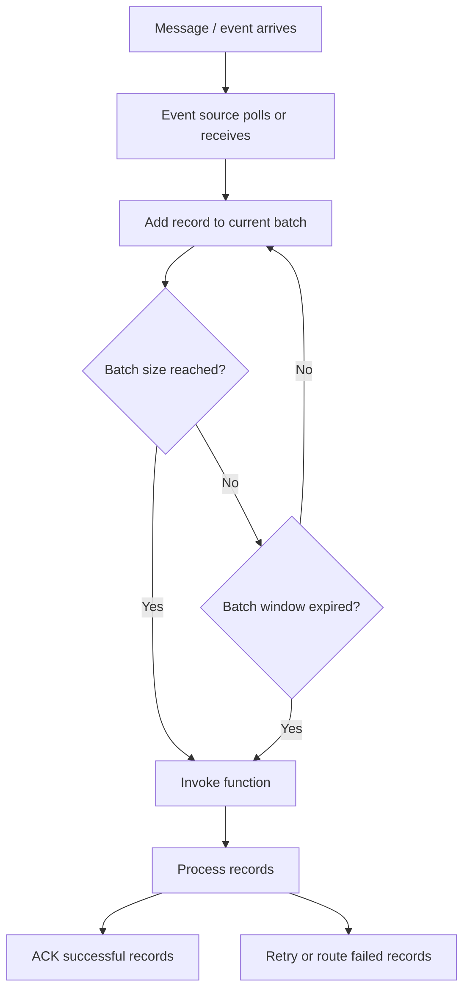

# Chọn batch size và batch window theo độ trễ mục tiêu

Batching gom nhiều message hoặc event vào một lần gọi function. Thay vì khởi chạy Java function cho từng record, event source có thể chờ đủ số lượng record hoặc chờ hết một khoảng thời gian rồi gửi cả batch cho handler. Cách này giảm số invocation, giảm chi phí khởi tạo lặp lại và tăng throughput, nhưng mỗi record có thể phải chờ lâu hơn trước khi được xử lý.

Hai tham số quan trọng là **batch size** và **batch window**. Batch size đặt giới hạn số record tối đa trong một lần invoke; batch window đặt thời gian tối đa để tích lũy record trước khi gửi batch. Chọn chúng theo latency objective, tốc độ đến của message, khả năng xử lý của function và giới hạn downstream. Không nên chọn batch size lớn nhất chỉ để giảm invocation, cũng không nên đặt batch window dài mà chưa tính thời gian chờ vào SLA.

## 1. Batching hoạt động như thế nào?

Một event source mapping hoặc message consumer nhận record từ nguồn, tích lũy chúng trong một batch rồi gọi handler. Batch thường được gửi khi một trong các điều kiện xảy ra trước:

- Đã đạt batch size tối đa.
- Batch window hết thời gian.
- Đạt giới hạn payload/bytes hoặc giới hạn riêng của dịch vụ.
- Nền tảng quyết định flush theo cơ chế polling và scheduling của nó.

Do đó, batch size là giới hạn trên chứ không phải số record được bảo đảm trong mọi invocation. Batch window là giới hạn chờ tích lũy chứ không phải lời hứa rằng mỗi record sẽ được xử lý chính xác sau từng ấy mili giây. Khi traffic thấp, handler thường nhận batch nhỏ; khi traffic cao, batch có thể đầy trước khi window kết thúc.



Batching thường được thực hiện ở phía consumer/event source mapping. Nó khác với publisher batching: publisher gom nhiều message vào một request gửi broker; consumer batching gom nhiều message đã nhận vào một lần xử lý. Hai loại batching có thể cùng tồn tại và cần được tính latency riêng.

## 2. Phân biệt batch size và batch window

| Tham số | Ý nghĩa | Tác động chính khi tăng |
|---|---|---|
| `batchSize` | Số record tối đa trong một invocation | Ít invocation hơn khi traffic đủ lớn; mỗi invocation có nhiều việc hơn |
| `batchWindow` | Thời gian tối đa chờ để tích lũy record | Batch có cơ hội đầy hơn khi traffic thưa; queueing latency tăng |
| Payload/byte limit | Tổng kích thước dữ liệu được gửi trong một invocation | Có thể khiến batch nhỏ hơn số record tối đa |
| Concurrency | Số invocation/consumer xử lý song song | Tăng throughput nhưng tăng áp lực lên dependency |
| Prefetch/buffer | Số record broker/client lấy trước khi xử lý | Có thể tăng throughput nhưng làm record chờ trong buffer và dùng thêm memory |

Batch size và batch window có quan hệ nhưng không thay thế nhau. Batch size cao với window thấp vẫn tạo batch nhỏ khi traffic thấp. Window dài với batch size thấp không làm batch vượt giới hạn size. Nếu payload record lớn, giới hạn bytes có thể flush batch trước khi đạt số lượng record.

## 3. Bắt đầu từ latency objective

Trước khi cấu hình batching, xác định mục tiêu độ trễ ở cấp nghiệp vụ. Ví dụ:

- HTTP API chấp nhận đơn hàng: p95 response dưới 500 ms.
- Worker cập nhật tồn kho: p95 hoàn tất trong 2 giây.
- Đồng bộ analytics: hoàn tất trong 1 phút.
- Tổng hợp báo cáo định kỳ: có thể chờ 5 phút để gom đủ dữ liệu.

Phân biệt ba mốc thời gian:

1. **Delivery/queue wait:** record nằm trong broker hoặc chờ consumer nhận.
2. **Batch wait:** record đã được nhận vào buffer nhưng chờ batch được flush.
3. **Processing time:** function thực thi handler và side effect.

Latency end-to-end có thể biểu diễn gần đúng:

\[
L_{e2e} = L_{ingress} + L_{queue} + L_{batch} + L_{handler} + L_{downstream} + L_{ack}
\]

Batch window chỉ ảnh hưởng một phần `L_batch`; nó không giải quyết queue backlog, handler chậm hoặc database quá tải. Nếu SLA là p95/p99, hãy phân bổ budget cho từng thành phần thay vì lấy average của toàn pipeline.

### Ví dụ phân bổ latency budget

Giả sử worker cần hoàn tất p95 trong 2 giây. Có thể phân bổ ban đầu:

| Thành phần | Budget p95 |
|---|---:|
| Broker delivery/queue wait | 300 ms |
| Batch accumulation | 400 ms |
| Handler | 600 ms |
| Downstream database/API | 500 ms |
| Acknowledgement và margin | 200 ms |
| **Tổng** | **2.000 ms** |

Đây là budget thiết kế, không phải kết quả bảo đảm. Nếu batch window đặt 2 giây thì riêng thời gian tích lũy đã có thể vượt toàn bộ SLA. Trong ví dụ này, nên thử window tối đa khoảng 300–400 ms hoặc thấp hơn để dành margin cho scheduling jitter và các thành phần khác.

## 4. Ước lượng thời gian lấp đầy batch

Gọi:

- \(B\): batch size mục tiêu (số record).
- \(\lambda\): tốc độ record đến, tính bằng record/giây.
- \(W\): batch window tối đa, tính bằng giây.

Nếu record đến tương đối đều, thời gian trung bình để có thêm đủ \(B-1\) record sau record đầu tiên có thể ước lượng:

\[
T_{fill} \approx \frac{B-1}{\lambda}
\]

Batch thường được gửi khi đạt size hoặc hết window, vì vậy thời gian tích lũy bị giới hạn gần đúng bởi:

\[
T_{batch} \approx \min(T_{fill}, W)
\]

Khi batch đầy do traffic đều, record đầu tiên chờ lâu nhất; thời gian chờ trung bình trong batch có thể xấp xỉ một nửa thời gian lấp đầy. Khi window hết trước lúc batch đầy và record đến tương đối đều trong window, thời gian chờ trung bình có thể xấp xỉ \(W/2\), còn record đến ngay đầu window có thể chờ gần \(W\).

Đây chỉ là mô hình ước lượng. Traffic thực tế thường bursty, arrival rate thay đổi theo thời gian, polling có chu kỳ riêng và broker có giới hạn payload. Không dùng công thức này thay cho đo p95/p99 trên môi trường gần production.

### Ví dụ 1: traffic cao

Giả sử:

- \(B=20\) record.
- \(\lambda=40\) record/giây.
- \(W=500\) ms.

Thời gian lấp đầy ước lượng:

\[
T_{fill} \approx \frac{20-1}{40}=0.475\text{ s}
\]

Batch có thể đạt 20 record trước khi window 500 ms kết thúc. Thời gian chờ trung bình gần đúng của record trong batch đầy khoảng 238 ms. Nếu latency budget cho batch accumulation là 400 ms, cấu hình này đáng để benchmark.

### Ví dụ 2: traffic thấp

Giả sử:

- \(B=20\) record.
- \(\lambda=5\) record/giây.
- \(W=1\) giây.

Thời gian lấp đầy ước lượng là \(19/5=3.8\) giây, dài hơn window. Batch sẽ thường được flush với số record nhỏ hơn 20. Nếu traffic tương đối đều, một window 1 giây có thể tích lũy khoảng 5 record; thời gian chờ trung bình xấp xỉ 500 ms. Tăng batch size lên 100 không giúp tăng batch thực tế khi window vẫn chỉ 1 giây và traffic không đổi.

### Khi arrival rate thay đổi

Không dùng một arrival rate trung bình cả ngày để chọn batch. Traffic có thể rất thấp ban đêm và tăng đột biến khi có campaign. Tính hoặc đo arrival rate theo các khoảng thời gian phù hợp, ví dụ 1 phút, 5 phút và peak burst. Đánh giá cả thời gian lấp batch ở traffic thấp lẫn khả năng tiêu thụ backlog khi traffic cao.

## 5. Chọn batch size

Batch size lớn có thể tăng throughput vì chi phí cố định của một invocation được chia cho nhiều record. Nhưng batch lớn cũng làm tăng memory, thời gian xử lý, payload và phạm vi retry.

### Lợi ích khi tăng batch size

- Giảm số invocation khi nguồn có đủ traffic.
- Giảm overhead cố định của runtime/handler trên mỗi record.
- Có thể giảm số lần mở transaction hoặc gọi API nếu downstream hỗ trợ bulk operation.
- Tăng throughput khi handler xử lý batch hiệu quả.
- Giảm chi phí tính theo invocation trong mô hình billing có thành phần request.

### Rủi ro khi tăng batch size

- Payload batch có thể chạm giới hạn bytes dù chưa đạt số record tối đa.
- Handler cần nhiều memory hơn để deserialize và giữ record.
- Batch duration dài hơn, dễ chạm function timeout.
- Một record lỗi có thể khiến nhiều record khác bị retry nếu không có partial batch response.
- Transaction lớn có thể lock lâu hoặc vượt giới hạn database.
- Một batch có nhiều tenant/aggregate có thể làm tăng độ phức tạp authorization và ordering.
- Thời gian xử lý dài có thể làm message visibility/lock timeout hết hạn.
- Batch lớn có thể làm tăng tail latency cho record đầu tiên nếu phải chờ đủ số lượng.

### Giới hạn batch size theo tài nguyên

Chọn batch size sao cho:

- Tổng payload nằm dưới giới hạn invocation/broker với margin an toàn.
- Memory đủ cho payload, object graph, buffer và kết quả xử lý.
- Thời gian xử lý batch p95/p99 nằm trong timeout.
- Số database/API operation không vượt khả năng downstream.
- Retry một batch không gây chi phí hoặc side effect quá lớn.
- Có thể quan sát và xử lý poison record mà không chặn toàn bộ luồng.

Nếu handler xử lý tuần tự, thời gian batch có thể xấp xỉ:

\[
T_{handler}(B) \approx T_{fixed} + B \times T_{record}
\]

Nếu xử lý song song, công thức còn phụ thuộc worker pool, contention và downstream capacity. Đừng tăng batch size nếu bottleneck nằm ở database hoặc API đối tác.

## 6. Chọn batch window

Batch window là nút điều chỉnh trực tiếp giữa thời gian chờ và khả năng gom nhiều record. Với workload nhạy latency, chọn window ngắn hoặc bằng 0 nếu event source hỗ trợ và overhead invocation chấp nhận được. Với workload nền, window dài hơn có thể giảm invocation và tăng hiệu quả bulk processing.

### Window ngắn

- Record được chuyển đến handler sớm hơn.
- Batch thường nhỏ khi traffic thấp.
- Invocation nhiều hơn và overhead cố định lớn hơn.
- Phù hợp API/event cần phản hồi nhanh hoặc worker cần giữ queue age thấp.

### Window dài

- Có thêm thời gian gom record.
- Batch trung bình có thể lớn hơn khi traffic thưa.
- Invocation có thể giảm nếu batch được lấp đầy.
- Record đầu tiên trong batch có thể chờ gần hết window.
- Queue age, end-to-end latency và nguy cơ timeout tăng.

Window dài không phải lúc nào cũng giảm cost. Nếu handler phải chờ lâu rồi vẫn nhận batch nhỏ, bạn đã thêm latency mà không tiết kiệm đáng kể invocation. Đo batch size thực tế và cost per successful record.

## 7. Tách latency mục tiêu theo loại workload

| Workload | Latency objective thường ưu tiên | Hướng batching ban đầu |
|---|---|---|
| HTTP request cần kết quả ngay | Response latency p95/p99 | Không chờ batch trong request; enqueue rồi xử lý async nếu phù hợp |
| Order/payment event | Thời gian hoàn tất nghiệp vụ và đúng thứ tự | Batch nhỏ/window ngắn; ưu tiên idempotency và retry an toàn |
| Notification | Độ trễ chấp nhận được theo SLA gửi | Batch vừa, window ngắn đến trung bình |
| Analytics ingestion | Throughput và cost per record | Batch lớn hơn, window dài hơn nếu SLA cho phép |
| Stream processing | Consumer lag và thứ tự theo partition/shard | Batch theo shard/partition, window phù hợp lag budget |
| Scheduled aggregation | Hoàn tất trước thời điểm báo cáo | Batch lớn hoặc gom theo time window nghiệp vụ |
| File/object processing | Thời gian xử lý object và chi phí invocation | Batch key/object metadata; tránh giữ payload file lớn trong memory |

Với HTTP API, batching thường nên đặt sau queue hoặc stream. Không giữ HTTP request mở để đợi batch đầy trừ khi giao thức và SLA cho phép rõ ràng.

## 8. AWS Lambda với SQS event source mapping

Khi Lambda đọc SQS, event source mapping poll queue, gom message thành batch và gọi function. Hai thuộc tính thường dùng:

- `BatchSize`: số message tối đa trong một invocation.
- `MaximumBatchingWindowInSeconds`: thời gian tối đa chờ gom message trước khi invoke.

Batch thực tế còn bị giới hạn bởi payload tối đa của invocation và giới hạn của loại queue/event source. Các giá trị tối đa khác nhau giữa Standard và FIFO queue; kiểm tra giới hạn hiện hành của AWS cho cấu hình đang dùng.

### Ví dụ AWS SAM

```yaml
Resources:
  OrdersQueue:
    Type: AWS::SQS::Queue
    Properties:
      VisibilityTimeout: 70

  ProcessOrdersFunction:
    Type: AWS::Serverless::Function
    Properties:
      Runtime: java21
      Handler: com.example.orders.ProcessOrdersHandler
      Timeout: 10
      MemorySize: 1024
      Events:
        OrdersEvent:
          Type: SQS
          Properties:
            Queue: !GetAtt OrdersQueue.Arn
            BatchSize: 10
            MaximumBatchingWindowInSeconds: 1
            FunctionResponseTypes:
              - ReportBatchItemFailures
```

Trong ví dụ, function timeout là 10 giây và batch window là 1 giây. Visibility timeout 70 giây lớn hơn mức khuyến nghị tối thiểu của AWS là sáu lần function timeout cộng batching window (61 giây). Khi thay timeout hoặc window, phải tính lại visibility timeout; đồng thời xem xét thời gian retry, throttling và thời gian xử lý batch.

### Partial batch response

Nếu không bật `ReportBatchItemFailures`, một record lỗi có thể khiến cả batch được giao lại. Với handler có side effect, điều này làm các record đã thành công bị xử lý lại. Partial batch response cho phép handler trả danh sách message ID lỗi để event source mapping chỉ retry các record đó.

Với FIFO queue, để giữ thứ tự trong message group, handler nên dừng xử lý các record tiếp theo sau record đầu tiên lỗi và trả record lỗi cùng các record chưa xử lý trong group tương ứng theo semantics của event source mapping. Không tiếp tục side effect phía sau một record lỗi nếu thứ tự nghiệp vụ cần được bảo toàn.

### Batching và visibility timeout

Visibility timeout phải đủ dài cho thời gian batch window, invocation, retry và scheduling. Nếu timeout quá ngắn, message có thể hiển thị lại khi invocation trước vẫn đang chạy, gây duplicate concurrency. Consumer vẫn cần idempotent vì không có cấu hình timeout nào loại bỏ hoàn toàn duplicate delivery.

### Khi nào SQS batch size nhỏ?

- Mỗi message gọi một API chậm hoặc transaction độc lập.
- Một record lỗi thường xuyên và retry tốn kém.
- Cần latency thấp hoặc FIFO ordering chặt.
- Payload lớn hoặc memory của function nhỏ.

### Khi nào SQS batch size lớn?

- Consumer xử lý mỗi record nhanh và độc lập.
- Downstream hỗ trợ bulk write.
- Traffic đủ lớn để lấp batch nhanh.
- Partial batch response và idempotency đã được triển khai.
- Function có memory/timeout và concurrency phù hợp.

## 9. AWS Lambda với Kinesis Data Streams và DynamoDB Streams

Với stream, Lambda event source mapping đọc record theo shard/partition và gọi function theo batch. Các thuộc tính có thể bao gồm:

- `BatchSize` và `MaximumBatchingWindowInSeconds`.
- `ParallelizationFactor` để tăng số batch được xử lý đồng thời trên một shard trong giới hạn dịch vụ.
- `FunctionResponseTypes: ReportBatchItemFailures` để báo record lỗi.
- `BisectBatchOnFunctionError` để chia batch khi function lỗi.
- `MaximumRetryAttempts` và `MaximumRecordAgeInSeconds` để giới hạn retry/tuổi record.
- `DestinationConfig` để định tuyến record thất bại theo cấu hình hỗ trợ.

Ví dụ SAM minh họa:

```yaml
Events:
  OrderStream:
    Type: Kinesis
    Properties:
      Stream: !GetAtt OrdersStream.Arn
      StartingPosition: LATEST
      BatchSize: 100
      MaximumBatchingWindowInSeconds: 1
      ParallelizationFactor: 2
      FunctionResponseTypes:
        - ReportBatchItemFailures
      BisectBatchOnFunctionError: true
      MaximumRetryAttempts: 3
      MaximumRecordAgeInSeconds: 3600
```

Các giá trị trên là điểm bắt đầu để minh họa, không phải cấu hình production mặc định. Với stream, ordering trong shard/partition và checkpoint rất quan trọng. Tăng parallelization hoặc chia batch có thể thay đổi cách xử lý lỗi và thứ tự quan sát được; cần xác minh theo semantics của nguồn stream và key/partition design.

Theo dõi `IteratorAge` hoặc consumer lag tương ứng. Batch window dài làm record chờ lâu hơn trước khi handler chạy; batch size quá lớn làm handler lâu hơn và có thể tăng iterator age nếu tốc độ xử lý không theo kịp tốc độ ghi.

## 10. Kafka và các event source khác

Với Amazon MSK hoặc self-managed Kafka, Lambda event source mapping đọc theo consumer group và gửi record thành batch. Batch size/window cần cân bằng throughput, payload, partition ordering và thời gian xử lý. Kafka partition là đơn vị song song quan trọng; tăng consumer concurrency không thể vượt quá số partition hữu ích và có thể ảnh hưởng thứ tự trong partition.

Với EventBridge event bus, rule thường chuyển từng event đến target Lambda theo cơ chế asynchronous invocation; không có batch size/window tổng quát như SQS event source mapping. Nếu cần gom event, có thể route EventBridge đến SQS rồi để Lambda đọc queue theo batch. Cách này thêm một hop và queue retention nhưng cho phép kiểm soát batching, backpressure và DLQ riêng.

Với DynamoDB Streams, Kinesis và Kafka, batch window cũng ảnh hưởng consumer lag và checkpoint. Không đặt window dài chỉ để giảm invocation nếu stream có yêu cầu xử lý gần real-time.

## 11. Azure Functions: Service Bus và Event Hubs

Azure Functions có cấu hình batching phụ thuộc trigger, extension version và kiểu function signature.

### Service Bus

Service Bus trigger có thể xử lý từng message hoặc batch tùy extension/binding model. Khi dùng batch mode, các thiết lập như minimum/maximum message batch size và maximum batch wait time (nếu được hỗ trợ bởi phiên bản extension) điều khiển điều kiện gom. `prefetchCount`, concurrency, lock duration và auto lock renewal cũng ảnh hưởng đến thời gian message chờ và xử lý.

Đừng chỉ tăng prefetch để tăng throughput. Prefetch đưa message vào buffer phía client; nếu function chưa xử lý kịp, lock có thể hết hạn hoặc message phải được giao lại. Đặt prefetch/concurrency theo tốc độ handler và thời gian lock, bật manual completion khi cần kiểm soát ack và thiết kế idempotency cho redelivery.

### Event Hubs

Event Hubs trigger thường đưa một batch event từ partition vào function. Các setting như `maxBatchSize`, `prefetchCount` và `batchCheckpointFrequency` ảnh hưởng lượng event đọc trước, kích thước batch và checkpoint. Batch lớn tăng throughput nhưng có thể tăng memory và thời gian xử lý; checkpoint quá thưa có thể làm nhiều event được đọc lại sau lỗi.

Ví dụ `host.json` minh họa cấu hình Event Hubs:

```json
{
  "version": "2.0",
  "extensions": {
    "eventHubs": {
      "maxBatchSize": 100,
      "prefetchCount": 300,
      "batchCheckpointFrequency": 1
    }
  }
}
```

Tên setting và khả năng batch có thể thay đổi theo extension version và hosting plan. Kiểm tra tài liệu extension đang dùng trước khi áp dụng. Theo dõi consumer lag, partition ownership, checkpoint và throttling để điều chỉnh.

## 12. Google Cloud Pub/Sub và Cloud Run/Functions

Pub/Sub có hai kiểu tiêu thụ thường gặp:

- **Push subscription:** gửi message đến HTTP endpoint; mỗi delivery thường là một request. Nếu cần xử lý batch, có thể đặt một service trung gian hoặc buffer nội bộ, nhưng phải thiết kế ack/retry rõ.
- **Pull/StreamingPull:** subscriber client nhận nhiều message và có thể gom chúng trong ứng dụng theo số lượng, byte hoặc thời gian. Java subscriber cần giới hạn outstanding messages/bytes và xử lý ack deadline phù hợp.

Event-driven Cloud Functions/Cloud Run functions có thể nhận một CloudEvent cho mỗi invocation tùy trigger. Nếu workload cần batching, cân nhắc Pub/Sub pull consumer chạy trên Cloud Run hoặc subscription pattern hỗ trợ batch; không giả định mọi event trigger tự động gom nhiều event vào một invocation.

Publisher batching và subscriber batching là hai cấu hình khác nhau. Publisher có thể gom publish request theo element count, byte threshold và delay; subscriber cần quản lý flow control, ack deadline và số message đang xử lý. Tối ưu publisher batching không tự làm consumer batch lớn hơn.

## 13. Java: xử lý SQS batch và partial failures

Ví dụ sau xử lý từng record độc lập và trả message ID thất bại. Trong thực tế, bật `ReportBatchItemFailures` trong event source mapping như ví dụ SAM ở trên.

```java
import com.amazonaws.services.lambda.runtime.Context;
import com.amazonaws.services.lambda.runtime.RequestHandler;
import com.amazonaws.services.lambda.runtime.events.SQSEvent;
import com.amazonaws.services.lambda.runtime.events.SQSBatchResponse;
import java.util.ArrayList;
import java.util.List;

public final class ProcessOrdersHandler
        implements RequestHandler<SQSEvent, SQSBatchResponse> {

    @Override
    public SQSBatchResponse handleRequest(SQSEvent event, Context context) {
        List<SQSBatchResponse.BatchItemFailure> failures = new ArrayList<>();

        for (SQSEvent.SQSMessage message : event.getRecords()) {
            try {
                OrderEvent order = OrderEvent.fromJson(message.getBody());
                OrderService.processIdempotently(order);
            } catch (RetryableException ex) {
                context.getLogger().log(
                        "Retryable failure for messageId=" + message.getMessageId());
                failures.add(new SQSBatchResponse.BatchItemFailure(
                        message.getMessageId()));
            } catch (Exception ex) {
                context.getLogger().log(
                        "Invalid or failed messageId=" + message.getMessageId());
                failures.add(new SQSBatchResponse.BatchItemFailure(
                        message.getMessageId()));
            }
        }

        return new SQSBatchResponse(failures);
    }
}
```

`OrderEvent`, `OrderService` và exception là kiểu do ứng dụng định nghĩa. Với lỗi dữ liệu không thể retry, cân nhắc đưa vào quarantine/DLQ theo chính sách thay vì retry mãi. Không log toàn bộ body nếu có PII hoặc secret. Consumer phải idempotent vì message có thể được giao lại sau khi side effect thành công nhưng acknowledgement thất bại.

Với FIFO queue, không tiếp tục xử lý các record sau record đầu tiên thất bại nếu chúng thuộc cùng thứ tự cần bảo toàn. Trả các record lỗi và chưa xử lý theo đúng partial batch response contract.

## 14. Xử lý batch tuần tự hay song song?

Batch size là số record trong một invocation; concurrency trong handler là số record được xử lý song song bên trong invocation. Event source concurrency là số invocation song song. Đây là ba mức khác nhau.

### Xử lý tuần tự

Ưu điểm:

- Dễ giữ thứ tự trong một batch.
- Dễ giới hạn tải lên database/API.
- Ít contention và dễ xử lý transaction.

Nhược điểm:

- Throughput thấp hơn nếu mỗi record chờ I/O lâu.
- Batch duration tăng tuyến tính theo số record trong trường hợp xử lý tuần tự.

### Xử lý song song trong batch

Ưu điểm:

- Có thể tăng throughput khi record độc lập và chủ yếu chờ I/O.
- Tận dụng tài nguyên function tốt hơn.

Nhược điểm:

- Tăng số kết nối và request downstream cùng lúc.
- Khó bảo toàn ordering.
- Một exception trong future/batch có thể khó ánh xạ về đúng record.
- Cần giới hạn worker pool và đảm bảo context/log theo record.

Không tạo một thread cho mỗi message. Dùng executor có giới hạn, semaphore hoặc bulkhead theo capacity downstream. Với stream partition hoặc FIFO message group, chỉ song song hóa phần nghiệp vụ không phá vỡ thứ tự yêu cầu.

## 15. Batch failure, retry và poison record

Batching làm tăng số record chịu ảnh hưởng khi invocation lỗi. Thiết kế lỗi cần trả lời:

- Function thất bại toàn bộ batch hay chỉ một record?
- Broker có retry cả batch hay từng record?
- Có partial batch response không?
- Có bisect batch hoặc retry chỉ phần lỗi không?
- Record lỗi có thể được chuyển sang DLQ/quarantine sau bao nhiêu lần?
- Một record poison có thể chặn partition/shard hoặc FIFO message group bao lâu?

### Partial batch response

Khi nền tảng hỗ trợ, trả danh sách record thất bại để tránh retry record đã thành công. Tuy nhiên, partial response không thay thế idempotency. Function có thể commit side effect rồi chết trước khi trả response; broker vẫn có thể giao lại record đó.

### Batch bisection

Một số stream event source hỗ trợ chia đôi batch khi function lỗi. Điều này giúp khoanh vùng record gây lỗi, nhưng có thể làm số invocation tăng và thay đổi số lần một record được thử. Cần theo dõi retry và giới hạn tuổi record.

### DLQ và quarantine

DLQ lưu record không xử lý được sau chính sách retry. Với event stream, có thể dùng destination/failure handling phù hợp dịch vụ. Quarantine cần giữ metadata như event ID, source, schema version, attempt và error type; không nhất thiết lưu raw payload nếu payload nhạy cảm.

## 16. Concurrency, backpressure và batch window

Batch size lớn không tự động tăng throughput nếu event source chỉ cho một số invocation nhỏ. Ngược lại, concurrency cao với batch nhỏ có thể gây quá tải downstream. Cần điều chỉnh đồng thời:

- Batch size và batch window.
- Maximum/reserved concurrency của function.
- Event source mapping maximum concurrency hoặc parallelization factor.
- Consumer worker pool bên trong handler.
- Database connection pool và API rate limit.
- Prefetch/outstanding message limit.
- Visibility timeout, lock duration và retry policy.

Backpressure giúp tốc độ nhận message không vượt quá tốc độ xử lý bền vững. Với SQS, queue có thể hấp thụ burst; giới hạn concurrency để worker xử lý theo năng lực database. Với stream, consumer lag tăng khi tốc độ xử lý thấp hơn tốc độ ingest; cần scale concurrency/partition hoặc giảm thời gian xử lý.

Không dùng batch window dài để che giấu consumer thiếu capacity. Nếu backlog tăng liên tục, cần tăng throughput xử lý hoặc giảm tốc độ ingest, không chỉ thay đổi thời gian gom batch.

## 17. Observability khi tối ưu batching

Đo cả hiệu quả batching và tác động đến latency:

| Metric | Ý nghĩa | Cách sử dụng |
|---|---|---|
| Actual batch size | Số record thực tế mỗi invocation | Xác định batch có thường đầy hay flush partial |
| Batch fill time | Thời gian từ record đầu đến lúc invoke | Đo chi phí chờ do batching |
| Queue age / oldest message age | Tuổi record cũ nhất chưa xử lý | Phát hiện backlog và latency vượt SLA |
| Handler duration | Thời gian xử lý batch | Tìm batch quá lớn hoặc downstream chậm |
| Records per second | Throughput thực tế | So sánh cấu hình size/window/concurrency |
| Invocation count | Số lần function được gọi | Đánh giá overhead/cost |
| Error/retry count | Lỗi và số lần thử lại | Phát hiện poison record hoặc partial failure sai |
| Throttle/concurrency | Mức sử dụng capacity | Điều chỉnh concurrency/backpressure |
| Iterator age/consumer lag | Độ trễ stream consumer | Đánh giá khả năng theo kịp ingest |
| Cost per successful record | Chi phí trên record hoàn tất | Tránh tối ưu invocation nhưng tăng retry/latency |

Không phải dịch vụ nào cũng cung cấp metric `actual batch size` hoặc `batch fill time` trực tiếp. Có thể ghi structured log từ handler: batch size, thời gian nhận invocation, record timestamp/age, số thành công/thất bại và duration. Tránh đưa event ID hoặc message ID làm metric dimension có cardinality cao; giữ chúng trong log/trace.

### Metric AWS thường dùng

- SQS: `ApproximateNumberOfMessagesVisible`, `ApproximateAgeOfOldestMessage`, số message nhận/xóa và DLQ depth.
- Lambda: `Invocations`, `Duration`, `Errors`, `Throttles`, `ConcurrentExecutions`.
- Kinesis/DynamoDB Streams: `IteratorAge` và metric stream/consumer liên quan.
- EventBridge: matched events, failed invocations và DLQ metrics tùy target.

### Metric Azure và Google Cloud

- Azure Service Bus: active messages, dead-letter messages, incoming/completed/abandoned messages và lock-related failures.
- Azure Event Hubs: incoming events/bytes, throttling và consumer lag/checkpoint behavior.
- Google Pub/Sub: undelivered messages, oldest unacked message age, ack deadline expirations và subscriber throughput.

Tên metric, dimension và khả năng hiển thị thay đổi theo tier, extension và cấu hình; chọn metric tương ứng với dịch vụ đang dùng.

## 18. Quy trình chọn batch size và window

Thực hiện theo thứ tự:

1. **Xác định SLA:** p95/p99 latency, throughput tối thiểu, backlog age và cost per record.
2. **Đo arrival rate:** average, peak, burst và traffic thấp; xem phân bố theo thời gian.
3. **Đo processing cost:** handler time/record, fixed overhead, memory, payload size và downstream latency.
4. **Phân bổ batch wait budget:** lấy từ end-to-end latency budget sau khi trừ queue, handler và downstream.
5. **Chọn window:** đặt mức tối đa không vượt budget; bắt đầu thấp nếu SLA nhạy latency.
6. **Chọn batch size:** đủ lớn để amortize overhead nhưng không vượt payload, memory, timeout, ordering và retry budget.
7. **Chọn concurrency:** giới hạn theo capacity downstream và khả năng tiêu thụ backlog.
8. **Bật partial failure/DLQ:** tránh retry toàn batch nếu nguồn hỗ trợ granular failure handling.
9. **Benchmark ma trận:** thay đổi một tham số mỗi lần, đo p50/p95/p99, batch size thực tế, throughput, retry và cost.
10. **Canary và theo dõi:** triển khai dần, cảnh báo queue age/iterator age, error và throttling; rollback nếu SLA xấu đi.

### Ma trận benchmark gợi ý

| Thử nghiệm | Batch size | Batch window | Mục tiêu |
|---|---:|---:|---|
| A | 1 | 0 | Baseline latency thấp, invocation cao |
| B | 10 | 0 | Xem lợi ích của batch size khi không thêm wait |
| C | 10 | 250 ms | Đo trade-off window ngắn |
| D | 25 | 500 ms | Kiểm tra throughput/cost ở batch lớn hơn |
| E | 50 | 1 s | Chỉ thử nếu SLA và payload cho phép |

Đây là các điểm thử, không phải cấu hình khuyến nghị chung. Chọn giá trị theo nguồn event, payload và SLA của hệ thống.

## 19. Ví dụ quyết định theo latency budget

Giả sử một worker nhận message đơn hàng với các mục tiêu:

- p95 từ lúc message được publish đến khi database cập nhật không quá 2 giây.
- Arrival rate trung bình 30 record/giây, peak 150 record/giây.
- Handler tuần tự xử lý trung bình 20 ms/record.
- Database có giới hạn connection và không hỗ trợ transaction quá lớn.

Một cấu hình thử nghiệm có thể là:

- Batch size 10 hoặc 20 để giới hạn transaction và memory.
- Batch window 200–300 ms để giữ batch wait trong ngân sách.
- Concurrency giới hạn theo database connection pool.
- Partial batch response để retry record lỗi.
- Visibility timeout đủ dài theo function timeout và batch window.

Ở arrival rate 30 record/giây và batch size 10, thời gian fill trung bình ước lượng khoảng `9/30 = 300 ms`. Nếu window đặt 250 ms, batch thường flush trước khi đủ 10 record khi traffic đều. Điều này có thể phù hợp latency budget nhưng cần đo actual batch size và p95.

Ở peak 150 record/giây, batch 10 có thể đầy trong khoảng `9/150 = 60 ms`; window không còn là yếu tố chi phối. Nếu handler mất khoảng 200 ms cho 10 record và concurrency đủ, worker có thể tăng throughput. Nếu database bắt đầu throttle, tăng batch/concurrency thêm sẽ làm tình hình xấu hơn.

## 20. Những lỗi cấu hình thường gặp

| Lỗi | Hậu quả | Cách khắc phục |
|---|---|---|
| Chọn batch size lớn nhất theo giới hạn provider | Memory, timeout và retry cost tăng | Chọn theo payload, handler time và downstream capacity |
| Đặt window dài để giảm invocation mà không tính SLA | Record chờ lâu, p95/p99 vượt mục tiêu | Phân bổ batch wait budget trước |
| Chỉ nhìn batch size cấu hình | Batch thực tế nhỏ do traffic hoặc byte limit | Ghi nhận actual batch size và fill time |
| Quên payload limit | Batch bị chia nhỏ hoặc invocation lỗi | Đo payload p95/p99 và giữ margin |
| Không bật partial batch response | Một record lỗi làm retry cả batch | Bật granular failure response nếu nguồn hỗ trợ |
| Visibility/lock timeout quá ngắn | Message redeliver khi invocation còn chạy | Tính timeout theo batch window, function timeout và retry |
| Tăng concurrency mà không giới hạn downstream | Database/API bị quá tải | Backpressure, connection pool và maximum concurrency |
| Dùng batching cho HTTP response đồng bộ | Client phải chờ gom batch | Chuyển sang async queue hoặc xử lý riêng |
| Dùng batch window dài cho stream real-time | Consumer lag tăng | Giữ window ngắn và scale theo lag |
| Không đo cost per success | Retry/duplicate làm tổng chi phí tăng | Theo dõi successful records và retry overhead |

## 21. Checklist trước khi triển khai

### Latency và traffic

- [ ] Đã xác định SLA p95/p99 và end-to-end latency budget.
- [ ] Đã tách queue wait, batch wait, handler time và downstream latency.
- [ ] Đã đo arrival rate trung bình, thấp, peak và burst.
- [ ] Batch window không vượt ngân sách latency dành cho accumulation.
- [ ] Có cách đo actual batch size và batch fill time.

### Batch size và payload

- [ ] Batch size phù hợp giới hạn source, payload và invocation.
- [ ] Memory đủ cho batch và object graph sau deserialize.
- [ ] Batch duration p95/p99 nằm trong function timeout.
- [ ] Transaction/bulk request không vượt giới hạn downstream.
- [ ] Batch size phù hợp retry cost, ordering và poison record handling.

### Delivery và lỗi

- [ ] Partial batch response được bật nếu trigger hỗ trợ.
- [ ] FIFO/partition ordering được bảo toàn theo yêu cầu nghiệp vụ.
- [ ] Visibility timeout hoặc message lock duration đủ dài.
- [ ] Có retry limit, DLQ/quarantine và idempotent consumer.
- [ ] Batch failure không tạo side effect trùng hoặc mất record.

### Scaling và vận hành

- [ ] Concurrency, prefetch và worker pool được giới hạn theo downstream capacity.
- [ ] Có backpressure và cảnh báo queue age/iterator age/consumer lag.
- [ ] Theo dõi invocation count, throughput, error, throttle và cost per successful record.
- [ ] Đã benchmark các tổ hợp batch size/window trên workload đại diện.
- [ ] Có canary/rollback và kiểm tra lại sau khi thay đổi traffic pattern.

Batch size quyết định số record tối đa trong một lần xử lý; batch window quyết định thời gian tối đa để tích lũy record. Chọn chúng từ latency budget và arrival rate, sau đó kiểm tra payload, handler duration, retry semantics và khả năng của downstream. Cấu hình tốt là cấu hình đạt p95/p99 và throughput mục tiêu với chi phí hợp lý, chứ không phải cấu hình tạo batch lớn nhất. Với Java serverless, hãy đo batch thực tế, xử lý partial failure, giữ consumer idempotent và điều tiết concurrency để tối ưu cả độ trễ lẫn độ tin cậy.
