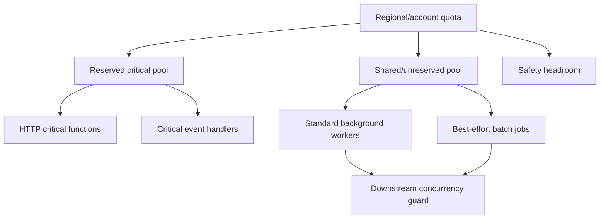
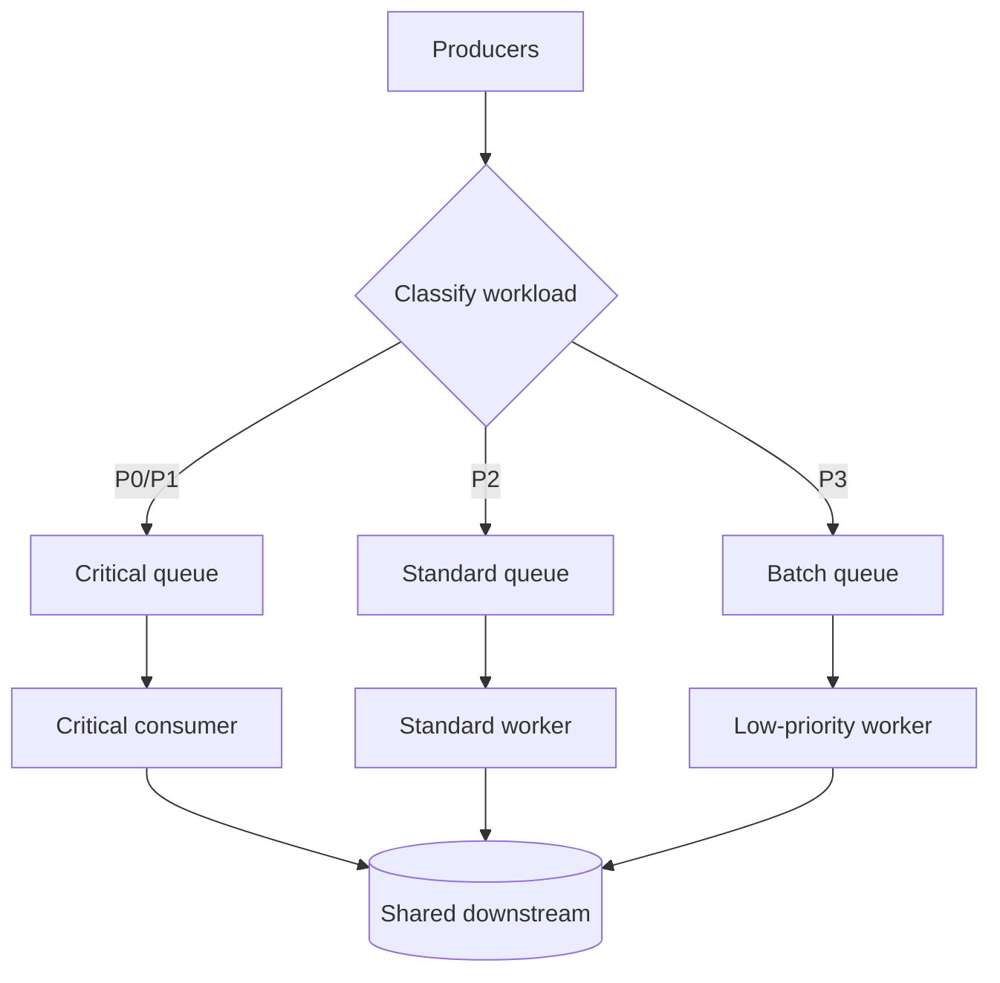

# Phân bổ quota giữa function quan trọng và tác vụ nền

## 1. Vì sao phải phân bổ quota?

Serverless tự động tăng hoặc giảm số execution environment theo nhu cầu, nhưng khả năng scale không phải vô hạn. Mỗi account, project, region, function app, service, event source hoặc dependency đều có giới hạn tài nguyên. Khi nhiều workload cùng tăng tải, chúng có thể tranh chấp concurrency, connection, CPU, memory, throughput và quota của dịch vụ phụ thuộc.

Hãy xét một hệ thống thương mại điện tử có các workload sau:

- `checkout-api`: xử lý request tạo đơn hàng, cần latency thấp.
- `payment-webhook`: nhận xác nhận thanh toán từ đối tác, cần xử lý đúng hạn.
- `order-events`: cập nhật trạng thái đơn từ message queue.
- `invoice-worker`: tạo hóa đơn và gửi thông báo.
- `report-worker`: tổng hợp dữ liệu và xuất báo cáo lớn.
- `data-export`: xử lý batch, có thể chạy chậm hơn mà không ảnh hưởng giao dịch.

Nếu `report-worker` scale lên hàng trăm invocation và chiếm hết concurrency hoặc connection database, `checkout-api` có thể bị throttling hoặc timeout dù request của khách hàng đang cần được xử lý. Một workload nền có thể không có ưu tiên cao nhưng vẫn tiêu thụ tài nguyên giống workload quan trọng nếu hệ thống không đặt giới hạn.

Phân bổ quota là cách xác định phần năng lực nào dành cho từng loại workload, phần nào được chia sẻ và phần nào phải để dự phòng. Mục tiêu là bảo vệ luồng quan trọng, giữ tác vụ nền tiến triển công bằng, giới hạn tải lên dependency và tránh một nhóm request chiếm hết tài nguyên.

Trong module CLOUD_SERVERLESS, quota cần được nhìn ở nhiều lớp: giới hạn của cloud account/region, concurrency của function, concurrency của event source, giới hạn instance của service, rate limit ở gateway và capacity của database/API bên ngoài. Một giới hạn ở lớp này không tự động bảo vệ các lớp còn lại.

## 2. Phân biệt quota, rate limit, concurrency và capacity

Các khái niệm này liên quan nhưng không thể thay thế cho nhau.

| Khái niệm | Ý nghĩa | Ví dụ |
| --- | --- | --- |
| Quota | Lượng tài nguyên tối đa được phép dùng trong một phạm vi/thời kỳ | Tổng concurrency của account trong một region |
| Rate limit | Giới hạn tốc độ request hoặc operation trong một khoảng thời gian | 200 request/giây cho một API key |
| Concurrency limit | Giới hạn số công việc đang chạy đồng thời | Tối đa 40 invocation của worker |
| Per-instance concurrency | Số request/message một instance xử lý đồng thời | 8 message trên một Functions host instance |
| Maximum instances | Giới hạn số instance có thể scale lên | Tối đa 25 container instance của một service |
| Reserved capacity | Một phần năng lực được dành cho workload cụ thể | Reserved concurrency cho function thanh toán |
| Provisioned/warm capacity | Instance hoặc execution environment được chuẩn bị trước | Provisioned concurrency để giảm cold start |
| Downstream capacity | Khả năng phục vụ của dịch vụ mà function gọi | 100 database connections hoặc 500 API calls/giây |

**Rate limit không giống concurrency limit.** Một API có thể nhận 100 request/giây nhưng chỉ có 10 request đồng thời nếu mỗi request hoàn tất trong 100 ms. Nếu mỗi request mất 2 giây, cùng tốc độ 100 request/giây có thể cần khoảng 200 request đồng thời.

**Quota không đồng nghĩa capacity sẵn sàng.** Một account có quota concurrency 1.000 vẫn có thể bị nghẽn ở database chỉ chịu được 80 connection. Ngược lại, giới hạn concurrency quá thấp có thể khiến queue backlog tăng dù database còn nhiều năng lực.

## 3. Phân loại workload theo mức độ quan trọng

### 3.1. Các lớp ưu tiên

Một cách phân loại thực tế:

| Lớp | Loại workload | Yêu cầu vận hành | Chính sách quota gợi ý |
| --- | --- | --- | --- |
| P0 – Critical | Checkout, xác nhận thanh toán, xác thực người dùng | Latency thấp, availability cao, ảnh hưởng trực tiếp đến doanh thu/an toàn | Dành riêng concurrency/capacity và headroom; rate limit theo client |
| P1 – Business async | Cập nhật đơn, đồng bộ tồn kho, xử lý webhook | Hoàn tất trong SLA ngắn, có retry và idempotency | Có phần capacity bảo đảm hoặc queue riêng; giới hạn theo dependency |
| P2 – Standard background | Email, hóa đơn, đồng bộ dữ liệu | Có thể trễ một khoảng thời gian, cần xử lý công bằng | Giới hạn concurrency; dùng queue và backpressure |
| P3 – Best effort/batch | Báo cáo, export, analytics, cleanup | Có thể hoãn hoặc giảm tốc khi hệ thống bận | Dùng capacity còn lại, lịch chạy ngoài peak và giới hạn chặt |

Không nên gán P0 cho mọi function. Nếu mọi workload đều “critical”, không còn cơ sở để phân bổ năng lực khi quota thiếu. Owner sản phẩm và vận hành cần xác định impact, SLA và mức ưu tiên thực tế.

### 3.2. Phân loại theo SLO và deadline

Ngoài nhãn ưu tiên, mỗi workload nên có:

- SLO availability hoặc success rate.
- Deadline xử lý từ lúc nhận request/event.
- Latency mục tiêu và timeout tối đa.
- Mức tải trung bình, peak và burst.
- Khả năng retry, pause, defer hoặc hủy.
- Mức độ chấp nhận mất thứ tự hoặc xử lý trùng.
- Tác động khi không xử lý kịp.

Ví dụ, `payment-webhook` có thể cần xử lý trong vài giây để cập nhật đơn, trong khi `report-worker` có thể hoàn tất trong 30 phút. Cả hai đều quan trọng với nghiệp vụ, nhưng deadline và cách phân bổ capacity khác nhau.

### 3.3. Không để background trở thành vô hạn

Tác vụ nền thường dễ bị xem là “cứ để scale tự động”. Điều này nguy hiểm khi queue backlog tăng: autoscaler thấy có nhiều message và tạo thêm invocation, nhưng downstream không tăng capacity tương ứng. Kết quả có thể là connection exhaustion, throttling, retry storm và chi phí tăng.

Mỗi consumer cần có giới hạn concurrency/throughput, chính sách retry và điều kiện backpressure. Nếu backlog tăng, hệ thống phải có khả năng giảm tốc có kiểm soát thay vì liên tục tạo thêm execution environment.

## 4. Ước lượng concurrency cần thiết

### 4.1. Dùng Little’s Law

Một ước lượng ban đầu cho số công việc đồng thời là:

\[
C \approx \lambda \times W
\]

Trong đó:

- `C`: số request/message đang xử lý đồng thời.
- `λ`: tốc độ đến trung bình, tính bằng request/giây.
- `W`: thời gian xử lý trung bình, tính bằng giây.

Ví dụ, `checkout-api` nhận 80 request/giây và thời gian xử lý trung bình là 250 ms (0,25 giây):

\[
C = 80 \times 0.25 = 20
\]

Hệ thống cần khoảng 20 request đồng thời để xử lý tải trung bình này. Nếu muốn dự phòng peak và biến động, nhóm có thể thử nghiệm ở mức 30–40 concurrency, sau đó kiểm chứng bằng load test và metric thực tế.

Đây là ước lượng theo trạng thái ổn định. Burst, tail latency, retry, batch size, thời gian chờ dependency và autoscaling delay có thể khiến nhu cầu peak cao hơn. Không lấy một con số tính từ average làm quota production mà không thử tải.

### 4.2. Tính capacity theo downstream

Giả sử database có 120 connection tối đa. Các workload khác cần giữ lại:

- 30 connection cho API nghiệp vụ.
- 20 connection cho admin và tác vụ vận hành.
- 10 connection dự phòng cho migration/monitoring.

Phần còn lại cho worker là:

\[
C_{worker-db} = 120 - 30 - 20 - 10 = 60
\]

Nếu mỗi invocation worker giữ một connection trong suốt quá trình xử lý, tổng số worker cùng dùng database không nên vượt khoảng 60. Nếu mỗi invocation mở nhiều connection, phải chia capacity theo số connection tối đa trên mỗi invocation.

Với connection pool theo instance, giới hạn tổng có thể được ước lượng:

\[
Connections_{max} = Instances_{max} \times PoolSize_{perInstance}
\]

Ví dụ 20 instance, mỗi instance pool 10 connection, có thể tạo ra tới 200 connection. Con số này có thể vượt database quota dù mỗi instance trông có vẻ nhỏ.

### 4.3. Dành headroom

Không phân bổ 100% quota danh nghĩa cho workload bình thường. Cần để headroom cho:

- Burst traffic và request kéo dài hơn dự kiến.
- Retry sau một đợt dependency outage.
- Health check, control plane và tác vụ vận hành.
- Rolling deployment/canary khi hai version cùng tồn tại.
- Sai lệch giữa quota cấu hình và capacity thực tế.

Headroom không phải phần tài nguyên lãng phí. Nó giúp hệ thống hấp thụ biến động và phục hồi sau sự cố mà không phải thay đổi quota trong lúc incident đang diễn ra.

## 5. Phân bổ capacity bằng các pool

### 5.1. Tách pool critical và background

Một mô hình đơn giản là chia tổng năng lực thành các pool:



Pool critical phải đủ cho tải dự kiến và mức dự phòng đã xác định. Background có giới hạn trên để không chiếm hết tài nguyên. Shared pool giúp các workload ít ưu tiên vẫn tận dụng capacity nhàn rỗi; headroom bảo vệ hệ thống trước burst hoặc failure recovery.

### 5.2. Ví dụ phân bổ quota

Giả sử một region có 600 đơn vị concurrency khả dụng theo quota của account. Một kế hoạch minh họa:

| Workload | Phân bổ/giới hạn | Mục đích |
| --- | ---: | --- |
| Checkout API | 180 | Dành năng lực cho request người dùng quan trọng |
| Payment webhook | 100 | Tiếp nhận xác nhận thanh toán đúng hạn |
| Order event processor | 80 | Xử lý sự kiện nghiệp vụ quan trọng |
| Background invoice | 40 | Giới hạn tải nền và bảo vệ database |
| Shared/unreserved pool | 120 | Workload khác và tải không dự đoán trước |
| Headroom vận hành | 80 | Dự phòng cho burst, deploy và phục hồi |
| **Tổng** | **600** | Ví dụ capacity budget |

Đây là mô hình phân bổ để lập kế hoạch, không phải cấu hình giống nhau trên mọi cloud. Trên AWS Lambda, reserved concurrency của từng function có thể dành riêng một phần pool và đồng thời giới hạn max concurrency. Trên Azure Functions hoặc Cloud Run, cần kết hợp giới hạn theo plan/service, per-instance concurrency và trigger-specific controls để đạt hiệu ứng tương tự.

Nếu một workload có reserved concurrency nhưng thường không dùng hết, phần đã reserve không thể được function khác sử dụng. Vì vậy, không reserve quá rộng cho mọi function. Có thể dùng event-source maximum concurrency hoặc service-level caps để giới hạn background mà không nhất thiết dành riêng một pool lớn.

### 5.3. Tách service/function để tạo ranh giới tài nguyên

Nếu critical API và batch worker chạy chung một function app/service, chúng có thể chia sẻ CPU, memory, thread pool, connection pool hoặc scale unit. Tách chúng thành function/service riêng giúp:

- Áp dụng concurrency và instance limit riêng.
- Dùng identity và quyền truy cập riêng.
- Scale, deploy và rollback độc lập.
- Có metric, SLO và alert theo workload.
- Hạn chế background worker làm cạn thread/connection của API.

Tách function không tự động tạo isolation hoàn toàn. Hai function vẫn có thể dùng chung account quota, database, network hoặc downstream API. Cần đặt giới hạn ở từng lớp liên quan.

## 6. AWS Lambda: reserved concurrency và event source limits

### 6.1. Reserved concurrency

AWS Lambda có concurrency pool ở cấp account/region. Mặc định các function chia sẻ pool này theo nhu cầu. **Reserved concurrency** dành một phần concurrency cho một function và đồng thời đặt giới hạn tối đa cho function đó.

Ví dụ:

- `checkout-api` có reserved concurrency 180.
- `payment-webhook` có reserved concurrency 100.
- `report-worker` có reserved concurrency 30.

Khi `report-worker` đạt 30 invocation đồng thời, invocation mới của nó bị throttle hoặc phải chờ theo semantics của nguồn event; nó không thể lấy phần reserved concurrency của `checkout-api`. Nếu checkout cần capacity đã reserve, background không thể chiếm phần đó.

Reserved concurrency không khởi tạo sẵn execution environment. Nó là cơ chế cô lập/giới hạn concurrency, không phải cơ chế giảm cold start. Nếu cần environment được chuẩn bị trước, xem **Provisioned Concurrency**.

AWS không tính phí riêng cho việc cấu hình reserved concurrency, nhưng phần concurrency đã reserve không còn được function khác sử dụng. Vì vậy, reserve quá nhiều capacity cho workload ít hoạt động có thể làm giảm phần pool còn lại.

### 6.2. Provisioned concurrency

Provisioned concurrency giữ sẵn một số execution environment đã khởi tạo cho version hoặc alias. Nó phù hợp với API có yêu cầu latency chặt hoặc tải có thể dự đoán. Provisioned concurrency có chi phí và vẫn tiêu thụ account concurrency. Không dùng nó chỉ vì muốn “dành quota” cho một function; mục đích chính là giảm thời gian khởi tạo.

Reserved concurrency và provisioned concurrency giải quyết hai bài toán khác nhau:

| Cơ chế | Bảo vệ khỏi function khác chiếm pool? | Giảm cold start? | Giới hạn max concurrency? |
| --- | --- | --- | --- |
| Reserved concurrency | Có | Không tự nó | Có |
| Provisioned concurrency | Không phải cơ chế isolation riêng | Có, trong phạm vi đã provision | Không thay reserved concurrency |

Provisioned concurrency cần nằm trong giới hạn reserved concurrency của function khi cấu hình reserved concurrency. Cả hai đều tính vào quota concurrency account/region theo quy tắc AWS hiện hành.

### 6.3. Giới hạn SQS event source mapping

Với SQS trigger, có thể đặt `MaximumConcurrency` ở event source mapping để giới hạn số invocation đồng thời do queue đó tạo ra. Điều này giúp một queue nền không scale quá nhanh và làm cạn function/account concurrency hoặc database connections.

Ví dụ cấu hình khái niệm:

```json
{
  "ScalingConfig": {
    "MaximumConcurrency": 20
  }
}
```

Đây là cấu hình scaling của event source mapping, không phải thuộc tính chung của mọi Lambda invocation. Nếu một function có nhiều SQS event source mappings, mỗi mapping có thể có maximum concurrency riêng.

Khi kết hợp mapping maximum concurrency với reserved concurrency của function, tổng maximum của các mapping cần nhỏ hơn hoặc bằng reserved concurrency của function để tránh các mapping tự tranh chấp rồi bị throttle. AWS cũng quy định `MaximumConcurrency` và provisioned polling mode là hai lựa chọn không dùng đồng thời cho cùng mapping.

Khi event source mapping đạt maximum concurrency, poller bị giới hạn và message tiếp tục nằm trong queue chờ xử lý khi capacity có lại. Nếu function chạm reserved concurrency do một nguồn invocation khác hoặc tổng cấu hình mapping vượt capacity của function, Lambda có thể throttle invocation.

Với FIFO queue, concurrency còn bị giới hạn bởi số `MessageGroupId` đang hoạt động. Nếu chỉ có 5 message group, đặt maximum concurrency 20 không làm queue xử lý song song 20 nhóm.

### 6.4. Chọn cách giới hạn theo mục tiêu

| Mục tiêu | Cơ chế gợi ý |
| --- | --- |
| Giữ capacity cho function quan trọng | Reserved concurrency |
| Chặn background SQS worker scale quá lớn | Maximum concurrency ở event source mapping |
| Giảm cold start của HTTP function | Provisioned concurrency |
| Chia quota cho nhiều function độc lập | Reserved concurrency kết hợp unreserved pool |
| Giới hạn throughput của dependency | Concurrency cap, rate limiter hoặc queue consumer control |

Không đặt reserved concurrency thấp hơn tổng concurrency mà event source mappings cần. Nếu cần isolation nghiêm ngặt giữa queue critical và queue background, cân nhắc dùng function riêng cho từng queue.

## 7. Azure Functions: host concurrency và plan scale

### 7.1. Giới hạn theo trigger và mỗi instance

Azure Functions có các mô hình concurrency khác nhau theo trigger và hosting plan. Nhiều trigger cho phép cấu hình giới hạn concurrency trên mỗi instance trong `host.json`. Ví dụ, Service Bus trigger có `maxConcurrentCalls` và `maxConcurrentSessions` để điều chỉnh số message/session được xử lý đồng thời trên mỗi scaled instance.

Ví dụ `host.json` cho Service Bus extension 5.x+:

```json
{
  "version": "2.0",
  "extensions": {
    "serviceBus": {
      "maxConcurrentCalls": 8,
      "maxConcurrentSessions": 4,
      "maxMessageBatchSize": 100
    }
  }
}
```

Các giá trị trên chỉ minh họa. Cấu hình thực tế phụ thuộc extension version, chế độ single message/session/batch và số core trên instance. Một giới hạn per-instance không phải giới hạn toàn ứng dụng: nếu app scale ra nhiều instance, tổng concurrency có thể là bội số của giới hạn mỗi instance.

`host.json` áp dụng ở phạm vi Function App; các trigger cùng loại trong app có thể cùng chịu cấu hình đó. Với một số hosting plan/core configuration, số callback thực tế có thể được nhân theo số core. Hãy tính tổng concurrency trên toàn bộ instance và kiểm tra extension version trước khi coi giá trị trong `host.json` là quota toàn cục.

### 7.2. Dynamic concurrency

Với một số trigger, Azure Functions hỗ trợ dynamic concurrency: host tự điều chỉnh concurrency theo sức khỏe instance và tải. Tính năng này hiện hỗ trợ một số trigger như Azure Blob Storage, Azure Queue Storage và Service Bus; không nên giả định mọi trigger đều có dynamic concurrency.

Khi bật dynamic concurrency, runtime học mức concurrency phù hợp theo thời gian. Trên các trigger được hỗ trợ, giá trị concurrency được điều chỉnh tự động có thể ghi đè cấu hình fixed concurrency. Điều này hữu ích khi payload hoặc tải thay đổi, nhưng không thay thế giới hạn toàn cục của downstream hoặc plan.

Ví dụ bật dynamic concurrency trong `host.json`:

```json
{
  "version": "2.0",
  "concurrency": {
    "dynamicConcurrencyEnabled": true,
    "snapshotPersistenceEnabled": true
  }
}
```

Hãy load test với workload đại diện và quan sát số instance, concurrency, CPU, thread và connection trước khi áp dụng production. Dynamic concurrency bảo vệ sức khỏe host; nó không tự biết SLA ưu tiên của checkout so với report worker.

### 7.3. Hosting plan ảnh hưởng đến isolation

Azure Functions scale behavior phụ thuộc hosting plan. Flex Consumption có per-function scaling cho nhiều trigger, trong khi một số loại trigger được scale theo nhóm; Premium/Dedicated có mô hình instance/plan khác. Khi nhiều function dùng chung app/plan, cần hiểu chúng chia sẻ compute và scale unit nào.

Đối với workload quan trọng và background nặng, có thể tách Function App hoặc hosting plan để tạo ranh giới tài nguyên, cấu hình scale và chi phí riêng. `host.json` điều chỉnh hành vi host/trigger, nhưng không thay thế quota subscription/region hoặc giới hạn của database.

## 8. Google Cloud Run và giới hạn instance/concurrency

Cloud Run service có thể giới hạn số instance tối đa và số request đồng thời trên mỗi instance. `max instances` giúp kiểm soát chi phí và giới hạn số kết nối đến backing service; concurrency per instance giúp điều chỉnh số request xử lý song song trên một container.

Ví dụ cấu hình qua CLI:

```bash
gcloud run services update order-worker \
  --max 20 \
  --concurrency 8
```

Trong ví dụ, service được giới hạn ở tối đa 20 instance và mỗi instance xử lý tối đa 8 request đồng thời. Đây là giới hạn cấu hình của service, không phải bảo đảm luôn có 20 instance sẵn sàng. Cloud Run còn chịu quota CPU/memory theo region và có thể không scale đủ nếu project đã dùng hết quota.

Ưu tiên cấu hình service-level maximum instances khi cần giới hạn tổng instance của service. Revision-level maximum instances được tính riêng theo revision; trong thời gian triển khai và traffic chuyển đổi, tổng instance của nhiều revision có thể cao hơn con số max của một revision. Cloud Run cũng lưu ý trong một số traffic surge, số instance có thể tạm thời vượt giới hạn cấu hình.

Nếu `checkout-api` và `report-worker` dùng chung một Cloud Run service, chúng chia sẻ scaling policy của service. Tách thành service riêng giúp đặt max instances và concurrency riêng cho từng workload. Dù vậy, cả hai vẫn có thể chia sẻ quota CPU/memory của region và database.

## 9. Phân bổ quota ở tầng queue và event source

### 9.1. Tách queue theo ưu tiên

Nếu mọi loại công việc nằm trong một queue, message nền có thể đứng trước message quan trọng. Một queue FIFO không tự hiểu rằng event thanh toán quan trọng hơn event tạo báo cáo.

Có thể tách queue:



Mỗi queue có thể có:

- Consumer/function riêng.
- Maximum concurrency riêng.
- Retry/backoff và DLQ riêng.
- SLA và alert riêng.
- Lịch xử lý hoặc thời hạn khác nhau.

Nếu muốn dùng chung consumer, cần một scheduler có khả năng chọn message theo priority và có cơ chế chống starvation. Chỉ thêm field `priority` vào message không đảm bảo broker tự ưu tiên message đó.

### 9.2. Giới hạn consumer

Giới hạn concurrency của consumer bảo vệ dependency và ngăn backlog tạo ra quá nhiều invocation. Ví dụ, worker gửi email có thể xử lý tối đa 15 message đồng thời dù queue có hàng nghìn message. Khi capacity còn, worker tiếp tục kéo message; khi downstream chậm, backlog tăng nhưng database/API không bị quá tải.

Backlog có thể được chấp nhận nếu oldest message age vẫn nằm trong SLA. Nếu age vượt deadline, cần tăng capacity có kiểm soát, tách queue, tối ưu xử lý hoặc điều chỉnh SLA; không chỉ tăng concurrency vô hạn.

### 9.3. Batch size và concurrency

Batch lớn có thể giảm overhead mỗi message nhưng tăng memory, thời gian invocation và phạm vi retry. Một batch có một message lỗi có thể khiến cả batch được retry nếu trigger không hỗ trợ partial batch response hoặc handler không báo đúng item failure.

Khi phân bổ quota, tính cả:

\[
InFlightMessages \approx ConcurrentInvocations \times BatchSize
\]

Đây là số message đang nằm trong các batch invocation theo ước lượng đơn giản. Nếu mỗi invocation giữ nhiều tài nguyên theo message, batch size lớn có thể gây áp lực memory/database dù số invocation không đổi.

### 9.4. Retry không được vượt ngân sách quota

Khi dependency lỗi, retry có thể nhân tải lên chính dependency đang gặp sự cố. Cần:

- Exponential backoff và jitter.
- Giới hạn số lần retry và tổng thời gian retry.
- DLQ/quarantine cho message lỗi lâu dài.
- Idempotency để xử lý redelivery an toàn.
- Giới hạn concurrency trong thời gian dependency phục hồi.
- Retry budget để ngăn một request tạo vô hạn lần thử.

Nếu một worker đang retry hàng loạt, giảm tốc consumer có thể giúp dependency phục hồi nhanh hơn tăng concurrency. Hãy phân biệt lỗi tạm thời với lỗi dữ liệu/contract không thể tự hết.

## 10. Fairness giữa tenant và workload

### 10.1. Vì sao cần fairness?

Ngay cả khi chia quota giữa critical và background, một tenant lớn vẫn có thể tiêu thụ hết quota của một queue hoặc một worker class. Điều này khiến tenant nhỏ phải chờ lâu và tạo noisy-neighbor problem.

Fairness đảm bảo mỗi tenant hoặc nhóm workload nhận phần năng lực phù hợp với chính sách. Có thể áp dụng:

- Per-tenant rate limit.
- Per-tenant concurrency cap.
- Weighted fair queueing.
- Token bucket theo tenant.
- Round-robin giữa tenant có backlog.
- Aging để job chờ lâu dần được tăng ưu tiên.

### 10.2. Token bucket

Token bucket giới hạn tốc độ và cho phép burst có giới hạn. Bucket có capacity `B`, tốc độ nạp `r` token/giây. Mỗi request tiêu thụ một token; nếu không đủ token, request bị trì hoãn hoặc từ chối.

Ví dụ, một tenant có bucket capacity 100 token và refill rate 20 token/giây. Tenant có thể gửi burst 100 request, sau đó duy trì trung bình 20 request/giây. Đây là ví dụ về rate limit, không giới hạn trực tiếp số request đang xử lý đồng thời.

Nếu cần giới hạn đồng thời, dùng semaphore/concurrency limiter riêng. Hai cơ chế có thể kết hợp: token bucket giới hạn tốc độ đến, semaphore giới hạn số công việc đang in-flight.

### 10.3. Weighted fairness

Có thể phân bổ trọng số theo tenant hoặc class:

| Nhóm | Trọng số minh họa | Ý nghĩa |
| --- | ---: | --- |
| Tenant enterprise | 5 | Nhận nhiều lượt xử lý hơn trong pool dùng chung |
| Tenant standard | 2 | Có phần năng lực ổn định |
| Tenant trial | 1 | Dùng phần còn lại với giới hạn chặt |

Trọng số không phải quota cứng. Cần kết hợp max cap để một tenant không vượt giới hạn tuyệt đối, và minimum share nếu SLA yêu cầu. Nếu không có cap, tenant enterprise có thể chiếm toàn bộ pool khi các nhóm khác ít hoạt động.

### 10.4. Tránh starvation

Nếu P0 luôn có message, P3 có thể không bao giờ được xử lý. Có thể áp dụng:

- Dành một phần nhỏ capacity tối thiểu cho P2/P3.
- Dùng weighted fair queueing thay cho strict priority tuyệt đối.
- Tăng priority theo tuổi message (aging).
- Chạy batch theo lịch khi peak traffic đã giảm.
- Đặt deadline và loại bỏ công việc đã hết giá trị theo chính sách nghiệp vụ.

Không nên để batch job tranh capacity với P0 trong giờ cao điểm, nhưng cũng không nên để batch bị đói tài nguyên vô thời hạn nếu chúng có deadline.

## 11. Backpressure và từ chối tải có kiểm soát

### 11.1. Backpressure là gì?

Backpressure là cách consumer hoặc dependency báo cho upstream giảm tốc khi không thể xử lý thêm công việc an toàn. Trong serverless, autoscaling có thể tạo thêm function instance nhanh hơn tốc độ mà database hoặc API ngoài có thể mở rộng. Backpressure giúp tốc độ nhận việc không vượt quá năng lực xử lý thực tế.

Các cơ chế phổ biến:

- Giới hạn concurrency của function hoặc event source.
- Giới hạn max instances của service.
- Rate limit ở API Gateway/ingress.
- Queue buffering và consumer pull rate.
- Semaphore/connection pool giới hạn trong Java.
- Circuit breaker khi dependency liên tục lỗi.
- Trả `429 Too Many Requests` hoặc `503 Service Unavailable` với retry guidance phù hợp.

### 11.2. HTTP response khi hết capacity

Nếu API không thể nhận thêm request, cần có contract rõ:

- `429` khi client vượt rate/quota của chính client hoặc tenant.
- `503` khi service tạm thời không có capacity hoặc dependency không khả dụng.
- `Retry-After` khi server biết thời điểm client nên thử lại.
- Idempotency key cho thao tác có side effect để retry không tạo giao dịch trùng.

Không trả `200` rồi bỏ request vào log nếu hệ thống chưa thực sự nhận và lưu công việc bền vững. Nếu dùng async acceptance, phải lưu job/message trước khi trả `202 Accepted`.

### 11.3. Java semaphore cho giới hạn cục bộ

Một semaphore có thể giới hạn số thao tác đồng thời trong một execution environment:

```java
import java.util.concurrent.Semaphore;
import java.util.concurrent.TimeUnit;

public final class DownstreamGate {
    private final Semaphore permits = new Semaphore(8);

    public <T> T execute(CheckedSupplier<T> operation) throws Exception {
        boolean acquired = permits.tryAcquire(200, TimeUnit.MILLISECONDS);
        if (!acquired) {
            throw new CapacityExceededException("Downstream concurrency limit reached");
        }

        try {
            return operation.get();
        } finally {
            permits.release();
        }
    }

    @FunctionalInterface
    public interface CheckedSupplier<T> {
        T get() throws Exception;
    }

    public static final class CapacityExceededException extends RuntimeException {
        public CapacityExceededException(String message) {
            super(message);
        }
    }
}
```

Đây là giới hạn **trong một process**. Nếu function scale lên 20 instance và mỗi instance có semaphore 8 permits, tổng số thao tác có thể đạt 160. Không dùng local semaphore làm global quota. Muốn giới hạn toàn fleet, kết hợp max instances/concurrency của platform, distributed limiter hoặc quota ở API Gateway/downstream.

### 11.4. Không tạo hàng đợi trong bộ nhớ function

Một `BlockingQueue` hoặc executor queue trong JVM chỉ tồn tại trong một instance và có thể mất khi instance bị thu hồi. Nó cũng không chia sẻ giữa các replica. Với công việc cần tồn tại qua restart, dùng queue/broker bền vững. Local bounded queue chỉ phù hợp để điều phối ngắn hạn trong một invocation, với giới hạn và timeout rõ.

## 12. Bảo vệ database và dịch vụ phụ thuộc

### 12.1. Lập ngân sách connection

Tính tổng connection có thể mở từ mọi function/service, không chỉ một worker. Ví dụ:

| Workload | Max instances | Pool/instance | Max connection lý thuyết |
| --- | ---: | ---: | ---: |
| Checkout API | 20 | 4 | 80 |
| Payment webhook | 10 | 3 | 30 |
| Invoice worker | 8 | 3 | 24 |
| Report worker | 5 | 4 | 20 |
| **Tổng** |  |  | **154** |

Nếu database chỉ cho phép 120 connection, cấu hình trên không an toàn dù từng service có vẻ nhỏ. Cần giảm pool/instance, giới hạn max instances, dùng connection proxy/pooling phù hợp hoặc tách workload sang database/replica khác.

### 12.2. Concurrency cap dựa trên dependency

Nếu payment provider cho phép tối đa 50 request đồng thời, worker thanh toán không nên scale đến 200 invocation cùng lúc. Có thể giới hạn concurrency 40 để còn headroom cho retry, traffic khác và sai số. Nếu provider quy định rate limit theo request/giây, cần rate limiter riêng vì concurrency cap không kiểm soát chính xác RPS.

### 12.3. Bulkhead pattern

Bulkhead chia hệ thống thành các khoang tài nguyên độc lập. Một nhóm lỗi hoặc quá tải không kéo sập nhóm khác.

Ví dụ:

- Pool HTTP client riêng cho payment provider và analytics API.
- Connection pool riêng cho transaction và reporting.
- Queue/function riêng cho critical và batch.
- Thread pool giới hạn riêng cho tác vụ blocking.
- Circuit breaker riêng theo dependency.

Không dùng một executor hoặc connection pool vô hạn cho tất cả dependency. Một API analytics chậm không nên giữ hết thread hoặc connection mà checkout cần.

## 13. Thiết kế lịch chạy cho background jobs

### 13.1. Chạy ngoài giờ cao điểm

Batch, export và cleanup thường có thể chạy theo lịch. Đặt lịch vào giờ thấp tải để giảm cạnh tranh với request đồng bộ. Tuy nhiên, nếu batch có deadline hoặc cần hoàn tất trước giờ làm việc, phải tính thời gian xử lý và khả năng chạy bù.

### 13.2. Chunking và checkpoint

Chia job lớn thành các chunk nhỏ giúp:

- Giới hạn thời gian và memory của mỗi invocation.
- Retry một phần thay vì chạy lại toàn bộ.
- Điều chỉnh concurrency theo tải.
- Lưu checkpoint và tiếp tục sau lỗi.
- Dừng job an toàn khi critical workload cần capacity.

Checkpoint phải bền vững và cập nhật theo semantics idempotent. Không chỉ lưu offset trong RAM hoặc dựa vào thứ tự xử lý không được broker bảo đảm.

### 13.3. Pause và resume

Một batch worker có thể giảm concurrency hoặc tạm dừng nhận message khi:

- Critical API bắt đầu vi phạm SLO.
- Database connection pool gần cạn.
- Downstream đang throttling.
- Quota account gần đạt giới hạn.
- Có incident cần giữ capacity cho luồng giao dịch.

Pause không đồng nghĩa xóa message. Queue giữ công việc cho đến khi worker resume, subject to retention và visibility/lock semantics của broker.

## 14. Retry budget và chống retry storm

Retry là một dạng tải bổ sung. Khi hệ thống đã quá tải, retry không kiểm soát có thể làm tình hình tệ hơn.

Thiết kế retry budget gồm:

- Số lần retry tối đa.
- Backoff tăng dần và jitter.
- Tổng thời gian retry.
- Phân loại lỗi retryable và non-retryable.
- DLQ cho message vượt ngưỡng.
- Giới hạn concurrency của retry worker.
- Idempotency cho side effect.
- Cơ chế dừng retry khi dependency đang ở trạng thái circuit-open.

Không để mỗi tầng retry độc lập mà không tính tổng số lần thử. Nếu HTTP client retry 3 lần, function retry 3 lần và queue redelivery 5 lần, một thao tác có thể tạo ra rất nhiều lần gọi downstream. Cần một retry budget tổng thể hoặc phân định tầng nào chịu trách nhiệm retry.

## 15. Autoscaling không thay thế quota governance

Autoscaling phản ứng với tải dựa trên tín hiệu của nền tảng, nhưng không biết mọi ràng buộc nghiệp vụ. Nếu chỉ tăng max instances để xử lý backlog, hệ thống có thể vượt giới hạn database hoặc chi phí.

Một chính sách scale an toàn cần:

- Min capacity đủ để đáp ứng latency nếu có yêu cầu.
- Max capacity theo quota và downstream budget.
- Per-instance concurrency phù hợp CPU, memory và blocking I/O.
- Event source concurrency phù hợp throughput của broker/dependency.
- Scale-out signal phản ánh queue age hoặc request concurrency.
- Scale-in không làm mất state hoặc ngắt side effect chưa hoàn tất.
- Headroom cho deployment và recovery.

Nếu max instances được đặt ở mức thấp, request có thể phải chờ, bị từ chối hoặc queue backlog tăng. Đây là trade-off có chủ ý để bảo vệ downstream; cần gắn nó với SLA và cảnh báo queue age/latency.

## 16. Quan sát quota và capacity

Theo dõi theo workload, không chỉ theo account tổng:

| Metric | Câu hỏi vận hành |
| --- | --- |
| Concurrent executions | Workload nào đang dùng bao nhiêu capacity? |
| Throttles/rejected requests | Có invocation nào không được cấp capacity? |
| Reserved/unreserved utilization | Phần capacity nào còn trống? |
| Queue depth và oldest age | Công việc đang tích tụ nhanh đến đâu? |
| Consumer throughput | Worker xử lý nhanh hơn hay chậm hơn producer? |
| DB connections/pool wait | Dependency có bị cạn connection? |
| API 429/503 và latency | Downstream có đang giới hạn hoặc suy giảm? |
| Retry/DLQ count | Tải lặp và message lỗi có tăng? |
| Instance count và per-instance concurrency | Autoscaling đang phân bổ tải ra sao? |
| Cost per workload | Pool nào tiêu thụ chi phí vượt kế hoạch? |

Gắn label `service`, `workload_class`, `environment`, `region`, `tenant_tier` và `version` khi có thể. Không dùng user ID hoặc request ID làm metric label vì cardinality cao.

Alert cần gắn với ngưỡng hành động:

- Critical function bị throttling hoặc error budget burn tăng.
- Background queue age vượt SLA.
- Database connection pool wait vượt ngưỡng.
- Tổng concurrency tiến sát quota account/region.
- Retry/DLQ tăng sau deployment.
- Một tenant liên tục dùng hết quota của mình hoặc pool chia sẻ.

## 17. Ví dụ thiết kế tổng thể

Một nền tảng xử lý đơn hàng có 400 đơn vị concurrency account-level và database hỗ trợ 100 connection. Sau load test, nhóm đề xuất:

| Workload | Concurrency cap | Giới hạn khác | Ưu tiên |
| --- | ---: | --- | --- |
| Checkout API | 100 | 60 request/giây theo gateway | P0 |
| Payment webhook | 60 | 30 request/giây theo provider quota | P0/P1 |
| Order event consumer | 50 | Queue riêng, idempotency theo event ID | P1 |
| Invoice worker | 20 | Max 20 concurrent messages | P2 |
| Report worker | 10 | Batch size 5, chạy ngoài peak | P3 |
| Headroom và workload khác | 160 | Không cấp hết cho worker nền | Shared |

Tổng cap theo workload được nêu là 240; phần còn lại 160 là headroom/shared pool. Các cap có thể là giới hạn tối đa chứ không phải capacity được reserve hoàn toàn; cơ chế cụ thể phụ thuộc cloud platform.

Database connection budget được phân bổ riêng: checkout 35, payment 20, order event 20, invoice 10, report 5 và 10 connection dự phòng. Mỗi worker cần cấu hình pool phù hợp với số instance và concurrency. Nếu một invocation không giữ connection trong toàn bộ thời gian xử lý, có thể tối ưu pool nhưng phải đo pool wait và transaction duration.

Khi report worker backlog tăng, nhóm có thể tăng cap từ 10 lên 15 nếu database còn headroom và queue age vượt SLA. Nếu checkout error rate tăng hoặc database connection wait cao, giảm report concurrency trước. Chính sách này bảo vệ luồng P0 mà vẫn cho batch tiếp tục tiến triển khi hệ thống còn capacity.

## 18. Kiểm thử phân bổ quota

Không chỉ kiểm thử từng function; cần kiểm thử khi nhiều workload cùng tăng tải:

1. Tải P0 đạt peak dự kiến trong khi P2/P3 cũng đang chạy.
2. Background queue tăng đột biến và consumer chạm max concurrency.
3. Database đạt gần connection quota.
4. Dependency trả 429/503 và các worker bắt đầu retry.
5. Một tenant gửi burst lớn hơn quota.
6. Critical function scale-out trong khi account quota gần cạn.
7. Deployment/canary khiến hai version cùng chạy.
8. Một region hoặc dependency mất khả năng phục vụ.
9. Worker pause/resume và tiếp tục từ checkpoint.
10. DLQ replay sau khi dependency phục hồi.

Tiêu chí pass nên gồm:

- Critical workload vẫn đáp ứng SLO trong giới hạn tải kiểm thử.
- Background không vượt concurrency/connection budget.
- Queue age tăng có kiểm soát và giảm sau khi tải trở lại bình thường.
- Không mất message hoặc tạo side effect trùng.
- Retry không tạo storm.
- Tenant khác vẫn nhận được phần capacity phù hợp.
- Chi phí không vượt giới hạn đã định.

## 19. Lỗi thiết kế thường gặp

| Lỗi | Hậu quả | Cách khắc phục |
| --- | --- | --- |
| Để mọi function dùng chung quota mà không có giới hạn | Background có thể chiếm capacity của critical workload | Reserve pool hoặc giới hạn event source/service |
| Chỉ giới hạn RPS, không giới hạn concurrency | Request chậm có thể tạo quá nhiều in-flight work | Kết hợp rate limit và concurrency cap |
| Chỉ giới hạn concurrency mỗi instance | Tổng concurrency vẫn tăng theo số instance | Đặt max instances hoặc global limiter |
| Dùng local semaphore làm quota toàn fleet | Mỗi instance có semaphore riêng | Dùng platform cap hoặc distributed limiter |
| Đặt background max quá cao | Database/API bị quá tải khi autoscale | Tính downstream budget và giới hạn consumer |
| Dùng một queue cho mọi ưu tiên | Message quan trọng có thể chờ sau batch dài | Tách queue hoặc scheduler có priority/fairness |
| Chỉ dùng strict priority | Workload thấp ưu tiên có thể bị starvation | Weighted fairness, minimum share hoặc aging |
| Retry vô hạn khi dependency lỗi | Retry storm và chi phí tăng | Retry budget, backoff, jitter, DLQ, circuit breaker |
| Quên tổng connection từ mọi function | Database bị cạn connection dù từng pool nhỏ | Tính tổng instance × pool size |
| Tăng max instances khi backlog tăng mà không kiểm tra downstream | Backlog chuyển thành dependency outage | Tăng capacity theo budget và theo dõi pool wait |
| Nhầm reserved concurrency với provisioned concurrency | Có quota nhưng vẫn cold start | Dùng reserved để isolate, provisioned để pre-warm |
| Không đo theo tenant/workload | Noisy neighbor bị che trong metric tổng | Label có cardinality thấp và quota riêng |

## 20. Checklist triển khai

- [ ] Phân loại workload theo impact, SLO và deadline.
- [ ] Đo arrival rate, duration, peak concurrency và burst.
- [ ] Xác định quota account/region/project/plan và giới hạn trigger.
- [ ] Tính capacity của database, API ngoài, connection pool và network.
- [ ] Dành headroom cho burst, deploy và recovery.
- [ ] Reserve hoặc isolate capacity cho critical functions khi nền tảng hỗ trợ.
- [ ] Giới hạn background consumer bằng max concurrency/max instances.
- [ ] Tách queue/function/service khi cần isolation rõ ràng.
- [ ] Áp dụng per-tenant rate/concurrency limit và fairness.
- [ ] Dùng backpressure, bounded queue, circuit breaker và retry budget.
- [ ] Bảo đảm idempotency và checkpoint cho message/job có thể chạy lại.
- [ ] Kiểm tra tổng concurrency trong giai đoạn canary/rolling deployment.
- [ ] Theo dõi throttling, queue age, connection wait, retry, DLQ và cost.
- [ ] Load test nhiều workload đồng thời, không chỉ từng function riêng lẻ.
- [ ] Có runbook giảm tải, pause worker và phục hồi backlog.

## 21. Kết luận

Phân bổ quota giúp hệ thống serverless bảo vệ workload quan trọng khi nhiều function và tác vụ nền cùng cạnh tranh tài nguyên. Bắt đầu bằng cách phân loại workload theo impact/SLO, ước lượng concurrency từ arrival rate và duration, rồi đối chiếu với quota của account, trigger, service và downstream.

Reserved concurrency, event-source maximum concurrency, per-instance concurrency, max instances, rate limiter và queue separation giải quyết các lớp khác nhau của bài toán. Chúng cần được kết hợp với fairness, backpressure, retry budget và capacity budget của database/API phụ thuộc. Giới hạn đúng không chỉ giữ cho critical request tiếp tục hoạt động; nó còn giúp background jobs tiến triển ổn định, không gây starvation và không biến một đợt backlog thành sự cố dây chuyền.

## Tài liệu tham khảo

- [AWS Lambda concurrency: reserved concurrency, provisioned concurrency và capacity planning](https://docs.aws.amazon.com/lambda/latest/dg/lambda-concurrency.html)
- [AWS Lambda: giới hạn concurrency cho SQS event source mappings](https://docs.aws.amazon.com/lambda/latest/dg/services-sqs-scaling.html)
- [AWS Lambda: cấu hình SQS event source mapping](https://docs.aws.amazon.com/lambda/latest/dg/services-sqs-configure.html)
- [Azure Functions: concurrency và dynamic concurrency](https://learn.microsoft.com/en-us/azure/azure-functions/functions-concurrency)
- [Azure Functions: Service Bus trigger host.json settings](https://learn.microsoft.com/en-us/azure/azure-functions/functions-bindings-service-bus)
- [Azure Functions: hosting plans và scaling](https://learn.microsoft.com/en-us/azure/azure-functions/functions-scale)
- [Google Cloud Run: giới hạn số instance](https://docs.cloud.google.com/run/docs/configuring/max-instances)
- [Google Cloud Run: concurrency per instance](https://docs.cloud.google.com/run/docs/about-concurrency)
