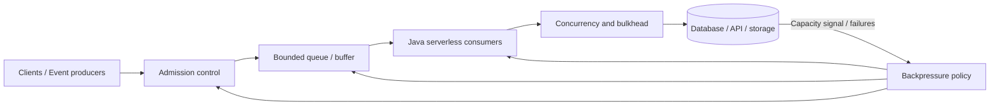
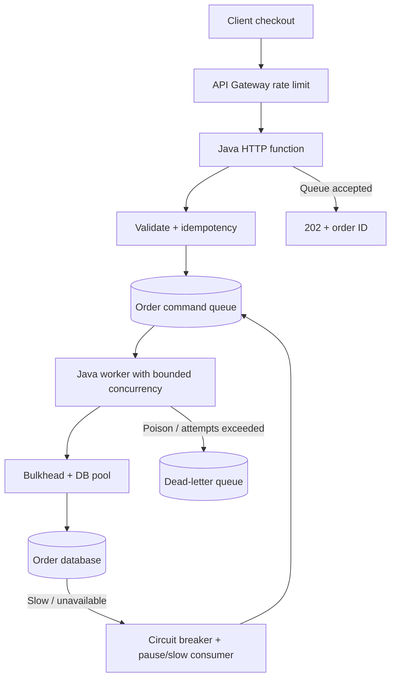

# Áp dụng backpressure để bảo vệ hệ thống phía sau

Serverless có thể tạo thêm function instance khi lượng request hoặc event tăng. Khả năng scale này giúp ứng dụng tiếp nhận burst traffic, nhưng cũng có thể đẩy tải sang database, API đối tác, cache hoặc message broker nhanh hơn khả năng xử lý của chúng. Một Java function có thể vẫn chạy tốt trong khi connection pool của database đã cạn, downstream bắt đầu trả 429/503 và retry làm lượng request tăng thêm.

**Backpressure** là cách điều tiết tốc độ công việc đi vào một thành phần theo khả năng xử lý thực tế của thành phần phía sau. Thay vì để producer gửi không giới hạn rồi chờ timeout, hệ thống tạo tín hiệu để giảm tốc, xếp hàng trong giới hạn, từ chối sớm hoặc hạ mức ưu tiên của công việc. Mục tiêu là giữ hệ thống trong vùng ổn định, bảo vệ dữ liệu và tài nguyên downstream, đồng thời đưa ra phản hồi có thể xử lý cho caller.

Bài học tập trung vào cách áp dụng backpressure cho Java serverless được kích hoạt bởi HTTP, queue hoặc event. Các kỹ thuật chính gồm bounded queue, admission control, rate limit, concurrency limit, bulkhead, timeout budget, circuit breaker, retry có kiểm soát và load shedding.

## 1. Vì sao serverless cần backpressure?

Trong mô hình server truyền thống, số process hoặc thread thường giới hạn khả năng nhận việc. Khi quá tải, server có thể hết worker và tự nhiên từ chối hoặc làm chậm request. Serverless lại có thể scale-out theo tải: một đợt burst khiến nền tảng tạo thêm nhiều instance hoặc invocation đồng thời.

Điều này tạo ra một vấn đề nếu downstream có capacity cố định. Ví dụ:

- API Gateway nhận 2.000 request/giây.
- Java function scale lên để xử lý gần như toàn bộ request.
- Mỗi invocation mở một kết nối database hoặc gọi một API đối tác.
- Database chỉ chịu được 300 thao tác/giây hoặc 100 kết nối đồng thời.
- Connection pool bắt đầu chờ, request timeout và function retry.
- Retry tạo thêm tải trong khi database đang yếu, khiến sự cố lan rộng.

Scale-out của function không làm database tự động scale theo. Backpressure tạo giới hạn rõ ràng giữa tốc độ nhận việc và tốc độ downstream có thể hoàn tất.



Backpressure không chỉ là giảm concurrency. Đó là cơ chế phản hồi xuyên suốt: biết tải đến, biết capacity, quyết định nhận/đợi/từ chối, giới hạn số công việc đang chạy và không retry nhanh hơn khả năng phục hồi.

## 2. Mô hình tải: arrival rate và service rate

Để điều tiết tải, cần phân biệt tốc độ công việc đến và tốc độ hệ thống hoàn tất.

- **Arrival rate (λ):** số request/message đến mỗi giây.
- **Service rate (μ):** số công việc một consumer hoặc nhóm consumer hoàn tất mỗi giây.
- **Concurrency (C):** số invocation/công việc đang xử lý đồng thời.
- **Service time (S):** thời gian xử lý trung bình của một công việc.
- **Queue depth (Q):** số công việc đang chờ.

Nếu λ lớn hơn μ trong một khoảng thời gian đủ dài, backlog sẽ tăng. Nếu λ thấp hơn μ, hệ thống có khả năng xử lý backlog, nhưng vẫn cần tính đến burst và giới hạn bộ nhớ.

Theo Little's Law, trong trạng thái ổn định:

\[
L = \lambda W
\]

Trong đó (L) là số công việc trung bình trong hệ thống (đang chờ và đang xử lý), λ là arrival rate và (W) là thời gian trung bình một công việc ở trong hệ thống.

Với một nhóm worker có concurrency tối đa (C) và service time trung bình (S), throughput lý thuyết gần đúng là:

\[
\mu \approx \frac{C}{S}
\]

Ví dụ, nếu mỗi invocation xử lý một request trong 200 ms và giới hạn 40 invocation đồng thời:

\[
\mu \approx \frac{40}{0,2} = 200\text{ request/giây}
\]

Đây chỉ là ước lượng khi worker luôn có việc và thời gian xử lý tương đối ổn định. Database, API rate limit, network, batch size và tail latency có thể làm throughput thực thấp hơn. Không nên cấu hình concurrency sát mức lý thuyết tối đa; cần chừa headroom để hấp thụ biến động.

### Queue drain time

Nếu backlog có (Q) message, consumer xử lý μ message/giây và producer vẫn gửi λ message/giây, thời gian drain gần đúng khi μ lớn hơn λ là:

\[
T_{drain} \approx \frac{Q}{\mu - \lambda}
\]

Ví dụ backlog 12.000 message, consumer xử lý 500 message/giây, producer vẫn gửi 200 message/giây:

\[
T_{drain} \approx \frac{12.000}{500-200} = 40\text{ giây}
\]

Nếu μ nhỏ hơn hoặc bằng λ, backlog không thể tự giảm. Khi đó cần tăng capacity consumer một cách an toàn, giảm tốc producer hoặc loại bỏ công việc không cần thiết.

## 3. Backpressure khác với autoscaling

Autoscaling tăng hoặc giảm số instance theo tín hiệu tải. Backpressure kiểm soát lượng công việc được nhận và lượng công việc được phép chạy. Hai cơ chế cần phối hợp.

| Cơ chế | Câu hỏi được giải quyết | Ví dụ |
| --- | --- | --- |
| Autoscaling | Cần bao nhiêu instance để xử lý tải? | Tăng số Cloud Run instances hoặc Lambda concurrency |
| Concurrency limit | Bao nhiêu công việc được chạy cùng lúc? | Giới hạn 30 invocation tới database |
| Rate limit | Bao nhiêu request được nhận trong một đơn vị thời gian? | 100 request/giây cho một tenant |
| Admission control | Có nhận công việc mới hay từ chối/đợi? | Trả 429 khi hàng đợi đầy |
| Queue buffering | Có thể tách producer và consumer bằng buffer không? | HTTP API enqueue vào SQS/Pub/Sub |
| Load shedding | Công việc nào có thể bỏ hoặc trì hoãn khi quá tải? | Tạm bỏ refresh cache không quan trọng |

Autoscaling không nên được dùng để đẩy mọi tải đến downstream. Nếu database chỉ xử lý được 200 query/giây, tăng function instances lên 1.000 có thể làm database sập nhanh hơn. Hãy scale consumer tới giới hạn an toàn và điều tiết phần tải vượt capacity.

## 4. Đặt backpressure ở đúng ranh giới

Một kiến trúc có thể có nhiều điểm cần điều tiết:

1. **Client/producer:** giảm tốc khi nhận 429/503 hoặc Retry-After.
2. **API gateway/edge:** giới hạn request theo IP, API key, tenant hoặc route.
3. **Queue/broker:** hấp thụ burst trong giới hạn storage, retention và quota.
4. **Function trigger:** giới hạn batch, concurrency hoặc số instance consumer.
5. **Java handler:** dùng semaphore/bulkhead để bảo vệ resource pool trong một instance.
6. **Downstream client:** giới hạn connection, request rate, timeout và retry.
7. **Database/service:** áp dụng quota, connection limit và workload priority.

Nếu chỉ đặt semaphore trong Java function, mỗi instance có một semaphore riêng. Khi serverless scale lên 50 instance, tổng số request vẫn có thể gấp 50 lần giới hạn cục bộ. Vì vậy, cần một giới hạn toàn cục ở gateway, queue consumer, platform concurrency hoặc downstream quota; giới hạn trong process chỉ là lớp bảo vệ bổ sung.

## 5. Dùng queue làm bộ đệm có giới hạn

Queue tách producer khỏi consumer. Producer có thể nhận request nhanh, lưu công việc bền vững rồi trả `202 Accepted`; consumer xử lý theo tốc độ được cấu hình.

Một flow thường gặp:

1. HTTP function xác thực request và kiểm tra input.
2. Function ghi job metadata và enqueue một message nhỏ chứa job ID/reference.
3. Function trả `202 Accepted` cùng status URL.
4. Queue trigger gọi Java worker theo concurrency/batch policy.
5. Worker xử lý dữ liệu, cập nhật trạng thái và phát event hoàn tất.
6. Client polling hoặc nhận callback khi job xong.

Không nên đưa file lớn hoặc dữ liệu nhạy cảm vào message nếu có thể lưu trong object storage và truyền reference. Queue cần có giới hạn kích thước, retention, visibility/lock timeout, dead-letter và chính sách khi backlog vượt ngưỡng.

### Queue không phải bộ nhớ vô hạn

Queue giúp hấp thụ burst nhưng backlog vẫn tiêu thụ storage, tăng event age và có thể vượt retention/SLO. Cần đặt ngưỡng:

- Queue depth tối đa được chấp nhận theo storage/quota.
- Oldest message age tối đa theo nghiệp vụ.
- Tốc độ producer/consumer mục tiêu.
- Retention và TTL của message/job.
- DLQ threshold và quy trình xử lý poison message.
- Admission control khi backlog đã quá lớn.

Khi queue gần ngưỡng, producer có thể bị rate limit, từ chối job mới hoặc chuyển sang chế độ degraded. Không để producer tiếp tục gửi vô hạn chỉ vì queue API vẫn trả thành công.

## 6. Admission control cho HTTP function

Admission control quyết định có nhận request mới hay không trước khi tiêu tốn tài nguyên xử lý. Nếu downstream đang quá tải hoặc hàng đợi đã đầy, trả lỗi có ý nghĩa để client thử lại sau.

Các response thường dùng:

- `429 Too Many Requests`: caller vượt rate/quota hoặc giới hạn công việc.
- `503 Service Unavailable`: service tạm thời không thể nhận thêm tải.
- `Retry-After`: gợi ý thời điểm caller nên thử lại.
- `202 Accepted`: đã nhận công việc bất đồng bộ và sẽ xử lý sau; cần trả job ID/status URL.

Không trả `200 OK` khi request chưa được lưu bền vững hoặc công việc chưa được chấp nhận. Nếu API trả `202`, phải bảo đảm job đã được ghi vào durable queue/store trước khi response gửi đi.

### Ví dụ Java trả 429 khi semaphore cục bộ đã đầy

```java
import java.util.concurrent.Semaphore;
import java.util.concurrent.TimeUnit;

public final class RequestGate {
    private final Semaphore permits = new Semaphore(20);

    public <T> T execute(java.util.concurrent.Callable<T> work)
            throws Exception {
        if (!permits.tryAcquire()) {
            throw new TooBusyException("Capacity is currently full");
        }
        try {
            return work.call();
        } finally {
            permits.release();
        }
    }

    public static final class TooBusyException extends RuntimeException {
        public TooBusyException(String message) {
            super(message);
        }
    }
}
```

HTTP adapter có thể map `TooBusyException` sang 429 hoặc 503 và thêm `Retry-After` nếu biết thời gian phục hồi. Ví dụ này giới hạn 20 tác vụ trong **một process**. Nó không tạo global limit giữa nhiều serverless instances và không thay thế gateway quota hoặc platform concurrency.

Không dùng `tryAcquire(timeout)` dài cho mọi request khi serverless đã quá tải; việc giữ request chờ vẫn tiêu tốn invocation, thread và memory. Nếu công việc có thể chờ, đưa nó vào durable queue thay vì giữ HTTP connection.

## 7. Rate limiting: giới hạn tốc độ nhận request

Rate limit đặt quota theo đơn vị thời gian, ví dụ 60 request/phút cho một API key hoặc 500 message/giây cho một tenant. Các thuật toán phổ biến:

- **Fixed window:** đếm request trong từng cửa sổ cố định; dễ triển khai nhưng có thể burst ở ranh giới hai cửa sổ.
- **Sliding window:** tính request trong cửa sổ trượt; chính xác hơn nhưng cần lưu timestamp/count.
- **Token bucket:** token được bổ sung theo tốc độ cố định; request tiêu thụ token, bucket có dung lượng cho phép burst giới hạn.
- **Leaky bucket:** đưa request vào hàng đợi và xử lý theo tốc độ đều; phù hợp khi cần smoothing.

Ví dụ token bucket: refill 100 token/giây, bucket capacity 200. Hệ thống cho phép burst tối đa 200 request, sau đó trung bình chỉ nhận thêm 100 request/giây nếu token được tiêu thụ liên tục.

### Rate limit theo tenant và operation

Một giới hạn tổng có thể khiến một tenant lớn chiếm toàn bộ capacity. Có thể phân bổ quota theo:

- Tenant/customer/API key.
- Endpoint hoặc loại operation.
- Priority tier (critical, standard, best effort).
- Region hoặc downstream dependency.
- Request cost/weight thay vì chỉ đếm request.

Ví dụ export report có thể tiêu tốn nhiều tài nguyên hơn health check; rate limiter có thể tính 10 token cho export và 1 token cho truy vấn nhẹ.

### Rate limit phân tán

Static counter trong Java process không phải global rate limiter vì mỗi instance có state riêng. Nếu cần quota toàn hệ thống, dùng API gateway, Redis/managed cache, distributed rate limit service hoặc quota service của nền tảng. Dữ liệu quota phải có atomic update/expiration phù hợp; nếu mỗi instance tự đếm, scale-out sẽ làm tổng quota vượt giới hạn.

## 8. Giới hạn concurrency để bảo vệ downstream

Concurrency limit giới hạn số invocation/request đang chạy cùng lúc. Chọn giới hạn theo capacity thấp nhất trong đường đi, ví dụ:

- Database chỉ có 120 connection dành cho workload này.
- Mỗi function instance có pool tối đa 5 connection.
- Các service khác đã dùng 40 connection.
- Cần giữ 20 connection headroom cho vận hành và burst.

Số connection còn lại cho function khoảng 60; nếu mỗi instance có 5 connection, có thể bắt đầu thử nghiệm với tối đa khoảng 12 instance, sau đó đo lại dưới tải thực. Đây là phép tính minh họa; connection pool không phải lúc nào cũng sử dụng hết và một query có thể giữ connection trong thời gian khác nhau.

Các giới hạn cần phối hợp:

1. Maximum function concurrency/instances ở nền tảng.
2. Trigger-specific maximum concurrency hoặc consumer count.
3. Concurrency bên trong một instance (HTTP server/thread pool/semaphore).
4. Connection pool và rate limit của từng dependency.

Đặt giới hạn thấp nhất đủ bảo vệ downstream, sau đó tăng dần qua load test. Nếu function có nhiều dependency, có thể cần bulkhead riêng cho từng dependency để một API chậm không chiếm hết worker.

## 9. Bulkhead: cô lập tài nguyên theo dependency

Bulkhead chia tài nguyên thành các vùng độc lập. Ví dụ Java function gọi hai dịch vụ: inventory và recommendation. Nếu cả hai dùng chung một executor không giới hạn, recommendation chậm có thể chiếm hết thread và làm inventory request bị kẹt.

Có thể tạo giới hạn riêng:

- Tối đa 20 call đồng thời tới inventory.
- Tối đa 5 call đồng thời tới recommendation.
- Timeout 300 ms cho recommendation, 800 ms cho inventory.
- Dành worker/connection riêng cho thao tác critical.

Ví dụ Resilience4j Bulkhead:

```java
import io.github.resilience4j.bulkhead.Bulkhead;
import io.github.resilience4j.bulkhead.BulkheadConfig;
import java.time.Duration;

public final class InventoryGateway {
    private final Bulkhead bulkhead = Bulkhead.of(
            "inventory",
            BulkheadConfig.custom()
                    .maxConcurrentCalls(20)
                    .maxWaitDuration(Duration.ZERO)
                    .build());

    public Inventory get(String sku) {
        return bulkhead.executeSupplier(() -> callInventoryApi(sku));
    }

    private Inventory callInventoryApi(String sku) {
        // Gọi HTTP client đã cấu hình timeout.
        return new Inventory(sku, 0);
    }

    public record Inventory(String sku, int available) {}
}
```

Bulkhead này giới hạn concurrency trong một JVM. Nếu có nhiều instances, tổng số call vẫn là giới hạn cục bộ nhân với số instance. Kết hợp với platform max instances hoặc quota toàn cục của dependency.

Không tạo executor queue không giới hạn để “giữ” công việc khi bulkhead đầy. Nếu không thể xử lý ngay, từ chối có kiểm soát hoặc enqueue vào broker bền vững.

## 10. Timeout budget và deadline propagation

Timeout giúp giải phóng tài nguyên khi downstream không phản hồi. Nhưng timeout ở các lớp phải phối hợp với nhau.

Ví dụ request HTTP có deadline tổng 2 giây:

| Thành phần | Ngân sách thời gian minh họa |
| --- | ---: |
| Gateway/authentication | 150 ms |
| Java handler logic | 200 ms |
| Database call | 700 ms |
| External API | 500 ms |
| Serialization/network margin | 250 ms |
| Tổng | 1.800 ms |

Phần còn lại là headroom cho biến động. Không đặt database timeout 5 giây bên trong request timeout 2 giây; handler có thể bị client ngắt trước khi database call kết thúc.

Truyền deadline hoặc remaining timeout qua các service. Mỗi downstream call chỉ được dùng phần ngân sách còn lại. Với queue worker, deadline dựa trên visibility timeout/message lock và function timeout; phải đủ thời gian để hoàn tất, renew lock nếu cơ chế hỗ trợ hoặc để message retry an toàn.

### Timeout không tự hủy side effect

Client timeout không chứng minh server đã dừng thao tác. Một payment request có thể đã được xử lý ở provider nhưng response bị mất. Retry cần idempotency key và trạng thái kết quả để tránh charge hai lần.

## 11. Circuit breaker: ngừng gọi dependency đang lỗi

Circuit breaker theo dõi lỗi/timeout của dependency và tạm thời ngừng gửi request khi dependency có dấu hiệu không khỏe. Ba trạng thái thường gặp:

- **Closed:** request được phép đi qua; lỗi được ghi nhận.
- **Open:** vượt ngưỡng lỗi, request bị từ chối nhanh trong thời gian chờ.
- **Half-open:** cho một số request thử nghiệm; nếu thành công thì đóng circuit, nếu lỗi thì mở lại.

Circuit breaker ngăn function tiếp tục tạo tải lên database/API đang lỗi. Nó cần fallback phù hợp, ví dụ trả cached data, đưa job vào queue hoặc trả 503. Không fallback thành dữ liệu giả cho thao tác ghi quan trọng.

Ví dụ Resilience4j:

```java
import io.github.resilience4j.circuitbreaker.CircuitBreaker;
import io.github.resilience4j.circuitbreaker.CircuitBreakerConfig;
import java.time.Duration;

public final class PartnerClient {
    private final CircuitBreaker breaker = CircuitBreaker.of(
            "partner-api",
            CircuitBreakerConfig.custom()
                    .failureRateThreshold(50)
                    .slidingWindowSize(20)
                    .minimumNumberOfCalls(10)
                    .waitDurationInOpenState(Duration.ofSeconds(10))
                    .build());

    public PartnerResult fetch(String id) {
        return breaker.executeSupplier(() -> callPartner(id));
    }

    private PartnerResult callPartner(String id) {
        // HTTP client phải có connect/read/request timeout riêng.
        return new PartnerResult(id, "ok");
    }

    public record PartnerResult(String id, String status) {}
}
```

Circuit breaker ở một instance chỉ quan sát lỗi trong instance đó; khi serverless scale-out, mỗi instance có thể có trạng thái khác nhau. Đây thường là điều chấp nhận được để bảo vệ cục bộ. Nếu cần global circuit/quota, dùng gateway hoặc coordination service; không chia sẻ mutable circuit state qua static variable giữa instance vì mỗi instance là process riêng.

## 12. Retry có kiểm soát và retry budget

Retry hữu ích với lỗi transient như network reset, throttling hoặc service tạm thời không khả dụng. Nhưng retry cũng là traffic mới. Nếu producer retry nhanh, function retry và SDK retry cùng lúc, một request gốc có thể tạo ra nhiều attempt.

Các nguyên tắc:

- Chỉ retry lỗi có khả năng phục hồi; không retry payload sai hoặc lỗi authorization cố định.
- Dùng exponential backoff và jitter để phân tán lần retry.
- Đặt maximum attempts và tổng retry deadline.
- Tránh retry ở mọi tầng cùng lúc; xác định một lớp chịu trách nhiệm chính.
- Dùng idempotency key hoặc deduplication cho side effect.
- Tách retryable error khỏi poison message/DLQ.
- Theo dõi retry count và retry amplification.

Một dạng backoff:

\[
delay_n = \min(delay_{max}, delay_{base} \times 2^n) + jitter
\]

Ví dụ base delay 200 ms, max delay 5 giây, thêm jitter ngẫu nhiên. Thông số thực tế phụ thuộc SLA và retry policy của nền tảng.

### Retry budget

Retry budget giới hạn tổng lượng retry so với traffic gốc hoặc trong một khoảng thời gian. Ví dụ chỉ cho phép retry tối đa 10% số request gốc trong một cửa sổ, hoặc tối đa 3 attempt cho một message. Khi budget cạn, chuyển lỗi sang DLQ/quarantine hoặc trả lỗi caller để tránh retry storm.

Không cộng dồn retry một cách mù quáng: nếu API client retry 3 lần, function retry 3 lần và HTTP SDK retry 3 lần, số lần downstream call lý thuyết có thể tăng rất lớn. Ghi rõ retry owner, attempt limit và timeout budget ở từng boundary.

## 13. Load shedding: bỏ hoặc trì hoãn công việc không thiết yếu

Khi tải vượt capacity, hệ thống có thể chủ động loại bỏ công việc có ưu tiên thấp để bảo vệ chức năng quan trọng.

Ví dụ:

- Giữ thao tác thanh toán và xác nhận đơn hàng.
- Trì hoãn email thông báo, refresh recommendation hoặc tạo báo cáo.
- Tắt một số endpoint tìm kiếm nặng hoặc trả kết quả cache.
- Từ chối request export mới khi backlog export đã vượt ngưỡng.
- Giảm số bản ghi telemetry/debug sampling trong thời gian incident.

Load shedding cần dựa trên business priority, không dựa trên random drop. Nếu loại bỏ công việc, cần phản hồi rõ cho caller hoặc ghi trạng thái để có thể chạy lại. Không âm thầm bỏ message nghiệp vụ mà không có audit/DLQ.

### Graceful degradation

Graceful degradation giảm chất lượng của tính năng ít quan trọng trong lúc hệ thống quá tải:

- Dùng cache hoặc dữ liệu stale có giới hạn cho nội dung đọc.
- Tạm tắt gợi ý/recommendation nhưng vẫn cho phép checkout.
- Trả status “processing” cho báo cáo thay vì giữ request mở.
- Chấp nhận request vào queue nếu backlog và retention còn trong ngưỡng.

Không dùng stale cache cho dữ liệu yêu cầu tính nhất quán mạnh như số dư hoặc trạng thái thanh toán nếu nghiệp vụ không cho phép.

## 14. Batch size và flow control cho event consumer

Batch lớn giảm overhead invocation nhưng có thể làm mỗi invocation giữ nhiều memory, connection và thời gian xử lý. Khi một record lỗi, cách retry có thể khiến record khác chạy lại. Batch nhỏ tăng invocation overhead nhưng giới hạn blast radius.

Chọn batch size dựa trên:

- Kích thước record và memory mỗi record.
- Thời gian xử lý trung bình/p99.
- Downstream throughput và connection pool.
- Retry/partial batch semantics của trigger.
- Visibility timeout/lock duration và function timeout.
- Khả năng xử lý song song theo partition/order key.

Với stream partitioned, tăng consumer concurrency không thể vượt giới hạn partition hoặc ordering semantics của nguồn. Một partition nóng có thể làm lag tăng dù các partition khác rảnh.

### Backpressure trong pull consumer

Với pull subscription/client, consumer thường có thể giới hạn số message hoặc byte đang outstanding. Khi số outstanding đạt ngưỡng, dừng pull thêm message cho tới khi xử lý xong. Đây là flow control trực tiếp và thường dễ dự đoán hơn việc nhận vô hạn rồi giữ trong memory.

Với push subscription, nguồn đẩy request đến endpoint; dùng autoscaling, concurrency limit và response code phù hợp để điều tiết. Cần hiểu retry/backoff của nguồn khi endpoint trả lỗi để tránh tạo vòng lặp retry quá nhanh.

## 15. Bảo vệ database và connection pool

Database thường là downstream nhạy cảm nhất vì số connection, CPU, IOPS và lock đều có giới hạn.

Các biện pháp:

- Giới hạn pool size trong mỗi Java instance.
- Giới hạn tổng function concurrency hoặc số instance để tổng pool không vượt connection budget.
- Dùng proxy/pooling service khi phù hợp (ví dụ RDS Proxy hoặc connection pooling managed).
- Đặt connection timeout, query timeout và transaction timeout.
- Không giữ connection trong lúc chờ HTTP API hoặc xử lý CPU lâu.
- Dùng batch/upsert để giảm round-trip nếu phù hợp.
- Dùng queue để làm phẳng burst và worker concurrency cố định.
- Tách workload đọc/ghi hoặc workload nặng theo pool/role riêng nếu cần.
- Theo dõi active connection, waiting thread, lock wait, slow query và transaction age.

Một lỗi thường gặp là đặt pool size 20 trong mỗi instance rồi cho function scale lên 100 instance: tổng connection tiềm năng có thể là 2.000. Pool size phải được tính theo maximum instance/concurrency, không chỉ theo một JVM.

## 16. Bảo vệ API đối tác và dịch vụ có quota

Nếu downstream giới hạn 100 request/giây, function không thể gọi 500 request/giây chỉ vì serverless scale được. Cần:

- Rate limiter ở client hoặc gateway theo quota nhà cung cấp.
- Giới hạn concurrency để tránh quá nhiều request đang chờ.
- Tôn trọng HTTP 429 và `Retry-After`.
- Dùng exponential backoff với jitter.
- Cache kết quả đọc an toàn và gom request trùng (request coalescing) khi phù hợp.
- Đưa công việc không khẩn cấp vào queue.
- Theo dõi quota utilization và lỗi 429.

Không retry ngay lập tức khi nhận 429. Nếu provider trả `Retry-After`, tuân theo giá trị đó trong giới hạn deadline. Nếu quota dùng chung cho nhiều function, local rate limiter riêng từng function có thể làm tổng request vượt quota; dùng centralized quota hoặc chia ngân sách theo consumer.

## 17. Java implementation: token bucket cục bộ

Ví dụ sau minh họa token bucket đơn giản trong một JVM. Mỗi request tiêu thụ một token; token được bổ sung theo thời gian:

```java
public final class LocalTokenBucket {
    private final long capacity;
    private final long refillPerSecond;
    private double tokens;
    private long lastRefillNanos;

    public LocalTokenBucket(long capacity, long refillPerSecond) {
        if (capacity <= 0 || refillPerSecond <= 0) {
            throw new IllegalArgumentException("Limits must be positive");
        }
        this.capacity = capacity;
        this.refillPerSecond = refillPerSecond;
        this.tokens = capacity;
        this.lastRefillNanos = System.nanoTime();
    }

    public synchronized boolean tryAcquire() {
        long now = System.nanoTime();
        long elapsed = Math.max(0, now - lastRefillNanos);
        double elapsedSeconds = elapsed / 1_000_000_000.0;
        tokens = Math.min(capacity, tokens + elapsedSeconds * refillPerSecond);
        lastRefillNanos = now;

        if (tokens < 1.0) {
            return false;
        }
        tokens -= 1.0;
        return true;
    }
}
```

Đây là ví dụ giáo dục cho một process, không phải thư viện rate limiter production. Cần test concurrency, định nghĩa burst/refill chính xác, xử lý clock/lifecycle theo yêu cầu và cân nhắc dùng thư viện đã được kiểm chứng. Trong serverless, mỗi instance có bucket riêng; 10 instance có thể cho phép tổng tốc độ xấp xỉ 10 lần refillPerSecond. Muốn quota toàn cục, dùng gateway hoặc distributed store có thao tác atomic.

## 18. Java implementation: xử lý queue với bounded worker

Một consumer Java tự quản lý thread pool cần bounded queue và chính sách reject rõ ràng. Ví dụ:

```java
import java.util.concurrent.ArrayBlockingQueue;
import java.util.concurrent.ThreadPoolExecutor;
import java.util.concurrent.TimeUnit;

public final class BoundedWorkPool implements AutoCloseable {
    private final ThreadPoolExecutor executor = new ThreadPoolExecutor(
            4,
            4,
            0L,
            TimeUnit.MILLISECONDS,
            new ArrayBlockingQueue<>(100),
            new ThreadPoolExecutor.AbortPolicy());

    public void submit(Runnable task) {
        executor.execute(task);
    }

    @Override
    public void close() {
        executor.shutdown();
    }
}
```

Khi 4 worker đang bận và queue có 100 task, task tiếp theo bị reject thay vì tăng memory vô hạn. Adapter cần bắt `RejectedExecutionException` và phản hồi/đẩy lại message theo contract. Không được ACK message trước khi task đã được nhận bền vững hoặc hoàn tất; nếu function host kết thúc invocation trong khi thread nền còn chạy, nền tảng có thể freeze/terminate process và làm mất công việc.

Trong FaaS, ưu tiên để queue/broker quản lý buffer và để mỗi invocation xử lý một message/batch rồi hoàn tất. Thread pool minh họa phù hợp hơn với một Java service/consumer process dài hạn hoặc một đoạn xử lý đồng bộ bên trong invocation có lifecycle được kiểm soát.

## 19. AWS Lambda: concurrency và event source backpressure

AWS Lambda có nhiều cơ chế điều tiết:

- **Reserved concurrency:** đặt giới hạn concurrency cho function và đồng thời giữ phần concurrency đó khỏi pool dùng chung của account. Đây là cách bảo vệ downstream khỏi một function scale quá mức.
- **Provisioned concurrency:** chuẩn bị execution environment trước để giảm cold start; không phải công cụ rate limit và có chi phí riêng.
- **Maximum concurrency của SQS event source mapping:** giới hạn mức consumer concurrency của một mapping để kiểm soát tốc độ đọc queue.
- **Batch size:** số record mỗi invocation; cần cân bằng throughput, memory và retry blast radius.
- **Event source scaling configuration:** các tùy chọn scale của nguồn event tùy trigger/loại mapping.
- **API Gateway throttling:** giới hạn request rate/burst ở lớp HTTP trước Lambda.

Reserved concurrency và maximum concurrency của event source mapping cần được tính cùng nhau. Nếu tổng maximum concurrency của các mapping vượt reserved concurrency, các mapping có thể bị throttle; nếu reserved concurrency quá cao, database vẫn có thể bị quá tải. Cần chừa capacity cho các invocation khác của cùng function nếu có.

### SQS queue và visibility timeout

Khi Lambda poll SQS, message được giữ invisible trong visibility timeout trong lúc xử lý. Nếu function không hoàn tất thành công, message có thể xuất hiện lại sau timeout và được giao lại. Visibility timeout nên đủ dài cho function timeout và retry behavior; AWS khuyến nghị cấu hình phù hợp với thời gian thực thi và batch window của event source mapping.

Để bảo vệ downstream:

1. Đặt maximum concurrency của event source mapping theo database/API capacity.
2. Chọn batch size và batch window phù hợp.
3. Dùng partial batch response để chỉ retry record lỗi khi trigger/configuration hỗ trợ.
4. Đặt redrive policy và DLQ cho poison message.
5. Theo dõi `ApproximateAgeOfOldestMessage`, visible/in-flight messages và Lambda throttles/errors.

### Kinesis và DynamoDB Streams

Với stream, partition/shard và ordering ảnh hưởng concurrency. Theo dõi iterator age/partition lag. Tăng parallelization factor hoặc consumer concurrency chỉ khi xử lý song song không phá thứ tự cần thiết và downstream chịu được tải. Một partition nóng có thể là bottleneck; không thể chỉ tăng số Lambda instance để vượt giới hạn nguồn.

## 20. Azure Functions: host concurrency và trigger control

Azure Functions có thể điều tiết theo trigger extension, host configuration và hosting plan. Các setting trong `host.json` phụ thuộc loại trigger và extension version; ví dụ Queue Storage có `batchSize`/`newBatchThreshold`, Service Bus có các giới hạn concurrent calls/sessions hoặc batch processing theo extension.

Các lớp điều tiết:

- **HTTP/API Management:** rate limit/quota theo subscription, client hoặc route trước khi request tới Function App.
- **Queue Storage:** batch size, dequeue/retry policy và poison queue.
- **Service Bus:** max concurrent calls/sessions, prefetch và lock renewal theo extension/SDK.
- **Event Hubs:** batch size, partition ownership và checkpoint; xử lý lag theo partition.
- **Hosting plan:** giới hạn instance/scale theo plan và cấu hình Function App.
- **Downstream:** connection pool, managed database limits và service quota.

Ví dụ khung `host.json` cho Queue Storage:

```json
{
  "version": "2.0",
  "extensions": {
    "queues": {
      "batchSize": 8,
      "newBatchThreshold": 4,
      "maxDequeueCount": 5
    }
  }
}
```

Các giá trị trên chỉ là ví dụ, không phải mặc định tối ưu. `batchSize` và `newBatchThreshold` ảnh hưởng số message được xử lý đồng thời trên một host; nhiều host vẫn có thể scale-out. Cần kết hợp hosting plan max scale và khả năng database. Kiểm tra schema, default và behavior theo Functions runtime/extension version đang dùng.

Với HTTP-triggered Function, có thể đặt rate limit tại API Management hoặc gateway thay vì cố giữ nhiều request chờ trong function. Với queue/event trigger, theo dõi backlog, oldest message age, delivery count, DLQ và host scale.

## 21. Google Cloud Run/Functions: concurrency, instances và Pub/Sub flow control

Cloud Run service cung cấp cấu hình request concurrency trên mỗi instance và maximum instances. Hai tham số này có thể giới hạn tổng lượng request đồng thời:

\[
\text{Max in-flight requests} \approx \text{max instances} \times \text{concurrency per instance}
\]

Đây là giới hạn gần đúng cho request đang được xử lý, không phải giới hạn request rate. Nếu request duration giảm, cùng concurrency có thể tạo throughput cao hơn; nếu duration tăng, backlog/latency tăng.

Cloud Run functions/Functions Framework cũng cần được cấu hình concurrency/instance theo loại function, generation và trigger. Không giả định mọi function có cùng default hoặc hỗ trợ cùng knob như Cloud Run service; kiểm tra runtime/plan và metric của resource cụ thể.

### Pub/Sub subscriber flow control

Với pull subscriber, client có thể giới hạn số outstanding messages và outstanding bytes. Khi đạt ngưỡng, subscriber tạm dừng nhận thêm message cho tới khi xử lý/ack các message hiện tại. Đây là cách tạo backpressure ở consumer thay vì tải mọi message vào memory.

Với push subscription, Pub/Sub gửi request tới endpoint và điều chỉnh delivery theo response/flow behavior của dịch vụ. Endpoint nên xử lý nhanh hoặc enqueue công việc, trả response chỉ sau khi đã nhận bền vững. Khi trả lỗi, Pub/Sub có thể redeliver theo retry policy; handler phải idempotent.

### Cloud Run Jobs

Với batch job, giới hạn task parallelism để bảo vệ database và API đối tác. Số task có thể lớn nhưng không có nghĩa nên chạy tất cả cùng lúc. Chọn parallelism theo throughput downstream, task size và thời gian hoàn tất mục tiêu.

## 22. Backpressure cho HTTP và async workflow

HTTP và message/event có cách phản hồi khác nhau:

| Kiểu workload | Cách backpressure |
| --- | --- |
| HTTP synchronous | Gateway rate limit, 429/503, Retry-After, concurrency cap và timeout ngắn |
| HTTP asynchronous | Ghi job bền vững, trả 202 + status URL, queue consumer có giới hạn |
| Queue consumer | Giới hạn polling/concurrency/batch; để backlog trong broker; DLQ và redrive có kiểm soát |
| Event stream | Giới hạn consumer/partition concurrency; theo dõi lag/checkpoint; xử lý batch an toàn |
| Scheduled job | Tránh chồng execution; giới hạn parallelism và bỏ qua/đưa lịch trễ vào queue theo policy |

Nếu HTTP request cần hoàn thành trong 300 ms nhưng downstream đang chậm, trả 503/429 sớm có thể tốt hơn giữ request 20 giây rồi timeout. Nếu công việc có thể xử lý sau, chuyển sang async và cung cấp trạng thái cho caller.

## 23. Retry storm và cascading failure

Retry storm xảy ra khi nhiều client/worker cùng retry sau một lỗi, tạo ra burst mới đúng lúc dependency đang phục hồi. Một dependency chậm có thể gây chuỗi sự cố:

1. Database chậm làm function duration tăng.
2. Concurrency tăng vì invocation giữ slot lâu hơn.
3. Function chạm concurrency limit, request bị throttle.
4. Client retry ngay, tạo thêm request.
5. Queue message hết visibility/lock và được giao lại.
6. Nhiều attempt cùng thực hiện side effect hoặc chiếm connection.
7. Database càng quá tải và hệ thống mất khả năng tự phục hồi.

Để phá vòng lặp:

- Giới hạn concurrency và rate theo capacity downstream.
- Dùng timeout nhỏ hơn deadline tổng.
- Retry có backoff/jitter và attempt budget.
- Mở circuit khi dependency lỗi kéo dài.
- Đưa công việc không khẩn cấp vào queue.
- Load shed các operation best-effort.
- Chỉ retry record lỗi nếu partial failure được hỗ trợ.
- Dùng idempotency/deduplication để bảo vệ side effect.

## 24. Idempotency khi dùng backpressure và retry

Backpressure có thể khiến request bị từ chối trước khi nhận; retry sau đó là request mới. Với async queue, message có thể được giao lại khi worker timeout hoặc mất ACK. Vì vậy, mọi consumer có side effect cần idempotent.

Một pattern:

1. Producer tạo event ID/idempotency key ổn định.
2. Consumer lưu key vào inbox/processed-event table có unique constraint.
3. Nếu key đã hoàn tất, bỏ qua side effect trùng và ACK message.
4. Nếu chưa xử lý, claim key và thực hiện nghiệp vụ trong transaction phù hợp.
5. Chỉ đánh dấu hoàn tất sau khi side effect được commit bền vững.

Không dùng timestamp hiện tại hoặc random UUID mới ở mỗi retry làm idempotency key. Với payment/email/API bên ngoài, truyền idempotency key tới provider nếu họ hỗ trợ.

## 25. Backpressure và multi-tenant fairness

Một tenant có thể gửi nhiều request và chiếm toàn bộ function concurrency, khiến tenant khác bị chậm. Fairness cần được xem xét cùng tổng capacity.

Các lựa chọn:

- Quota/rate limit riêng theo tenant.
- Weighted fair queue hoặc nhiều queue theo priority.
- Giới hạn concurrency tối đa cho một tenant.
- Reserved capacity cho operation quan trọng.
- Round-robin hoặc weighted scheduling giữa tenant.
- Admission control theo cost estimate thay vì request count đơn thuần.

Không để tenant ID do client tự gửi quyết định quota nếu chưa xác thực. Rate limit key phải dựa trên principal/tenant đã xác thực. Với queue, message attributes cần được kiểm tra và không tin tenant metadata không được ký/đối chiếu.

## 26. Backpressure cho scheduled jobs và workflow

Timer/scheduler có thể tạo nhiều execution cùng lúc nếu lần chạy trước chưa hoàn tất hoặc lịch bị dồn sau outage. Cần:

- Đặt concurrency tối đa cho job/workflow.
- Dùng lease/lock hoặc execution key để ngăn chạy trùng khi nghiệp vụ yêu cầu.
- Giới hạn số partition/task chạy song song.
- Lưu checkpoint và cho phép tiếp tục sau lỗi.
- Nếu backlog lịch tăng, quyết định chạy bù, gộp các khoảng hoặc bỏ qua kỳ cũ theo business rule.
- Không khởi chạy hàng nghìn execution cùng lúc khi downstream chưa sẵn sàng.

Một job chạy mỗi phút nhưng mất 10 phút có thể tạo overlap nếu scheduler không ngăn. Cần thiết kế skip, queue hoặc coalesce policy; không chỉ tăng timeout.

## 27. Quan sát backpressure: metric và alert

Để biết backpressure đang hoạt động đúng, theo dõi cả tải đến, tải hoàn tất và tín hiệu từ downstream.

| Metric | Điều cần quan sát |
| --- | --- |
| Incoming rate | Request/event đến mỗi giây |
| Accepted/rejected rate | Số việc được nhận và bị từ chối |
| Queue depth | Backlog hiện tại |
| Oldest message age | Thời gian công việc cũ nhất đã chờ |
| Consumer throughput | Message/record hoàn tất mỗi giây |
| In-flight/concurrency | Số invocation/task đang chạy |
| Throttle/429/503 | Request bị giới hạn hoặc từ chối |
| Retry/delivery count | Số attempt trên mỗi event/message |
| DLQ depth | Công việc không xử lý được |
| Downstream latency/error | Database/API đang chậm hoặc lỗi |
| Connection pool wait | Thread chờ connection và pool utilization |
| Circuit state | Dependency đang closed/open/half-open |

Alert nên dựa trên ngưỡng nghiệp vụ:

- Oldest message age vượt SLO.
- Queue depth tăng liên tục và consumer throughput thấp hơn arrival rate.
- Throttle/429 tăng trong nhiều cửa sổ.
- Database pool wait hoặc connection utilization chạm ngưỡng.
- Retry và DLQ tăng đột biến.
- Circuit breaker mở kéo dài.

Một queue depth cao chưa chắc là sự cố nếu consumer xử lý nhanh và age thấp. Ngược lại, queue depth nhỏ nhưng oldest age lớn có thể cho thấy một message bị kẹt hoặc partition nóng.

## 28. Quy trình tuning backpressure

1. Đo arrival rate, service time, p95/p99 và throughput downstream dưới tải bình thường.
2. Xác định bottleneck thật: database, API, network, CPU, memory hay quota.
3. Tính capacity mục tiêu với headroom; không dùng capacity tối đa làm operating point.
4. Đặt connection pool và per-instance concurrency.
5. Đặt function max concurrency/instances hoặc trigger consumer concurrency.
6. Đặt queue batch/flow control và backlog/age thresholds.
7. Đặt admission rate limit, tenant quota và 429/503 behavior.
8. Cấu hình timeout, retry budget, jitter và circuit breaker.
9. Load test burst, sustained overload và dependency slowdown.
10. Quan sát accepted/rejected rate, queue age, downstream saturation và business outcome.
11. Điều chỉnh từng knob một để biết tác động.
12. Viết runbook cho load shedding, scale cap và khôi phục backlog.

Không tuning chỉ dựa trên một lần benchmark. Dùng traffic mix thực tế, payload size, tenant distribution, retry và tail latency. Chạy thử khi downstream chậm hoặc lỗi để kiểm tra backpressure có giữ hệ thống ổn định hay không.

## 29. Kịch bản minh họa: bảo vệ database trong order processing

Giả sử API nhận 1.000 order/giây trong flash sale. Database chỉ xử lý ổn định 250 order/giây. Kiến trúc có thể:

1. API Gateway giới hạn burst và rate theo tenant.
2. HTTP function validate, lưu idempotency key và enqueue order command.
3. API trả 202 cùng order ID khi message đã được ghi bền vững.
4. Queue consumer có maximum concurrency được tính theo connection/query budget.
5. Worker dùng pool nhỏ, batch hợp lý và transaction ngắn.
6. Khi oldest age vượt ngưỡng, giảm tốc producer hoặc trả 429 cho request mới.
7. Notification/analytics được đưa vào queue riêng với priority thấp.
8. Khi database lỗi, circuit breaker mở và consumer ngừng nhận thêm hoặc retry theo budget.
9. Message poison được đưa vào DLQ; không retry liên tục.
10. Dashboard theo dõi order accepted, processed, rejected, backlog, age, DB latency và DLQ.



Trong ví dụ này, queue hấp thụ burst nhưng không phải nơi cho phép backlog tăng vô hạn. Nếu database chỉ xử lý 250 order/giây và flash sale kéo dài, cần tăng capacity database, giảm tải nghiệp vụ hoặc từ chối phần request vượt khả năng. Backpressure chỉ kiểm soát sự quá tải; nó không tạo thêm capacity vật lý.

## 30. Các lỗi thường gặp

1. **Dựa hoàn toàn vào autoscaling.** Function scale nhanh có thể làm downstream quá tải.
2. **Dùng queue không giới hạn như kho lưu trữ.** Backlog và event age vẫn phải có ngưỡng.
3. **Chỉ giới hạn concurrency trong JVM.** Nhiều instance nhân tổng giới hạn cục bộ lên.
4. **Tăng max instances để giảm latency mà không kiểm tra DB.** Có thể gây connection exhaustion.
5. **Giữ HTTP request chờ lâu khi quá tải.** Tốn invocation/thread và làm timeout lan truyền.
6. **Retry ngay khi nhận 429/503.** Tạo retry storm và làm dependency yếu hơn.
7. **Retry ở mọi tầng.** Số attempt có thể nhân lên theo cấp số nhân.
8. **Dùng circuit breaker nhưng không có fallback hợp lệ.** Request vẫn thất bại hoặc trả dữ liệu sai.
9. **Dùng unbounded executor queue.** Memory tăng cho tới khi process bị OOM.
10. **ACK message trước khi công việc được nhận bền vững.** Có thể mất việc khi process bị dừng.
11. **Không dùng idempotency.** Retry/redelivery tạo side effect trùng.
12. **Bỏ message âm thầm khi load shed.** Không thể audit hoặc khôi phục công việc.
13. **Rate limit theo IP duy nhất.** NAT/proxy có thể gom nhiều người dùng; cần principal/tenant đã xác thực.
14. **Không đo oldest message age.** Queue có thể chứa công việc đã quá hạn dù depth không lớn.

## 31. Checklist triển khai backpressure

- [ ] Đã đo arrival rate, service rate, duration và downstream capacity chưa?
- [ ] Có xác định bottleneck và operating headroom cho database/API không?
- [ ] Có admission control trước khi nhận request/công việc mới không?
- [ ] HTTP overload trả 429/503/Retry-After theo contract rõ ràng không?
- [ ] Công việc dài được ghi bền vững và trả 202/status URL không?
- [ ] Queue/broker có retention, backlog threshold, oldest-age alert và DLQ không?
- [ ] Consumer có giới hạn concurrency, batch size và flow control không?
- [ ] Per-instance semaphore/bulkhead có được kết hợp với global/platform limit không?
- [ ] Connection pool và downstream quota được tính theo max instances không?
- [ ] Có timeout/deadline propagation và giới hạn tổng thời gian request không?
- [ ] Retry có exponential backoff, jitter, attempt limit và retry budget không?
- [ ] Có circuit breaker/fallback phù hợp cho dependency quan trọng không?
- [ ] Có load shedding/priority policy và cách khôi phục công việc bị trì hoãn không?
- [ ] Consumer idempotent trước duplicate/redelivery không?
- [ ] Có metric accepted/rejected, queue depth/age, throughput, throttle, retry và downstream saturation không?
- [ ] Đã load test burst, sustained overload, dependency slowdown và recovery chưa?
- [ ] Có runbook để giảm tốc producer, điều chỉnh consumer và drain backlog không?

Backpressure bảo vệ hệ thống phía sau bằng cách điều chỉnh lượng công việc được nhận và chạy theo capacity thực tế. Với Java serverless, cần phối hợp gateway rate limit, queue có giới hạn, trigger concurrency, bulkhead/connection pool, timeout, circuit breaker và retry budget. Autoscaling giúp tăng worker khi downstream còn capacity; backpressure ngăn việc scale-out biến một dependency chậm thành sự cố toàn hệ thống. Khi đo cả arrival rate, completion rate, backlog age và downstream saturation, nhóm phát triển có thể giữ hệ thống ổn định ngay cả khi traffic tăng đột biến.

## Tài liệu tham khảo chính thức

- [AWS Lambda – Managing concurrency](https://docs.aws.amazon.com/lambda/latest/dg/lambda-concurrency.html)
- [AWS Lambda – Configuring maximum concurrency for SQS event source mappings](https://docs.aws.amazon.com/lambda/latest/dg/services-sqs-scaling.html)
- [AWS Lambda – Using Lambda with Amazon SQS](https://docs.aws.amazon.com/lambda/latest/dg/with-sqs.html)
- [Amazon SQS – Visibility timeout](https://docs.aws.amazon.com/AWSSimpleQueueService/latest/SQSDeveloperGuide/sqs-visibility-timeout.html)
- [Azure Functions – Concurrency](https://learn.microsoft.com/azure/azure-functions/functions-concurrency)
- [Azure Functions – host.json reference](https://learn.microsoft.com/azure/azure-functions/functions-host-json)
- [Azure Service Bus – Message transfers, locks and settlement](https://learn.microsoft.com/azure/service-bus-messaging/message-transfers-locks-settlement)
- [Google Cloud Run – Concurrency](https://cloud.google.com/run/docs/about-concurrency)
- [Google Cloud Run – Maximum instances](https://cloud.google.com/run/docs/configuring/max-instances)
- [Google Cloud Pub/Sub – Subscriber flow control](https://cloud.google.com/pubsub/docs/flow-control)
- [Resilience4j – Bulkhead](https://resilience4j.readme.io/docs/bulkhead)
- [Resilience4j – Circuit breaker](https://resilience4j.readme.io/docs/circuitbreaker)
