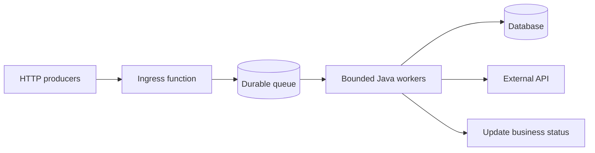
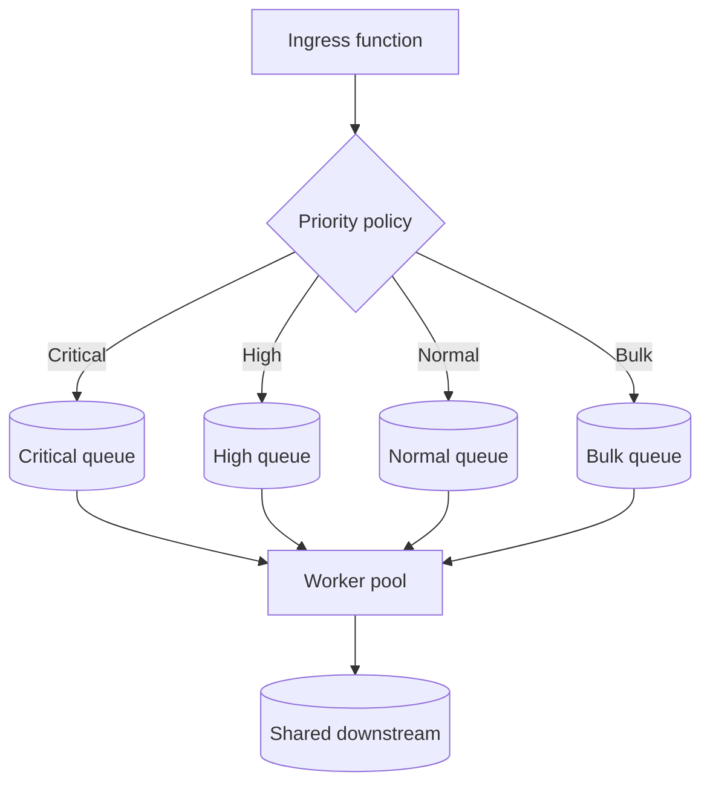

# Load leveling bằng hàng đợi và chính sách ưu tiên

Serverless có thể tự tạo thêm function instance khi tải tăng, nhưng autoscaling không làm cho database, payment API hoặc dịch vụ bên ngoài có năng lực vô hạn. Khi nhiều request đến cùng lúc, nếu function gọi thẳng dependency, một đợt traffic ngắn có thể tạo ra hàng nghìn kết nối, làm cạn connection pool hoặc vượt quota downstream. Hàng đợi giúp tách tốc độ tiếp nhận công việc khỏi tốc độ xử lý, hấp thụ burst và cho phép điều tiết worker theo capacity thực tế.

Load leveling là cách làm phẳng tải: producer tiếp nhận công việc nhanh, ghi message vào queue bền vững, còn consumer xử lý theo tốc độ đã kiểm soát. Chính sách ưu tiên quyết định công việc nào được xử lý trước khi capacity có hạn. Nếu chỉ thêm một queue mà không quản lý backlog, deadline, fairness và retry, hệ thống vẫn có thể bị nghẽn hoặc bỏ đói một nhóm công việc.

Trong phạm vi **CLOUD_SERVERLESS**, bài học tập trung vào phát triển và triển khai ứng dụng serverless, đặc biệt là Java function kích hoạt bởi HTTP, message hoặc event. Người học xử lý trigger, trạng thái, quyền truy cập, retry, idempotency, cold start, mở rộng và chi phí. Bài này trình bày cách dùng queue để điều tiết tải và áp dụng priority policy sao cho vừa đáp ứng SLA vừa bảo vệ dependency.

## 1. Load leveling giải quyết vấn đề gì?

Giả sử một API nhận 2.000 yêu cầu trong 10 giây, nhưng hệ thống downstream chỉ xử lý an toàn 80 công việc mỗi giây. Nếu HTTP function gọi database hoặc payment provider đồng bộ cho mọi request, burst có thể làm vượt connection limit và tăng timeout. Nếu function chỉ xác thực, lưu công việc vào queue rồi trả `202 Accepted`, worker có thể xử lý dần theo capacity.



Queue tạo một ranh giới bất đồng bộ giữa ingress và worker. Producer không cần chờ toàn bộ nghiệp vụ hoàn tất; worker có thể scale theo backlog nhưng vẫn bị giới hạn bởi concurrency, max instances và năng lực dependency.

Load leveling hữu ích khi:

- Traffic đến theo burst hoặc có đợt tăng tải theo lịch.
- Công việc có thể xử lý bất đồng bộ và người gọi chấp nhận chờ kết quả.
- Downstream có quota hoặc connection limit thấp hơn năng lực tiếp nhận request.
- Cần retry khi dependency lỗi tạm thời.
- Cần lưu công việc để xử lý sau khi function tạm thời không hoạt động.
- Có nhiều loại công việc với SLA khác nhau và cần chính sách ưu tiên.

Queue không phù hợp nếu mọi thao tác bắt buộc trả kết quả đồng bộ ngay lập tức hoặc nếu nghiệp vụ yêu cầu một transaction nguyên tử xuyên suốt HTTP request và dependency. Khi đó cần thiết kế lại hợp đồng API hoặc dùng mô hình xử lý đồng bộ có timeout, bulkhead và admission control.

## 2. Queue làm phẳng tải, không tạo thêm capacity

Queue giữ công việc trong khi consumer chưa xử lý. Nó không làm tăng tốc độ xử lý thực tế. Nếu tốc độ message đến liên tục cao hơn tốc độ xử lý, backlog sẽ tăng cho đến khi chạm retention, giới hạn dung lượng, deadline hoặc ngân sách.

Ký hiệu:

- `λ`: tốc độ message đến, tính bằng message/giây.
- `μ`: tốc độ xử lý của một worker, tính bằng message/giây.
- `c`: số worker hoặc invocation xử lý đồng thời.
- `C = c × μ`: capacity xử lý tổng ước lượng.
- `B`: số message đang chờ.

Để backlog không tăng vô hạn trong điều kiện ổn định, cần có:

\[
\lambda < c \times \mu
\]

Nếu `λ` lớn hơn capacity trong một khoảng thời gian, backlog tăng gần theo phần chênh lệch giữa tốc độ đến và tốc độ xử lý. Khi burst kết thúc, consumer cần capacity dư để drain backlog.

Ví dụ: 10 worker, mỗi worker xử lý trung bình 8 message/giây, tổng capacity lý thuyết là 80 message/giây. Nếu producer gửi 200 message/giây trong 30 giây, backlog tăng khoảng 3.600 message trong burst, chưa tính overhead, retry và biến động thời gian xử lý.

Đừng thiết kế ở mức sử dụng 100% capacity liên tục. Cần headroom cho request chậm, retry, cold start, deployment rollout và traffic không đều. Mức headroom phải được xác định bằng load test và SLO của hệ thống.

## 3. Dùng định luật Little để ước lượng độ trễ

Định luật Little mô tả mối liên hệ giữa số công việc trong hệ thống, tốc độ đến và thời gian trung bình:

\[
L = \lambda \times W
\]

Trong đó `L` là số công việc trung bình trong hệ thống, `λ` là throughput trung bình và `W` là thời gian trung bình trong hệ thống. Với riêng queue, có thể áp dụng cho số message đang chờ và thời gian chờ nếu các đại lượng được đo trên cùng một phạm vi.

Ví dụ, nếu hệ thống xử lý 50 message/giây và trung bình có 500 message đang chờ, thời gian chờ trung bình ước lượng là 10 giây. Đây là ước lượng trung bình; p95/p99 có thể lớn hơn nhiều khi thời gian xử lý phân tán hoặc có priority tier.

Để dự báo thời gian drain backlog khi traffic trở về mức bình thường:

\[
T_{drain} \approx \frac{B}{C - \lambda}
\]

Công thức chỉ áp dụng khi `C > λ`, capacity và arrival rate tương đối ổn định, chưa tính retry hoặc message bị poison. Nếu arrival rate bằng hoặc cao hơn capacity, backlog không tự giảm.

## 4. Thiết kế ingress function trả kết quả bất đồng bộ

Ingress function nên xác thực request, kiểm tra quyền, validate payload, tạo business ID/idempotency key, ghi message bền vững rồi trả mã phản hồi phù hợp. Không nên trả `202 Accepted` trước khi message đã được ghi thành công, nếu không client có thể nghĩ công việc đã được nhận trong khi queue chưa có message.

Một response điển hình:

```http
HTTP/1.1 202 Accepted
Content-Type: application/json
Location: /operations/op-7812

{
  "operationId": "op-7812",
  "status": "QUEUED",
  "statusUrl": "/operations/op-7812"
}
```

Client có thể poll status endpoint, nhận webhook khi hoàn tất hoặc dùng callback theo hợp đồng. API nên mô tả rõ `202` có nghĩa là đã nhận công việc, không phải đã hoàn tất nghiệp vụ.

Nếu queue publish thành công nhưng ghi status database thất bại (hoặc ngược lại), cần thiết kế nhất quán. Có thể dùng transactional outbox: ghi business record và outbox event trong cùng transaction, sau đó relay outbox vào queue. Consumer vẫn cần idempotency vì relay có thể publish lại sau timeout.

## 5. Thiết kế message envelope cho điều tiết tải

Message nên chứa đủ metadata để worker xử lý, theo dõi và quyết định có còn đáng xử lý hay không.

```json
{
  "messageId": "msg-90017",
  "eventId": "evt-55291",
  "eventType": "OrderSubmitted",
  "schemaVersion": 2,
  "priority": "HIGH",
  "tenantId": "tenant-42",
  "correlationId": "order-7812",
  "idempotencyKey": "order-submitted:order-7812",
  "createdAt": "2026-11-17T09:00:00Z",
  "deadlineAt": "2026-11-17T09:05:00Z",
  "data": {
    "orderId": "order-7812"
  }
}
```

Các field quan trọng:

- `messageId` hoặc `eventId`: nhận diện message/event để log, retry và deduplicate.
- `priority`: mức ưu tiên đã được hệ thống xác thực.
- `tenantId`: hỗ trợ quota và fairness giữa tenant.
- `correlationId`: nối các bước của business workflow.
- `idempotencyKey`: ngăn side effect bị thực hiện lặp.
- `createdAt` và `deadlineAt`: tính tuổi message và loại bỏ công việc hết hạn theo policy.
- `schemaVersion`: cho phép consumer xử lý nhiều phiên bản payload trong thời gian rollout.

Không tin giá trị priority do client gửi trực tiếp. Ingress cần kiểm tra quyền và áp dụng policy server-side; nếu không, client có thể tự gắn mọi công việc thành `CRITICAL` để chiếm capacity.

## 6. Chính sách ưu tiên là gì?

Priority policy xác định thứ tự hoặc phần capacity dành cho các loại công việc. Ví dụ:

| Mức | Ví dụ | Mục tiêu xử lý |
|---|---|---|
| Critical | Hủy giao dịch sai, sự kiện bảo mật khẩn cấp | Xử lý sớm nhất theo giới hạn an toàn |
| High | Đơn hàng cần xác nhận trước khi thanh toán hết hạn | Độ trễ thấp, có capacity dự phòng |
| Normal | Đơn hàng và cập nhật thông thường | SLA tiêu chuẩn |
| Low / Bulk | Báo cáo, đồng bộ lịch sử, tác vụ batch | Chạy khi còn capacity hoặc theo lịch |

Priority không nên chỉ là số nguyên tùy ý. Hãy định nghĩa số mức nhỏ, điều kiện được gán mức, SLA, quota và hành động khi không đáp ứng được. Mỗi mức cần có owner nghiệp vụ và quy tắc audit.

## 7. Không phải queue service nào cũng có priority native

Nhiều dịch vụ queue phổ biến không cung cấp một trường priority có nghĩa là message mức cao luôn được lấy trước message mức thấp. Cách triển khai thường là nhiều queue/topic riêng hoặc một scheduler đứng trước consumer.

| Dịch vụ | Cách biểu diễn priority thường dùng | Lưu ý |
|---|---|---|
| Amazon SQS | Nhiều queue như `critical`, `high`, `normal`, `bulk` | SQS không có native priority field để sắp xếp message giữa các mức; Standard không đảm bảo thứ tự tuyệt đối |
| Azure Service Bus | Nhiều queue hoặc subscription theo mức ưu tiên | Không có priority ordering chung cho mọi message trong một queue; Sessions phục vụ ordering theo session, không phải priority |
| Google Cloud Tasks | Nhiều queue với dispatch rate/concurrency riêng | Queue có thể điều tiết dispatch; không nên xem một queue là native priority scheduler |
| Google Cloud Pub/Sub | Nhiều topic/subscription hoặc consumer scheduler | Ordering key hỗ trợ thứ tự trong phạm vi key; không phải priority toàn cục |
| Event Hubs/Kafka-like stream | Topic/stream riêng hoặc scheduler phía consumer | Partition và offset quyết định thứ tự; không có priority queue toàn cục |
| RabbitMQ | Priority queue qua cấu hình broker như `x-max-priority` nếu được hỗ trợ | Cần cân nhắc fairness, head-of-line behavior và chi phí broker |

Khi dùng nhiều queue, worker phải có chính sách chọn queue. Khi dùng nhiều function trigger riêng, mỗi mapping có thể có concurrency cap riêng; cần tính tổng concurrency để không vượt downstream budget.

## 8. Kiến trúc nhiều queue theo priority tier

Một thiết kế dễ vận hành là phân loại message tại ingress và gửi vào queue tương ứng:



Có hai cách tiêu thụ:

1. **Worker pool riêng:** mỗi queue có function/worker riêng và concurrency cap riêng. Cách này dễ tách SLA và capacity nhưng có thể tạo idle capacity hoặc khó chia sẻ tài nguyên.
2. **Worker pool chung:** một dispatcher lấy message từ nhiều queue theo lịch ưu tiên. Cách này tận dụng worker tốt hơn nhưng scheduler cần xử lý fairness, polling và backpressure.

Có thể kết hợp: dành một phần worker cho Critical/High và phần còn lại dùng chung cho Normal/Bulk. Đây là cách bảo vệ tác vụ khẩn cấp mà vẫn giữ capacity cho công việc thường.

## 9. Strict priority có thể gây starvation

Strict priority luôn lấy message mức cao trước cho đến khi queue đó rỗng. Nếu High liên tục có message mới, Normal và Bulk có thể không bao giờ được xử lý. Đây gọi là starvation.

Ví dụ:

```text
High:    H1 H2 H3 H4 H5 H6 H7 ... (liên tục có message mới)
Normal:  N1 N2 N3
Bulk:    B1 B2

Strict priority: H1 H2 H3 H4 H5 H6 ...
                 N1 và B1 có thể chờ vô hạn
```

Strict priority chỉ phù hợp khi công việc thấp có thể bị trì hoãn vô thời hạn hoặc khi high traffic có giới hạn cứng. Trong phần lớn hệ thống, cần kết hợp priority với fairness, aging hoặc quota để bảo đảm công việc bình thường vẫn được xử lý.

## 10. Weighted fair scheduling

Weighted scheduling phân bổ lượt xử lý theo trọng số. Ví dụ một chu kỳ gồm 5 message High, 3 Normal và 1 Bulk:

```text
High, High, High, High, High,
Normal, Normal, Normal,
Bulk
```

Nếu queue nào rỗng, scheduler bỏ lượt đó và chuyển sang queue khác. Trọng số là chính sách capacity, không phải cam kết SLA tuyệt đối; cần đo latency và điều chỉnh dựa trên workload.

Ví dụ Java minh họa bộ lập lịch đơn giản:

```java
enum Priority {
    HIGH, NORMAL, BULK
}

interface MessageSource {
    Optional<Message> poll(Priority priority);
}

final class WeightedPriorityPoller {
    private static final List<Priority> CYCLE = List.of(
            Priority.HIGH, Priority.HIGH, Priority.HIGH,
            Priority.HIGH, Priority.HIGH,
            Priority.NORMAL, Priority.NORMAL, Priority.NORMAL,
            Priority.BULK);

    private final MessageSource source;
    private int cursor;

    WeightedPriorityPoller(MessageSource source) {
        this.source = source;
    }

    Optional<Message> next() {
        for (int attempt = 0; attempt < CYCLE.size(); attempt++) {
            Priority priority = CYCLE.get(cursor);
            cursor = (cursor + 1) % CYCLE.size();

            Optional<Message> message = source.poll(priority);
            if (message.isPresent()) {
                return message;
            }
        }
        return Optional.empty();
    }
}
```

Đây là ví dụ thuật toán trong một dispatcher đơn tiến trình. Khi chạy nhiều function instance song song, mỗi instance có cursor riêng nên tỷ lệ toàn hệ thống không còn chính xác. Nếu cần quota toàn cục, scheduler phải có trạng thái dùng chung hoặc phân bổ capacity theo queue ở tầng platform. Polling nhiều queue cũng cần giới hạn request rate, timeout và chi phí API.

## 11. Priority aging để tránh bỏ đói

Aging tăng effective priority khi message chờ lâu. Một message Bulk có thể được nâng lên Normal sau 10 phút và High sau 30 phút, tùy policy.

Ví dụ quy tắc:

| Priority ban đầu | Thời gian chờ | Effective priority |
|---|---:|---|
| Bulk | Dưới 10 phút | Bulk |
| Bulk | Từ 10 phút | Normal |
| Bulk | Từ 30 phút | High |
| Normal | Từ 20 phút | High |

Không nhất thiết phải sửa field priority trong message. Scheduler có thể tính effective priority từ `createdAt` và tuổi message. Nếu dùng queue riêng, có thể chạy job promotion hoặc tạo lại message ở queue cao hơn, nhưng thao tác này cần idempotency để tránh một message tồn tại đồng thời ở hai queue.

Aging cần giới hạn mức tối đa để một công việc cũ không tự động chiếm toàn bộ capacity. Với công việc đã hết deadline, policy có thể chuyển sang expired/cancelled thay vì tiếp tục nâng priority.

## 12. Fairness giữa tenant và nhóm khách hàng

Priority không phải chính sách fairness. Nếu một tenant lớn gửi nhiều message High, tenant nhỏ có thể bị chậm dù tất cả cùng mức ưu tiên.

Các cơ chế có thể dùng:

- Queue riêng hoặc partition riêng theo tenant lớn.
- Per-tenant token bucket hoặc rate limit.
- Weighted fair share giữa tenant.
- Maximum in-flight message theo tenant.
- Quota theo loại nghiệp vụ hoặc subscription tier.
- Admission control khi tenant vượt hạn mức.

Không nên tạo queue riêng cho mọi tenant nếu số lượng tenant lớn và khó quản lý. Có thể dùng shared queue kèm scheduler theo tenant key, hoặc chỉ tách tenant lớn/nhạy cảm ra queue riêng.

## 13. Deadline và thời hạn hữu ích của message

Không phải message nào cũng còn giá trị khi được xử lý muộn. Ví dụ OTP, báo giá tức thời hoặc giữ chỗ có thể hết hạn sau vài phút. Báo cáo lịch sử có thể chờ lâu hơn.

Worker nên kiểm tra `deadlineAt` trước khi thực hiện side effect:

```java
public ProcessingResult process(MessageEnvelope message, Clock clock) {
    if (message.deadlineAt() != null
            && clock.instant().isAfter(message.deadlineAt())) {
        return ProcessingResult.expired(message.messageId());
    }

    return orderService.process(message.data());
}
```

Nếu message hết hạn, cần ghi nhận trạng thái `EXPIRED` hoặc `CANCELLED`, không âm thầm bỏ qua. Một số nghiệp vụ cần compensation hoặc thông báo cho caller. Clock nên được inject để test thời gian ổn định.

Deadline không giống queue retention. Retention quy định message được lưu bao lâu; deadline là thời điểm nghiệp vụ không còn muốn thực hiện công việc. Message có thể còn trong retention nhưng đã hết hạn.

## 14. Admission control ở producer

Queue có thể hấp thụ burst, nhưng không nên chấp nhận công việc vô hạn. Ingress cần kiểm tra:

- Queue backlog hoặc oldest message age có đang vượt ngưỡng không.
- Tenant có vượt quota không.
- Công việc có deadline đủ xa để còn khả năng hoàn tất không.
- Downstream đang degraded hay có circuit breaker mở không.
- Loại công việc có thể bị giảm chất lượng, trì hoãn hoặc từ chối không.

Khi hệ thống quá tải, có thể trả `429 Too Many Requests` hoặc `503 Service Unavailable` kèm `Retry-After` nếu caller có thể retry. Với request đã ghi vào queue, trả `202` và operation ID. Không trả `202` rồi sau đó âm thầm loại bỏ message vì queue đầy hoặc deadline không còn khả thi.

Admission control nên ưu tiên từ chối công việc ít quan trọng hoặc có thể trì hoãn trước khi ảnh hưởng đến giao dịch quan trọng. Mọi quyết định từ chối cần có metric và reason code để dashboard phản ánh tác động nghiệp vụ.

## 15. Backpressure và giới hạn worker concurrency

Worker concurrency phải dựa trên capacity của dependency, không chỉ dựa vào khả năng scale của nền tảng.

Ví dụ database có thể chấp nhận tối đa 300 connection cho workload này. Nếu mỗi Java function instance có pool tối đa 10 connection và nền tảng scale đến 50 instance, tổng connection có thể đạt 500, vượt budget. Có thể cần:

- Giảm pool size hoặc max instances.
- Đặt concurrency thấp hơn nếu mỗi invocation chiếm connection lâu.
- Dùng database proxy/pooling phù hợp.
- Chia queue theo workload để giới hạn worker.
- Dùng semaphore/distributed rate limiter nếu cần quota toàn cục.
- Tăng capacity database chỉ sau khi đánh giá chi phí và giới hạn thực tế.

Backpressure là tín hiệu yêu cầu producer/consumer giảm tốc khi downstream không theo kịp. Với queue, backlog là bộ đệm; với HTTP, backpressure có thể là 429/503; với stream, có thể là flow control hoặc giảm số record được fetch.

## 16. Batch size và tốc độ xử lý

Batch giúp giảm overhead invocation và API call, nhưng batch lớn làm tăng memory, thời gian xử lý và phạm vi retry. Nếu một batch gồm 100 message và một record lỗi, hành vi retry phụ thuộc dịch vụ và cấu hình partial batch response.

Khi chọn batch size, cân nhắc:

- Thời gian xử lý mỗi record và timeout tổng invocation.
- Memory cần cho payload và kết quả trung gian.
- Khả năng xử lý partial failure.
- Độ trễ tối đa mà từng priority tier chấp nhận.
- Kích thước message và giới hạn payload của dịch vụ.
- Idempotency khi batch bị gửi lại.

Batch lớn thường hiệu quả cho bulk processing, nhưng có thể không phù hợp với Critical/High nếu cần latency thấp. Có thể dùng batch size nhỏ hơn cho queue ưu tiên cao và batch lớn hơn cho queue bulk.

## 17. Retry, visibility timeout, lock và dead-letter queue

Retry xử lý lỗi tạm thời, nhưng retry quá nhanh hoặc vô hạn có thể tạo retry storm và làm backlog tăng. Cần có exponential backoff, jitter, giới hạn số lần giao và DLQ/quarantine.

Các khái niệm khác nhau theo dịch vụ:

- **Visibility timeout** (ví dụ SQS): message đang được consumer xử lý tạm thời không hiển thị cho consumer khác. Nếu timeout quá ngắn, message có thể được giao lại khi xử lý vẫn chưa xong.
- **Lock duration** (ví dụ Service Bus): consumer giữ lock trong thời gian xử lý; có thể cần renew lock cho tác vụ dài.
- **Ack deadline** (ví dụ Pub/Sub): thời gian consumer có để acknowledge; client có thể gia hạn theo cấu hình.
- **Checkpoint/offset** (ví dụ Event Hubs/Kafka): vị trí đã xử lý trong stream, không tương đương message ack của queue.
- **DLQ:** nơi cách ly message đã vượt retry/delivery policy để điều tra hoặc redrive có kiểm soát.

Không áp dụng một giá trị timeout chung cho mọi provider. Hãy cấu hình theo thời gian xử lý p99, batch window, khả năng gia hạn lock và hướng dẫn riêng của dịch vụ. Worker phải idempotent vì duplicate delivery vẫn có thể xảy ra.

## 18. Triển khai priority với AWS SQS và Lambda

SQS không có native priority ordering giữa các message. Mẫu phổ biến là tạo nhiều queue, ví dụ `orders-critical`, `orders-normal` và `orders-bulk`, rồi gắn từng queue với event source mapping riêng.

Lambda event source mapping có thể giới hạn maximum concurrency cho từng mapping. Function cũng có reserved concurrency để bảo vệ tổng concurrency và các dependency. Khi dùng nhiều mapping trỏ cùng function, cần tính tổng giới hạn và đảm bảo reserved concurrency đủ cho tổng tải dự kiến.

Ví dụ cấu hình khái niệm bằng AWS CLI:

```bash
aws lambda create-event-source-mapping \
  --function-name orders-worker \
  --event-source-arn arn:aws:sqs:REGION:ACCOUNT:orders-critical \
  --batch-size 5 \
  --scaling-config MaximumConcurrency=20
```

Đây là ví dụ cho queue Standard; với FIFO queue, giới hạn batch và concurrency cần xét message group. ARN và tên queue là placeholder. Cần kiểm tra API/region hỗ trợ scaling config cho event source mapping đang dùng.

Đặt giới hạn riêng, ví dụ Critical tối đa 20 concurrent batches, Normal tối đa 10 và Bulk tối đa 2. Những giá trị này chỉ là ví dụ; tổng concurrency phải phù hợp với reserved concurrency, account quota và downstream budget.

Khi xử lý SQS event, Lambda chỉ coi batch thành công theo cơ chế event source mapping. Nếu dùng partial batch response, function cần trả đúng `batchItemFailures` để chỉ retry record thất bại; nếu không, cả batch có thể bị giao lại tùy cấu hình.

## 19. Triển khai priority với Google Cloud Tasks và Pub/Sub

Cloud Tasks phù hợp khi cần dispatch HTTP task có rate limit và concurrent dispatch limit theo queue. Có thể tạo nhiều queue với cấu hình khác nhau cho `critical`, `normal` và `bulk`, sau đó trỏ đến cùng hoặc khác HTTP worker endpoint.

Pub/Sub phù hợp với event/messaging fan-out và subscription độc lập. Nếu cần priority, có thể tách topic/subscription theo mức hoặc dùng scheduler ở consumer. Ordering key giữ thứ tự theo key trong phạm vi dịch vụ hỗ trợ; nó không biến subscription thành priority queue toàn cục.

Với Cloud Run/Cloud Run functions nhận task HTTP, cần xác minh authentication giữa Cloud Tasks và endpoint, giới hạn concurrency/instances, retry policy và deadline. Cloud Tasks queue rate limit là một phần backpressure; max instances ở Cloud Run vẫn cần giới hạn theo capacity downstream.

## 20. Triển khai priority với Azure Service Bus

Azure Service Bus queue/topic subscription cung cấp message lock, delivery count, dead-lettering và sessions tùy tier/configuration. Không nên giả định message có thuộc tính priority sẽ tự động được broker lấy trước.

Một mẫu triển khai là nhiều queue hoặc subscription theo mức ưu tiên, sau đó cấu hình processor concurrency riêng. Với Java SDK/processor, các tham số như `maxConcurrentCalls`, prefetch và lock renewal ảnh hưởng throughput và tải lên dependency.

Sessions giúp xử lý message theo nhóm có thứ tự, nhưng session ordering có thể làm một session chậm ảnh hưởng các message sau trong cùng session. Không dùng session như cơ chế priority. Nếu cần priority và ordering đồng thời, hãy xác định key partition/session, queue tier và scheduler rõ ràng.

## 21. Event Hubs và stream không phải priority queue

Event Hubs/Kafka-like stream được tổ chức theo partition và offset. Consumer đọc event theo thứ tự trong partition; tăng priority cho một event giữa stream có thể phá vỡ ordering và semantics replay.

Nếu nghiệp vụ cần ưu tiên, có thể:

- Tách workload có SLA khác nhau thành event hub/topic/stream riêng.
- Dùng một routing service trước khi ghi vào stream.
- Xử lý event khẩn cấp qua một queue riêng và giữ stream cho event analytics/bulk.
- Dùng scheduler phía consumer nếu có thể chấp nhận thay đổi thứ tự.

Tách stream có thể làm tăng chi phí và độ phức tạp của consumer group/checkpoint. Hãy giữ event có thứ tự nghiệp vụ bắt buộc trong cùng partition key và không để priority policy làm đảo thứ tự của cùng một aggregate.

## 22. Kiểm soát retry và ưu tiên khi có sự cố downstream

Khi payment provider hoặc database lỗi, queue có thể nhanh chóng tích tụ retry. Nếu retry của High chiếm toàn bộ worker, Normal/Bulk có thể bị đói. Ngược lại, nếu tất cả queue retry cùng lúc khi dependency hồi phục, hệ thống có thể tạo một burst thứ hai.

Các biện pháp:

- Exponential backoff và jitter.
- Giới hạn số lần delivery/retry.
- Circuit breaker hoặc pause consumer khi dependency outage kéo dài.
- Retry queue riêng hoặc delay queue cho lỗi tạm thời.
- DLQ cho message không thể xử lý sau policy.
- Redrive theo batch nhỏ và rate limit.
- Giữ priority ban đầu nhưng giới hạn số retry đồng thời.
- Phân biệt lỗi dữ liệu vĩnh viễn với lỗi hạ tầng tạm thời.

Không tự động nâng mọi message retry lên Critical. Điều đó sẽ biến lỗi dependency thành cơ chế chiếm hết capacity của hệ thống.

## 23. Idempotency khi worker scale-out và replay

Nhiều worker có thể nhận cùng một message do visibility timeout, lock expiry, retry hoặc consumer restart. Idempotency cần được lưu ở hệ thống bền vững.

Một mẫu xử lý:

```java
public final class OrderMessageHandler {
    private final IdempotencyRepository idempotency;
    private final OrderService orders;

    public ProcessingResult handle(OrderMessage message) {
        return idempotency.executeOnce(
                message.idempotencyKey(),
                () -> orders.process(message.orderId()));
    }
}
```

`executeOnce` cần được triển khai bằng conditional insert/unique constraint hoặc transaction trong shared store. Không dùng `synchronized`, `static Set` hay memory của một function instance làm khóa idempotency toàn hệ thống.

Nếu side effect nằm ở API ngoài, truyền idempotency key đến provider nếu họ hỗ trợ. Nếu không, dùng outbox, reconciliation hoặc saga compensation để xử lý trường hợp timeout sau khi provider đã thực hiện nhưng worker chưa nhận được response.

## 24. Theo dõi backlog và đặt ngưỡng vận hành

Queue depth là chỉ số hữu ích nhưng chưa đủ. Cần theo dõi:

- Visible message count/backlog theo từng priority.
- Age of oldest message và p95 queue wait time.
- Arrival rate và completion rate.
- Retry count, in-flight/locked count và DLQ rate.
- Worker concurrency, throttling và invocation duration.
- Downstream latency, error rate và connection pool wait.
- Ước lượng thời gian drain backlog.

Ngưỡng cảnh báo nên dựa trên SLA. Ví dụ, nếu High cần bắt đầu xử lý trong 30 giây, alert khi oldest message age của High vượt 20 giây. Với Bulk có thể chấp nhận vài giờ, nhưng cần cảnh báo trước khi retention hoặc deadline bị chạm.

Không dùng cùng một ngưỡng backlog tuyệt đối cho mọi queue. Queue Bulk có thể chứa hàng triệu message nhưng vẫn bình thường nếu drain rate đủ cao; queue Critical chỉ có 20 message cũng có thể là sự cố nếu oldest age vượt SLA.

## 25. Dashboard và alert cho load leveling

Một dashboard điều tiết tải nên có panel theo từng tier:

| Panel | Metric | Câu hỏi |
|---|---|---|
| Arrival vs completion | Messages/sec in và out | Consumer có theo kịp producer? |
| Backlog by priority | Visible message count | Tier nào đang tích tụ? |
| Oldest age by priority | Seconds | Có SLA nào sắp bị vi phạm? |
| Worker capacity | Active concurrency, max concurrency | Có chạm trần scale không? |
| Retry/DLQ | Retry rate, delivery count, DLQ arrivals | Có poison message hoặc retry storm? |
| Fairness | Completed count/latency theo tenant/tier | Một nhóm có bị bỏ đói? |
| Dependency | DB/API latency, throttling, connection count | Downstream có đang giới hạn worker? |
| Cost | Cost per completed message/operation | Điều tiết tải có làm chi phí tăng bất thường? |

Alert nên bao gồm oldest age, backlog growth rate, DLQ arrivals, downstream saturation và starvation indicator. Khi cảnh báo, runbook cần chỉ rõ có thể giảm producer admission, pause queue tier, giảm concurrency hay tăng capacity an toàn.

## 26. Chi phí và giới hạn của queue-based load leveling

Queue giúp giảm burst lên downstream nhưng phát sinh chi phí request, storage, message retention, polling, logging và retry. Nhiều queue riêng làm tăng số cấu hình, alarm, permission và quy trình vận hành.

Các yếu tố cần tính:

- Message count và kích thước payload.
- Số lần receive/delete/ack và polling.
- Retention duration và backlog peak.
- Retry/redrive và DLQ storage.
- Số worker instance, duration và memory/CPU.
- Chi phí database/API khi worker xử lý.
- Chi phí telemetry và lưu trữ audit.

Không giữ payload lớn trong queue nếu có thể lưu object ở storage và chỉ truyền reference có kiểm soát. Tuy nhiên, reference phải trỏ đến object bất biến hoặc version cụ thể để worker không đọc nhầm nội dung đã bị thay đổi.

Queue cũng có giới hạn retention, payload size, throughput và quota theo dịch vụ/region. Thiết kế phải có hành vi khi queue đầy, service quota bị chạm hoặc broker không sẵn sàng; không giả định queue là bộ đệm vô hạn.

## 27. Các lỗi thiết kế thường gặp

| Lỗi | Hậu quả | Cách xử lý |
|---|---|---|
| Scale worker không giới hạn | Database/API bị quá tải | Giới hạn concurrency và max instances theo downstream budget |
| Chỉ có một queue cho mọi loại công việc | Tác vụ khẩn cấp chờ sau bulk backlog | Tách priority tier hoặc dùng scheduler |
| Strict priority không aging | Normal/Bulk bị starvation | Weighted fair scheduling, aging hoặc quota |
| Client tự đặt priority | Abuse làm cạn capacity High | Xác thực và gán priority ở server-side |
| Không có deadline | Xử lý công việc đã mất giá trị | Kiểm tra deadline và trạng thái expired |
| Retry vô hạn | Backlog và chi phí tăng | Retry cap, backoff, DLQ và redrive có kiểm soát |
| Không idempotent | Duplicate side effect khi replay | Durable idempotency key và conditional write |
| Batch quá lớn | Latency cao và retry phạm vi lớn | Chọn batch theo timeout, payload và partial failure |
| Không theo dõi oldest age | Queue có backlog nhưng vi phạm SLA không được phát hiện | Alert theo tuổi message và priority |
| Queue được coi là vô hạn | Chạm retention/quota hoặc tăng chi phí | Capacity plan, admission control và expiry policy |

## 28. Quy trình thiết kế load leveling

1. **Xác định công việc có thể bất đồng bộ:** xác định request nào có thể trả `202` và cách client nhận trạng thái.
2. **Đo traffic và service time:** lấy arrival rate, burst duration, thời gian xử lý p50/p95/p99 và downstream capacity.
3. **Chọn queue/broker:** dựa trên delivery semantics, ordering, retention, payload, retry và quota.
4. **Định nghĩa priority tier:** nêu rõ tiêu chí, SLA, quota và owner.
5. **Chọn scheduler:** strict priority, weighted, aging, per-tenant fairness hoặc kết hợp.
6. **Đặt giới hạn worker:** concurrency, max instances, batch size và connection pool.
7. **Thiết kế retry/idempotency:** backoff, retry cap, DLQ, deduplication và compensation.
8. **Thiết kế admission/deadline:** từ chối hoặc hết hạn công việc khi không còn khả năng hoàn tất đúng SLA.
9. **Tạo dashboard/alert:** backlog, oldest age, arrival/completion, retry, DLQ, fairness và downstream health.
10. **Load test và diễn tập:** mô phỏng burst, dependency outage, poison message, queue recovery và priority starvation.

## 29. Checklist production

| Câu hỏi | Bằng chứng cần có |
|---|---|
| Producer có tách khỏi worker? | Queue bền vững và API contract bất đồng bộ |
| `202 Accepted` chỉ trả sau khi nhận công việc? | Publish/outbox đã được xác nhận |
| Capacity có lớn hơn arrival rate dài hạn? | Load test và headroom được đo |
| Queue backlog có giới hạn vận hành? | Retention, quota, age threshold và admission control |
| Priority được gán đáng tin cậy? | Server-side policy, authorization và audit |
| Có bảo vệ Normal/Bulk khỏi starvation? | Weighted scheduling, aging hoặc reserved capacity |
| Tenant có fairness/quota? | Per-tenant rate/in-flight limits |
| Worker concurrency bảo vệ downstream? | Connection budget, API quota và max instances |
| Batch size phù hợp? | Timeout, memory, partial failure và latency test |
| Retry có giới hạn? | Backoff, jitter, delivery cap và DLQ |
| Consumer idempotent? | Durable idempotency key và duplicate test |
| Deadline được xử lý? | Expired state và policy cho công việc hết hạn |
| Có dashboard theo từng tier? | Backlog, oldest age, throughput, retry và DLQ |
| Có diễn tập burst/outage? | Báo cáo load test và recovery runbook |
| Chi phí được kiểm soát? | Cost per completed operation, retention và worker budget |

Load leveling giúp serverless tiếp nhận burst mà không buộc dependency phải xử lý cùng tốc độ với producer. Queue tạo vùng đệm bền vững; concurrency, dispatch rate và batch size điều khiển tốc độ worker; priority policy phân bổ capacity theo giá trị nghiệp vụ. Một thiết kế production cần kết hợp fairness, aging, deadline, admission control, retry có giới hạn và idempotency. Khi dashboard theo dõi backlog cùng tuổi message và kết quả cuối, đội vận hành có thể biết không chỉ queue đang dài bao nhiêu mà còn công việc nào có nguy cơ vi phạm SLA và cần điều chỉnh ở đâu.
